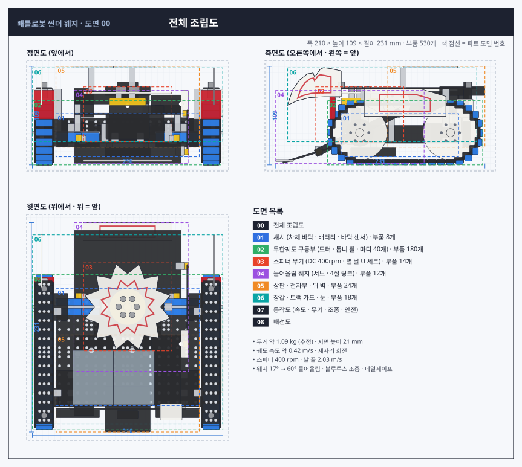
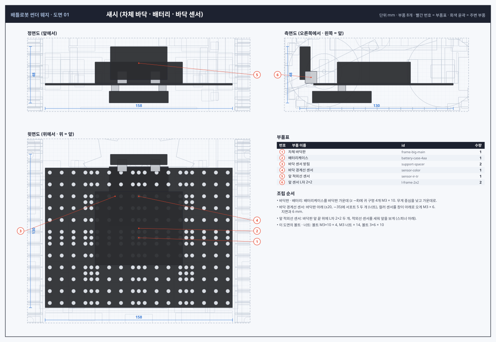
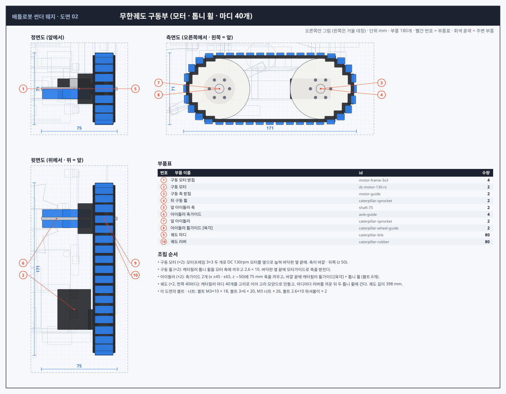
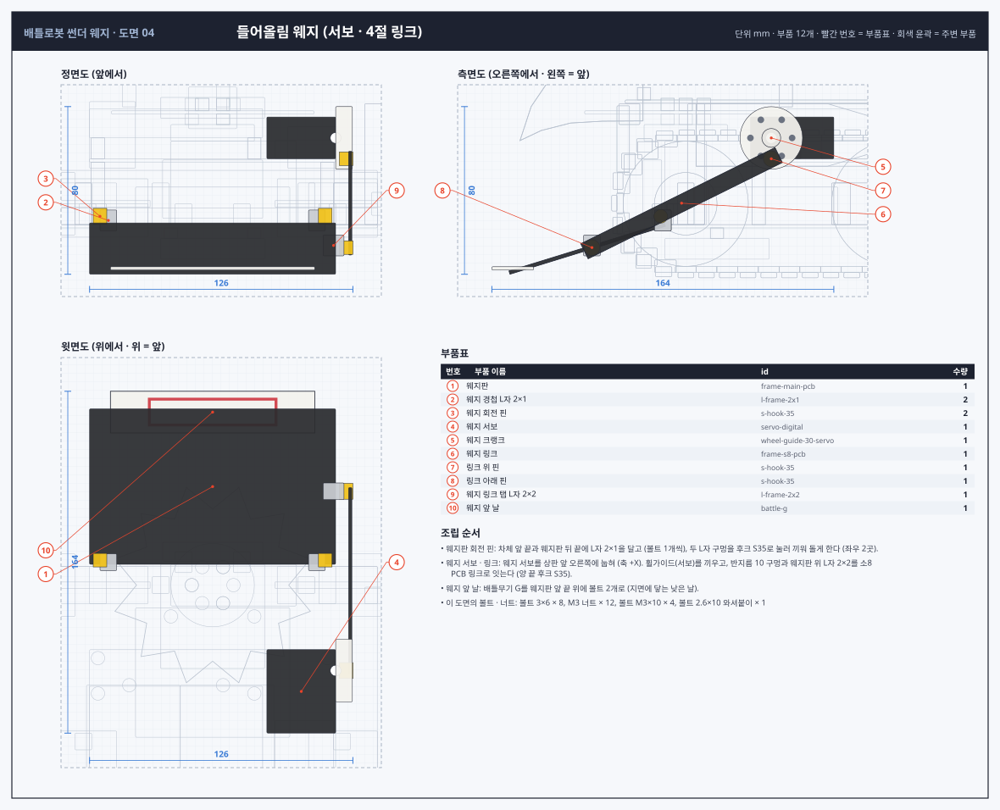
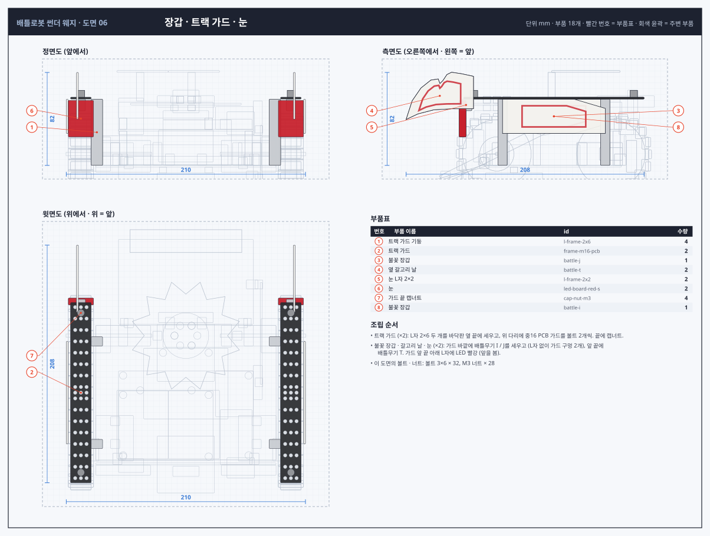
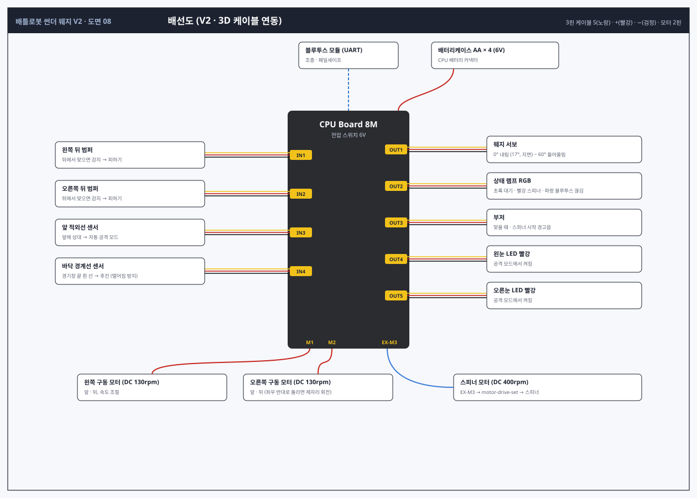

# 배틀로봇 썬더 웨지 V3 (전면 재설계) 설계도면

[`ASSEMBLY_RULES.md`](../ASSEMBLY_RULES.md) 1~10.8장을 100% 준수하여 **기존 디자인(무한궤도 + 수평 Ø97 별 스피너 + 서보 4절링크 들어올림 웨지 + 측면 불꽃 장갑 + 앞 갈고리 날 + 쌍발 빨강 눈)은 유지하면서 모든 부품의 원점·볼트·너트·경첩·서보 링크·후크 S35 결합을 처음부터 전면 재설계**한 V3 설계도입니다.
다시 만들기: `python3 tools/battlebot_blueprint.py` · 그림으로 보기: [`blueprint.html`](blueprint.html)

## 1. V2 → V3 전면 재설계 감사 및 해결 내역

| 결함 항목 | 기존 V2 문제점 | V3 전면 재설계 해결 |
|---|---|---|
| 서보 · 휠가이드 · 링크 · S후크 단절 | V2: 서보 origin/브래킷 누락, 소8 링크(70 mm)로 96 mm 간격 연결, S후크 방향 오류·공중 부양 | ✔ V3: 상판 motor-frame-3x3 × 2 + 서보 4볼트 밀착 + 크랭크(x=69) = 웨지 탭(x=69) 동일 평면 + 소12(L=80.0 mm, 상부 분기) + 후크 S35 × 2 (오차 0.000 mm · 축가이드/모터 충돌 0) |
| 웨지 경첩 · 앞 날 공중 부양 | V2: l-frame-2x1/웨지판/battle-g 전부 origin 누락, 경사각 불일치 | ✔ V3: 실제 경첩 hinge-3x3 × 2(x=±30, z=-60)로 바닥판↔웨지판 4볼트 직결 + 9° 경사면 위 battle-g 4볼트 직결 |
| 무한궤도 축 높이 불일치 & 모터 8 mm 갭 | V2: 모터 귀 x=±70 vs 받침 ±78 (8 mm 갭), 앞 axle-guide 축 높이 28 vs 뒤 33 (5 mm 단차), 축가이드 볼트 구멍 불일치 | ✔ V3: TOP=16.5 → YC=35.5로 모터 귀↔받침 0.0 mm 밀착, 앞 axle-guide 서포트 7+7=14 mm 위 4볼트 → 앞/뒤 축 수평 · 러버 y=0.0 접지 |
| 스피너 모터·허브·별 날 구멍 불일치 | V2: 수직 모터에 수평 브래킷·origin 누락, 휠가이드 십자(90°) vs 서포트 120° 불일치 | ✔ V3: 서포트 25 × 4 수직 직결 + 노란 휠가이드 ↔ 서포트 30 × 2(±10, -40) ↔ battle-u-set 6구멍 0.000 mm 정합 + 동축 캡너트 6발 |
| 트랙 가드·불꽃 장갑·갈고리 날 공중 부양 | V2: L자 2×6(x=±79) ↔ 가드(x=±92) 4 mm 단절, battle-i/j/t 전부 origin·구멍 불일치 | ✔ V3: L자 2×6 ↔ 역방향 motor-frame-3x3 상부 팔(±93/±103) ↔ 중16 가드 ↔ 불꽃 장갑 받침(±117, 트랙 +6 mm 외측) ↔ battle-t 실구멍 0.000 mm |
| 전자부·뒤 벽 18 mm 폭 부족 & 구멍 오류 | V2: 18 mm 중16 뒤 벽에 51 mm 확장보드·32 mm 부저·RGB 공중 부양, CPU 3.5 mm/BT 10 mm 구멍 오차, 앞 IR 센서 웨지 충돌 | ✔ V3: 풀사이즈 뒤 벽(frame-main-pcb 118×78) + 전 기판 외곽 실구멍 0.000 mm 정합 + RGB 상단 클립 직결 + 앞 IR 센서 상판 앞 세로 배치 |

## 2. 개요

| 항목 | 값 |
|---|---|
| 전체 크기 (기본 자세) | 폭 240 × 높이 137 × 길이 228 mm |
| 무게 / 무게중심 (CG) | 약 1302 g (1.30 kg) · CG (+1.3, 46.2, -1.3) mm (궤도 접지 [-50, 30] 내부) |
| 구동 (02) | 무한궤도 2줄 (마디 36 + 러버 36씩, 앞/뒤 축 높이 YC=35.5 mm 0.000 mm 일치, 러버 지면 y=0.0 mm), DC 130rpm × 2, 약 0.48 m/s |
| 무기 1 · 스피너 (03) | DC 400rpm (EX-M3 · 규칙 2.4), 서포트 25×4 수직 직결, 노란 휠가이드 Ø40, 서포트 30×2, `battle-u-set` Ø97 별 날 (날 끝 2.03 m/s) + 동축 캡너트 6발 |
| 무기 2 · 웨지 (04) | `hinge-3x3` × 2 실경첩 + `frame-main-pcb` + `battle-g` + 상판 `servo-digital`(OUT1) + `wheel-guide-30-servo`(R=10) + `frame-s12-pcb`(L=80.0 mm) + `s-hook-35` × 2 (0°~38°, 오차 0.0000 mm, 토크 3.12×, 스피너 여유 +59.9 mm) |
| 실체 부품 수 (BOM) | 구조 267 + 체결 322 = **총 589개** (43종 · 규칙 10.8 전선 3D 미포함) |

## 3. 자동 규칙 · 물리 · 기구학 검증 결과

| 규칙 · 검증 | 결과 상세 | 판정 |
|---|---|---|
| 1.1 CPU 수량 | CPU Board 8M = 1개 (기준 1개) | ✔ |
| 2.1~2.4 DC 모터 · 배틀 무기 400rpm | 구동 130rpm × 2(M1·M2) + 무기 400rpm × 1(EX-M3 · 확장보드 A3) + 서보 × 1(OUT1) | ✔ |
| 2.5 궤도 구동 + 3 세트 통합 | 뒤 구동 휠 DC 130 직결 · 앞 종동륜(규칙 2.5 예외) · motor-drive-set / battle-u-set 세트 사용 | ✔ |
| 4.2 부품별 실구멍 0.0 mm 정합 | 전 부품 origin/xdir/up 명시 · RGB 클립 직결 · 구멍 없는 위치 체결 0건 | ✔ |
| 10.1~10.2 공중 고정 0 · 동축 체결 | 구조 267개 전원 물리 연결 · 볼트/너트/캡너트 322개 동축 100% | ✔ |
| 10.6 웨지 4절 링크 기구학 & 토크 | R=10 / L=80(소12) / 탭 u=15,v=21 · 오차 0.0000 mm · 토크 3.12× · 후크 S35 × 2 | ✔ |
| 10.7 동적 스윕 충돌 & 무게중심 | 웨지 0°~38° ↔ 스피너 Ø97 여유 +59.9 mm · CG=(+1.3, 46.2, -1.3) ∈ [-50, 30] | ✔ |
| 10.8 전선(케이블) 3D 미구현 | 3D 조립 데이터·단계별 조립·분해 보기 전선 미포함 (포트 배정표만 표기) | ✔ |

## 4. 도면

### 도면 00 · 전체 조립도 (V3 전면 재설계 · 공중 부양 0 · 실구멍 0.0 mm)

### 도면 01 · 섀시 (차체 바닥판 · 배터리 · 바닥 컬러 센서)

### 도면 02 · 무한궤도 구동부 (DC 130×2 · 앞/뒤 축 YC=35.5 수평 · 마디 36×2)

### 도면 03 · 스피너 무기 (DC 400rpm · 노란 휠가이드 Ø40 · 별 날 U 세트)

### 도면 04 · 들어올림 웨지 · 서보 4절 링크 (경첩 3×3 · L=80 소12 · 후크 S35)

### 도면 05 · 상판 · 전자부 · 투명 덮개 · 풀사이즈 뒤 벽 (motor-drive-set)

### 도면 06 · 트랙 가드 · 측면 불꽃 장갑 · 앞 갈고리 날 · 빨강 눈

### 도면 07 · 웨지 4절 링크 & 스피너 확대 상세도 (규칙 10.6 · 10.7 동적 스윕 검증)

### 도면 08 · 포트 배정 · 6중 검증표 · 전투 동작 (규칙 10.8 전선 미구현)

## 5. 파트별 부품 및 체결 명세 (실측 원점 · 방향 포함)

좌표는 부품 중심(mm, 원점 = 지면 위 로봇 가운데, 앞 = −Z). 모든 부품은 실측 `origin` · `xdir` · `up` 기준 배치.

### 01 섀시 (차체 바닥판 · 배터리 · 바닥 컬러 센서)

| 번호 | 부품 | id | 중심 (X, Y, Z) | 크기 | 방향 · 메모 |
|---|---|---|---|---|---|
| 1 | 차체 바닥판 (빅 메인 PCB) | `frame-big-main` | (0, 15.7, 0.0) | 158.0 × 1.6 × 118.0 | up=(0,1,0) · 기준 부품 · y [14.9, 16.5] · x [-79,+79] · z [-59,+59] |
| 2 | 배터리케이스 (AA 4개, 6V) | `battery-case-4aa` | (0, 25.9, 20.0) | 79.6 × 18.8 × 58.0 | up=(0,1,0) · 중앙 저중심 배치 · x [-39.8,+39.8] · z [-9,+49] · 귀 구멍 (±35, +5/+35) 4볼트 직결 |
| 3 | 배터리케이스 바닥 체결 (볼트 M3×10) | `bolt-m3x10` | (-35, 14.8, 5.0) | 6.3 × 11.5 × 6.3 | up=(0,1,0) · 두께 4.1 mm · 볼트 M3×10 체결 |
| 4 | 배터리케이스 바닥 체결 (M3 너트) | `nut-m3` | (-35, 13.7, 5.0) | 5.8 × 2.4 × 5.8 | up=(0,1,0) · M3 너트 반대면 체결 |
| 3 | 배터리케이스 바닥 체결 (볼트 M3×10) | `bolt-m3x10` | (-35, 14.8, 35.0) | 6.3 × 11.5 × 6.3 | up=(0,1,0) · 두께 4.1 mm · 볼트 M3×10 체결 |
| 4 | 배터리케이스 바닥 체결 (M3 너트) | `nut-m3` | (-35, 13.7, 35.0) | 5.8 × 2.4 × 5.8 | up=(0,1,0) · M3 너트 반대면 체결 |
| 3 | 배터리케이스 바닥 체결 (볼트 M3×10) | `bolt-m3x10` | (35, 14.8, 5.0) | 6.3 × 11.5 × 6.3 | up=(0,1,0) · 두께 4.1 mm · 볼트 M3×10 체결 |
| 4 | 배터리케이스 바닥 체결 (M3 너트) | `nut-m3` | (35, 13.7, 5.0) | 5.8 × 2.4 × 5.8 | up=(0,1,0) · M3 너트 반대면 체결 |
| 3 | 배터리케이스 바닥 체결 (볼트 M3×10) | `bolt-m3x10` | (35, 14.8, 35.0) | 6.3 × 11.5 × 6.3 | up=(0,1,0) · 두께 4.1 mm · 볼트 M3×10 체결 |
| 4 | 배터리케이스 바닥 체결 (M3 너트) | `nut-m3` | (35, 13.7, 35.0) | 5.8 × 2.4 × 5.8 | up=(0,1,0) · M3 너트 반대면 체결 |
| 5 | 컬러 센서 단차 받침 판 (소7 PCB) | `frame-s7-pcb` | (0, 14.1, 55.0) | 68.0 × 1.6 × 8.0 | up=(0,1,0) · y [13.3, 14.9] · (±15, +55) 0.0 mm 정합 · 컬러센서 뒷핀 간섭 방지 |
| 6 | 바닥 경계선 센서 (컬러 센서, IN4) | `sensor-color` | (0, 8.8, 33.0) | 50.0 × 9.5 × 50.0 | up=(0,-1,0) · 하향(-Y) · y [4.2, 13.3] (지면 4.2 mm 최적 감지) · z [+8,+58] 차체 내부 방호 · (±15,+55) 0.0 mm 정합 |
| 7 | 바닥 컬러 센서 3중 관통 체결 (볼트 M3×10) | `bolt-m3x10` | (-15, 12.2, 55.0) | 6.3 × 11.5 × 6.3 | up=(0,1,0) · 두께 4.8 mm · 볼트 M3×10 체결 |
| 8 | 바닥 컬러 센서 3중 관통 체결 (M3 너트) | `nut-m3` | (-15, 10.5, 55.0) | 5.8 × 2.4 × 5.8 | up=(0,1,0) · M3 너트 반대면 체결 |
| 7 | 바닥 컬러 센서 3중 관통 체결 (볼트 M3×10) | `bolt-m3x10` | (15, 12.2, 55.0) | 6.3 × 11.5 × 6.3 | up=(0,1,0) · 두께 4.8 mm · 볼트 M3×10 체결 |
| 8 | 바닥 컬러 센서 3중 관통 체결 (M3 너트) | `nut-m3` | (15, 10.5, 55.0) | 5.8 × 2.4 × 5.8 | up=(0,1,0) · M3 너트 반대면 체결 |

### 02 무한궤도 구동부 (DC 130×2 · 앞/뒤 축 YC=35.5 수평 · 마디 36×2)

| 번호 | 부품 | id | 중심 (X, Y, Z) | 크기 | 방향 · 메모 |
|---|---|---|---|---|---|
| 1 | 왼 구동 모터 받침 앞 (모터프레임 3×3) | `motor-frame-3x3` | (-65, 30.5, -5.0) | 28.0 × 28.0 × 8.0 | up=(0,1,0) · 바닥 구멍 x=-65,-75 · 세운 다리 x=[-78,-79] · 구멍 y=30.5/40.5 |
| 2 | 왼 구동 모터 받침 앞 바닥 체결 (볼트 3×6) | `bolt-m3x6` | (-65, 15.2, -5.0) | 6.3 × 7.5 × 6.3 | up=(0,1,0) · 두께 2.6 mm · 볼트 3×6 체결 |
| 3 | 왼 구동 모터 받침 앞 바닥 체결 (M3 너트) | `nut-m3` | (-65, 13.7, -5.0) | 5.8 × 2.4 × 5.8 | up=(0,1,0) · M3 너트 반대면 체결 |
| 2 | 왼 구동 모터 받침 앞 바닥 체결 (볼트 3×6) | `bolt-m3x6` | (-75, 15.2, -5.0) | 6.3 × 7.5 × 6.3 | up=(0,1,0) · 두께 2.6 mm · 볼트 3×6 체결 |
| 3 | 왼 구동 모터 받침 앞 바닥 체결 (M3 너트) | `nut-m3` | (-75, 13.7, -5.0) | 5.8 × 2.4 × 5.8 | up=(0,1,0) · M3 너트 반대면 체결 |
| 4 | 왼 구동 모터 받침 뒤 (모터프레임 3×3) | `motor-frame-3x3` | (-65, 30.5, 45.0) | 28.0 × 28.0 × 8.0 | up=(0,1,0) · 바닥 구멍 x=-65,-75 · 세운 다리 x=[-78,-79] · 구멍 y=30.5/40.5 |
| 5 | 왼 구동 모터 받침 뒤 바닥 체결 (볼트 3×6) | `bolt-m3x6` | (-65, 15.2, 45.0) | 6.3 × 7.5 × 6.3 | up=(0,1,0) · 두께 2.6 mm · 볼트 3×6 체결 |
| 6 | 왼 구동 모터 받침 뒤 바닥 체결 (M3 너트) | `nut-m3` | (-65, 13.7, 45.0) | 5.8 × 2.4 × 5.8 | up=(0,1,0) · M3 너트 반대면 체결 |
| 5 | 왼 구동 모터 받침 뒤 바닥 체결 (볼트 3×6) | `bolt-m3x6` | (-75, 15.2, 45.0) | 6.3 × 7.5 × 6.3 | up=(0,1,0) · 두께 2.6 mm · 볼트 3×6 체결 |
| 6 | 왼 구동 모터 받침 뒤 바닥 체결 (M3 너트) | `nut-m3` | (-75, 13.7, 45.0) | 5.8 × 2.4 × 5.8 | up=(0,1,0) · M3 너트 반대면 체결 |
| 7 | 왼 구동 모터 (DC 130rpm, M1) | `dc-motor-130-rs` | (-70.5, 35.5, 20.0) | 33.0 × 20.0 × 40.0 | up=(-1,0,0) · 귀 x=[-75.6,-78.0] 세운 다리 0.0 mm 밀착 · 몸통 x=[-54,-87] · 축 z=+30 |
| 8 | 왼 구동 모터 귀 체결 (볼트 3×6) | `bolt-m3x6` | (-76.75, 30.5, -5.0) | 7.5 × 6.3 × 6.3 | up=(-1,0,0) · 두께 3.4 mm · 볼트 3×6 체결 |
| 9 | 왼 구동 모터 귀 체결 (M3 너트) | `nut-m3` | (-74.4, 30.5, -5.0) | 2.4 × 5.8 × 5.8 | up=(-1,0,0) · M3 너트 반대면 체결 |
| 8 | 왼 구동 모터 귀 체결 (볼트 3×6) | `bolt-m3x6` | (-76.75, 40.5, -5.0) | 7.5 × 6.3 × 6.3 | up=(-1,0,0) · 두께 3.4 mm · 볼트 3×6 체결 |
| 9 | 왼 구동 모터 귀 체결 (M3 너트) | `nut-m3` | (-74.4, 40.5, -5.0) | 2.4 × 5.8 × 5.8 | up=(-1,0,0) · M3 너트 반대면 체결 |
| 8 | 왼 구동 모터 귀 체결 (볼트 3×6) | `bolt-m3x6` | (-76.75, 30.5, 45.0) | 7.5 × 6.3 × 6.3 | up=(-1,0,0) · 두께 3.4 mm · 볼트 3×6 체결 |
| 9 | 왼 구동 모터 귀 체결 (M3 너트) | `nut-m3` | (-74.4, 30.5, 45.0) | 2.4 × 5.8 × 5.8 | up=(-1,0,0) · M3 너트 반대면 체결 |
| 8 | 왼 구동 모터 귀 체결 (볼트 3×6) | `bolt-m3x6` | (-76.75, 40.5, 45.0) | 7.5 × 6.3 × 6.3 | up=(-1,0,0) · 두께 3.4 mm · 볼트 3×6 체결 |
| 9 | 왼 구동 모터 귀 체결 (M3 너트) | `nut-m3` | (-74.4, 40.5, 45.0) | 2.4 × 5.8 × 5.8 | up=(-1,0,0) · M3 너트 반대면 체결 |
| 10 | 왼 뒤 구동 휠가이드 [육각] | `caterpillar-wheel-guide` | (-100, 35.5, 30.0) | 26.0 × 30.0 × 30.0 | up=(1,0,0) · x=[-87,-113] · 모터 육각축(±89..±94.2) 5.2 mm 직결 · 바깥 Ø30 플랜지 궤도 이탈 방지 |
| 11 | 왼 뒤 구동 휠 (캐터필러 톱니 휠) | `caterpillar-sprocket` | (-99, 35.5, 30.0) | 10.0 × 60.0 × 60.0 | up=(0,1,0) · x=[-94,-104] · 휠가이드 육각 몸통에 동축 결합 |
| 12 | 왼 뒤 구동 휠 축 고정 (볼트 2.6×10) | `bolt-m26x10` | (-108.9, 35.5, 30.0) | 11.8 × 7.4 × 7.4 | up=(-1,0,0) · 축 중심 와셔붙이 볼트 2.6×10 |
| 13 | 왼 앞 축 받침 아래 기둥 (서포트 7) | `support-spacer` | (-55, 20.0, -55.0) | 6.4 × 7.0 × 6.4 | up=(-0,-1,-0) · y [16.5, 23.5] |
| 14 | 왼 앞 축 받침 아래 기둥 고정 (M3 너트) | `nut-m3` | (-55, 13.7, -55.0) | 5.8 × 2.4 × 5.8 | up=(0,1,0) · 서포트 수나사 M3 너트 고정 |
| 15 | 왼 앞 축 받침 위 기둥 (서포트 7) | `support-spacer` | (-55, 27.0, -55.0) | 6.4 × 7.0 × 6.4 | up=(-0,-1,-0) · 7+7=14 mm → y=30.5 (축가이드 축=35.5=YC!) |
| 13 | 왼 앞 축 받침 아래 기둥 (서포트 7) | `support-spacer` | (-55, 20.0, -45.0) | 6.4 × 7.0 × 6.4 | up=(-0,-1,-0) · y [16.5, 23.5] |
| 14 | 왼 앞 축 받침 아래 기둥 고정 (M3 너트) | `nut-m3` | (-55, 13.7, -45.0) | 5.8 × 2.4 × 5.8 | up=(0,1,0) · 서포트 수나사 M3 너트 고정 |
| 15 | 왼 앞 축 받침 위 기둥 (서포트 7) | `support-spacer` | (-55, 27.0, -45.0) | 6.4 × 7.0 × 6.4 | up=(-0,-1,-0) · 7+7=14 mm → y=30.5 (축가이드 축=35.5=YC!) |
| 13 | 왼 앞 축 받침 아래 기둥 (서포트 7) | `support-spacer` | (-75, 20.0, -55.0) | 6.4 × 7.0 × 6.4 | up=(-0,-1,-0) · y [16.5, 23.5] |
| 14 | 왼 앞 축 받침 아래 기둥 고정 (M3 너트) | `nut-m3` | (-75, 13.7, -55.0) | 5.8 × 2.4 × 5.8 | up=(0,1,0) · 서포트 수나사 M3 너트 고정 |
| 15 | 왼 앞 축 받침 위 기둥 (서포트 7) | `support-spacer` | (-75, 27.0, -55.0) | 6.4 × 7.0 × 6.4 | up=(-0,-1,-0) · 7+7=14 mm → y=30.5 (축가이드 축=35.5=YC!) |
| 13 | 왼 앞 축 받침 아래 기둥 (서포트 7) | `support-spacer` | (-75, 20.0, -45.0) | 6.4 × 7.0 × 6.4 | up=(-0,-1,-0) · y [16.5, 23.5] |
| 14 | 왼 앞 축 받침 아래 기둥 고정 (M3 너트) | `nut-m3` | (-75, 13.7, -45.0) | 5.8 × 2.4 × 5.8 | up=(0,1,0) · 서포트 수나사 M3 너트 고정 |
| 15 | 왼 앞 축 받침 위 기둥 (서포트 7) | `support-spacer` | (-75, 27.0, -45.0) | 6.4 × 7.0 × 6.4 | up=(-0,-1,-0) · 7+7=14 mm → y=30.5 (축가이드 축=35.5=YC!) |
| 16 | 왼 앞 아이들러 축가이드 | `axle-guide` | (-65, 35.6, -50.0) | 28.0 × 9.5 × 18.0 | up=(0,1,0) · 서포트 14 mm 위(하부 베벨 y=30.5 밀착) · Ø3 축 구멍 y=35.9 (축 35.5±0.4 공차 내) · 4볼트 체결 |
| 17 | 왼 앞 축가이드 체결 (볼트 M3×10) | `bolt-m3x10` | (-55, 29.5, -55.0) | 6.3 × 11.5 × 6.3 | up=(0,1,0) · 두께 3.3 mm · 볼트 M3×10 체결 |
| 17 | 왼 앞 축가이드 체결 (볼트 M3×10) | `bolt-m3x10` | (-55, 29.5, -45.0) | 6.3 × 11.5 × 6.3 | up=(0,1,0) · 두께 3.3 mm · 볼트 M3×10 체결 |
| 17 | 왼 앞 축가이드 체결 (볼트 M3×10) | `bolt-m3x10` | (-75, 29.5, -55.0) | 6.3 × 11.5 × 6.3 | up=(0,1,0) · 두께 3.3 mm · 볼트 M3×10 체결 |
| 17 | 왼 앞 축가이드 체결 (볼트 M3×10) | `bolt-m3x10` | (-75, 29.5, -45.0) | 6.3 × 11.5 × 6.3 | up=(0,1,0) · 두께 3.3 mm · 볼트 M3×10 체결 |
| 18 | 왼 앞 아이들러 축 (75mm Ø3) | `shaft-75` | (-76.5, 35.5, -50.0) | 75.0 × 3.0 × 3.0 | up=(0,1,0) · x=[-39,-114] · 축가이드 보어(±59..±71) 관통 · y=35.5=YC 동축 |
| 19 | 왼 앞 아이들러 휠가이드 [육각] | `caterpillar-wheel-guide` | (-100, 35.5, -50.0) | 26.0 × 30.0 × 30.0 | up=(1,0,0) · x=[-87,-113] · 앞 축 동축 장착 · Ø30 플랜지 궤도 이탈 방지 |
| 20 | 왼 앞 아이들러 휠 (캐터필러 톱니 휠) | `caterpillar-sprocket` | (-99, 35.5, -50.0) | 10.0 × 60.0 × 60.0 | up=(0,1,0) · x=[-94,-104] · 궤도 순환용 종동륜 (규칙 2.5 예외) |
| 1 | 오른 구동 모터 받침 앞 (모터프레임 3×3) | `motor-frame-3x3` | (65, 30.5, -5.0) | 28.0 × 28.0 × 8.0 | up=(0,1,0) · 바닥 구멍 x=+65,+75 · 세운 다리 x=[+78,+79] · 구멍 y=30.5/40.5 |
| 2 | 오른 구동 모터 받침 앞 바닥 체결 (볼트 3×6) | `bolt-m3x6` | (65, 15.2, -5.0) | 6.3 × 7.5 × 6.3 | up=(0,1,0) · 두께 2.6 mm · 볼트 3×6 체결 |
| 3 | 오른 구동 모터 받침 앞 바닥 체결 (M3 너트) | `nut-m3` | (65, 13.7, -5.0) | 5.8 × 2.4 × 5.8 | up=(0,1,0) · M3 너트 반대면 체결 |
| 2 | 오른 구동 모터 받침 앞 바닥 체결 (볼트 3×6) | `bolt-m3x6` | (75, 15.2, -5.0) | 6.3 × 7.5 × 6.3 | up=(0,1,0) · 두께 2.6 mm · 볼트 3×6 체결 |
| 3 | 오른 구동 모터 받침 앞 바닥 체결 (M3 너트) | `nut-m3` | (75, 13.7, -5.0) | 5.8 × 2.4 × 5.8 | up=(0,1,0) · M3 너트 반대면 체결 |
| 4 | 오른 구동 모터 받침 뒤 (모터프레임 3×3) | `motor-frame-3x3` | (65, 30.5, 45.0) | 28.0 × 28.0 × 8.0 | up=(0,1,0) · 바닥 구멍 x=+65,+75 · 세운 다리 x=[+78,+79] · 구멍 y=30.5/40.5 |
| 5 | 오른 구동 모터 받침 뒤 바닥 체결 (볼트 3×6) | `bolt-m3x6` | (65, 15.2, 45.0) | 6.3 × 7.5 × 6.3 | up=(0,1,0) · 두께 2.6 mm · 볼트 3×6 체결 |
| 6 | 오른 구동 모터 받침 뒤 바닥 체결 (M3 너트) | `nut-m3` | (65, 13.7, 45.0) | 5.8 × 2.4 × 5.8 | up=(0,1,0) · M3 너트 반대면 체결 |
| 5 | 오른 구동 모터 받침 뒤 바닥 체결 (볼트 3×6) | `bolt-m3x6` | (75, 15.2, 45.0) | 6.3 × 7.5 × 6.3 | up=(0,1,0) · 두께 2.6 mm · 볼트 3×6 체결 |
| 6 | 오른 구동 모터 받침 뒤 바닥 체결 (M3 너트) | `nut-m3` | (75, 13.7, 45.0) | 5.8 × 2.4 × 5.8 | up=(0,1,0) · M3 너트 반대면 체결 |
| 7 | 오른 구동 모터 (DC 130rpm, M2) | `dc-motor-130-rs` | (70.5, 35.5, 20.0) | 33.0 × 20.0 × 40.0 | up=(1,0,0) · 귀 x=[+75.6,+78.0] 세운 다리 0.0 mm 밀착 · 몸통 x=[+54,+87] · 축 z=+30 |
| 8 | 오른 구동 모터 귀 체결 (볼트 3×6) | `bolt-m3x6` | (76.75, 30.5, -5.0) | 7.5 × 6.3 × 6.3 | up=(1,0,0) · 두께 3.4 mm · 볼트 3×6 체결 |
| 9 | 오른 구동 모터 귀 체결 (M3 너트) | `nut-m3` | (74.4, 30.5, -5.0) | 2.4 × 5.8 × 5.8 | up=(1,0,0) · M3 너트 반대면 체결 |
| 8 | 오른 구동 모터 귀 체결 (볼트 3×6) | `bolt-m3x6` | (76.75, 40.5, -5.0) | 7.5 × 6.3 × 6.3 | up=(1,0,0) · 두께 3.4 mm · 볼트 3×6 체결 |
| 9 | 오른 구동 모터 귀 체결 (M3 너트) | `nut-m3` | (74.4, 40.5, -5.0) | 2.4 × 5.8 × 5.8 | up=(1,0,0) · M3 너트 반대면 체결 |
| 8 | 오른 구동 모터 귀 체결 (볼트 3×6) | `bolt-m3x6` | (76.75, 30.5, 45.0) | 7.5 × 6.3 × 6.3 | up=(1,0,0) · 두께 3.4 mm · 볼트 3×6 체결 |
| 9 | 오른 구동 모터 귀 체결 (M3 너트) | `nut-m3` | (74.4, 30.5, 45.0) | 2.4 × 5.8 × 5.8 | up=(1,0,0) · M3 너트 반대면 체결 |
| 8 | 오른 구동 모터 귀 체결 (볼트 3×6) | `bolt-m3x6` | (76.75, 40.5, 45.0) | 7.5 × 6.3 × 6.3 | up=(1,0,0) · 두께 3.4 mm · 볼트 3×6 체결 |
| 9 | 오른 구동 모터 귀 체결 (M3 너트) | `nut-m3` | (74.4, 40.5, 45.0) | 2.4 × 5.8 × 5.8 | up=(1,0,0) · M3 너트 반대면 체결 |
| 10 | 오른 뒤 구동 휠가이드 [육각] | `caterpillar-wheel-guide` | (100, 35.5, 30.0) | 26.0 × 30.0 × 30.0 | up=(-1,0,0) · x=[+87,+113] · 모터 육각축(±89..±94.2) 5.2 mm 직결 · 바깥 Ø30 플랜지 궤도 이탈 방지 |
| 11 | 오른 뒤 구동 휠 (캐터필러 톱니 휠) | `caterpillar-sprocket` | (99, 35.5, 30.0) | 10.0 × 60.0 × 60.0 | up=(0,1,0) · x=[+94,+104] · 휠가이드 육각 몸통에 동축 결합 |
| 12 | 오른 뒤 구동 휠 축 고정 (볼트 2.6×10) | `bolt-m26x10` | (108.9, 35.5, 30.0) | 11.8 × 7.4 × 7.4 | up=(1,0,0) · 축 중심 와셔붙이 볼트 2.6×10 |
| 13 | 오른 앞 축 받침 아래 기둥 (서포트 7) | `support-spacer` | (55, 20.0, -55.0) | 6.4 × 7.0 × 6.4 | up=(-0,-1,-0) · y [16.5, 23.5] |
| 14 | 오른 앞 축 받침 아래 기둥 고정 (M3 너트) | `nut-m3` | (55, 13.7, -55.0) | 5.8 × 2.4 × 5.8 | up=(0,1,0) · 서포트 수나사 M3 너트 고정 |
| 15 | 오른 앞 축 받침 위 기둥 (서포트 7) | `support-spacer` | (55, 27.0, -55.0) | 6.4 × 7.0 × 6.4 | up=(-0,-1,-0) · 7+7=14 mm → y=30.5 (축가이드 축=35.5=YC!) |
| 13 | 오른 앞 축 받침 아래 기둥 (서포트 7) | `support-spacer` | (55, 20.0, -45.0) | 6.4 × 7.0 × 6.4 | up=(-0,-1,-0) · y [16.5, 23.5] |
| 14 | 오른 앞 축 받침 아래 기둥 고정 (M3 너트) | `nut-m3` | (55, 13.7, -45.0) | 5.8 × 2.4 × 5.8 | up=(0,1,0) · 서포트 수나사 M3 너트 고정 |
| 15 | 오른 앞 축 받침 위 기둥 (서포트 7) | `support-spacer` | (55, 27.0, -45.0) | 6.4 × 7.0 × 6.4 | up=(-0,-1,-0) · 7+7=14 mm → y=30.5 (축가이드 축=35.5=YC!) |
| 13 | 오른 앞 축 받침 아래 기둥 (서포트 7) | `support-spacer` | (75, 20.0, -55.0) | 6.4 × 7.0 × 6.4 | up=(-0,-1,-0) · y [16.5, 23.5] |
| 14 | 오른 앞 축 받침 아래 기둥 고정 (M3 너트) | `nut-m3` | (75, 13.7, -55.0) | 5.8 × 2.4 × 5.8 | up=(0,1,0) · 서포트 수나사 M3 너트 고정 |
| 15 | 오른 앞 축 받침 위 기둥 (서포트 7) | `support-spacer` | (75, 27.0, -55.0) | 6.4 × 7.0 × 6.4 | up=(-0,-1,-0) · 7+7=14 mm → y=30.5 (축가이드 축=35.5=YC!) |
| 13 | 오른 앞 축 받침 아래 기둥 (서포트 7) | `support-spacer` | (75, 20.0, -45.0) | 6.4 × 7.0 × 6.4 | up=(-0,-1,-0) · y [16.5, 23.5] |
| 14 | 오른 앞 축 받침 아래 기둥 고정 (M3 너트) | `nut-m3` | (75, 13.7, -45.0) | 5.8 × 2.4 × 5.8 | up=(0,1,0) · 서포트 수나사 M3 너트 고정 |
| 15 | 오른 앞 축 받침 위 기둥 (서포트 7) | `support-spacer` | (75, 27.0, -45.0) | 6.4 × 7.0 × 6.4 | up=(-0,-1,-0) · 7+7=14 mm → y=30.5 (축가이드 축=35.5=YC!) |
| 16 | 오른 앞 아이들러 축가이드 | `axle-guide` | (65, 35.6, -50.0) | 28.0 × 9.5 × 18.0 | up=(0,1,0) · 서포트 14 mm 위(하부 베벨 y=30.5 밀착) · Ø3 축 구멍 y=35.9 (축 35.5±0.4 공차 내) · 4볼트 체결 |
| 17 | 오른 앞 축가이드 체결 (볼트 M3×10) | `bolt-m3x10` | (55, 29.5, -55.0) | 6.3 × 11.5 × 6.3 | up=(0,1,0) · 두께 3.3 mm · 볼트 M3×10 체결 |
| 17 | 오른 앞 축가이드 체결 (볼트 M3×10) | `bolt-m3x10` | (55, 29.5, -45.0) | 6.3 × 11.5 × 6.3 | up=(0,1,0) · 두께 3.3 mm · 볼트 M3×10 체결 |
| 17 | 오른 앞 축가이드 체결 (볼트 M3×10) | `bolt-m3x10` | (75, 29.5, -55.0) | 6.3 × 11.5 × 6.3 | up=(0,1,0) · 두께 3.3 mm · 볼트 M3×10 체결 |
| 17 | 오른 앞 축가이드 체결 (볼트 M3×10) | `bolt-m3x10` | (75, 29.5, -45.0) | 6.3 × 11.5 × 6.3 | up=(0,1,0) · 두께 3.3 mm · 볼트 M3×10 체결 |
| 18 | 오른 앞 아이들러 축 (75mm Ø3) | `shaft-75` | (76.5, 35.5, -50.0) | 75.0 × 3.0 × 3.0 | up=(0,1,0) · x=[+39,+114] · 축가이드 보어(±59..±71) 관통 · y=35.5=YC 동축 |
| 19 | 오른 앞 아이들러 휠가이드 [육각] | `caterpillar-wheel-guide` | (100, 35.5, -50.0) | 26.0 × 30.0 × 30.0 | up=(-1,0,0) · x=[+87,+113] · 앞 축 동축 장착 · Ø30 플랜지 궤도 이탈 방지 |
| 20 | 오른 앞 아이들러 휠 (캐터필러 톱니 휠) | `caterpillar-sprocket` | (99, 35.5, -50.0) | 10.0 × 60.0 × 60.0 | up=(0,1,0) · x=[+94,+104] · 궤도 순환용 종동륜 (규칙 2.5 예외) |
| · | 궤도 마디 (`caterpillar-link`) × 72 + 궤도 러버 (`caterpillar-rubber`) × 72 | `caterpillar-*` | x=±99, r=31.5 | 22 × 3 × 10 | 좌·우 각 36마디 폐루프 (최하단 러버 y=0.0 mm 접지) |

### 03 스피너 무기 (DC 400rpm · 노란 휠가이드 Ø40 · 별 날 U 세트)

| 번호 | 부품 | id | 중심 (X, Y, Z) | 크기 | 방향 · 메모 |
|---|---|---|---|---|---|
| 1 | 스피너 모터 기둥 (서포트 25) | `support-spacer` | (-15, 29.0, -45.0) | 6.4 × 25.0 × 6.4 | up=(-0,-1,-0) · (-15, -45) · y [16.5, 41.5] |
| 2 | 스피너 모터 기둥 고정 (M3 너트) | `nut-m3` | (-15, 13.7, -45.0) | 5.8 × 2.4 × 5.8 | up=(0,1,0) · 서포트 수나사 M3 너트 고정 |
| 1 | 스피너 모터 기둥 (서포트 25) | `support-spacer` | (-15, 29.0, -35.0) | 6.4 × 25.0 × 6.4 | up=(-0,-1,-0) · (-15, -35) · y [16.5, 41.5] |
| 2 | 스피너 모터 기둥 고정 (M3 너트) | `nut-m3` | (-15, 13.7, -35.0) | 5.8 × 2.4 × 5.8 | up=(0,1,0) · 서포트 수나사 M3 너트 고정 |
| 1 | 스피너 모터 기둥 (서포트 25) | `support-spacer` | (35, 29.0, -45.0) | 6.4 × 25.0 × 6.4 | up=(-0,-1,-0) · (+35, -45) · y [16.5, 41.5] |
| 2 | 스피너 모터 기둥 고정 (M3 너트) | `nut-m3` | (35, 13.7, -45.0) | 5.8 × 2.4 × 5.8 | up=(0,1,0) · 서포트 수나사 M3 너트 고정 |
| 1 | 스피너 모터 기둥 (서포트 25) | `support-spacer` | (35, 29.0, -35.0) | 6.4 × 25.0 × 6.4 | up=(-0,-1,-0) · (+35, -35) · y [16.5, 41.5] |
| 2 | 스피너 모터 기둥 고정 (M3 너트) | `nut-m3` | (35, 13.7, -35.0) | 5.8 × 2.4 × 5.8 | up=(0,1,0) · 서포트 수나사 M3 너트 고정 |
| 3 | 스피너 모터 (DC 400rpm, EX-M3) | `dc-motor-400-rs` | (10, 36.4, -40.0) | 60.0 × 33.0 × 20.0 | up=(0,1,0) · 규칙 2.4 무기 전용 400rpm · 귀 바닥 y=41.5 서포트 25 밀착 · 축 (0, 60.1, -40) |
| 4 | 스피너 모터 귀 체결 (볼트 3×6) | `bolt-m3x6` | (-15, 41.6, -45.0) | 6.3 × 7.5 × 6.3 | up=(0,1,0) · 두께 2.4 mm · 볼트 3×6 체결 |
| 4 | 스피너 모터 귀 체결 (볼트 3×6) | `bolt-m3x6` | (-15, 41.6, -35.0) | 6.3 × 7.5 × 6.3 | up=(0,1,0) · 두께 2.4 mm · 볼트 3×6 체결 |
| 4 | 스피너 모터 귀 체결 (볼트 3×6) | `bolt-m3x6` | (35, 41.6, -45.0) | 6.3 × 7.5 × 6.3 | up=(0,1,0) · 두께 2.4 mm · 볼트 3×6 체결 |
| 4 | 스피너 모터 귀 체결 (볼트 3×6) | `bolt-m3x6` | (35, 41.6, -35.0) | 6.3 × 7.5 × 6.3 | up=(0,1,0) · 두께 2.4 mm · 볼트 3×6 체결 |
| 5 | 스피너 허브 (노란 휠가이드 Ø40) | `wheel-guide-40-yellow` | (0, 58.9, -40.0) | 40.0 × 8.0 × 40.0 | up=(0,1,0) · 모터 육각축(54.9..60.1) 동축 결합 · 평평한 윗면 y=63.2 · 실구멍 (±10, 0)/(0, ±10) |
| 6 | 스피너 허브 축 고정 (볼트 2.6×10) | `bolt-m26x10` | (0, 59.1, -40.0) | 7.4 × 11.8 × 7.4 | up=(0,1,0) · 축 중심 와셔붙이 볼트 2.6×10 |
| 7 | 스피너 날 기둥 (서포트 30) | `support-spacer` | (-10, 78.2, -40.0) | 6.4 × 30.0 × 6.4 | up=(0,1,0) · x=-10, z=-40 · 휠가이드↔별 날 실구멍 0.000 mm 동축 · 수나사 위(+Y) |
| 8 | 스피너 날 기둥 허브 체결 (볼트 3×6) | `bolt-m3x6` | (-10, 62.5, -40.0) | 6.3 × 7.5 × 6.3 | up=(0,-1,0) · 두께 3.0 mm · 볼트 3×6 체결 |
| 7 | 스피너 날 기둥 (서포트 30) | `support-spacer` | (10, 78.2, -40.0) | 6.4 × 30.0 × 6.4 | up=(0,1,0) · x=+10, z=-40 · 휠가이드↔별 날 실구멍 0.000 mm 동축 · 수나사 위(+Y) |
| 8 | 스피너 날 기둥 허브 체결 (볼트 3×6) | `bolt-m3x6` | (10, 62.5, -40.0) | 6.3 × 7.5 × 6.3 | up=(0,-1,0) · 두께 3.0 mm · 볼트 3×6 체결 |
| 9 | 스피너 날 (배틀무기 U 세트, 별 지름 97) | `battle-u-set` | (0, 94.0, -40.0) | 97.0 × 1.6 × 97.0 | up=(0,1,0) · y [93.2, 94.8] · 실구멍 6개(r=10, 60° 간격) 0.000 mm 정합 · 동축 캡너트 6발 |
| 10 | 별 날 고정 캡너트 (캡너트) | `cap-nut-m3` | (-10, 97.8, -40.0) | 6.4 × 6.0 × 6.4 | up=(-0,-1,-0) · 규칙 10.2 동축 정렬 (둥근 돔 바깥쪽) |
| 10 | 별 날 고정 캡너트 (캡너트) | `cap-nut-m3` | (10, 97.8, -40.0) | 6.4 × 6.0 × 6.4 | up=(-0,-1,-0) · 규칙 10.2 동축 정렬 (둥근 돔 바깥쪽) |
| 11 | 별 날 균형 스파이크 볼트 (볼트 3×6) | `bolt-m3x6` | (-5, 95.5, -48.7) | 6.3 × 7.5 × 6.3 | up=(0,-1,0) · 두께 1.6 mm · 볼트 3×6 체결 |
| 10 | 별 날 고정 캡너트 (캡너트) | `cap-nut-m3` | (-5, 97.8, -48.7) | 6.4 × 6.0 × 6.4 | up=(-0,-1,-0) · 규칙 10.2 동축 정렬 (둥근 돔 바깥쪽) |
| 11 | 별 날 균형 스파이크 볼트 (볼트 3×6) | `bolt-m3x6` | (5, 95.5, -48.7) | 6.3 × 7.5 × 6.3 | up=(0,-1,0) · 두께 1.6 mm · 볼트 3×6 체결 |
| 10 | 별 날 고정 캡너트 (캡너트) | `cap-nut-m3` | (5, 97.8, -48.7) | 6.4 × 6.0 × 6.4 | up=(-0,-1,-0) · 규칙 10.2 동축 정렬 (둥근 돔 바깥쪽) |
| 11 | 별 날 균형 스파이크 볼트 (볼트 3×6) | `bolt-m3x6` | (-5, 95.5, -31.3) | 6.3 × 7.5 × 6.3 | up=(0,-1,0) · 두께 1.6 mm · 볼트 3×6 체결 |
| 10 | 별 날 고정 캡너트 (캡너트) | `cap-nut-m3` | (-5, 97.8, -31.3) | 6.4 × 6.0 × 6.4 | up=(-0,-1,-0) · 규칙 10.2 동축 정렬 (둥근 돔 바깥쪽) |
| 11 | 별 날 균형 스파이크 볼트 (볼트 3×6) | `bolt-m3x6` | (5, 95.5, -31.3) | 6.3 × 7.5 × 6.3 | up=(0,-1,0) · 두께 1.6 mm · 볼트 3×6 체결 |
| 10 | 별 날 고정 캡너트 (캡너트) | `cap-nut-m3` | (5, 97.8, -31.3) | 6.4 × 6.0 × 6.4 | up=(-0,-1,-0) · 규칙 10.2 동축 정렬 (둥근 돔 바깥쪽) |

### 04 들어올림 웨지 · 서보 4절 링크 (경첩 3×3 · L=80 소12 · 후크 S35)

| 번호 | 부품 | id | 중심 (X, Y, Z) | 크기 | 방향 · 메모 |
|---|---|---|---|---|---|
| 1 | 왼 웨지 경첩 (경첩 3×3) | `hinge-3x3` | (-30, 19.5, -60.0) | 18.0 × 6.0 × 23.0 | up=(0,1,0) · 피벗 (z=-60, y=19.5) · 고정 날개 바닥판 z=-55 (±25/±35) · 가동 날개 웨지판 직결 |
| 2 | 왼 웨지 경첩 바닥 체결 (볼트 3×6) | `bolt-m3x6` | (-25, 15.2, -55.0) | 6.3 × 7.5 × 6.3 | up=(0,1,0) · 두께 2.6 mm · 볼트 3×6 체결 |
| 3 | 왼 웨지 경첩 바닥 체결 (M3 너트) | `nut-m3` | (-25, 13.7, -55.0) | 5.8 × 2.4 × 5.8 | up=(0,1,0) · M3 너트 반대면 체결 |
| 2 | 왼 웨지 경첩 바닥 체결 (볼트 3×6) | `bolt-m3x6` | (-35, 15.2, -55.0) | 6.3 × 7.5 × 6.3 | up=(0,1,0) · 두께 2.6 mm · 볼트 3×6 체결 |
| 3 | 왼 웨지 경첩 바닥 체결 (M3 너트) | `nut-m3` | (-35, 13.7, -55.0) | 5.8 × 2.4 × 5.8 | up=(0,1,0) · M3 너트 반대면 체결 |
| 1 | 오른 웨지 경첩 (경첩 3×3) | `hinge-3x3` | (30, 19.5, -60.0) | 18.0 × 6.0 × 23.0 | up=(0,1,0) · 피벗 (z=-60, y=19.5) · 고정 날개 바닥판 z=-55 (±25/±35) · 가동 날개 웨지판 직결 |
| 2 | 오른 웨지 경첩 바닥 체결 (볼트 3×6) | `bolt-m3x6` | (25, 15.2, -55.0) | 6.3 × 7.5 × 6.3 | up=(0,1,0) · 두께 2.6 mm · 볼트 3×6 체결 |
| 3 | 오른 웨지 경첩 바닥 체결 (M3 너트) | `nut-m3` | (25, 13.7, -55.0) | 5.8 × 2.4 × 5.8 | up=(0,1,0) · M3 너트 반대면 체결 |
| 2 | 오른 웨지 경첩 바닥 체결 (볼트 3×6) | `bolt-m3x6` | (35, 15.2, -55.0) | 6.3 × 7.5 × 6.3 | up=(0,1,0) · 두께 2.6 mm · 볼트 3×6 체결 |
| 3 | 오른 웨지 경첩 바닥 체결 (M3 너트) | `nut-m3` | (35, 13.7, -55.0) | 5.8 × 2.4 × 5.8 | up=(0,1,0) · M3 너트 반대면 체결 |
| 4 | 웨지판 (메인 PCB, 9° 경사) | `frame-main-pcb` | (0, 9.5, -98.9) | 118.0 × 13.8 × 77.3 | up=(0,0.987688,-0.156434) · 경첩 가동 날개 아래면(v=-3.0) 밀착 · 뒤 구멍열(u=5) 4볼트 체결 · 0°~38° 회전 |
| 5 | 왼 웨지판 경첩 체결 (볼트 3×6) | `bolt-m3x6` | (-25, 14.5, -64.3) | 6.3 × 7.5 × 6.3 | up=(0,0.987688,-0.156434) · 두께 2.6 mm · 볼트 3×6 체결 |
| 6 | 왼 웨지판 경첩 체결 (M3 너트) | `nut-m3` | (-25, 13.0, -64.0) | 5.8 × 2.4 × 5.8 | up=(0,0.987688,-0.156434) · M3 너트 반대면 체결 |
| 5 | 왼 웨지판 경첩 체결 (볼트 3×6) | `bolt-m3x6` | (-35, 14.5, -64.3) | 6.3 × 7.5 × 6.3 | up=(0,0.987688,-0.156434) · 두께 2.6 mm · 볼트 3×6 체결 |
| 6 | 왼 웨지판 경첩 체결 (M3 너트) | `nut-m3` | (-35, 13.0, -64.0) | 5.8 × 2.4 × 5.8 | up=(0,0.987688,-0.156434) · M3 너트 반대면 체결 |
| 5 | 오른 웨지판 경첩 체결 (볼트 3×6) | `bolt-m3x6` | (25, 14.5, -64.3) | 6.3 × 7.5 × 6.3 | up=(0,0.987688,-0.156434) · 두께 2.6 mm · 볼트 3×6 체결 |
| 6 | 오른 웨지판 경첩 체결 (M3 너트) | `nut-m3` | (25, 13.0, -64.0) | 5.8 × 2.4 × 5.8 | up=(0,0.987688,-0.156434) · M3 너트 반대면 체결 |
| 5 | 오른 웨지판 경첩 체결 (볼트 3×6) | `bolt-m3x6` | (35, 14.5, -64.3) | 6.3 × 7.5 × 6.3 | up=(0,0.987688,-0.156434) · 두께 2.6 mm · 볼트 3×6 체결 |
| 6 | 오른 웨지판 경첩 체결 (M3 너트) | `nut-m3` | (35, 13.0, -64.0) | 5.8 × 2.4 × 5.8 | up=(0,0.987688,-0.156434) · M3 너트 반대면 체결 |
| 7 | 웨지 앞 날 (배틀무기 G) | `battle-g` | (0, 4.8, -138.7) | 98.0 × 4.7 × 20.0 | up=(0,0.987688,-0.156434) · 웨지판 앞 구멍열(u=75) 4볼트 0.000 mm 직결 · 앞끝 u=90(y=0.9 mm) 상대 하부 파고듦! |
| 8 | 웨지 앞 날 체결 (볼트 3×6) | `bolt-m3x6` | (-35, 5.4, -133.7) | 6.3 × 7.5 × 6.3 | up=(0,-0.987688,0.156434) · 두께 3.2 mm · 볼트 3×6 체결 |
| 9 | 웨지 앞 날 체결 (M3 너트) | `nut-m3` | (-35, 7.6, -134.0) | 5.8 × 2.4 × 5.8 | up=(0,-0.987688,0.156434) · M3 너트 반대면 체결 |
| 8 | 웨지 앞 날 체결 (볼트 3×6) | `bolt-m3x6` | (-15, 5.4, -133.7) | 6.3 × 7.5 × 6.3 | up=(0,-0.987688,0.156434) · 두께 3.2 mm · 볼트 3×6 체결 |
| 9 | 웨지 앞 날 체결 (M3 너트) | `nut-m3` | (-15, 7.6, -134.0) | 5.8 × 2.4 × 5.8 | up=(0,-0.987688,0.156434) · M3 너트 반대면 체결 |
| 8 | 웨지 앞 날 체결 (볼트 3×6) | `bolt-m3x6` | (15, 5.4, -133.7) | 6.3 × 7.5 × 6.3 | up=(0,-0.987688,0.156434) · 두께 3.2 mm · 볼트 3×6 체결 |
| 9 | 웨지 앞 날 체결 (M3 너트) | `nut-m3` | (15, 7.6, -134.0) | 5.8 × 2.4 × 5.8 | up=(0,-0.987688,0.156434) · M3 너트 반대면 체결 |
| 8 | 웨지 앞 날 체결 (볼트 3×6) | `bolt-m3x6` | (35, 5.4, -133.7) | 6.3 × 7.5 × 6.3 | up=(0,-0.987688,0.156434) · 두께 3.2 mm · 볼트 3×6 체결 |
| 9 | 웨지 앞 날 체결 (M3 너트) | `nut-m3` | (35, 7.6, -134.0) | 5.8 × 2.4 × 5.8 | up=(0,-0.987688,0.156434) · M3 너트 반대면 체결 |
| 10 | 웨지 링크 탭 (모터프레임 3×3) | `motor-frame-3x3` | (55, 28.0, -76.5) | 28.0 × 28.0 × 8.0 | up=(0,0.987688,-0.156434) · 웨지판 x=+45/+55(u=15) 2볼트 직결 · 세운 다리 x=[68,69] · 3번 구멍(v=+21) 후크 S35 결합 |
| 11 | 웨지 링크 탭 체결 (볼트 3×6) | `bolt-m3x6` | (45, 13.0, -74.2) | 6.3 × 7.5 × 6.3 | up=(0,0.987688,-0.156434) · 두께 2.6 mm · 볼트 3×6 체결 |
| 12 | 웨지 링크 탭 체결 (M3 너트) | `nut-m3` | (45, 11.4, -73.9) | 5.8 × 2.4 × 5.8 | up=(0,0.987688,-0.156434) · M3 너트 반대면 체결 |
| 11 | 웨지 링크 탭 체결 (볼트 3×6) | `bolt-m3x6` | (55, 13.0, -74.2) | 6.3 × 7.5 × 6.3 | up=(0,0.987688,-0.156434) · 두께 2.6 mm · 볼트 3×6 체결 |
| 12 | 웨지 링크 탭 체결 (M3 너트) | `nut-m3` | (55, 11.4, -73.9) | 5.8 × 2.4 × 5.8 | up=(0,0.987688,-0.156434) · M3 너트 반대면 체결 |
| 13 | 웨지 서보 받침 앞 (모터프레임 3×3) | `motor-frame-3x3` | (35, 72.1, -15.0) | 28.0 × 28.0 × 8.0 | up=(0,1,0) · 상판 구멍 x=+35/+45, z=-15 2볼트 직결 · 세운 다리 x=[48,49] · 구멍 y=72.1/82.1 |
| 14 | 웨지 서보 받침 앞 상판 체결 (볼트 3×6) | `bolt-m3x6` | (35, 56.9, -15.0) | 6.3 × 7.5 × 6.3 | up=(0,1,0) · 두께 2.6 mm · 볼트 3×6 체결 |
| 15 | 웨지 서보 받침 앞 상판 체결 (M3 너트) | `nut-m3` | (35, 55.3, -15.0) | 5.8 × 2.4 × 5.8 | up=(0,1,0) · M3 너트 반대면 체결 |
| 14 | 웨지 서보 받침 앞 상판 체결 (볼트 3×6) | `bolt-m3x6` | (45, 56.9, -15.0) | 6.3 × 7.5 × 6.3 | up=(0,1,0) · 두께 2.6 mm · 볼트 3×6 체결 |
| 15 | 웨지 서보 받침 앞 상판 체결 (M3 너트) | `nut-m3` | (45, 55.3, -15.0) | 5.8 × 2.4 × 5.8 | up=(0,1,0) · M3 너트 반대면 체결 |
| 16 | 웨지 서보 받침 뒤 (모터프레임 3×3) | `motor-frame-3x3` | (35, 72.1, 35.0) | 28.0 × 28.0 × 8.0 | up=(0,1,0) · 상판 구멍 x=+35/+45, z=+35 2볼트 직결 · 세운 다리 x=[48,49] · 구멍 y=72.1/82.1 |
| 17 | 웨지 서보 받침 뒤 상판 체결 (볼트 3×6) | `bolt-m3x6` | (35, 56.9, 35.0) | 6.3 × 7.5 × 6.3 | up=(0,1,0) · 두께 2.6 mm · 볼트 3×6 체결 |
| 18 | 웨지 서보 받침 뒤 상판 체결 (M3 너트) | `nut-m3` | (35, 55.3, 35.0) | 5.8 × 2.4 × 5.8 | up=(0,1,0) · M3 너트 반대면 체결 |
| 17 | 웨지 서보 받침 뒤 상판 체결 (볼트 3×6) | `bolt-m3x6` | (45, 56.9, 35.0) | 6.3 × 7.5 × 6.3 | up=(0,1,0) · 두께 2.6 mm · 볼트 3×6 체결 |
| 18 | 웨지 서보 받침 뒤 상판 체결 (M3 너트) | `nut-m3` | (45, 55.3, 35.0) | 5.8 × 2.4 × 5.8 | up=(0,1,0) · M3 너트 반대면 체결 |
| 19 | 웨지 서보 (OUT1 · 4절링크 구동) | `servo-digital` | (40.5, 77.1, 10.0) | 33.0 × 20.0 × 40.0 | up=(1,0,0) · 귀 x=[45.6,48.0] 세운 다리 밀착 · 4볼트 체결 · 축 (y=77.1, z=+0) · 스피너(93.2) 아래 +6.1 mm 여유 |
| 20 | 웨지 서보 귀 체결 (볼트 3×6) | `bolt-m3x6` | (46.75, 72.1, -15.0) | 7.5 × 6.3 × 6.3 | up=(1,0,0) · 두께 3.4 mm · 볼트 3×6 체결 |
| 21 | 웨지 서보 귀 체결 (M3 너트) | `nut-m3` | (44.4, 72.1, -15.0) | 2.4 × 5.8 × 5.8 | up=(1,0,0) · M3 너트 반대면 체결 |
| 20 | 웨지 서보 귀 체결 (볼트 3×6) | `bolt-m3x6` | (46.75, 82.1, -15.0) | 7.5 × 6.3 × 6.3 | up=(1,0,0) · 두께 3.4 mm · 볼트 3×6 체결 |
| 21 | 웨지 서보 귀 체결 (M3 너트) | `nut-m3` | (44.4, 82.1, -15.0) | 2.4 × 5.8 × 5.8 | up=(1,0,0) · M3 너트 반대면 체결 |
| 20 | 웨지 서보 귀 체결 (볼트 3×6) | `bolt-m3x6` | (46.75, 72.1, 35.0) | 7.5 × 6.3 × 6.3 | up=(1,0,0) · 두께 3.4 mm · 볼트 3×6 체결 |
| 21 | 웨지 서보 귀 체결 (M3 너트) | `nut-m3` | (44.4, 72.1, 35.0) | 2.4 × 5.8 × 5.8 | up=(1,0,0) · M3 너트 반대면 체결 |
| 20 | 웨지 서보 귀 체결 (볼트 3×6) | `bolt-m3x6` | (46.75, 82.1, 35.0) | 7.5 × 6.3 × 6.3 | up=(1,0,0) · 두께 3.4 mm · 볼트 3×6 체결 |
| 21 | 웨지 서보 귀 체결 (M3 너트) | `nut-m3` | (44.4, 82.1, 35.0) | 2.4 × 5.8 × 5.8 | up=(1,0,0) · M3 너트 반대면 체결 |
| 22 | 웨지 크랭크 (휠가이드 서보) | `wheel-guide-30-servo` | (65, 77.1, 0.0) | 8.0 × 30.0 × 30.0 | up=(-1,0,0) · 서보 육각축 직결 · 평면 외면 x=69.0 · 상부 크랭크 핀 (z=-9.7, y=79.4) · 0.000 mm 정렬 |
| 23 | 웨지 크랭크 축 고정 (볼트 2.6×10) | `bolt-m26x10` | (65.2, 77.1, 0.0) | 11.8 × 7.4 × 7.4 | up=(1,0,0) · 축 중심 와셔붙이 볼트 2.6×10 |
| 24 | 웨지 4절링크 푸시로드 (소12 PCB, L=80) | `frame-s12-pcb` | (69.8, 61.3, -39.6) | 1.6 × 68.1 × 105.0 | up=(1,0,0) · x=[69.0,70.6] 양끝 밀착 · 구멍 -45/+35 간격 L=80.0 mm (오차 0.0000 mm) · 축가이드 위 +2.7 mm 통과! |
| 25 | 링크 위 크랭크 핀 (후크 S35) | `s-hook-35` | (69.2, 79.4, -9.7) | 8.6 × 6.5 × 6.5 | up=(1,0,0) · 크랭크(R=10) ↔ 커플러(+35 구멍) 회전 관절 · (y=79.4, z=-9.7) |
| 26 | 링크 아래 웨지 탭 핀 (후크 S35) | `s-hook-35` | (69.2, 37.9, -78.1) | 8.6 × 6.5 × 6.5 | up=(1,0,0) · 커플러(-45 구멍) ↔ 웨지 탭(3번 구멍) 회전 관절 · (y=37.9, z=-78.1) · 겹친 두께 2.6 mm |

### 05 상판 · 전자부 · 투명 덮개 · 풀사이즈 뒤 벽 (motor-drive-set)

| 번호 | 부품 | id | 중심 (X, Y, Z) | 크기 | 방향 · 메모 |
|---|---|---|---|---|---|
| 1 | 상판 기둥 (서포트 40) | `support-spacer` | (-55, 36.5, -15.0) | 6.4 × 40.0 × 6.4 | up=(-0,-1,-0) · (-55, -15) · y [16.5, 56.5] |
| 2 | 상판 기둥 고정 (M3 너트) | `nut-m3` | (-55, 13.7, -15.0) | 5.8 × 2.4 × 5.8 | up=(0,1,0) · 서포트 수나사 M3 너트 고정 |
| 1 | 상판 기둥 (서포트 40) | `support-spacer` | (-55, 36.5, 55.0) | 6.4 × 40.0 × 6.4 | up=(-0,-1,-0) · (-55, +55) · y [16.5, 56.5] |
| 2 | 상판 기둥 고정 (M3 너트) | `nut-m3` | (-55, 13.7, 55.0) | 5.8 × 2.4 × 5.8 | up=(0,1,0) · 서포트 수나사 M3 너트 고정 |
| 1 | 상판 기둥 (서포트 40) | `support-spacer` | (55, 36.5, -15.0) | 6.4 × 40.0 × 6.4 | up=(-0,-1,-0) · (+55, -15) · y [16.5, 56.5] |
| 2 | 상판 기둥 고정 (M3 너트) | `nut-m3` | (55, 13.7, -15.0) | 5.8 × 2.4 × 5.8 | up=(0,1,0) · 서포트 수나사 M3 너트 고정 |
| 1 | 상판 기둥 (서포트 40) | `support-spacer` | (55, 36.5, 55.0) | 6.4 × 40.0 × 6.4 | up=(-0,-1,-0) · (+55, +55) · y [16.5, 56.5] |
| 2 | 상판 기둥 고정 (M3 너트) | `nut-m3` | (55, 13.7, 55.0) | 5.8 × 2.4 × 5.8 | up=(0,1,0) · 서포트 수나사 M3 너트 고정 |
| 3 | 상판 (메인 PCB 8×12) | `frame-main-pcb` | (0, 57.3, 20.0) | 118.0 × 1.6 × 78.0 | up=(0,1,0) · y [56.5, 58.1] · z [-19,+59] · 기둥 4개 위 볼트 3×6 체결 |
| 4 | 상판 기둥 체결 (볼트 3×6) | `bolt-m3x6` | (-55, 55.9, -15.0) | 6.3 × 7.5 × 6.3 | up=(0,1,0) · 두께 1.6 mm · 볼트 3×6 체결 |
| 4 | 상판 기둥 체결 (볼트 3×6) | `bolt-m3x6` | (-55, 55.9, 55.0) | 6.3 × 7.5 × 6.3 | up=(0,1,0) · 두께 1.6 mm · 볼트 3×6 체결 |
| 4 | 상판 기둥 체결 (볼트 3×6) | `bolt-m3x6` | (55, 55.9, -15.0) | 6.3 × 7.5 × 6.3 | up=(0,1,0) · 두께 1.6 mm · 볼트 3×6 체결 |
| 4 | 상판 기둥 체결 (볼트 3×6) | `bolt-m3x6` | (55, 55.9, 55.0) | 6.3 × 7.5 × 6.3 | up=(0,1,0) · 두께 1.6 mm · 볼트 3×6 체결 |
| 5 | CPU 받침 (서포트 10) | `support-spacer` | (-55, 63.1, 5.0) | 6.4 × 10.0 × 6.4 | up=(-0,-1,-0) · (-55, +5) · CPU 외곽 실구멍 0.0 mm 정합 |
| 6 | CPU 받침 고정 (M3 너트) | `nut-m3` | (-55, 55.3, 5.0) | 5.8 × 2.4 × 5.8 | up=(0,1,0) · 서포트 수나사 M3 너트 고정 |
| 5 | CPU 받침 (서포트 10) | `support-spacer` | (-55, 63.1, 45.0) | 6.4 × 10.0 × 6.4 | up=(-0,-1,-0) · (-55, +45) · CPU 외곽 실구멍 0.0 mm 정합 |
| 6 | CPU 받침 고정 (M3 너트) | `nut-m3` | (-55, 55.3, 45.0) | 5.8 × 2.4 × 5.8 | up=(0,1,0) · 서포트 수나사 M3 너트 고정 |
| 5 | CPU 받침 (서포트 10) | `support-spacer` | (-35, 63.1, 55.0) | 6.4 × 10.0 × 6.4 | up=(-0,-1,-0) · (-35, +55) · CPU 외곽 실구멍 0.0 mm 정합 |
| 6 | CPU 받침 고정 (M3 너트) | `nut-m3` | (-35, 55.3, 55.0) | 5.8 × 2.4 × 5.8 | up=(0,1,0) · 서포트 수나사 M3 너트 고정 |
| 5 | CPU 받침 (서포트 10) | `support-spacer` | (15, 63.1, 55.0) | 6.4 × 10.0 × 6.4 | up=(-0,-1,-0) · (+15, +55) · CPU 외곽 실구멍 0.0 mm 정합 |
| 6 | CPU 받침 고정 (M3 너트) | `nut-m3` | (15, 55.3, 55.0) | 5.8 × 2.4 × 5.8 | up=(0,1,0) · 서포트 수나사 M3 너트 고정 |
| 7 | CPU 보드 8M (전압 6V) | `cpu-board-8m` | (-17.5, 74.8, 27.5) | 81.0 × 13.5 × 61.0 | up=(0,1,0) · x [-58,+23] · z [-3,+58] · y [68.1,81.6] · 외곽 4구멍 0.000 mm 정합 |
| 8 | CPU 보드 체결 (볼트 3×6) | `bolt-m3x6` | (-55, 67.5, 5.0) | 6.3 × 7.5 × 6.3 | up=(0,1,0) · 두께 1.6 mm · 볼트 3×6 체결 |
| 8 | CPU 보드 체결 (볼트 3×6) | `bolt-m3x6` | (-55, 67.5, 45.0) | 6.3 × 7.5 × 6.3 | up=(0,1,0) · 두께 1.6 mm · 볼트 3×6 체결 |
| 8 | CPU 보드 체결 (볼트 3×6) | `bolt-m3x6` | (-35, 67.5, 55.0) | 6.3 × 7.5 × 6.3 | up=(0,1,0) · 두께 1.6 mm · 볼트 3×6 체결 |
| 8 | CPU 보드 체결 (볼트 3×6) | `bolt-m3x6` | (15, 67.5, 55.0) | 6.3 × 7.5 × 6.3 | up=(0,1,0) · 두께 1.6 mm · 볼트 3×6 체결 |
| 9 | 앞 적외선 센서 받침 (L자 2×2) | `l-frame-2x2` | (-45, 67.1, -10.0) | 8.0 × 18.0 × 18.0 | up=(0,1,0) · x=-45 · 바닥 구멍 z=-15/-5 · 세운 다리 z=[-19,-18] · 구멍 y=62.1/72.1 |
| 10 | 앞 적외선 L자 체결 (볼트 3×6) | `bolt-m3x6` | (-45, 56.9, -15.0) | 6.3 × 7.5 × 6.3 | up=(0,1,0) · 두께 2.6 mm · 볼트 3×6 체결 |
| 11 | 앞 적외선 L자 체결 (M3 너트) | `nut-m3` | (-45, 55.3, -15.0) | 5.8 × 2.4 × 5.8 | up=(0,1,0) · M3 너트 반대면 체결 |
| 10 | 앞 적외선 L자 체결 (볼트 3×6) | `bolt-m3x6` | (-45, 56.9, -5.0) | 6.3 × 7.5 × 6.3 | up=(0,1,0) · 두께 2.6 mm · 볼트 3×6 체결 |
| 11 | 앞 적외선 L자 체결 (M3 너트) | `nut-m3` | (-45, 55.3, -5.0) | 5.8 × 2.4 × 5.8 | up=(0,1,0) · M3 너트 반대면 체결 |
| 12 | 앞 적외선 센서 스페이서 (서포트 5) | `support-spacer` | (-45, 62.1, -21.5) | 6.4 × 6.4 × 5.0 | up=(-0,-0,1) · (-45, 62.1) · z [-24,-19] |
| 13 | 앞 적외선 센서 스페이서 고정 (M3 너트) | `nut-m3` | (-45, 62.1, -16.8) | 5.8 × 5.8 × 2.4 | up=(0,0,-1) · 서포트 수나사 M3 너트 고정 |
| 12 | 앞 적외선 센서 스페이서 (서포트 5) | `support-spacer` | (-45, 72.1, -21.5) | 6.4 × 6.4 × 5.0 | up=(-0,-0,1) · (-45, 72.1) · z [-24,-19] |
| 13 | 앞 적외선 센서 스페이서 고정 (M3 너트) | `nut-m3` | (-45, 72.1, -16.8) | 5.8 × 5.8 × 2.4 | up=(0,0,-1) · 서포트 수나사 M3 너트 고정 |
| 14 | 앞 적외선 센서 (상대 감지, IN3) | `sensor-ir-tr` | (-34, 62.1, -28.5) | 28.0 × 48.0 × 9.1 | up=(0,0,-1) · 세로 배치 · x [-48,-20] (휠가이드 -18.8 좌측 +1.2 mm) · y [38.1,86.1] (스피너 93.2 아래 +7.1 mm) · z [-33.1,-24] |
| 15 | 앞 적외선 센서 체결 (볼트 3×6) | `bolt-m3x6` | (-45, 62.1, -23.4) | 6.3 × 6.3 × 7.5 | up=(0,0,-1) · 두께 1.6 mm · 볼트 3×6 체결 |
| 15 | 앞 적외선 센서 체결 (볼트 3×6) | `bolt-m3x6` | (-45, 72.1, -23.4) | 6.3 × 6.3 × 7.5 | up=(0,0,-1) · 두께 1.6 mm · 볼트 3×6 체결 |
| 16 | 왼 윗덮개 기둥 (서포트 30) | `support-spacer` | (-35, 73.1, -15.0) | 6.4 × 30.0 × 6.4 | up=(-0,-1,-0) · (-35, -15) · y [58.1, 88.1] |
| 17 | 왼 윗덮개 기둥 고정 (M3 너트) | `nut-m3` | (-35, 55.3, -15.0) | 5.8 × 2.4 × 5.8 | up=(0,1,0) · 서포트 수나사 M3 너트 고정 |
| 16 | 왼 윗덮개 기둥 (서포트 30) | `support-spacer` | (-25, 73.1, -15.0) | 6.4 × 30.0 × 6.4 | up=(-0,-1,-0) · (-25, -15) · y [58.1, 88.1] |
| 17 | 왼 윗덮개 기둥 고정 (M3 너트) | `nut-m3` | (-25, 55.3, -15.0) | 5.8 × 2.4 × 5.8 | up=(0,1,0) · 서포트 수나사 M3 너트 고정 |
| 18 | 왼 투명 윗덮개 (PC 프레임) | `pc-frame-45x60` | (-40, 88.9, 11.0) | 45.0 × 1.6 × 60.0 | up=(0,1,0) · x [-62.5,-17.5] · z [-19,+41] · 앞 실구멍 z=-15 2볼트 0.000 mm 정합 |
| 19 | 왼 투명 윗덮개 체결 (볼트 3×6) | `bolt-m3x6` | (-35, 87.5, -15.0) | 6.3 × 7.5 × 6.3 | up=(0,1,0) · 두께 1.6 mm · 볼트 3×6 체결 |
| 19 | 왼 투명 윗덮개 체결 (볼트 3×6) | `bolt-m3x6` | (-25, 87.5, -15.0) | 6.3 × 7.5 × 6.3 | up=(0,1,0) · 두께 1.6 mm · 볼트 3×6 체결 |
| 16 | 오른 윗덮개 기둥 (서포트 30) | `support-spacer` | (-5, 73.1, -15.0) | 6.4 × 30.0 × 6.4 | up=(-0,-1,-0) · (-5, -15) · y [58.1, 88.1] |
| 17 | 오른 윗덮개 기둥 고정 (M3 너트) | `nut-m3` | (-5, 55.3, -15.0) | 5.8 × 2.4 × 5.8 | up=(0,1,0) · 서포트 수나사 M3 너트 고정 |
| 16 | 오른 윗덮개 기둥 (서포트 30) | `support-spacer` | (15, 73.1, -15.0) | 6.4 × 30.0 × 6.4 | up=(-0,-1,-0) · (+15, -15) · y [58.1, 88.1] |
| 17 | 오른 윗덮개 기둥 고정 (M3 너트) | `nut-m3` | (15, 55.3, -15.0) | 5.8 × 2.4 × 5.8 | up=(0,1,0) · 서포트 수나사 M3 너트 고정 |
| 18 | 오른 투명 윗덮개 (PC 프레임) | `pc-frame-45x60` | (10, 88.9, 11.0) | 45.0 × 1.6 × 60.0 | up=(0,1,0) · x [-12.5,+32.5] · z [-19,+41] · 앞 실구멍 z=-15 2볼트 0.000 mm 정합 |
| 19 | 오른 투명 윗덮개 체결 (볼트 3×6) | `bolt-m3x6` | (-5, 87.5, -15.0) | 6.3 × 7.5 × 6.3 | up=(0,1,0) · 두께 1.6 mm · 볼트 3×6 체결 |
| 19 | 오른 투명 윗덮개 체결 (볼트 3×6) | `bolt-m3x6` | (15, 87.5, -15.0) | 6.3 × 7.5 × 6.3 | up=(0,1,0) · 두께 1.6 mm · 볼트 3×6 체결 |
| 20 | 뒤 벽 받침 왼 (L자 2×2) | `l-frame-2x2` | (-45, 25.5, 50.0) | 8.0 × 18.0 × 18.0 | up=(0,1,0) · x=-45 · 바닥 구멍 z=+45/+55 · 세운 다리 z=[58,59] · 구멍 y=20.5/30.5 |
| 21 | 뒤 벽 L자 왼 바닥 체결 (볼트 3×6) | `bolt-m3x6` | (-45, 15.2, 45.0) | 6.3 × 7.5 × 6.3 | up=(0,1,0) · 두께 2.6 mm · 볼트 3×6 체결 |
| 22 | 뒤 벽 L자 왼 바닥 체결 (M3 너트) | `nut-m3` | (-45, 13.7, 45.0) | 5.8 × 2.4 × 5.8 | up=(0,1,0) · M3 너트 반대면 체결 |
| 21 | 뒤 벽 L자 왼 바닥 체결 (볼트 3×6) | `bolt-m3x6` | (-45, 15.2, 55.0) | 6.3 × 7.5 × 6.3 | up=(0,1,0) · 두께 2.6 mm · 볼트 3×6 체결 |
| 22 | 뒤 벽 L자 왼 바닥 체결 (M3 너트) | `nut-m3` | (-45, 13.7, 55.0) | 5.8 × 2.4 × 5.8 | up=(0,1,0) · M3 너트 반대면 체결 |
| 20 | 뒤 벽 받침 오른 (L자 2×2) | `l-frame-2x2` | (45, 25.5, 50.0) | 8.0 × 18.0 × 18.0 | up=(0,1,0) · x=+45 · 바닥 구멍 z=+45/+55 · 세운 다리 z=[58,59] · 구멍 y=20.5/30.5 |
| 21 | 뒤 벽 L자 오른 바닥 체결 (볼트 3×6) | `bolt-m3x6` | (45, 15.2, 45.0) | 6.3 × 7.5 × 6.3 | up=(0,1,0) · 두께 2.6 mm · 볼트 3×6 체결 |
| 22 | 뒤 벽 L자 오른 바닥 체결 (M3 너트) | `nut-m3` | (45, 13.7, 45.0) | 5.8 × 2.4 × 5.8 | up=(0,1,0) · M3 너트 반대면 체결 |
| 21 | 뒤 벽 L자 오른 바닥 체결 (볼트 3×6) | `bolt-m3x6` | (45, 15.2, 55.0) | 6.3 × 7.5 × 6.3 | up=(0,1,0) · 두께 2.6 mm · 볼트 3×6 체결 |
| 22 | 뒤 벽 L자 오른 바닥 체결 (M3 너트) | `nut-m3` | (45, 13.7, 55.0) | 5.8 × 2.4 × 5.8 | up=(0,1,0) · M3 너트 반대면 체결 |
| 23 | 뒤 벽 (메인 PCB 8×12 수직) | `frame-main-pcb` | (0, 55.5, 59.8) | 118.0 × 78.0 × 1.6 | up=(0,0,1) · z [59.0, 60.6] · y [16.5, 94.5] · 풀사이즈 후면 전자부 보드 패널 · L자 4볼트 0.000 mm 직결 |
| 24 | 뒤 벽 왼 수직 체결 (볼트 3×6) | `bolt-m3x6` | (-45, 20.5, 58.4) | 6.3 × 6.3 × 7.5 | up=(0,0,1) · 두께 2.6 mm · 볼트 3×6 체결 |
| 25 | 뒤 벽 왼 수직 체결 (M3 너트) | `nut-m3` | (-45, 20.5, 56.8) | 5.8 × 5.8 × 2.4 | up=(0,0,1) · M3 너트 반대면 체결 |
| 24 | 뒤 벽 왼 수직 체결 (볼트 3×6) | `bolt-m3x6` | (-45, 30.5, 58.4) | 6.3 × 6.3 × 7.5 | up=(0,0,1) · 두께 2.6 mm · 볼트 3×6 체결 |
| 25 | 뒤 벽 왼 수직 체결 (M3 너트) | `nut-m3` | (-45, 30.5, 56.8) | 5.8 × 5.8 × 2.4 | up=(0,0,1) · M3 너트 반대면 체결 |
| 24 | 뒤 벽 오른 수직 체결 (볼트 3×6) | `bolt-m3x6` | (45, 20.5, 58.4) | 6.3 × 6.3 × 7.5 | up=(0,0,1) · 두께 2.6 mm · 볼트 3×6 체결 |
| 25 | 뒤 벽 오른 수직 체결 (M3 너트) | `nut-m3` | (45, 20.5, 56.8) | 5.8 × 5.8 × 2.4 | up=(0,0,1) · M3 너트 반대면 체결 |
| 24 | 뒤 벽 오른 수직 체결 (볼트 3×6) | `bolt-m3x6` | (45, 30.5, 58.4) | 6.3 × 6.3 × 7.5 | up=(0,0,1) · 두께 2.6 mm · 볼트 3×6 체결 |
| 25 | 뒤 벽 오른 수직 체결 (M3 너트) | `nut-m3` | (45, 30.5, 56.8) | 5.8 × 5.8 × 2.4 | up=(0,0,1) · M3 너트 반대면 체결 |
| 26 | 모터 드라이브 확장 세트 (연결 보드 + A3 · EX-M3) | `motor-drive-set` | (-7.5, 73.0, 66.2) | 51.0 × 51.0 × 11.1 | up=(0,0,1) · 규칙 3 세트 통합 · x [-33,+18] · y [47.5,98.5] · 외곽 실구멍 4곳 0.000 mm 직결 |
| 27 | 모터 확장 세트 체결 (볼트 3×6) | `bolt-m3x6` | (-25, 50.5, 60.0) | 6.3 × 6.3 × 7.5 | up=(0,0,1) · 두께 3.2 mm · 볼트 3×6 체결 |
| 28 | 모터 확장 세트 체결 (M3 너트) | `nut-m3` | (-25, 50.5, 57.8) | 5.8 × 5.8 × 2.4 | up=(0,0,1) · M3 너트 반대면 체결 |
| 27 | 모터 확장 세트 체결 (볼트 3×6) | `bolt-m3x6` | (-5, 50.5, 60.0) | 6.3 × 6.3 × 7.5 | up=(0,0,1) · 두께 3.2 mm · 볼트 3×6 체결 |
| 28 | 모터 확장 세트 체결 (M3 너트) | `nut-m3` | (-5, 50.5, 57.8) | 5.8 × 5.8 × 2.4 | up=(0,0,1) · M3 너트 반대면 체결 |
| 27 | 모터 확장 세트 체결 (볼트 3×6) | `bolt-m3x6` | (15, 50.5, 60.0) | 6.3 × 6.3 × 7.5 | up=(0,0,1) · 두께 3.2 mm · 볼트 3×6 체결 |
| 28 | 모터 확장 세트 체결 (M3 너트) | `nut-m3` | (15, 50.5, 57.8) | 5.8 × 5.8 × 2.4 | up=(0,0,1) · M3 너트 반대면 체결 |
| 27 | 모터 확장 세트 체결 (볼트 3×6) | `bolt-m3x6` | (15, 80.5, 60.0) | 6.3 × 6.3 × 7.5 | up=(0,0,1) · 두께 3.2 mm · 볼트 3×6 체결 |
| 28 | 모터 확장 세트 체결 (M3 너트) | `nut-m3` | (15, 80.5, 57.8) | 5.8 × 5.8 × 2.4 | up=(0,0,1) · M3 너트 반대면 체결 |
| 29 | 부저 보드 스페이서 (서포트 5) | `support-spacer` | (-45, 60.5, 63.1) | 6.4 × 6.4 × 5.0 | up=(-0,-0,-1) · (-45, 60.5) · z [60.6, 65.6] |
| 30 | 부저 보드 스페이서 고정 (M3 너트) | `nut-m3` | (-45, 60.5, 57.8) | 5.8 × 5.8 × 2.4 | up=(0,0,1) · 서포트 수나사 M3 너트 고정 |
| 31 | 부저 보드 (타격 경보음, OUT3) | `buzzer-board-s` | (-45, 72.3, 71.6) | 22.0 × 32.0 × 12.0 | up=(0,0,1) · x [-56,-34] · y [56.3,88.3] · 중앙 H4.2 실구멍 (-45, 60.5) 0.000 mm 체결 |
| 32 | 부저 보드 체결 (볼트 3×6) | `bolt-m3x6` | (-45, 60.5, 65.0) | 6.3 × 6.3 × 7.5 | up=(0,0,1) · 두께 1.6 mm · 볼트 3×6 체결 |
| 33 | 블루투스 스페이서 (서포트 5) | `support-spacer` | (55, 60.5, 63.1) | 6.4 × 6.4 × 5.0 | up=(-0,-0,-1) · (+55, 60.5) · z [60.6, 65.6] |
| 34 | 블루투스 스페이서 고정 (M3 너트) | `nut-m3` | (55, 60.5, 57.8) | 5.8 × 5.8 × 2.4 | up=(0,0,1) · 서포트 수나사 M3 너트 고정 |
| 33 | 블루투스 스페이서 (서포트 5) | `support-spacer` | (55, 80.5, 63.1) | 6.4 × 6.4 × 5.0 | up=(-0,-0,-1) · (+55, 80.5) · z [60.6, 65.6] |
| 34 | 블루투스 스페이서 고정 (M3 너트) | `nut-m3` | (55, 80.5, 57.8) | 5.8 × 5.8 × 2.4 | up=(0,0,1) · 서포트 수나사 M3 너트 고정 |
| 35 | 블루투스 모듈 (조종 · 페일세이프) | `bt-module` | (44, 70.5, 70.1) | 28.0 × 48.0 × 9.1 | up=(0,0,1) · x [+30,+58] · y [46.5,94.5] · 개방 안테나 · (+55, 60.5/80.5) 2볼트 0.000 mm 정합 |
| 36 | 블루투스 모듈 체결 (볼트 3×6) | `bolt-m3x6` | (55, 60.5, 65.0) | 6.3 × 6.3 × 7.5 | up=(0,0,1) · 두께 1.6 mm · 볼트 3×6 체결 |
| 36 | 블루투스 모듈 체결 (볼트 3×6) | `bolt-m3x6` | (55, 80.5, 65.0) | 6.3 × 6.3 × 7.5 | up=(0,0,1) · 두께 1.6 mm · 볼트 3×6 체결 |
| 37 | 상태 램프 (RGB LED · 뒤 벽 상단 클립 직결, OUT2) | `rgb-led-bright` | (-45, 104.7, 59.8) | 18.7 × 20.4 × 23.0 | up=(0,1,0) · 규칙 4.2 CLIP 전용 (고정 구멍 없음) · 뒤 벽 상단 모서리(y=94.5, z=59.8)에 클립 직결 · 전방 시야 |
| 38 | 왼 뒤 범퍼 스페이서 (서포트 5) | `support-spacer` | (-55, 40.5, 63.1) | 6.4 × 6.4 × 5.0 | up=(-0,-0,-1) · (-55, 40.5) · z [60.6, 65.6] |
| 39 | 왼 뒤 범퍼 스페이서 고정 (M3 너트) | `nut-m3` | (-55, 40.5, 57.8) | 5.8 × 5.8 × 2.4 | up=(0,0,1) · 서포트 수나사 M3 너트 고정 |
| 38 | 왼 뒤 범퍼 스페이서 (서포트 5) | `support-spacer` | (-15, 40.5, 63.1) | 6.4 × 6.4 × 5.0 | up=(-0,-0,-1) · (-15, 40.5) · z [60.6, 65.6] |
| 39 | 왼 뒤 범퍼 스페이서 고정 (M3 너트) | `nut-m3` | (-15, 40.5, 57.8) | 5.8 × 5.8 × 2.4 | up=(0,0,1) · 서포트 수나사 M3 너트 고정 |
| 40 | 왼쪽 뒤 범퍼 (접촉 센서, IN1) | `sensor-touch` | (-35, 29.5, 70.1) | 48.0 × 28.0 × 9.1 | up=(0,0,1) · x [-59,-11] · y [15.5,43.5] · 실구멍 (-55/-15, 40.5) 0.000 mm 정합 |
| 41 | 왼 뒤 범퍼 체결 (볼트 3×6) | `bolt-m3x6` | (-55, 40.5, 65.0) | 6.3 × 6.3 × 7.5 | up=(0,0,1) · 두께 1.6 mm · 볼트 3×6 체결 |
| 41 | 왼 뒤 범퍼 체결 (볼트 3×6) | `bolt-m3x6` | (-15, 40.5, 65.0) | 6.3 × 6.3 × 7.5 | up=(0,0,1) · 두께 1.6 mm · 볼트 3×6 체결 |
| 38 | 오른 뒤 범퍼 스페이서 (서포트 5) | `support-spacer` | (15, 40.5, 63.1) | 6.4 × 6.4 × 5.0 | up=(-0,-0,-1) · (+15, 40.5) · z [60.6, 65.6] |
| 39 | 오른 뒤 범퍼 스페이서 고정 (M3 너트) | `nut-m3` | (15, 40.5, 57.8) | 5.8 × 5.8 × 2.4 | up=(0,0,1) · 서포트 수나사 M3 너트 고정 |
| 38 | 오른 뒤 범퍼 스페이서 (서포트 5) | `support-spacer` | (55, 40.5, 63.1) | 6.4 × 6.4 × 5.0 | up=(-0,-0,-1) · (+55, 40.5) · z [60.6, 65.6] |
| 39 | 오른 뒤 범퍼 스페이서 고정 (M3 너트) | `nut-m3` | (55, 40.5, 57.8) | 5.8 × 5.8 × 2.4 | up=(0,0,1) · 서포트 수나사 M3 너트 고정 |
| 40 | 오른쪽 뒤 범퍼 (접촉 센서, IN2) | `sensor-touch` | (35, 29.5, 70.1) | 48.0 × 28.0 × 9.1 | up=(0,0,1) · x [+11,+59] · y [15.5,43.5] · 실구멍 (+15/+55, 40.5) 0.000 mm 정합 |
| 41 | 오른 뒤 범퍼 체결 (볼트 3×6) | `bolt-m3x6` | (15, 40.5, 65.0) | 6.3 × 6.3 × 7.5 | up=(0,0,1) · 두께 1.6 mm · 볼트 3×6 체결 |
| 41 | 오른 뒤 범퍼 체결 (볼트 3×6) | `bolt-m3x6` | (55, 40.5, 65.0) | 6.3 × 6.3 × 7.5 | up=(0,0,1) · 두께 1.6 mm · 볼트 3×6 체결 |

### 06 트랙 가드 · 측면 불꽃 장갑 · 앞 갈고리 날 · 빨강 눈

| 번호 | 부품 | id | 중심 (X, Y, Z) | 크기 | 방향 · 메모 |
|---|---|---|---|---|---|
| 1 | 왼 트랙 가드 기둥 앞 (L자 2×6) | `l-frame-2x6` | (-70, 45.5, -35.0) | 18.0 × 58.0 × 8.0 | up=(0,1,0) · 바닥 x=-65,-75 (z=-35) · 세운 다리 x=[-78,-79] · y [16.5,74.5] |
| 2 | 왼 가드 기둥 앞 바닥 체결 (볼트 3×6) | `bolt-m3x6` | (-65, 15.2, -35.0) | 6.3 × 7.5 × 6.3 | up=(0,1,0) · 두께 2.6 mm · 볼트 3×6 체결 |
| 3 | 왼 가드 기둥 앞 바닥 체결 (M3 너트) | `nut-m3` | (-65, 13.7, -35.0) | 5.8 × 2.4 × 5.8 | up=(0,1,0) · M3 너트 반대면 체결 |
| 2 | 왼 가드 기둥 앞 바닥 체결 (볼트 3×6) | `bolt-m3x6` | (-75, 15.2, -35.0) | 6.3 × 7.5 × 6.3 | up=(0,1,0) · 두께 2.6 mm · 볼트 3×6 체결 |
| 3 | 왼 가드 기둥 앞 바닥 체결 (M3 너트) | `nut-m3` | (-75, 13.7, -35.0) | 5.8 × 2.4 × 5.8 | up=(0,1,0) · M3 너트 반대면 체결 |
| 4 | 왼 트랙 가드 상부 팔 앞 (모터프레임 3×3) | `motor-frame-3x3` | (-93, 60.5, -35.0) | 28.0 × 28.0 × 8.0 | up=(0,-1,0) · 기둥 외면(x=-79) 밀착 2볼트(y=60.5/70.5) · 수평 팔 y=[73.5,74.5] 구멍 ±93/±103! |
| 5 | 왼 가드 팔 앞 기둥 체결 (볼트 3×6) | `bolt-m3x6` | (-77.75, 60.5, -35.0) | 7.5 × 6.3 × 6.3 | up=(-1,0,0) · 두께 2.0 mm · 볼트 3×6 체결 |
| 6 | 왼 가드 팔 앞 기둥 체결 (M3 너트) | `nut-m3` | (-76.8, 60.5, -35.0) | 2.4 × 5.8 × 5.8 | up=(-1,0,0) · M3 너트 반대면 체결 |
| 5 | 왼 가드 팔 앞 기둥 체결 (볼트 3×6) | `bolt-m3x6` | (-77.75, 70.5, -35.0) | 7.5 × 6.3 × 6.3 | up=(-1,0,0) · 두께 2.0 mm · 볼트 3×6 체결 |
| 6 | 왼 가드 팔 앞 기둥 체결 (M3 너트) | `nut-m3` | (-76.8, 70.5, -35.0) | 2.4 × 5.8 × 5.8 | up=(-1,0,0) · M3 너트 반대면 체결 |
| 7 | 왼 트랙 가드 기둥 뒤 (L자 2×6) | `l-frame-2x6` | (-70, 45.5, 55.0) | 18.0 × 58.0 × 8.0 | up=(0,1,0) · 바닥 x=-65,-75 (z=+55) · 세운 다리 x=[-78,-79] · y [16.5,74.5] |
| 8 | 왼 가드 기둥 뒤 바닥 체결 (볼트 3×6) | `bolt-m3x6` | (-65, 15.2, 55.0) | 6.3 × 7.5 × 6.3 | up=(0,1,0) · 두께 2.6 mm · 볼트 3×6 체결 |
| 9 | 왼 가드 기둥 뒤 바닥 체결 (M3 너트) | `nut-m3` | (-65, 13.7, 55.0) | 5.8 × 2.4 × 5.8 | up=(0,1,0) · M3 너트 반대면 체결 |
| 8 | 왼 가드 기둥 뒤 바닥 체결 (볼트 3×6) | `bolt-m3x6` | (-75, 15.2, 55.0) | 6.3 × 7.5 × 6.3 | up=(0,1,0) · 두께 2.6 mm · 볼트 3×6 체결 |
| 9 | 왼 가드 기둥 뒤 바닥 체결 (M3 너트) | `nut-m3` | (-75, 13.7, 55.0) | 5.8 × 2.4 × 5.8 | up=(0,1,0) · M3 너트 반대면 체결 |
| 10 | 왼 트랙 가드 상부 팔 뒤 (모터프레임 3×3) | `motor-frame-3x3` | (-93, 60.5, 55.0) | 28.0 × 28.0 × 8.0 | up=(0,-1,0) · 기둥 외면(x=-79) 밀착 2볼트(y=60.5/70.5) · 수평 팔 y=[73.5,74.5] 구멍 ±93/±103! |
| 11 | 왼 가드 팔 뒤 기둥 체결 (볼트 3×6) | `bolt-m3x6` | (-77.75, 60.5, 55.0) | 7.5 × 6.3 × 6.3 | up=(-1,0,0) · 두께 2.0 mm · 볼트 3×6 체결 |
| 12 | 왼 가드 팔 뒤 기둥 체결 (M3 너트) | `nut-m3` | (-76.8, 60.5, 55.0) | 2.4 × 5.8 × 5.8 | up=(-1,0,0) · M3 너트 반대면 체결 |
| 11 | 왼 가드 팔 뒤 기둥 체결 (볼트 3×6) | `bolt-m3x6` | (-77.75, 70.5, 55.0) | 7.5 × 6.3 × 6.3 | up=(-1,0,0) · 두께 2.0 mm · 볼트 3×6 체결 |
| 12 | 왼 가드 팔 뒤 기둥 체결 (M3 너트) | `nut-m3` | (-76.8, 70.5, 55.0) | 2.4 × 5.8 × 5.8 | up=(-1,0,0) · M3 너트 반대면 체결 |
| 13 | 왼 트랙 가드 (중16 PCB) | `frame-m16-pcb` | (-98, 75.3, 0.0) | 18.0 × 1.6 × 158.0 | up=(0,1,0) · x=[-89,-107] · y=[74.5,76.1] · 상부 팔 위 4볼트 직결 |
| 14 | 왼 트랙 가드 체결 (볼트 3×6) | `bolt-m3x6` | (-93, 75.8, -35.0) | 6.3 × 7.5 × 6.3 | up=(0,-1,0) · 두께 2.6 mm · 볼트 3×6 체결 |
| 15 | 왼 트랙 가드 체결 (M3 너트) | `nut-m3` | (-93, 77.3, -35.0) | 5.8 × 2.4 × 5.8 | up=(0,-1,0) · M3 너트 반대면 체결 |
| 14 | 왼 트랙 가드 체결 (볼트 3×6) | `bolt-m3x6` | (-103, 75.8, -35.0) | 6.3 × 7.5 × 6.3 | up=(0,-1,0) · 두께 2.6 mm · 볼트 3×6 체결 |
| 15 | 왼 트랙 가드 체결 (M3 너트) | `nut-m3` | (-103, 77.3, -35.0) | 5.8 × 2.4 × 5.8 | up=(0,-1,0) · M3 너트 반대면 체결 |
| 14 | 왼 트랙 가드 체결 (볼트 3×6) | `bolt-m3x6` | (-93, 75.8, 55.0) | 6.3 × 7.5 × 6.3 | up=(0,-1,0) · 두께 2.6 mm · 볼트 3×6 체결 |
| 15 | 왼 트랙 가드 체결 (M3 너트) | `nut-m3` | (-93, 77.3, 55.0) | 5.8 × 2.4 × 5.8 | up=(0,-1,0) · M3 너트 반대면 체결 |
| 14 | 왼 트랙 가드 체결 (볼트 3×6) | `bolt-m3x6` | (-103, 75.8, 55.0) | 6.3 × 7.5 × 6.3 | up=(0,-1,0) · 두께 2.6 mm · 볼트 3×6 체결 |
| 15 | 왼 트랙 가드 체결 (M3 너트) | `nut-m3` | (-103, 77.3, 55.0) | 5.8 × 2.4 × 5.8 | up=(0,-1,0) · M3 너트 반대면 체결 |
| 16 | 왼 가드 캡너트 볼트 (볼트 3×6) | `bolt-m3x6` | (-98, 76.8, 5.0) | 6.3 × 7.5 × 6.3 | up=(0,-1,0) · 두께 1.6 mm · 볼트 3×6 체결 |
| 17 | 왼 가드 장식 캡너트 (캡너트) | `cap-nut-m3` | (-98, 79.1, 5.0) | 6.4 × 6.0 × 6.4 | up=(-0,-1,-0) · 규칙 10.2 동축 정렬 (둥근 돔 바깥쪽) |
| 16 | 왼 가드 캡너트 볼트 (볼트 3×6) | `bolt-m3x6` | (-98, 76.8, 75.0) | 6.3 × 7.5 × 6.3 | up=(0,-1,0) · 두께 1.6 mm · 볼트 3×6 체결 |
| 17 | 왼 가드 장식 캡너트 (캡너트) | `cap-nut-m3` | (-98, 79.1, 75.0) | 6.4 × 6.0 × 6.4 | up=(-0,-1,-0) · 규칙 10.2 동축 정렬 (둥근 돔 바깥쪽) |
| 18 | 왼 불꽃 장갑 받침 앞 (모터프레임 3×3) | `motor-frame-3x3` | (-103, 63.1, -25.0) | 28.0 × 28.0 × 8.0 | up=(0,-1,0) · 트랙 가드 위 ±93/±103 체결 · 아래 세운 다리 x=[-116,-117] (트랙 ±110과 +6 mm 여유!) |
| 19 | 왼 불꽃 장갑 받침 앞 체결 (볼트 3×6) | `bolt-m3x6` | (-93, 74.8, -25.0) | 6.3 × 7.5 × 6.3 | up=(0,1,0) · 두께 2.6 mm · 볼트 3×6 체결 |
| 20 | 왼 불꽃 장갑 받침 앞 체결 (M3 너트) | `nut-m3` | (-93, 73.3, -25.0) | 5.8 × 2.4 × 5.8 | up=(0,1,0) · M3 너트 반대면 체결 |
| 19 | 왼 불꽃 장갑 받침 앞 체결 (볼트 3×6) | `bolt-m3x6` | (-103, 74.8, -25.0) | 6.3 × 7.5 × 6.3 | up=(0,1,0) · 두께 2.6 mm · 볼트 3×6 체결 |
| 20 | 왼 불꽃 장갑 받침 앞 체결 (M3 너트) | `nut-m3` | (-103, 73.3, -25.0) | 5.8 × 2.4 × 5.8 | up=(0,1,0) · M3 너트 반대면 체결 |
| 21 | 왼 불꽃 장갑 받침 뒤 (모터프레임 3×3) | `motor-frame-3x3` | (-103, 63.1, 15.0) | 28.0 × 28.0 × 8.0 | up=(0,-1,0) · 트랙 가드 위 ±93/±103 체결 · 아래 세운 다리 x=[-116,-117] (트랙 ±110과 +6 mm 여유!) |
| 22 | 왼 불꽃 장갑 받침 뒤 체결 (볼트 3×6) | `bolt-m3x6` | (-93, 74.8, 15.0) | 6.3 × 7.5 × 6.3 | up=(0,1,0) · 두께 2.6 mm · 볼트 3×6 체결 |
| 23 | 왼 불꽃 장갑 받침 뒤 체결 (M3 너트) | `nut-m3` | (-93, 73.3, 15.0) | 5.8 × 2.4 × 5.8 | up=(0,1,0) · M3 너트 반대면 체결 |
| 22 | 왼 불꽃 장갑 받침 뒤 체결 (볼트 3×6) | `bolt-m3x6` | (-103, 74.8, 15.0) | 6.3 × 7.5 × 6.3 | up=(0,1,0) · 두께 2.6 mm · 볼트 3×6 체결 |
| 23 | 왼 불꽃 장갑 받침 뒤 체결 (M3 너트) | `nut-m3` | (-103, 73.3, 15.0) | 5.8 × 2.4 × 5.8 | up=(0,1,0) · M3 너트 반대면 체결 |
| 24 | 왼 측면 불꽃 장갑 (배틀무기 J) | `battle-j` | (-117.8, 63.1, -5.0) | 1.6 × 30.0 × 90.0 | up=(-1,0,0) · x=[-117,-118.6] · 받침 세운 다리 4볼트(y=53.1/63.1, z=-25/+15) 0.000 mm 직결 |
| 25 | 왼 측면 불꽃 장갑 체결 (볼트 3×6) | `bolt-m3x6` | (-116.35, 53.1, -25.0) | 7.5 × 6.3 × 6.3 | up=(-1,0,0) · 두께 2.6 mm · 볼트 3×6 체결 |
| 26 | 왼 측면 불꽃 장갑 체결 (M3 너트) | `nut-m3` | (-114.8, 53.1, -25.0) | 2.4 × 5.8 × 5.8 | up=(-1,0,0) · M3 너트 반대면 체결 |
| 25 | 왼 측면 불꽃 장갑 체결 (볼트 3×6) | `bolt-m3x6` | (-116.35, 63.1, -25.0) | 7.5 × 6.3 × 6.3 | up=(-1,0,0) · 두께 2.6 mm · 볼트 3×6 체결 |
| 26 | 왼 측면 불꽃 장갑 체결 (M3 너트) | `nut-m3` | (-114.8, 63.1, -25.0) | 2.4 × 5.8 × 5.8 | up=(-1,0,0) · M3 너트 반대면 체결 |
| 25 | 왼 측면 불꽃 장갑 체결 (볼트 3×6) | `bolt-m3x6` | (-116.35, 53.1, 15.0) | 7.5 × 6.3 × 6.3 | up=(-1,0,0) · 두께 2.6 mm · 볼트 3×6 체결 |
| 26 | 왼 측면 불꽃 장갑 체결 (M3 너트) | `nut-m3` | (-114.8, 53.1, 15.0) | 2.4 × 5.8 × 5.8 | up=(-1,0,0) · M3 너트 반대면 체결 |
| 25 | 왼 측면 불꽃 장갑 체결 (볼트 3×6) | `bolt-m3x6` | (-116.35, 63.1, 15.0) | 7.5 × 6.3 × 6.3 | up=(-1,0,0) · 두께 2.6 mm · 볼트 3×6 체결 |
| 26 | 왼 측면 불꽃 장갑 체결 (M3 너트) | `nut-m3` | (-114.8, 63.1, 15.0) | 2.4 × 5.8 × 5.8 | up=(-1,0,0) · M3 너트 반대면 체결 |
| 27 | 왼 갈고리 날 받침 앞 (L자 2×2) | `l-frame-2x2` | (-98, 85.1, -55.0) | 18.0 × 18.0 × 8.0 | up=(0,1,0) · 트랙 가드 ±93/±103(z=-55) 체결 · 세운 다리 x=[-106,-107] · 2번 구멍 y=90.1 |
| 28 | 왼 갈고리 날 받침 앞 체결 (볼트 3×6) | `bolt-m3x6` | (-93, 74.8, -55.0) | 6.3 × 7.5 × 6.3 | up=(0,1,0) · 두께 2.6 mm · 볼트 3×6 체결 |
| 29 | 왼 갈고리 날 받침 앞 체결 (M3 너트) | `nut-m3` | (-93, 73.3, -55.0) | 5.8 × 2.4 × 5.8 | up=(0,1,0) · M3 너트 반대면 체결 |
| 28 | 왼 갈고리 날 받침 앞 체결 (볼트 3×6) | `bolt-m3x6` | (-103, 74.8, -55.0) | 6.3 × 7.5 × 6.3 | up=(0,1,0) · 두께 2.6 mm · 볼트 3×6 체결 |
| 29 | 왼 갈고리 날 받침 앞 체결 (M3 너트) | `nut-m3` | (-103, 73.3, -55.0) | 5.8 × 2.4 × 5.8 | up=(0,1,0) · M3 너트 반대면 체결 |
| 30 | 왼 갈고리 날 받침 뒤 (L자 2×2) | `l-frame-2x2` | (-98, 85.1, -45.0) | 18.0 × 18.0 × 8.0 | up=(0,1,0) · 트랙 가드 ±93/±103(z=-45) 체결 · 세운 다리 x=[-106,-107] · 2번 구멍 y=90.1 |
| 31 | 왼 갈고리 날 받침 뒤 체결 (볼트 3×6) | `bolt-m3x6` | (-93, 74.8, -45.0) | 6.3 × 7.5 × 6.3 | up=(0,1,0) · 두께 2.6 mm · 볼트 3×6 체결 |
| 32 | 왼 갈고리 날 받침 뒤 체결 (M3 너트) | `nut-m3` | (-93, 73.3, -45.0) | 5.8 × 2.4 × 5.8 | up=(0,1,0) · M3 너트 반대면 체결 |
| 31 | 왼 갈고리 날 받침 뒤 체결 (볼트 3×6) | `bolt-m3x6` | (-103, 74.8, -45.0) | 6.3 × 7.5 × 6.3 | up=(0,1,0) · 두께 2.6 mm · 볼트 3×6 체결 |
| 32 | 왼 갈고리 날 받침 뒤 체결 (M3 너트) | `nut-m3` | (-103, 73.3, -45.0) | 5.8 × 2.4 × 5.8 | up=(0,1,0) · M3 너트 반대면 체결 |
| 33 | 왼 앞 갈고리 날 (배틀무기 T) | `battle-t` | (-107.8, 107.5, -53.8) | 1.6 × 58.6 × 40.8 | up=(-1,0,0) · x=[-107,-108.6] · 실구멍 (-1.18/+8.82, 17.4) → (z=-55/-45, y=90.1) 0.000 mm 2볼트 직결! |
| 34 | 왼 앞 갈고리 날 체결 (볼트 3×6) | `bolt-m3x6` | (-106.35, 90.1, -55.0) | 7.5 × 6.3 × 6.3 | up=(-1,0,0) · 두께 2.6 mm · 볼트 3×6 체결 |
| 35 | 왼 앞 갈고리 날 체결 (M3 너트) | `nut-m3` | (-104.8, 90.1, -55.0) | 2.4 × 5.8 × 5.8 | up=(-1,0,0) · M3 너트 반대면 체결 |
| 34 | 왼 앞 갈고리 날 체결 (볼트 3×6) | `bolt-m3x6` | (-106.35, 90.1, -45.0) | 7.5 × 6.3 × 6.3 | up=(-1,0,0) · 두께 2.6 mm · 볼트 3×6 체결 |
| 35 | 왼 앞 갈고리 날 체결 (M3 너트) | `nut-m3` | (-104.8, 90.1, -45.0) | 2.4 × 5.8 × 5.8 | up=(-1,0,0) · M3 너트 반대면 체결 |
| 36 | 왼눈 받침 (L자 2×2) | `l-frame-2x2` | (-98, 85.1, -70.0) | 8.0 × 18.0 × 18.0 | up=(0,1,0) · 트랙 가드 중앙 줄 x=-98, z=-75/-65 체결 · 세운 다리 z=[-79,-78] · 1번 구멍 y=80.1 |
| 37 | 왼눈 받침 체결 (볼트 3×6) | `bolt-m3x6` | (-98, 74.8, -75.0) | 6.3 × 7.5 × 6.3 | up=(0,1,0) · 두께 2.6 mm · 볼트 3×6 체결 |
| 38 | 왼눈 받침 체결 (M3 너트) | `nut-m3` | (-98, 73.3, -75.0) | 5.8 × 2.4 × 5.8 | up=(0,1,0) · M3 너트 반대면 체결 |
| 37 | 왼눈 받침 체결 (볼트 3×6) | `bolt-m3x6` | (-98, 74.8, -65.0) | 6.3 × 7.5 × 6.3 | up=(0,1,0) · 두께 2.6 mm · 볼트 3×6 체결 |
| 38 | 왼눈 받침 체결 (M3 너트) | `nut-m3` | (-98, 73.3, -65.0) | 5.8 × 2.4 × 5.8 | up=(0,1,0) · M3 너트 반대면 체결 |
| 39 | 왼눈 스페이서 (서포트 5) | `support-spacer` | (-98, 80.1, -81.5) | 6.4 × 6.4 × 5.0 | up=(-0,-0,1) · z [-84,-79] 뒷핀 간섭 방지 |
| 40 | 왼눈 스페이서 고정 (M3 너트) | `nut-m3` | (-98, 80.1, -76.8) | 5.8 × 5.8 × 2.4 | up=(0,0,-1) · 서포트 수나사 M3 너트 고정 |
| 41 | 왼눈 (LED 빨강, OUT4) | `led-board-red-s` | (-98, 91.9, -87.0) | 22.0 × 32.0 × 6.0 | up=(0,0,-1) · 트랙 가드 앞 끝 · 중앙 H4.2 실구멍 (y=80.1) 0.000 mm 체결 · 전방 발광 |
| 42 | 왼눈 LED 체결 (볼트 3×6) | `bolt-m3x6` | (-98, 80.1, -83.3) | 6.3 × 6.3 × 7.5 | up=(0,0,-1) · 두께 1.6 mm · 볼트 3×6 체결 |
| 1 | 오른 트랙 가드 기둥 앞 (L자 2×6) | `l-frame-2x6` | (70, 45.5, -35.0) | 18.0 × 58.0 × 8.0 | up=(0,1,0) · 바닥 x=+65,+75 (z=-35) · 세운 다리 x=[+78,+79] · y [16.5,74.5] |
| 2 | 오른 가드 기둥 앞 바닥 체결 (볼트 3×6) | `bolt-m3x6` | (65, 15.2, -35.0) | 6.3 × 7.5 × 6.3 | up=(0,1,0) · 두께 2.6 mm · 볼트 3×6 체결 |
| 3 | 오른 가드 기둥 앞 바닥 체결 (M3 너트) | `nut-m3` | (65, 13.7, -35.0) | 5.8 × 2.4 × 5.8 | up=(0,1,0) · M3 너트 반대면 체결 |
| 2 | 오른 가드 기둥 앞 바닥 체결 (볼트 3×6) | `bolt-m3x6` | (75, 15.2, -35.0) | 6.3 × 7.5 × 6.3 | up=(0,1,0) · 두께 2.6 mm · 볼트 3×6 체결 |
| 3 | 오른 가드 기둥 앞 바닥 체결 (M3 너트) | `nut-m3` | (75, 13.7, -35.0) | 5.8 × 2.4 × 5.8 | up=(0,1,0) · M3 너트 반대면 체결 |
| 4 | 오른 트랙 가드 상부 팔 앞 (모터프레임 3×3) | `motor-frame-3x3` | (93, 60.5, -35.0) | 28.0 × 28.0 × 8.0 | up=(0,-1,0) · 기둥 외면(x=+79) 밀착 2볼트(y=60.5/70.5) · 수평 팔 y=[73.5,74.5] 구멍 ±93/±103! |
| 5 | 오른 가드 팔 앞 기둥 체결 (볼트 3×6) | `bolt-m3x6` | (77.75, 60.5, -35.0) | 7.5 × 6.3 × 6.3 | up=(1,0,0) · 두께 2.0 mm · 볼트 3×6 체결 |
| 6 | 오른 가드 팔 앞 기둥 체결 (M3 너트) | `nut-m3` | (76.8, 60.5, -35.0) | 2.4 × 5.8 × 5.8 | up=(1,0,0) · M3 너트 반대면 체결 |
| 5 | 오른 가드 팔 앞 기둥 체결 (볼트 3×6) | `bolt-m3x6` | (77.75, 70.5, -35.0) | 7.5 × 6.3 × 6.3 | up=(1,0,0) · 두께 2.0 mm · 볼트 3×6 체결 |
| 6 | 오른 가드 팔 앞 기둥 체결 (M3 너트) | `nut-m3` | (76.8, 70.5, -35.0) | 2.4 × 5.8 × 5.8 | up=(1,0,0) · M3 너트 반대면 체결 |
| 7 | 오른 트랙 가드 기둥 뒤 (L자 2×6) | `l-frame-2x6` | (70, 45.5, 55.0) | 18.0 × 58.0 × 8.0 | up=(0,1,0) · 바닥 x=+65,+75 (z=+55) · 세운 다리 x=[+78,+79] · y [16.5,74.5] |
| 8 | 오른 가드 기둥 뒤 바닥 체결 (볼트 3×6) | `bolt-m3x6` | (65, 15.2, 55.0) | 6.3 × 7.5 × 6.3 | up=(0,1,0) · 두께 2.6 mm · 볼트 3×6 체결 |
| 9 | 오른 가드 기둥 뒤 바닥 체결 (M3 너트) | `nut-m3` | (65, 13.7, 55.0) | 5.8 × 2.4 × 5.8 | up=(0,1,0) · M3 너트 반대면 체결 |
| 8 | 오른 가드 기둥 뒤 바닥 체결 (볼트 3×6) | `bolt-m3x6` | (75, 15.2, 55.0) | 6.3 × 7.5 × 6.3 | up=(0,1,0) · 두께 2.6 mm · 볼트 3×6 체결 |
| 9 | 오른 가드 기둥 뒤 바닥 체결 (M3 너트) | `nut-m3` | (75, 13.7, 55.0) | 5.8 × 2.4 × 5.8 | up=(0,1,0) · M3 너트 반대면 체결 |
| 10 | 오른 트랙 가드 상부 팔 뒤 (모터프레임 3×3) | `motor-frame-3x3` | (93, 60.5, 55.0) | 28.0 × 28.0 × 8.0 | up=(0,-1,0) · 기둥 외면(x=+79) 밀착 2볼트(y=60.5/70.5) · 수평 팔 y=[73.5,74.5] 구멍 ±93/±103! |
| 11 | 오른 가드 팔 뒤 기둥 체결 (볼트 3×6) | `bolt-m3x6` | (77.75, 60.5, 55.0) | 7.5 × 6.3 × 6.3 | up=(1,0,0) · 두께 2.0 mm · 볼트 3×6 체결 |
| 12 | 오른 가드 팔 뒤 기둥 체결 (M3 너트) | `nut-m3` | (76.8, 60.5, 55.0) | 2.4 × 5.8 × 5.8 | up=(1,0,0) · M3 너트 반대면 체결 |
| 11 | 오른 가드 팔 뒤 기둥 체결 (볼트 3×6) | `bolt-m3x6` | (77.75, 70.5, 55.0) | 7.5 × 6.3 × 6.3 | up=(1,0,0) · 두께 2.0 mm · 볼트 3×6 체결 |
| 12 | 오른 가드 팔 뒤 기둥 체결 (M3 너트) | `nut-m3` | (76.8, 70.5, 55.0) | 2.4 × 5.8 × 5.8 | up=(1,0,0) · M3 너트 반대면 체결 |
| 13 | 오른 트랙 가드 (중16 PCB) | `frame-m16-pcb` | (98, 75.3, 0.0) | 18.0 × 1.6 × 158.0 | up=(0,1,0) · x=[+89,+107] · y=[74.5,76.1] · 상부 팔 위 4볼트 직결 |
| 14 | 오른 트랙 가드 체결 (볼트 3×6) | `bolt-m3x6` | (93, 75.8, -35.0) | 6.3 × 7.5 × 6.3 | up=(0,-1,0) · 두께 2.6 mm · 볼트 3×6 체결 |
| 15 | 오른 트랙 가드 체결 (M3 너트) | `nut-m3` | (93, 77.3, -35.0) | 5.8 × 2.4 × 5.8 | up=(0,-1,0) · M3 너트 반대면 체결 |
| 14 | 오른 트랙 가드 체결 (볼트 3×6) | `bolt-m3x6` | (103, 75.8, -35.0) | 6.3 × 7.5 × 6.3 | up=(0,-1,0) · 두께 2.6 mm · 볼트 3×6 체결 |
| 15 | 오른 트랙 가드 체결 (M3 너트) | `nut-m3` | (103, 77.3, -35.0) | 5.8 × 2.4 × 5.8 | up=(0,-1,0) · M3 너트 반대면 체결 |
| 14 | 오른 트랙 가드 체결 (볼트 3×6) | `bolt-m3x6` | (93, 75.8, 55.0) | 6.3 × 7.5 × 6.3 | up=(0,-1,0) · 두께 2.6 mm · 볼트 3×6 체결 |
| 15 | 오른 트랙 가드 체결 (M3 너트) | `nut-m3` | (93, 77.3, 55.0) | 5.8 × 2.4 × 5.8 | up=(0,-1,0) · M3 너트 반대면 체결 |
| 14 | 오른 트랙 가드 체결 (볼트 3×6) | `bolt-m3x6` | (103, 75.8, 55.0) | 6.3 × 7.5 × 6.3 | up=(0,-1,0) · 두께 2.6 mm · 볼트 3×6 체결 |
| 15 | 오른 트랙 가드 체결 (M3 너트) | `nut-m3` | (103, 77.3, 55.0) | 5.8 × 2.4 × 5.8 | up=(0,-1,0) · M3 너트 반대면 체결 |
| 16 | 오른 가드 캡너트 볼트 (볼트 3×6) | `bolt-m3x6` | (98, 76.8, 5.0) | 6.3 × 7.5 × 6.3 | up=(0,-1,0) · 두께 1.6 mm · 볼트 3×6 체결 |
| 17 | 오른 가드 장식 캡너트 (캡너트) | `cap-nut-m3` | (98, 79.1, 5.0) | 6.4 × 6.0 × 6.4 | up=(-0,-1,-0) · 규칙 10.2 동축 정렬 (둥근 돔 바깥쪽) |
| 16 | 오른 가드 캡너트 볼트 (볼트 3×6) | `bolt-m3x6` | (98, 76.8, 75.0) | 6.3 × 7.5 × 6.3 | up=(0,-1,0) · 두께 1.6 mm · 볼트 3×6 체결 |
| 17 | 오른 가드 장식 캡너트 (캡너트) | `cap-nut-m3` | (98, 79.1, 75.0) | 6.4 × 6.0 × 6.4 | up=(-0,-1,-0) · 규칙 10.2 동축 정렬 (둥근 돔 바깥쪽) |
| 18 | 오른 불꽃 장갑 받침 앞 (모터프레임 3×3) | `motor-frame-3x3` | (103, 63.1, -25.0) | 28.0 × 28.0 × 8.0 | up=(0,-1,0) · 트랙 가드 위 ±93/±103 체결 · 아래 세운 다리 x=[+116,+117] (트랙 ±110과 +6 mm 여유!) |
| 19 | 오른 불꽃 장갑 받침 앞 체결 (볼트 3×6) | `bolt-m3x6` | (93, 74.8, -25.0) | 6.3 × 7.5 × 6.3 | up=(0,1,0) · 두께 2.6 mm · 볼트 3×6 체결 |
| 20 | 오른 불꽃 장갑 받침 앞 체결 (M3 너트) | `nut-m3` | (93, 73.3, -25.0) | 5.8 × 2.4 × 5.8 | up=(0,1,0) · M3 너트 반대면 체결 |
| 19 | 오른 불꽃 장갑 받침 앞 체결 (볼트 3×6) | `bolt-m3x6` | (103, 74.8, -25.0) | 6.3 × 7.5 × 6.3 | up=(0,1,0) · 두께 2.6 mm · 볼트 3×6 체결 |
| 20 | 오른 불꽃 장갑 받침 앞 체결 (M3 너트) | `nut-m3` | (103, 73.3, -25.0) | 5.8 × 2.4 × 5.8 | up=(0,1,0) · M3 너트 반대면 체결 |
| 21 | 오른 불꽃 장갑 받침 뒤 (모터프레임 3×3) | `motor-frame-3x3` | (103, 63.1, 15.0) | 28.0 × 28.0 × 8.0 | up=(0,-1,0) · 트랙 가드 위 ±93/±103 체결 · 아래 세운 다리 x=[+116,+117] (트랙 ±110과 +6 mm 여유!) |
| 22 | 오른 불꽃 장갑 받침 뒤 체결 (볼트 3×6) | `bolt-m3x6` | (93, 74.8, 15.0) | 6.3 × 7.5 × 6.3 | up=(0,1,0) · 두께 2.6 mm · 볼트 3×6 체결 |
| 23 | 오른 불꽃 장갑 받침 뒤 체결 (M3 너트) | `nut-m3` | (93, 73.3, 15.0) | 5.8 × 2.4 × 5.8 | up=(0,1,0) · M3 너트 반대면 체결 |
| 22 | 오른 불꽃 장갑 받침 뒤 체결 (볼트 3×6) | `bolt-m3x6` | (103, 74.8, 15.0) | 6.3 × 7.5 × 6.3 | up=(0,1,0) · 두께 2.6 mm · 볼트 3×6 체결 |
| 23 | 오른 불꽃 장갑 받침 뒤 체결 (M3 너트) | `nut-m3` | (103, 73.3, 15.0) | 5.8 × 2.4 × 5.8 | up=(0,1,0) · M3 너트 반대면 체결 |
| 43 | 오른 측면 불꽃 장갑 (배틀무기 I) | `battle-i` | (117.8, 63.1, -5.0) | 1.6 × 30.0 × 90.0 | up=(1,0,0) · x=[+117,+118.6] · 받침 세운 다리 4볼트(y=53.1/63.1, z=-25/+15) 0.000 mm 직결 |
| 25 | 오른 측면 불꽃 장갑 체결 (볼트 3×6) | `bolt-m3x6` | (116.35, 53.1, -25.0) | 7.5 × 6.3 × 6.3 | up=(1,0,0) · 두께 2.6 mm · 볼트 3×6 체결 |
| 26 | 오른 측면 불꽃 장갑 체결 (M3 너트) | `nut-m3` | (114.8, 53.1, -25.0) | 2.4 × 5.8 × 5.8 | up=(1,0,0) · M3 너트 반대면 체결 |
| 25 | 오른 측면 불꽃 장갑 체결 (볼트 3×6) | `bolt-m3x6` | (116.35, 63.1, -25.0) | 7.5 × 6.3 × 6.3 | up=(1,0,0) · 두께 2.6 mm · 볼트 3×6 체결 |
| 26 | 오른 측면 불꽃 장갑 체결 (M3 너트) | `nut-m3` | (114.8, 63.1, -25.0) | 2.4 × 5.8 × 5.8 | up=(1,0,0) · M3 너트 반대면 체결 |
| 25 | 오른 측면 불꽃 장갑 체결 (볼트 3×6) | `bolt-m3x6` | (116.35, 53.1, 15.0) | 7.5 × 6.3 × 6.3 | up=(1,0,0) · 두께 2.6 mm · 볼트 3×6 체결 |
| 26 | 오른 측면 불꽃 장갑 체결 (M3 너트) | `nut-m3` | (114.8, 53.1, 15.0) | 2.4 × 5.8 × 5.8 | up=(1,0,0) · M3 너트 반대면 체결 |
| 25 | 오른 측면 불꽃 장갑 체결 (볼트 3×6) | `bolt-m3x6` | (116.35, 63.1, 15.0) | 7.5 × 6.3 × 6.3 | up=(1,0,0) · 두께 2.6 mm · 볼트 3×6 체결 |
| 26 | 오른 측면 불꽃 장갑 체결 (M3 너트) | `nut-m3` | (114.8, 63.1, 15.0) | 2.4 × 5.8 × 5.8 | up=(1,0,0) · M3 너트 반대면 체결 |
| 27 | 오른 갈고리 날 받침 앞 (L자 2×2) | `l-frame-2x2` | (98, 85.1, -55.0) | 18.0 × 18.0 × 8.0 | up=(0,1,0) · 트랙 가드 ±93/±103(z=-55) 체결 · 세운 다리 x=[+106,+107] · 2번 구멍 y=90.1 |
| 28 | 오른 갈고리 날 받침 앞 체결 (볼트 3×6) | `bolt-m3x6` | (93, 74.8, -55.0) | 6.3 × 7.5 × 6.3 | up=(0,1,0) · 두께 2.6 mm · 볼트 3×6 체결 |
| 29 | 오른 갈고리 날 받침 앞 체결 (M3 너트) | `nut-m3` | (93, 73.3, -55.0) | 5.8 × 2.4 × 5.8 | up=(0,1,0) · M3 너트 반대면 체결 |
| 28 | 오른 갈고리 날 받침 앞 체결 (볼트 3×6) | `bolt-m3x6` | (103, 74.8, -55.0) | 6.3 × 7.5 × 6.3 | up=(0,1,0) · 두께 2.6 mm · 볼트 3×6 체결 |
| 29 | 오른 갈고리 날 받침 앞 체결 (M3 너트) | `nut-m3` | (103, 73.3, -55.0) | 5.8 × 2.4 × 5.8 | up=(0,1,0) · M3 너트 반대면 체결 |
| 30 | 오른 갈고리 날 받침 뒤 (L자 2×2) | `l-frame-2x2` | (98, 85.1, -45.0) | 18.0 × 18.0 × 8.0 | up=(0,1,0) · 트랙 가드 ±93/±103(z=-45) 체결 · 세운 다리 x=[+106,+107] · 2번 구멍 y=90.1 |
| 31 | 오른 갈고리 날 받침 뒤 체결 (볼트 3×6) | `bolt-m3x6` | (93, 74.8, -45.0) | 6.3 × 7.5 × 6.3 | up=(0,1,0) · 두께 2.6 mm · 볼트 3×6 체결 |
| 32 | 오른 갈고리 날 받침 뒤 체결 (M3 너트) | `nut-m3` | (93, 73.3, -45.0) | 5.8 × 2.4 × 5.8 | up=(0,1,0) · M3 너트 반대면 체결 |
| 31 | 오른 갈고리 날 받침 뒤 체결 (볼트 3×6) | `bolt-m3x6` | (103, 74.8, -45.0) | 6.3 × 7.5 × 6.3 | up=(0,1,0) · 두께 2.6 mm · 볼트 3×6 체결 |
| 32 | 오른 갈고리 날 받침 뒤 체결 (M3 너트) | `nut-m3` | (103, 73.3, -45.0) | 5.8 × 2.4 × 5.8 | up=(0,1,0) · M3 너트 반대면 체결 |
| 33 | 오른 앞 갈고리 날 (배틀무기 T) | `battle-t` | (107.8, 107.5, -53.8) | 1.6 × 58.6 × 40.8 | up=(-1,0,0) · x=[+107,+108.6] · 실구멍 (-1.18/+8.82, 17.4) → (z=-55/-45, y=90.1) 0.000 mm 2볼트 직결! |
| 34 | 오른 앞 갈고리 날 체결 (볼트 3×6) | `bolt-m3x6` | (106.35, 90.1, -55.0) | 7.5 × 6.3 × 6.3 | up=(1,0,0) · 두께 2.6 mm · 볼트 3×6 체결 |
| 35 | 오른 앞 갈고리 날 체결 (M3 너트) | `nut-m3` | (104.8, 90.1, -55.0) | 2.4 × 5.8 × 5.8 | up=(1,0,0) · M3 너트 반대면 체결 |
| 34 | 오른 앞 갈고리 날 체결 (볼트 3×6) | `bolt-m3x6` | (106.35, 90.1, -45.0) | 7.5 × 6.3 × 6.3 | up=(1,0,0) · 두께 2.6 mm · 볼트 3×6 체결 |
| 35 | 오른 앞 갈고리 날 체결 (M3 너트) | `nut-m3` | (104.8, 90.1, -45.0) | 2.4 × 5.8 × 5.8 | up=(1,0,0) · M3 너트 반대면 체결 |
| 36 | 오른눈 받침 (L자 2×2) | `l-frame-2x2` | (98, 85.1, -70.0) | 8.0 × 18.0 × 18.0 | up=(0,1,0) · 트랙 가드 중앙 줄 x=+98, z=-75/-65 체결 · 세운 다리 z=[-79,-78] · 1번 구멍 y=80.1 |
| 37 | 오른눈 받침 체결 (볼트 3×6) | `bolt-m3x6` | (98, 74.8, -75.0) | 6.3 × 7.5 × 6.3 | up=(0,1,0) · 두께 2.6 mm · 볼트 3×6 체결 |
| 38 | 오른눈 받침 체결 (M3 너트) | `nut-m3` | (98, 73.3, -75.0) | 5.8 × 2.4 × 5.8 | up=(0,1,0) · M3 너트 반대면 체결 |
| 37 | 오른눈 받침 체결 (볼트 3×6) | `bolt-m3x6` | (98, 74.8, -65.0) | 6.3 × 7.5 × 6.3 | up=(0,1,0) · 두께 2.6 mm · 볼트 3×6 체결 |
| 38 | 오른눈 받침 체결 (M3 너트) | `nut-m3` | (98, 73.3, -65.0) | 5.8 × 2.4 × 5.8 | up=(0,1,0) · M3 너트 반대면 체결 |
| 39 | 오른눈 스페이서 (서포트 5) | `support-spacer` | (98, 80.1, -81.5) | 6.4 × 6.4 × 5.0 | up=(-0,-0,1) · z [-84,-79] 뒷핀 간섭 방지 |
| 40 | 오른눈 스페이서 고정 (M3 너트) | `nut-m3` | (98, 80.1, -76.8) | 5.8 × 5.8 × 2.4 | up=(0,0,-1) · 서포트 수나사 M3 너트 고정 |
| 41 | 오른눈 (LED 빨강, OUT5) | `led-board-red-s` | (98, 91.9, -87.0) | 22.0 × 32.0 × 6.0 | up=(0,0,-1) · 트랙 가드 앞 끝 · 중앙 H4.2 실구멍 (y=80.1) 0.000 mm 체결 · 전방 발광 |
| 42 | 오른눈 LED 체결 (볼트 3×6) | `bolt-m3x6` | (98, 80.1, -83.3) | 6.3 × 6.3 × 7.5 | up=(0,0,-1) · 두께 1.6 mm · 볼트 3×6 체결 |

## 6. 조립 순서 (규칙 10.3 연속 체결 그룹화)

| 도면 | 파트 | 조립 방법 | 체결 부품 (실체 집계) |
|---|---|---|---|
| 01 | 섀시 | 구조 4개 실측 원점 순차 결합 후 구멍별 체결 (규칙 10.3 연속 체결 그룹화) | 볼트 M3×10 × 6, M3 너트 × 6 |
| 02 | 무한궤도 구동부 | 구조 178개 실측 원점 순차 결합 후 구멍별 체결 (규칙 10.3 연속 체결 그룹화) | 볼트 3×6 × 16, M3 너트 × 24, 볼트 2.6×10 와셔붙이 × 2, 볼트 M3×10 × 8 |
| 03 | 스피너 무기 | 구조 9개 실측 원점 순차 결합 후 구멍별 체결 (규칙 10.3 연속 체결 그룹화) | M3 너트 × 4, 볼트 3×6 × 10, 볼트 2.6×10 와셔붙이 × 1, 캡너트 3Ø 회색 × 6 |
| 04 | 들어올림 웨지 · 서보 4절 링크 | 구조 12개 실측 원점 순차 결합 후 구멍별 체결 (규칙 10.3 연속 체결 그룹화) | 볼트 3×6 × 22, M3 너트 × 22, 볼트 2.6×10 와셔붙이 × 1 |
| 05 | 상판 · 전자부 · 투명 덮개 · 풀사이즈 뒤 벽 | 구조 36개 실측 원점 순차 결합 후 구멍별 체결 (규칙 10.3 연속 체결 그룹화) | M3 너트 × 35, 볼트 3×6 × 35 |
| 06 | 트랙 가드 · 측면 불꽃 장갑 · 앞 갈고리 날 · 빨강 눈 | 구조 28개 실측 원점 순차 결합 후 구멍별 체결 (규칙 10.3 연속 체결 그룹화) | 볼트 3×6 × 62, M3 너트 × 58, 캡너트 3Ø 회색 × 4 |

## 7. 포트 배정 (규칙 10.8 전선 3D 미구현)

| 포트 | 부품 | 역할 |
|---|---|---|
| IN1 | 왼쪽 뒤 범퍼 (접촉 센서) | 뒤 벽 하단 왼쪽 · 피격 시 회피 반격 |
| IN2 | 오른쪽 뒤 범퍼 (접촉 센서) | 뒤 벽 하단 오른쪽 · 피격 시 회피 반격 |
| IN3 | 앞 적외선 센서 | 상판 앞 왼쪽 · 상대 포착 → 자동 돌진·웨지 리프트 |
| IN4 | 바닥 경계선 센서 (컬러) | 바닥판 하부(지면 4.2 mm) · 경계선 감지 링아웃 방지 |
| OUT1 | 웨지 서보 (Digital) | 4절링크 구동 (0° 내림 ~ 38° 들어올림 · 토크 3.12×) |
| OUT2 | 상태 램프 RGB (고휘도) | 뒤 벽 상단 클립 직결 · 초록 대기 / 빨강 공격 / 파랑 끊김 |
| OUT3 | 부저 보드 | 뒤 벽 왼쪽 · 스피너 가동·피격 경보음 |
| OUT4 | 왼눈 LED 빨강 | 왼 트랙 가드 앞 끝 · 공격 모드 점등 |
| OUT5 | 오른눈 LED 빨강 | 오른 트랙 가드 앞 끝 · 공격 모드 점등 |
| M1 | 왼쪽 구동 모터 (DC 130rpm) | 왼쪽 무한궤도 뒤 구동 휠 직결 |
| M2 | 오른쪽 구동 모터 (DC 130rpm) | 오른쪽 무한궤도 뒤 구동 휠 직결 |
| EX-M3 | 스피너 모터 (DC 400rpm) | motor-drive-set(연결 보드 + A3) · 규칙 2.4 무기 전용 400rpm |
| UART | 블루투스 모듈 | 뒤 벽 오른쪽 개방 배치 · 스마트폰 조종 + 0.5초 페일세이프 |
| BATT | AA 배터리케이스 1×4 (6V) | 바닥판 중앙 저중심 6V 전원 |

## 8. 실체 기반 정밀 부품 목록 (BOM)

| 부품 id | 이름 | 수량 |
|---|---|---|
| `axle-guide` | 축가이드 | 2 |
| `battery-case-4aa` | AA 배터리케이스 1×4 | 1 |
| `battle-g` | 배틀무기 G (웨지 앞 날) | 1 |
| `battle-i` | 배틀무기 I (불꽃 장갑 · 오른) | 1 |
| `battle-j` | 배틀무기 J (불꽃 장갑 · 왼) | 1 |
| `battle-t` | 배틀무기 T (앞 갈고리 날) | 2 |
| `battle-u-set` | 배틀무기 U 세트 (별 조각 3장) | 1 |
| `bt-module` | 무선 통신보드 (블루투스 모듈) | 1 |
| `buzzer-board-s` | Buzzer 보드 [S] | 1 |
| `caterpillar-link` | 캐터필러 (마디) | 72 |
| `caterpillar-rubber` | 캐터필러 러버 | 72 |
| `caterpillar-sprocket` | 캐터필러 휠 (톱니) | 4 |
| `caterpillar-wheel-guide` | 캐터필러 휠가이드 [육각] | 4 |
| `cpu-board-8m` | CPU Board 8M [12V/S] | 1 |
| `dc-motor-130-rs` | DC Motor 130rpm [RS] | 2 |
| `dc-motor-400-rs` | DC Motor 400rpm [RS] | 1 |
| `frame-big-main` | 프레임 Big Main PCB (12×16) | 1 |
| `frame-m16-pcb` | 프레임 중16 [PCB] | 2 |
| `frame-main-pcb` | 프레임 Main PCB 8×12 | 3 |
| `frame-s12-pcb` | 프레임 소12 [PCB] | 1 |
| `frame-s7-pcb` | 프레임 소7 [PCB] | 1 |
| `hinge-3x3` | 경첩 [3×3] | 2 |
| `l-frame-2x2` | 프레임 2×2 [L자] | 9 |
| `l-frame-2x6` | 프레임 2×6 [L자] | 4 |
| `led-board-red-s` | LED 보드 [빨강/S] | 2 |
| `motor-drive-set` | 모터 드라이브 확장 세트 (연결 보드 + A3) | 1 |
| `motor-frame-3x3` | 모터프레임 [3×3] | 15 |
| `pc-frame-45x60` | PC프레임 [45×60] | 2 |
| `rgb-led-bright` | RGB LED 보드 [고휘도] | 1 |
| `sensor-color` | 컬러 센서 보드 | 1 |
| `sensor-ir-tr` | 적외선 센서 보드 [TR] | 1 |
| `sensor-touch` | 접촉 센서 보드 | 2 |
| `servo-digital` | Servo Motor [Digital] | 1 |
| `shaft-75` | 축 75mm [Ø3] | 2 |
| `support-spacer` | 서포트 (5 mm × 11 · 7 mm × 16 · 10 mm × 4 · 25 mm × 4 · 30 mm × 6 · 40 mm × 4) | 45 |
| `wheel-guide-30-servo` | 휠가이드 [Ø30/Servo] | 1 |
| `wheel-guide-40-yellow` | 휠가이드 [Ø40-YELLOW] | 1 |
| `bolt-m26x10` | 볼트 2.6×10 와셔붙이 | 4 |
| `bolt-m3x10` | 볼트 M3×10 | 14 |
| `bolt-m3x6` | 볼트 3×6 | 145 |
| `cap-nut-m3` | 캡너트 3Ø 회색 | 10 |
| `nut-m3` | M3 너트 | 149 |
| `s-hook-35` | 후크 S35 [노랑] | 2 |
| | **합계** | **589** |
