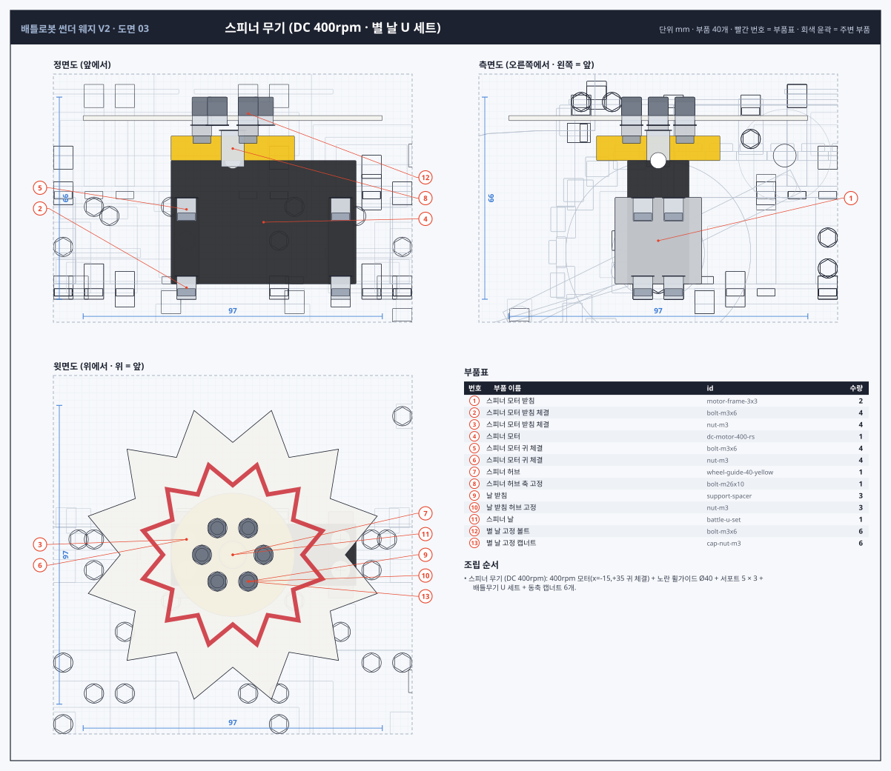
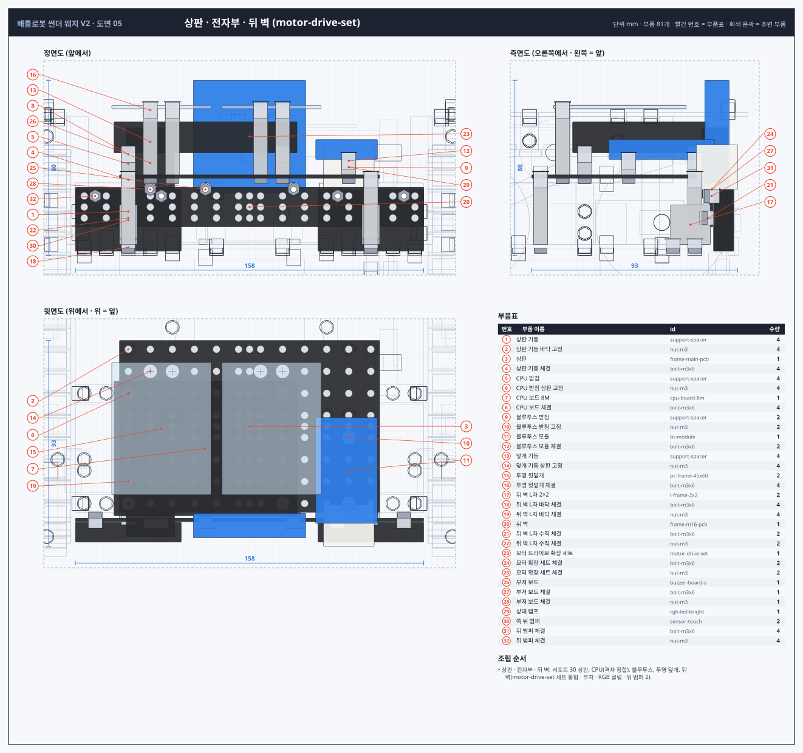
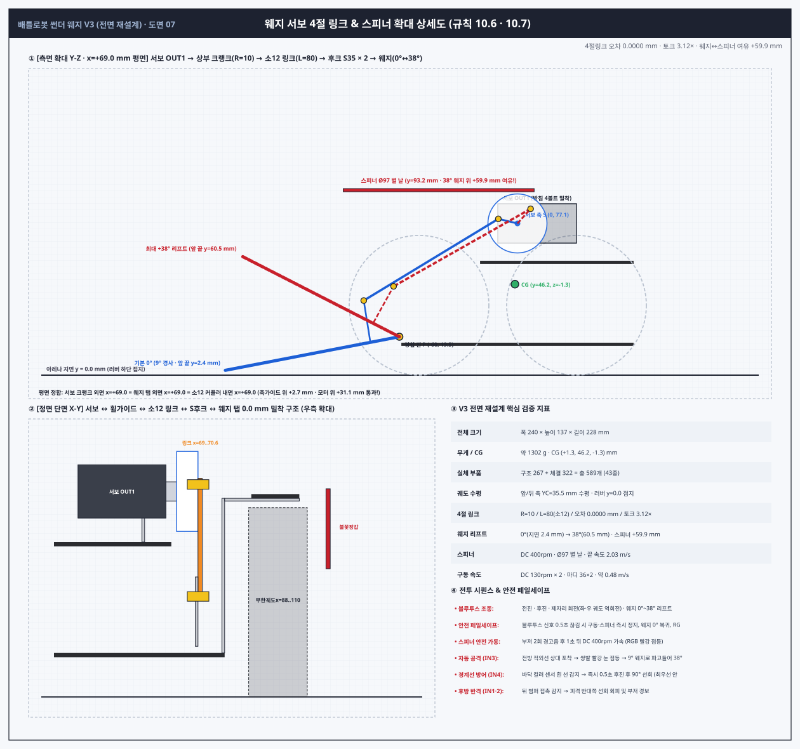

# 배틀로봇 "썬더 웨지 V2" 설계도면

`ASSEMBLY_RULES.md` 1~10.7장(실제 볼트·너트 전수 구현, 캡너트 동축 정렬, `motor-drive-set` 세트 통합, 실구멍 정합, 연속 체결 1단계 그룹화, 웨지↔스피너 동적 충돌 0건)을 완전 준수한 V2 설계도입니다.

## 1. 개요

| 항목 | 값 |
|---|---|
| 전체 크기 | 폭 214 × 높이 108 × 길이 222 mm |
| 무게 (추정) | 약 1093 g |
| 구동 | 무한궤도 2줄 (마디 38 + 러버 38씩), DC 130rpm × 2, 속도 약 0.42 m/s |
| 무기 | 수평 스피너 (DC 400rpm, 배틀무기 U 세트 별 날 Ø97, 날 끝 2.03 m/s) + 서보 들어올림 웨지 (17° ~ 60°, 스피너 여유 +18.2 mm) |
| 실체 배치 / BOM | 구조 245 + 체결 243 = 488개 (케이블 포함 총 498개 · 45종) |

## 2. 도면

### 도면 00 · 전체 조립도 (V2 · 규칙 1~10.7 준수)

### 도면 01 · 섀시 (차체 바닥 · 배터리 · 바닥 센서)

### 도면 02 · 무한궤도 구동부 (모터 · 톱니 휠 · 마디 38개)

### 도면 03 · 스피너 무기 (DC 400rpm · 별 날 U 세트)

### 도면 04 · 들어올림 웨지 (서보 · 4절 링크)

### 도면 05 · 상판 · 전자부 · 뒤 벽 (motor-drive-set)

### 도면 06 · 장갑 · 트랙 가드 · 눈

### 도면 07 · 동작도 (속도 · 무기 · 조종 · 안전)

### 도면 08 · 배선도

## 3. 배선

| 포트 | 부품 | 역할 |
|---|---|---|
| IN1 | 왼쪽 뒤 범퍼 | 뒤에서 맞으면 감지 → 피하기 |
| IN2 | 오른쪽 뒤 범퍼 | 뒤에서 맞으면 감지 → 피하기 |
| IN3 | 앞 적외선 센서 | 앞에 상대 → 자동 공격 모드 |
| IN4 | 바닥 경계선 센서 | 경기장 끝 흰 선 → 후진 (떨어짐 방지) |
| OUT1 | 웨지 서보 | 0° 내림 (17°, 지면) ~ 60° 들어올림 |
| OUT2 | 상태 램프 RGB | 초록 대기 · 빨강 스피너 · 파랑 블루투스 끊김 |
| OUT3 | 부저 | 맞을 때 · 스피너 시작 경고음 |
| OUT4 | 왼눈 LED 빨강 | 공격 모드에서 켜짐 |
| OUT5 | 오른눈 LED 빨강 | 공격 모드에서 켜짐 |
| M1 | 왼쪽 구동 모터 (DC 130rpm) | 앞 · 뒤, 속도 조절 |
| M2 | 오른쪽 구동 모터 (DC 130rpm) | 앞 · 뒤 (좌우 반대로 돌리면 제자리 회전) |
| EX-M3 | 스피너 모터 (DC 400rpm) | motor-drive-set(연결 보드 + A3) 경유 |
| UART | 블루투스 모듈 | 스마트폰 조종 · 0.5초 페일세이프 |
| BATT | 배터리케이스 4AA 6V | CPU 6V → 모터 · 서보 공용 |

## 4. 부품 목록 (BOM)

| 부품 id | 이름 | 수량 |
|---|---|---|
| `axle-guide` | 축가이드 | 4 |
| `battery-case-4aa` | AA 배터리케이스 1×4 | 1 |
| `battle-g` | 배틀무기 G | 1 |
| `battle-i` | 배틀무기 I | 1 |
| `battle-j` | 배틀무기 J | 1 |
| `battle-t` | 배틀무기 T | 2 |
| `battle-u-set` | 배틀무기 U 세트 (별 조각 3장) | 1 |
| `bt-module` | 무선 통신보드 (블루투스 모듈) | 1 |
| `buzzer-board-s` | Buzzer 보드[S] | 1 |
| `caterpillar-link` | 캐터필러 (마디) | 76 |
| `caterpillar-rubber` | 캐터필러 러버 | 76 |
| `caterpillar-sprocket` | 캐터필러 휠 (톱니) | 4 |
| `caterpillar-wheel-guide` | 캐터필러 휠가이드 [육각] | 2 |
| `cpu-board-8m` | CPU Board 8M[12V/S] | 1 |
| `dc-motor-130-rs` | DC Motor 130rpm [RS] | 2 |
| `dc-motor-400-rs` | DC Motor 400rpm [RS] | 1 |
| `frame-big-main` | 프레임 Big Main PCB | 1 |
| `frame-m16-pcb` | 프레임 중16 [PCB] | 3 |
| `frame-main-pcb` | 프레임 Main PCB 8×12 | 2 |
| `frame-s8-pcb` | 프레임 소8 [PCB] | 1 |
| `l-frame-2x1` | 프레임 2x1 [L자] | 2 |
| `l-frame-2x2` | 프레임 2x2 [L자] | 11 |
| `l-frame-2x6` | 프레임 2x6 [L자] | 4 |
| `led-board-red-s` | LED 보드[빨강/S] | 2 |
| `motor-drive-set` | 모터 드라이브 확장 세트 (연결 보드 + A3) | 1 |
| `motor-frame-3x3` | 모터프레임 [3x3] | 6 |
| `motor-guide` | 모터가이드 | 2 |
| `pc-frame-45x60` | PC프레임 [45×60] | 2 |
| `rgb-led-bright` | RGB LED 보드[고휘도] | 1 |
| `s-hook-35` | 후크 S35 [노랑] | 4 |
| `sensor-color` | 컬러 센서 보드 | 1 |
| `sensor-ir-tr` | 적외선 센서 보드[TR] | 1 |
| `sensor-touch` | 접촉 센서 보드 | 2 |
| `servo-digital` | Servo Motor[Digital] | 1 |
| `shaft-75` | 축 75mm[Ø3] | 2 |
| `support-spacer` | 서포트 (5 mm × 5 · 7 mm × 2 · 10 mm × 4 · 30 mm × 8) | 19 |
| `wheel-guide-30-servo` | 휠가이드[Ø30/Servo] | 1 |
| `wheel-guide-40-yellow` | 휠가이드[Ø40-YELLOW] | 1 |
| `bolt-m26x10` | 볼트 2.6×10 와셔붙이 | 4 |
| `bolt-m3x10` | 볼트 M3×10 | 20 |
| `bolt-m3x6` | 볼트 3×6 | 98 |
| `cable-3pin` | 케이블 - 3Pin | 9 |
| `cap-nut-m3` | 캡너트 3Ø 회색 | 10 |
| `header-pin-3p` | 헤더핀 3pin | 1 |
| `nut-m3` | M3 너트 | 111 |
| | **합계** | **498** |
