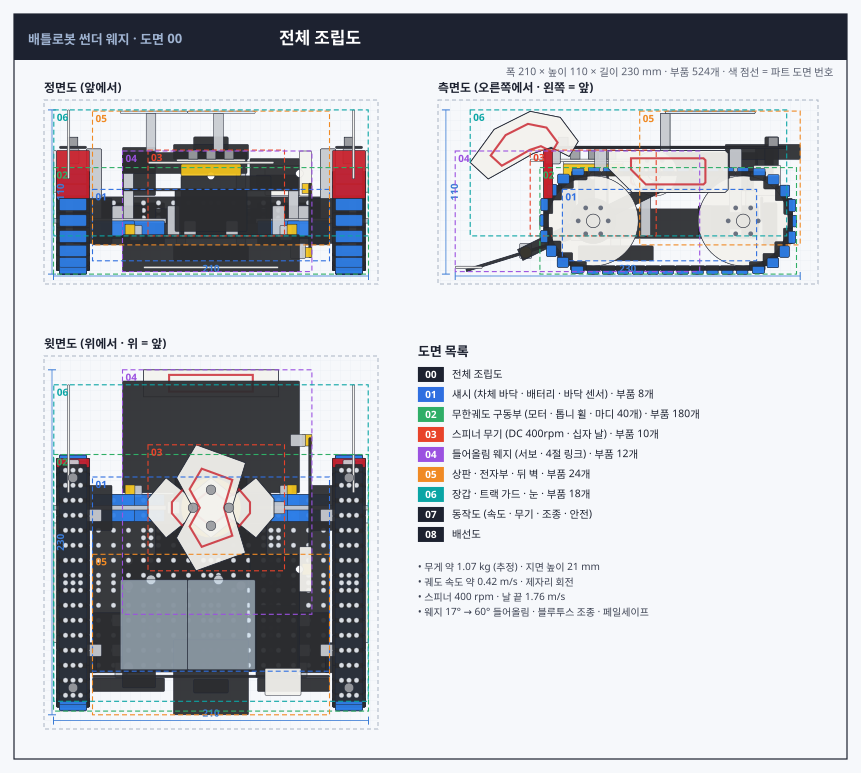
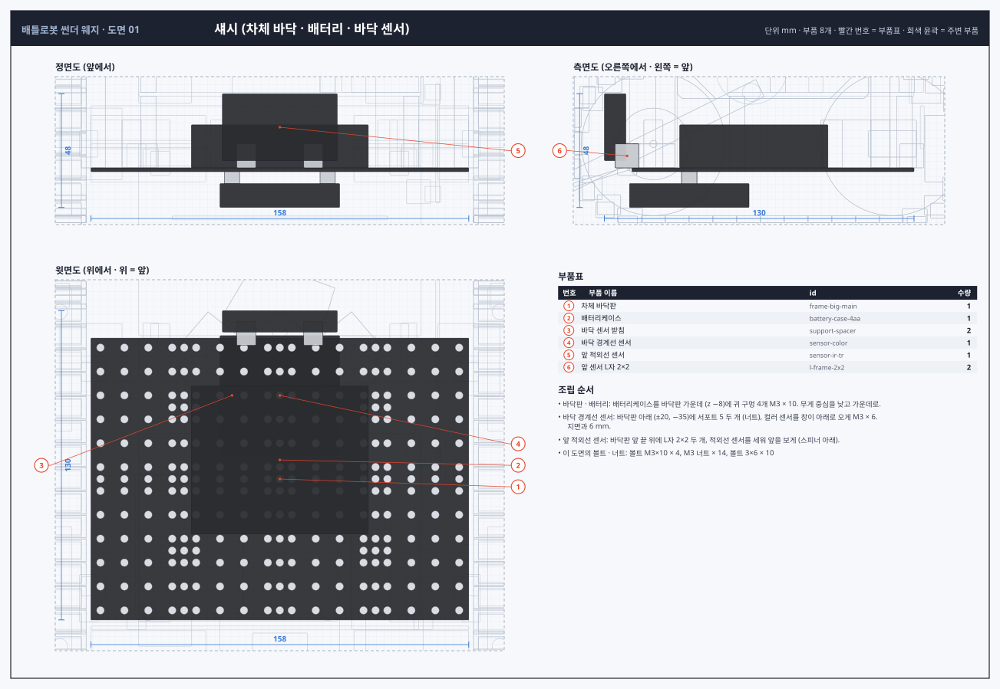
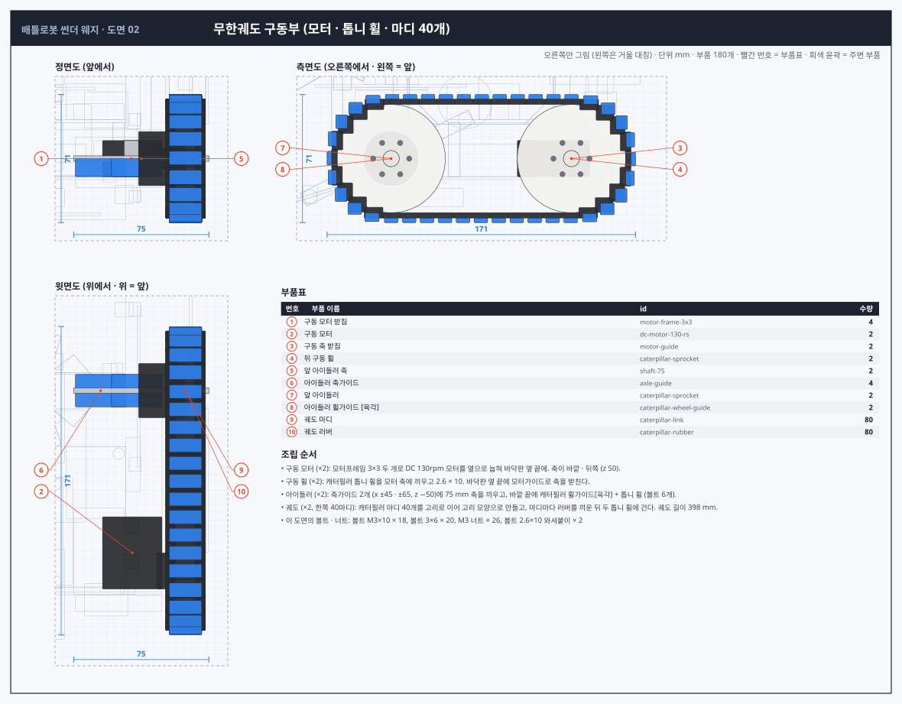
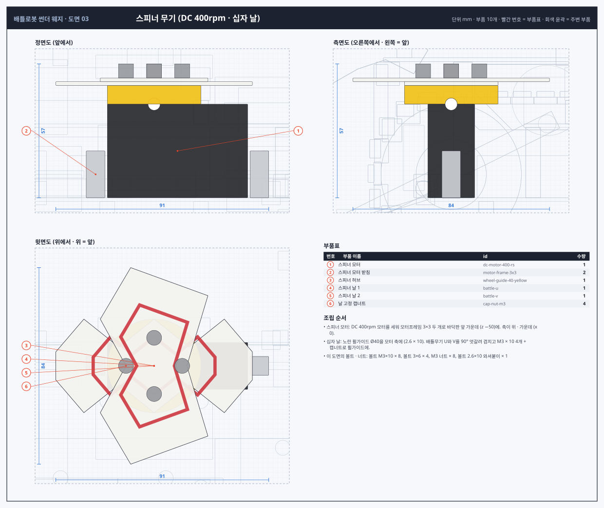
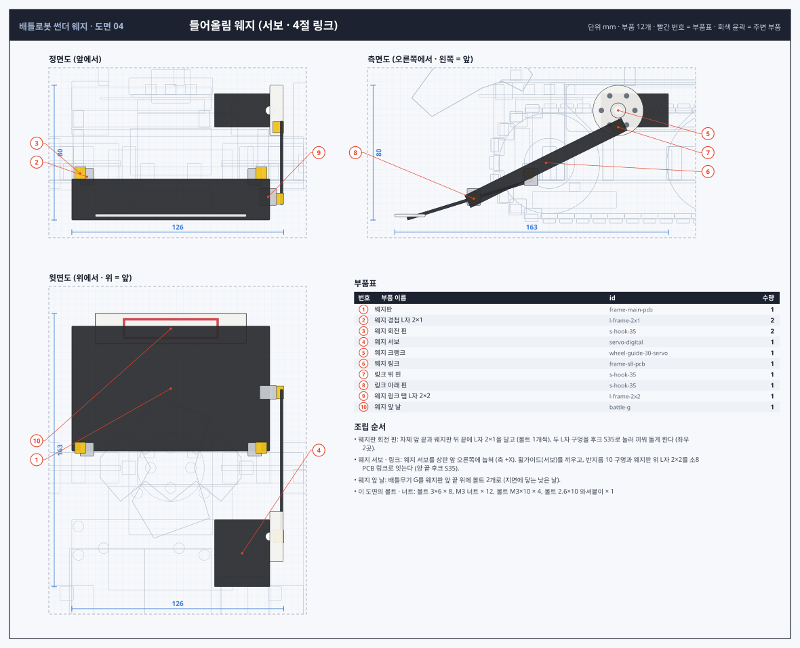
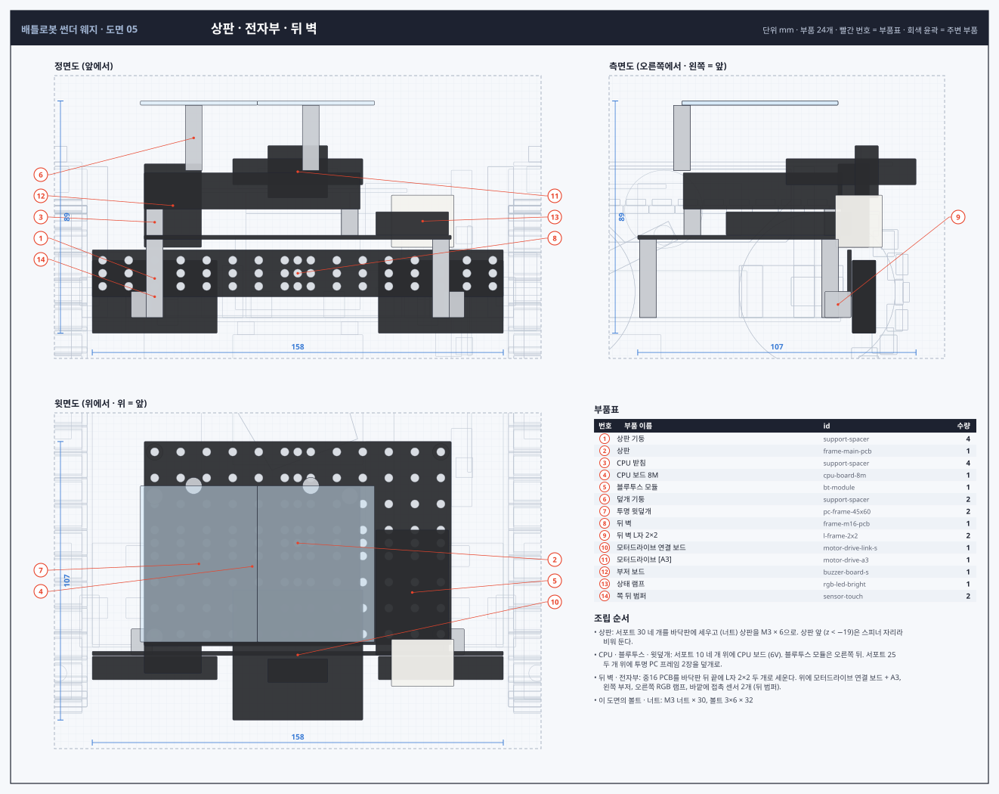
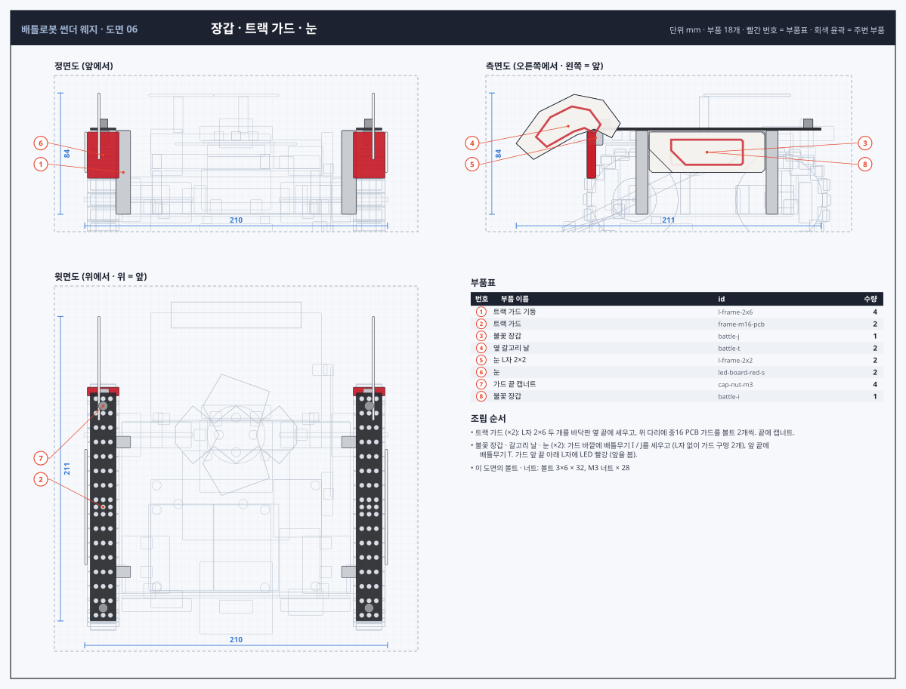
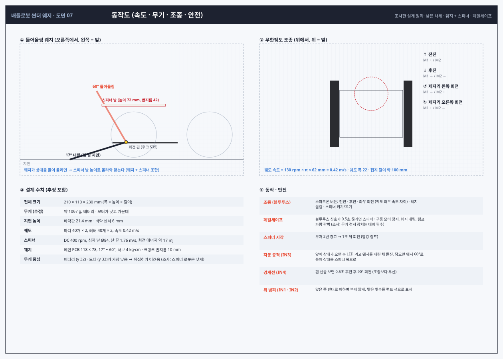
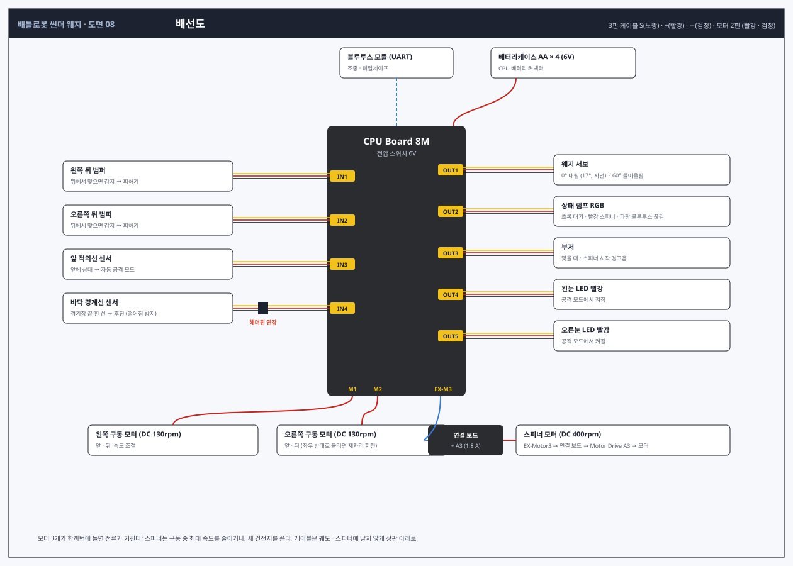

# 배틀로봇 "썬더 웨지" 설계도면

이 저장소에서 만든 부품만 사용합니다. 조립 규칙은 [`ASSEMBLY_RULES.md`](../ASSEMBLY_RULES.md)를 따릅니다.
이 문서와 도면은 `python3 tools/battlebot_blueprint.py`로 다시 만듭니다.

## 1. 조사: 배틀로봇 설계 원리

| 원리 | 내용 | 이 설계에 적용 |
|---|---|---|
| 무기 종류 | 스피너(수평 · 드럼 · 전체 회전), 플리퍼 · 리프터, 웨지가 대표적. 웨지가 가장 단순하고 튼튼 | 들어올림 웨지 + 수평 스피너 |
| 웨지 + 스피너 조합 | 웨지로 상대를 들어 무기 쪽으로 보내는 조합이 흔함 | 서보 웨지가 상대를 스피너 높이로 들어 올림 |
| 낮은 차체 | 스피너 로봇은 뒤집히지 않게 낮게, 플리퍼 로봇은 튼튼한 웨지로 스피너를 막음 | 지면 높이 21 mm, 배터리 · 모터를 가장 아래에 |
| 구동 | 2WD · 4WD · 바퀴 · 무한궤도 중 선택 | 무한궤도 (밀리지 않고 장애물에 강함), 좌우 속도 차이로 회전 |
| 설계 순서 | 무기 · 구동 방식 → 스케치 → 전자 부품 | 도면 순서도 같게 (구동 → 무기 → 전자부 → 장갑) |
| 안전 | 신호가 끊기면 무기 회전을 멈추는 페일세이프가 대부분 대회에서 필수 | 블루투스 0.5초 끊김 → 스피너 · 구동 정지 |

출처: [NHRL Common Robot Types](https://wiki.nhrl.io/wiki/index.php/Common_Robot_Types), [GrabCAD Types of Combat Bots](https://workbench.grabcad.com/tutorials/types-of-combat-bots), [BYU Combat Robotics helpful tips](https://combatrobotics.byu.edu/getting-started/helpful-tips), [zbotic 배틀로봇 설계](https://zbotic.in/battle-robot-design-weight-classes-weapons-drive-systems/), [Combat Robot Building Guide](https://beetlebros.gametechmods.com/building.htm). 로보로보 공식 대회 규칙은 찾지 못했습니다 — 대회에 나가려면 주최 측 규정을 확인하세요.

## 2. 개요

| 항목 | 값 |
|---|---|
| 전체 크기 | 폭 210 × 높이 110 × 길이 230 mm |
| 무게 (추정) | 약 1067 g |
| 구동 | 무한궤도 2줄 (마디 40 + 러버 40씩), DC 130rpm × 2, 속도 약 0.42 m/s |
| 무기 | 수평 스피너 (DC 400rpm, 배틀무기 U + V 십자 날, 날 끝 1.76 m/s) + 서보 들어올림 웨지 (17° ~ 60°) |
| 조종 | 블루투스 (스마트폰), 페일세이프 |
| 센서 | 앞 적외선 (상대) · 바닥 컬러 (경계선) · 뒤 범퍼 접촉 2 |
| 부품 수 | 524개 (볼트 · 너트 · 케이블 포함), 47종 |

## 3. 도면

### 도면 00 · 전체 조립도

### 도면 01 · 섀시 (차체 바닥 · 배터리 · 바닥 센서)

### 도면 02 · 무한궤도 구동부 (모터 · 톱니 휠 · 마디 40개)

### 도면 03 · 스피너 무기 (DC 400rpm · 십자 날)

### 도면 04 · 들어올림 웨지 (서보 · 4절 링크)

### 도면 05 · 상판 · 전자부 · 뒤 벽

### 도면 06 · 장갑 · 트랙 가드 · 눈

### 도면 07 · 동작도 (속도 · 무기 · 조종 · 안전)

### 도면 08 · 배선도

## 4. 파트별 부품 위치

좌표는 부품 중심(mm, 원점 = 지면 위 로봇 가운데), 크기는 X × Y × Z. 번호는 도면의 빨간 번호입니다. 궤도 마디 · 러버는 개수가 많아 한 줄로 묶었습니다.

### 01 섀시 (차체 바닥 · 배터리 · 바닥 센서)

| 번호 | 부품 | id | 중심 (X, Y, Z) | 크기 | 방향 · 메모 |
|---|---|---|---|---|---|
| 1 | 차체 바닥판 (빅 메인 PCB) | `frame-big-main` | (0, 22.2, 0.0) | 158.0 × 1.6 × 118.0 | 수평, 지면에서 21.4 mm |
| 2 | 배터리케이스 (AA 4개, 6V) | `battery-case-4aa` | (0, 32.0, -8.0) | 74.0 × 18.0 × 62.0 | 가운데 · 낮게 (무게 중심) |
| 3 | 바닥 센서 받침 (서포트 5) | `support-spacer` | (-20, 18.9, -35.0) | 6.4 × 5.0 × 6.4 | 판 아래 |
| 3 | 바닥 센서 받침 (서포트 5) | `support-spacer` | (20, 18.9, -35.0) | 6.4 × 5.0 × 6.4 | 판 아래 |
| 4 | 바닥 경계선 센서 (컬러 센서, 창이 아래) | `sensor-color` | (0, 11.4, -35.0) | 50.0 × 10.0 × 50.0 | 지면에서 6 mm, 경기장 끝 흰 선 감지 |
| 5 | 앞 적외선 센서 (상대 감지) | `sensor-ir-tr` | (0, 40.0, -66.0) | 48.0 × 28.0 × 9.0 | 세움, 앞(−Z)을 봄, 스피너 아래 |
| 6 | 앞 센서 L자 2×2 | `l-frame-2x2` | (-14, 28.0, -61.0) | 8.0 × 10.0 × 10.0 | 바닥판 앞 끝 위로 |
| 6 | 앞 센서 L자 2×2 | `l-frame-2x2` | (14, 28.0, -61.0) | 8.0 × 10.0 × 10.0 | 바닥판 앞 끝 위로 |

### 02 무한궤도 구동부 (모터 · 톱니 휠 · 마디 40개)

| 번호 | 부품 | id | 중심 (X, Y, Z) | 크기 | 방향 · 메모 |
|---|---|---|---|---|---|
| 1 | 구동 모터 받침 (모터프레임 3×3) | `motor-frame-3x3` | (-62, 33.0, 25.0) | 8.0 × 20.0 × 8.0 | 바닥판 위, 모터 귀를 잡음 |
| 1 | 구동 모터 받침 (모터프레임 3×3) | `motor-frame-3x3` | (-62, 33.0, 45.0) | 8.0 × 20.0 × 8.0 | 바닥판 위, 모터 귀를 잡음 |
| 2 | 왼 구동 모터 (DC 130rpm) | `dc-motor-130-rs` | (-62.5, 33.0, 40.0) | 33.0 × 20.0 × 40.0 | 옆으로 눕힘, 축이 바깥(±X) · 뒤쪽 끝 z 50 |
| 3 | 구동 축 받침 (모터가이드) | `motor-guide` | (-80, 33.0, 50.0) | 7.5 × 11.0 × 20.0 | 바닥판 옆 끝, 축 흔들림 방지 |
| 4 | 왼 뒤 구동 휠 (캐터필러 톱니 휠) | `caterpillar-sprocket` | (-92, 33.0, 50.0) | 10.0 × 60.0 × 60.0 | 모터 축 (D컷) |
| 5 | 왼 앞 아이들러 축 (75mm) | `shaft-75` | (-67.5, 33.0, -50.0) | 75.0 × 3.0 × 3.0 | x = ±30 ~ ±105 |
| 6 | 아이들러 축가이드 | `axle-guide` | (-45, 28.0, -50.0) | 28.0 × 10.0 × 18.0 | 바닥판 위, 축 높이 33 |
| 6 | 아이들러 축가이드 | `axle-guide` | (-65, 28.0, -50.0) | 28.0 × 10.0 × 18.0 | 바닥판 위, 축 높이 33 |
| 7 | 왼 앞 아이들러 (캐터필러 톱니 휠) | `caterpillar-sprocket` | (-92, 33.0, -50.0) | 10.0 × 60.0 × 60.0 | 축에 헛돔 |
| 8 | 아이들러 휠가이드 [육각] | `caterpillar-wheel-guide` | (-79, 33.0, -50.0) | 26.0 × 30.0 × 30.0 | 축 고정 · 톱니 휠과 볼트 6개 |
| 9 | 궤도 마디 × 40 (왼쪽) | `caterpillar-link` | x -92, 궤도를 따라 10 mm 간격 | 22 × 3 × 10 | 10 mm 간격, 고리를 끼워 이음 |
| 10 | 궤도 러버 × 40 (왼쪽) | `caterpillar-rubber` | x -92, 궤도를 따라 10 mm 간격 | 22 × 3 × 10 | 마디 바깥면 |
| 1 | 구동 모터 받침 (모터프레임 3×3) | `motor-frame-3x3` | (62, 33.0, 25.0) | 8.0 × 20.0 × 8.0 | 바닥판 위, 모터 귀를 잡음 |
| 1 | 구동 모터 받침 (모터프레임 3×3) | `motor-frame-3x3` | (62, 33.0, 45.0) | 8.0 × 20.0 × 8.0 | 바닥판 위, 모터 귀를 잡음 |
| 2 | 오른 구동 모터 (DC 130rpm) | `dc-motor-130-rs` | (62.5, 33.0, 40.0) | 33.0 × 20.0 × 40.0 | 옆으로 눕힘, 축이 바깥(±X) · 뒤쪽 끝 z 50 |
| 3 | 구동 축 받침 (모터가이드) | `motor-guide` | (80, 33.0, 50.0) | 7.5 × 11.0 × 20.0 | 바닥판 옆 끝, 축 흔들림 방지 |
| 4 | 오른 뒤 구동 휠 (캐터필러 톱니 휠) | `caterpillar-sprocket` | (92, 33.0, 50.0) | 10.0 × 60.0 × 60.0 | 모터 축 (D컷) |
| 5 | 오른 앞 아이들러 축 (75mm) | `shaft-75` | (67.5, 33.0, -50.0) | 75.0 × 3.0 × 3.0 | x = ±30 ~ ±105 |
| 6 | 아이들러 축가이드 | `axle-guide` | (45, 28.0, -50.0) | 28.0 × 10.0 × 18.0 | 바닥판 위, 축 높이 33 |
| 6 | 아이들러 축가이드 | `axle-guide` | (65, 28.0, -50.0) | 28.0 × 10.0 × 18.0 | 바닥판 위, 축 높이 33 |
| 7 | 오른 앞 아이들러 (캐터필러 톱니 휠) | `caterpillar-sprocket` | (92, 33.0, -50.0) | 10.0 × 60.0 × 60.0 | 축에 헛돔 |
| 8 | 아이들러 휠가이드 [육각] | `caterpillar-wheel-guide` | (79, 33.0, -50.0) | 26.0 × 30.0 × 30.0 | 축 고정 · 톱니 휠과 볼트 6개 |
| 9 | 궤도 마디 × 40 (오른쪽) | `caterpillar-link` | x 92, 궤도를 따라 10 mm 간격 | 22 × 3 × 10 | 10 mm 간격, 고리를 끼워 이음 |
| 10 | 궤도 러버 × 40 (오른쪽) | `caterpillar-rubber` | x 92, 궤도를 따라 10 mm 간격 | 22 × 3 × 10 | 마디 바깥면 |

### 03 스피너 무기 (DC 400rpm · 십자 날)

| 번호 | 부품 | id | 중심 (X, Y, Z) | 크기 | 방향 · 메모 |
|---|---|---|---|---|---|
| 1 | 스피너 모터 (DC 400rpm) | `dc-motor-400-rs` | (10, 43.0, -50.0) | 60.0 × 40.0 × 20.0 | 세움, 축이 위 · 가운데 (0, 63, −50) |
| 2 | 스피너 모터 받침 (모터프레임 3×3) | `motor-frame-3x3` | (-25, 33.0, -50.0) | 8.0 × 20.0 × 8.0 | 모터 귀를 바닥판에 |
| 2 | 스피너 모터 받침 (모터프레임 3×3) | `motor-frame-3x3` | (45, 33.0, -50.0) | 8.0 × 20.0 × 8.0 | 모터 귀를 바닥판에 |
| 3 | 스피너 허브 (노란 휠가이드 Ø40) | `wheel-guide-40-yellow` | (0, 67.0, -50.0) | 40.0 × 8.0 × 40.0 | 모터 축, 윗면 평평 |
| 4 | 스피너 날 1 (배틀무기 U, 톱날) | `battle-u` | (0, 71.8, -50.0) | 84.0 × 1.6 × 40.0 | 휠가이드 위, 좌우 방향 |
| 5 | 스피너 날 2 (배틀무기 V) | `battle-v` | (0, 73.4, -50.0) | 46.0 × 1.6 × 84.0 | 날 1 위에 90° 엇갈림 (십자 날) |
| 6 | 날 고정 캡너트 | `cap-nut-m3` | (-12, 77.2, -50.0) | 6.4 × 6.0 × 6.4 | 볼트 끝 가림 |
| 6 | 날 고정 캡너트 | `cap-nut-m3` | (12, 77.2, -50.0) | 6.4 × 6.0 × 6.4 | 볼트 끝 가림 |
| 6 | 날 고정 캡너트 | `cap-nut-m3` | (0, 77.2, -62.0) | 6.4 × 6.0 × 6.4 | 볼트 끝 가림 |
| 6 | 날 고정 캡너트 | `cap-nut-m3` | (0, 77.2, -38.0) | 6.4 × 6.0 × 6.4 | 볼트 끝 가림 |

### 04 들어올림 웨지 (서보 · 4절 링크)

| 번호 | 부품 | id | 중심 (X, Y, Z) | 크기 | 방향 · 메모 |
|---|---|---|---|---|---|
| 1 | 웨지판 (메인 PCB, 17° 경사) | `frame-main-pcb` | (0, 11.5, -97.3) | 118.0 × 24.6 × 74.5 | 뒤 끝이 차체 앞 끝에서 돌고, 앞 끝은 지면 |
| 2 | 웨지 경첩 L자 2×1 | `l-frame-2x1` | (-50, 25.0, -61.0) | 8.0 × 10.0 × 8.0 | 차체 앞 끝 · 웨지 뒤 끝 |
| 3 | 웨지 회전 핀 (후크 S35) | `s-hook-35` | (-54, 27.0, -62.0) | 6.5 × 7.6 × 6.5 | 경첩 대신 돌아가는 핀 |
| 2 | 웨지 경첩 L자 2×1 | `l-frame-2x1` | (50, 25.0, -61.0) | 8.0 × 10.0 × 8.0 | 차체 앞 끝 · 웨지 뒤 끝 |
| 3 | 웨지 회전 핀 (후크 S35) | `s-hook-35` | (54, 27.0, -62.0) | 6.5 × 7.6 × 6.5 | 경첩 대신 돌아가는 핀 |
| 4 | 웨지 서보 | `servo-digital` | (42.5, 64.6, 1.0) | 33.0 × 20.0 × 40.0 | 상판 앞 오른쪽, 축이 바깥(+X) · 앞쪽 끝 |
| 5 | 웨지 크랭크 (휠가이드 서보) | `wheel-guide-30-servo` | (63, 64.6, -9.0) | 8.0 × 30.0 × 30.0 | 서보 축, 반지름 10 구멍에 핀 |
| 6 | 웨지 링크 (소8 PCB, 핀 간격 70) | `frame-s8-pcb` | (66, 33.3, -52.0) | 1.6 × 49.8 × 89.6 | 크랭크 핀과 웨지 탭을 후크 S35로 |
| 7 | 링크 위 핀 (후크 S35) | `s-hook-35` | (64, 54.6, -9.0) | 6.5 × 6.5 × 7.6 | 크랭크 쪽 |
| 8 | 링크 아래 핀 (후크 S35) | `s-hook-35` | (64, 12.0, -95.0) | 6.5 × 6.5 × 7.6 | 웨지 탭 쪽 |
| 9 | 웨지 링크 탭 L자 2×2 | `l-frame-2x2` | (58, 13.0, -95.0) | 10.0 × 10.0 × 8.0 | 웨지판 위에 세움 |
| 10 | 웨지 앞 날 (배틀무기 G) | `battle-g` | (0, 2.0, -133.0) | 90.0 × 1.6 × 18.0 | 웨지 앞 끝 위, 낮은 날 |

### 05 상판 · 전자부 · 뒤 벽

| 번호 | 부품 | id | 중심 (X, Y, Z) | 크기 | 방향 · 메모 |
|---|---|---|---|---|---|
| 1 | 상판 기둥 (서포트 30) | `support-spacer` | (-55, 38.0, -15.0) | 6.4 × 30.0 × 6.4 | 바닥판 → 상판 |
| 1 | 상판 기둥 (서포트 30) | `support-spacer` | (-55, 38.0, 55.0) | 6.4 × 30.0 × 6.4 | 바닥판 → 상판 |
| 1 | 상판 기둥 (서포트 30) | `support-spacer` | (55, 38.0, -15.0) | 6.4 × 30.0 × 6.4 | 바닥판 → 상판 |
| 1 | 상판 기둥 (서포트 30) | `support-spacer` | (55, 38.0, 55.0) | 6.4 × 30.0 × 6.4 | 바닥판 → 상판 |
| 2 | 상판 (메인 PCB) | `frame-main-pcb` | (0, 53.8, 20.0) | 118.0 × 1.6 × 78.0 | 긴 쪽이 좌우, z −19 ~ 59 (앞은 스피너 자리) |
| 3 | CPU 받침 (서포트 10) | `support-spacer` | (-55, 59.6, 2.0) | 6.4 × 10.0 × 6.4 |  |
| 3 | CPU 받침 (서포트 10) | `support-spacer` | (-55, 59.6, 56.0) | 6.4 × 10.0 × 6.4 |  |
| 3 | CPU 받침 (서포트 10) | `support-spacer` | (20, 59.6, 2.0) | 6.4 × 10.0 × 6.4 |  |
| 3 | CPU 받침 (서포트 10) | `support-spacer` | (20, 59.6, 56.0) | 6.4 × 10.0 × 6.4 |  |
| 4 | CPU 보드 8M | `cpu-board-8m` | (-17.5, 71.6, 29.0) | 83.0 × 14.0 × 61.0 | 상판 왼쪽 뒤, 전압 스위치 6V |
| 5 | 블루투스 모듈 (조종 · 페일세이프) | `bt-module` | (44, 59.1, 39.0) | 28.0 × 9.0 × 48.0 | 상판 오른쪽 뒤 |
| 6 | 덮개 기둥 (서포트 25) | `support-spacer` | (-40, 92.0, -2.0) | 6.4 × 25.0 × 6.4 | CPU 위 덮개 |
| 6 | 덮개 기둥 (서포트 25) | `support-spacer` | (5, 92.0, -2.0) | 6.4 × 25.0 × 6.4 | CPU 위 덮개 |
| 7 | 투명 윗덮개 (PC 프레임) | `pc-frame-45x60` | (-38, 105.4, 28.0) | 45.0 × 1.6 × 60.0 | 앞 가장자리 구멍 4개, CPU를 보며 보호 |
| 7 | 투명 윗덮개 (PC 프레임) | `pc-frame-45x60` | (7, 105.4, 28.0) | 45.0 × 1.6 × 60.0 | 앞 가장자리 구멍 4개, CPU를 보며 보호 |
| 8 | 뒤 벽 (중16 PCB) | `frame-m16-pcb` | (0, 40.0, 62.4) | 158.0 × 18.0 × 1.6 | 세움, 바닥판 뒤 끝 |
| 9 | 뒤 벽 L자 2×2 | `l-frame-2x2` | (-60, 28.0, 58.0) | 8.0 × 10.0 × 10.0 |  |
| 9 | 뒤 벽 L자 2×2 | `l-frame-2x2` | (60, 28.0, 58.0) | 8.0 × 10.0 × 10.0 |  |
| 10 | 모터드라이브 연결 보드 (EX-Motor3/4) | `motor-drive-link-s` | (0, 79.0, 63.0) | 50.0 × 10.0 × 50.0 | 뒤 벽 위에 세움, 스피너 모터용 |
| 11 | 모터드라이브 [A3] (연결 보드에 꽂음) | `motor-drive-a3` | (0, 79.0, 69.0) | 23.0 × 20.0 × 9.0 |  |
| 12 | 부저 보드 (타격음) | `buzzer-board-s` | (-48, 66.0, 64.0) | 22.0 × 32.0 × 12.0 | 뒤 벽 왼쪽 위 |
| 13 | 상태 램프 (RGB LED 고휘도) | `rgb-led-bright` | (48, 60.0, 66.0) | 24.0 × 20.0 × 18.0 | 뒤 벽 오른쪽 위, 색으로 상태 표시 |
| 14 | 왼쪽 뒤 범퍼 (접촉 센서) | `sensor-touch` | (-55, 31.0, 68.0) | 48.0 × 28.0 × 9.0 | 뒤 벽 바깥, 버튼이 뒤 |
| 14 | 오른쪽 뒤 범퍼 (접촉 센서) | `sensor-touch` | (55, 31.0, 68.0) | 48.0 × 28.0 × 9.0 | 뒤 벽 바깥, 버튼이 뒤 |

### 06 장갑 · 트랙 가드 · 눈

| 번호 | 부품 | id | 중심 (X, Y, Z) | 크기 | 방향 · 메모 |
|---|---|---|---|---|---|
| 1 | 트랙 가드 기둥 (L자 2×6) | `l-frame-2x6` | (-78, 52.0, -45.0) | 10.0 × 58.0 × 8.0 | 바닥판 옆 끝에 세움, 위 다리가 바깥 |
| 1 | 트랙 가드 기둥 (L자 2×6) | `l-frame-2x6` | (-78, 52.0, 45.0) | 10.0 × 58.0 × 8.0 | 바닥판 옆 끝에 세움, 위 다리가 바깥 |
| 2 | 왼 트랙 가드 (중16 PCB) | `frame-m16-pcb` | (-92, 82.0, 0.0) | 18.0 × 1.6 × 158.0 | 궤도 위 덮개 |
| 3 | 왼 불꽃 장갑 (배틀무기 J) | `battle-j` | (-104, 66.0, 0.0) | 1.6 × 28.0 × 80.0 | 가드 바깥에 세움, 궤도 위쪽을 가림 |
| 4 | 왼 옆 갈고리 날 (배틀무기 T) | `battle-t` | (-95, 84.0, -96.0) | 1.6 × 46.0 × 72.0 | 가드 앞 끝, 앞으로 휘어진 날 |
| 5 | 눈 L자 2×2 | `l-frame-2x2` | (-92, 76.0, -77.0) | 8.0 × 10.0 × 10.0 |  |
| 6 | 왼눈 (LED 빨강) | `led-board-red-s` | (-92, 64.0, -80.0) | 22.0 × 32.0 × 6.0 | 가드 앞 끝 아래, 앞을 봄 |
| 7 | 가드 끝 캡너트 | `cap-nut-m3` | (-92, 85.8, -70.0) | 6.4 × 6.0 × 6.4 |  |
| 7 | 가드 끝 캡너트 | `cap-nut-m3` | (-92, 85.8, 70.0) | 6.4 × 6.0 × 6.4 |  |
| 1 | 트랙 가드 기둥 (L자 2×6) | `l-frame-2x6` | (78, 52.0, -45.0) | 10.0 × 58.0 × 8.0 | 바닥판 옆 끝에 세움, 위 다리가 바깥 |
| 1 | 트랙 가드 기둥 (L자 2×6) | `l-frame-2x6` | (78, 52.0, 45.0) | 10.0 × 58.0 × 8.0 | 바닥판 옆 끝에 세움, 위 다리가 바깥 |
| 2 | 오른 트랙 가드 (중16 PCB) | `frame-m16-pcb` | (92, 82.0, 0.0) | 18.0 × 1.6 × 158.0 | 궤도 위 덮개 |
| 8 | 오른 불꽃 장갑 (배틀무기 I) | `battle-i` | (104, 66.0, 0.0) | 1.6 × 28.0 × 80.0 | 가드 바깥에 세움, 궤도 위쪽을 가림 |
| 4 | 오른 옆 갈고리 날 (배틀무기 T) | `battle-t` | (95, 84.0, -96.0) | 1.6 × 46.0 × 72.0 | 가드 앞 끝, 앞으로 휘어진 날 |
| 5 | 눈 L자 2×2 | `l-frame-2x2` | (92, 76.0, -77.0) | 8.0 × 10.0 × 10.0 |  |
| 6 | 오른눈 (LED 빨강) | `led-board-red-s` | (92, 64.0, -80.0) | 22.0 × 32.0 × 6.0 | 가드 앞 끝 아래, 앞을 봄 |
| 7 | 가드 끝 캡너트 | `cap-nut-m3` | (92, 85.8, -70.0) | 6.4 × 6.0 × 6.4 |  |
| 7 | 가드 끝 캡너트 | `cap-nut-m3` | (92, 85.8, 70.0) | 6.4 × 6.0 × 6.4 |  |

## 5. 조립 순서

| 도면 | 단계 | 방법 | 볼트 · 너트 등 |
|---|---|---|---|
| 01 | 바닥판 · 배터리 | 배터리케이스를 바닥판 가운데 (z −8)에 귀 구멍 4개 M3 × 10. 무게 중심을 낮고 가운데로. | 볼트 M3×10 × 4, M3 너트 × 4 |
| 01 | 바닥 경계선 센서 | 바닥판 아래 (±20, −35)에 서포트 5 두 개 (너트), 컬러 센서를 창이 아래로 오게 M3 × 6. 지면과 6 mm. | M3 너트 × 2, 볼트 3×6 × 2 |
| 01 | 앞 적외선 센서 | 바닥판 앞 끝 위에 L자 2×2 두 개, 적외선 센서를 세워 앞을 보게 (스피너 아래). | 볼트 3×6 × 8, M3 너트 × 8 |
| 02 | 구동 모터 (×2) | 모터프레임 3×3 두 개로 DC 130rpm 모터를 옆으로 눕혀 바닥판 옆 끝에. 축이 바깥 · 뒤쪽 (z 50). | 볼트 M3×10 × 8, 볼트 3×6 × 8, M3 너트 × 16 |
| 02 | 구동 휠 (×2) | 캐터필러 톱니 휠을 모터 축에 끼우고 2.6 × 10. 바닥판 옆 끝에 모터가이드로 축을 받친다. | 볼트 2.6×10 와셔붙이 × 2, 볼트 M3×10 × 2, M3 너트 × 2 |
| 02 | 아이들러 (×2) | 축가이드 2개 (x ±45 · ±65, z −50)에 75 mm 축을 끼우고, 바깥 끝에 캐터필러 휠가이드[육각] + 톱니 휠 (볼트 6개). | 볼트 M3×10 × 8, M3 너트 × 8, 볼트 3×6 × 12 |
| 02 | 궤도 (×2, 한쪽 40마디) | 캐터필러 마디 40개를 고리로 이어 고리 모양으로 만들고, 마디마다 러버를 끼운 뒤 두 톱니 휠에 건다. 궤도 길이 398 mm. | — |
| 03 | 스피너 모터 | DC 400rpm 모터를 세워 모터프레임 3×3 두 개로 바닥판 앞 가운데 (z −50)에. 축이 위 · 가운데 (x 0). | 볼트 M3×10 × 4, 볼트 3×6 × 4, M3 너트 × 8 |
| 03 | 십자 날 | 노란 휠가이드 Ø40을 모터 축에 (2.6 × 10). 배틀무기 U와 V를 90° 엇갈려 겹치고 M3 × 10 4개 + 캡너트로 휠가이드에. | 볼트 2.6×10 와셔붙이 × 1, 볼트 M3×10 × 4 |
| 04 | 웨지판 회전 핀 | 차체 앞 끝과 웨지판 뒤 끝에 L자 2×1을 달고 (볼트 1개씩), 두 L자 구멍을 후크 S35로 눌러 끼워 돌게 한다 (좌우 2곳). | 볼트 3×6 × 4, M3 너트 × 4 |
| 04 | 웨지 서보 · 링크 | 웨지 서보를 상판 앞 오른쪽에 눕혀 (축 +X). 휠가이드(서보)를 끼우고, 반지름 10 구멍과 웨지판 위 L자 2×2를 소8 PCB 링크로 잇는다 (양 끝 후크 S35). | 볼트 M3×10 × 4, M3 너트 × 6, 볼트 2.6×10 와셔붙이 × 1, 볼트 3×6 × 2 |
| 04 | 웨지 앞 날 | 배틀무기 G를 웨지판 앞 끝 위에 볼트 2개로 (지면에 닿는 낮은 날). | 볼트 3×6 × 2, M3 너트 × 2 |
| 05 | 상판 | 서포트 30 네 개를 바닥판에 세우고 (너트) 상판을 M3 × 6으로. 상판 앞 (z < −19)은 스피너 자리라 비워 둔다. | M3 너트 × 4, 볼트 3×6 × 4 |
| 05 | CPU · 블루투스 · 윗덮개 | 서포트 10 네 개 위에 CPU 보드 (6V). 블루투스 모듈은 오른쪽 뒤. 서포트 25 두 개 위에 투명 PC 프레임 2장을 덮개로. | M3 너트 × 8, 볼트 3×6 × 10 |
| 05 | 뒤 벽 · 전자부 | 중16 PCB를 바닥판 뒤 끝에 L자 2×2 두 개로 세운다. 위에 모터드라이브 연결 보드 + A3, 왼쪽 부저, 오른쪽 RGB 램프, 바깥에 접촉 센서 2개 (뒤 범퍼). | 볼트 3×6 × 18, M3 너트 × 18 |
| 06 | 트랙 가드 (×2) | L자 2×6 두 개를 바닥판 옆 끝에 세우고, 위 다리에 중16 PCB 가드를 볼트 2개씩. 끝에 캡너트. | 볼트 3×6 × 16, M3 너트 × 12 |
| 06 | 불꽃 장갑 · 갈고리 날 · 눈 (×2) | 가드 바깥에 배틀무기 I / J를 세우고 (L자 없이 가드 구멍 2개), 앞 끝에 배틀무기 T. 가드 앞 끝 아래 L자에 LED 빨강 (앞을 봄). | 볼트 3×6 × 16, M3 너트 × 16 |
| 08 | 배선 | 배선도대로. 스피너 모터는 EX-Motor3 → 연결 보드 → A3. 바닥 센서 케이블은 헤더핀으로 400 mm. | 케이블 - 3Pin × 9, 헤더핀 3pin × 1 |

## 6. 배선

| 포트 | 부품 | 역할 |
|---|---|---|
| IN1 | 왼쪽 뒤 범퍼 | 뒤에서 맞으면 감지 → 피하기 |
| IN2 | 오른쪽 뒤 범퍼 | 뒤에서 맞으면 감지 → 피하기 |
| IN3 | 앞 적외선 센서 | 앞에 상대 → 자동 공격 모드 |
| IN4 | 바닥 경계선 센서 | 경기장 끝 흰 선 → 후진 (떨어짐 방지) |
| OUT1 | 웨지 서보 | 0° 내림 (17°, 지면) ~ 60° 들어올림 |
| OUT2 | 상태 램프 RGB | 초록 대기 · 빨강 스피너 · 파랑 블루투스 끊김 |
| OUT3 | 부저 | 맞을 때 · 스피너 시작 경고음 |
| OUT4 | 왼눈 LED 빨강 | 공격 모드에서 켜짐 |
| OUT5 | 오른눈 LED 빨강 | 공격 모드에서 켜짐 |
| M1 | 왼쪽 구동 모터 (DC 130rpm) | 앞 · 뒤, 속도 조절 |
| M2 | 오른쪽 구동 모터 (DC 130rpm) | 앞 · 뒤 (좌우 반대로 돌리면 제자리 회전) |
| EX-M3 | 스피너 모터 (DC 400rpm) | 연결 보드 + A3 경유, 한 방향 회전 |
| UART | 블루투스 모듈 | 스마트폰 조종 · 신호 끊기면 무기 정지 |
| BATT | 배터리케이스 4AA 6V | CPU 6V → 모터 · 서보 공용 |

## 7. 동작 · 안전

| 상황 | 동작 |
|---|---|
| 조종 (블루투스) | 스마트폰 버튼: 전진 · 후진 · 좌우 회전 (궤도 좌우 속도 차이) · 웨지 올림 · 스피너 켜기/끄기 |
| 페일세이프 | 블루투스 신호가 0.5초 끊기면 스피너 · 구동 모터 정지, 웨지 내림, 램프 파랑 깜빡 (조사: 무기 정지 장치는 대회 필수) |
| 스피너 시작 | 부저 2번 경고 → 1초 뒤 회전 (빨강 램프) |
| 자동 공격 (IN3) | 앞에 상대가 오면 눈 LED 켜고 웨지를 내린 채 돌진, 닿으면 웨지 60°로 들어 상대를 스피너 쪽으로 |
| 경계선 (IN4) | 흰 선을 보면 0.5초 후진 후 90° 회전 (조종보다 우선) |
| 뒤 범퍼 (IN1 · IN2) | 맞은 쪽 반대로 피하며 부저 짧게, 맞은 횟수를 램프 색으로 표시 |

## 8. 부품 목록 (BOM)

| 부품 id | 이름 | 수량 |
|---|---|---|
| `axle-guide` | 축가이드 | 4 |
| `battery-case-4aa` | AA 배터리케이스 1×4 | 1 |
| `battle-g` | 배틀무기 G | 1 |
| `battle-i` | 배틀무기 I | 1 |
| `battle-j` | 배틀무기 J | 1 |
| `battle-t` | 배틀무기 T | 2 |
| `battle-u` | 배틀무기 U | 1 |
| `battle-v` | 배틀무기 V | 1 |
| `bt-module` | 무선 통신보드 (블루투스 모듈) | 1 |
| `buzzer-board-s` | Buzzer 보드[S] | 1 |
| `caterpillar-link` | 캐터필러 (마디) | 80 |
| `caterpillar-rubber` | 캐터필러 러버 | 80 |
| `caterpillar-sprocket` | 캐터필러 휠 (톱니) | 4 |
| `caterpillar-wheel-guide` | 캐터필러 휠가이드 [육각] | 2 |
| `cpu-board-8m` | CPU Board 8M[12V/S] | 1 |
| `dc-motor-130-rs` | DC Motor 130rpm [RS] | 2 |
| `dc-motor-400-rs` | DC Motor 400rpm [RS] | 1 |
| `frame-big-main` | 프레임 Big Main PCB | 1 |
| `frame-m16-pcb` | 프레임 중16 [PCB] | 3 |
| `frame-main-pcb` | 프레임 Main PCB 8×12 | 2 |
| `frame-s8-pcb` | 프레임 소8 [PCB] | 1 |
| `l-frame-2x1` | 프레임 2x1 [L자] | 2 |
| `l-frame-2x2` | 프레임 2x2 [L자] | 7 |
| `l-frame-2x6` | 프레임 2x6 [L자] | 4 |
| `led-board-red-s` | LED 보드[빨강/S] | 2 |
| `motor-drive-a3` | Motor Drive Board[A3] | 1 |
| `motor-drive-link-s` | MotorDrive 연결 Board[외장형/S] | 1 |
| `motor-frame-3x3` | 모터프레임 [3x3] | 6 |
| `motor-guide` | 모터가이드 | 2 |
| `pc-frame-45x60` | PC프레임 [45×60] | 2 |
| `rgb-led-bright` | RGB LED 보드[고휘도] | 1 |
| `s-hook-35` | 후크 S35 [노랑] | 4 |
| `sensor-color` | 컬러 센서 보드 | 1 |
| `sensor-ir-tr` | 적외선 센서 보드[TR] | 1 |
| `sensor-touch` | 접촉 센서 보드 | 2 |
| `servo-digital` | Servo Motor[Digital] | 1 |
| `shaft-75` | 축 75mm[Ø3] | 2 |
| `support-spacer` | 서포트 (5 mm × 2 · 10 mm × 4 · 25 mm × 2 · 30 mm × 4) | 12 |
| `wheel-guide-30-servo` | 휠가이드[Ø30/Servo] | 1 |
| `wheel-guide-40-yellow` | 휠가이드[Ø40-YELLOW] | 1 |
| `bolt-m26x10` | 볼트 2.6×10 와셔붙이 | 4 |
| `bolt-m3x10` | 볼트 M3×10 | 34 |
| `bolt-m3x6` | 볼트 3×6 | 106 |
| `cable-3pin` | 케이블 - 3Pin | 9 |
| `cap-nut-m3` | 캡너트 3Ø 회색 | 8 |
| `header-pin-3p` | 헤더핀 3pin | 1 |
| `nut-m3` | M3 너트 | 118 |
| | **합계** | **524** |
