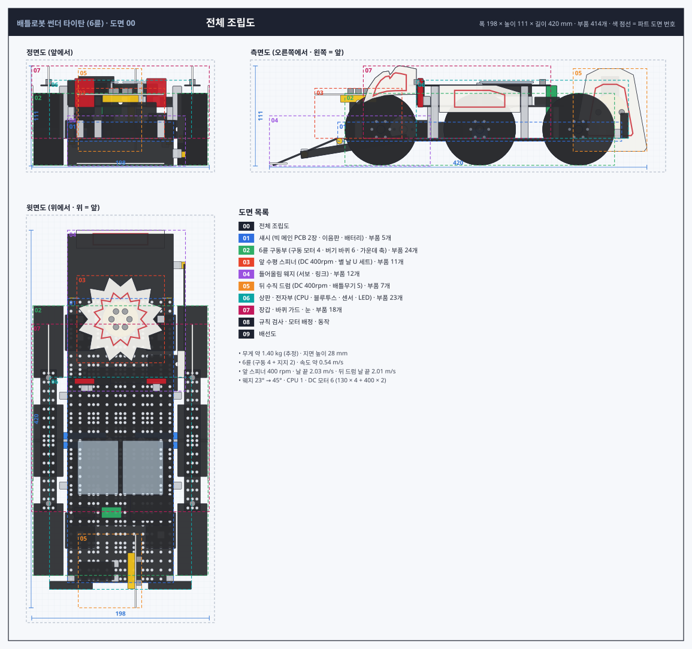
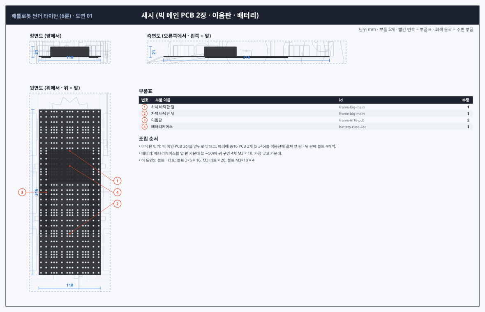
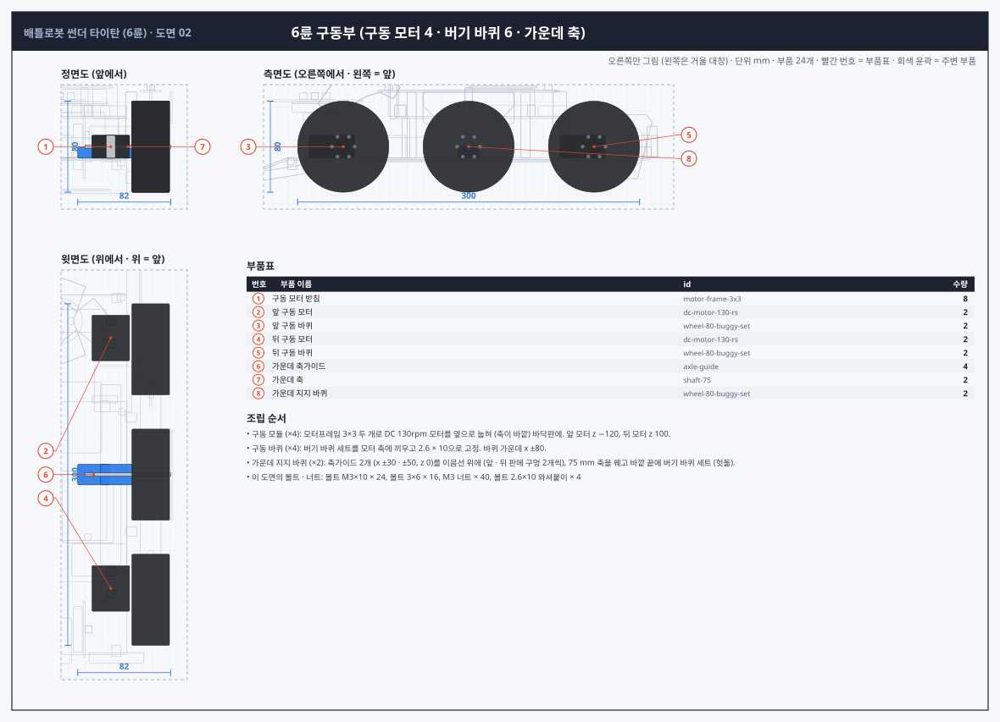
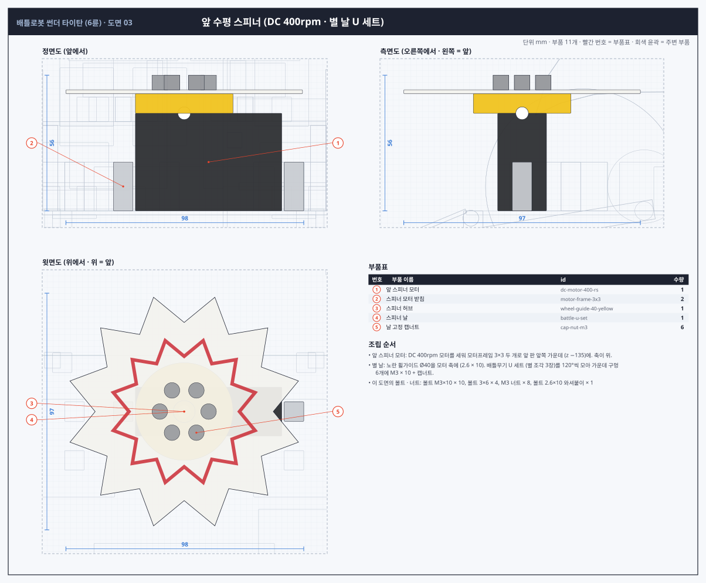
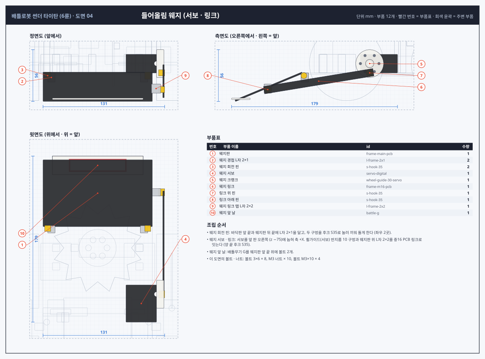
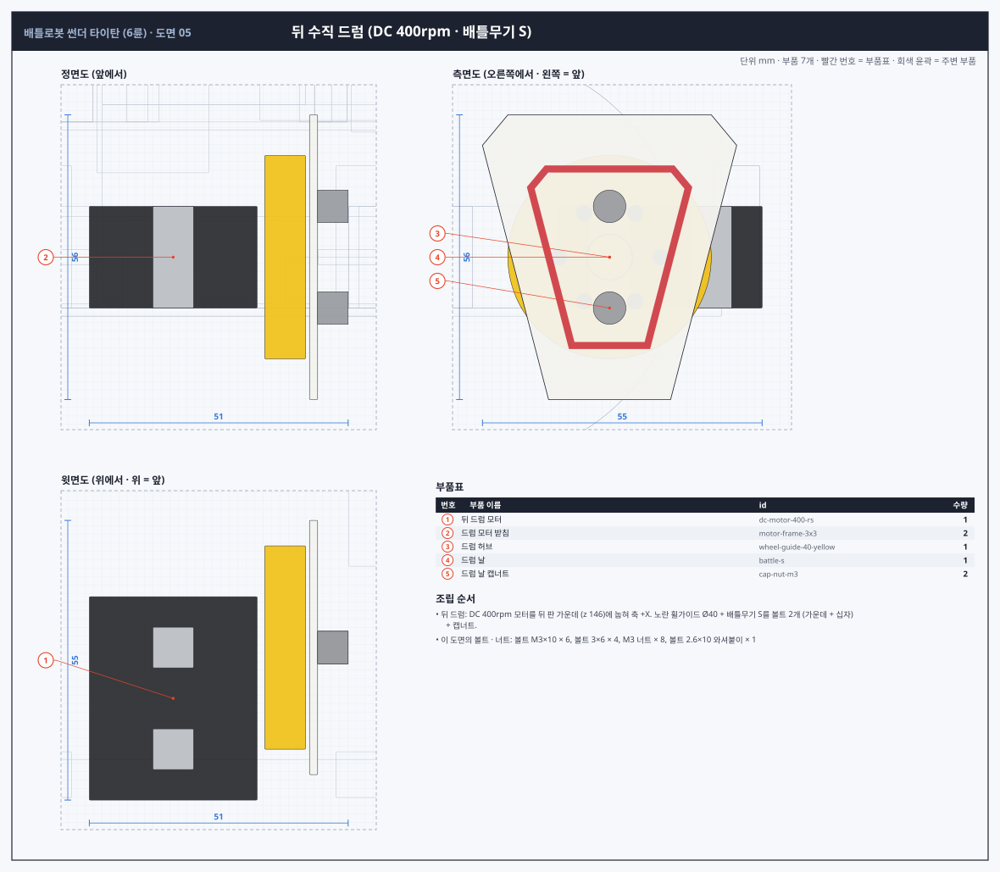
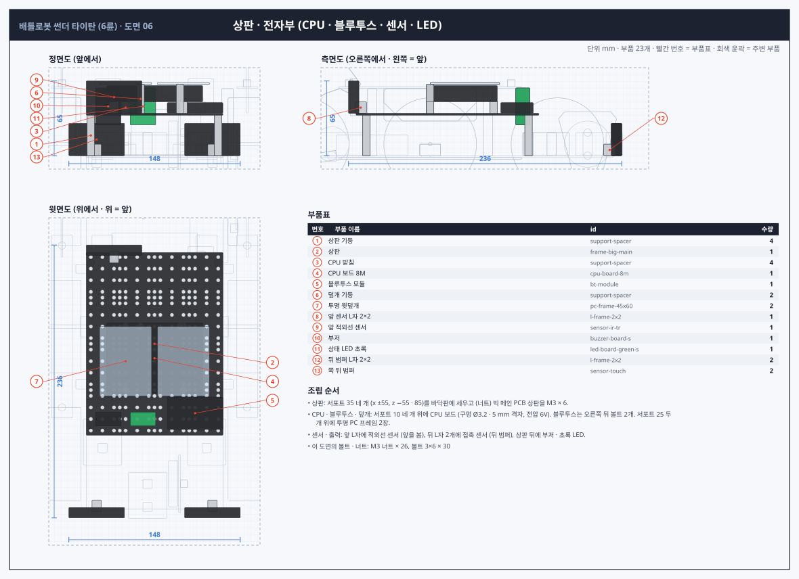
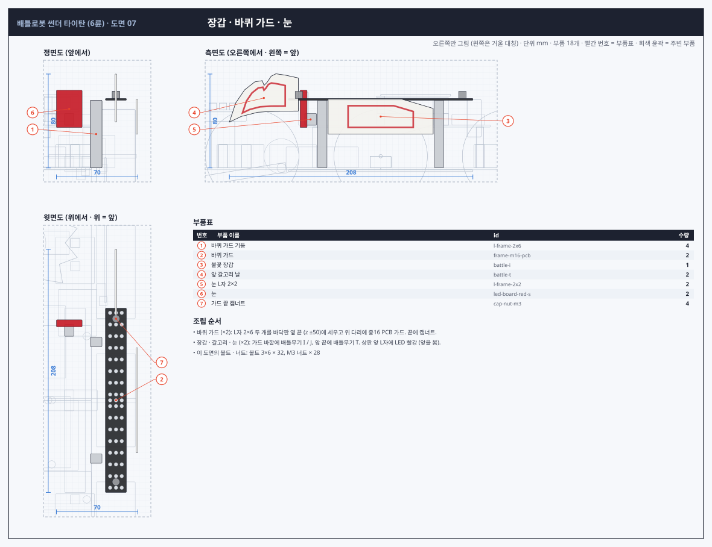
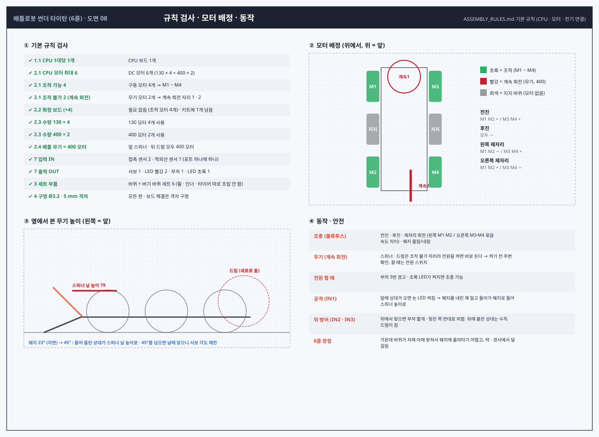
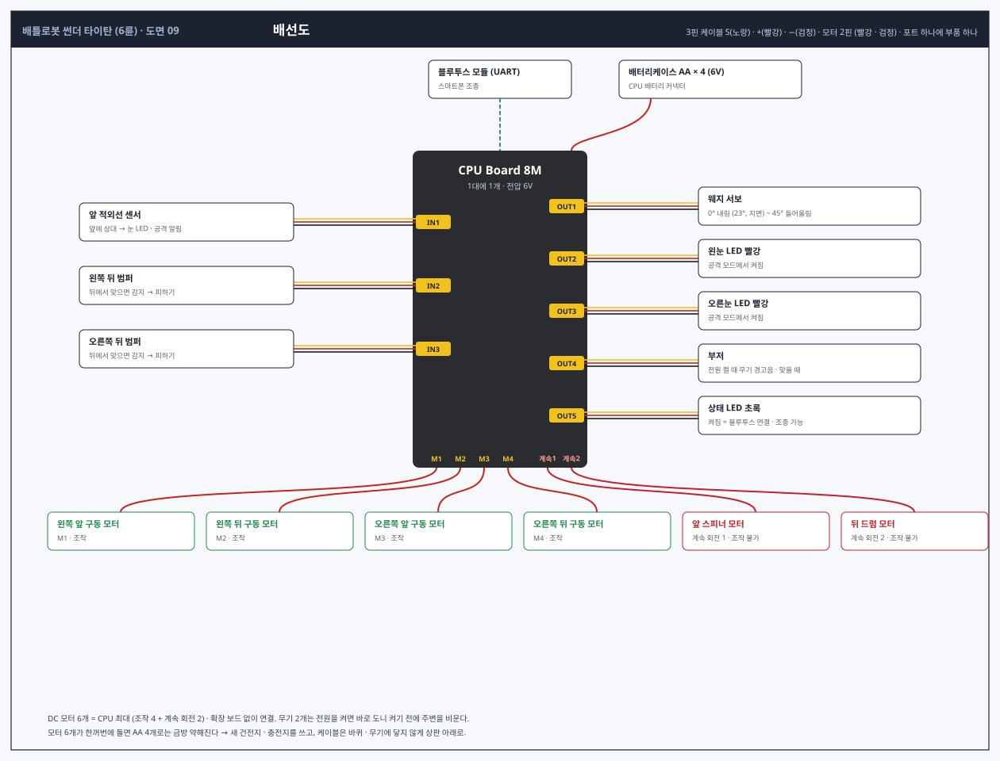

# 배틀로봇 썬더 타이탄 (6륜) 설계도면

기존 배틀로봇 "썬더 웨지"(무한궤도)를 **바퀴 6개로 바꾸고 크게** 만든 설계입니다. 기본 조립 규칙 [`ASSEMBLY_RULES.md`](../ASSEMBLY_RULES.md)를 따릅니다.
이 문서와 도면은 `python3 tools/bigbot_blueprint.py`로 다시 만듭니다. 그림으로 보기: [`blueprint.html`](blueprint.html)

## 1. 디자인 포인트

- **① 6륜 = 구동 4 + 지지 2** — 모터는 130 × 4 + 400 × 2 = 6개가 전부이고 무기에 400 두 개를 쓰므로, 바퀴를 돌릴 모터는 130 네 개. 앞 · 뒤 바퀴 4개를 구동하고 가운데 2개는 축에서 헛도는 지지 바퀴로 둔다 (확장 보드 없이 CPU 조작 자리 4개에 딱 맞음).
- **② 크게 = 바닥판 2장** — 빅 메인 PCB 2장을 앞뒤로 잇고 아래에 중16 PCB 2개로 묶어 길이 316 mm. 바퀴 간격 110 mm × 3줄 → 기존 썬더 웨지보다 길이 약 1.6배, 폭 약 1.1배.
- **③ 축 높이 하나로 통일 (40 mm)** — 구동 모터는 눕혀서 축이 지면 40, 가운데 축은 축가이드 구멍이 지면 40. 버기 바퀴 Ø80 6개가 모두 같은 높이로 지면에 닿아 흔들리지 않는다. 지면 높이 28 mm.
- **④ 무기 2개 = 400 모터 2개 (계속 회전)** — 앞: 수평 스피너 (배틀무기 U 세트 = 별 조각 3장, 지름 97). 뒤: 수직 드럼 (배틀무기 S가 세로로 돎, 모터를 세워 축 높이 59) — 뒤에 붙는 상대를 친다. 둘 다 조작 불가 자리라 전원을 켜면 계속 돈다.
- **⑤ 웨지 + 스피너 조합 유지** — 서보 웨지가 23° (지면)에서 45°까지 들어 올려 상대를 스피너 날 높이로 보낸다. 45°를 넘으면 날에 닿으므로 서보 각도를 제한.
- **⑥ 무게 중심 낮게 · 가운데** — 배터리는 바닥판 앞쪽 가운데, 모터 6개 모두 바닥판 위 낮게. 상판에는 CPU · 블루투스 · 센서처럼 가벼운 것만.
- **⑦ 전기 연결은 규칙 7장대로** — 입력: 적외선 1 (앞 상대) · 접촉 2 (뒤 범퍼). 출력: 서보 1 · LED 빨강 2 (눈) · 부저 · LED 초록 (상태). 포트 하나에 부품 하나.
- **⑧ 세트 부품 · 구멍 통일** — 바퀴는 버기 바퀴 세트 하나로 조립 (휠 · 인너 · 타이어 따로 안 함). 모든 체결은 Ø3.2 · 5 mm 격자 구멍.

## 2. 기존 썬더 웨지와 비교

| 항목 | 썬더 웨지 (기존) | 썬더 타이탄 6륜 (이번) |
|---|---|---|
| 크기 | 약 218 × 108 × 266 mm | 약 198 × 111 × 420 mm |
| 바닥판 | 빅 메인 PCB 1장 | 빅 메인 PCB 2장 + 중16 이음판 2 |
| 구동 | 무한궤도 2줄, 130 × 2 | 버기 바퀴 6개 (구동 4 · 지지 2), 130 × 4 |
| 무기 | 수평 스피너 (400, 확장 보드 경유) + 웨지 | 수평 스피너 + 뒤 수직 드럼 (400 × 2, 계속 회전 자리) + 웨지 |
| 모터 연결 | CPU 2 + 확장 보드 1 | CPU 6 (조작 4 + 계속 회전 2), 확장 보드 없음 |
| 센서 · 출력 | 컬러 · RGB LED 포함 (지금 규칙 목록 밖) | 규칙 7장 목록만 (적외선 · 접촉 · 서보 · LED · 부저) |

## 3. 기본 규칙 검사

| 규칙 | 이 설계 | 결과 |
|---|---|---|
| 1.1 CPU 1대당 1개 | CPU 보드 1개 | ✔ |
| 2.1 CPU 모터 최대 6 | DC 모터 6개 (130 × 4 + 400 × 2) | ✔ |
| 2.1 조작 가능 4 | 구동 모터 4개 → M1 ~ M4 | ✔ |
| 2.1 조작 불가 2 (계속 회전) | 무기 모터 2개 → 계속 회전 자리 1 · 2 | ✔ |
| 2.2 확장 보드 (+4) | 필요 없음 (조작 모터 4개) · 키트에 1개 남음 | ✔ |
| 2.3 수량 130 × 4 | 130 모터 4개 사용 | ✔ |
| 2.3 수량 400 × 2 | 400 모터 2개 사용 | ✔ |
| 2.4 배틀 무기 = 400 모터 | 앞 스피너 · 뒤 드럼 모두 400 모터 | ✔ |
| 7 입력 IN | 접촉 센서 2 · 적외선 센서 1 (포트 하나에 하나) | ✔ |
| 7 출력 OUT | 서보 1 · LED 빨강 2 · 부저 1 · LED 초록 1 | ✔ |
| 3 세트 부품 | 바퀴 = 버기 바퀴 세트 6 (휠 · 인너 · 타이어 따로 조립 안 함) | ✔ |
| 4 구멍 Ø3.2 · 5 mm 격자 | 모든 판 · 보드 체결은 격자 구멍 | ✔ |

## 4. 개요

| 항목 | 값 |
|---|---|
| 전체 크기 | 폭 198 × 높이 111 × 길이 420 mm |
| 무게 (추정) | 약 1398 g |
| 구동 | 버기 바퀴 Ø80 × 6 (앞 · 뒤 구동, 가운데 지지), DC 130rpm × 4, 속도 약 0.54 m/s |
| 무기 | 앞 수평 스피너 (날 끝 2.03 m/s) · 뒤 수직 드럼 (날 끝 2.01 m/s) · 서보 웨지 (23° ~ 45°) |
| 조종 | 블루투스 (스마트폰) |
| 부품 수 | 414개 (볼트 · 너트 · 케이블 포함), 39종 |

## 5. 도면

### 도면 00 · 전체 조립도

### 도면 01 · 섀시 (빅 메인 PCB 2장 · 이음판 · 배터리)

### 도면 02 · 6륜 구동부 (구동 모터 4 · 버기 바퀴 6 · 가운데 축)

### 도면 03 · 앞 수평 스피너 (DC 400rpm · 별 날 U 세트)

### 도면 04 · 들어올림 웨지 (서보 · 링크)

### 도면 05 · 뒤 수직 드럼 (DC 400rpm · 배틀무기 S)

### 도면 06 · 상판 · 전자부 (CPU · 블루투스 · 센서 · LED)

### 도면 07 · 장갑 · 바퀴 가드 · 눈

### 도면 08 · 규칙 검사 · 모터 배정 · 동작

### 도면 09 · 배선도

## 6. 파트별 부품 위치

좌표는 부품 중심 (mm, 원점 = 지면 위 로봇 가운데, 앞 = −Z), 크기는 X × Y × Z. 번호는 도면의 빨간 번호입니다.

### 01 섀시 (빅 메인 PCB 2장 · 이음판 · 배터리)

| 번호 | 부품 | id | 중심 (X, Y, Z) | 크기 | 방향 · 메모 |
|---|---|---|---|---|---|
| 1 | 차체 바닥판 앞 (빅 메인 PCB) | `frame-big-main` | (0, 29.2, -79.0) | 118.0 × 1.6 × 158.0 | 수평 · 긴 쪽이 앞뒤 · z -158 ~ 0 |
| 2 | 차체 바닥판 뒤 (빅 메인 PCB) | `frame-big-main` | (0, 29.2, 79.0) | 118.0 × 1.6 × 158.0 | 수평 · 긴 쪽이 앞뒤 · z 0 ~ 158 |
| 3 | 이음판 (중16 PCB, 두 바닥판 아래) | `frame-m16-pcb` | (-45, 27.6, 0.0) | 18.0 × 1.6 × 158.0 | 바닥판 아래에서 이음선(z 0)을 가로질러 앞뒤 판에 볼트 4개씩 |
| 3 | 이음판 (중16 PCB, 두 바닥판 아래) | `frame-m16-pcb` | (45, 27.6, 0.0) | 18.0 × 1.6 × 158.0 | 바닥판 아래에서 이음선(z 0)을 가로질러 앞뒤 판에 볼트 4개씩 |
| 4 | 배터리케이스 (AA 4개, 6V) | `battery-case-4aa` | (0, 39.0, -50.0) | 74.0 × 18.0 × 62.0 | 앞 바퀴와 가운데 바퀴 사이 · 가장 낮게 (무게 중심) |

### 02 6륜 구동부 (구동 모터 4 · 버기 바퀴 6 · 가운데 축)

| 번호 | 부품 | id | 중심 (X, Y, Z) | 크기 | 방향 · 메모 |
|---|---|---|---|---|---|
| 1 | 구동 모터 받침 (모터프레임 3×3) | `motor-frame-3x3` | (-45, 40.0, -135.0) | 8.0 × 20.0 × 8.0 | 바닥판 위, 모터 귀를 잡음 |
| 1 | 구동 모터 받침 (모터프레임 3×3) | `motor-frame-3x3` | (-45, 40.0, -115.0) | 8.0 × 20.0 × 8.0 | 바닥판 위, 모터 귀를 잡음 |
| 2 | 왼 앞 구동 모터 (DC 130rpm) | `dc-motor-130-rs` | (-45, 40.0, -120.0) | 33.0 × 20.0 × 40.0 | 옆으로 눕힘, 축이 바깥(±X) · z -110 |
| 3 | 왼 앞 구동 바퀴 (Ø80 버기 세트) | `wheel-80-buggy-set` | (-80, 40.0, -110.0) | 33.0 × 80.0 × 80.0 | 모터 D컷 축에 끼움 + 2.6 × 10 |
| 1 | 구동 모터 받침 (모터프레임 3×3) | `motor-frame-3x3` | (-45, 40.0, 85.0) | 8.0 × 20.0 × 8.0 | 바닥판 위, 모터 귀를 잡음 |
| 1 | 구동 모터 받침 (모터프레임 3×3) | `motor-frame-3x3` | (-45, 40.0, 105.0) | 8.0 × 20.0 × 8.0 | 바닥판 위, 모터 귀를 잡음 |
| 4 | 왼 뒤 구동 모터 (DC 130rpm) | `dc-motor-130-rs` | (-45, 40.0, 100.0) | 33.0 × 20.0 × 40.0 | 옆으로 눕힘, 축이 바깥(±X) · z 110 |
| 5 | 왼 뒤 구동 바퀴 (Ø80 버기 세트) | `wheel-80-buggy-set` | (-80, 40.0, 110.0) | 33.0 × 80.0 × 80.0 | 모터 D컷 축에 끼움 + 2.6 × 10 |
| 6 | 가운데 축가이드 | `axle-guide` | (-30, 35.0, 0.0) | 28.0 × 10.0 × 18.0 | 이음선 위 (구멍 2개씩 앞 · 뒤 판), 축 높이 40 |
| 6 | 가운데 축가이드 | `axle-guide` | (-50, 35.0, 0.0) | 28.0 × 10.0 × 18.0 | 이음선 위 (구멍 2개씩 앞 · 뒤 판), 축 높이 40 |
| 7 | 왼 가운데 축 (75 mm) | `shaft-75` | (-60, 40.0, 0.0) | 75.0 × 3.0 × 3.0 | x ±22.5 ~ ±97.5 |
| 8 | 왼 가운데 지지 바퀴 (Ø80 버기 세트, 헛돎) | `wheel-80-buggy-set` | (-80, 40.0, 0.0) | 33.0 × 80.0 × 80.0 | 둥근 축에서 헛돎 · 6륜 접지 |
| 1 | 구동 모터 받침 (모터프레임 3×3) | `motor-frame-3x3` | (45, 40.0, -135.0) | 8.0 × 20.0 × 8.0 | 바닥판 위, 모터 귀를 잡음 |
| 1 | 구동 모터 받침 (모터프레임 3×3) | `motor-frame-3x3` | (45, 40.0, -115.0) | 8.0 × 20.0 × 8.0 | 바닥판 위, 모터 귀를 잡음 |
| 2 | 오른 앞 구동 모터 (DC 130rpm) | `dc-motor-130-rs` | (45, 40.0, -120.0) | 33.0 × 20.0 × 40.0 | 옆으로 눕힘, 축이 바깥(±X) · z -110 |
| 3 | 오른 앞 구동 바퀴 (Ø80 버기 세트) | `wheel-80-buggy-set` | (80, 40.0, -110.0) | 33.0 × 80.0 × 80.0 | 모터 D컷 축에 끼움 + 2.6 × 10 |
| 1 | 구동 모터 받침 (모터프레임 3×3) | `motor-frame-3x3` | (45, 40.0, 85.0) | 8.0 × 20.0 × 8.0 | 바닥판 위, 모터 귀를 잡음 |
| 1 | 구동 모터 받침 (모터프레임 3×3) | `motor-frame-3x3` | (45, 40.0, 105.0) | 8.0 × 20.0 × 8.0 | 바닥판 위, 모터 귀를 잡음 |
| 4 | 오른 뒤 구동 모터 (DC 130rpm) | `dc-motor-130-rs` | (45, 40.0, 100.0) | 33.0 × 20.0 × 40.0 | 옆으로 눕힘, 축이 바깥(±X) · z 110 |
| 5 | 오른 뒤 구동 바퀴 (Ø80 버기 세트) | `wheel-80-buggy-set` | (80, 40.0, 110.0) | 33.0 × 80.0 × 80.0 | 모터 D컷 축에 끼움 + 2.6 × 10 |
| 6 | 가운데 축가이드 | `axle-guide` | (30, 35.0, 0.0) | 28.0 × 10.0 × 18.0 | 이음선 위 (구멍 2개씩 앞 · 뒤 판), 축 높이 40 |
| 6 | 가운데 축가이드 | `axle-guide` | (50, 35.0, 0.0) | 28.0 × 10.0 × 18.0 | 이음선 위 (구멍 2개씩 앞 · 뒤 판), 축 높이 40 |
| 7 | 오른 가운데 축 (75 mm) | `shaft-75` | (60, 40.0, 0.0) | 75.0 × 3.0 × 3.0 | x ±22.5 ~ ±97.5 |
| 8 | 오른 가운데 지지 바퀴 (Ø80 버기 세트, 헛돎) | `wheel-80-buggy-set` | (80, 40.0, 0.0) | 33.0 × 80.0 × 80.0 | 둥근 축에서 헛돎 · 6륜 접지 |

### 03 앞 수평 스피너 (DC 400rpm · 별 날 U 세트)

| 번호 | 부품 | id | 중심 (X, Y, Z) | 크기 | 방향 · 메모 |
|---|---|---|---|---|---|
| 1 | 앞 스피너 모터 (DC 400rpm) | `dc-motor-400-rs` | (10, 50.0, -135.0) | 60.0 × 40.0 × 20.0 | 세움, 축이 위 · 가운데 |
| 2 | 스피너 모터 받침 (모터프레임 3×3) | `motor-frame-3x3` | (-25, 40.0, -135.0) | 8.0 × 20.0 × 8.0 | 모터 귀를 바닥판에 |
| 2 | 스피너 모터 받침 (모터프레임 3×3) | `motor-frame-3x3` | (45, 40.0, -135.0) | 8.0 × 20.0 × 8.0 | 모터 귀를 바닥판에 |
| 3 | 스피너 허브 (노란 휠가이드 Ø40) | `wheel-guide-40-yellow` | (0, 74.0, -135.0) | 40.0 × 8.0 × 40.0 | 모터 축 + 2.6 × 10, 십자 구멍 4개 |
| 4 | 스피너 날 (배틀무기 U 세트, 별 지름 97) | `battle-u-set` | (0, 78.8, -135.0) | 97.0 × 1.6 × 97.0 | 별 조각 3장을 120°씩 모아 허브 위에 (가운데 구멍 6개) |
| 5 | 날 고정 캡너트 | `cap-nut-m3` | (5, 82.6, -126.3) | 6.4 × 6.0 × 6.4 | 볼트 끝 가림 |
| 5 | 날 고정 캡너트 | `cap-nut-m3` | (10, 82.6, -135.0) | 6.4 × 6.0 × 6.4 | 볼트 끝 가림 |
| 5 | 날 고정 캡너트 | `cap-nut-m3` | (5, 82.6, -143.7) | 6.4 × 6.0 × 6.4 | 볼트 끝 가림 |
| 5 | 날 고정 캡너트 | `cap-nut-m3` | (-5, 82.6, -143.7) | 6.4 × 6.0 × 6.4 | 볼트 끝 가림 |
| 5 | 날 고정 캡너트 | `cap-nut-m3` | (-10, 82.6, -135.0) | 6.4 × 6.0 × 6.4 | 볼트 끝 가림 |
| 5 | 날 고정 캡너트 | `cap-nut-m3` | (-5, 82.6, -126.3) | 6.4 × 6.0 × 6.4 | 볼트 끝 가림 |

### 04 들어올림 웨지 (서보 · 링크)

| 번호 | 부품 | id | 중심 (X, Y, Z) | 크기 | 방향 · 메모 |
|---|---|---|---|---|---|
| 1 | 웨지판 (메인 PCB, 23° 경사) | `frame-main-pcb` | (0, 15.0, -194.0) | 118.0 × 31.6 × 72.0 | 뒤 끝이 바닥판 앞 끝에서 돌고, 앞 끝은 지면 |
| 2 | 웨지 경첩 L자 2×1 | `l-frame-2x1` | (-50, 25.0, -155.0) | 8.0 × 10.0 × 8.0 | 바닥판 앞 끝 · 웨지 뒤 끝 |
| 3 | 웨지 회전 핀 (후크 S35) | `s-hook-35` | (-54, 27.0, -156.0) | 6.5 × 7.6 × 6.5 | 경첩 대신 돌아가는 핀 |
| 2 | 웨지 경첩 L자 2×1 | `l-frame-2x1` | (50, 25.0, -155.0) | 8.0 × 10.0 × 8.0 | 바닥판 앞 끝 · 웨지 뒤 끝 |
| 3 | 웨지 회전 핀 (후크 S35) | `s-hook-35` | (54, 27.0, -156.0) | 6.5 × 7.6 × 6.5 | 경첩 대신 돌아가는 핀 |
| 4 | 웨지 서보 (OUT1) | `servo-digital` | (47, 40.0, -75.0) | 33.0 × 20.0 × 40.0 | 눕힘, 축이 바깥(+X) · 앞쪽 끝 |
| 5 | 웨지 크랭크 (휠가이드 서보) | `wheel-guide-30-servo` | (67.5, 40.0, -85.0) | 8.0 × 30.0 × 30.0 | 서보 축, 반지름 10 구멍에 핀 |
| 6 | 웨지 링크 (중16 PCB, 핀 간격 111) | `frame-m16-pcb` | (71, 21.0, -140.0) | 1.6 × 35.8 × 112.9 | 크랭크 핀과 웨지 탭을 후크 S35로 (구멍 간격 10의 배수에 맞춰 핀 위치 조정) |
| 7 | 링크 위 핀 (후크 S35) | `s-hook-35` | (69, 30.0, -85.0) | 6.5 × 6.5 × 7.6 | 크랭크 쪽 |
| 8 | 링크 아래 핀 (후크 S35) | `s-hook-35` | (69, 12.0, -195.0) | 6.5 × 6.5 × 7.6 | 웨지 탭 쪽 |
| 9 | 웨지 링크 탭 L자 2×2 | `l-frame-2x2` | (63, 13.0, -195.0) | 10.0 × 10.0 × 8.0 | 웨지판 위에 세움 |
| 10 | 웨지 앞 날 (배틀무기 G) | `battle-g` | (0, 2.0, -224.0) | 98.0 × 1.6 × 20.0 | 웨지 앞 끝 위, 낮은 날 |

### 05 뒤 수직 드럼 (DC 400rpm · 배틀무기 S)

| 번호 | 부품 | id | 중심 (X, Y, Z) | 크기 | 방향 · 메모 |
|---|---|---|---|---|---|
| 1 | 뒤 드럼 모터 (DC 400rpm) | `dc-motor-400-rs` | (-27, 69.0, 145.0) | 40.0 × 60.0 × 20.0 | 세움 (긴 쪽이 위), 축이 오른쪽(+X) · 축 높이 59 |
| 2 | 드럼 모터 받침 (모터프레임 3×3) | `motor-frame-3x3` | (-6, 40.0, 137.0) | 8.0 × 20.0 × 8.0 | 바닥판 뒤 가운데, 모터 아래 귀를 잡음 |
| 2 | 드럼 모터 받침 (모터프레임 3×3) | `motor-frame-3x3` | (-6, 40.0, 153.0) | 8.0 × 20.0 × 8.0 | 바닥판 뒤 가운데, 모터 아래 귀를 잡음 |
| 3 | 드럼 허브 (노란 휠가이드 Ø40) | `wheel-guide-40-yellow` | (12, 59.0, 145.0) | 8.0 × 40.0 × 40.0 | 모터 축 + 2.6 × 10, 축 = X |
| 4 | 드럼 날 (배틀무기 S, 세로로 돎) | `battle-s` | (16.8, 61.5, 145.0) | 1.6 × 92.0 × 82.0 | 가운데 큰 구멍을 허브에 · 꽃잎 홈 2곳 볼트, 세로 원을 그리며 돎 |
| 5 | 드럼 날 캡너트 | `cap-nut-m3` | (20.6, 59.0, 132.0) | 6.0 × 6.4 × 6.4 |  |
| 5 | 드럼 날 캡너트 | `cap-nut-m3` | (20.6, 59.0, 158.0) | 6.0 × 6.4 × 6.4 |  |

### 06 상판 · 전자부 (CPU · 블루투스 · 센서 · LED)

| 번호 | 부품 | id | 중심 (X, Y, Z) | 크기 | 방향 · 메모 |
|---|---|---|---|---|---|
| 1 | 상판 기둥 (서포트 35) | `support-spacer` | (-55, 47.5, -55.0) | 6.4 × 35.0 × 6.4 | 바닥판 → 상판 |
| 1 | 상판 기둥 (서포트 35) | `support-spacer` | (-55, 47.5, 85.0) | 6.4 × 35.0 × 6.4 | 바닥판 → 상판 |
| 1 | 상판 기둥 (서포트 35) | `support-spacer` | (55, 47.5, -55.0) | 6.4 × 35.0 × 6.4 | 바닥판 → 상판 |
| 1 | 상판 기둥 (서포트 35) | `support-spacer` | (55, 47.5, 85.0) | 6.4 × 35.0 × 6.4 | 바닥판 → 상판 |
| 2 | 상판 (빅 메인 PCB) | `frame-big-main` | (0, 65.8, 15.0) | 118.0 × 1.6 × 158.0 | z −64 ~ 94 (앞 = 스피너 자리, 뒤 = 드럼 자리는 비움) |
| 3 | CPU 받침 (서포트 10) | `support-spacer` | (-25, 71.6, 0.0) | 6.4 × 10.0 × 6.4 |  |
| 3 | CPU 받침 (서포트 10) | `support-spacer` | (-25, 71.6, 55.0) | 6.4 × 10.0 × 6.4 |  |
| 3 | CPU 받침 (서포트 10) | `support-spacer` | (25, 71.6, 0.0) | 6.4 × 10.0 × 6.4 |  |
| 3 | CPU 받침 (서포트 10) | `support-spacer` | (25, 71.6, 55.0) | 6.4 × 10.0 × 6.4 |  |
| 4 | CPU 보드 8M (로봇 1대에 1개) | `cpu-board-8m` | (0, 83.6, 27.5) | 83.0 × 14.0 × 61.0 | 상판 가운데, 전압 스위치 6V |
| 5 | 블루투스 모듈 (조종) | `bt-module` | (35, 71.4, 75.0) | 48.0 × 9.0 × 28.0 | 상판 오른쪽 뒤 |
| 6 | 덮개 기둥 (서포트 25) | `support-spacer` | (-12, 79.1, 0.0) | 6.4 × 25.0 × 6.4 | CPU 위 덮개 |
| 6 | 덮개 기둥 (서포트 25) | `support-spacer` | (22, 79.1, 0.0) | 6.4 × 25.0 × 6.4 | CPU 위 덮개 |
| 7 | 투명 윗덮개 (PC 프레임) | `pc-frame-45x60` | (-25, 92.4, 30.0) | 45.0 × 1.6 × 60.0 | CPU를 보며 보호 |
| 7 | 투명 윗덮개 (PC 프레임) | `pc-frame-45x60` | (25, 92.4, 30.0) | 45.0 × 1.6 × 60.0 | CPU를 보며 보호 |
| 8 | 앞 센서 L자 2×2 | `l-frame-2x2` | (-35, 71.6, -60.0) | 8.0 × 10.0 × 10.0 | 상판 앞 끝 |
| 9 | 앞 적외선 센서 (IN1, 상대 감지) | `sensor-ir-tr` | (-35, 80.6, -66.0) | 48.0 × 28.0 × 9.0 | 세움, 앞(−Z)을 봄 · 스피너 위로 내다봄 |
| 10 | 부저 (OUT4, 경고음) | `buzzer-board-s` | (-40, 72.6, 80.0) | 22.0 × 32.0 × 12.0 | 상판 왼쪽 뒤 |
| 11 | 상태 LED 초록 (OUT5, 준비 · 조종 중) | `led-board-green-s` | (-10, 72.6, 80.0) | 22.0 × 32.0 × 12.0 | 상판 뒤 |
| 12 | 뒤 범퍼 L자 2×2 | `l-frame-2x2` | (-55, 35.0, 155.0) | 8.0 × 10.0 × 10.0 | 바닥판 뒤 끝 |
| 13 | 왼쪽 뒤 범퍼 (접촉 센서, IN2) | `sensor-touch` | (-55, 44.0, 161.0) | 48.0 × 28.0 × 9.0 | 세움, 버튼이 뒤 · 드럼 옆 |
| 12 | 뒤 범퍼 L자 2×2 | `l-frame-2x2` | (55, 35.0, 155.0) | 8.0 × 10.0 × 10.0 | 바닥판 뒤 끝 |
| 13 | 오른쪽 뒤 범퍼 (접촉 센서, IN3) | `sensor-touch` | (55, 44.0, 161.0) | 48.0 × 28.0 × 9.0 | 세움, 버튼이 뒤 · 드럼 옆 |

### 07 장갑 · 바퀴 가드 · 눈

| 번호 | 부품 | id | 중심 (X, Y, Z) | 크기 | 방향 · 메모 |
|---|---|---|---|---|---|
| 1 | 바퀴 가드 기둥 (L자 2×6) | `l-frame-2x6` | (-63, 59.0, -50.0) | 10.0 × 58.0 × 8.0 | 바닥판 옆 끝에 세움, 위 다리가 바깥 |
| 1 | 바퀴 가드 기둥 (L자 2×6) | `l-frame-2x6` | (-63, 59.0, 50.0) | 10.0 × 58.0 × 8.0 | 바닥판 옆 끝에 세움, 위 다리가 바깥 |
| 2 | 왼 바퀴 가드 (중16 PCB) | `frame-m16-pcb` | (-80, 88.8, 0.0) | 18.0 × 1.6 × 158.0 | 가운데 바퀴 위 덮개 (바퀴 위 8 mm) |
| · | 왼 불꽃 장갑 (배틀무기 J) | `battle-j` | (-98, 74.0, 0.0) | 1.6 × 30.0 × 90.0 | 가드 바깥에 세움 (구멍 2개) |
| 4 | 왼 앞 갈고리 날 (배틀무기 T) | `battle-t` | (-80, 90.0, -100.0) | 1.6 × 41.0 × 59.0 | 가드 앞 끝, 앞 바퀴 위로 휘어짐 (T 반쪽 1장) |
| 5 | 눈 L자 2×2 | `l-frame-2x2` | (-40, 71.6, -60.0) | 8.0 × 10.0 × 10.0 |  |
| 6 | 왼눈 (LED 빨강, OUT2) | `led-board-red-s` | (-40, 80.6, -66.0) | 22.0 × 32.0 × 6.0 | 상판 앞 끝, 앞을 봄 |
| 7 | 가드 끝 캡너트 | `cap-nut-m3` | (-80, 92.6, -70.0) | 6.4 × 6.0 × 6.4 |  |
| 7 | 가드 끝 캡너트 | `cap-nut-m3` | (-80, 92.6, 70.0) | 6.4 × 6.0 × 6.4 |  |
| 1 | 바퀴 가드 기둥 (L자 2×6) | `l-frame-2x6` | (63, 59.0, -50.0) | 10.0 × 58.0 × 8.0 | 바닥판 옆 끝에 세움, 위 다리가 바깥 |
| 1 | 바퀴 가드 기둥 (L자 2×6) | `l-frame-2x6` | (63, 59.0, 50.0) | 10.0 × 58.0 × 8.0 | 바닥판 옆 끝에 세움, 위 다리가 바깥 |
| 2 | 오른 바퀴 가드 (중16 PCB) | `frame-m16-pcb` | (80, 88.8, 0.0) | 18.0 × 1.6 × 158.0 | 가운데 바퀴 위 덮개 (바퀴 위 8 mm) |
| 3 | 오른 불꽃 장갑 (배틀무기 I) | `battle-i` | (98, 74.0, 0.0) | 1.6 × 30.0 × 90.0 | 가드 바깥에 세움 (구멍 2개) |
| 4 | 오른 앞 갈고리 날 (배틀무기 T) | `battle-t` | (80, 90.0, -100.0) | 1.6 × 41.0 × 59.0 | 가드 앞 끝, 앞 바퀴 위로 휘어짐 (T 반쪽 1장) |
| 5 | 눈 L자 2×2 | `l-frame-2x2` | (40, 71.6, -60.0) | 8.0 × 10.0 × 10.0 |  |
| 6 | 오른눈 (LED 빨강, OUT3) | `led-board-red-s` | (40, 80.6, -66.0) | 22.0 × 32.0 × 6.0 | 상판 앞 끝, 앞을 봄 |
| 7 | 가드 끝 캡너트 | `cap-nut-m3` | (80, 92.6, -70.0) | 6.4 × 6.0 × 6.4 |  |
| 7 | 가드 끝 캡너트 | `cap-nut-m3` | (80, 92.6, 70.0) | 6.4 × 6.0 × 6.4 |  |

## 7. 조립 순서

| 도면 | 단계 | 방법 | 볼트 · 너트 등 |
|---|---|---|---|
| 01 | 바닥판 잇기 | 빅 메인 PCB 2장을 앞뒤로 맞대고, 아래에 중16 PCB 2개 (x ±45)를 이음선에 걸쳐 앞 판 · 뒤 판에 볼트 4개씩. | 볼트 3×6 × 16, M3 너트 × 16 |
| 01 | 배터리 | 배터리케이스를 앞 판 가운데 (z −50)에 귀 구멍 4개 M3 × 10. 가장 낮고 가운데. | 볼트 M3×10 × 4, M3 너트 × 4 |
| 02 | 구동 모듈 (×4) | 모터프레임 3×3 두 개로 DC 130rpm 모터를 옆으로 눕혀 (축이 바깥) 바닥판에. 앞 모터 z −120, 뒤 모터 z 100. | 볼트 M3×10 × 16, 볼트 3×6 × 16, M3 너트 × 32 |
| 02 | 구동 바퀴 (×4) | 버기 바퀴 세트를 모터 축에 끼우고 2.6 × 10으로 고정. 바퀴 가운데 x ±80. | 볼트 2.6×10 와셔붙이 × 4 |
| 02 | 가운데 지지 바퀴 (×2) | 축가이드 2개 (x ±30 · ±50, z 0)를 이음선 위에 (앞 · 뒤 판에 구멍 2개씩), 75 mm 축을 꿰고 바깥 끝에 버기 바퀴 세트 (헛돎). | 볼트 M3×10 × 8, M3 너트 × 8 |
| 03 | 앞 스피너 모터 | DC 400rpm 모터를 세워 모터프레임 3×3 두 개로 앞 판 앞쪽 가운데 (z −135)에. 축이 위. | 볼트 M3×10 × 4, 볼트 3×6 × 4, M3 너트 × 8 |
| 03 | 별 날 | 노란 휠가이드 Ø40을 모터 축에 (2.6 × 10). 배틀무기 U 세트 (별 조각 3장)를 120°씩 모아 가운데 구멍 6개에 M3 × 10 + 캡너트. | 볼트 2.6×10 와셔붙이 × 1, 볼트 M3×10 × 6 |
| 04 | 웨지 회전 핀 | 바닥판 앞 끝과 웨지판 뒤 끝에 L자 2×1을 달고, 두 구멍을 후크 S35로 눌러 끼워 돌게 한다 (좌우 2곳). | 볼트 3×6 × 4, M3 너트 × 4 |
| 04 | 웨지 서보 · 링크 | 서보를 앞 판 오른쪽 (z −75)에 눕혀 축 +X. 휠가이드(서보) 반지름 10 구멍과 웨지판 위 L자 2×2를 중16 PCB 링크로 잇는다 (양 끝 후크 S35). | 볼트 M3×10 × 4, M3 너트 × 4, 볼트 3×6 × 2 |
| 04 | 웨지 앞 날 | 배틀무기 G를 웨지판 앞 끝 위에 볼트 2개. | 볼트 3×6 × 2, M3 너트 × 2 |
| 05 | 뒤 드럼 | DC 400rpm 모터를 뒤 판 가운데 (z 145)에 세워 (축 +X, 높이 59) 모터프레임 2개로. 노란 휠가이드 Ø40에 배틀무기 S (가운데 큰 구멍 · 꽃잎 홈 2곳 볼트) + 캡너트. | 볼트 M3×10 × 6, 볼트 3×6 × 4, M3 너트 × 8, 볼트 2.6×10 와셔붙이 × 1 |
| 06 | 상판 | 서포트 35 네 개 (x ±55, z −55 · 85)를 바닥판에 세우고 (너트) 빅 메인 PCB 상판을 M3 × 6. | M3 너트 × 4, 볼트 3×6 × 4 |
| 06 | CPU · 블루투스 · 덮개 | 서포트 10 네 개 위에 CPU 보드 (구멍 Ø3.2 · 5 mm 격자, 전압 6V). 블루투스는 오른쪽 뒤 볼트 2개. 서포트 25 두 개 위에 투명 PC 프레임 2장. | M3 너트 × 8, 볼트 3×6 × 12 |
| 06 | 센서 · 출력 | 앞 L자에 적외선 센서 (앞을 봄), 뒤 L자 2개에 접촉 센서 (뒤 범퍼), 상판 뒤에 부저 · 초록 LED. | 볼트 3×6 × 14, M3 너트 × 14 |
| 07 | 바퀴 가드 (×2) | L자 2×6 두 개를 바닥판 옆 끝 (z ±50)에 세우고 위 다리에 중16 PCB 가드. 끝에 캡너트. | 볼트 3×6 × 16, M3 너트 × 12 |
| 07 | 장갑 · 갈고리 · 눈 (×2) | 가드 바깥에 배틀무기 I / J, 앞 끝에 배틀무기 T. 상판 앞 L자에 LED 빨강 (앞을 봄). | 볼트 3×6 × 16, M3 너트 × 16 |
| 09 | 배선 | 배선도대로. 구동 모터 4개는 CPU 조작 자리 M1 ~ M4, 무기 모터 2개는 계속 회전 자리 1 · 2. 뒤 범퍼 케이블은 헤더핀으로 400 mm. | 케이블 - 3Pin × 8, 헤더핀 3pin × 2 |

## 8. 배선

| 포트 | 부품 | 역할 |
|---|---|---|
| IN1 | 앞 적외선 센서 | 앞에 상대 → 눈 LED · 공격 알림 |
| IN2 | 왼쪽 뒤 범퍼 | 뒤에서 맞으면 감지 → 피하기 |
| IN3 | 오른쪽 뒤 범퍼 | 뒤에서 맞으면 감지 → 피하기 |
| OUT1 | 웨지 서보 | 0° 내림 (23°, 지면) ~ 45° 들어올림 |
| OUT2 | 왼눈 LED 빨강 | 공격 모드에서 켜짐 |
| OUT3 | 오른눈 LED 빨강 | 공격 모드에서 켜짐 |
| OUT4 | 부저 | 전원 켤 때 무기 경고음 · 맞을 때 |
| OUT5 | 상태 LED 초록 | 켜짐 = 블루투스 연결 · 조종 가능 |
| M1 | 왼쪽 앞 구동 모터 (DC 130) | 조작 · 왼쪽 묶음 (M2와 같은 명령) |
| M2 | 왼쪽 뒤 구동 모터 (DC 130) | 조작 · 왼쪽 묶음 |
| M3 | 오른쪽 앞 구동 모터 (DC 130) | 조작 · 오른쪽 묶음 (M4와 같은 명령) |
| M4 | 오른쪽 뒤 구동 모터 (DC 130) | 조작 · 오른쪽 묶음 |
| 계속1 | 앞 스피너 모터 (DC 400) | 조작 불가 · 전원이 켜지면 계속 회전 |
| 계속2 | 뒤 드럼 모터 (DC 400) | 조작 불가 · 전원이 켜지면 계속 회전 |
| UART | 블루투스 모듈 | 스마트폰 조종 (구동 · 웨지) |
| BATT | 배터리케이스 4AA 6V | CPU 6V → 모터 · 서보 공용 |

## 9. 동작 · 안전

| 상황 | 동작 |
|---|---|
| 조종 (블루투스) | 전진 · 후진 · 제자리 회전 (왼쪽 M1·M2 / 오른쪽 M3·M4 묶음 속도 차이) · 웨지 올림/내림 |
| 무기 (계속 회전) | 스피너 · 드럼은 조작 불가 자리라 전원을 켜면 바로 돈다 → 켜기 전 주변 확인, 끌 때는 전원 스위치 |
| 전원 켤 때 | 부저 3번 경고 · 초록 LED가 켜지면 조종 가능 |
| 공격 (IN1) | 앞에 상대가 오면 눈 LED 켜짐 → 웨지를 내린 채 밀고 들어가 웨지로 들어 스피너 높이로 |
| 뒤 방어 (IN2 · IN3) | 뒤에서 맞으면 부저 짧게 · 맞은 쪽 반대로 피함. 뒤에 붙은 상대는 수직 드럼이 침 |
| 6륜 장점 | 가운데 바퀴가 차체 아래 받쳐서 웨지에 올라타기 어렵고, 턱 · 경사에서 덜 걸림 |

## 10. 부품 목록 (BOM)

| 부품 id | 이름 | 수량 |
|---|---|---|
| `axle-guide` | 축가이드 | 4 |
| `battery-case-4aa` | AA 배터리케이스 1×4 | 1 |
| `battle-g` | 배틀무기 G | 1 |
| `battle-i` | 배틀무기 I | 1 |
| `battle-j` | 배틀무기 J | 1 |
| `battle-s` | 배틀무기 S | 1 |
| `battle-t` | 배틀무기 T | 2 |
| `battle-u-set` | 배틀무기 U 세트 (별 조각 3장) | 1 |
| `bt-module` | 무선 통신보드 (블루투스 모듈) | 1 |
| `buzzer-board-s` | Buzzer 보드[S] | 1 |
| `cpu-board-8m` | CPU Board 8M[12V/S] | 1 |
| `dc-motor-130-rs` | DC Motor 130rpm [RS] | 4 |
| `dc-motor-400-rs` | DC Motor 400rpm [RS] | 2 |
| `frame-big-main` | 프레임 Big Main PCB | 3 |
| `frame-m16-pcb` | 프레임 중16 [PCB] | 5 |
| `frame-main-pcb` | 프레임 Main PCB 8×12 | 1 |
| `l-frame-2x1` | 프레임 2x1 [L자] | 2 |
| `l-frame-2x2` | 프레임 2x2 [L자] | 6 |
| `l-frame-2x6` | 프레임 2x6 [L자] | 4 |
| `led-board-green-s` | LED 보드[초록/S] | 1 |
| `led-board-red-s` | LED 보드[빨강/S] | 2 |
| `motor-frame-3x3` | 모터프레임 [3x3] | 12 |
| `pc-frame-45x60` | PC프레임 [45×60] | 2 |
| `s-hook-35` | 후크 S35 [노랑] | 4 |
| `sensor-ir-tr` | 적외선 센서 보드[TR] | 1 |
| `sensor-touch` | 접촉 센서 보드 | 2 |
| `servo-digital` | Servo Motor[Digital] | 1 |
| `shaft-75` | 축 75mm[Ø3] | 2 |
| `support-spacer` | 서포트 (10 mm × 4 · 25 mm × 2 · 35 mm × 4) | 10 |
| `wheel-80-buggy-set` | 바퀴 Ø80 버기 세트 (휠 + 인너 + 타이어) | 6 |
| `wheel-guide-30-servo` | 휠가이드[Ø30/Servo] | 1 |
| `wheel-guide-40-yellow` | 휠가이드[Ø40-YELLOW] | 2 |
| `bolt-m26x10` | 볼트 2.6×10 와셔붙이 | 6 |
| `bolt-m3x10` | 볼트 M3×10 | 48 |
| `bolt-m3x6` | 볼트 3×6 | 110 |
| `cable-3pin` | 케이블 - 3Pin | 8 |
| `cap-nut-m3` | 캡너트 3Ø 회색 | 12 |
| `header-pin-3p` | 헤더핀 3pin | 2 |
| `nut-m3` | M3 너트 | 140 |
| | **합계** | **414** |
