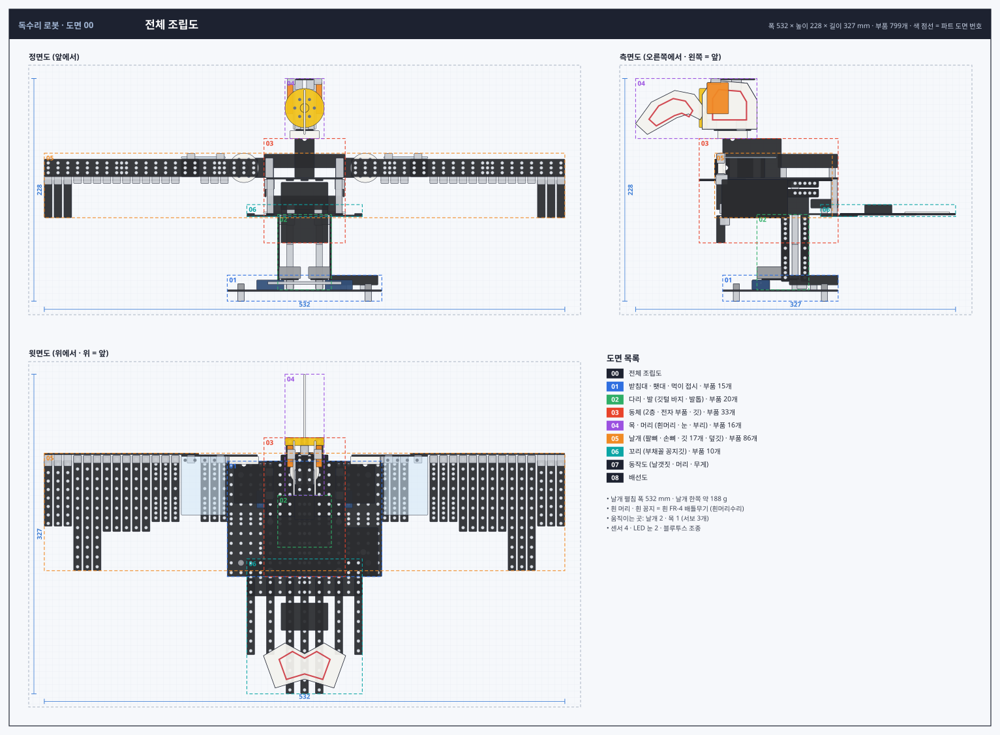
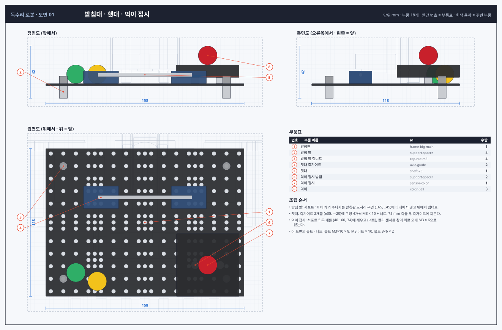
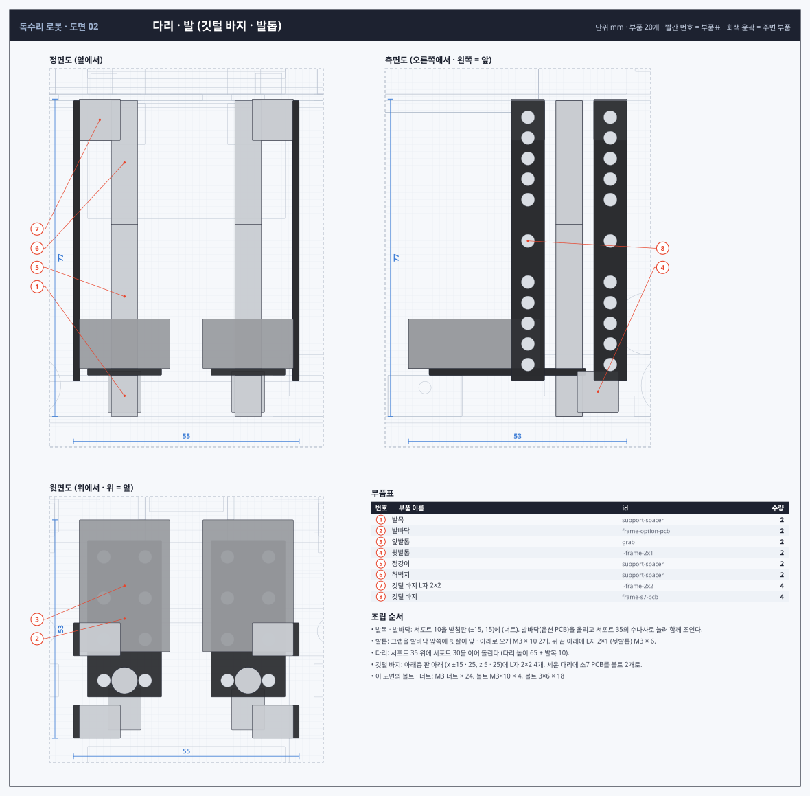
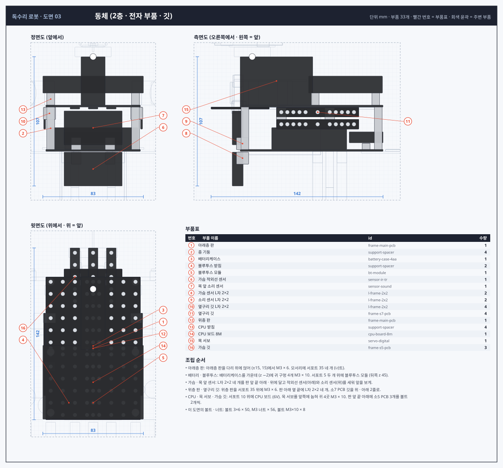
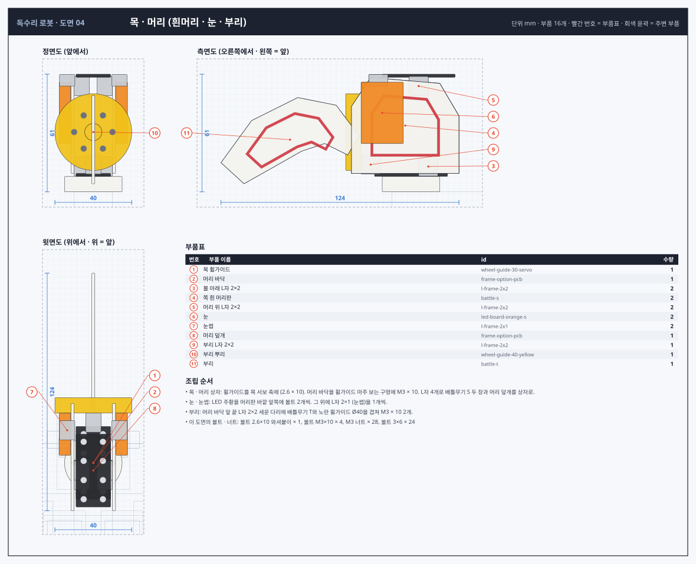
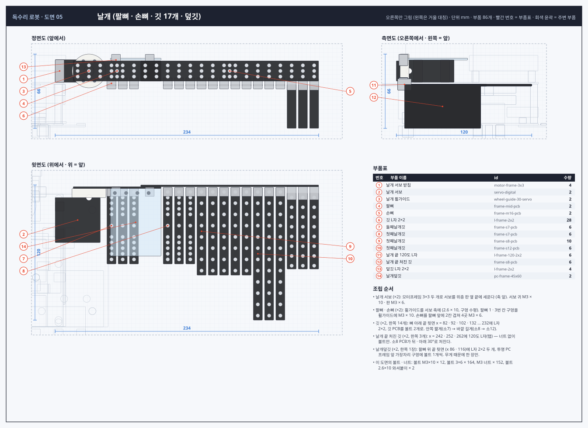
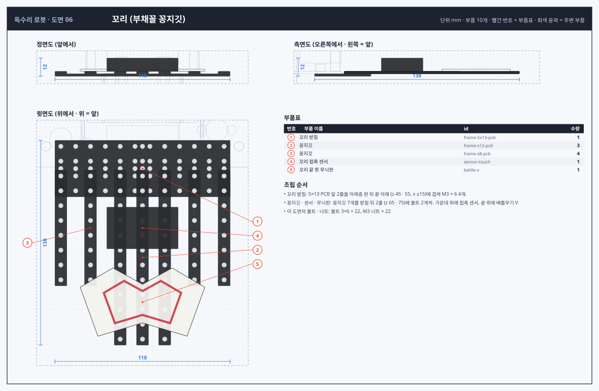
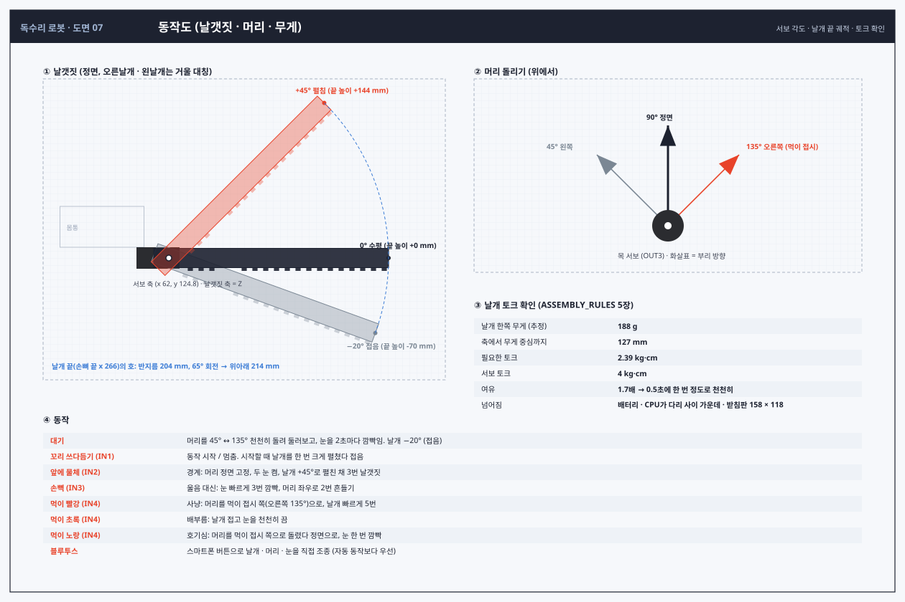
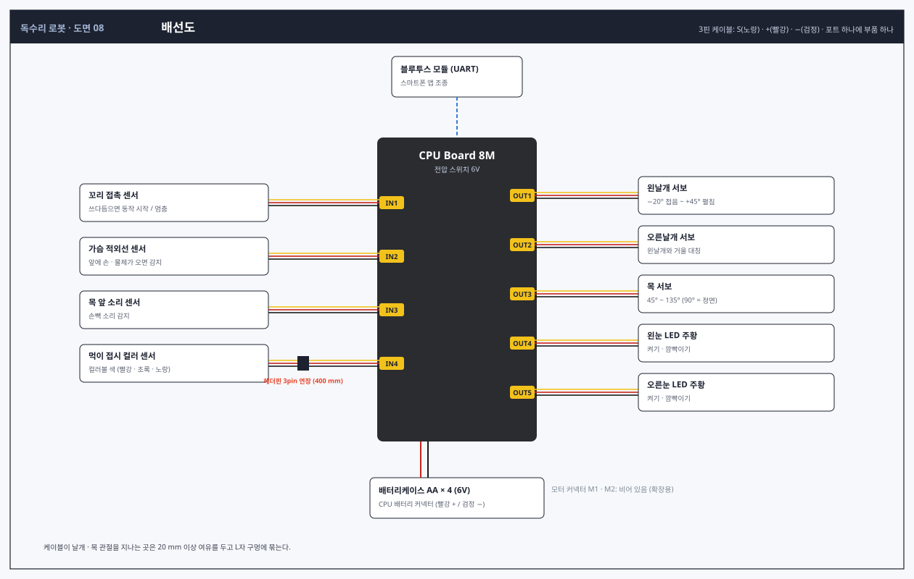

# 독수리 로봇 설계도면 (v2 상세)

이 저장소에서 만든 부품만 사용합니다. 조립 규칙은 [`ASSEMBLY_RULES.md`](../ASSEMBLY_RULES.md)를 따릅니다.
도면과 이 문서는 `python3 tools/eagle_blueprint.py`로 다시 만듭니다.

## 개요

흰머리수리가 횃대(75 mm 축)를 발톱(그랩)으로 움켜쥐고 앉아 있는 모습입니다.

- **날개:** 서보 2개가 날갯짓합니다. 날개는 팔뼈(중 PCB)와 손뼈(중16 PCB)를 이어 만들었습니다.
- **깃:** 한쪽 날개에 깃 17개(둘째날개깃 3 · 첫째날개깃 11 · 날개 끝 처진 깃 3)와 투명 날개덮깃 1장이 있습니다. 서보 힘에 맞춰 깃 길이와 덮깃 수를 줄였습니다.
- **머리:** 흰 배틀무기 S 두 장으로 흰 머리를 만들고, 노란 휠가이드(납막) · 배틀무기 T(갈고리 부리) · LED 주황 눈을 달았습니다. 목 서보가 머리를 좌우로 돌립니다.
- **몸통:** 2층 구조입니다. 가운데에 배터리, 위에 CPU 보드가 있습니다. 옆구리 깃 · 가슴 깃 · 깃털 바지로 깃털을 표현했습니다.
- **꼬리:** 꽁지깃 7개를 부채꼴로 달고, 끝에 흰 무늬판(배틀무기 V)을 얹었습니다.
- **센서:** 꼬리 쓰다듬기(접촉) · 앞 감지(적외선) · 손뼉(소리) · 먹이 접시에 올린 물건의 색(컬러 센서)에 반응합니다. 블루투스로 스마트폰 조종도 됩니다.

| 항목 | 값 |
|---|---|
| 전체 크기 | 폭 532 (날개 펼침) × 높이 228 × 길이 327 mm |
| 주요 높이 | 받침판 0 · 발바닥 10 · 아래층 판 76.6 · 위층 판 114.8 · 날개 축 124.8 · 머리 바닥 162.8 |
| 부품 수 | 799개 (볼트 · 너트 · 케이블 포함), 40종 |
| 날개 한쪽 | 약 188 g, 필요 토크 2.39 kg·cm (서보 4 kg·cm) |

## 도면

### 도면 00 · 전체 조립도

### 도면 01 · 받침대 · 횃대 · 먹이 접시

### 도면 02 · 다리 · 발 (깃털 바지 · 발톱)

### 도면 03 · 동체 (2층 · 전자 부품 · 깃)

### 도면 04 · 목 · 머리 (흰머리 · 눈 · 부리)

### 도면 05 · 날개 (팔뼈 · 손뼈 · 깃 17개 · 덮깃)

### 도면 06 · 꼬리 (부채꼴 꽁지깃)

### 도면 07 · 동작도 (날갯짓 · 머리 · 무게)

### 도면 08 · 배선도

## 파트별 부품 위치

좌표는 부품 중심(mm), 크기는 X × Y × Z입니다. 번호는 도면의 빨간 풍선 번호입니다.

### 01 받침대 · 횃대 · 먹이 접시

| 번호 | 부품 | id | 중심 (X, Y, Z) | 크기 | 방향 · 메모 |
|---|---|---|---|---|---|
| 1 | 받침판 (빅 메인 PCB) | `frame-big-main` | (0, -0.8, 0.0) | 158.0 × 1.6 × 118.0 | 수평 |
| 2 | 받침 발 (서포트 10) | `support-spacer` | (-65, -6.6, -45.0) | 6.4 × 10.0 × 6.4 | 수나사가 위, 받침판을 지나 캡너트 |
| 3 | 받침 발 캡너트 | `cap-nut-m3` | (-65, 3, -45.0) | 6.4 × 6.0 × 6.4 |  |
| 2 | 받침 발 (서포트 10) | `support-spacer` | (-65, -6.6, 45.0) | 6.4 × 10.0 × 6.4 | 수나사가 위, 받침판을 지나 캡너트 |
| 3 | 받침 발 캡너트 | `cap-nut-m3` | (-65, 3, 45.0) | 6.4 × 6.0 × 6.4 |  |
| 2 | 받침 발 (서포트 10) | `support-spacer` | (65, -6.6, -45.0) | 6.4 × 10.0 × 6.4 | 수나사가 위, 받침판을 지나 캡너트 |
| 3 | 받침 발 캡너트 | `cap-nut-m3` | (65, 3, -45.0) | 6.4 × 6.0 × 6.4 |  |
| 2 | 받침 발 (서포트 10) | `support-spacer` | (65, -6.6, 45.0) | 6.4 × 10.0 × 6.4 | 수나사가 위, 받침판을 지나 캡너트 |
| 3 | 받침 발 캡너트 | `cap-nut-m3` | (65, 3, 45.0) | 6.4 × 6.0 × 6.4 |  |
| 4 | 횃대 축가이드 | `axle-guide` | (-35, 5, -20.0) | 28.0 × 10.0 × 18.0 | 구멍 4개 (x ±10, z ±5) |
| 4 | 횃대 축가이드 | `axle-guide` | (35, 5, -20.0) | 28.0 × 10.0 × 18.0 | 구멍 4개 (x ±10, z ±5) |
| 5 | 횃대 (축 75mm) | `shaft-75` | (0, 7, -20.0) | 75.0 × 3.0 × 3.0 | 좌우 방향 나뭇가지, 발톱이 감쌈 |
| 6 | 먹이 접시 받침 (서포트 5) | `support-spacer` | (40, 2.5, 34.0) | 6.4 × 5.0 × 6.4 |  |
| 6 | 먹이 접시 받침 (서포트 5) | `support-spacer` | (60, 2.5, 34.0) | 6.4 × 5.0 × 6.4 |  |
| 7 | 먹이 접시 (컬러 센서, 창이 위) | `sensor-color` | (50, 10, 34.0) | 50.0 × 10.0 × 50.0 | 오른쪽 뒤, 창 위에 색 있는 물건을 올림 |

### 02 다리 · 발 (깃털 바지 · 발톱)

| 번호 | 부품 | id | 중심 (X, Y, Z) | 크기 | 방향 · 메모 |
|---|---|---|---|---|---|
| 1 | 왼발목 (서포트 10) | `support-spacer` | (-15, 5, 15.0) | 6.4 × 10.0 × 6.4 | 수나사가 아래, 받침판 + 너트 |
| 2 | 왼발바닥 (옵션 PCB) | `frame-option-pcb` | (-15, 10.8, 0.0) | 18.0 × 1.6 × 38.0 | 긴 쪽이 앞뒤 |
| 3 | 왼앞발톱 (그랩) | `grab` | (-15, 17.6, -8.0) | 22.0 × 12.0 × 32.0 | 빗살이 앞 · 아래로 횃대를 감쌈 |
| 4 | 왼뒷발톱 (L자 2×1) | `l-frame-2x1` | (-15, 6, 22.0) | 8.0 × 10.0 × 10.0 | 발바닥 뒤 끝 아래로 |
| 5 | 왼정강이 (서포트 35) | `support-spacer` | (-15, 29.1, 15.0) | 6.4 × 35.0 × 6.4 |  |
| 6 | 왼허벅지 (서포트 30) | `support-spacer` | (-15, 61.6, 15.0) | 6.4 × 30.0 × 6.4 | 아래층 판에 M3 × 6 |
| 7 | 깃털 바지 L자 2×2 | `l-frame-2x2` | (-21, 72, 5.0) | 10.0 × 10.0 × 8.0 | 아래층 판 아래, 세운 다리가 바깥 |
| 8 | 왼깃털 바지 (소7 PCB) | `frame-s7-pcb` | (-26.6, 42.6, 5.0) | 1.6 × 68.0 × 8.0 | 세움, 다리 바깥 |
| 7 | 깃털 바지 L자 2×2 | `l-frame-2x2` | (-21, 72, 25.0) | 10.0 × 10.0 × 8.0 | 아래층 판 아래, 세운 다리가 바깥 |
| 8 | 왼깃털 바지 (소7 PCB) | `frame-s7-pcb` | (-26.6, 42.6, 25.0) | 1.6 × 68.0 × 8.0 | 세움, 다리 바깥 |
| 1 | 오른발목 (서포트 10) | `support-spacer` | (15, 5, 15.0) | 6.4 × 10.0 × 6.4 | 수나사가 아래, 받침판 + 너트 |
| 2 | 오른발바닥 (옵션 PCB) | `frame-option-pcb` | (15, 10.8, 0.0) | 18.0 × 1.6 × 38.0 | 긴 쪽이 앞뒤 |
| 3 | 오른앞발톱 (그랩) | `grab` | (15, 17.6, -8.0) | 22.0 × 12.0 × 32.0 | 빗살이 앞 · 아래로 횃대를 감쌈 |
| 4 | 오른뒷발톱 (L자 2×1) | `l-frame-2x1` | (15, 6, 22.0) | 8.0 × 10.0 × 10.0 | 발바닥 뒤 끝 아래로 |
| 5 | 오른정강이 (서포트 35) | `support-spacer` | (15, 29.1, 15.0) | 6.4 × 35.0 × 6.4 |  |
| 6 | 오른허벅지 (서포트 30) | `support-spacer` | (15, 61.6, 15.0) | 6.4 × 30.0 × 6.4 | 아래층 판에 M3 × 6 |
| 7 | 깃털 바지 L자 2×2 | `l-frame-2x2` | (21, 72, 5.0) | 10.0 × 10.0 × 8.0 | 아래층 판 아래, 세운 다리가 바깥 |
| 8 | 오른깃털 바지 (소7 PCB) | `frame-s7-pcb` | (26.6, 42.6, 5.0) | 1.6 × 68.0 × 8.0 | 세움, 다리 바깥 |
| 7 | 깃털 바지 L자 2×2 | `l-frame-2x2` | (21, 72, 25.0) | 10.0 × 10.0 × 8.0 | 아래층 판 아래, 세운 다리가 바깥 |
| 8 | 오른깃털 바지 (소7 PCB) | `frame-s7-pcb` | (26.6, 42.6, 25.0) | 1.6 × 68.0 × 8.0 | 세움, 다리 바깥 |

### 03 동체 (2층 · 전자 부품 · 깃)

| 번호 | 부품 | id | 중심 (X, Y, Z) | 크기 | 방향 · 메모 |
|---|---|---|---|---|---|
| 1 | 아래층 판 (메인 PCB) | `frame-main-pcb` | (0, 77.4, 0.0) | 78.0 × 1.6 × 118.0 | 긴 쪽이 앞뒤 |
| 2 | 층 기둥 (서포트 35) | `support-spacer` | (-35, 95.7, -55.0) | 6.4 × 35.0 × 6.4 | 모서리 |
| 2 | 층 기둥 (서포트 35) | `support-spacer` | (-35, 95.7, 55.0) | 6.4 × 35.0 × 6.4 | 모서리 |
| 2 | 층 기둥 (서포트 35) | `support-spacer` | (35, 95.7, -55.0) | 6.4 × 35.0 × 6.4 | 모서리 |
| 2 | 층 기둥 (서포트 35) | `support-spacer` | (35, 95.7, 55.0) | 6.4 × 35.0 × 6.4 | 모서리 |
| 3 | 배터리케이스 (AA 4개, 6V) | `battery-case-4aa` | (0, 87.2, -2.0) | 74.0 × 18.0 × 62.0 | 가운데 (무게 중심) |
| 4 | 블루투스 받침 (서포트 5) | `support-spacer` | (-20, 80.7, 45.0) | 6.4 × 5.0 × 6.4 |  |
| 4 | 블루투스 받침 (서포트 5) | `support-spacer` | (20, 80.7, 45.0) | 6.4 × 5.0 × 6.4 |  |
| 5 | 블루투스 모듈 (스마트폰 조종) | `bt-module` | (0, 88.2, 45.0) | 48.0 × 9.0 × 28.0 | 아래층 뒤, UART → CPU |
| 6 | 가슴 적외선 센서 (앞 감지) | `sensor-ir-tr` | (0, 62, -61.0) | 48.0 × 28.0 × 9.0 | 판 아래 매달림, 앞(−Z)을 봄 |
| 7 | 목 앞 소리 센서 | `sensor-sound` | (0, 96, -61.0) | 48.0 × 28.0 × 9.0 | 세움, 마이크가 앞 |
| 8 | 가슴 센서 L자 2×2 | `l-frame-2x2` | (-14, 71, -57.0) | 8.0 × 10.0 × 10.0 | 판 아래로 |
| 9 | 소리 센서 L자 2×2 | `l-frame-2x2` | (-14, 83, -57.0) | 8.0 × 10.0 × 10.0 | 판 위로 |
| 10 | 옆구리 깃 L자 2×2 | `l-frame-2x2` | (-36, 108, -25.0) | 10.0 × 10.0 × 8.0 | 위층 판 아래, 바깥으로 |
| 10 | 옆구리 깃 L자 2×2 | `l-frame-2x2` | (-36, 108, 15.0) | 10.0 × 10.0 × 8.0 | 위층 판 아래, 바깥으로 |
| 11 | 옆구리 깃 (소7 PCB) | `frame-s7-pcb` | (-40, 109, 5.0) | 1.6 × 8.0 × 68.0 | 세움, 앞뒤 방향 |
| 11 | 옆구리 깃 (소7 PCB) | `frame-s7-pcb` | (-40, 99, 5.0) | 1.6 × 8.0 × 68.0 | 세움, 앞뒤 방향 |
| 8 | 가슴 센서 L자 2×2 | `l-frame-2x2` | (14, 71, -57.0) | 8.0 × 10.0 × 10.0 | 판 아래로 |
| 9 | 소리 센서 L자 2×2 | `l-frame-2x2` | (14, 83, -57.0) | 8.0 × 10.0 × 10.0 | 판 위로 |
| 10 | 옆구리 깃 L자 2×2 | `l-frame-2x2` | (36, 108, -25.0) | 10.0 × 10.0 × 8.0 | 위층 판 아래, 바깥으로 |
| 10 | 옆구리 깃 L자 2×2 | `l-frame-2x2` | (36, 108, 15.0) | 10.0 × 10.0 × 8.0 | 위층 판 아래, 바깥으로 |
| 11 | 옆구리 깃 (소7 PCB) | `frame-s7-pcb` | (40, 109, 5.0) | 1.6 × 8.0 × 68.0 | 세움, 앞뒤 방향 |
| 11 | 옆구리 깃 (소7 PCB) | `frame-s7-pcb` | (40, 99, 5.0) | 1.6 × 8.0 × 68.0 | 세움, 앞뒤 방향 |
| 12 | 위층 판 (메인 PCB) | `frame-main-pcb` | (0, 114, 0.0) | 78.0 × 1.6 × 118.0 | 아래층과 같은 방향 |
| 13 | CPU 받침 (서포트 10) | `support-spacer` | (-35, 119.8, 3.0) | 6.4 × 10.0 × 6.4 |  |
| 13 | CPU 받침 (서포트 10) | `support-spacer` | (-35, 119.8, 53.0) | 6.4 × 10.0 × 6.4 |  |
| 13 | CPU 받침 (서포트 10) | `support-spacer` | (35, 119.8, 3.0) | 6.4 × 10.0 × 6.4 |  |
| 13 | CPU 받침 (서포트 10) | `support-spacer` | (35, 119.8, 53.0) | 6.4 × 10.0 × 6.4 |  |
| 14 | CPU 보드 8M | `cpu-board-8m` | (0, 131.8, 28.0) | 83.0 × 14.0 × 61.0 | 전압 스위치 6V |
| 15 | 목 서보 | `servo-digital` | (0, 134.8, -29.0) | 20.0 × 40.0 × 60.0 | 눕힘, 축이 위 · 앞쪽 끝 (0, 154.8, −49) |
| 16 | 가슴 깃 (소5 PCB) | `frame-s5-pcb` | (-15, 112.4, -59.0) | 8.0 × 1.6 × 48.0 | 위층 판 아래, 앞으로 24 mm |
| 16 | 가슴 깃 (소5 PCB) | `frame-s5-pcb` | (0, 112.4, -59.0) | 8.0 × 1.6 × 48.0 | 위층 판 아래, 앞으로 24 mm |
| 16 | 가슴 깃 (소5 PCB) | `frame-s5-pcb` | (15, 112.4, -59.0) | 8.0 × 1.6 × 48.0 | 위층 판 아래, 앞으로 24 mm |

### 04 목 · 머리 (흰머리 · 눈 · 부리)

| 번호 | 부품 | id | 중심 (X, Y, Z) | 크기 | 방향 · 메모 |
|---|---|---|---|---|---|
| 1 | 목 휠가이드 (서보) | `wheel-guide-30-servo` | (0, 158.8, -49.0) | 30.0 × 8.0 × 30.0 | 목 서보 축 |
| 2 | 머리 바닥 (옵션 PCB) | `frame-option-pcb` | (0, 163.6, -49.0) | 18.0 × 1.6 × 38.0 |  |
| 3 | 볼 아래 L자 2×2 | `l-frame-2x2` | (-6, 168, -40.0) | 8.0 × 10.0 × 10.0 |  |
| 4 | 왼쪽 흰 머리판 (배틀무기 S) | `battle-s` | (-10.8, 189.4, -52.0) | 1.6 × 50.0 × 56.0 | 세움(YZ 평면), 흰 FR-4 = 흰머리 |
| 5 | 머리 위 L자 2×2 | `l-frame-2x2` | (-6, 210, -45.0) | 8.0 × 10.0 × 10.0 |  |
| 6 | 왼눈 (LED 주황) | `led-board-orange-s` | (-14.8, 196, -64.0) | 6.0 × 32.0 × 22.0 | 머리판 바깥 앞쪽 |
| 7 | 왼눈썹 (L자 2×1) | `l-frame-2x1` | (-13.6, 213, -66.0) | 8.0 × 6.0 × 10.0 | 눈 위로 튀어나온 눈썹뼈 |
| 3 | 볼 아래 L자 2×2 | `l-frame-2x2` | (6, 168, -40.0) | 8.0 × 10.0 × 10.0 |  |
| 4 | 오른쪽 흰 머리판 (배틀무기 S) | `battle-s` | (10.8, 189.4, -52.0) | 1.6 × 50.0 × 56.0 | 세움(YZ 평면), 흰 FR-4 = 흰머리 |
| 5 | 머리 위 L자 2×2 | `l-frame-2x2` | (6, 210, -45.0) | 8.0 × 10.0 × 10.0 |  |
| 6 | 오른눈 (LED 주황) | `led-board-orange-s` | (14.8, 196, -64.0) | 6.0 × 32.0 × 22.0 | 머리판 바깥 앞쪽 |
| 7 | 오른눈썹 (L자 2×1) | `l-frame-2x1` | (13.6, 213, -66.0) | 8.0 × 6.0 × 10.0 | 눈 위로 튀어나온 눈썹뼈 |
| 8 | 머리 덮개 (옵션 PCB) | `frame-option-pcb` | (0, 215.4, -45.0) | 18.0 × 1.6 × 38.0 |  |
| 9 | 부리 L자 2×2 | `l-frame-2x2` | (0, 169, -70.0) | 8.0 × 10.0 × 10.0 | 머리 바닥 앞 끝, 위로 |
| 10 | 부리 뿌리 (노란 휠가이드 Ø40) | `wheel-guide-40-yellow` | (0, 186, -79.0) | 40.0 × 40.0 × 8.0 | 세움(XY 평면), 노란 납막 |
| 11 | 부리 (배틀무기 T, 갈고리) | `battle-t` | (0, 182, -112.0) | 1.6 × 46.0 × 72.0 | 세움(YZ 평면), 갈고리 끝이 앞 · 아래 |

### 05 날개 (팔뼈 · 손뼈 · 깃 17개 · 덮깃)

| 번호 | 부품 | id | 중심 (X, Y, Z) | 크기 | 방향 · 메모 |
|---|---|---|---|---|---|
| 1 | 날개 서보 받침 (모터프레임 3×3) | `motor-frame-3x3` | (-36, 124.8, -48.0) | 8.0 × 20.0 × 8.0 | 위층 판 옆 끝 |
| 1 | 날개 서보 받침 (모터프레임 3×3) | `motor-frame-3x3` | (-36, 124.8, -24.0) | 8.0 × 20.0 × 8.0 | 위층 판 옆 끝 |
| 2 | 왼날개 서보 | `servo-digital` | (-52, 124.8, -36.0) | 40.0 × 20.0 × 40.0 | 축이 앞(−Z), 날갯짓 축 = Z |
| 3 | 날개 휠가이드 (서보) | `wheel-guide-30-servo` | (-62, 124.8, -60.0) | 30.0 × 30.0 × 8.0 | 구멍이 수평(0° · 180°)이 되게 돌려 끼움 |
| 4 | 왼팔뼈 (중 PCB 9×3) | `frame-mid-pcb` | (-87, 124.8, -64.8) | 78.0 × 18.0 × 1.6 | 세움(XY 평면), x = 48 ~ 126 |
| 5 | 왼손뼈 (중16 PCB 17×3) | `frame-m16-pcb` | (-187, 124.8, -66.4) | 158.0 × 18.0 × 1.6 | 팔뼈 앞에 2칸 겹침, x = 108 ~ 266 |
| 6 | 깃 L자 2×2 | `l-frame-2x2` | (-82, 113.8, -61.0) | 8.0 × 10.0 × 8.0 | 뼈 아래 끝 뒷면에서 뒤로 |
| 7 | 둘째날개깃 (소7 PCB, 68) | `frame-s7-pcb` | (-82, 112.2, -31.0) | 8.0 × 1.6 × 68.0 | 수평, 뒤(+Z)로 |
| 6 | 깃 L자 2×2 | `l-frame-2x2` | (-92, 113.8, -61.0) | 8.0 × 10.0 × 8.0 | 뼈 아래 끝 뒷면에서 뒤로 |
| 7 | 둘째날개깃 (소7 PCB, 68) | `frame-s7-pcb` | (-92, 112.2, -31.0) | 8.0 × 1.6 × 68.0 | 수평, 뒤(+Z)로 |
| 6 | 깃 L자 2×2 | `l-frame-2x2` | (-102, 113.8, -61.0) | 8.0 × 10.0 × 8.0 | 뼈 아래 끝 뒷면에서 뒤로 |
| 7 | 둘째날개깃 (소7 PCB, 68) | `frame-s7-pcb` | (-102, 112.2, -31.0) | 8.0 × 1.6 × 68.0 | 수평, 뒤(+Z)로 |
| 6 | 깃 L자 2×2 | `l-frame-2x2` | (-132, 113.8, -61.0) | 8.0 × 10.0 × 8.0 | 뼈 아래 끝 뒷면에서 뒤로 |
| 8 | 첫째날개깃 (소7 PCB, 68) | `frame-s7-pcb` | (-132, 112.2, -31.0) | 8.0 × 1.6 × 68.0 | 수평, 뒤(+Z)로 |
| 6 | 깃 L자 2×2 | `l-frame-2x2` | (-142, 113.8, -61.0) | 8.0 × 10.0 × 8.0 | 뼈 아래 끝 뒷면에서 뒤로 |
| 8 | 첫째날개깃 (소7 PCB, 68) | `frame-s7-pcb` | (-142, 112.2, -31.0) | 8.0 × 1.6 × 68.0 | 수평, 뒤(+Z)로 |
| 6 | 깃 L자 2×2 | `l-frame-2x2` | (-152, 113.8, -61.0) | 8.0 × 10.0 × 8.0 | 뼈 아래 끝 뒷면에서 뒤로 |
| 8 | 첫째날개깃 (소7 PCB, 68) | `frame-s7-pcb` | (-152, 112.2, -31.0) | 8.0 × 1.6 × 68.0 | 수평, 뒤(+Z)로 |
| 6 | 깃 L자 2×2 | `l-frame-2x2` | (-162, 113.8, -61.0) | 8.0 × 10.0 × 8.0 | 뼈 아래 끝 뒷면에서 뒤로 |
| 9 | 첫째날개깃 (소8 PCB, 78) | `frame-s8-pcb` | (-162, 112.2, -26.0) | 8.0 × 1.6 × 78.0 | 수평, 뒤(+Z)로 |
| 6 | 깃 L자 2×2 | `l-frame-2x2` | (-172, 113.8, -61.0) | 8.0 × 10.0 × 8.0 | 뼈 아래 끝 뒷면에서 뒤로 |
| 9 | 첫째날개깃 (소8 PCB, 78) | `frame-s8-pcb` | (-172, 112.2, -26.0) | 8.0 × 1.6 × 78.0 | 수평, 뒤(+Z)로 |
| 6 | 깃 L자 2×2 | `l-frame-2x2` | (-182, 113.8, -61.0) | 8.0 × 10.0 × 8.0 | 뼈 아래 끝 뒷면에서 뒤로 |
| 9 | 첫째날개깃 (소8 PCB, 78) | `frame-s8-pcb` | (-182, 112.2, -26.0) | 8.0 × 1.6 × 78.0 | 수평, 뒤(+Z)로 |
| 6 | 깃 L자 2×2 | `l-frame-2x2` | (-192, 113.8, -61.0) | 8.0 × 10.0 × 8.0 | 뼈 아래 끝 뒷면에서 뒤로 |
| 9 | 첫째날개깃 (소8 PCB, 78) | `frame-s8-pcb` | (-192, 112.2, -26.0) | 8.0 × 1.6 × 78.0 | 수평, 뒤(+Z)로 |
| 6 | 깃 L자 2×2 | `l-frame-2x2` | (-202, 113.8, -61.0) | 8.0 × 10.0 × 8.0 | 뼈 아래 끝 뒷면에서 뒤로 |
| 9 | 첫째날개깃 (소8 PCB, 78) | `frame-s8-pcb` | (-202, 112.2, -26.0) | 8.0 × 1.6 × 78.0 | 수평, 뒤(+Z)로 |
| 6 | 깃 L자 2×2 | `l-frame-2x2` | (-212, 113.8, -61.0) | 8.0 × 10.0 × 8.0 | 뼈 아래 끝 뒷면에서 뒤로 |
| 10 | 첫째날개깃 (소12 PCB, 118) | `frame-s12-pcb` | (-212, 112.2, -6.0) | 8.0 × 1.6 × 118.0 | 수평, 뒤(+Z)로 |
| 6 | 깃 L자 2×2 | `l-frame-2x2` | (-222, 113.8, -61.0) | 8.0 × 10.0 × 8.0 | 뼈 아래 끝 뒷면에서 뒤로 |
| 10 | 첫째날개깃 (소12 PCB, 118) | `frame-s12-pcb` | (-222, 112.2, -6.0) | 8.0 × 1.6 × 118.0 | 수평, 뒤(+Z)로 |
| 6 | 깃 L자 2×2 | `l-frame-2x2` | (-232, 113.8, -61.0) | 8.0 × 10.0 × 8.0 | 뼈 아래 끝 뒷면에서 뒤로 |
| 10 | 첫째날개깃 (소12 PCB, 118) | `frame-s12-pcb` | (-232, 112.2, -6.0) | 8.0 × 1.6 × 118.0 | 수평, 뒤(+Z)로 |
| 11 | 날개 끝 120도 L자 (탭) | `l-frame-120-2x2` | (-242, 112.8, -60.0) | 8.0 × 10.0 × 12.0 | 깃이 30° 아래로 처짐 |
| 12 | 날개 끝 처진 깃 (소8 PCB) | `frame-s8-pcb` | (-242, 93.3, -26.2) | 8.0 × 39.0 × 67.5 | 뒤로 30° 처짐 (윗면도에서 짧아 보임) |
| 11 | 날개 끝 120도 L자 (탭) | `l-frame-120-2x2` | (-252, 112.8, -60.0) | 8.0 × 10.0 × 12.0 | 깃이 30° 아래로 처짐 |
| 12 | 날개 끝 처진 깃 (소8 PCB) | `frame-s8-pcb` | (-252, 93.3, -26.2) | 8.0 × 39.0 × 67.5 | 뒤로 30° 처짐 (윗면도에서 짧아 보임) |
| 11 | 날개 끝 120도 L자 (탭) | `l-frame-120-2x2` | (-262, 112.8, -60.0) | 8.0 × 10.0 × 12.0 | 깃이 30° 아래로 처짐 |
| 12 | 날개 끝 처진 깃 (소8 PCB) | `frame-s8-pcb` | (-262, 93.3, -26.2) | 8.0 × 39.0 × 67.5 | 뒤로 30° 처짐 (윗면도에서 짧아 보임) |
| 13 | 덮깃 L자 2×2 | `l-frame-2x2` | (-86, 134.6, -61.0) | 8.0 × 10.0 × 8.0 | 뼈 위 끝 뒷면에서 뒤로 |
| 13 | 덮깃 L자 2×2 | `l-frame-2x2` | (-116, 134.6, -61.0) | 8.0 × 10.0 × 8.0 | 뼈 위 끝 뒷면에서 뒤로 |
| 14 | 날개덮깃 (투명 PC 프레임) | `pc-frame-45x60` | (-103.5, 135.4, -34.0) | 45.0 × 1.6 × 60.0 | 수평, 앞 가장자리 구멍 4개 |
| 1 | 날개 서보 받침 (모터프레임 3×3) | `motor-frame-3x3` | (36, 124.8, -48.0) | 8.0 × 20.0 × 8.0 | 위층 판 옆 끝 |
| 1 | 날개 서보 받침 (모터프레임 3×3) | `motor-frame-3x3` | (36, 124.8, -24.0) | 8.0 × 20.0 × 8.0 | 위층 판 옆 끝 |
| 2 | 오른날개 서보 | `servo-digital` | (52, 124.8, -36.0) | 40.0 × 20.0 × 40.0 | 축이 앞(−Z), 날갯짓 축 = Z |
| 3 | 날개 휠가이드 (서보) | `wheel-guide-30-servo` | (62, 124.8, -60.0) | 30.0 × 30.0 × 8.0 | 구멍이 수평(0° · 180°)이 되게 돌려 끼움 |
| 4 | 오른팔뼈 (중 PCB 9×3) | `frame-mid-pcb` | (87, 124.8, -64.8) | 78.0 × 18.0 × 1.6 | 세움(XY 평면), x = 48 ~ 126 |
| 5 | 오른손뼈 (중16 PCB 17×3) | `frame-m16-pcb` | (187, 124.8, -66.4) | 158.0 × 18.0 × 1.6 | 팔뼈 앞에 2칸 겹침, x = 108 ~ 266 |
| 6 | 깃 L자 2×2 | `l-frame-2x2` | (82, 113.8, -61.0) | 8.0 × 10.0 × 8.0 | 뼈 아래 끝 뒷면에서 뒤로 |
| 7 | 둘째날개깃 (소7 PCB, 68) | `frame-s7-pcb` | (82, 112.2, -31.0) | 8.0 × 1.6 × 68.0 | 수평, 뒤(+Z)로 |
| 6 | 깃 L자 2×2 | `l-frame-2x2` | (92, 113.8, -61.0) | 8.0 × 10.0 × 8.0 | 뼈 아래 끝 뒷면에서 뒤로 |
| 7 | 둘째날개깃 (소7 PCB, 68) | `frame-s7-pcb` | (92, 112.2, -31.0) | 8.0 × 1.6 × 68.0 | 수평, 뒤(+Z)로 |
| 6 | 깃 L자 2×2 | `l-frame-2x2` | (102, 113.8, -61.0) | 8.0 × 10.0 × 8.0 | 뼈 아래 끝 뒷면에서 뒤로 |
| 7 | 둘째날개깃 (소7 PCB, 68) | `frame-s7-pcb` | (102, 112.2, -31.0) | 8.0 × 1.6 × 68.0 | 수평, 뒤(+Z)로 |
| 6 | 깃 L자 2×2 | `l-frame-2x2` | (132, 113.8, -61.0) | 8.0 × 10.0 × 8.0 | 뼈 아래 끝 뒷면에서 뒤로 |
| 8 | 첫째날개깃 (소7 PCB, 68) | `frame-s7-pcb` | (132, 112.2, -31.0) | 8.0 × 1.6 × 68.0 | 수평, 뒤(+Z)로 |
| 6 | 깃 L자 2×2 | `l-frame-2x2` | (142, 113.8, -61.0) | 8.0 × 10.0 × 8.0 | 뼈 아래 끝 뒷면에서 뒤로 |
| 8 | 첫째날개깃 (소7 PCB, 68) | `frame-s7-pcb` | (142, 112.2, -31.0) | 8.0 × 1.6 × 68.0 | 수평, 뒤(+Z)로 |
| 6 | 깃 L자 2×2 | `l-frame-2x2` | (152, 113.8, -61.0) | 8.0 × 10.0 × 8.0 | 뼈 아래 끝 뒷면에서 뒤로 |
| 8 | 첫째날개깃 (소7 PCB, 68) | `frame-s7-pcb` | (152, 112.2, -31.0) | 8.0 × 1.6 × 68.0 | 수평, 뒤(+Z)로 |
| 6 | 깃 L자 2×2 | `l-frame-2x2` | (162, 113.8, -61.0) | 8.0 × 10.0 × 8.0 | 뼈 아래 끝 뒷면에서 뒤로 |
| 9 | 첫째날개깃 (소8 PCB, 78) | `frame-s8-pcb` | (162, 112.2, -26.0) | 8.0 × 1.6 × 78.0 | 수평, 뒤(+Z)로 |
| 6 | 깃 L자 2×2 | `l-frame-2x2` | (172, 113.8, -61.0) | 8.0 × 10.0 × 8.0 | 뼈 아래 끝 뒷면에서 뒤로 |
| 9 | 첫째날개깃 (소8 PCB, 78) | `frame-s8-pcb` | (172, 112.2, -26.0) | 8.0 × 1.6 × 78.0 | 수평, 뒤(+Z)로 |
| 6 | 깃 L자 2×2 | `l-frame-2x2` | (182, 113.8, -61.0) | 8.0 × 10.0 × 8.0 | 뼈 아래 끝 뒷면에서 뒤로 |
| 9 | 첫째날개깃 (소8 PCB, 78) | `frame-s8-pcb` | (182, 112.2, -26.0) | 8.0 × 1.6 × 78.0 | 수평, 뒤(+Z)로 |
| 6 | 깃 L자 2×2 | `l-frame-2x2` | (192, 113.8, -61.0) | 8.0 × 10.0 × 8.0 | 뼈 아래 끝 뒷면에서 뒤로 |
| 9 | 첫째날개깃 (소8 PCB, 78) | `frame-s8-pcb` | (192, 112.2, -26.0) | 8.0 × 1.6 × 78.0 | 수평, 뒤(+Z)로 |
| 6 | 깃 L자 2×2 | `l-frame-2x2` | (202, 113.8, -61.0) | 8.0 × 10.0 × 8.0 | 뼈 아래 끝 뒷면에서 뒤로 |
| 9 | 첫째날개깃 (소8 PCB, 78) | `frame-s8-pcb` | (202, 112.2, -26.0) | 8.0 × 1.6 × 78.0 | 수평, 뒤(+Z)로 |
| 6 | 깃 L자 2×2 | `l-frame-2x2` | (212, 113.8, -61.0) | 8.0 × 10.0 × 8.0 | 뼈 아래 끝 뒷면에서 뒤로 |
| 10 | 첫째날개깃 (소12 PCB, 118) | `frame-s12-pcb` | (212, 112.2, -6.0) | 8.0 × 1.6 × 118.0 | 수평, 뒤(+Z)로 |
| 6 | 깃 L자 2×2 | `l-frame-2x2` | (222, 113.8, -61.0) | 8.0 × 10.0 × 8.0 | 뼈 아래 끝 뒷면에서 뒤로 |
| 10 | 첫째날개깃 (소12 PCB, 118) | `frame-s12-pcb` | (222, 112.2, -6.0) | 8.0 × 1.6 × 118.0 | 수평, 뒤(+Z)로 |
| 6 | 깃 L자 2×2 | `l-frame-2x2` | (232, 113.8, -61.0) | 8.0 × 10.0 × 8.0 | 뼈 아래 끝 뒷면에서 뒤로 |
| 10 | 첫째날개깃 (소12 PCB, 118) | `frame-s12-pcb` | (232, 112.2, -6.0) | 8.0 × 1.6 × 118.0 | 수평, 뒤(+Z)로 |
| 11 | 날개 끝 120도 L자 (탭) | `l-frame-120-2x2` | (242, 112.8, -60.0) | 8.0 × 10.0 × 12.0 | 깃이 30° 아래로 처짐 |
| 12 | 날개 끝 처진 깃 (소8 PCB) | `frame-s8-pcb` | (242, 93.3, -26.2) | 8.0 × 39.0 × 67.5 | 뒤로 30° 처짐 (윗면도에서 짧아 보임) |
| 11 | 날개 끝 120도 L자 (탭) | `l-frame-120-2x2` | (252, 112.8, -60.0) | 8.0 × 10.0 × 12.0 | 깃이 30° 아래로 처짐 |
| 12 | 날개 끝 처진 깃 (소8 PCB) | `frame-s8-pcb` | (252, 93.3, -26.2) | 8.0 × 39.0 × 67.5 | 뒤로 30° 처짐 (윗면도에서 짧아 보임) |
| 11 | 날개 끝 120도 L자 (탭) | `l-frame-120-2x2` | (262, 112.8, -60.0) | 8.0 × 10.0 × 12.0 | 깃이 30° 아래로 처짐 |
| 12 | 날개 끝 처진 깃 (소8 PCB) | `frame-s8-pcb` | (262, 93.3, -26.2) | 8.0 × 39.0 × 67.5 | 뒤로 30° 처짐 (윗면도에서 짧아 보임) |
| 13 | 덮깃 L자 2×2 | `l-frame-2x2` | (86, 134.6, -61.0) | 8.0 × 10.0 × 8.0 | 뼈 위 끝 뒷면에서 뒤로 |
| 13 | 덮깃 L자 2×2 | `l-frame-2x2` | (116, 134.6, -61.0) | 8.0 × 10.0 × 8.0 | 뼈 위 끝 뒷면에서 뒤로 |
| 14 | 날개덮깃 (투명 PC 프레임) | `pc-frame-45x60` | (103.5, 135.4, -34.0) | 45.0 × 1.6 × 60.0 | 수평, 앞 가장자리 구멍 4개 |

### 06 꼬리 (부채꼴 꽁지깃)

| 번호 | 부품 | id | 중심 (X, Y, Z) | 크기 | 방향 · 메모 |
|---|---|---|---|---|---|
| 1 | 꼬리 받침 (5×13 PCB) | `frame-5x13-pcb` | (0, 75.8, 60.0) | 118.0 × 1.6 × 38.0 | 아래층 판 뒤 끝 아래에 2줄 겹침 |
| 2 | 꽁지깃 (소12 PCB) | `frame-s12-pcb` | (0, 77.4, 120.0) | 8.0 × 1.6 × 118.0 | 받침 뒤 2줄(z 65 · 75)에 볼트 2개 |
| 2 | 꽁지깃 (소12 PCB) | `frame-s12-pcb` | (-15, 77.4, 120.0) | 8.0 × 1.6 × 118.0 | 받침 뒤 2줄(z 65 · 75)에 볼트 2개 |
| 2 | 꽁지깃 (소12 PCB) | `frame-s12-pcb` | (15, 77.4, 120.0) | 8.0 × 1.6 × 118.0 | 받침 뒤 2줄(z 65 · 75)에 볼트 2개 |
| 3 | 꽁지깃 (소8 PCB) | `frame-s8-pcb` | (-35, 77.4, 100.0) | 8.0 × 1.6 × 78.0 | 받침 뒤 2줄(z 65 · 75)에 볼트 2개 |
| 3 | 꽁지깃 (소8 PCB) | `frame-s8-pcb` | (35, 77.4, 100.0) | 8.0 × 1.6 × 78.0 | 받침 뒤 2줄(z 65 · 75)에 볼트 2개 |
| 3 | 꽁지깃 (소8 PCB) | `frame-s8-pcb` | (-55, 77.4, 100.0) | 8.0 × 1.6 × 78.0 | 받침 뒤 2줄(z 65 · 75)에 볼트 2개 |
| 3 | 꽁지깃 (소8 PCB) | `frame-s8-pcb` | (55, 77.4, 100.0) | 8.0 × 1.6 × 78.0 | 받침 뒤 2줄(z 65 · 75)에 볼트 2개 |
| 4 | 꼬리 접촉 센서 (쓰다듬기) | `sensor-touch` | (0, 82.7, 100.0) | 48.0 × 9.0 × 28.0 | 가운데 꽁지깃 3개 위 |
| 5 | 꼬리 끝 흰 무늬판 (배틀무기 V) | `battle-v` | (0, 79, 150.0) | 84.0 × 1.6 × 46.0 | 꽁지깃 끝 위, 흰 꽁지 |

## 조립 순서

| 도면 | 단계 | 방법 | 볼트 · 너트 등 |
|---|---|---|---|
| 01 | 받침 발 | 서포트 10 네 개의 수나사를 받침판 모서리 구멍 (±65, ±45)에 아래에서 넣고 위에서 캡너트. | — |
| 01 | 횃대 | 축가이드 2개를 (±35, −20)에 구멍 4개씩 M3 × 10 + 너트. 75 mm 축을 두 축가이드에 끼운다. | 볼트 M3×10 × 8, M3 너트 × 8 |
| 01 | 먹이 접시 | 서포트 5 두 개를 (40 · 60, 34)에 세우고 (너트), 컬러 센서를 창이 위로 오게 M3 × 6으로 얹는다. | M3 너트 × 2, 볼트 3×6 × 2 |
| 02 | 발목 · 발바닥 | 서포트 10을 받침판 (±15, 15)에 (너트). 발바닥(옵션 PCB)을 올리고 서포트 35의 수나사로 눌러 함께 조인다. | M3 너트 × 2 |
| 02 | 발톱 | 그랩을 발바닥 앞쪽에 빗살이 앞 · 아래로 오게 M3 × 10 2개. 뒤 끝 아래에 L자 2×1 (뒷발톱) M3 × 6. | 볼트 M3×10 × 4, 볼트 3×6 × 2, M3 너트 × 6 |
| 02 | 다리 | 서포트 35 위에 서포트 30을 이어 돌린다 (다리 높이 65 + 발목 10). | — |
| 02 | 깃털 바지 | 아래층 판 아래 (x ±15 · 25, z 5 · 25)에 L자 2×2 4개, 세운 다리에 소7 PCB를 볼트 2개로. | 볼트 3×6 × 16, M3 너트 × 16 |
| 03 | 아래층 판 | 아래층 판을 다리 위에 얹어 (±15, 15)에서 M3 × 6. 모서리에 서포트 35 네 개 (너트). | 볼트 3×6 × 2, M3 너트 × 4 |
| 03 | 배터리 · 블루투스 | 배터리케이스를 가운데 (z −2)에 귀 구멍 4개 M3 × 10. 서포트 5 두 개 위에 블루투스 모듈 (뒤쪽 z 45). | 볼트 M3×10 × 4, M3 너트 × 6, 볼트 3×6 × 2 |
| 03 | 가슴 · 목 앞 센서 | L자 2×2 네 개를 판 앞 끝 아래 · 위에 달고 적외선 센서(아래)와 소리 센서(위)를 세워 앞을 보게. | 볼트 3×6 × 16, M3 너트 × 16 |
| 03 | 위층 판 · 옆구리 깃 | 위층 판을 서포트 35 위에 M3 × 6. 판 아래 옆 끝에 L자 2×2 네 개, 소7 PCB 깃을 위 · 아래 2줄로. | 볼트 3×6 × 20, M3 너트 × 16 |
| 03 | CPU · 목 서보 · 가슴 깃 | 서포트 10 위에 CPU 보드 (6V). 목 서보를 앞쪽에 눕혀 귀 4곳 M3 × 10. 판 앞 끝 아래에 소5 PCB 3개를 볼트 2개씩. | M3 너트 × 14, 볼트 3×6 × 10, 볼트 M3×10 × 4 |
| 04 | 목 · 머리 상자 | 휠가이드를 목 서보 축에 (2.6 × 10). 머리 바닥을 휠가이드 마주 보는 구멍에 M3 × 10. L자 4개로 배틀무기 S 두 장과 머리 덮개를 상자로. | 볼트 2.6×10 와셔붙이 × 1, 볼트 M3×10 × 2, M3 너트 × 18, 볼트 3×6 × 16 |
| 04 | 눈 · 눈썹 | LED 주황을 머리판 바깥 앞쪽에 볼트 2개씩. 그 위에 L자 2×1 (눈썹)을 1개씩. | 볼트 3×6 × 6, M3 너트 × 6 |
| 04 | 부리 | 머리 바닥 앞 끝 L자 2×2 세운 다리에 배틀무기 T와 노란 휠가이드 Ø40을 겹쳐 M3 × 10 2개. | 볼트 3×6 × 2, 볼트 M3×10 × 2, M3 너트 × 4 |
| 05 | 날개 서보 (×2) | 모터프레임 3×3 두 개로 서보를 위층 판 옆 끝에 세운다 (축 앞). 서보 귀 M3 × 10 · 판 M3 × 6. | 볼트 M3×10 × 8, 볼트 3×6 × 8, M3 너트 × 16 |
| 05 | 팔뼈 · 손뼈 (×2) | 휠가이드를 서보 축에 (2.6 × 10, 구멍 수평). 팔뼈 1 · 3번 칸 구멍을 휠가이드에 M3 × 10. 손뼈를 팔뼈 앞에 2칸 겹쳐 4곳 M3 × 6. | 볼트 2.6×10 와셔붙이 × 2, 볼트 M3×10 × 4, 볼트 3×6 × 8, M3 너트 × 12 |
| 05 | 깃 (×2, 한쪽 14개) | 뼈 아래 끝 뒷면 x = 82 · 92 · 102 · 132 … 232에 L자 2×2, 깃 PCB를 볼트 2개로. 안쪽 짧게(소7) → 바깥 길게(소8 → 소12). | 볼트 3×6 × 112, M3 너트 × 112 |
| 05 | 날개 끝 처진 깃 (×2, 한쪽 3개) | x = 242 · 252 · 262에 120도 L자(탭) — 너트 없이 볼트만. 소8 PCB가 뒤 · 아래 30°로 처진다. | 볼트 3×6 × 24 |
| 05 | 날개덮깃 (×2, 한쪽 1장) | 팔뼈 위 끝 뒷면 (x 86 · 116)에 L자 2×2 두 개, 투명 PC 프레임 앞 가장자리 구멍에 볼트 1개씩. 무게 때문에 한 장만. | 볼트 3×6 × 12, M3 너트 × 12 |
| 06 | 꼬리 받침 | 5×13 PCB 앞 2줄을 아래층 판 뒤 끝 아래 (z 45 · 55, x ±15)에 겹쳐 M3 × 6 4개. | 볼트 3×6 × 4, M3 너트 × 4 |
| 06 | 꽁지깃 · 센서 · 무늬판 | 꽁지깃 7개를 받침 뒤 2줄 (z 65 · 75)에 볼트 2개씩. 가운데 위에 접촉 센서, 끝 위에 배틀무기 V. | 볼트 3×6 × 18, M3 너트 × 18 |
| 08 | 배선 | 배선도대로 꽂는다. 먹이 접시(컬러 센서)는 헤더핀 3pin으로 케이블 2개를 이어 400 mm. | 케이블 - 3Pin × 7, 헤더핀 3pin × 1 |

## 배선

| 포트 | 부품 | 역할 |
|---|---|---|
| IN1 | 꼬리 접촉 센서 | 쓰다듬으면 동작 시작 / 멈춤 |
| IN2 | 가슴 적외선 센서 | 앞에 손 · 물체가 오면 감지 |
| IN3 | 목 앞 소리 센서 | 손뼉 소리 감지 |
| IN4 | 먹이 접시 컬러 센서 | 접시에 올린 물건의 색 (빨강 · 초록 · 노랑) |
| OUT1 | 왼날개 서보 | −20° 접음 ~ +45° 펼침 |
| OUT2 | 오른날개 서보 | 왼날개와 거울 대칭 |
| OUT3 | 목 서보 | 45° ~ 135° (90° = 정면) |
| OUT4 | 왼눈 LED 주황 | 켜기 · 깜빡이기 |
| OUT5 | 오른눈 LED 주황 | 켜기 · 깜빡이기 |
| UART | 블루투스 모듈 | 스마트폰 앱으로 직접 조종 |
| BATT | 배터리케이스 4AA 6V | CPU 전압 스위치 6V (서보 보호) |

## 동작

| 상황 | 동작 |
|---|---|
| 대기 | 머리를 45° ↔ 135° 천천히 돌려 둘러보고, 눈을 2초마다 깜빡임. 날개 −20° (접음) |
| 꼬리 쓰다듬기 (IN1) | 동작 시작 / 멈춤. 시작할 때 날개를 한 번 크게 펼쳤다 접음 |
| 앞에 물체 (IN2) | 경계: 머리 정면 고정, 두 눈 켬, 날개 +45°로 펼친 채 3번 날갯짓 |
| 손뼉 (IN3) | 울음 대신: 눈 빠르게 3번 깜빡, 머리 좌우로 2번 흔들기 |
| 먹이 빨강 (IN4) | 사냥: 머리를 먹이 접시 쪽(오른쪽 135°)으로, 날개 빠르게 5번 |
| 먹이 초록 (IN4) | 배부름: 날개 접고 눈을 천천히 끔 |
| 먹이 노랑 (IN4) | 호기심: 머리를 먹이 접시 쪽으로 돌렸다 정면으로, 눈 한 번 깜빡 |
| 블루투스 | 스마트폰 버튼으로 날개 · 머리 · 눈을 직접 조종 (자동 동작보다 우선) |

## 부품 목록 (BOM)

| 부품 id | 이름 | 수량 |
|---|---|---|
| `axle-guide` | 축가이드 | 2 |
| `battery-case-4aa` | AA 배터리케이스 1×4 | 1 |
| `battle-s` | 배틀무기 S | 2 |
| `battle-t` | 배틀무기 T | 1 |
| `battle-v` | 배틀무기 V | 1 |
| `bt-module` | 무선 통신보드 (블루투스 모듈) | 1 |
| `cpu-board-8m` | CPU Board 8M[12V/S] | 1 |
| `frame-5x13-pcb` | 프레임 5×13 [PCB] | 1 |
| `frame-big-main` | 프레임 Big Main PCB | 1 |
| `frame-m16-pcb` | 프레임 중16 [PCB] | 2 |
| `frame-main-pcb` | 프레임 Main PCB 8×12 | 2 |
| `frame-mid-pcb` | 프레임 중 [PCB] | 2 |
| `frame-option-pcb` | 프레임 옵션 [PCB] | 4 |
| `frame-s12-pcb` | 프레임 소12 [PCB] | 9 |
| `frame-s5-pcb` | 프레임 소5 [PCB] | 3 |
| `frame-s7-pcb` | 프레임 소7 [PCB] | 20 |
| `frame-s8-pcb` | 프레임 소8 [PCB] | 20 |
| `grab` | 그랩[플라스틱] | 2 |
| `l-frame-120-2x2` | 프레임 2x2 120도 [L자 · 탭] | 6 |
| `l-frame-2x1` | 프레임 2x1 [L자] | 4 |
| `l-frame-2x2` | 프레임 2x2 [L자] | 49 |
| `led-board-orange-s` | LED 보드[주황/S] | 2 |
| `motor-frame-3x3` | 모터프레임 [3x3] | 4 |
| `pc-frame-45x60` | PC프레임 [45×60] | 2 |
| `sensor-color` | 컬러 센서 보드 | 1 |
| `sensor-ir-tr` | 적외선 센서 보드[TR] | 1 |
| `sensor-sound` | 소리 감지 센서 | 1 |
| `sensor-touch` | 접촉 센서 보드 | 1 |
| `servo-digital` | Servo Motor[Digital] | 3 |
| `shaft-75` | 축 75mm[Ø3] | 1 |
| `support-spacer` | 서포트 (5 mm × 4 · 10 mm × 10 · 30 mm × 2 · 35 mm × 6) | 22 |
| `wheel-guide-30-servo` | 휠가이드[Ø30/Servo] | 3 |
| `wheel-guide-40-yellow` | 휠가이드[Ø40-YELLOW] | 1 |
| `bolt-m26x10` | 볼트 2.6×10 와셔붙이 | 3 |
| `bolt-m3x10` | 볼트 M3×10 | 36 |
| `bolt-m3x6` | 볼트 3×6 | 280 |
| `cable-3pin` | 케이블 - 3Pin | 7 |
| `cap-nut-m3` | 캡너트 3Ø 회색 | 4 |
| `header-pin-3p` | 헤더핀 3pin | 1 |
| `nut-m3` | M3 너트 | 292 |
| | **합계** | **799** |
