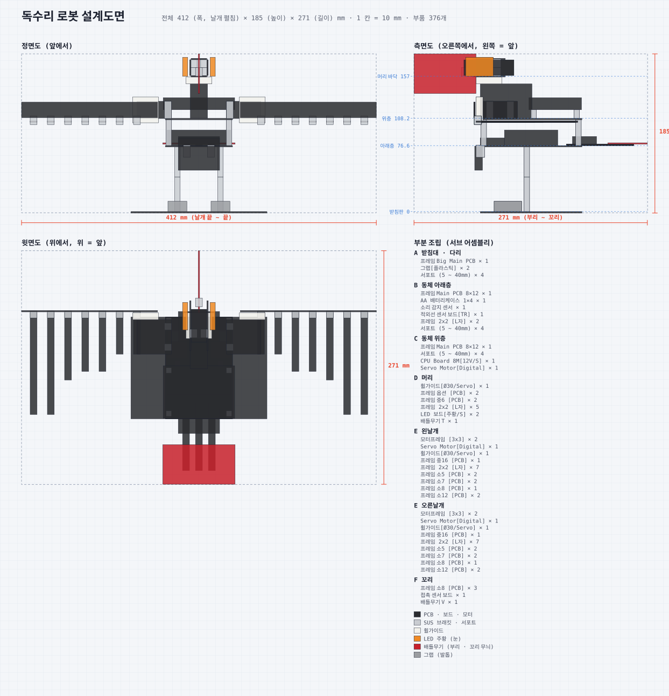

# 독수리 로봇 설계도면

이 저장소에서 만든 부품만 사용합니다. 조립 규칙은 [`ASSEMBLY_RULES.md`](../ASSEMBLY_RULES.md)를 따릅니다.
이 파일과 `blueprint.svg`는 `python3 tools/eagle_blueprint.py`로 다시 만들 수 있습니다.

## 1. 개요

받침판 위에 두 다리로 서 있는 독수리입니다.

- 서보 2개가 좌우 날개를 날갯짓합니다.
- 서보 1개가 머리를 좌우로 돌립니다.
- 두 눈은 LED 주황, 부리는 휘어진 갈고리 모양의 배틀무기 T입니다.
- 가슴의 적외선 센서가 앞에 온 먹이를 감지하고, 소리 센서가 손뼉 소리를 듣습니다.
- 꼬리의 접촉 센서는 시작 버튼입니다.

| 항목 | 값 |
|---|---|
| 전체 크기 | 폭 412 (날개 펼침) × 높이 185 × 길이 271 mm |
| X 범위 | -206.0 ~ 206.0 |
| Y 범위 | -1.6 ~ 183.0 |
| Z 범위 | -136.0 ~ 135.0 (앞 = −) |
| 주요 높이 | 받침판 윗면 0 · 아래층 판 윗면 76.6 · 위층 판 윗면 108.2 · 머리 바닥 157 · 날개 축 118 |
| 움직이는 곳 | 날개 2 (서보, 축 = Z), 머리 1 (서보, 축 = Y) |
| 전원 | AA 4개 6 V |
| 부품 수 | 376개 (볼트 · 너트 · 케이블 포함) |

## 2. 날개 무게 확인 (규칙 5장)

| 항목 | 값 |
|---|---|
| 한쪽 날개 부품 | 중16 PCB 1 + 깃 PCB 7 + L자 7 + 볼트 · 너트 32 |
| 무게 (추정) | 약 45 g |
| 축에서 무게 중심까지 | 약 75 mm |
| 필요한 힘 | 약 0.34 kg·cm |
| 서보 토크 | 4 kg·cm → **충분 (약 12배 여유)** |

## 3. 부분 조립과 부품 위치

좌표는 부품 중심(mm), 크기는 X × Y × Z입니다.

### A 받침대 · 다리

| 부품 | id | 중심 (X, Y, Z) | 크기 | 방향 |
|---|---|---|---|---|
| 받침판 (빅 메인 PCB) | `frame-big-main` | (0, -0.8, 0) | 158 × 1.6 × 118 | 수평, 긴 쪽이 좌우 |
| 왼발 발톱 (그랩) | `grab` | (-25, 6, -27) | 22 × 12 × 32 | 빗살(발톱)이 앞(-Z) |
| 왼다리 아래 (서포트 40) | `support-spacer` | (-25, 20, -5) | 6.4 × 40 × 6.4 | 수나사가 아래 |
| 왼다리 위 (서포트 35) | `support-spacer` | (-25, 57.5, -5) | 6.4 × 35 × 6.4 | 40 위에 이어 붙임 |
| 오른발 발톱 (그랩) | `grab` | (25, 6, -27) | 22 × 12 × 32 | 빗살(발톱)이 앞(-Z) |
| 오른다리 아래 (서포트 40) | `support-spacer` | (25, 20, -5) | 6.4 × 40 × 6.4 | 수나사가 아래 |
| 오른다리 위 (서포트 35) | `support-spacer` | (25, 57.5, -5) | 6.4 × 35 × 6.4 | 40 위에 이어 붙임 |

### B 동체 아래층

| 부품 | id | 중심 (X, Y, Z) | 크기 | 방향 |
|---|---|---|---|---|
| 아래층 판 (메인 PCB) | `frame-main-pcb` | (0, 75.8, 0) | 78 × 1.6 × 118 | 긴 쪽이 앞뒤 |
| 배터리케이스 (AA 4개, 6V) | `battery-case-4aa` | (0, 85.6, 0) | 74 × 18 × 62 | 긴 쪽이 좌우, 가운데 |
| 소리 센서 (울음 듣기) | `sensor-sound` | (0, 81, -45) | 48 × 9 × 28 | 마이크가 위 |
| 적외선 센서 (가슴 · 앞 감지) | `sensor-ir-tr` | (0, 62, -61) | 48 × 28 × 9 | 세워서 앞(-Z)을 봄, 판 아래에 매달림 |
| 가슴 센서 L자 2×2 | `l-frame-2x2` | (-14, 70, -59) | 8 × 14 × 10 | 판 아래로 꺾임 |
| 가슴 센서 L자 2×2 | `l-frame-2x2` | (14, 70, -59) | 8 × 14 × 10 | 판 아래로 꺾임 |
| 층 기둥 (서포트 30) | `support-spacer` | (-35, 91.6, -55) | 6.4 × 30 × 6.4 | 모서리 구멍 |
| 층 기둥 (서포트 30) | `support-spacer` | (-35, 91.6, 55) | 6.4 × 30 × 6.4 | 모서리 구멍 |
| 층 기둥 (서포트 30) | `support-spacer` | (35, 91.6, -55) | 6.4 × 30 × 6.4 | 모서리 구멍 |
| 층 기둥 (서포트 30) | `support-spacer` | (35, 91.6, 55) | 6.4 × 30 × 6.4 | 모서리 구멍 |

### C 동체 위층

| 부품 | id | 중심 (X, Y, Z) | 크기 | 방향 |
|---|---|---|---|---|
| 위층 판 (메인 PCB) | `frame-main-pcb` | (0, 107.4, 0) | 78 × 1.6 × 118 | 아래층과 같은 방향 |
| CPU 받침 (서포트 10) | `support-spacer` | (-35, 113.2, 3) | 6.4 × 10 × 6.4 |  |
| CPU 받침 (서포트 10) | `support-spacer` | (-35, 113.2, 53) | 6.4 × 10 × 6.4 |  |
| CPU 받침 (서포트 10) | `support-spacer` | (35, 113.2, 3) | 6.4 × 10 × 6.4 |  |
| CPU 받침 (서포트 10) | `support-spacer` | (35, 113.2, 53) | 6.4 × 10 × 6.4 |  |
| CPU 보드 8M | `cpu-board-8m` | (0, 125.2, 28) | 83 × 14 × 61 | 전압 스위치 6V, 긴 쪽이 좌우 |
| 목 서보 | `servo-digital` | (0, 128.2, -29) | 20 × 40 × 60 | 눕힘(귀가 판 위), 축이 위 · 앞쪽 끝 |

### D 머리

| 부품 | id | 중심 (X, Y, Z) | 크기 | 방향 |
|---|---|---|---|---|
| 목 휠가이드 (서보) | `wheel-guide-30-servo` | (0, 152.2, -49) | 30 × 8 × 30 | 목 서보 축에 끼움 |
| 머리 바닥 (옵션 PCB 2×4) | `frame-option-pcb` | (0, 157, -49) | 18 × 1.6 × 38 | 긴 쪽이 앞뒤 |
| 왼쪽 볼 (중6 PCB) | `frame-m6-pcb` | (-10, 167, -49) | 1.6 × 18 × 58 | 세움, 긴 쪽이 앞뒤 |
| 볼 아래 L자 2×2 | `l-frame-2x2` | (-6, 162, -40) | 8 × 10 × 10 |  |
| 볼 위 L자 2×2 | `l-frame-2x2` | (-6, 172, -40) | 8 × 10 × 10 |  |
| 왼눈 (LED 주황) | `led-board-orange-s` | (-16, 168, -60) | 6 × 22 × 32 | 볼 바깥에 세움, LED가 옆 · 앞 |
| 오른쪽 볼 (중6 PCB) | `frame-m6-pcb` | (10, 167, -49) | 1.6 × 18 × 58 | 세움, 긴 쪽이 앞뒤 |
| 볼 아래 L자 2×2 | `l-frame-2x2` | (6, 162, -40) | 8 × 10 × 10 |  |
| 볼 위 L자 2×2 | `l-frame-2x2` | (6, 172, -40) | 8 × 10 × 10 |  |
| 오른눈 (LED 주황) | `led-board-orange-s` | (16, 168, -60) | 6 × 22 × 32 | 볼 바깥에 세움, LED가 옆 · 앞 |
| 머리 덮개 (옵션 PCB 2×4) | `frame-option-pcb` | (0, 177, -49) | 18 × 1.6 × 38 |  |
| 부리 L자 2×2 | `l-frame-2x2` | (0, 162, -76) | 8 × 10 × 10 | 머리 바닥 앞 끝 |
| 부리 (배틀무기 T, 휘어진 갈고리) | `battle-t` | (0, 160, -100) | 1.6 × 46 × 72 | 세움(YZ 평면), 갈고리 끝이 앞 · 아래 |

### E 왼날개

| 부품 | id | 중심 (X, Y, Z) | 크기 | 방향 |
|---|---|---|---|---|
| 날개 서보 받침 (모터프레임 3×3) | `motor-frame-3x3` | (-36, 118, -48) | 8 × 20 × 8 | 위층 판 옆 끝 |
| 날개 서보 받침 (모터프레임 3×3) | `motor-frame-3x3` | (-36, 118, -24) | 8 × 20 × 8 | 위층 판 옆 끝 |
| 왼날개 서보 | `servo-digital` | (-52, 118, -36) | 40 × 20 × 40 | 축이 앞(-Z), 날갯짓 축 = Z |
| 날개 휠가이드 (서보) | `wheel-guide-30-servo` | (-62, 118, -60) | 30 × 30 × 8 | XY 평면에서 돈다 |
| 날개 뼈대 (중16 PCB 2×16) | `frame-m16-pcb` | (-127, 118, -65.8) | 158 × 18 × 1.6 | 세움(XY 평면), 안쪽 끝 x=48 |
| 깃 L자 2×2 | `l-frame-2x2` | (-72, 106, -62) | 8 × 10 × 8 | 뼈대 아래 끝에서 뒤로 꺾임 |
| 깃 1 (소5 PCB, 48) | `frame-s5-pcb` | (-72, 104.4, -40) | 8 × 1.6 × 48 | 수평, 뒤(+Z)로 |
| 깃 L자 2×2 | `l-frame-2x2` | (-92, 106, -62) | 8 × 10 × 8 | 뼈대 아래 끝에서 뒤로 꺾임 |
| 깃 2 (소5 PCB, 48) | `frame-s5-pcb` | (-92, 104.4, -40) | 8 × 1.6 × 48 | 수평, 뒤(+Z)로 |
| 깃 L자 2×2 | `l-frame-2x2` | (-112, 106, -62) | 8 × 10 × 8 | 뼈대 아래 끝에서 뒤로 꺾임 |
| 깃 3 (소7 PCB, 68) | `frame-s7-pcb` | (-112, 104.4, -30) | 8 × 1.6 × 68 | 수평, 뒤(+Z)로 |
| 깃 L자 2×2 | `l-frame-2x2` | (-132, 106, -62) | 8 × 10 × 8 | 뼈대 아래 끝에서 뒤로 꺾임 |
| 깃 4 (소7 PCB, 68) | `frame-s7-pcb` | (-132, 104.4, -30) | 8 × 1.6 × 68 | 수평, 뒤(+Z)로 |
| 깃 L자 2×2 | `l-frame-2x2` | (-152, 106, -62) | 8 × 10 × 8 | 뼈대 아래 끝에서 뒤로 꺾임 |
| 깃 5 (소8 PCB, 78) | `frame-s8-pcb` | (-152, 104.4, -25) | 8 × 1.6 × 78 | 수평, 뒤(+Z)로 |
| 깃 L자 2×2 | `l-frame-2x2` | (-172, 106, -62) | 8 × 10 × 8 | 뼈대 아래 끝에서 뒤로 꺾임 |
| 깃 6 (소12 PCB, 118) | `frame-s12-pcb` | (-172, 104.4, -5) | 8 × 1.6 × 118 | 수평, 뒤(+Z)로 |
| 깃 L자 2×2 | `l-frame-2x2` | (-192, 106, -62) | 8 × 10 × 8 | 뼈대 아래 끝에서 뒤로 꺾임 |
| 깃 7 (소12 PCB, 118) | `frame-s12-pcb` | (-192, 104.4, -5) | 8 × 1.6 × 118 | 수평, 뒤(+Z)로 |

### E 오른날개

| 부품 | id | 중심 (X, Y, Z) | 크기 | 방향 |
|---|---|---|---|---|
| 날개 서보 받침 (모터프레임 3×3) | `motor-frame-3x3` | (36, 118, -48) | 8 × 20 × 8 | 위층 판 옆 끝 |
| 날개 서보 받침 (모터프레임 3×3) | `motor-frame-3x3` | (36, 118, -24) | 8 × 20 × 8 | 위층 판 옆 끝 |
| 오른날개 서보 | `servo-digital` | (52, 118, -36) | 40 × 20 × 40 | 축이 앞(-Z), 날갯짓 축 = Z |
| 날개 휠가이드 (서보) | `wheel-guide-30-servo` | (62, 118, -60) | 30 × 30 × 8 | XY 평면에서 돈다 |
| 날개 뼈대 (중16 PCB 2×16) | `frame-m16-pcb` | (127, 118, -65.8) | 158 × 18 × 1.6 | 세움(XY 평면), 안쪽 끝 x=48 |
| 깃 L자 2×2 | `l-frame-2x2` | (72, 106, -62) | 8 × 10 × 8 | 뼈대 아래 끝에서 뒤로 꺾임 |
| 깃 1 (소5 PCB, 48) | `frame-s5-pcb` | (72, 104.4, -40) | 8 × 1.6 × 48 | 수평, 뒤(+Z)로 |
| 깃 L자 2×2 | `l-frame-2x2` | (92, 106, -62) | 8 × 10 × 8 | 뼈대 아래 끝에서 뒤로 꺾임 |
| 깃 2 (소5 PCB, 48) | `frame-s5-pcb` | (92, 104.4, -40) | 8 × 1.6 × 48 | 수평, 뒤(+Z)로 |
| 깃 L자 2×2 | `l-frame-2x2` | (112, 106, -62) | 8 × 10 × 8 | 뼈대 아래 끝에서 뒤로 꺾임 |
| 깃 3 (소7 PCB, 68) | `frame-s7-pcb` | (112, 104.4, -30) | 8 × 1.6 × 68 | 수평, 뒤(+Z)로 |
| 깃 L자 2×2 | `l-frame-2x2` | (132, 106, -62) | 8 × 10 × 8 | 뼈대 아래 끝에서 뒤로 꺾임 |
| 깃 4 (소7 PCB, 68) | `frame-s7-pcb` | (132, 104.4, -30) | 8 × 1.6 × 68 | 수평, 뒤(+Z)로 |
| 깃 L자 2×2 | `l-frame-2x2` | (152, 106, -62) | 8 × 10 × 8 | 뼈대 아래 끝에서 뒤로 꺾임 |
| 깃 5 (소8 PCB, 78) | `frame-s8-pcb` | (152, 104.4, -25) | 8 × 1.6 × 78 | 수평, 뒤(+Z)로 |
| 깃 L자 2×2 | `l-frame-2x2` | (172, 106, -62) | 8 × 10 × 8 | 뼈대 아래 끝에서 뒤로 꺾임 |
| 깃 6 (소12 PCB, 118) | `frame-s12-pcb` | (172, 104.4, -5) | 8 × 1.6 × 118 | 수평, 뒤(+Z)로 |
| 깃 L자 2×2 | `l-frame-2x2` | (192, 106, -62) | 8 × 10 × 8 | 뼈대 아래 끝에서 뒤로 꺾임 |
| 깃 7 (소12 PCB, 118) | `frame-s12-pcb` | (192, 104.4, -5) | 8 × 1.6 × 118 | 수평, 뒤(+Z)로 |

### F 꼬리

| 부품 | id | 중심 (X, Y, Z) | 크기 | 방향 |
|---|---|---|---|---|
| 꼬리깃 (소8 PCB) | `frame-s8-pcb` | (-15, 77.4, 80) | 8 × 1.6 × 78 | 아래층 판 뒤 구멍 z=45 · 55에 2개로 |
| 꼬리깃 (소8 PCB) | `frame-s8-pcb` | (0, 77.4, 80) | 8 × 1.6 × 78 | 아래층 판 뒤 구멍 z=45 · 55에 2개로 |
| 꼬리깃 (소8 PCB) | `frame-s8-pcb` | (15, 77.4, 80) | 8 × 1.6 × 78 | 아래층 판 뒤 구멍 z=45 · 55에 2개로 |
| 꼬리 접촉 센서 (시작 버튼) | `sensor-touch` | (0, 82.7, 62) | 48 × 9 × 28 | 꼬리깃 3개 위, 버튼이 위 |
| 꼬리 끝 무늬판 (배틀무기 V) | `battle-v` | (0, 79, 112) | 84 × 1.6 × 46 | 꼬리깃 끝 위 |

## 4. 조립 순서와 체결표

| 단계 | 이름 | 방법 | 볼트 · 너트 등 |
|---|---|---|---|
| 1 | 다리 세우기 | 서포트 40의 수나사를 받침판 구멍 (±25, −5)에 넣고 아래에서 M3 너트. 그 위에 서포트 35를 이어 돌려 끼운다 (다리 높이 75). | M3 너트 × 2 |
| 2 | 발톱 달기 | 그랩 2개를 다리 앞(z = −27)에 빗살이 앞을 보게 놓고 그랩 구멍 2개씩 M3 × 10 + 너트로 받침판에 고정. | 볼트 M3×10 × 4, M3 너트 × 4 |
| 3 | 아래층 판 + 층 기둥 | 아래층 판 모서리 구멍 4곳에 서포트 30을 세운다 (수나사 아래 + 너트). 판을 다리 위에 얹고 (±25, −5) 구멍에서 M3 × 6으로 다리 암나사에 고정. | M3 너트 × 4, 볼트 3×6 × 2 |
| 4 | 배터리 · 소리 센서 | 배터리케이스를 판 가운데에 귀 구멍 4개로 고정 (M3 × 10 + 너트). 소리 센서를 앞쪽 (z = −45)에 서포트 5 두 개로 띄워 고정. | 볼트 M3×10 × 4, M3 너트 × 4, 서포트 (5 ~ 40mm) × 2, 볼트 3×6 × 2 |
| 5 | 가슴 적외선 센서 | L자 2×2 두 개를 아래층 판 앞 끝 아래에 달고 (다리마다 볼트 2개), 적외선 센서를 세워 앞을 보게 고정. | 볼트 3×6 × 8, M3 너트 × 8 |
| 6 | 꼬리 | 소8 PCB 3개를 아래층 판 뒤 구멍 (x = −15 · 0 · 15, z = 45 · 55)에 볼트 2개씩 고정. 그 위에 접촉 센서(볼트 2)와 배틀무기 V(볼트 2). | 볼트 3×6 × 10, M3 너트 × 10 |
| 7 | 위층 판 | 위층 판을 서포트 30 위에 얹고 모서리 4곳 M3 × 6으로 고정. | 볼트 3×6 × 4 |
| 8 | CPU 보드 | 위층 판 뒤쪽에 서포트 10 네 개를 세우고 (너트), CPU 보드를 얹어 M3 × 6으로 고정. 전압 스위치 6V. | M3 너트 × 4, 볼트 3×6 × 4 |
| 9 | 목 서보 | 목 서보를 위층 판 앞쪽에 눕혀 귀 구멍 4개 M3 × 10 + 너트. 축이 앞쪽 끝 (z = −49)에 오게. | 볼트 M3×10 × 4, M3 너트 × 4 |
| 10 | 머리 | 휠가이드(서보)를 목 서보 축에 끼우고 2.6 × 10 태핑 볼트. 옵션 PCB(머리 바닥)를 휠가이드 마주 보는 구멍 2개에 M3 × 10. L자 4개로 중6 PCB 볼 두 장과 머리 덮개를 상자로 잇는다. | 볼트 2.6×10 와셔붙이 × 1, 볼트 M3×10 × 2, M3 너트 × 18, 볼트 3×6 × 16 |
| 11 | 눈 · 부리 | LED 주황 보드를 볼 바깥 앞쪽에 구멍 2개씩. 머리 바닥 앞 끝 L자에 배틀무기 T를 구멍 2개로 세워 부리를 만든다. | 볼트 3×6 × 8, M3 너트 × 8 |
| 12 | 날개 서보 (양쪽) | 모터프레임 3×3 두 개로 날개 서보를 위층 판 옆 끝에 세운다. 서보 축은 앞(−Z). 서보 귀 M3 × 10, 판 쪽 M3 × 6. | 볼트 M3×10 × 8, 볼트 3×6 × 8, M3 너트 × 16 |
| 13 | 날개 뼈대 (양쪽) | 휠가이드(서보)를 날개 서보 축에 (2.6 × 10). 중16 PCB의 안쪽 1 · 3번 구멍을 휠가이드 마주 보는 구멍 2개에 M3 × 10. | 볼트 2.6×10 와셔붙이 × 2, 볼트 M3×10 × 4, M3 너트 × 4 |
| 14 | 깃 (양쪽 7개씩) | 뼈대 아래 줄 구멍 x = 72 · 92 · … · 192에 L자 2×2를 달고 (볼트 2), 깃 PCB를 L자 다른 다리에 (볼트 2). 안쪽부터 소5 · 소5 · 소7 · 소7 · 소8 · 소12 · 소12. | 볼트 3×6 × 56, M3 너트 × 56 |
| 15 | 배선 | 아래 배선표대로 3핀 케이블 · 서보 케이블을 CPU 보드에 꽂는다. 날개 · 목이 움직여도 당기지 않게 여유를 둔다. | 케이블 - 3Pin × 5 |

## 5. 배선표

| 포트 | 부품 | 역할 |
|---|---|---|
| IN1 | 접촉 센서 (꼬리) | 누르면 동작 시작 / 멈춤 |
| IN2 | 적외선 센서 (가슴) | 앞에 물체(먹이)가 오면 감지 |
| IN3 | 소리 센서 (몸통 앞) | 손뼉 소리 감지 |
| OUT1 | 왼날개 서보 | 날갯짓 −20° (접음) ~ +45° (펼침) |
| OUT2 | 오른날개 서보 | 왼날개와 거울 대칭 각도 |
| OUT3 | 목 서보 | 머리 좌우 돌리기 45° ~ 135° (90° = 정면) |
| OUT4 | 왼눈 LED 주황 | 켜기 · 깜빡이기 |
| OUT5 | 오른눈 LED 주황 | 켜기 · 깜빡이기 |
| 전원 | 배터리케이스 4AA (6V) | CPU 배터리 커넥터, 전압 스위치 6V (서보 보호) |

서보 3개는 자기 케이블로 OUT1~3에 꽂습니다. 센서 3개와 LED 2개는 3핀 케이블(200 mm)로 꽂습니다.

## 6. 동작

| 상황 | 동작 |
|---|---|
| 대기 | 눈을 천천히 깜빡이고, 머리를 좌우로 천천히 돌려 둘러본다. 날개는 접음(−20°). |
| 꼬리 접촉 (IN1) | 동작 시작 / 멈춤을 바꾼다. 시작하면 날개를 한 번 펼쳤다 접는다. |
| 먹이 감지 (IN2) | 머리를 정면(90°)으로 고정, 두 눈을 켜고, 날개를 펼친(+45°) 채 3번 크게 날갯짓. |
| 손뼉 소리 (IN3) | 눈을 빠르게 3번 깜빡이고 머리를 좌우로 흔든다 (울음 대신). |

## 7. 부품 목록 (BOM)

| 부품 id | 이름 | 수량 |
|---|---|---|
| `battery-case-4aa` | AA 배터리케이스 1×4 | 1 |
| `battle-t` | 배틀무기 T | 1 |
| `battle-v` | 배틀무기 V | 1 |
| `cpu-board-8m` | CPU Board 8M[12V/S] | 1 |
| `frame-big-main` | 프레임 Big Main PCB | 1 |
| `frame-m16-pcb` | 프레임 중16 [PCB] | 2 |
| `frame-m6-pcb` | 프레임 중6 [PCB] | 2 |
| `frame-main-pcb` | 프레임 Main PCB 8×12 | 2 |
| `frame-option-pcb` | 프레임 옵션 [PCB] | 2 |
| `frame-s12-pcb` | 프레임 소12 [PCB] | 4 |
| `frame-s5-pcb` | 프레임 소5 [PCB] | 4 |
| `frame-s7-pcb` | 프레임 소7 [PCB] | 4 |
| `frame-s8-pcb` | 프레임 소8 [PCB] | 5 |
| `grab` | 그랩[플라스틱] | 2 |
| `l-frame-2x2` | 프레임 2x2 [L자] | 21 |
| `led-board-orange-s` | LED 보드[주황/S] | 2 |
| `motor-frame-3x3` | 모터프레임 [3x3] | 4 |
| `sensor-ir-tr` | 적외선 센서 보드[TR] | 1 |
| `sensor-sound` | 소리 감지 센서 | 1 |
| `sensor-touch` | 접촉 센서 보드 | 1 |
| `servo-digital` | Servo Motor[Digital] | 3 |
| `support-spacer` | 서포트 (5 ~ 40mm) (5 mm × 2 · 10 mm × 4 · 30 mm × 4 · 35 mm × 2 · 40 mm × 2) | 14 |
| `wheel-guide-30-servo` | 휠가이드[Ø30/Servo] | 3 |
| `bolt-m26x10` | 볼트 2.6×10 와셔붙이 | 3 |
| `bolt-m3x10` | 볼트 M3×10 | 26 |
| `bolt-m3x6` | 볼트 3×6 | 118 |
| `cable-3pin` | 케이블 - 3Pin | 5 |
| `nut-m3` | M3 너트 | 142 |
| | **합계** | **376** |
