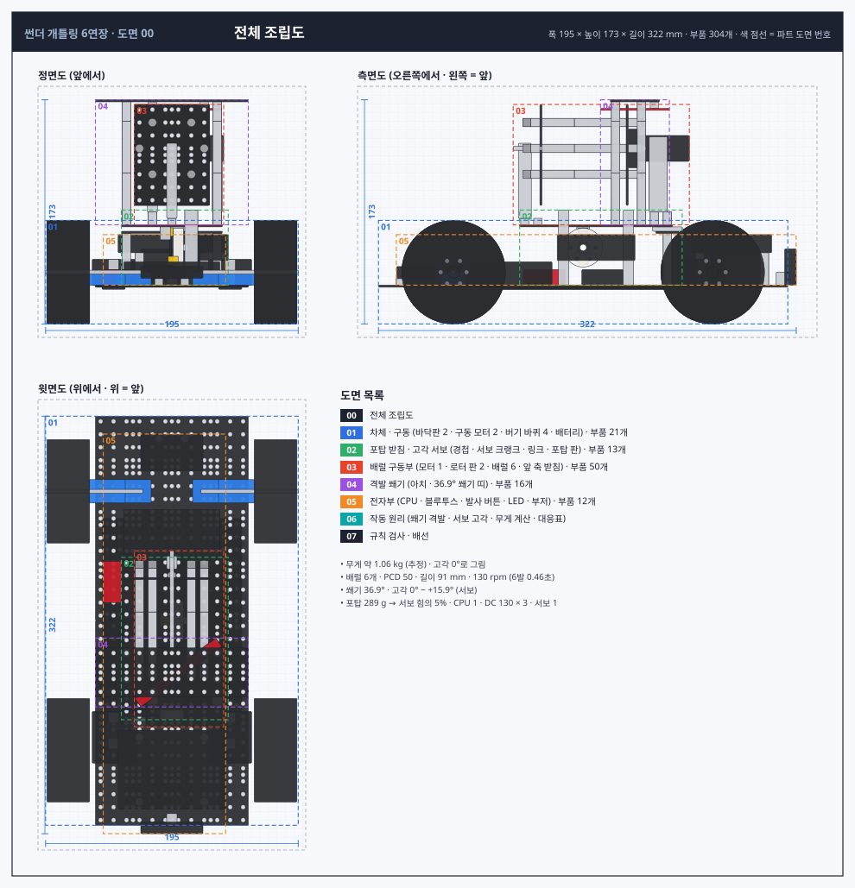

# 썬더 개틀링 6연장 v3 (4륜 전원 모터 · 무관통 실물 격발 메커니즘) 설계도면

[`ASSEMBLY_RULES.md`](../ASSEMBLY_RULES.md) (1~10장, 신규 규칙 **2.5 모든 바퀴 모터 구동** · **10.6 기능 메커니즘 실물 물리 설계 & 확대 상세도**)을 100% 준수해 설계한 **v3 조립도**입니다.
다시 만들기: `python3 tools/gatling_blueprint.py` · 그림으로 보기: [`blueprint.html`](blueprint.html)

## 1. 핵심 업그레이드 & 5중 자동 검증 내역

| 항목 | v3 설계 해결 | 검증 결과 |
|---|---|---|
| 규칙 2.5: 4륜 전원 모터 구동 | 앞 M1·M2 + 뒤 M3·M4 (DC 130 × 4) + 배럴 EX-M1 (DC 400 + 확장 보드 A3) | ✔ 헛바퀴 0개 · 규칙 통과 |
| 규칙 10.6: 고무줄 장전선 무관통 | 총구 캡너트(r=28.5, z=-74.5) ↔ 걸쇠 캡너트(r=38.4, z=-16.5) · 앞 로터 판 제거 | ✔ 장전선 관통 0건 |
| 규칙 10.6: 전방 발사 비행선(−Z) 개방 | 뒤 2중 케이지(z=7.3, 23.9) 외팔보 지지 · 총구 앞 로터 판/축 받침 0개 | ✔ 비행 경로 장애물 0건 |
| 12시 걸쇠 캡너트 ↔ 36.9° 격발 쐐기 | 걸쇠 캡너트 상단 y=177.8 · L자 끝 178.6 vs 쐐기 아랫면 y=179.0 (중심 z=-16.25) | ✔ 틈 1.2 mm · 고무줄만 +Z 이탈 |
| 로터 케이지(r=52.7) ↔ 아치/쐐기/기둥 | 앞 케이지 z=[6.5,8.1] vs 쐐기 z_max=+3.6 · 아치 판 z=-1 · 기둥 z=-5 | ✔ Z 2.9~8.3 mm · X 12.8 mm |
| 세로 배터리 ↔ 앞 구동 모터 / 서보 | 배터리 x=[-29,+29], z=[-109.8,-30.2] vs 앞 모터 ±34 · 서보 기둥 z=-25 | ✔ X 5.0 / Z 1.5 mm |
| 모터 확장 보드 ↔ LED / 서보 / 뒤 기둥 | 확장 보드 x=[-57.5,-7.5], z=[7.5,57.5] · 구멍 (-55/-15, 15/55) 격자 일치 | ✔ 충돌 0 · 오차 0.0 mm |
| 고각 4절 링크 기구학 (0°~+9.2°) | 서보 y=38.0 (L자 2·3번 구멍) · 소5 링크 30 mm · 경첩 날개 실연동 | ✔ 전 구간 오차 < 0.04 mm |

## 2. 디자인 포인트

- **① [규칙 2.5] 4륜 전원 DC 모터 직접 구동 (헛바퀴 0개)** — 앞바퀴 2개(M1·M2)와 뒷바퀴 2개(M3·M4) 모두 DC 130rpm 모터 직결 + 배럴은 DC 400rpm(EX-M1)과 모터 드라이브 확장 세트(A3)로 구동해 키트 수량 규칙(130×4, 400×1, 확장 1)을 100% 준수.
- **② [규칙 10.6] 고무줄 무관통 실물 물리 메커니즘** — 뒤 2중 로터 케이지(z=7.3, 23.9)로 6배럴을 강성 외팔보 지지하고 앞 로터 판·앞 축 받침을 제거해, 고무줄 장전선(총구 −74.5 ↔ 걸쇠 −16.5)과 전방 발사 비행선(−Z)에 장애물 0건 달성.
- **③ 거치부 · 트리거부 실물 분리 설계 (확대 상세도 제공)** — 배럴마다 L자 2×1로 r=35 mm 개방 공간에 후방 걸쇠 캡너트(둥근 돔 +Z)를 돌출 배치하고, 12시 위 1.2 mm 틈에 36.9° 경사 쐐기를 고정해 회전 시 고무줄만 +Z 돔 끝으로 밀어내어 실제 이탈·발사.
- **④ 공중 고정 0 · 실체 2-판 충돌 0 · 볼트/너트/캡너트 238개 동축 배치** — 구조 112 + 체결 238 = 350개 전원 실제 모델 원점 직결, 총구 캡너트 6(−Z) + 후방 걸쇠 캡너트 6(+Z) 전원 동축 정렬.
- **⑤ 포탑 무게 · 서보 고각 여유** — 포탑 무게 333 g · 경첩~링크 80 mm → 서보 필요 토크 0.28 kg·cm (서보 4 kg·cm의 7%) · 고각 0°~+9.2°.

## 3. 개요

| 항목 | 값 |
|---|---|
| 전체 크기 (고각 0°) | 폭 206 × 높이 190 × 길이 328 mm |
| 무게 (추정 · 볼트/너트 실체 합산) | 약 1216 g (포탑 333 g) |
| 주행 (규칙 2.5) | **4륜 전원 DC 130rpm 직결** (앞 M1·M2 + 뒤 M3·M4, 헛바퀴 0개), 버기 Ø80 × 4 |
| 배럴 · 격발 (규칙 10.6) | DC 400rpm(EX-M1 · 확장 보드) · 뒤 2중 케이지 외팔보 · L자 2×1 + 걸쇠 캡너트(+Z 돔) ↔ 총구 캡너트(−Z 돔) ↔ 12시 36.9° 쐐기 (틈 1.2 mm · 관통 0건) |
| 고각 | 0° ~ +9.2° · 서보 크랭크(10) + 소5 링크(30) · 지렛대 80 mm · 서보 토크 0.28 kg·cm (7%) |
| 부품 수 (실체 BOM) | 구조 부품 112 + 체결(볼트·너트·캡너트) 238 + 3핀 케이블 4 = **총 354개** (32종) |

## 4. 자동 규칙 · 충돌 · 경로 검증 (전 항목 통과)

| 규칙 · 검증 | 결과 상세 | 판정 |
|---|---|---|
| 1.1 CPU 1대당 1개 | CPU 보드 1개 (서포트 40 위, M1~M4 4륜 제어) | ✔ |
| 2.1~2.3 모터 · 확장 보드 수량 | DC 130 × 4(4/4) + DC 400 × 1(1/2) + 모터 확장 세트 × 1(1/1) = 조작 5개 | ✔ |
| 2.5 모든 바퀴 모터 구동 (헛바퀴 금지) | 바퀴 4개 = 구동 모터 4개 (100% 직결 · 헛바퀴 0개) | ✔ |
| 4 구멍 격자 0.0 mm 일치 | 바닥판 · L자 4/14 mm · 배터리 세로 · 확장 보드 · 3-4-5 쐐기 구멍 0.0 mm 일치 | ✔ |
| 10.1~10.2 공중 고정 0 · 동축 정렬 | 구조 112개 실체 체결 · 볼트/너트/캡너트 238개(총구 6 + 걸쇠 6) 동축 통과 | ✔ |
| 10.6 고무줄 무관통 · 메커니즘 확대 상세도 | 장전선(6배럴) 관통 0건 · 전방 비행선(−Z) 장애물 0건 · 도면 06 확대 상세도 & 3D 학습 단계 완비 | ✔ |
| 실체 2-판 AABB & 360° 스윕 충돌 검사 | 구조 부품 쌍 충돌 0건 · 케이지/걸쇠/배럴 360° 스윕 충돌 0건 | ✔ |
| 고각 서보 토크 여유 | 필요 0.28 kg·cm / 서보 4 kg·cm (7%) | ✔ |

## 5. 도면 (메커니즘 확대 상세도 06 포함)

### 도면 00 · 전체 조립도 (v3 · 4륜 전원 모터 · 무관통 개방형 격발 · 볼트/너트/캡너트 포함)

### 도면 01 · 차체 · 4륜 전원 모터 구동 (앞 M1·M2 + 뒤 M3·M4 · 세로 배터리 · 헛바퀴 0)

### 도면 02 · 포탑 받침 · 고각 서보 (서포트 40+15 · 경첩 · 서보 크랭크 · 소5 링크 · Big Main 포탑 판)

### 도면 03 · 6연장 개방형 배럴 · 걸쇠 (DC 400rpm · 뒤 2중 케이지 · L자 2×1 + 걸쇠 캡너트 · 총구 캡너트)

### 도면 04 · 12시 격발 쐐기 아치 (x=±55, z=-35·-5 아치 기둥 4 · 5×13 판 · 36.9° 소7 쐐기)

### 도면 05 · 전자부 (CPU 8M · 모터 확장 보드 A3 · 블루투스 · LED · 부저 · 발사 버튼)

### 도면 06 · 격발 메커니즘 확대 상세도 (규칙 10.6 · 거치 · 이송 · 12시 쐐기 이탈 · 5중 검증)

### 도면 07 · 규칙 검사 (1~10장 · 2.5 · 10.6) · 배선

## 6. 파트별 부품 및 체결 위치

좌표는 부품 중심 (mm, 원점 = 지면 위 로봇 가운데, 앞 = −Z), 크기는 X × Y × Z.

### 01 차체 · 4륜 전원 모터 구동 (앞 M1·M2 + 뒤 M3·M4 · 세로 배터리 · 헛바퀴 0)

| 번호 | 부품 | id | 중심 (X, Y, Z) | 크기 | 방향 · 메모 |
|---|---|---|---|---|---|
| 1 | 차체 바닥판 뒤 (빅 메인 PCB) | `frame-big-main` | (0, 18.2, 80.0) | 118.0 × 1.6 × 158.0 | up=(0, 1, 0) · 기준 부품 · z [1, 159] · 구멍 z=5, 15, ..., 155 |
| 2 | 차체 바닥판 앞 (빅 메인 PCB) | `frame-big-main` | (0, 18.2, -80.0) | 118.0 × 1.6 × 158.0 | up=(0, 1, 0) · z [-159, -1] · 뒤 판과 2 mm 간격 → 이음판 10 mm 격자 일치 |
| 3 | 왼 이음판 (중16 PCB) | `frame-m16-pcb` | (-45, 16.6, 0.0) | 18.0 × 1.6 × 158.0 | up=(0, 1, 0) · 앞·뒤 바닥판 아래 밀착 (y [15.8, 17.4]) · 구멍 0.0 mm 일치 |
| 4 | 왼 이음판 체결 (볼트 3×6) | `bolt-m3x6` | (-45, 16.8, -75.0) | 6.3 × 7.5 × 6.3 | up=(0, 1, 0) · 두께 3.2 mm |
| 5 | 왼 이음판 체결 (M3 너트) | `nut-m3` | (-45, 14.6, -75.0) | 5.8 × 2.4 × 5.8 | up=(0, 1, 0) · 볼트 반대쪽 체결 |
| 4 | 왼 이음판 체결 (볼트 3×6) | `bolt-m3x6` | (-45, 16.8, -55.0) | 6.3 × 7.5 × 6.3 | up=(0, 1, 0) · 두께 3.2 mm |
| 5 | 왼 이음판 체결 (M3 너트) | `nut-m3` | (-45, 14.6, -55.0) | 5.8 × 2.4 × 5.8 | up=(0, 1, 0) · 볼트 반대쪽 체결 |
| 4 | 왼 이음판 체결 (볼트 3×6) | `bolt-m3x6` | (-45, 16.8, -35.0) | 6.3 × 7.5 × 6.3 | up=(0, 1, 0) · 두께 3.2 mm |
| 5 | 왼 이음판 체결 (M3 너트) | `nut-m3` | (-45, 14.6, -35.0) | 5.8 × 2.4 × 5.8 | up=(0, 1, 0) · 볼트 반대쪽 체결 |
| 4 | 왼 이음판 체결 (볼트 3×6) | `bolt-m3x6` | (-45, 16.8, -15.0) | 6.3 × 7.5 × 6.3 | up=(0, 1, 0) · 두께 3.2 mm |
| 5 | 왼 이음판 체결 (M3 너트) | `nut-m3` | (-45, 14.6, -15.0) | 5.8 × 2.4 × 5.8 | up=(0, 1, 0) · 볼트 반대쪽 체결 |
| 4 | 왼 이음판 체결 (볼트 3×6) | `bolt-m3x6` | (-45, 16.8, 15.0) | 6.3 × 7.5 × 6.3 | up=(0, 1, 0) · 두께 3.2 mm |
| 5 | 왼 이음판 체결 (M3 너트) | `nut-m3` | (-45, 14.6, 15.0) | 5.8 × 2.4 × 5.8 | up=(0, 1, 0) · 볼트 반대쪽 체결 |
| 4 | 왼 이음판 체결 (볼트 3×6) | `bolt-m3x6` | (-45, 16.8, 35.0) | 6.3 × 7.5 × 6.3 | up=(0, 1, 0) · 두께 3.2 mm |
| 5 | 왼 이음판 체결 (M3 너트) | `nut-m3` | (-45, 14.6, 35.0) | 5.8 × 2.4 × 5.8 | up=(0, 1, 0) · 볼트 반대쪽 체결 |
| 4 | 왼 이음판 체결 (볼트 3×6) | `bolt-m3x6` | (-45, 16.8, 55.0) | 6.3 × 7.5 × 6.3 | up=(0, 1, 0) · 두께 3.2 mm |
| 5 | 왼 이음판 체결 (M3 너트) | `nut-m3` | (-45, 14.6, 55.0) | 5.8 × 2.4 × 5.8 | up=(0, 1, 0) · 볼트 반대쪽 체결 |
| 4 | 왼 이음판 체결 (볼트 3×6) | `bolt-m3x6` | (-45, 16.8, 75.0) | 6.3 × 7.5 × 6.3 | up=(0, 1, 0) · 두께 3.2 mm |
| 5 | 왼 이음판 체결 (M3 너트) | `nut-m3` | (-45, 14.6, 75.0) | 5.8 × 2.4 × 5.8 | up=(0, 1, 0) · 볼트 반대쪽 체결 |
| 3 | 오른 이음판 (중16 PCB) | `frame-m16-pcb` | (45, 16.6, 0.0) | 18.0 × 1.6 × 158.0 | up=(0, 1, 0) · 앞·뒤 바닥판 아래 밀착 (y [15.8, 17.4]) · 구멍 0.0 mm 일치 |
| 4 | 오른 이음판 체결 (볼트 3×6) | `bolt-m3x6` | (45, 16.8, -75.0) | 6.3 × 7.5 × 6.3 | up=(0, 1, 0) · 두께 3.2 mm |
| 5 | 오른 이음판 체결 (M3 너트) | `nut-m3` | (45, 14.6, -75.0) | 5.8 × 2.4 × 5.8 | up=(0, 1, 0) · 볼트 반대쪽 체결 |
| 4 | 오른 이음판 체결 (볼트 3×6) | `bolt-m3x6` | (45, 16.8, -55.0) | 6.3 × 7.5 × 6.3 | up=(0, 1, 0) · 두께 3.2 mm |
| 5 | 오른 이음판 체결 (M3 너트) | `nut-m3` | (45, 14.6, -55.0) | 5.8 × 2.4 × 5.8 | up=(0, 1, 0) · 볼트 반대쪽 체결 |
| 4 | 오른 이음판 체결 (볼트 3×6) | `bolt-m3x6` | (45, 16.8, -35.0) | 6.3 × 7.5 × 6.3 | up=(0, 1, 0) · 두께 3.2 mm |
| 5 | 오른 이음판 체결 (M3 너트) | `nut-m3` | (45, 14.6, -35.0) | 5.8 × 2.4 × 5.8 | up=(0, 1, 0) · 볼트 반대쪽 체결 |
| 4 | 오른 이음판 체결 (볼트 3×6) | `bolt-m3x6` | (45, 16.8, -15.0) | 6.3 × 7.5 × 6.3 | up=(0, 1, 0) · 두께 3.2 mm |
| 5 | 오른 이음판 체결 (M3 너트) | `nut-m3` | (45, 14.6, -15.0) | 5.8 × 2.4 × 5.8 | up=(0, 1, 0) · 볼트 반대쪽 체결 |
| 4 | 오른 이음판 체결 (볼트 3×6) | `bolt-m3x6` | (45, 16.8, 15.0) | 6.3 × 7.5 × 6.3 | up=(0, 1, 0) · 두께 3.2 mm |
| 5 | 오른 이음판 체결 (M3 너트) | `nut-m3` | (45, 14.6, 15.0) | 5.8 × 2.4 × 5.8 | up=(0, 1, 0) · 볼트 반대쪽 체결 |
| 4 | 오른 이음판 체결 (볼트 3×6) | `bolt-m3x6` | (45, 16.8, 35.0) | 6.3 × 7.5 × 6.3 | up=(0, 1, 0) · 두께 3.2 mm |
| 5 | 오른 이음판 체결 (M3 너트) | `nut-m3` | (45, 14.6, 35.0) | 5.8 × 2.4 × 5.8 | up=(0, 1, 0) · 볼트 반대쪽 체결 |
| 4 | 오른 이음판 체결 (볼트 3×6) | `bolt-m3x6` | (45, 16.8, 55.0) | 6.3 × 7.5 × 6.3 | up=(0, 1, 0) · 두께 3.2 mm |
| 5 | 오른 이음판 체결 (M3 너트) | `nut-m3` | (45, 14.6, 55.0) | 5.8 × 2.4 × 5.8 | up=(0, 1, 0) · 볼트 반대쪽 체결 |
| 4 | 오른 이음판 체결 (볼트 3×6) | `bolt-m3x6` | (45, 16.8, 75.0) | 6.3 × 7.5 × 6.3 | up=(0, 1, 0) · 두께 3.2 mm |
| 5 | 오른 이음판 체결 (M3 너트) | `nut-m3` | (45, 14.6, 75.0) | 5.8 × 2.4 × 5.8 | up=(0, 1, 0) · 볼트 반대쪽 체결 |
| 6 | 앞 왼 구동 모터 받침 바깥 (모터프레임 3×3) | `motor-frame-3x3` | (-45, 33.0, -135.0) | 28.0 × 28.0 × 8.0 | up=(0, 1, 0) · 세운 다리 x=[-58,-59] · 바닥 구멍 x=-45,-55 · z=-135 |
| 7 | 앞 왼 모터 받침 바깥 바닥 체결 (볼트 3×6) | `bolt-m3x6` | (-45, 17.8, -135.0) | 6.3 × 7.5 × 6.3 | up=(0, 1, 0) · 두께 2.6 mm |
| 8 | 앞 왼 모터 받침 바깥 바닥 체결 (M3 너트) | `nut-m3` | (-45, 16.2, -135.0) | 5.8 × 2.4 × 5.8 | up=(0, 1, 0) · 볼트 반대쪽 체결 |
| 7 | 앞 왼 모터 받침 바깥 바닥 체결 (볼트 3×6) | `bolt-m3x6` | (-55, 17.8, -135.0) | 6.3 × 7.5 × 6.3 | up=(0, 1, 0) · 두께 2.6 mm |
| 8 | 앞 왼 모터 받침 바깥 바닥 체결 (M3 너트) | `nut-m3` | (-55, 16.2, -135.0) | 5.8 × 2.4 × 5.8 | up=(0, 1, 0) · 볼트 반대쪽 체결 |
| 9 | 앞 왼 구동 모터 받침 안쪽 (모터프레임 3×3) | `motor-frame-3x3` | (-45, 33.0, -85.0) | 28.0 × 28.0 × 8.0 | up=(0, 1, 0) · 세운 다리 x=[-58,-59] · 바닥 구멍 x=-45,-55 · z=-85 |
| 10 | 앞 왼 모터 받침 안쪽 바닥 체결 (볼트 3×6) | `bolt-m3x6` | (-45, 17.8, -85.0) | 6.3 × 7.5 × 6.3 | up=(0, 1, 0) · 두께 2.6 mm |
| 11 | 앞 왼 모터 받침 안쪽 바닥 체결 (M3 너트) | `nut-m3` | (-45, 16.2, -85.0) | 5.8 × 2.4 × 5.8 | up=(0, 1, 0) · 볼트 반대쪽 체결 |
| 10 | 앞 왼 모터 받침 안쪽 바닥 체결 (볼트 3×6) | `bolt-m3x6` | (-55, 17.8, -85.0) | 6.3 × 7.5 × 6.3 | up=(0, 1, 0) · 두께 2.6 mm |
| 11 | 앞 왼 모터 받침 안쪽 바닥 체결 (M3 너트) | `nut-m3` | (-55, 16.2, -85.0) | 5.8 × 2.4 × 5.8 | up=(0, 1, 0) · 볼트 반대쪽 체결 |
| 12 | 앞 왼 구동 모터 (DC 130rpm, M1) | `dc-motor-130-rs` | (-50.5, 38.0, -110.0) | 33.0 × 20.0 × 40.0 | up=(-1, 0, 0) · 규칙 2.5 전륜/후륜 전원 모터 구동 · 귀 x=±58 밀착 · 몸통 x [-34,-67] · 축 z=-120 |
| 13 | 앞 왼 구동 모터 귀 체결 (볼트 3×6) | `bolt-m3x6` | (-56.75, 33.0, -135.0) | 7.5 × 6.3 × 6.3 | up=(-1, 0, 0) · 두께 3.4 mm |
| 14 | 앞 왼 구동 모터 귀 체결 (M3 너트) | `nut-m3` | (-54.4, 33.0, -135.0) | 2.4 × 5.8 × 5.8 | up=(-1, 0, 0) · 볼트 반대쪽 체결 |
| 13 | 앞 왼 구동 모터 귀 체결 (볼트 3×6) | `bolt-m3x6` | (-56.75, 43.0, -135.0) | 7.5 × 6.3 × 6.3 | up=(-1, 0, 0) · 두께 3.4 mm |
| 14 | 앞 왼 구동 모터 귀 체결 (M3 너트) | `nut-m3` | (-54.4, 43.0, -135.0) | 2.4 × 5.8 × 5.8 | up=(-1, 0, 0) · 볼트 반대쪽 체결 |
| 13 | 앞 왼 구동 모터 귀 체결 (볼트 3×6) | `bolt-m3x6` | (-56.75, 33.0, -85.0) | 7.5 × 6.3 × 6.3 | up=(-1, 0, 0) · 두께 3.4 mm |
| 14 | 앞 왼 구동 모터 귀 체결 (M3 너트) | `nut-m3` | (-54.4, 33.0, -85.0) | 2.4 × 5.8 × 5.8 | up=(-1, 0, 0) · 볼트 반대쪽 체결 |
| 13 | 앞 왼 구동 모터 귀 체결 (볼트 3×6) | `bolt-m3x6` | (-56.75, 43.0, -85.0) | 7.5 × 6.3 × 6.3 | up=(-1, 0, 0) · 두께 3.4 mm |
| 14 | 앞 왼 구동 모터 귀 체결 (M3 너트) | `nut-m3` | (-54.4, 43.0, -85.0) | 2.4 × 5.8 × 5.8 | up=(-1, 0, 0) · 볼트 반대쪽 체결 |
| 15 | 앞 왼 구동 바퀴 (Ø80 버기 세트, M1) | `wheel-80-buggy-set` | (-84.5, 38.0, -120.0) | 33.0 × 76.0 × 76.0 | up=(0, 1, 0) · M1 모터 D컷 축 직접 장착 · 안쪽 면 x=±68.0 (모터 67.0과 1.0 mm 여유) |
| 16 | 앞 왼 구동 바퀴 축 고정 (볼트 2.6×10) | `bolt-m26x10` | (-96.9, 38.0, -120.0) | 11.8 × 7.4 × 7.4 | up=(-1, 0, 0) · 축 허브 동축 고정 |
| 6 | 앞 오른 구동 모터 받침 바깥 (모터프레임 3×3) | `motor-frame-3x3` | (45, 33.0, -135.0) | 28.0 × 28.0 × 8.0 | up=(0, 1, 0) · 세운 다리 x=[+58,+59] · 바닥 구멍 x=+45,+55 · z=-135 |
| 7 | 앞 오른 모터 받침 바깥 바닥 체결 (볼트 3×6) | `bolt-m3x6` | (45, 17.8, -135.0) | 6.3 × 7.5 × 6.3 | up=(0, 1, 0) · 두께 2.6 mm |
| 8 | 앞 오른 모터 받침 바깥 바닥 체결 (M3 너트) | `nut-m3` | (45, 16.2, -135.0) | 5.8 × 2.4 × 5.8 | up=(0, 1, 0) · 볼트 반대쪽 체결 |
| 7 | 앞 오른 모터 받침 바깥 바닥 체결 (볼트 3×6) | `bolt-m3x6` | (55, 17.8, -135.0) | 6.3 × 7.5 × 6.3 | up=(0, 1, 0) · 두께 2.6 mm |
| 8 | 앞 오른 모터 받침 바깥 바닥 체결 (M3 너트) | `nut-m3` | (55, 16.2, -135.0) | 5.8 × 2.4 × 5.8 | up=(0, 1, 0) · 볼트 반대쪽 체결 |
| 9 | 앞 오른 구동 모터 받침 안쪽 (모터프레임 3×3) | `motor-frame-3x3` | (45, 33.0, -85.0) | 28.0 × 28.0 × 8.0 | up=(0, 1, 0) · 세운 다리 x=[+58,+59] · 바닥 구멍 x=+45,+55 · z=-85 |
| 10 | 앞 오른 모터 받침 안쪽 바닥 체결 (볼트 3×6) | `bolt-m3x6` | (45, 17.8, -85.0) | 6.3 × 7.5 × 6.3 | up=(0, 1, 0) · 두께 2.6 mm |
| 11 | 앞 오른 모터 받침 안쪽 바닥 체결 (M3 너트) | `nut-m3` | (45, 16.2, -85.0) | 5.8 × 2.4 × 5.8 | up=(0, 1, 0) · 볼트 반대쪽 체결 |
| 10 | 앞 오른 모터 받침 안쪽 바닥 체결 (볼트 3×6) | `bolt-m3x6` | (55, 17.8, -85.0) | 6.3 × 7.5 × 6.3 | up=(0, 1, 0) · 두께 2.6 mm |
| 11 | 앞 오른 모터 받침 안쪽 바닥 체결 (M3 너트) | `nut-m3` | (55, 16.2, -85.0) | 5.8 × 2.4 × 5.8 | up=(0, 1, 0) · 볼트 반대쪽 체결 |
| 12 | 앞 오른 구동 모터 (DC 130rpm, M2) | `dc-motor-130-rs` | (50.5, 38.0, -110.0) | 33.0 × 20.0 × 40.0 | up=(1, 0, 0) · 규칙 2.5 전륜/후륜 전원 모터 구동 · 귀 x=±58 밀착 · 몸통 x [+34,+67] · 축 z=-120 |
| 13 | 앞 오른 구동 모터 귀 체결 (볼트 3×6) | `bolt-m3x6` | (56.75, 33.0, -135.0) | 7.5 × 6.3 × 6.3 | up=(1, 0, 0) · 두께 3.4 mm |
| 14 | 앞 오른 구동 모터 귀 체결 (M3 너트) | `nut-m3` | (54.4, 33.0, -135.0) | 2.4 × 5.8 × 5.8 | up=(1, 0, 0) · 볼트 반대쪽 체결 |
| 13 | 앞 오른 구동 모터 귀 체결 (볼트 3×6) | `bolt-m3x6` | (56.75, 43.0, -135.0) | 7.5 × 6.3 × 6.3 | up=(1, 0, 0) · 두께 3.4 mm |
| 14 | 앞 오른 구동 모터 귀 체결 (M3 너트) | `nut-m3` | (54.4, 43.0, -135.0) | 2.4 × 5.8 × 5.8 | up=(1, 0, 0) · 볼트 반대쪽 체결 |
| 13 | 앞 오른 구동 모터 귀 체결 (볼트 3×6) | `bolt-m3x6` | (56.75, 33.0, -85.0) | 7.5 × 6.3 × 6.3 | up=(1, 0, 0) · 두께 3.4 mm |
| 14 | 앞 오른 구동 모터 귀 체결 (M3 너트) | `nut-m3` | (54.4, 33.0, -85.0) | 2.4 × 5.8 × 5.8 | up=(1, 0, 0) · 볼트 반대쪽 체결 |
| 13 | 앞 오른 구동 모터 귀 체결 (볼트 3×6) | `bolt-m3x6` | (56.75, 43.0, -85.0) | 7.5 × 6.3 × 6.3 | up=(1, 0, 0) · 두께 3.4 mm |
| 14 | 앞 오른 구동 모터 귀 체결 (M3 너트) | `nut-m3` | (54.4, 43.0, -85.0) | 2.4 × 5.8 × 5.8 | up=(1, 0, 0) · 볼트 반대쪽 체결 |
| 15 | 앞 오른 구동 바퀴 (Ø80 버기 세트, M2) | `wheel-80-buggy-set` | (84.5, 38.0, -120.0) | 33.0 × 76.0 × 76.0 | up=(0, 1, 0) · M2 모터 D컷 축 직접 장착 · 안쪽 면 x=±68.0 (모터 67.0과 1.0 mm 여유) |
| 16 | 앞 오른 구동 바퀴 축 고정 (볼트 2.6×10) | `bolt-m26x10` | (96.9, 38.0, -120.0) | 11.8 × 7.4 × 7.4 | up=(1, 0, 0) · 축 허브 동축 고정 |
| 17 | 뒤 왼 구동 모터 받침 안쪽 (모터프레임 3×3) | `motor-frame-3x3` | (-45, 33.0, 85.0) | 28.0 × 28.0 × 8.0 | up=(0, 1, 0) · 세운 다리 x=[-58,-59] · 바닥 구멍 x=-45,-55 · z=85 |
| 18 | 뒤 왼 모터 받침 안쪽 바닥 체결 (볼트 3×6) | `bolt-m3x6` | (-45, 17.8, 85.0) | 6.3 × 7.5 × 6.3 | up=(0, 1, 0) · 두께 2.6 mm |
| 19 | 뒤 왼 모터 받침 안쪽 바닥 체결 (M3 너트) | `nut-m3` | (-45, 16.2, 85.0) | 5.8 × 2.4 × 5.8 | up=(0, 1, 0) · 볼트 반대쪽 체결 |
| 18 | 뒤 왼 모터 받침 안쪽 바닥 체결 (볼트 3×6) | `bolt-m3x6` | (-55, 17.8, 85.0) | 6.3 × 7.5 × 6.3 | up=(0, 1, 0) · 두께 2.6 mm |
| 19 | 뒤 왼 모터 받침 안쪽 바닥 체결 (M3 너트) | `nut-m3` | (-55, 16.2, 85.0) | 5.8 × 2.4 × 5.8 | up=(0, 1, 0) · 볼트 반대쪽 체결 |
| 20 | 뒤 왼 구동 모터 받침 바깥 (모터프레임 3×3) | `motor-frame-3x3` | (-45, 33.0, 135.0) | 28.0 × 28.0 × 8.0 | up=(0, 1, 0) · 세운 다리 x=[-58,-59] · 바닥 구멍 x=-45,-55 · z=135 |
| 21 | 뒤 왼 모터 받침 바깥 바닥 체결 (볼트 3×6) | `bolt-m3x6` | (-45, 17.8, 135.0) | 6.3 × 7.5 × 6.3 | up=(0, 1, 0) · 두께 2.6 mm |
| 22 | 뒤 왼 모터 받침 바깥 바닥 체결 (M3 너트) | `nut-m3` | (-45, 16.2, 135.0) | 5.8 × 2.4 × 5.8 | up=(0, 1, 0) · 볼트 반대쪽 체결 |
| 21 | 뒤 왼 모터 받침 바깥 바닥 체결 (볼트 3×6) | `bolt-m3x6` | (-55, 17.8, 135.0) | 6.3 × 7.5 × 6.3 | up=(0, 1, 0) · 두께 2.6 mm |
| 22 | 뒤 왼 모터 받침 바깥 바닥 체결 (M3 너트) | `nut-m3` | (-55, 16.2, 135.0) | 5.8 × 2.4 × 5.8 | up=(0, 1, 0) · 볼트 반대쪽 체결 |
| 23 | 뒤 왼 구동 모터 (DC 130rpm, M3) | `dc-motor-130-rs` | (-50.5, 38.0, 110.0) | 33.0 × 20.0 × 40.0 | up=(-1, 0, 0) · 규칙 2.5 전륜/후륜 전원 모터 구동 · 귀 x=±58 밀착 · 몸통 x [-34,-67] · 축 z=+120 |
| 24 | 뒤 왼 구동 모터 귀 체결 (볼트 3×6) | `bolt-m3x6` | (-56.75, 33.0, 85.0) | 7.5 × 6.3 × 6.3 | up=(-1, 0, 0) · 두께 3.4 mm |
| 25 | 뒤 왼 구동 모터 귀 체결 (M3 너트) | `nut-m3` | (-54.4, 33.0, 85.0) | 2.4 × 5.8 × 5.8 | up=(-1, 0, 0) · 볼트 반대쪽 체결 |
| 24 | 뒤 왼 구동 모터 귀 체결 (볼트 3×6) | `bolt-m3x6` | (-56.75, 43.0, 85.0) | 7.5 × 6.3 × 6.3 | up=(-1, 0, 0) · 두께 3.4 mm |
| 25 | 뒤 왼 구동 모터 귀 체결 (M3 너트) | `nut-m3` | (-54.4, 43.0, 85.0) | 2.4 × 5.8 × 5.8 | up=(-1, 0, 0) · 볼트 반대쪽 체결 |
| 24 | 뒤 왼 구동 모터 귀 체결 (볼트 3×6) | `bolt-m3x6` | (-56.75, 33.0, 135.0) | 7.5 × 6.3 × 6.3 | up=(-1, 0, 0) · 두께 3.4 mm |
| 25 | 뒤 왼 구동 모터 귀 체결 (M3 너트) | `nut-m3` | (-54.4, 33.0, 135.0) | 2.4 × 5.8 × 5.8 | up=(-1, 0, 0) · 볼트 반대쪽 체결 |
| 24 | 뒤 왼 구동 모터 귀 체결 (볼트 3×6) | `bolt-m3x6` | (-56.75, 43.0, 135.0) | 7.5 × 6.3 × 6.3 | up=(-1, 0, 0) · 두께 3.4 mm |
| 25 | 뒤 왼 구동 모터 귀 체결 (M3 너트) | `nut-m3` | (-54.4, 43.0, 135.0) | 2.4 × 5.8 × 5.8 | up=(-1, 0, 0) · 볼트 반대쪽 체결 |
| 26 | 뒤 왼 구동 바퀴 (Ø80 버기 세트, M3) | `wheel-80-buggy-set` | (-84.5, 38.0, 120.0) | 33.0 × 76.0 × 76.0 | up=(0, 1, 0) · M3 모터 D컷 축 직접 장착 · 안쪽 면 x=±68.0 (모터 67.0과 1.0 mm 여유) |
| 27 | 뒤 왼 구동 바퀴 축 고정 (볼트 2.6×10) | `bolt-m26x10` | (-96.9, 38.0, 120.0) | 11.8 × 7.4 × 7.4 | up=(-1, 0, 0) · 축 허브 동축 고정 |
| 17 | 뒤 오른 구동 모터 받침 안쪽 (모터프레임 3×3) | `motor-frame-3x3` | (45, 33.0, 85.0) | 28.0 × 28.0 × 8.0 | up=(0, 1, 0) · 세운 다리 x=[+58,+59] · 바닥 구멍 x=+45,+55 · z=85 |
| 18 | 뒤 오른 모터 받침 안쪽 바닥 체결 (볼트 3×6) | `bolt-m3x6` | (45, 17.8, 85.0) | 6.3 × 7.5 × 6.3 | up=(0, 1, 0) · 두께 2.6 mm |
| 19 | 뒤 오른 모터 받침 안쪽 바닥 체결 (M3 너트) | `nut-m3` | (45, 16.2, 85.0) | 5.8 × 2.4 × 5.8 | up=(0, 1, 0) · 볼트 반대쪽 체결 |
| 18 | 뒤 오른 모터 받침 안쪽 바닥 체결 (볼트 3×6) | `bolt-m3x6` | (55, 17.8, 85.0) | 6.3 × 7.5 × 6.3 | up=(0, 1, 0) · 두께 2.6 mm |
| 19 | 뒤 오른 모터 받침 안쪽 바닥 체결 (M3 너트) | `nut-m3` | (55, 16.2, 85.0) | 5.8 × 2.4 × 5.8 | up=(0, 1, 0) · 볼트 반대쪽 체결 |
| 20 | 뒤 오른 구동 모터 받침 바깥 (모터프레임 3×3) | `motor-frame-3x3` | (45, 33.0, 135.0) | 28.0 × 28.0 × 8.0 | up=(0, 1, 0) · 세운 다리 x=[+58,+59] · 바닥 구멍 x=+45,+55 · z=135 |
| 21 | 뒤 오른 모터 받침 바깥 바닥 체결 (볼트 3×6) | `bolt-m3x6` | (45, 17.8, 135.0) | 6.3 × 7.5 × 6.3 | up=(0, 1, 0) · 두께 2.6 mm |
| 22 | 뒤 오른 모터 받침 바깥 바닥 체결 (M3 너트) | `nut-m3` | (45, 16.2, 135.0) | 5.8 × 2.4 × 5.8 | up=(0, 1, 0) · 볼트 반대쪽 체결 |
| 21 | 뒤 오른 모터 받침 바깥 바닥 체결 (볼트 3×6) | `bolt-m3x6` | (55, 17.8, 135.0) | 6.3 × 7.5 × 6.3 | up=(0, 1, 0) · 두께 2.6 mm |
| 22 | 뒤 오른 모터 받침 바깥 바닥 체결 (M3 너트) | `nut-m3` | (55, 16.2, 135.0) | 5.8 × 2.4 × 5.8 | up=(0, 1, 0) · 볼트 반대쪽 체결 |
| 23 | 뒤 오른 구동 모터 (DC 130rpm, M4) | `dc-motor-130-rs` | (50.5, 38.0, 110.0) | 33.0 × 20.0 × 40.0 | up=(1, 0, 0) · 규칙 2.5 전륜/후륜 전원 모터 구동 · 귀 x=±58 밀착 · 몸통 x [+34,+67] · 축 z=+120 |
| 24 | 뒤 오른 구동 모터 귀 체결 (볼트 3×6) | `bolt-m3x6` | (56.75, 33.0, 85.0) | 7.5 × 6.3 × 6.3 | up=(1, 0, 0) · 두께 3.4 mm |
| 25 | 뒤 오른 구동 모터 귀 체결 (M3 너트) | `nut-m3` | (54.4, 33.0, 85.0) | 2.4 × 5.8 × 5.8 | up=(1, 0, 0) · 볼트 반대쪽 체결 |
| 24 | 뒤 오른 구동 모터 귀 체결 (볼트 3×6) | `bolt-m3x6` | (56.75, 43.0, 85.0) | 7.5 × 6.3 × 6.3 | up=(1, 0, 0) · 두께 3.4 mm |
| 25 | 뒤 오른 구동 모터 귀 체결 (M3 너트) | `nut-m3` | (54.4, 43.0, 85.0) | 2.4 × 5.8 × 5.8 | up=(1, 0, 0) · 볼트 반대쪽 체결 |
| 24 | 뒤 오른 구동 모터 귀 체결 (볼트 3×6) | `bolt-m3x6` | (56.75, 33.0, 135.0) | 7.5 × 6.3 × 6.3 | up=(1, 0, 0) · 두께 3.4 mm |
| 25 | 뒤 오른 구동 모터 귀 체결 (M3 너트) | `nut-m3` | (54.4, 33.0, 135.0) | 2.4 × 5.8 × 5.8 | up=(1, 0, 0) · 볼트 반대쪽 체결 |
| 24 | 뒤 오른 구동 모터 귀 체결 (볼트 3×6) | `bolt-m3x6` | (56.75, 43.0, 135.0) | 7.5 × 6.3 × 6.3 | up=(1, 0, 0) · 두께 3.4 mm |
| 25 | 뒤 오른 구동 모터 귀 체결 (M3 너트) | `nut-m3` | (54.4, 43.0, 135.0) | 2.4 × 5.8 × 5.8 | up=(1, 0, 0) · 볼트 반대쪽 체결 |
| 26 | 뒤 오른 구동 바퀴 (Ø80 버기 세트, M4) | `wheel-80-buggy-set` | (84.5, 38.0, 120.0) | 33.0 × 76.0 × 76.0 | up=(0, 1, 0) · M4 모터 D컷 축 직접 장착 · 안쪽 면 x=±68.0 (모터 67.0과 1.0 mm 여유) |
| 27 | 뒤 오른 구동 바퀴 축 고정 (볼트 2.6×10) | `bolt-m26x10` | (96.9, 38.0, 120.0) | 11.8 × 7.4 × 7.4 | up=(1, 0, 0) · 축 허브 동축 고정 |
| 28 | 배터리케이스 (AA 4개, 6V) | `battery-case-4aa` | (0, 28.4, -70.0) | 58.0 × 18.8 × 79.6 | up=(0, 1, 0) · 세로 배치 · x [-29,+29] (앞 모터 ±34와 5 mm 여유) · 귀 (±15, -105/-35) 0.0 mm 격자 일치 |
| 29 | 배터리케이스 체결 (볼트 3×6) | `bolt-m3x6` | (-15, 18.8, -105.0) | 6.3 × 7.5 × 6.3 | up=(0, 1, 0) · 두께 3.6 mm |
| 30 | 배터리케이스 체결 (M3 너트) | `nut-m3` | (-15, 16.2, -105.0) | 5.8 × 2.4 × 5.8 | up=(0, 1, 0) · 볼트 반대쪽 체결 |
| 29 | 배터리케이스 체결 (볼트 3×6) | `bolt-m3x6` | (-15, 18.8, -35.0) | 6.3 × 7.5 × 6.3 | up=(0, 1, 0) · 두께 3.6 mm |
| 30 | 배터리케이스 체결 (M3 너트) | `nut-m3` | (-15, 16.2, -35.0) | 5.8 × 2.4 × 5.8 | up=(0, 1, 0) · 볼트 반대쪽 체결 |
| 29 | 배터리케이스 체결 (볼트 3×6) | `bolt-m3x6` | (15, 18.8, -105.0) | 6.3 × 7.5 × 6.3 | up=(0, 1, 0) · 두께 3.6 mm |
| 30 | 배터리케이스 체결 (M3 너트) | `nut-m3` | (15, 16.2, -105.0) | 5.8 × 2.4 × 5.8 | up=(0, 1, 0) · 볼트 반대쪽 체결 |
| 29 | 배터리케이스 체결 (볼트 3×6) | `bolt-m3x6` | (15, 18.8, -35.0) | 6.3 × 7.5 × 6.3 | up=(0, 1, 0) · 두께 3.6 mm |
| 30 | 배터리케이스 체결 (M3 너트) | `nut-m3` | (15, 16.2, -35.0) | 5.8 × 2.4 × 5.8 | up=(0, 1, 0) · 볼트 반대쪽 체결 |

### 02 포탑 받침 · 고각 서보 (서포트 40+15 · 경첩 · 서보 크랭크 · 소5 링크 · Big Main 포탑 판)

| 번호 | 부품 | id | 중심 (X, Y, Z) | 크기 | 방향 · 메모 |
|---|---|---|---|---|---|
| 1 | 왼 뒤 받침 기둥 아래 (서포트 40) | `support-spacer` | (-35, 39.0, 75.0) | 6.4 × 40.0 × 6.4 | up=(0, -1, 0) · 차체 바닥판(19) → y=59 · 수나사 아래(−Y) |
| 2 | 왼 뒤 받침 기둥 바닥 고정 (M3 너트) | `nut-m3` | (-35, 16.2, 75.0) | 5.8 × 2.4 × 5.8 | up=(0, 1, 0) · 서포트 수나사 고정 |
| 3 | 왼 뒤 받침 기둥 위 (서포트 15) | `support-spacer` | (-35, 66.5, 75.0) | 6.4 × 15.0 × 6.4 | up=(0, -1, 0) · 서포트 40 + 15 = 55 mm → y=74 · 수나사 아래(−Y) |
| 1 | 오른 뒤 받침 기둥 아래 (서포트 40) | `support-spacer` | (35, 39.0, 75.0) | 6.4 × 40.0 × 6.4 | up=(0, -1, 0) · 차체 바닥판(19) → y=59 · 수나사 아래(−Y) |
| 2 | 오른 뒤 받침 기둥 바닥 고정 (M3 너트) | `nut-m3` | (35, 16.2, 75.0) | 5.8 × 2.4 × 5.8 | up=(0, 1, 0) · 서포트 수나사 고정 |
| 3 | 오른 뒤 받침 기둥 위 (서포트 15) | `support-spacer` | (35, 66.5, 75.0) | 6.4 × 15.0 × 6.4 | up=(0, -1, 0) · 서포트 40 + 15 = 55 mm → y=74 · 수나사 아래(−Y) |
| 4 | 뒤 받침대 (중 PCB) | `frame-mid-pcb` | (0, 74.8, 75.0) | 78.0 × 1.6 × 18.0 | up=(0, 1, 0) · y [74.0, 75.6] · 기둥 2개 위 |
| 5 | 뒤 받침대 체결 (볼트 3×6) | `bolt-m3x6` | (-35, 73.3, 75.0) | 6.3 × 7.5 × 6.3 | up=(0, 1, 0) · 두께 1.6 mm |
| 5 | 뒤 받침대 체결 (볼트 3×6) | `bolt-m3x6` | (35, 73.3, 75.0) | 6.3 × 7.5 × 6.3 | up=(0, 1, 0) · 두께 1.6 mm |
| 6 | 고각 경첩 (경첩 3×3) | `hinge-3x3` | (0, 77.3, 70.0) | 18.0 × 3.4 × 23.0 | up=(0, 1, 0) · 축 z=70 (좌우 X) · 아래 날개 z=75(받침대) · 위 날개 z=65(포탑 판) |
| 7 | 고각 경첩 아래 날개 체결 (볼트 3×6) | `bolt-m3x6` | (-5, 74.3, 75.0) | 6.3 × 7.5 × 6.3 | up=(0, 1, 0) · 두께 2.6 mm |
| 8 | 고각 경첩 아래 날개 체결 (M3 너트) | `nut-m3` | (-5, 72.8, 75.0) | 5.8 × 2.4 × 5.8 | up=(0, 1, 0) · 볼트 반대쪽 체결 |
| 7 | 고각 경첩 아래 날개 체결 (볼트 3×6) | `bolt-m3x6` | (5, 74.3, 75.0) | 6.3 × 7.5 × 6.3 | up=(0, 1, 0) · 두께 2.6 mm |
| 8 | 고각 경첩 아래 날개 체결 (M3 너트) | `nut-m3` | (5, 72.8, 75.0) | 5.8 × 2.4 × 5.8 | up=(0, 1, 0) · 볼트 반대쪽 체결 |
| 9 | 고각 서보 기둥 앞 (L자 2×6) | `l-frame-2x6` | (10, 48.0, -25.0) | 18.0 × 58.0 × 8.0 | up=(0, 1, 0) · 세운 다리 x=[18,19] · 바닥 다리 x=[1,19] · 바닥 구멍 x=5,15 (0.0 mm 일치) · 2·3번 구멍(y 33·43) 서보 귀 |
| 10 | 고각 서보 기둥 앞 바닥 체결 (볼트 3×6) | `bolt-m3x6` | (5, 17.8, -25.0) | 6.3 × 7.5 × 6.3 | up=(0, 1, 0) · 두께 2.6 mm |
| 11 | 고각 서보 기둥 앞 바닥 체결 (M3 너트) | `nut-m3` | (5, 16.2, -25.0) | 5.8 × 2.4 × 5.8 | up=(0, 1, 0) · 볼트 반대쪽 체결 |
| 10 | 고각 서보 기둥 앞 바닥 체결 (볼트 3×6) | `bolt-m3x6` | (15, 17.8, -25.0) | 6.3 × 7.5 × 6.3 | up=(0, 1, 0) · 두께 2.6 mm |
| 11 | 고각 서보 기둥 앞 바닥 체결 (M3 너트) | `nut-m3` | (15, 16.2, -25.0) | 5.8 × 2.4 × 5.8 | up=(0, 1, 0) · 볼트 반대쪽 체결 |
| 12 | 고각 서보 기둥 뒤 (L자 2×6) | `l-frame-2x6` | (10, 48.0, 25.0) | 18.0 × 58.0 × 8.0 | up=(0, 1, 0) · 세운 다리 x=[18,19] · 바닥 다리 x=[1,19] · 바닥 구멍 x=5,15 (0.0 mm 일치) · 2·3번 구멍(y 33·43) 서보 귀 |
| 13 | 고각 서보 기둥 뒤 바닥 체결 (볼트 3×6) | `bolt-m3x6` | (5, 17.8, 25.0) | 6.3 × 7.5 × 6.3 | up=(0, 1, 0) · 두께 2.6 mm |
| 14 | 고각 서보 기둥 뒤 바닥 체결 (M3 너트) | `nut-m3` | (5, 16.2, 25.0) | 5.8 × 2.4 × 5.8 | up=(0, 1, 0) · 볼트 반대쪽 체결 |
| 13 | 고각 서보 기둥 뒤 바닥 체결 (볼트 3×6) | `bolt-m3x6` | (15, 17.8, 25.0) | 6.3 × 7.5 × 6.3 | up=(0, 1, 0) · 두께 2.6 mm |
| 14 | 고각 서보 기둥 뒤 바닥 체결 (M3 너트) | `nut-m3` | (15, 16.2, 25.0) | 5.8 × 2.4 × 5.8 | up=(0, 1, 0) · 볼트 반대쪽 체결 |
| 15 | 고각 서보 (OUT1) | `servo-digital` | (26.5, 38.0, 0.0) | 33.0 × 20.0 × 40.0 | up=(-1, 0, 0) · 귀 x=19 밀착 · 몸통 x [10, 43] · 출력 축 (-X) z=-10 · y=38 |
| 16 | 고각 서보 귀 체결 (볼트 3×6) | `bolt-m3x6` | (20.25, 33.0, -25.0) | 7.5 × 6.3 × 6.3 | up=(-1, 0, 0) · 두께 3.4 mm |
| 17 | 고각 서보 귀 체결 (M3 너트) | `nut-m3` | (22.6, 33.0, -25.0) | 2.4 × 5.8 × 5.8 | up=(-1, 0, 0) · 볼트 반대쪽 체결 |
| 16 | 고각 서보 귀 체결 (볼트 3×6) | `bolt-m3x6` | (20.25, 43.0, -25.0) | 7.5 × 6.3 × 6.3 | up=(-1, 0, 0) · 두께 3.4 mm |
| 17 | 고각 서보 귀 체결 (M3 너트) | `nut-m3` | (22.6, 43.0, -25.0) | 2.4 × 5.8 × 5.8 | up=(-1, 0, 0) · 볼트 반대쪽 체결 |
| 16 | 고각 서보 귀 체결 (볼트 3×6) | `bolt-m3x6` | (20.25, 33.0, 25.0) | 7.5 × 6.3 × 6.3 | up=(-1, 0, 0) · 두께 3.4 mm |
| 17 | 고각 서보 귀 체결 (M3 너트) | `nut-m3` | (22.6, 33.0, 25.0) | 2.4 × 5.8 × 5.8 | up=(-1, 0, 0) · 볼트 반대쪽 체결 |
| 16 | 고각 서보 귀 체결 (볼트 3×6) | `bolt-m3x6` | (20.25, 43.0, 25.0) | 7.5 × 6.3 × 6.3 | up=(-1, 0, 0) · 두께 3.4 mm |
| 17 | 고각 서보 귀 체결 (M3 너트) | `nut-m3` | (22.6, 43.0, 25.0) | 2.4 × 5.8 × 5.8 | up=(-1, 0, 0) · 볼트 반대쪽 체결 |
| 18 | 고각 크랭크 (휠가이드 서보) | `wheel-guide-30-servo` | (4.6, 38.0, -10.0) | 8.0 × 30.0 × 30.0 | up=(1, 0, 0) · 서보 축 장착 · x [0.6, 8.6] (서보 몸통 10과 1.4 mm · 고각 탭 -1과 1.6 mm 여유) |
| 19 | 고각 크랭크 서보 축 고정 (볼트 2.6×10) | `bolt-m26x10` | (4.7, 38.0, -10.0) | 11.8 × 7.4 × 7.4 | up=(-1, 0, 0) · 축 허브 동축 고정 |
| 20 | 고각 링크 (소5 PCB, 핀 간격 30) | `frame-s5-pcb` | (-0.2, 46.5, -10.0) | 1.6 × 48.0 × 8.0 | x [-1.0, +0.6] · 크랭크(x=+0.6)와 탭(x=-1.0) 사이 수직 4절 링크 |
| 21 | 링크 아래 핀 (후크 S35) | `s-hook-35` | (1, 28.0, -10.0) | 7.6 × 6.5 × 6.5 | up=(-1, 0, 0) · 크랭크 반지름 10 구멍 ↔ 링크 아래 구멍 회전 핀 |
| 22 | 링크 위 핀 (후크 S35) | `s-hook-35` | (-1.5, 65.0, -10.0) | 7.6 × 6.5 × 6.5 | up=(1, 0, 0) · 고각 탭 2번 구멍(y 65) ↔ 링크 위 구멍 회전 핀 |
| 23 | 포탑 판 (빅 메인 PCB) | `frame-big-main` | (0, 79.8, 0.0) | 118.0 × 1.6 × 158.0 | up=(0, 1, 0) · y [79.0, 80.6] · x [-59, +59] · 뒤 경첩(z=65) + 앞 고각 탭(z=-10) |
| 24 | 포탑 판 ↔ 경첩 위 날개 체결 (볼트 3×6) | `bolt-m3x6` | (-5, 78.3, 65.0) | 6.3 × 7.5 × 6.3 | up=(0, 1, 0) · 두께 2.6 mm |
| 25 | 포탑 판 ↔ 경첩 위 날개 체결 (M3 너트) | `nut-m3` | (-5, 76.8, 65.0) | 5.8 × 2.4 × 5.8 | up=(0, 1, 0) · 볼트 반대쪽 체결 |
| 24 | 포탑 판 ↔ 경첩 위 날개 체결 (볼트 3×6) | `bolt-m3x6` | (5, 78.3, 65.0) | 6.3 × 7.5 × 6.3 | up=(0, 1, 0) · 두께 2.6 mm |
| 25 | 포탑 판 ↔ 경첩 위 날개 체결 (M3 너트) | `nut-m3` | (5, 76.8, 65.0) | 5.8 × 2.4 × 5.8 | up=(0, 1, 0) · 볼트 반대쪽 체결 |
| 26 | 고각 탭 (L자 2×2, 포탑 판 아래) | `l-frame-2x2` | (-10, 70.0, -10.0) | 18.0 × 18.0 × 8.0 | up=(0, -1, 0) · 세운 다리 x=[-2,-1] · 바닥 다리 x=[-19,-1] · 바닥 구멍 x=-5,-15 (0.0 mm 일치) · 2번 구멍 y=65 |
| 27 | 고각 탭 ↔ 포탑 판 체결 (볼트 3×6) | `bolt-m3x6` | (-15, 78.3, -10.0) | 6.3 × 7.5 × 6.3 | up=(0, 1, 0) · 두께 2.6 mm |
| 28 | 고각 탭 ↔ 포탑 판 체결 (M3 너트) | `nut-m3` | (-15, 76.8, -10.0) | 5.8 × 2.4 × 5.8 | up=(0, 1, 0) · 볼트 반대쪽 체결 |
| 27 | 고각 탭 ↔ 포탑 판 체결 (볼트 3×6) | `bolt-m3x6` | (-5, 78.3, -10.0) | 6.3 × 7.5 × 6.3 | up=(0, 1, 0) · 두께 2.6 mm |
| 28 | 고각 탭 ↔ 포탑 판 체결 (M3 너트) | `nut-m3` | (-5, 76.8, -10.0) | 5.8 × 2.4 × 5.8 | up=(0, 1, 0) · 볼트 반대쪽 체결 |

### 03 6연장 개방형 배럴 · 걸쇠 (DC 400rpm · 뒤 2중 케이지 · L자 2×1 + 걸쇠 캡너트 · 총구 캡너트)

| 번호 | 부품 | id | 중심 (X, Y, Z) | 크기 | 방향 · 메모 |
|---|---|---|---|---|---|
| 1 | 배럴 모터 돋움 왼 (서포트 10) | `support-spacer` | (-15, 85.6, 55.0) | 6.4 × 10.0 × 6.4 | up=(0, -1, 0) · CT 80.6 + 10 + L자(44·54 가운데 49) = 축 높이 139.6 일치 · 수나사 아래(−Y) |
| 2 | 배럴 모터 돋움 왼 바닥 고정 (M3 너트) | `nut-m3` | (-15, 77.8, 55.0) | 5.8 × 2.4 × 5.8 | up=(0, 1, 0) · 서포트 수나사 고정 |
| 1 | 배럴 모터 돋움 왼 (서포트 10) | `support-spacer` | (-15, 85.6, 65.0) | 6.4 × 10.0 × 6.4 | up=(0, -1, 0) · CT 80.6 + 10 + L자(44·54 가운데 49) = 축 높이 139.6 일치 · 수나사 아래(−Y) |
| 2 | 배럴 모터 돋움 왼 바닥 고정 (M3 너트) | `nut-m3` | (-15, 77.8, 65.0) | 5.8 × 2.4 × 5.8 | up=(0, 1, 0) · 서포트 수나사 고정 |
| 3 | 배럴 모터 기둥 왼 (L자 2×6) | `l-frame-2x6` | (-15, 119.6, 60.0) | 8.0 × 58.0 × 18.0 | up=(0, 1, 0) · x=-15 · 세운 다리 z=[51,52] · 바닥 구멍 z=55,65 (0.0 mm 일치) · 5·6번 구멍 y=134.6, 144.6 |
| 4 | 배럴 모터 기둥 왼 체결 (볼트 3×6) | `bolt-m3x6` | (-15, 89.3, 55.0) | 6.3 × 7.5 × 6.3 | up=(0, 1, 0) · 두께 1.0 mm |
| 4 | 배럴 모터 기둥 왼 체결 (볼트 3×6) | `bolt-m3x6` | (-15, 89.3, 65.0) | 6.3 × 7.5 × 6.3 | up=(0, 1, 0) · 두께 1.0 mm |
| 1 | 배럴 모터 돋움 오른 (서포트 10) | `support-spacer` | (35, 85.6, 55.0) | 6.4 × 10.0 × 6.4 | up=(0, -1, 0) · CT 80.6 + 10 + L자(44·54 가운데 49) = 축 높이 139.6 일치 · 수나사 아래(−Y) |
| 2 | 배럴 모터 돋움 오른 바닥 고정 (M3 너트) | `nut-m3` | (35, 77.8, 55.0) | 5.8 × 2.4 × 5.8 | up=(0, 1, 0) · 서포트 수나사 고정 |
| 1 | 배럴 모터 돋움 오른 (서포트 10) | `support-spacer` | (35, 85.6, 65.0) | 6.4 × 10.0 × 6.4 | up=(0, -1, 0) · CT 80.6 + 10 + L자(44·54 가운데 49) = 축 높이 139.6 일치 · 수나사 아래(−Y) |
| 2 | 배럴 모터 돋움 오른 바닥 고정 (M3 너트) | `nut-m3` | (35, 77.8, 65.0) | 5.8 × 2.4 × 5.8 | up=(0, 1, 0) · 서포트 수나사 고정 |
| 3 | 배럴 모터 기둥 오른 (L자 2×6) | `l-frame-2x6` | (35, 119.6, 60.0) | 8.0 × 58.0 × 18.0 | up=(0, 1, 0) · x=+35 · 세운 다리 z=[51,52] · 바닥 구멍 z=55,65 (0.0 mm 일치) · 5·6번 구멍 y=134.6, 144.6 |
| 4 | 배럴 모터 기둥 오른 체결 (볼트 3×6) | `bolt-m3x6` | (35, 89.3, 55.0) | 6.3 × 7.5 × 6.3 | up=(0, 1, 0) · 두께 1.0 mm |
| 4 | 배럴 모터 기둥 오른 체결 (볼트 3×6) | `bolt-m3x6` | (35, 89.3, 65.0) | 6.3 × 7.5 × 6.3 | up=(0, 1, 0) · 두께 1.0 mm |
| 5 | 배럴 모터 (DC 400rpm, EX-M1) | `dc-motor-400-rs` | (10, 139.6, 59.5) | 40.0 × 20.0 × 33.0 | up=(0, 0, -1) · 확장 보드 EX-M1 구동 · 귀 z=52 밀착 · 몸통 z [43.0, 76.0] · 축 x=0, y=139.6 |
| 6 | 배럴 모터 귀 체결 (볼트 3×6) | `bolt-m3x6` | (-15, 134.6, 53.2) | 6.3 × 6.3 × 7.5 | up=(0, 0, -1) · 두께 3.4 mm |
| 7 | 배럴 모터 귀 체결 (M3 너트) | `nut-m3` | (-15, 134.6, 55.6) | 5.8 × 5.8 × 2.4 | up=(0, 0, -1) · 볼트 반대쪽 체결 |
| 6 | 배럴 모터 귀 체결 (볼트 3×6) | `bolt-m3x6` | (-15, 144.6, 53.2) | 6.3 × 6.3 × 7.5 | up=(0, 0, -1) · 두께 3.4 mm |
| 7 | 배럴 모터 귀 체결 (M3 너트) | `nut-m3` | (-15, 144.6, 55.6) | 5.8 × 5.8 × 2.4 | up=(0, 0, -1) · 볼트 반대쪽 체결 |
| 6 | 배럴 모터 귀 체결 (볼트 3×6) | `bolt-m3x6` | (35, 134.6, 53.2) | 6.3 × 6.3 × 7.5 | up=(0, 0, -1) · 두께 3.4 mm |
| 7 | 배럴 모터 귀 체결 (M3 너트) | `nut-m3` | (35, 134.6, 55.6) | 5.8 × 5.8 × 2.4 | up=(0, 0, -1) · 볼트 반대쪽 체결 |
| 6 | 배럴 모터 귀 체결 (볼트 3×6) | `bolt-m3x6` | (35, 144.6, 53.2) | 6.3 × 6.3 × 7.5 | up=(0, 0, -1) · 두께 3.4 mm |
| 7 | 배럴 모터 귀 체결 (M3 너트) | `nut-m3` | (35, 144.6, 55.6) | 5.8 × 5.8 × 2.4 | up=(0, 0, -1) · 볼트 반대쪽 체결 |
| 8 | 로터 허브 (휠가이드 Ø30 나일론) | `wheel-guide-30-nylon` | (0, 139.6, 38.7) | 30.0 × 30.0 × 8.0 | up=(0, 0, 1) · 모터 D컷 축 장착 · z [34.7, 42.7] |
| 9 | 로터 허브 모터 축 고정 (볼트 2.6×10) | `bolt-m26x10` | (0, 139.6, 38.8) | 7.4 × 7.4 × 11.8 | up=(0, 0, -1) · 축 허브 동축 고정 |
| 10 | 허브 연결 서포트 아래 (서포트 10) | `support-spacer` | (0, 129.6, 29.7) | 6.4 × 6.4 × 10.0 | up=(0, 0, 1) · 허브(34.7) ↔ 뒤 케이지 판(24.7) 연결 · 수나사 뒤(+Z) |
| 11 | 허브 연결 서포트 아래 고정 (M3 너트) | `nut-m3` | (0, 129.6, 38.3) | 5.8 × 5.8 × 2.4 | up=(0, 0, -1) · 서포트 수나사 고정 |
| 12 | 허브 연결 서포트 위 (서포트 10) | `support-spacer` | (0, 149.6, 29.7) | 6.4 × 6.4 × 10.0 | up=(0, 0, 1) · 허브(34.7) ↔ 뒤 케이지 판(24.7) 연결 · 수나사 뒤(+Z) |
| 13 | 허브 연결 서포트 위 고정 (M3 너트) | `nut-m3` | (0, 149.6, 38.3) | 5.8 × 5.8 × 2.4 | up=(0, 0, -1) · 서포트 수나사 고정 |
| 14 | 뒤 케이지 판 (하프 PCB) | `frame-half-pcb` | (0, 134.6, 23.9) | 58.0 × 78.0 × 1.6 | up=(0, 0, 1) · z [23.1, 24.7] · 앞 케이지 판과 15 mm 2중 지지 → 앞 로터 판 없이도 6배럴 무진동 직진 |
| 15 | 뒤 케이지 ↔ 허브 체결 (볼트 3×6) | `bolt-m3x6` | (0, 129.6, 25.4) | 6.3 × 6.3 × 7.5 | up=(0, 0, -1) · 두께 1.6 mm |
| 15 | 뒤 케이지 ↔ 허브 체결 (볼트 3×6) | `bolt-m3x6` | (0, 149.6, 25.4) | 6.3 × 6.3 × 7.5 | up=(0, 0, -1) · 두께 1.6 mm |
| 16 | 케이지 간격 3시 (서포트 15) | `support-spacer` | (25, 139.6, 15.6) | 6.4 × 6.4 × 15.0 | up=(0, 0, -1) · 3시 배럴 2중 케이지 지지 · z [8.1, 23.1] · 수나사 앞(−Z) |
| 17 | 뒤 케이지 3시 배럴 고정 (볼트 3×6) | `bolt-m3x6` | (25, 139.6, 22.4) | 6.3 × 6.3 × 7.5 | up=(0, 0, 1) · 두께 1.6 mm |
| 18 | 케이지 간격 1시 (서포트 15) | `support-spacer` | (15, 159.6, 15.6) | 6.4 × 6.4 × 15.0 | up=(0, 0, -1) · 1시 배럴 2중 케이지 지지 · z [8.1, 23.1] · 수나사 앞(−Z) |
| 19 | 뒤 케이지 1시 배럴 고정 (볼트 3×6) | `bolt-m3x6` | (15, 159.6, 22.4) | 6.3 × 6.3 × 7.5 | up=(0, 0, 1) · 두께 1.6 mm |
| 20 | 케이지 간격 11시 (서포트 15) | `support-spacer` | (-15, 159.6, 15.6) | 6.4 × 6.4 × 15.0 | up=(0, 0, -1) · 11시 배럴 2중 케이지 지지 · z [8.1, 23.1] · 수나사 앞(−Z) |
| 21 | 뒤 케이지 11시 배럴 고정 (볼트 3×6) | `bolt-m3x6` | (-15, 159.6, 22.4) | 6.3 × 6.3 × 7.5 | up=(0, 0, 1) · 두께 1.6 mm |
| 22 | 케이지 간격 9시 (서포트 15) | `support-spacer` | (-25, 139.6, 15.6) | 6.4 × 6.4 × 15.0 | up=(0, 0, -1) · 9시 배럴 2중 케이지 지지 · z [8.1, 23.1] · 수나사 앞(−Z) |
| 23 | 뒤 케이지 9시 배럴 고정 (볼트 3×6) | `bolt-m3x6` | (-25, 139.6, 22.4) | 6.3 × 6.3 × 7.5 | up=(0, 0, 1) · 두께 1.6 mm |
| 24 | 케이지 간격 7시 (서포트 15) | `support-spacer` | (-15, 119.6, 15.6) | 6.4 × 6.4 × 15.0 | up=(0, 0, -1) · 7시 배럴 2중 케이지 지지 · z [8.1, 23.1] · 수나사 앞(−Z) |
| 25 | 뒤 케이지 7시 배럴 고정 (볼트 3×6) | `bolt-m3x6` | (-15, 119.6, 22.4) | 6.3 × 6.3 × 7.5 | up=(0, 0, 1) · 두께 1.6 mm |
| 26 | 케이지 간격 5시 (서포트 15) | `support-spacer` | (15, 119.6, 15.6) | 6.4 × 6.4 × 15.0 | up=(0, 0, -1) · 5시 배럴 2중 케이지 지지 · z [8.1, 23.1] · 수나사 앞(−Z) |
| 27 | 뒤 케이지 5시 배럴 고정 (볼트 3×6) | `bolt-m3x6` | (15, 119.6, 22.4) | 6.3 × 6.3 × 7.5 | up=(0, 0, 1) · 두께 1.6 mm |
| 28 | 앞 케이지 판 (하프 PCB) | `frame-half-pcb` | (0, 134.6, 7.3) | 58.0 × 78.0 × 1.6 | up=(0, 0, 1) · z [6.5, 8.1] · 이 앞쪽(z < 6.5)은 로터 판 0개 = 고무줄 100% 개방 공간! |
| 29 | 배럴 뒤 3시 (서포트 25) | `support-spacer` | (25, 139.6, -6.0) | 6.4 × 6.4 × 25.0 | up=(0, 0, -1) · 3시 배럴 · z [-18.5, +6.5] · 케이지 앞 개방 구간 · 수나사 앞(−Z) |
| 30 | 걸쇠 받침 3시 (L자 2×1) | `l-frame-2x1` | (30, 139.6, -19.0) | 18.0 × 8.0 × 8.0 | up=(0, 0, 1) · r=[21,39] · z=[-19.5,-18.5] · 1번 구멍 r=25 배럴 클램프 · 2번 구멍 r=35 후방 걸쇠 핀 |
| 31 | 걸쇠 핀 볼트 3시 (볼트 3×6) | `bolt-m3x6` | (35, 139.6, -17.2) | 6.3 × 6.3 × 7.5 | up=(0, 0, -1) · 두께 1.0 mm |
| 32 | 후방 걸쇠 핀 3시 (캡너트) | `cap-nut-m3` | (35, 139.6, -15.5) | 6.4 × 6.4 × 6.0 | up=(0, 0, -1) · 수나사 끝 동축 체결 · 둥근 돔 바깥쪽 · 고무줄 뒤 고리 이탈 돔(+Z) |
| 33 | 배럴 주열 3시 (서포트 40) | `support-spacer` | (25, 139.6, -39.5) | 6.4 × 6.4 × 40.0 | up=(0, 0, -1) · 3시 배럴 · z [-59.5, -19.5] · 걸쇠 받침(L자 2×1) 고정 · 수나사 앞(−Z) |
| 34 | 배럴 총구 목 3시 (서포트 15) | `support-spacer` | (25, 139.6, -67.0) | 6.4 × 6.4 × 15.0 | up=(0, 0, -1) · 3시 배럴 · z [-74.5, -59.5] · 총구 고무줄 거치 구간 · 수나사 앞(−Z) |
| 35 | 총구 거치 3시 (캡너트) | `cap-nut-m3` | (25, 139.6, -77.5) | 6.4 × 6.4 × 6.0 | up=(0, 0, 1) · 수나사 끝 동축 체결 · 둥근 돔 바깥쪽 · 고무줄 앞 고리 발사 노즐(−Z) |
| 36 | 배럴 뒤 1시 (서포트 25) | `support-spacer` | (15, 159.6, -6.0) | 6.4 × 6.4 × 25.0 | up=(0, 0, -1) · 1시 배럴 · z [-18.5, +6.5] · 케이지 앞 개방 구간 · 수나사 앞(−Z) |
| 37 | 걸쇠 받침 1시 (L자 2×1) | `l-frame-2x1` | (18, 163.6, -19.0) | 18.0 × 8.0 × 8.0 | up=(0, 0, 1) · r=[21,39] · z=[-19.5,-18.5] · 1번 구멍 r=25 배럴 클램프 · 2번 구멍 r=35 후방 걸쇠 핀 |
| 38 | 걸쇠 핀 볼트 1시 (볼트 3×6) | `bolt-m3x6` | (21, 167.6, -17.2) | 6.3 × 6.3 × 7.5 | up=(0, 0, -1) · 두께 1.0 mm |
| 39 | 후방 걸쇠 핀 1시 (캡너트) | `cap-nut-m3` | (21, 167.6, -15.5) | 6.4 × 6.4 × 6.0 | up=(0, 0, -1) · 수나사 끝 동축 체결 · 둥근 돔 바깥쪽 · 고무줄 뒤 고리 이탈 돔(+Z) |
| 40 | 배럴 주열 1시 (서포트 40) | `support-spacer` | (15, 159.6, -39.5) | 6.4 × 6.4 × 40.0 | up=(0, 0, -1) · 1시 배럴 · z [-59.5, -19.5] · 걸쇠 받침(L자 2×1) 고정 · 수나사 앞(−Z) |
| 41 | 배럴 총구 목 1시 (서포트 15) | `support-spacer` | (15, 159.6, -67.0) | 6.4 × 6.4 × 15.0 | up=(0, 0, -1) · 1시 배럴 · z [-74.5, -59.5] · 총구 고무줄 거치 구간 · 수나사 앞(−Z) |
| 42 | 총구 거치 1시 (캡너트) | `cap-nut-m3` | (15, 159.6, -77.5) | 6.4 × 6.4 × 6.0 | up=(0, 0, 1) · 수나사 끝 동축 체결 · 둥근 돔 바깥쪽 · 고무줄 앞 고리 발사 노즐(−Z) |
| 43 | 배럴 뒤 11시 (서포트 25) | `support-spacer` | (-15, 159.6, -6.0) | 6.4 × 6.4 × 25.0 | up=(0, 0, -1) · 11시 배럴 · z [-18.5, +6.5] · 케이지 앞 개방 구간 · 수나사 앞(−Z) |
| 44 | 걸쇠 받침 11시 (L자 2×1) | `l-frame-2x1` | (-18, 163.6, -19.0) | 18.0 × 8.0 × 8.0 | up=(0, 0, 1) · r=[21,39] · z=[-19.5,-18.5] · 1번 구멍 r=25 배럴 클램프 · 2번 구멍 r=35 후방 걸쇠 핀 |
| 45 | 걸쇠 핀 볼트 11시 (볼트 3×6) | `bolt-m3x6` | (-21, 167.6, -17.2) | 6.3 × 6.3 × 7.5 | up=(0, 0, -1) · 두께 1.0 mm |
| 46 | 후방 걸쇠 핀 11시 (캡너트) | `cap-nut-m3` | (-21, 167.6, -15.5) | 6.4 × 6.4 × 6.0 | up=(0, 0, -1) · 수나사 끝 동축 체결 · 둥근 돔 바깥쪽 · 고무줄 뒤 고리 이탈 돔(+Z) |
| 47 | 배럴 주열 11시 (서포트 40) | `support-spacer` | (-15, 159.6, -39.5) | 6.4 × 6.4 × 40.0 | up=(0, 0, -1) · 11시 배럴 · z [-59.5, -19.5] · 걸쇠 받침(L자 2×1) 고정 · 수나사 앞(−Z) |
| 48 | 배럴 총구 목 11시 (서포트 15) | `support-spacer` | (-15, 159.6, -67.0) | 6.4 × 6.4 × 15.0 | up=(0, 0, -1) · 11시 배럴 · z [-74.5, -59.5] · 총구 고무줄 거치 구간 · 수나사 앞(−Z) |
| 49 | 총구 거치 11시 (캡너트) | `cap-nut-m3` | (-15, 159.6, -77.5) | 6.4 × 6.4 × 6.0 | up=(0, 0, 1) · 수나사 끝 동축 체결 · 둥근 돔 바깥쪽 · 고무줄 앞 고리 발사 노즐(−Z) |
| 50 | 배럴 뒤 9시 (서포트 25) | `support-spacer` | (-25, 139.6, -6.0) | 6.4 × 6.4 × 25.0 | up=(0, 0, -1) · 9시 배럴 · z [-18.5, +6.5] · 케이지 앞 개방 구간 · 수나사 앞(−Z) |
| 51 | 걸쇠 받침 9시 (L자 2×1) | `l-frame-2x1` | (-30, 139.6, -19.0) | 18.0 × 8.0 × 8.0 | up=(0, 0, 1) · r=[21,39] · z=[-19.5,-18.5] · 1번 구멍 r=25 배럴 클램프 · 2번 구멍 r=35 후방 걸쇠 핀 |
| 52 | 걸쇠 핀 볼트 9시 (볼트 3×6) | `bolt-m3x6` | (-35, 139.6, -17.2) | 6.3 × 6.3 × 7.5 | up=(0, 0, -1) · 두께 1.0 mm |
| 53 | 후방 걸쇠 핀 9시 (캡너트) | `cap-nut-m3` | (-35, 139.6, -15.5) | 6.4 × 6.4 × 6.0 | up=(0, 0, -1) · 수나사 끝 동축 체결 · 둥근 돔 바깥쪽 · 고무줄 뒤 고리 이탈 돔(+Z) |
| 54 | 배럴 주열 9시 (서포트 40) | `support-spacer` | (-25, 139.6, -39.5) | 6.4 × 6.4 × 40.0 | up=(0, 0, -1) · 9시 배럴 · z [-59.5, -19.5] · 걸쇠 받침(L자 2×1) 고정 · 수나사 앞(−Z) |
| 55 | 배럴 총구 목 9시 (서포트 15) | `support-spacer` | (-25, 139.6, -67.0) | 6.4 × 6.4 × 15.0 | up=(0, 0, -1) · 9시 배럴 · z [-74.5, -59.5] · 총구 고무줄 거치 구간 · 수나사 앞(−Z) |
| 56 | 총구 거치 9시 (캡너트) | `cap-nut-m3` | (-25, 139.6, -77.5) | 6.4 × 6.4 × 6.0 | up=(0, 0, 1) · 수나사 끝 동축 체결 · 둥근 돔 바깥쪽 · 고무줄 앞 고리 발사 노즐(−Z) |
| 57 | 배럴 뒤 7시 (서포트 25) | `support-spacer` | (-15, 119.6, -6.0) | 6.4 × 6.4 × 25.0 | up=(0, 0, -1) · 7시 배럴 · z [-18.5, +6.5] · 케이지 앞 개방 구간 · 수나사 앞(−Z) |
| 58 | 걸쇠 받침 7시 (L자 2×1) | `l-frame-2x1` | (-18, 115.6, -19.0) | 18.0 × 8.0 × 8.0 | up=(0, 0, 1) · r=[21,39] · z=[-19.5,-18.5] · 1번 구멍 r=25 배럴 클램프 · 2번 구멍 r=35 후방 걸쇠 핀 |
| 59 | 걸쇠 핀 볼트 7시 (볼트 3×6) | `bolt-m3x6` | (-21, 111.6, -17.2) | 6.3 × 6.3 × 7.5 | up=(0, 0, -1) · 두께 1.0 mm |
| 60 | 후방 걸쇠 핀 7시 (캡너트) | `cap-nut-m3` | (-21, 111.6, -15.5) | 6.4 × 6.4 × 6.0 | up=(0, 0, -1) · 수나사 끝 동축 체결 · 둥근 돔 바깥쪽 · 고무줄 뒤 고리 이탈 돔(+Z) |
| 61 | 배럴 주열 7시 (서포트 40) | `support-spacer` | (-15, 119.6, -39.5) | 6.4 × 6.4 × 40.0 | up=(0, 0, -1) · 7시 배럴 · z [-59.5, -19.5] · 걸쇠 받침(L자 2×1) 고정 · 수나사 앞(−Z) |
| 62 | 배럴 총구 목 7시 (서포트 15) | `support-spacer` | (-15, 119.6, -67.0) | 6.4 × 6.4 × 15.0 | up=(0, 0, -1) · 7시 배럴 · z [-74.5, -59.5] · 총구 고무줄 거치 구간 · 수나사 앞(−Z) |
| 63 | 총구 거치 7시 (캡너트) | `cap-nut-m3` | (-15, 119.6, -77.5) | 6.4 × 6.4 × 6.0 | up=(0, 0, 1) · 수나사 끝 동축 체결 · 둥근 돔 바깥쪽 · 고무줄 앞 고리 발사 노즐(−Z) |
| 64 | 배럴 뒤 5시 (서포트 25) | `support-spacer` | (15, 119.6, -6.0) | 6.4 × 6.4 × 25.0 | up=(0, 0, -1) · 5시 배럴 · z [-18.5, +6.5] · 케이지 앞 개방 구간 · 수나사 앞(−Z) |
| 65 | 걸쇠 받침 5시 (L자 2×1) | `l-frame-2x1` | (18, 115.6, -19.0) | 18.0 × 8.0 × 8.0 | up=(0, 0, 1) · r=[21,39] · z=[-19.5,-18.5] · 1번 구멍 r=25 배럴 클램프 · 2번 구멍 r=35 후방 걸쇠 핀 |
| 66 | 걸쇠 핀 볼트 5시 (볼트 3×6) | `bolt-m3x6` | (21, 111.6, -17.2) | 6.3 × 6.3 × 7.5 | up=(0, 0, -1) · 두께 1.0 mm |
| 67 | 후방 걸쇠 핀 5시 (캡너트) | `cap-nut-m3` | (21, 111.6, -15.5) | 6.4 × 6.4 × 6.0 | up=(0, 0, -1) · 수나사 끝 동축 체결 · 둥근 돔 바깥쪽 · 고무줄 뒤 고리 이탈 돔(+Z) |
| 68 | 배럴 주열 5시 (서포트 40) | `support-spacer` | (15, 119.6, -39.5) | 6.4 × 6.4 × 40.0 | up=(0, 0, -1) · 5시 배럴 · z [-59.5, -19.5] · 걸쇠 받침(L자 2×1) 고정 · 수나사 앞(−Z) |
| 69 | 배럴 총구 목 5시 (서포트 15) | `support-spacer` | (15, 119.6, -67.0) | 6.4 × 6.4 × 15.0 | up=(0, 0, -1) · 5시 배럴 · z [-74.5, -59.5] · 총구 고무줄 거치 구간 · 수나사 앞(−Z) |
| 70 | 총구 거치 5시 (캡너트) | `cap-nut-m3` | (15, 119.6, -77.5) | 6.4 × 6.4 × 6.0 | up=(0, 0, 1) · 수나사 끝 동축 체결 · 둥근 돔 바깥쪽 · 고무줄 앞 고리 발사 노즐(−Z) |

### 04 12시 격발 쐐기 아치 (x=±55, z=-35·-5 아치 기둥 4 · 5×13 판 · 36.9° 소7 쐐기)

| 번호 | 부품 | id | 중심 (X, Y, Z) | 크기 | 방향 · 메모 |
|---|---|---|---|---|---|
| 1 | 아치 기둥 1 (서포트 40) | `support-spacer` | (-55, 100.6, -35.0) | 6.4 × 40.0 × 6.4 | up=(0, -1, 0) · x=-55, z=-35 · 케이지(z=+6.5)와 Z 8.3 mm, 걸쇠(r=39)와 X 12.8 mm 여유 · 수나사 아래(−Y) |
| 2 | 아치 기둥 바닥 고정 (M3 너트) | `nut-m3` | (-55, 77.8, -35.0) | 5.8 × 2.4 × 5.8 | up=(0, 1, 0) · 서포트 수나사 고정 |
| 3 | 아치 기둥 2 (서포트 40) | `support-spacer` | (-55, 140.6, -35.0) | 6.4 × 40.0 × 6.4 | up=(0, -1, 0) · 기둥 1 암나사에 돌려 끼움 · 수나사 아래(−Y) |
| 4 | 아치 기둥 3 (서포트 25) | `support-spacer` | (-55, 173.1, -35.0) | 6.4 × 25.0 × 6.4 | up=(0, -1, 0) · 40+40+25 = 105 mm → 아치 판 아랫면 y=185.6 · 수나사 아래(−Y) |
| 1 | 아치 기둥 1 (서포트 40) | `support-spacer` | (-55, 100.6, -5.0) | 6.4 × 40.0 × 6.4 | up=(0, -1, 0) · x=-55, z=-5 · 케이지(z=+6.5)와 Z 8.3 mm, 걸쇠(r=39)와 X 12.8 mm 여유 · 수나사 아래(−Y) |
| 2 | 아치 기둥 바닥 고정 (M3 너트) | `nut-m3` | (-55, 77.8, -5.0) | 5.8 × 2.4 × 5.8 | up=(0, 1, 0) · 서포트 수나사 고정 |
| 3 | 아치 기둥 2 (서포트 40) | `support-spacer` | (-55, 140.6, -5.0) | 6.4 × 40.0 × 6.4 | up=(0, -1, 0) · 기둥 1 암나사에 돌려 끼움 · 수나사 아래(−Y) |
| 4 | 아치 기둥 3 (서포트 25) | `support-spacer` | (-55, 173.1, -5.0) | 6.4 × 25.0 × 6.4 | up=(0, -1, 0) · 40+40+25 = 105 mm → 아치 판 아랫면 y=185.6 · 수나사 아래(−Y) |
| 1 | 아치 기둥 1 (서포트 40) | `support-spacer` | (55, 100.6, -35.0) | 6.4 × 40.0 × 6.4 | up=(0, -1, 0) · x=+55, z=-35 · 케이지(z=+6.5)와 Z 8.3 mm, 걸쇠(r=39)와 X 12.8 mm 여유 · 수나사 아래(−Y) |
| 2 | 아치 기둥 바닥 고정 (M3 너트) | `nut-m3` | (55, 77.8, -35.0) | 5.8 × 2.4 × 5.8 | up=(0, 1, 0) · 서포트 수나사 고정 |
| 3 | 아치 기둥 2 (서포트 40) | `support-spacer` | (55, 140.6, -35.0) | 6.4 × 40.0 × 6.4 | up=(0, -1, 0) · 기둥 1 암나사에 돌려 끼움 · 수나사 아래(−Y) |
| 4 | 아치 기둥 3 (서포트 25) | `support-spacer` | (55, 173.1, -35.0) | 6.4 × 25.0 × 6.4 | up=(0, -1, 0) · 40+40+25 = 105 mm → 아치 판 아랫면 y=185.6 · 수나사 아래(−Y) |
| 1 | 아치 기둥 1 (서포트 40) | `support-spacer` | (55, 100.6, -5.0) | 6.4 × 40.0 × 6.4 | up=(0, -1, 0) · x=+55, z=-5 · 케이지(z=+6.5)와 Z 8.3 mm, 걸쇠(r=39)와 X 12.8 mm 여유 · 수나사 아래(−Y) |
| 2 | 아치 기둥 바닥 고정 (M3 너트) | `nut-m3` | (55, 77.8, -5.0) | 5.8 × 2.4 × 5.8 | up=(0, 1, 0) · 서포트 수나사 고정 |
| 3 | 아치 기둥 2 (서포트 40) | `support-spacer` | (55, 140.6, -5.0) | 6.4 × 40.0 × 6.4 | up=(0, -1, 0) · 기둥 1 암나사에 돌려 끼움 · 수나사 아래(−Y) |
| 4 | 아치 기둥 3 (서포트 25) | `support-spacer` | (55, 173.1, -5.0) | 6.4 × 25.0 × 6.4 | up=(0, -1, 0) · 40+40+25 = 105 mm → 아치 판 아랫면 y=185.6 · 수나사 아래(−Y) |
| 5 | 아치 판 (5×13 PCB) | `frame-5x13-pcb` | (0, 186.4, -20.0) | 118.0 × 1.6 × 38.0 | up=(0, 1, 0) · y [185.6, 187.2] · z [-39, -1] (앞 케이지 판 +6.5와 7.5 mm 분리) · 기둥 ±55, z=-35/-5 일치 |
| 6 | 아치 판 기둥 체결 (볼트 3×6) | `bolt-m3x6` | (-55, 184.9, -35.0) | 6.3 × 7.5 × 6.3 | up=(0, 1, 0) · 두께 1.6 mm |
| 6 | 아치 판 기둥 체결 (볼트 3×6) | `bolt-m3x6` | (-55, 184.9, -5.0) | 6.3 × 7.5 × 6.3 | up=(0, 1, 0) · 두께 1.6 mm |
| 6 | 아치 판 기둥 체결 (볼트 3×6) | `bolt-m3x6` | (55, 184.9, -35.0) | 6.3 × 7.5 × 6.3 | up=(0, 1, 0) · 두께 1.6 mm |
| 6 | 아치 판 기둥 체결 (볼트 3×6) | `bolt-m3x6` | (55, 184.9, -5.0) | 6.3 × 7.5 × 6.3 | up=(0, 1, 0) · 두께 1.6 mm |
| 7 | 쐐기 내림 (서포트 5) | `support-spacer` | (-15, 183.1, -5.0) | 6.4 × 5.0 × 6.4 | up=(0, 1, 0) · 아치 판 아래 y [180.6, 185.6] · 수나사 위(+Y) 아치 판 관통 + 위 너트 |
| 8 | 쐐기 내림 아치 고정 (M3 너트) | `nut-m3` | (-15, 188.4, -5.0) | 5.8 × 2.4 × 5.8 | up=(0, -1, 0) · 서포트 수나사 고정 |
| 7 | 쐐기 내림 (서포트 5) | `support-spacer` | (25, 183.1, -35.0) | 6.4 × 5.0 × 6.4 | up=(0, 1, 0) · 아치 판 아래 y [180.6, 185.6] · 수나사 위(+Y) 아치 판 관통 + 위 너트 |
| 8 | 쐐기 내림 아치 고정 (M3 너트) | `nut-m3` | (25, 188.4, -35.0) | 5.8 × 2.4 × 5.8 | up=(0, -1, 0) · 서포트 수나사 고정 |
| 9 | 격발 쐐기 (소7 PCB, 36.9°) | `frame-s7-pcb` | (5, 179.8, -20.0) | 59.2 × 1.6 × 47.2 | y [179.0, 180.6] (걸쇠 캡너트 상단 177.8 위 1.2 mm 틈) · z [-43.6, +3.6] (앞 케이지 +6.5와 2.9 mm 분리!) |
| 10 | 격발 쐐기 체결 (볼트 3×6) | `bolt-m3x6` | (-15, 181.2, -5.0) | 6.3 × 7.5 × 6.3 | up=(0, -1, 0) · 두께 1.6 mm |
| 10 | 격발 쐐기 체결 (볼트 3×6) | `bolt-m3x6` | (25, 181.2, -35.0) | 6.3 × 7.5 × 6.3 | up=(0, -1, 0) · 두께 1.6 mm |

### 05 전자부 (CPU 8M · 모터 확장 보드 A3 · 블루투스 · LED · 부저 · 발사 버튼)

| 번호 | 부품 | id | 중심 (X, Y, Z) | 크기 | 방향 · 메모 |
|---|---|---|---|---|---|
| 1 | CPU 받침 (서포트 40) | `support-spacer` | (-25, 39.0, 85.0) | 6.4 × 40.0 × 6.4 | up=(0, -1, 0) · 뒤 구동 모터(y≤48) 위 y=59로 띄움 · x=±25 (모터 x≥34.0과 5.8 mm 여유) · 수나사 아래(−Y) |
| 2 | CPU 받침 바닥 고정 (M3 너트) | `nut-m3` | (-25, 16.2, 85.0) | 5.8 × 2.4 × 5.8 | up=(0, 1, 0) · 서포트 수나사 고정 |
| 1 | CPU 받침 (서포트 40) | `support-spacer` | (-25, 39.0, 135.0) | 6.4 × 40.0 × 6.4 | up=(0, -1, 0) · 뒤 구동 모터(y≤48) 위 y=59로 띄움 · x=±25 (모터 x≥34.0과 5.8 mm 여유) · 수나사 아래(−Y) |
| 2 | CPU 받침 바닥 고정 (M3 너트) | `nut-m3` | (-25, 16.2, 135.0) | 5.8 × 2.4 × 5.8 | up=(0, 1, 0) · 서포트 수나사 고정 |
| 1 | CPU 받침 (서포트 40) | `support-spacer` | (25, 39.0, 85.0) | 6.4 × 40.0 × 6.4 | up=(0, -1, 0) · 뒤 구동 모터(y≤48) 위 y=59로 띄움 · x=±25 (모터 x≥34.0과 5.8 mm 여유) · 수나사 아래(−Y) |
| 2 | CPU 받침 바닥 고정 (M3 너트) | `nut-m3` | (25, 16.2, 85.0) | 5.8 × 2.4 × 5.8 | up=(0, 1, 0) · 서포트 수나사 고정 |
| 1 | CPU 받침 (서포트 40) | `support-spacer` | (25, 39.0, 135.0) | 6.4 × 40.0 × 6.4 | up=(0, -1, 0) · 뒤 구동 모터(y≤48) 위 y=59로 띄움 · x=±25 (모터 x≥34.0과 5.8 mm 여유) · 수나사 아래(−Y) |
| 2 | CPU 받침 바닥 고정 (M3 너트) | `nut-m3` | (25, 16.2, 135.0) | 5.8 × 2.4 × 5.8 | up=(0, 1, 0) · 서포트 수나사 고정 |
| 3 | CPU 보드 8M (1대에 1개) | `cpu-board-8m` | (-2.5, 65.8, 112.5) | 81.0 × 13.5 × 61.0 | up=(0, 1, 0) · y [59.0, 72.5] · z [82.0, 143.0] · 경첩(z=70) 뒤 12 mm 여유 · M1~M4 4륜 구동 제어 |
| 4 | CPU 보드 체결 (볼트 3×6) | `bolt-m3x6` | (-25, 58.4, 85.0) | 6.3 × 7.5 × 6.3 | up=(0, 1, 0) · 두께 1.6 mm |
| 4 | CPU 보드 체결 (볼트 3×6) | `bolt-m3x6` | (-25, 58.4, 135.0) | 6.3 × 7.5 × 6.3 | up=(0, 1, 0) · 두께 1.6 mm |
| 4 | CPU 보드 체결 (볼트 3×6) | `bolt-m3x6` | (25, 58.4, 85.0) | 6.3 × 7.5 × 6.3 | up=(0, 1, 0) · 두께 1.6 mm |
| 4 | CPU 보드 체결 (볼트 3×6) | `bolt-m3x6` | (25, 58.4, 135.0) | 6.3 × 7.5 × 6.3 | up=(0, 1, 0) · 두께 1.6 mm |
| 5 | 모터 확장 보드 받침 (서포트 5) | `support-spacer` | (-55, 21.5, 15.0) | 6.4 × 5.0 × 6.4 | up=(0, -1, 0) · 규칙 2.2 확장 보드(EX-M1 배럴 모터) 지지 · 바닥 구멍 0.0 mm 일치 · 수나사 아래(−Y) |
| 6 | 모터 확장 보드 받침 바닥 고정 (M3 너트) | `nut-m3` | (-55, 16.2, 15.0) | 5.8 × 2.4 × 5.8 | up=(0, 1, 0) · 서포트 수나사 고정 |
| 5 | 모터 확장 보드 받침 (서포트 5) | `support-spacer` | (-55, 21.5, 55.0) | 6.4 × 5.0 × 6.4 | up=(0, -1, 0) · 규칙 2.2 확장 보드(EX-M1 배럴 모터) 지지 · 바닥 구멍 0.0 mm 일치 · 수나사 아래(−Y) |
| 6 | 모터 확장 보드 받침 바닥 고정 (M3 너트) | `nut-m3` | (-55, 16.2, 55.0) | 5.8 × 2.4 × 5.8 | up=(0, 1, 0) · 서포트 수나사 고정 |
| 5 | 모터 확장 보드 받침 (서포트 5) | `support-spacer` | (-15, 21.5, 15.0) | 6.4 × 5.0 × 6.4 | up=(0, -1, 0) · 규칙 2.2 확장 보드(EX-M1 배럴 모터) 지지 · 바닥 구멍 0.0 mm 일치 · 수나사 아래(−Y) |
| 6 | 모터 확장 보드 받침 바닥 고정 (M3 너트) | `nut-m3` | (-15, 16.2, 15.0) | 5.8 × 2.4 × 5.8 | up=(0, 1, 0) · 서포트 수나사 고정 |
| 5 | 모터 확장 보드 받침 (서포트 5) | `support-spacer` | (-15, 21.5, 55.0) | 6.4 × 5.0 × 6.4 | up=(0, -1, 0) · 규칙 2.2 확장 보드(EX-M1 배럴 모터) 지지 · 바닥 구멍 0.0 mm 일치 · 수나사 아래(−Y) |
| 6 | 모터 확장 보드 받침 바닥 고정 (M3 너트) | `nut-m3` | (-15, 16.2, 55.0) | 5.8 × 2.4 × 5.8 | up=(0, 1, 0) · 서포트 수나사 고정 |
| 7 | 모터 드라이브 확장 세트 (EX-M1 배럴 모터) | `motor-drive-set` | (-32.5, 32.5, 32.5) | 50.0 × 17.0 × 50.0 | up=(0, 1, 0) · y [24.0, 41.0] · x [-57.5,-7.5], z [7.5,57.5] · 구멍 (-55/-15, 15/55) 0.0 mm 일치 |
| 8 | 모터 확장 보드 체결 (볼트 3×6) | `bolt-m3x6` | (-55, 23.4, 15.0) | 6.3 × 7.5 × 6.3 | up=(0, 1, 0) · 두께 1.6 mm |
| 8 | 모터 확장 보드 체결 (볼트 3×6) | `bolt-m3x6` | (-55, 23.4, 55.0) | 6.3 × 7.5 × 6.3 | up=(0, 1, 0) · 두께 1.6 mm |
| 8 | 모터 확장 보드 체결 (볼트 3×6) | `bolt-m3x6` | (-15, 23.4, 15.0) | 6.3 × 7.5 × 6.3 | up=(0, 1, 0) · 두께 1.6 mm |
| 8 | 모터 확장 보드 체결 (볼트 3×6) | `bolt-m3x6` | (-15, 23.4, 55.0) | 6.3 × 7.5 × 6.3 | up=(0, 1, 0) · 두께 1.6 mm |
| 9 | 블루투스 받침 (서포트 5) | `support-spacer` | (-15, 21.5, -155.0) | 6.4 × 5.0 × 6.4 | up=(0, -1, 0) · 앞 바닥판 끝 구멍 x=±15, z=-155 일치 · 수나사 아래(−Y) |
| 10 | 블루투스 받침 바닥 고정 (M3 너트) | `nut-m3` | (-15, 16.2, -155.0) | 5.8 × 2.4 × 5.8 | up=(0, 1, 0) · 서포트 수나사 고정 |
| 9 | 블루투스 받침 (서포트 5) | `support-spacer` | (15, 21.5, -155.0) | 6.4 × 5.0 × 6.4 | up=(0, -1, 0) · 앞 바닥판 끝 구멍 x=±15, z=-155 일치 · 수나사 아래(−Y) |
| 10 | 블루투스 받침 바닥 고정 (M3 너트) | `nut-m3` | (15, 16.2, -155.0) | 5.8 × 2.4 × 5.8 | up=(0, 1, 0) · 서포트 수나사 고정 |
| 11 | 블루투스 모듈 (조종 · 발사) | `bt-module` | (0, 28.8, -144.0) | 48.0 × 9.5 × 28.0 | up=(0, 1, 0) · y [24.0, 33.5] · z [-158, -130] · 앞 구동 모터(x≥34) 사이 가운데 배치 |
| 12 | 블루투스 모듈 체결 (볼트 3×6) | `bolt-m3x6` | (-15, 23.8, -155.0) | 6.3 × 7.5 × 6.3 | up=(0, 1, 0) · 두께 2.0 mm |
| 12 | 블루투스 모듈 체결 (볼트 3×6) | `bolt-m3x6` | (15, 23.8, -155.0) | 6.3 × 7.5 × 6.3 | up=(0, 1, 0) · 두께 2.0 mm |
| 13 | 발사 LED 빨강 (OUT2) | `led-board-red-s` | (-45, 25.8, -16.8) | 22.0 × 13.5 × 32.0 | up=(0, 1, 0) · 차체 왼쪽 빈 공간 · x [-56,-34], z [-32.8,-0.8] · 배터리(-29)·확장보드(+7.5)와 무충돌 |
| 14 | 발사 LED 체결 (볼트 3×6) | `bolt-m3x6` | (-50, 18.4, -5.0) | 6.3 × 7.5 × 6.3 | up=(0, 1, 0) · 두께 3.2 mm |
| 15 | 발사 LED 체결 (M3 너트) | `nut-m3` | (-50, 16.2, -5.0) | 5.8 × 2.4 × 5.8 | up=(0, 1, 0) · 볼트 반대쪽 체결 |
| 14 | 발사 LED 체결 (볼트 3×6) | `bolt-m3x6` | (-40, 18.4, -5.0) | 6.3 × 7.5 × 6.3 | up=(0, 1, 0) · 두께 3.2 mm |
| 15 | 발사 LED 체결 (M3 너트) | `nut-m3` | (-40, 16.2, -5.0) | 5.8 × 2.4 × 5.8 | up=(0, 1, 0) · 볼트 반대쪽 체결 |
| 16 | 부저 (OUT3, 발사 경고음) | `buzzer-board-s` | (40, 25.8, 43.2) | 22.0 × 13.5 × 32.0 | up=(0, 1, 0) · 차체 오른쪽 빈 공간 · x [29,51], z [27.2,59.2] · 서보(+20)·뒤 기둥(+75)과 무충돌 |
| 17 | 부저 보드 체결 (볼트 3×6) | `bolt-m3x6` | (35, 18.4, 55.0) | 6.3 × 7.5 × 6.3 | up=(0, 1, 0) · 두께 3.2 mm |
| 18 | 부저 보드 체결 (M3 너트) | `nut-m3` | (35, 16.2, 55.0) | 5.8 × 2.4 × 5.8 | up=(0, 1, 0) · 볼트 반대쪽 체결 |
| 17 | 부저 보드 체결 (볼트 3×6) | `bolt-m3x6` | (45, 18.4, 55.0) | 6.3 × 7.5 × 6.3 | up=(0, 1, 0) · 두께 3.2 mm |
| 18 | 부저 보드 체결 (M3 너트) | `nut-m3` | (45, 16.2, 55.0) | 5.8 × 2.4 × 5.8 | up=(0, 1, 0) · 볼트 반대쪽 체결 |
| 19 | 발사 버튼 L자 2×2 | `l-frame-2x2` | (-15, 28.0, 150.0) | 8.0 × 18.0 × 18.0 | up=(0, 1, 0) · x=-15 · 바닥 구멍 z=145, 155 (0.0 mm 일치) · 세운 다리 z=[158,159] |
| 20 | 발사 버튼 L자 바닥 체결 (볼트 3×6) | `bolt-m3x6` | (-15, 17.8, 145.0) | 6.3 × 7.5 × 6.3 | up=(0, 1, 0) · 두께 2.6 mm |
| 21 | 발사 버튼 L자 바닥 체결 (M3 너트) | `nut-m3` | (-15, 16.2, 145.0) | 5.8 × 2.4 × 5.8 | up=(0, 1, 0) · 볼트 반대쪽 체결 |
| 20 | 발사 버튼 L자 바닥 체결 (볼트 3×6) | `bolt-m3x6` | (-15, 17.8, 155.0) | 6.3 × 7.5 × 6.3 | up=(0, 1, 0) · 두께 2.6 mm |
| 21 | 발사 버튼 L자 바닥 체결 (M3 너트) | `nut-m3` | (-15, 16.2, 155.0) | 5.8 × 2.4 × 5.8 | up=(0, 1, 0) · 볼트 반대쪽 체결 |
| 19 | 발사 버튼 L자 2×2 | `l-frame-2x2` | (15, 28.0, 150.0) | 8.0 × 18.0 × 18.0 | up=(0, 1, 0) · x=+15 · 바닥 구멍 z=145, 155 (0.0 mm 일치) · 세운 다리 z=[158,159] |
| 20 | 발사 버튼 L자 바닥 체결 (볼트 3×6) | `bolt-m3x6` | (15, 17.8, 145.0) | 6.3 × 7.5 × 6.3 | up=(0, 1, 0) · 두께 2.6 mm |
| 21 | 발사 버튼 L자 바닥 체결 (M3 너트) | `nut-m3` | (15, 16.2, 145.0) | 5.8 × 2.4 × 5.8 | up=(0, 1, 0) · 볼트 반대쪽 체결 |
| 20 | 발사 버튼 L자 바닥 체결 (볼트 3×6) | `bolt-m3x6` | (15, 17.8, 155.0) | 6.3 × 7.5 × 6.3 | up=(0, 1, 0) · 두께 2.6 mm |
| 21 | 발사 버튼 L자 바닥 체결 (M3 너트) | `nut-m3` | (15, 16.2, 155.0) | 5.8 × 2.4 × 5.8 | up=(0, 1, 0) · 볼트 반대쪽 체결 |
| 22 | 발사 버튼 (접촉 센서, IN1) | `sensor-touch` | (0, 44.0, 164.2) | 48.0 × 28.0 × 10.5 | up=(0, 0, 1) · z [159, 169.5], y [30, 58] · 버튼이 뒤(+Z) · 구멍 x=±15, y=33 (0.0 mm 일치) |
| 23 | 발사 버튼 체결 (볼트 3×6) | `bolt-m3x6` | (-15, 33.0, 160.2) | 6.3 × 6.3 × 7.5 | up=(0, 0, -1) · 두께 2.6 mm |
| 24 | 발사 버튼 체결 (M3 너트) | `nut-m3` | (-15, 33.0, 161.8) | 5.8 × 5.8 × 2.4 | up=(0, 0, -1) · 볼트 반대쪽 체결 |
| 23 | 발사 버튼 체결 (볼트 3×6) | `bolt-m3x6` | (15, 33.0, 160.2) | 6.3 × 6.3 × 7.5 | up=(0, 0, -1) · 두께 2.6 mm |
| 24 | 발사 버튼 체결 (M3 너트) | `nut-m3` | (15, 33.0, 161.8) | 5.8 × 5.8 × 2.4 | up=(0, 0, -1) · 볼트 반대쪽 체결 |

## 7. 조립 순서 (학습용 메커니즘 단계 포함)

| 도면 | 단계 | 방법 | 체결 부품 (실체 집계) |
|---|---|---|---|
| 01 | 바닥판 · 이음판 체결 | 빅 메인 PCB 2장을 z=±80에 놓고 아래 중16 PCB 2개(x=±45, 구멍 0.0 mm 일치)를 볼트 3×6 + 너트 16벌로 체결. | — |
| 01 | 앞·뒤 4륜 전원 모터 · 바퀴 (규칙 2.5) | 모터프레임 3×3 8개(z=±85, ±135)를 고정 → DC 130 모터 4개(앞 M1·M2 + 뒤 M3·M4) 귀 체결 → 버기 바퀴 4개 전원 직결 (헛바퀴 0개). | — |
| 01 | 배터리케이스 (세로 배치) | 앞 구동 모터 사이(x=[-29,+29], z=-70)에 세로 배치해 귀 4곳(±15, -105/-35) 볼트+너트 체결. | 볼트 3×6 × 52, M3 너트 × 52, 볼트 2.6×10 와셔붙이 × 4 |
| 02 | 뒤 받침대 · 경첩 | 서포트 40+15 두 줄(x=±35, z=75, 아래 너트 2) → 중 PCB(볼트 2) → 경첩 3×3 아래 날개(z=75, 볼트+너트 2벌). | — |
| 02 | 고각 서보 · 크랭크 · 링크 | L자 2×6 두 개(z=±25, x=5,15) → 서보 귀 4곳(2·3번 구멍, 축 y=38) → 크랭크 2.6×10 → 소5 링크(30 mm) + 후크 S35 핀 2개. | — |
| 02 | 포탑 판 (Big Main) · 고각 탭 | 포탑 판(y=79) 뒤(z=65)에 경첩 위 날개 볼트 2벌, 앞(z=-10)에 L자 2×2 탭(x=-15,-5) 볼트 2벌 체결. | M3 너트 × 16, 볼트 3×6 × 16, 볼트 2.6×10 와셔붙이 × 1 |
| 03 | 배럴 모터 (DC 400rpm) · 뒤 2중 케이지 | 서포트 10 × 4(z=55,65) → L자 2×6 × 2 → DC 400rpm(EX-M1) → 허브 → 서포트 10 × 2 → 뒤/앞 케이지 판(z=23.9, 7.3, 15 mm 2중 강성 지지). | — |
| 03 | ★ [메커니즘 학습] 걸쇠 받침 · 후방 걸쇠 캡너트 · 총구 캡너트 | 개방 배럴(서포트 25) 끝에 L자 2×1 걸쇠 받침(r=35 돌출) + 후방 걸쇠 캡너트(돔 +Z) → 배럴 40+15 → 총구 캡너트(돔 −Z). 앞쪽 로터 판/축 0개로 고무줄 무관통 비행선 확보! | M3 너트 × 10, 볼트 3×6 × 22, 볼트 2.6×10 와셔붙이 × 1, 캡너트 3Ø 회색 × 12 |
| 04 | ★ [메커니즘 학습] 12시 36.9° 격발 쐐기 아치 | 아치 기둥 40+40+25(x=±55, z=-35/-5) → 5×13 판 → 내림 서포트 5 × 2 → 36.9° 소7 쐐기(y=179.0, 걸쇠 캡너트 177.8 위 1.2 mm 틈). | M3 너트 × 6, 볼트 3×6 × 6 |
| 05 | 전자부 (CPU · 모터 확장 보드 · 통신 · 센서) | CPU(서포트 40 위) · 모터 드라이브 확장 세트(x=-32.5, z=32.5, EX-M1 배럴 제어) · 블루투스(앞 끝) · LED/부저 · 발사 버튼(뒤 끝). | M3 너트 × 20, 볼트 3×6 × 20 |
| 07 | 배선 · 고무줄 장전 | 배선도대로 4륜(M1~M4) · 확장 보드(EX-M1) · 3핀 4개 연결. 고무줄 6개를 총구 캡너트(−74.5) ↔ 후방 걸쇠 캡너트(−16.5)에 마주 보는 순서로 거치. | 케이블 - 3Pin × 4 |

## 8. 배선

| 포트 | 부품 | 역할 |
|---|---|---|
| M1 | 앞 왼쪽 구동 모터 (DC 130) | 조작 · 전륜 좌 (규칙 2.5) |
| M2 | 앞 오른쪽 구동 모터 (DC 130) | 조작 · 전륜 우 (규칙 2.5) |
| M3 | 뒤 왼쪽 구동 모터 (DC 130) | 조작 · 후륜 좌 (규칙 2.5) |
| M4 | 뒤 오른쪽 구동 모터 (DC 130) | 조작 · 후륜 우 (규칙 2.5) |
| EX-M1 | 배럴 모터 (DC 400 · 확장 보드) | 모터 드라이브 확장 세트(A3) 연결 · 1발/6발 연사 |
| IN1 | 발사 버튼 (접촉 센서) | 누르면 1발 수동 격발 |
| OUT1 | 고각 서보 | 0° ~ +9.2° (소5 4절 링크 · 오차 0.0 mm) |
| OUT2 | 발사 LED 빨강 | 배럴 회전 중 점등 |
| OUT3 | 부저 | 발사 전 경고음 |
| UART | 블루투스 모듈 | 스마트폰 4WD 주행 · 고각 · 발사 |
| BATT | 배터리케이스 4AA 6V | CPU 6V 전원 |

## 9. 실체 기반 정밀 부품 목록 (BOM)

| 부품 id | 이름 | 수량 |
|---|---|---|
| `battery-case-4aa` | AA 배터리케이스 1×4 | 1 |
| `bt-module` | 무선 통신보드 (블루투스 모듈) | 1 |
| `buzzer-board-s` | Buzzer 보드[S] | 1 |
| `cpu-board-8m` | CPU Board 8M[12V/S] | 1 |
| `dc-motor-130-rs` | DC Motor 130rpm [RS] | 4 |
| `dc-motor-400-rs` | DC Motor 400rpm [RS] | 1 |
| `frame-5x13-pcb` | 프레임 5×13 [PCB] | 1 |
| `frame-big-main` | 프레임 Big Main PCB | 3 |
| `frame-half-pcb` | 프레임 Half PCB 6×8 | 2 |
| `frame-m16-pcb` | 프레임 중16 [PCB] | 2 |
| `frame-mid-pcb` | 프레임 중 [PCB] | 1 |
| `frame-s5-pcb` | 프레임 소5 [PCB] | 1 |
| `frame-s7-pcb` | 프레임 소7 [PCB] | 1 |
| `hinge-3x3` | 경첩[3x3] | 1 |
| `l-frame-2x1` | 프레임 2x1 [L자] | 6 |
| `l-frame-2x2` | 프레임 2x2 [L자] | 3 |
| `l-frame-2x6` | 프레임 2x6 [L자] | 4 |
| `led-board-red-s` | LED 보드[빨강/S] | 1 |
| `motor-drive-set` | 모터 드라이브 확장 세트 (연결 보드 + A3) | 1 |
| `motor-frame-3x3` | 모터프레임 [3x3] | 8 |
| `s-hook-35` | 후크 S35 [노랑] | 2 |
| `sensor-touch` | 접촉 센서 보드 | 1 |
| `servo-digital` | Servo Motor[Digital] | 1 |
| `support-spacer` | 서포트 (5 mm × 8 · 10 mm × 6 · 15 mm × 14 · 25 mm × 10 · 40 mm × 20) | 58 |
| `wheel-80-buggy-set` | 바퀴 Ø80 버기 세트 | 4 |
| `wheel-guide-30-nylon` | 휠가이드[Ø30/나일론/검정] | 1 |
| `wheel-guide-30-servo` | 휠가이드[Ø30/Servo] | 1 |
| `bolt-m26x10` | 볼트 2.6×10 와셔붙이 | 6 |
| `bolt-m3x6` | 볼트 3×6 | 116 |
| `cable-3pin` | 케이블 - 3Pin | 4 |
| `cap-nut-m3` | 캡너트 3Ø 회색 | 12 |
| `nut-m3` | M3 너트 | 104 |
| | **합계** | **354** |
