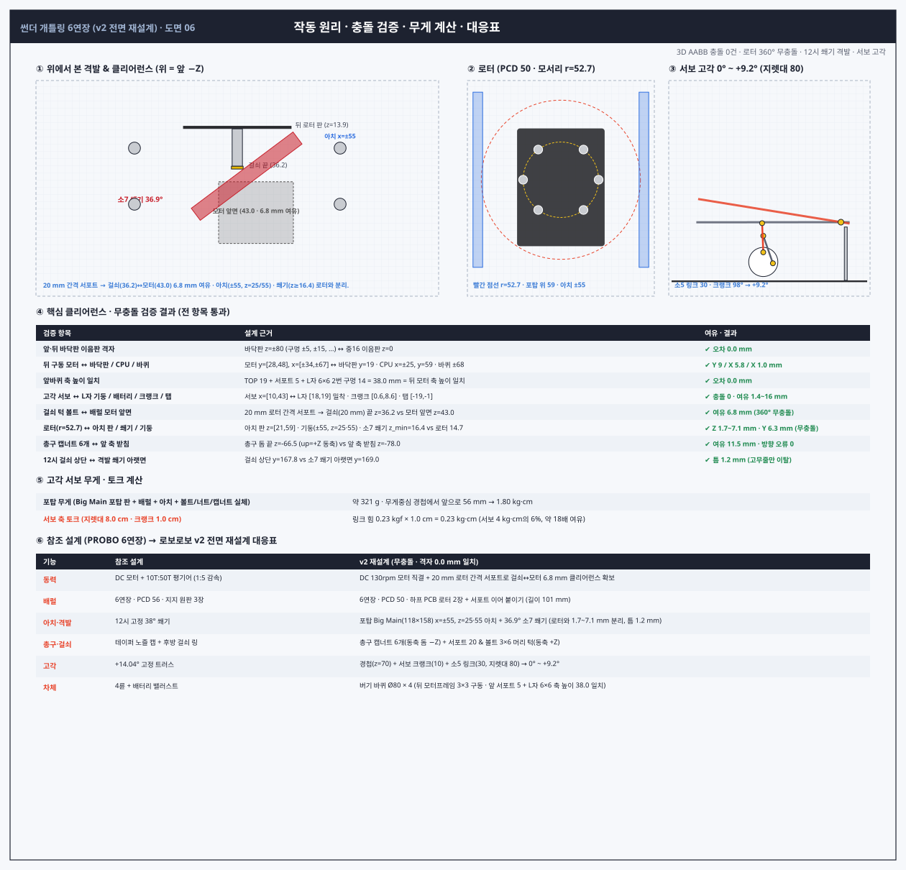

# 썬더 개틀링 6연장 설계도면

사용자가 준 "PROBO Technic 6연장 개틀링 머신" (2D 도면 + 3D)을 분석해 **로보로보 부품으로 옮긴** 설계입니다. 기본 조립 규칙 [`ASSEMBLY_RULES.md`](../ASSEMBLY_RULES.md)를 따릅니다.
다시 만들기: `python3 tools/gatling_blueprint.py` · 그림으로 보기: [`blueprint.html`](blueprint.html)

## 1. 참조 설계 분석

- **핵심:** 모터 1개의 회전만으로 ① 배럴 다발 회전 ② 12시에 고정된 38° 쐐기가 고무줄 고리를 밀어 내는 순차 격발 (캠-스토퍼 방식). 방아쇠 서보가 없다.
- **동력:** DC 모터 + 10T:50T 평기어 (1:5 감속, 중심거리 30) → 토크 약 4.5배.
- **배럴:** 6연장, 피치원 Ø56, 고정 중심축 Ø4 위에서 지지 원판 3장이 회전. 앞은 테이퍼 노즐 캡, 뒤는 걸쇠 링 (턱 3 mm).
- **격발:** 쐐기 끝 반지름 30.5 (배럴 28 + 틈 2.5) → 금속 배럴은 지나가고 고리만 3.5 mm 밀려 이탈. 격발 위치가 늘 12시라 탄착이 모인다.
- **구조:** 고각 +14.04° 트러스 (지주 80 / 110, 스팬 120, X자 보강), 4륜 차체 + 배터리 밸러스트.

## 1-1. 고각 서보 무게 계산

포탑 약 289 g · 무게 중심이 경첩에서 43 mm → 1.24 kg·cm. 링크 (65 mm 지점) 힘 0.19 kgf × 크랭크 1 cm = **0.19 kg·cm** (서보 4 kg·cm의 5%). 서포트 무게 0.12 g/mm 등은 추정값입니다.

## 2. 우리 부품으로 옮긴 방법 (대응표)

| 기능 | 참조 설계 | 이 설계 |
|---|---|---|
| 동력 | DC 모터 + 10T:50T 평기어 (1:5 감속, 약 55 rpm) | 기어 부품이 없음 → 감속기가 든 DC 130rpm 모터를 로터에 바로 연결. 켜는 시간으로 조절 |
| 배럴 | 6연장 · PCD 56 · 금속 축 + 지지 원판 3장 | 6연장 · PCD 50 · 서포트를 이어 만든 배럴 + 하프 PCB 로터 2장 (반지름 25가 정확히 같은 구멍 6개) |
| 고정 축 | 비회전 중심 샤프트 Ø4 위에서 원판이 회전 | 뒤는 모터 축이 돌리고, 앞은 75 mm 축 (L자에 고정)이 로터 가운데 구멍을 받침 |
| 총구 | 원추형 테이퍼 노즐 캡 | 캡너트 (둥근 끝) |
| 걸쇠 | 후방 걸쇠 링 (턱 3 mm) | 로터 뒤로 나온 서포트 10 + 볼트 머리 턱 |
| 격발 | 12시 고정 38° 쐐기가 고리를 앞으로 3.5 mm 밀어 냄 | 12시 고정 36.9° 쐐기 (소8 PCB)가 고리를 뒤로 10 mm 밀어 기둥 끝에서 벗김 |
| 고각 | +14.04° 고정 트러스 | 경첩 + 서보 크랭크 · 링크: 0° ~ +15.9°를 모터로 조절 |
| 차체 | 4륜 + 배터리 밸러스트 (구동 없음) | 4륜 (뒤 2 구동) + 배터리. 블루투스로 움직이며 쏨 |

## 3. 디자인 포인트

- **① 모터 1개로 회전 + 격발** — 참조 설계의 캠-스토퍼 방식 그대로: 배럴 모터가 배럴 다발을 돌리고, 12시에 고정된 쐐기가 지나가는 고무줄 고리만 밀어 내 한 발씩 쏜다.
- **② 6연장 · 반지름이 정확히 같은 구멍 6개** — 네모 격자에서도 3-4-5 삼각형을 쓰면 반지름 25가 딱 맞는 자리가 여섯 개 있다: (±25, 0) · (±15, ±20). 하프 PCB의 구멍 (0, 5)를 회전 가운데로 잡으면 여섯 자리에 모두 구멍이 있다 (PCD 50, 참조 56). 간격은 53° · 53° · 74°로 조금 고르지 않아 발사 시간으로 맞춘다.
- **③ 고각은 서보 모터로** — 포탑 판 뒤는 경첩, 앞은 서보 크랭크 (반지름 10) + 링크 (소3 PCB)가 밀어 올린다. 크랭크를 131° 돌리면 0° → +15.9° (참조 +14.04°). 손으로 서포트를 끼우던 것을 블루투스로 조절.
- **④ 서보가 들 수 있는 무게** — 포탑 무게 약 289 g, 무게 중심이 경첩에서 43 mm → 경첩 둘레 1.24 kg·cm. 링크가 경첩에서 65 mm를 밀고 크랭크가 10 mm라 서보에 걸리는 토크는 약 0.19 kg·cm = 서보 힘 (4 kg·cm)의 5%. 전자부는 모두 차체에 달아 포탑을 가볍게 했다.
- **⑤ 로터가 포탑 판에 닿지 않게** — 하프 PCB 로터는 돌 때 모서리가 반지름 52.7까지 나온다. 배럴 축을 포탑 판 위 59 mm로 올렸다 (모터 기둥 L자 2×6의 구멍 44 · 54 + 서포트 10 돋움).
- **⑥ 배럴 = 서포트 이어 끼우기** — 걸쇠 기둥 10 + 40 + 25 + (앞 로터) + 7 + 캡너트 = 길이 91 mm. 수나사가 로터 구멍을 지나 다음 서포트에 끼워져 로터 두 장이 배럴 사이에 물린다.
- **⑦ 쐐기 각도는 구멍으로 (36.9°)** — 아치 판에서 가로 40 · 세로 30 떨어진 두 구멍에 소8 PCB를 달면 36.9° (참조 38°).
- **⑧ 기어 대신 감속 모터 직결** — DC 130rpm 모터를 로터에 바로 붙이고 조작 자리 (M3)에 연결해 켜는 시간으로 발사 수를 정한다.

## 4. 개요

| 항목 | 값 |
|---|---|
| 전체 크기 (고각 0°) | 폭 195 × 높이 173 × 길이 322 mm |
| 무게 (추정) | 약 1058 g |
| 배럴 | 6연장 · PCD 50 · 길이 91 mm (걸쇠 끝 ~ 총구) · DC 130rpm 직결 |
| 격발 | 12시 고정 쐐기 36.9° · 1/6바퀴쯤마다 1발 (약 0.08초) |
| 고각 | 0° ~ +15.9° · 서보 모터 (크랭크 + 링크), 서보 힘의 5% 사용 |
| 주행 | 버기 바퀴 Ø80 × 4 (뒤 2 구동), 약 0.54 m/s |
| 부품 수 | 304개 (볼트 · 너트 · 케이블 포함), 33종 + 고무줄 6 (소모품, 목록 밖) |

## 5. 기본 규칙 검사

| 규칙 | 이 설계 | 결과 |
|---|---|---|
| 1.1 CPU 1대당 1개 | CPU 보드 1개 | ✔ |
| 2.1 CPU 모터 최대 6 · 조작 4 | DC 모터 3개 (구동 2 + 배럴 1), 모두 조작 자리 M1 ~ M3 | ✔ |
| 2.2 확장 보드 | 필요 없음 | ✔ |
| 2.3 수량 130 × 4 | 130 모터 3개 사용 (1개 남음) | ✔ |
| 2.4 배틀 무기 = 400 모터 | 배틀무기 판을 쓰지 않음. 배럴은 130 모터 (판단 필요 — 아래 참고) | 확인 필요 |
| 7 입력 IN | 접촉 센서 1 (발사 버튼) | ✔ |
| 7 출력 OUT | 서보 1 (고각) · LED 빨강 1 · 부저 1 | ✔ |
| 3 세트 부품 | 바퀴 = 버기 바퀴 세트 4 | ✔ |
| 고각 서보 힘 | 필요 0.19 kg·cm / 서보 4 kg·cm (5%) | ✔ |

## 6. 도면

### 도면 00 · 전체 조립도

### 도면 01 · 차체 · 구동 (바닥판 2 · 구동 모터 2 · 버기 바퀴 4 · 배터리)

### 도면 02 · 포탑 받침 · 고각 서보 (경첩 · 서보 크랭크 · 링크 · 포탑 판)

### 도면 03 · 배럴 구동부 (모터 1 · 로터 판 2 · 배럴 6 · 앞 축 받침)

### 도면 04 · 격발 쐐기 (아치 · 36.9° 쐐기 띠)

### 도면 05 · 전자부 (CPU · 블루투스 · 발사 버튼 · LED · 부저)

### 도면 06 · 작동 원리 (쐐기 격발 · 서보 고각 · 무게 계산 · 대응표)

### 도면 07 · 규칙 검사 · 배선

## 7. 파트별 부품 위치

좌표는 부품 중심 (mm, 원점 = 지면 위 로봇 가운데, 앞 = −Z), 크기는 X × Y × Z. 포탑 (포탑 판과 그 위 부품)은 고각 0° 기준입니다.

### 01 차체 · 구동 (바닥판 2 · 구동 모터 2 · 버기 바퀴 4 · 배터리)

| 번호 | 부품 | id | 중심 (X, Y, Z) | 크기 | 방향 · 메모 |
|---|---|---|---|---|---|
| 1 | 차체 바닥판 뒤 (빅 메인 PCB) | `frame-big-main` | (0, 29.2, 79.0) | 118.0 × 1.6 × 158.0 | 수평 · 긴 쪽이 앞뒤 |
| 2 | 차체 바닥판 앞 (빅 메인 PCB) | `frame-big-main` | (0, 29.2, -79.0) | 118.0 × 1.6 × 158.0 | 수평 · 긴 쪽이 앞뒤 |
| 3 | 이음판 (중16 PCB) | `frame-m16-pcb` | (-45, 27.6, 0.0) | 18.0 × 1.6 × 158.0 | 두 바닥판 아래에서 이음선을 가로질러 |
| 3 | 이음판 (중16 PCB) | `frame-m16-pcb` | (45, 27.6, 0.0) | 18.0 × 1.6 × 158.0 | 두 바닥판 아래에서 이음선을 가로질러 |
| 4 | 왼 구동 모터 받침 (모터프레임 3×3) | `motor-frame-3x3` | (-45, 40.0, 75.0) | 8.0 × 20.0 × 8.0 | 모터 귀를 잡음 |
| 4 | 왼 구동 모터 받침 (모터프레임 3×3) | `motor-frame-3x3` | (-45, 40.0, 95.0) | 8.0 × 20.0 × 8.0 | 모터 귀를 잡음 |
| 5 | 왼 구동 모터 (DC 130rpm, M1) | `dc-motor-130-rs` | (-45, 40.0, 90.0) | 33.0 × 20.0 × 40.0 | 눕힘, 축이 바깥 · z 100 |
| 6 | 왼 뒤 구동 바퀴 (Ø80 버기 세트) | `wheel-80-buggy-set` | (-80, 40.0, 100.0) | 33.0 × 80.0 × 80.0 | 모터 D컷 축 |
| 4 | 오른 구동 모터 받침 (모터프레임 3×3) | `motor-frame-3x3` | (45, 40.0, 75.0) | 8.0 × 20.0 × 8.0 | 모터 귀를 잡음 |
| 4 | 오른 구동 모터 받침 (모터프레임 3×3) | `motor-frame-3x3` | (45, 40.0, 95.0) | 8.0 × 20.0 × 8.0 | 모터 귀를 잡음 |
| 5 | 오른 구동 모터 (DC 130rpm, M2) | `dc-motor-130-rs` | (45, 40.0, 90.0) | 33.0 × 20.0 × 40.0 | 눕힘, 축이 바깥 · z 100 |
| 6 | 오른 뒤 구동 바퀴 (Ø80 버기 세트) | `wheel-80-buggy-set` | (80, 40.0, 100.0) | 33.0 × 80.0 × 80.0 | 모터 D컷 축 |
| 7 | 왼 앞 축가이드 | `axle-guide` | (-30, 35.0, -100.0) | 28.0 × 10.0 × 18.0 | 축 높이 40 |
| 7 | 왼 앞 축가이드 | `axle-guide` | (-50, 35.0, -100.0) | 28.0 × 10.0 × 18.0 | 축 높이 40 |
| 8 | 왼 앞 축 (75 mm) | `shaft-75` | (-60, 40.0, -100.0) | 75.0 × 3.0 × 3.0 |  |
| 9 | 왼 앞 바퀴 (Ø80 버기 세트, 헛돎) | `wheel-80-buggy-set` | (-80, 40.0, -100.0) | 33.0 × 80.0 × 80.0 | 축에서 헛돎 |
| 7 | 오른 앞 축가이드 | `axle-guide` | (30, 35.0, -100.0) | 28.0 × 10.0 × 18.0 | 축 높이 40 |
| 7 | 오른 앞 축가이드 | `axle-guide` | (50, 35.0, -100.0) | 28.0 × 10.0 × 18.0 | 축 높이 40 |
| 8 | 오른 앞 축 (75 mm) | `shaft-75` | (60, 40.0, -100.0) | 75.0 × 3.0 × 3.0 |  |
| 9 | 오른 앞 바퀴 (Ø80 버기 세트, 헛돎) | `wheel-80-buggy-set` | (80, 40.0, -100.0) | 33.0 × 80.0 × 80.0 | 축에서 헛돎 |
| 10 | 배터리케이스 (AA 4개, 6V) | `battery-case-4aa` | (0, 39.0, -55.0) | 74.0 × 18.0 × 62.0 | 앞 판 가운데 · 가장 낮게 |

### 02 포탑 받침 · 고각 서보 (경첩 · 서보 크랭크 · 링크 · 포탑 판)

| 번호 | 부품 | id | 중심 (X, Y, Z) | 크기 | 방향 · 메모 |
|---|---|---|---|---|---|
| 1 | 뒤 받침 기둥 (서포트 40) | `support-spacer` | (-35, 50.0, 65.0) | 6.4 × 40.0 × 6.4 | 차체 → 뒤 받침대 |
| 1 | 뒤 받침 기둥 (서포트 40) | `support-spacer` | (35, 50.0, 65.0) | 6.4 × 40.0 × 6.4 | 차체 → 뒤 받침대 |
| 2 | 뒤 받침대 (중 PCB) | `frame-mid-pcb` | (0, 70.8, 65.0) | 78.0 × 1.6 × 18.0 | 기둥 2개 위 |
| 3 | 고각 경첩 (경첩 3×3) | `hinge-3x3` | (0, 73.3, 65.0) | 18.0 × 3.4 × 23.0 | 축이 좌우 |
| 4 | 고각 서보 기둥 (L자 2×6) | `l-frame-2x6` | (15, 59.0, 35.0) | 10.0 × 58.0 × 8.0 | 세운 다리 구멍 24 · 34에 서보 귀 |
| 4 | 고각 서보 기둥 (L자 2×6) | `l-frame-2x6` | (15, 59.0, -15.0) | 10.0 × 58.0 × 8.0 | 세운 다리 구멍 24 · 34에 서보 귀 |
| 5 | 고각 서보 (OUT1) | `servo-digital` | (27, 59.0, 10.0) | 33.0 × 20.0 × 60.0 | 축이 왼쪽(−X) · z 0 |
| 6 | 고각 크랭크 (휠가이드 서보) | `wheel-guide-30-servo` | (5, 59.0, 0.0) | 8.0 × 30.0 × 30.0 | 서보 축 · 반지름 10 구멍에 핀 |
| 7 | 고각 링크 (소3 PCB, 핀 간격 20) | `frame-s3-pcb` | (-1, 60.0, 0.0) | 1.6 × 28.0 × 8.0 | 크랭크 핀 ↔ 포탑 판 아래 탭 |
| 8 | 링크 아래 핀 (후크 S35) | `s-hook-35` | (1, 49.0, 0.0) | 7.6 × 6.5 × 6.5 | 크랭크 쪽 |
| 9 | 링크 위 핀 (후크 S35) | `s-hook-35` | (-3, 71.0, 0.0) | 7.6 × 6.5 × 6.5 | 탭 쪽 |
| 10 | 고각 탭 (L자 2×2, 포탑 판 아래) | `l-frame-2x2` | (-5, 70.0, 0.0) | 8.0 × 10.0 × 10.0 | 포탑 판 아랫면에 매닮 · 경첩에서 65 |
| 11 | 포탑 판 (메인 PCB) | `frame-main-pcb` | (0, 75.8, 10.0) | 78.0 × 1.6 × 118.0 | 뒤는 경첩, 앞은 서보 링크가 받침 |

### 03 배럴 구동부 (모터 1 · 로터 판 2 · 배럴 6 · 앞 축 받침)

| 번호 | 부품 | id | 중심 (X, Y, Z) | 크기 | 방향 · 메모 |
|---|---|---|---|---|---|
| 1 | 배럴 모터 돋움 (서포트 10) | `support-spacer` | (-15, 81.6, 55.0) | 6.4 × 10.0 × 6.4 | 축 높이 59에 맞춤 |
| 1 | 배럴 모터 돋움 (서포트 10) | `support-spacer` | (-15, 81.6, 65.0) | 6.4 × 10.0 × 6.4 | 축 높이 59에 맞춤 |
| 2 | 배럴 모터 기둥 (L자 2×6) | `l-frame-2x6` | (-15, 115.6, 58.0) | 8.0 × 58.0 × 14.0 | 구멍 44 · 54에 모터 귀 |
| 1 | 배럴 모터 돋움 (서포트 10) | `support-spacer` | (35, 81.6, 55.0) | 6.4 × 10.0 × 6.4 | 축 높이 59에 맞춤 |
| 1 | 배럴 모터 돋움 (서포트 10) | `support-spacer` | (35, 81.6, 65.0) | 6.4 × 10.0 × 6.4 | 축 높이 59에 맞춤 |
| 2 | 배럴 모터 기둥 (L자 2×6) | `l-frame-2x6` | (35, 115.6, 58.0) | 8.0 × 58.0 × 14.0 | 구멍 44 · 54에 모터 귀 |
| 3 | 배럴 모터 (DC 130rpm, M3) | `dc-motor-130-rs` | (10, 135.6, 62.0) | 60.0 × 20.0 × 40.0 | 축이 앞(−Z) · 가운데 (x 0) |
| 4 | 로터 허브 (휠가이드 Ø30 나일론) | `wheel-guide-30-nylon` | (0, 135.6, 39.0) | 30.0 × 30.0 × 8.0 | 모터 D컷 축 |
| 5 | 뒤 로터 판 (하프 PCB) | `frame-half-pcb` | (0, 130.6, 34.0) | 58.0 × 78.0 × 1.6 | 판 구멍 (0, 5)가 회전 가운데 · 위아래 구멍 2개를 허브에 |
| 6 | 걸쇠 기둥 (서포트 10) | `support-spacer` | (25, 135.6, 39.8) | 6.4 × 6.4 × 10.0 | 3시 배럴 · 뒤 로터 뒤로 10 mm |
| 7 | 배럴 뒤 (서포트 40) | `support-spacer` | (25, 135.6, 13.2) | 6.4 × 6.4 × 40.0 | 3시 배럴 |
| 8 | 배럴 가운데 (서포트 25) | `support-spacer` | (25, 135.6, -19.3) | 6.4 × 6.4 × 25.0 |  |
| 6 | 걸쇠 기둥 (서포트 10) | `support-spacer` | (15, 155.6, 39.8) | 6.4 × 6.4 × 10.0 | 1시 배럴 · 뒤 로터 뒤로 10 mm |
| 7 | 배럴 뒤 (서포트 40) | `support-spacer` | (15, 155.6, 13.2) | 6.4 × 6.4 × 40.0 | 1시 배럴 |
| 8 | 배럴 가운데 (서포트 25) | `support-spacer` | (15, 155.6, -19.3) | 6.4 × 6.4 × 25.0 |  |
| 6 | 걸쇠 기둥 (서포트 10) | `support-spacer` | (-15, 155.6, 39.8) | 6.4 × 6.4 × 10.0 | 11시 배럴 · 뒤 로터 뒤로 10 mm |
| 7 | 배럴 뒤 (서포트 40) | `support-spacer` | (-15, 155.6, 13.2) | 6.4 × 6.4 × 40.0 | 11시 배럴 |
| 8 | 배럴 가운데 (서포트 25) | `support-spacer` | (-15, 155.6, -19.3) | 6.4 × 6.4 × 25.0 |  |
| 6 | 걸쇠 기둥 (서포트 10) | `support-spacer` | (-25, 135.6, 39.8) | 6.4 × 6.4 × 10.0 | 9시 배럴 · 뒤 로터 뒤로 10 mm |
| 7 | 배럴 뒤 (서포트 40) | `support-spacer` | (-25, 135.6, 13.2) | 6.4 × 6.4 × 40.0 | 9시 배럴 |
| 8 | 배럴 가운데 (서포트 25) | `support-spacer` | (-25, 135.6, -19.3) | 6.4 × 6.4 × 25.0 |  |
| 6 | 걸쇠 기둥 (서포트 10) | `support-spacer` | (-15, 115.6, 39.8) | 6.4 × 6.4 × 10.0 | 7시 배럴 · 뒤 로터 뒤로 10 mm |
| 7 | 배럴 뒤 (서포트 40) | `support-spacer` | (-15, 115.6, 13.2) | 6.4 × 6.4 × 40.0 | 7시 배럴 |
| 8 | 배럴 가운데 (서포트 25) | `support-spacer` | (-15, 115.6, -19.3) | 6.4 × 6.4 × 25.0 |  |
| 6 | 걸쇠 기둥 (서포트 10) | `support-spacer` | (15, 115.6, 39.8) | 6.4 × 6.4 × 10.0 | 5시 배럴 · 뒤 로터 뒤로 10 mm |
| 7 | 배럴 뒤 (서포트 40) | `support-spacer` | (15, 115.6, 13.2) | 6.4 × 6.4 × 40.0 | 5시 배럴 |
| 8 | 배럴 가운데 (서포트 25) | `support-spacer` | (15, 115.6, -19.3) | 6.4 × 6.4 × 25.0 |  |
| 9 | 걸쇠 턱 (볼트 3×6 머리) | `bolt-m3x6` | (25, 135.6, 45.6) | 6.3 × 6.3 × 1.6 | 고리가 저절로 안 빠지게 |
| 9 | 걸쇠 턱 (볼트 3×6 머리) | `bolt-m3x6` | (15, 155.6, 45.6) | 6.3 × 6.3 × 1.6 | 고리가 저절로 안 빠지게 |
| 9 | 걸쇠 턱 (볼트 3×6 머리) | `bolt-m3x6` | (-15, 155.6, 45.6) | 6.3 × 6.3 × 1.6 | 고리가 저절로 안 빠지게 |
| 9 | 걸쇠 턱 (볼트 3×6 머리) | `bolt-m3x6` | (-25, 135.6, 45.6) | 6.3 × 6.3 × 1.6 | 고리가 저절로 안 빠지게 |
| 9 | 걸쇠 턱 (볼트 3×6 머리) | `bolt-m3x6` | (-15, 115.6, 45.6) | 6.3 × 6.3 × 1.6 | 고리가 저절로 안 빠지게 |
| 9 | 걸쇠 턱 (볼트 3×6 머리) | `bolt-m3x6` | (15, 115.6, 45.6) | 6.3 × 6.3 × 1.6 | 고리가 저절로 안 빠지게 |
| 10 | 앞 로터 판 (하프 PCB) | `frame-half-pcb` | (0, 130.6, -32.6) | 58.0 × 78.0 × 1.6 | 가운데 구멍에 앞 받침 축 |
| 11 | 배럴 앞 (서포트 7) | `support-spacer` | (25, 135.6, -36.9) | 6.4 × 6.4 × 7.0 | 앞 로터를 사이에 물림 |
| 12 | 총구 (캡너트) | `cap-nut-m3` | (25, 135.6, -43.4) | 6.4 × 6.4 × 6.0 | 둥근 끝 = 앞고리 자리 |
| 11 | 배럴 앞 (서포트 7) | `support-spacer` | (15, 155.6, -36.9) | 6.4 × 6.4 × 7.0 | 앞 로터를 사이에 물림 |
| 12 | 총구 (캡너트) | `cap-nut-m3` | (15, 155.6, -43.4) | 6.4 × 6.4 × 6.0 | 둥근 끝 = 앞고리 자리 |
| 11 | 배럴 앞 (서포트 7) | `support-spacer` | (-15, 155.6, -36.9) | 6.4 × 6.4 × 7.0 | 앞 로터를 사이에 물림 |
| 12 | 총구 (캡너트) | `cap-nut-m3` | (-15, 155.6, -43.4) | 6.4 × 6.4 × 6.0 | 둥근 끝 = 앞고리 자리 |
| 11 | 배럴 앞 (서포트 7) | `support-spacer` | (-25, 135.6, -36.9) | 6.4 × 6.4 × 7.0 | 앞 로터를 사이에 물림 |
| 12 | 총구 (캡너트) | `cap-nut-m3` | (-25, 135.6, -43.4) | 6.4 × 6.4 × 6.0 | 둥근 끝 = 앞고리 자리 |
| 11 | 배럴 앞 (서포트 7) | `support-spacer` | (-15, 115.6, -36.9) | 6.4 × 6.4 × 7.0 | 앞 로터를 사이에 물림 |
| 12 | 총구 (캡너트) | `cap-nut-m3` | (-15, 115.6, -43.4) | 6.4 × 6.4 × 6.0 | 둥근 끝 = 앞고리 자리 |
| 11 | 배럴 앞 (서포트 7) | `support-spacer` | (15, 115.6, -36.9) | 6.4 × 6.4 × 7.0 | 앞 로터를 사이에 물림 |
| 12 | 총구 (캡너트) | `cap-nut-m3` | (15, 115.6, -43.4) | 6.4 × 6.4 × 6.0 | 둥근 끝 = 앞고리 자리 |
| 13 | 앞 받침 돋움 (서포트 5) | `support-spacer` | (0, 79.1, -45.0) | 6.4 × 5.0 × 6.4 | 5 + 54 = 축 높이 59 |
| 13 | 앞 받침 돋움 (서포트 5) | `support-spacer` | (0, 79.1, -35.0) | 6.4 × 5.0 × 6.4 | 5 + 54 = 축 높이 59 |
| 14 | 앞 축 받침 (L자 2×6) | `l-frame-2x6` | (0, 110.6, -45.0) | 8.0 × 58.0 × 10.0 | 총구보다 앞 (세운 다리 z −59) · 구멍 54에 축 |
| 15 | 앞 받침 축 (75 mm) | `shaft-75` | (0, 135.6, -16.5) | 3.0 × 3.0 × 75.0 | L자 구멍 → 앞 로터 가운데 구멍 |

### 04 격발 쐐기 (아치 · 36.9° 쐐기 띠)

| 번호 | 부품 | id | 중심 (X, Y, Z) | 크기 | 방향 · 메모 |
|---|---|---|---|---|---|
| 1 | 아치 기둥 1 (서포트 40) | `support-spacer` | (-35, 96.6, 25.0) | 6.4 × 40.0 × 6.4 |  |
| 2 | 아치 기둥 2 (서포트 40) | `support-spacer` | (-35, 136.6, 25.0) | 6.4 × 40.0 × 6.4 |  |
| 3 | 아치 기둥 3 (서포트 15) | `support-spacer` | (-35, 164.1, 25.0) | 6.4 × 15.0 × 6.4 |  |
| 1 | 아치 기둥 1 (서포트 40) | `support-spacer` | (-35, 96.6, 45.0) | 6.4 × 40.0 × 6.4 |  |
| 2 | 아치 기둥 2 (서포트 40) | `support-spacer` | (-35, 136.6, 45.0) | 6.4 × 40.0 × 6.4 |  |
| 3 | 아치 기둥 3 (서포트 15) | `support-spacer` | (-35, 164.1, 45.0) | 6.4 × 15.0 × 6.4 |  |
| 1 | 아치 기둥 1 (서포트 40) | `support-spacer` | (35, 96.6, 25.0) | 6.4 × 40.0 × 6.4 |  |
| 2 | 아치 기둥 2 (서포트 40) | `support-spacer` | (35, 136.6, 25.0) | 6.4 × 40.0 × 6.4 |  |
| 3 | 아치 기둥 3 (서포트 15) | `support-spacer` | (35, 164.1, 25.0) | 6.4 × 15.0 × 6.4 |  |
| 1 | 아치 기둥 1 (서포트 40) | `support-spacer` | (35, 96.6, 45.0) | 6.4 × 40.0 × 6.4 |  |
| 2 | 아치 기둥 2 (서포트 40) | `support-spacer` | (35, 136.6, 45.0) | 6.4 × 40.0 × 6.4 |  |
| 3 | 아치 기둥 3 (서포트 15) | `support-spacer` | (35, 164.1, 45.0) | 6.4 × 15.0 × 6.4 |  |
| 4 | 아치 판 (5×13 PCB) | `frame-5x13-pcb` | (0, 172.4, 40.0) | 118.0 × 1.6 × 38.0 | 배럴 뒤쪽 위를 가로지름 |
| 5 | 쐐기 내림 (서포트 5) | `support-spacer` | (-15, 169.1, 55.0) | 6.4 × 5.0 × 6.4 | 너트를 더 끼워 높이 조절 |
| 5 | 쐐기 내림 (서포트 5) | `support-spacer` | (25, 169.1, 25.0) | 6.4 × 5.0 × 6.4 | 너트를 더 끼워 높이 조절 |
| 6 | 격발 쐐기 (소8 PCB, 36.9°) | `frame-s8-pcb` | (5, 165.8, 40.0) | 67.2 × 1.6 × 53.2 | 아치 판 구멍 (−15, 45) · (25, 15) = 가로 40 · 세로 30 → 36.9° |

### 05 전자부 (CPU · 블루투스 · 발사 버튼 · LED · 부저)

| 번호 | 부품 | id | 중심 (X, Y, Z) | 크기 | 방향 · 메모 |
|---|---|---|---|---|---|
| 1 | CPU 받침 (서포트 25) | `support-spacer` | (-25, 42.5, 90.0) | 6.4 × 25.0 × 6.4 | 구동 모터 위로 띄움 |
| 1 | CPU 받침 (서포트 25) | `support-spacer` | (-25, 42.5, 140.0) | 6.4 × 25.0 × 6.4 | 구동 모터 위로 띄움 |
| 1 | CPU 받침 (서포트 25) | `support-spacer` | (25, 42.5, 90.0) | 6.4 × 25.0 × 6.4 | 구동 모터 위로 띄움 |
| 1 | CPU 받침 (서포트 25) | `support-spacer` | (25, 42.5, 140.0) | 6.4 × 25.0 × 6.4 | 구동 모터 위로 띄움 |
| 2 | CPU 보드 8M (1대에 1개) | `cpu-board-8m` | (0, 62.0, 115.0) | 83.0 × 14.0 × 61.0 | 차체 뒤쪽 · 전압 6V |
| 3 | 블루투스 받침 (서포트 5) | `support-spacer` | (-10, 32.5, -141.0) | 6.4 × 5.0 × 6.4 |  |
| 3 | 블루투스 받침 (서포트 5) | `support-spacer` | (10, 32.5, -141.0) | 6.4 × 5.0 × 6.4 |  |
| 4 | 블루투스 모듈 (조종 · 발사) | `bt-module` | (0, 39.8, -130.0) | 48.0 × 9.0 × 28.0 | 차체 앞 끝 |
| 5 | 발사 LED 빨강 (OUT2) | `led-board-red-s` | (-42, 36.0, -30.0) | 22.0 × 12.0 × 32.0 | 차체 왼쪽 |
| 6 | 부저 (OUT3, 발사 경고음) | `buzzer-board-s` | (-42, 36.0, 15.0) | 22.0 × 12.0 × 32.0 | 차체 왼쪽 |
| 7 | 발사 버튼 L자 2×2 | `l-frame-2x2` | (0, 35.0, 154.0) | 8.0 × 10.0 × 10.0 | 차체 뒤 끝 |
| 8 | 발사 버튼 (접촉 센서, IN1) | `sensor-touch` | (0, 44.0, 160.0) | 48.0 × 28.0 × 9.0 | 세움, 버튼이 뒤 |

## 8. 조립 순서

| 도면 | 단계 | 방법 | 볼트 · 너트 등 |
|---|---|---|---|
| 01 | 바닥판 잇기 | 빅 메인 PCB 2장을 앞뒤로 맞대고 아래에 중16 PCB 2개 (x ±45)로 묶는다. | 볼트 3×6 × 16, M3 너트 × 16 |
| 01 | 구동 모듈 (×2) | 모터프레임 3×3 두 개로 DC 130rpm 모터를 눕혀 뒤 판에. 버기 바퀴 세트를 축에 2.6 × 10. | 볼트 M3×10 × 8, 볼트 3×6 × 8, M3 너트 × 16, 볼트 2.6×10 와셔붙이 × 2 |
| 01 | 앞바퀴 (×2) · 배터리 | 축가이드 2개에 75 mm 축을 꿰고 버기 바퀴 세트. 배터리는 앞 판 가운데. | 볼트 M3×10 × 12, M3 너트 × 12 |
| 02 | 뒤 받침대 · 경첩 | 서포트 40 두 개 (x ±35, z 65)에 중 PCB, 그 위에 경첩 한 날개. | M3 너트 × 4, 볼트 3×6 × 4 |
| 02 | 고각 서보 | L자 2×6 두 개 (x 15, z 35 · −15)를 세우고 구멍 24 · 34에 서보 귀 (축이 왼쪽, z 0). 서보 휠가이드를 축에. | 볼트 M3×10 × 4, 볼트 3×6 × 4, M3 너트 × 8, 볼트 2.6×10 와셔붙이 × 1 |
| 02 | 포탑 판 · 링크 | 메인 PCB 아랫면 뒤에 경첩 날개, 앞쪽 (경첩에서 65)에 L자 2×2 탭. 소3 PCB 링크로 크랭크 반지름 10 구멍과 탭을 후크 S35 두 개로 잇는다. | M3 너트 × 4, 볼트 3×6 × 4 |
| 03 | 배럴 모터 | 서포트 10 네 개 위에 L자 2×6 두 개 (x −15 · 35), 구멍 44 · 54에 모터 귀. 축이 앞. | 볼트 M3×10 × 4, 볼트 3×6 × 4, M3 너트 × 8 |
| 03 | 뒤 로터 · 배럴 (×6) | 나일론 휠가이드를 모터 축에. 하프 PCB의 구멍 (0, 5)를 가운데로 맞춰 위 · 아래 구멍을 허브에. 반지름 25의 여섯 구멍에 걸쇠 기둥 (뒤에서) + 서포트 40 + 25를 이어 끼운다. | 볼트 2.6×10 와셔붙이 × 1, 볼트 M3×10 × 2, M3 너트 × 2 |
| 03 | 앞 로터 · 총구 · 앞 축 | 배럴 끝에 앞 로터 판을 끼우고 서포트 7 + 캡너트. 포탑 판 앞 끝 서포트 5 두 개 위에 L자 2×6, 75 mm 축을 구멍 54에서 로터 가운데로. | M3 너트 × 2, 볼트 3×6 × 2 |
| 04 | 아치 · 쐐기 | 서포트 40 + 40 + 15 네 개 (x ±35, z 15 · 35) 위에 5×13 PCB. 구멍 (−15, 45) · (25, 15) 아래 서포트 5에 소8 PCB (구멍 2번 · 7번). | M3 너트 × 6, 볼트 3×6 × 6 |
| 05 | 전자부 | CPU는 차체 뒤 서포트 25 위, 블루투스는 앞 끝, LED · 부저는 왼쪽, 발사 버튼은 뒤 끝 L자에. 모두 차체에 달아 포탑을 가볍게. | M3 너트 × 12, 볼트 3×6 × 16 |
| 07 | 배선 · 고무줄 | 배선도대로. 고무줄 6개 (지름 약 50 mm, 소모품)를 총구 캡너트 → 걸쇠 기둥에. 마주 보는 순서로 건다. | 케이블 - 3Pin × 4 |

## 9. 배선

| 포트 | 부품 | 역할 |
|---|---|---|
| IN1 | 발사 버튼 | 누르면 1발 |
| OUT1 | 고각 서보 | 0° ~ +15.9° (크랭크 131° 회전) |
| OUT2 | 발사 LED 빨강 | 배럴이 도는 동안 켜짐 |
| OUT3 | 부저 | 발사 전 짧은 경고음 |
| M1 | 왼쪽 구동 모터 (DC 130) | 조작 |
| M2 | 오른쪽 구동 모터 (DC 130) | 조작 |
| M3 | 배럴 모터 (DC 130) | 조작 · 약 0.08초 = 1발, 0.46초 = 6발 연사 |
| UART | 블루투스 모듈 | 스마트폰 조종 · 고각 · 발사 |
| BATT | 배터리케이스 4AA 6V | CPU 6V (서보 6 V 이하) |

## 10. 부품 목록 (BOM)

| 부품 id | 이름 | 수량 |
|---|---|---|
| `axle-guide` | 축가이드 | 4 |
| `battery-case-4aa` | AA 배터리케이스 1×4 | 1 |
| `bt-module` | 무선 통신보드 (블루투스 모듈) | 1 |
| `buzzer-board-s` | Buzzer 보드[S] | 1 |
| `cpu-board-8m` | CPU Board 8M[12V/S] | 1 |
| `dc-motor-130-rs` | DC Motor 130rpm [RS] | 3 |
| `frame-5x13-pcb` | 프레임 5×13 [PCB] | 1 |
| `frame-big-main` | 프레임 Big Main PCB | 2 |
| `frame-half-pcb` | 프레임 Half PCB 6×8 | 2 |
| `frame-m16-pcb` | 프레임 중16 [PCB] | 2 |
| `frame-main-pcb` | 프레임 Main PCB 8×12 | 1 |
| `frame-mid-pcb` | 프레임 중 [PCB] | 1 |
| `frame-s3-pcb` | 프레임 소3 [PCB] | 1 |
| `frame-s8-pcb` | 프레임 소8 [PCB] | 1 |
| `hinge-3x3` | 경첩[3x3] | 1 |
| `l-frame-2x2` | 프레임 2x2 [L자] | 2 |
| `l-frame-2x6` | 프레임 2x6 [L자] | 5 |
| `led-board-red-s` | LED 보드[빨강/S] | 1 |
| `motor-frame-3x3` | 모터프레임 [3x3] | 4 |
| `s-hook-35` | 후크 S35 [노랑] | 2 |
| `sensor-touch` | 접촉 센서 보드 | 1 |
| `servo-digital` | Servo Motor[Digital] | 1 |
| `shaft-75` | 축 75mm[Ø3] | 3 |
| `support-spacer` | 서포트 (5 mm × 6 · 7 mm × 6 · 10 mm × 10 · 15 mm × 4 · 25 mm × 10 · 40 mm × 16) | 52 |
| `wheel-80-buggy-set` | 바퀴 Ø80 버기 세트 | 4 |
| `wheel-guide-30-nylon` | 휠가이드[Ø30/나일론/검정] | 1 |
| `wheel-guide-30-servo` | 휠가이드[Ø30/Servo] | 1 |
| `bolt-m26x10` | 볼트 2.6×10 와셔붙이 | 4 |
| `bolt-m3x10` | 볼트 M3×10 | 30 |
| `bolt-m3x6` | 볼트 3×6 | 70 |
| `cable-3pin` | 케이블 - 3Pin | 4 |
| `cap-nut-m3` | 캡너트 3Ø 회색 | 6 |
| `nut-m3` | M3 너트 | 90 |
| | **합계** | **304** |
