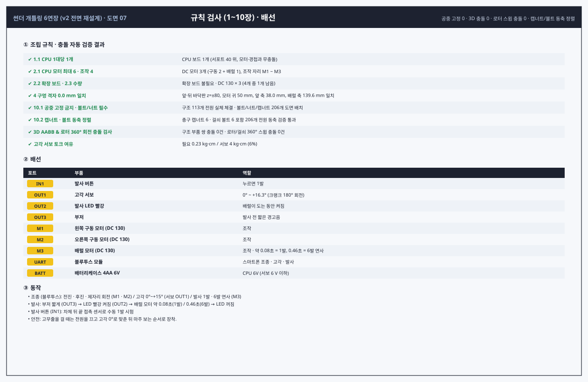

# 썬더 개틀링 4연장 설계도면

사용자가 준 "PROBO Technic 6연장 개틀링 머신" (2D 도면 + 3D)을 분석해 **로보로보 부품으로 옮긴** 설계입니다. 기본 조립 규칙 [`ASSEMBLY_RULES.md`](../ASSEMBLY_RULES.md)를 따릅니다.
다시 만들기: `python3 tools/gatling_blueprint.py` · 그림으로 보기: [`blueprint.html`](blueprint.html)

## 1. 참조 설계 분석

- **핵심:** 모터 1개의 회전만으로 ① 배럴 다발 회전 ② 12시에 고정된 38° 쐐기가 고무줄 고리를 밀어 내는 순차 격발 (캠-스토퍼 방식). 방아쇠 서보가 없다.
- **동력:** DC 모터 + 10T:50T 평기어 (1:5 감속, 중심거리 30) → 토크 약 4.5배.
- **배럴:** 6연장, 피치원 Ø56, 고정 중심축 Ø4 위에서 지지 원판 3장이 회전. 앞은 테이퍼 노즐 캡, 뒤는 걸쇠 링 (턱 3 mm).
- **격발:** 쐐기 끝 반지름 30.5 (배럴 28 + 틈 2.5) → 금속 배럴은 지나가고 고리만 3.5 mm 밀려 이탈. 격발 위치가 늘 12시라 탄착이 모인다.
- **구조:** 고각 +14.04° 트러스 (지주 80 / 110, 스팬 120, X자 보강), 4륜 차체 + 배터리 밸러스트.

## 2. 우리 부품으로 옮긴 방법 (대응표)

| 기능 | 참조 설계 | 이 설계 |
|---|---|---|
| 동력 | DC 모터 + 10T:50T 평기어 (1:5 감속, 약 55 rpm) | 기어 부품이 없음 → 감속기가 든 DC 130rpm 모터를 로터에 바로 연결. 속도는 켜는 시간으로 조절 (0.12초 = 1발) |
| 배럴 | 6연장 · PCD 56 · 금속 축 + 지지 원판 3장 | 4연장 · PCD 40 · 서포트를 이어 만든 배럴 + 소5 PCB 십자 로터 2장 (구멍 격자가 네모라 60° 간격이 안 됨 → 90° 간격 4개) |
| 고정 축 | 비회전 중심 샤프트 Ø4 위에서 원판이 회전 | 뒤는 모터 축이 돌리고, 앞은 75 mm 축 (L자에 고정)이 로터 가운데 구멍을 받침 |
| 총구 | 원추형 테이퍼 노즐 캡 | 캡너트 (둥근 끝) |
| 걸쇠 | 후방 걸쇠 링 (턱 3 mm) | 로터 뒤로 나온 서포트 10 + 볼트 머리 턱 |
| 격발 | 12시 고정 38° 쐐기가 고리를 앞으로 3.5 mm 밀어 냄 | 12시 고정 36.9° 쐐기 (소8 PCB, 구멍 40 × 30)가 고리를 뒤로 10 mm 밀어 기둥 끝에서 벗김 |
| 고각 | +14.04° 고정 트러스 (지주 80 / 110, 스팬 120) | 경첩 + 앞 받침: 서포트 25를 더하면 +14.5°, 빼면 수평 (장전 자세) |
| 차체 | 4륜 + 배터리 밸러스트 (구동 없음) | 4륜 (뒤 2 구동) + 가운데 배터리. 블루투스로 움직이며 쏨 |

## 3. 디자인 포인트

- **① 모터 1개로 회전 + 격발** — 참조 설계의 핵심 (캠-스토퍼 방식)을 그대로: 배럴 모터 하나가 배럴 다발을 돌리고, 12시에 고정된 쐐기가 지나가는 고무줄 고리만 밀어 내 한 발씩 쏜다. 방아쇠용 서보 · 솔레노이드가 없다.
- **② 기어 대신 감속 모터 직결** — 우리 부품에는 평기어가 없다. DC 130rpm 모터는 이미 감속기가 들어 있어 로터에 바로 붙이고, 조작 자리 (M3)에 연결해 켜는 시간으로 발사 수를 정한다 (1/4바퀴 = 0.12초 = 1발).
- **③ 6연장 → 4연장 (PCD 40)** — 프레임 구멍은 네모 격자라 60° 간격 6개를 같은 반지름에 둘 수 없다. 소5 PCB 2개를 십자로 겹치면 가운데에서 ±10 (허브 볼트) · ±20 (배럴) 구멍이 딱 맞아 90° 간격 4배럴이 된다.
- **④ 배럴 = 서포트 이어 끼우기** — 서포트 10 (걸쇠) + 40 + 40 + 15 + 캡너트 (총구) = 길이 111 mm. 서포트의 수나사가 로터 구멍을 지나 다음 서포트에 끼워져, 볼트 없이 로터 두 장이 배럴 사이에 물린다.
- **⑤ 쐐기 각도는 구멍으로 (36.9°)** — 아치 판에서 가로 40 · 세로 30 떨어진 두 구멍에 소8 PCB (구멍 간격 50 = 3-4-5 삼각형)를 달면 36.9° — 참조의 38°와 거의 같다. 각도기를 쓰지 않아도 구멍이 각도를 정한다.
- **⑥ 고각은 경첩 + 서포트** — 포탑 판 뒤를 경첩으로, 앞을 서포트 받침으로. 서포트 25를 더하면 +14.5° (참조 +14.04°), 빼면 수평이라 고무줄을 걸기 쉽다.
- **⑦ 앞 받침은 총구보다 앞에** — 배럴이 도는 원통 안으로는 고정 부품이 들어올 수 없다. 앞 축 받침 L자를 총구보다 앞 (z −89)에 세우고, 75 mm 축만 배럴 다발 안쪽으로 넣어 앞 로터를 받친다. 고무줄은 12시 위쪽으로 날아가 받침에 걸리지 않는다.
- **⑧ 무게 중심 · 규칙** — 배터리는 차체 가운데 가장 아래 (참조의 밸러스트). CPU 1개, 모터 3개 (조작 자리), 입력 접촉 센서 1, 출력 LED · 부저 — 기본 규칙 안.

## 4. 개요

| 항목 | 값 |
|---|---|
| 전체 크기 (장전 자세) | 폭 195 × 높이 140 × 길이 190 mm |
| 무게 (추정) | 약 890 g |
| 배럴 | 4연장 · PCD 40 · 길이 111 mm (걸쇠 끝 ~ 총구) · DC 130rpm 직결 |
| 격발 | 12시 고정 쐐기 36.9° · 1/4바퀴마다 1발 (0.12초) |
| 고각 | 0° (장전) / +14.5° (사격, 서포트 25 추가) |
| 주행 | 버기 바퀴 Ø80 × 4 (뒤 2 구동), 약 0.54 m/s |
| 부품 수 | 225개 (볼트 · 너트 · 케이블 포함), 27종 + 고무줄 4 (소모품, 목록 밖) |

## 5. 기본 규칙 검사

| 규칙 | 이 설계 | 결과 |
|---|---|---|
| 1.1 CPU 1대당 1개 | CPU 보드 1개 | ✔ |
| 2.1 CPU 모터 최대 6 · 조작 4 | DC 모터 3개 (구동 2 + 배럴 1), 모두 조작 자리 M1 ~ M3 | ✔ |
| 2.2 확장 보드 | 필요 없음 | ✔ |
| 2.3 수량 130 × 4 | 130 모터 3개 사용 (1개 남음) | ✔ |
| 2.4 배틀 무기 = 400 모터 | 배틀무기 판을 쓰지 않음. 배럴은 130 모터 (판단 필요 — 아래 참고) | 확인 필요 |
| 7 입력 IN | 접촉 센서 1 (발사 버튼) | ✔ |
| 7 출력 OUT | LED 빨강 1 · 부저 1 | ✔ |
| 3 세트 부품 | 바퀴 = 버기 바퀴 세트 4 | ✔ |

## 6. 도면

### 도면 00 · 전체 조립도

### 도면 01 · 차체 · 구동 (바닥판 · 구동 모터 2 · 버기 바퀴 4 · 배터리)

### 도면 02 · 포탑 받침 (뒤 받침대 · 경첩 · 포탑 판 · 고각 받침)

### 도면 03 · 배럴 구동부 (모터 1 · 십자 로터 2 · 배럴 4 · 앞 축 받침)

### 도면 04 · 격발 쐐기 (아치 · 36.9° 쐐기 띠)

### 도면 05 · 전자부 (CPU · 블루투스 · 발사 버튼 · LED · 부저)

### 도면 06 · 작동 원리 (쐐기 격발 · 고각 · 참조 설계 대응표)

### 도면 07 · 규칙 검사 · 배선

## 7. 파트별 부품 위치

좌표는 부품 중심 (mm, 원점 = 지면 위 로봇 가운데, 앞 = −Z), 크기는 X × Y × Z. 포탑 (도면 02 ~ 05의 포탑 판 위 부품)은 장전 자세 (수평) 기준입니다.

### 01 차체 · 구동 (바닥판 · 구동 모터 2 · 버기 바퀴 4 · 배터리)

| 번호 | 부품 | id | 중심 (X, Y, Z) | 크기 | 방향 · 메모 |
|---|---|---|---|---|---|
| 1 | 차체 바닥판 (빅 메인 PCB) | `frame-big-main` | (0, 29.2, 0.0) | 118.0 × 1.6 × 158.0 | 수평 · 긴 쪽이 앞뒤 |
| 2 | 구동 모터 받침 (모터프레임 3×3) | `motor-frame-3x3` | (-45, 40.0, 25.0) | 8.0 × 20.0 × 8.0 | 모터 귀를 잡음 |
| 2 | 구동 모터 받침 (모터프레임 3×3) | `motor-frame-3x3` | (-45, 40.0, 45.0) | 8.0 × 20.0 × 8.0 | 모터 귀를 잡음 |
| 3 | 왼 구동 모터 (DC 130rpm, M1) | `dc-motor-130-rs` | (-45, 40.0, 40.0) | 33.0 × 20.0 × 40.0 | 눕힘, 축이 바깥 · z 50 |
| 4 | 왼 뒤 구동 바퀴 (Ø80 버기 세트) | `wheel-80-buggy-set` | (-80, 40.0, 50.0) | 33.0 × 80.0 × 80.0 | 모터 D컷 축 + 2.6 × 10 |
| 5 | 앞 축가이드 | `axle-guide` | (-30, 35.0, -60.0) | 28.0 × 10.0 × 18.0 | 축 높이 40 |
| 5 | 앞 축가이드 | `axle-guide` | (-50, 35.0, -60.0) | 28.0 × 10.0 × 18.0 | 축 높이 40 |
| 6 | 왼 앞 축 (75 mm) | `shaft-75` | (-60, 40.0, -60.0) | 75.0 × 3.0 × 3.0 |  |
| 7 | 왼 앞 바퀴 (Ø80 버기 세트, 헛돎) | `wheel-80-buggy-set` | (-80, 40.0, -60.0) | 33.0 × 80.0 × 80.0 | 축에서 헛돎 |
| 2 | 구동 모터 받침 (모터프레임 3×3) | `motor-frame-3x3` | (45, 40.0, 25.0) | 8.0 × 20.0 × 8.0 | 모터 귀를 잡음 |
| 2 | 구동 모터 받침 (모터프레임 3×3) | `motor-frame-3x3` | (45, 40.0, 45.0) | 8.0 × 20.0 × 8.0 | 모터 귀를 잡음 |
| 3 | 오른 구동 모터 (DC 130rpm, M2) | `dc-motor-130-rs` | (45, 40.0, 40.0) | 33.0 × 20.0 × 40.0 | 눕힘, 축이 바깥 · z 50 |
| 4 | 오른 뒤 구동 바퀴 (Ø80 버기 세트) | `wheel-80-buggy-set` | (80, 40.0, 50.0) | 33.0 × 80.0 × 80.0 | 모터 D컷 축 + 2.6 × 10 |
| 5 | 앞 축가이드 | `axle-guide` | (30, 35.0, -60.0) | 28.0 × 10.0 × 18.0 | 축 높이 40 |
| 5 | 앞 축가이드 | `axle-guide` | (50, 35.0, -60.0) | 28.0 × 10.0 × 18.0 | 축 높이 40 |
| 6 | 오른 앞 축 (75 mm) | `shaft-75` | (60, 40.0, -60.0) | 75.0 × 3.0 × 3.0 |  |
| 7 | 오른 앞 바퀴 (Ø80 버기 세트, 헛돎) | `wheel-80-buggy-set` | (80, 40.0, -60.0) | 33.0 × 80.0 × 80.0 | 축에서 헛돎 |
| 8 | 배터리케이스 (AA 4개, 6V) | `battery-case-4aa` | (0, 39.0, -14.0) | 74.0 × 18.0 × 62.0 | 차체 가운데 · 가장 낮게 (참조 설계의 밸러스트) |

### 02 포탑 받침 (뒤 받침대 · 경첩 · 포탑 판 · 고각 받침)

| 번호 | 부품 | id | 중심 (X, Y, Z) | 크기 | 방향 · 메모 |
|---|---|---|---|---|---|
| 1 | 뒤 받침 기둥 (서포트 40) | `support-spacer` | (-35, 50.0, 65.0) | 6.4 × 40.0 × 6.4 | 차체 → 뒤 받침대 |
| 1 | 뒤 받침 기둥 (서포트 40) | `support-spacer` | (35, 50.0, 65.0) | 6.4 × 40.0 × 6.4 | 차체 → 뒤 받침대 |
| 2 | 뒤 받침대 (중 PCB) | `frame-mid-pcb` | (0, 70.8, 65.0) | 78.0 × 1.6 × 18.0 | 기둥 2개 위 · 경첩 자리 |
| 3 | 고각 경첩 (경첩 3×3) | `hinge-3x3` | (0, 73.3, 65.0) | 18.0 × 3.4 × 23.0 | 한 날개는 받침대, 다른 날개는 포탑 판 아래 · 축이 좌우 |
| 4 | 포탑 판 (빅 메인 PCB) | `frame-big-main` | (0, 75.8, 0.0) | 118.0 × 1.6 × 158.0 | 경첩으로 뒤가 고정, 앞은 받침 위에 얹힘 |
| 5 | 앞 받침 아래 (서포트 25) | `support-spacer` | (-55, 42.5, -35.0) | 6.4 × 25.0 × 6.4 |  |
| 6 | 앞 받침 위 (서포트 20) | `support-spacer` | (-55, 65.0, -35.0) | 6.4 × 20.0 × 6.4 | 여기까지 = 장전 자세 (수평). 서포트 25를 더 끼우면 사격 자세 +14.5° |
| 5 | 앞 받침 아래 (서포트 25) | `support-spacer` | (55, 42.5, -35.0) | 6.4 × 25.0 × 6.4 |  |
| 6 | 앞 받침 위 (서포트 20) | `support-spacer` | (55, 65.0, -35.0) | 6.4 × 20.0 × 6.4 | 여기까지 = 장전 자세 (수평). 서포트 25를 더 끼우면 사격 자세 +14.5° |

### 03 배럴 구동부 (모터 1 · 십자 로터 2 · 배럴 4 · 앞 축 받침)

| 번호 | 부품 | id | 중심 (X, Y, Z) | 크기 | 방향 · 메모 |
|---|---|---|---|---|---|
| 1 | 배럴 모터 기둥 (L자 2×6) | `l-frame-2x6` | (-15, 105.6, 51.0) | 8.0 × 58.0 × 10.0 | 세운 다리 구멍 24 · 34에 모터 귀 (축 높이 29) |
| 1 | 배럴 모터 기둥 (L자 2×6) | `l-frame-2x6` | (35, 105.6, 51.0) | 8.0 × 58.0 × 10.0 | 세운 다리 구멍 24 · 34에 모터 귀 (축 높이 29) |
| 2 | 배럴 모터 (DC 130rpm, M3) | `dc-motor-130-rs` | (10, 105.6, 62.0) | 60.0 × 20.0 × 40.0 | 축이 앞(−Z) · 가운데 (x 0) |
| 3 | 로터 허브 (휠가이드 Ø30 나일론) | `wheel-guide-30-nylon` | (0, 105.6, 39.0) | 30.0 × 30.0 × 8.0 | 모터 D컷 축 + 2.6 × 10 |
| 4 | 뒤 십자 로터 가로 (소5 PCB) | `frame-s5-pcb` | (0, 105.6, 34.2) | 48.0 × 8.0 × 1.6 | 구멍 ±10 = 허브, ±20 = 배럴 |
| 5 | 뒤 십자 로터 세로 (소5 PCB) | `frame-s5-pcb` | (0, 105.6, 32.6) | 8.0 × 48.0 × 1.6 | 가로와 90° 겹침 |
| 6 | 앞 십자 로터 가로 (소5 PCB) | `frame-s5-pcb` | (0, 105.6, -49.0) | 48.0 × 8.0 × 1.6 | 가운데 구멍에 앞 받침 축 |
| 7 | 앞 십자 로터 세로 (소5 PCB) | `frame-s5-pcb` | (0, 105.6, -50.6) | 8.0 × 48.0 × 1.6 |  |
| 8 | 걸쇠 기둥 (서포트 10) | `support-spacer` | (20, 105.6, 40.0) | 6.4 × 6.4 × 10.0 | 뒤 로터 뒤로 10 mm · 고무줄 뒷고리를 건다 |
| 9 | 걸쇠 턱 (볼트 3×6 머리) | `bolt-m3x6` | (20, 105.6, 45.8) | 6.3 × 6.3 × 1.6 | 기둥 끝 암나사에 · 고리가 저절로 안 빠지게 |
| 10 | 배럴 뒤 (서포트 40) | `support-spacer` | (20, 105.6, 11.8) | 6.4 × 6.4 × 40.0 | 오른 배럴 |
| 11 | 배럴 가운데 (서포트 40) | `support-spacer` | (20, 105.6, -28.2) | 6.4 × 6.4 × 40.0 |  |
| 12 | 배럴 앞 (서포트 15) | `support-spacer` | (20, 105.6, -58.9) | 6.4 × 6.4 × 15.0 | 앞 로터를 사이에 끼움 |
| 13 | 총구 (캡너트) | `cap-nut-m3` | (20, 105.6, -69.4) | 6.4 × 6.4 × 6.0 | 둥근 끝 = 고무줄 앞고리가 걸리고 잘 빠짐 |
| 8 | 걸쇠 기둥 (서포트 10) | `support-spacer` | (-20, 105.6, 40.0) | 6.4 × 6.4 × 10.0 | 뒤 로터 뒤로 10 mm · 고무줄 뒷고리를 건다 |
| 9 | 걸쇠 턱 (볼트 3×6 머리) | `bolt-m3x6` | (-20, 105.6, 45.8) | 6.3 × 6.3 × 1.6 | 기둥 끝 암나사에 · 고리가 저절로 안 빠지게 |
| 10 | 배럴 뒤 (서포트 40) | `support-spacer` | (-20, 105.6, 11.8) | 6.4 × 6.4 × 40.0 | 왼 배럴 |
| 11 | 배럴 가운데 (서포트 40) | `support-spacer` | (-20, 105.6, -28.2) | 6.4 × 6.4 × 40.0 |  |
| 12 | 배럴 앞 (서포트 15) | `support-spacer` | (-20, 105.6, -58.9) | 6.4 × 6.4 × 15.0 | 앞 로터를 사이에 끼움 |
| 13 | 총구 (캡너트) | `cap-nut-m3` | (-20, 105.6, -69.4) | 6.4 × 6.4 × 6.0 | 둥근 끝 = 고무줄 앞고리가 걸리고 잘 빠짐 |
| 8 | 걸쇠 기둥 (서포트 10) | `support-spacer` | (0, 125.6, 40.0) | 6.4 × 6.4 × 10.0 | 뒤 로터 뒤로 10 mm · 고무줄 뒷고리를 건다 |
| 9 | 걸쇠 턱 (볼트 3×6 머리) | `bolt-m3x6` | (0, 125.6, 45.8) | 6.3 × 6.3 × 1.6 | 기둥 끝 암나사에 · 고리가 저절로 안 빠지게 |
| 10 | 배럴 뒤 (서포트 40) | `support-spacer` | (0, 125.6, 11.8) | 6.4 × 6.4 × 40.0 | 위 배럴 |
| 11 | 배럴 가운데 (서포트 40) | `support-spacer` | (0, 125.6, -28.2) | 6.4 × 6.4 × 40.0 |  |
| 12 | 배럴 앞 (서포트 15) | `support-spacer` | (0, 125.6, -58.9) | 6.4 × 6.4 × 15.0 | 앞 로터를 사이에 끼움 |
| 13 | 총구 (캡너트) | `cap-nut-m3` | (0, 125.6, -69.4) | 6.4 × 6.4 × 6.0 | 둥근 끝 = 고무줄 앞고리가 걸리고 잘 빠짐 |
| 8 | 걸쇠 기둥 (서포트 10) | `support-spacer` | (0, 85.6, 40.0) | 6.4 × 6.4 × 10.0 | 뒤 로터 뒤로 10 mm · 고무줄 뒷고리를 건다 |
| 9 | 걸쇠 턱 (볼트 3×6 머리) | `bolt-m3x6` | (0, 85.6, 45.8) | 6.3 × 6.3 × 1.6 | 기둥 끝 암나사에 · 고리가 저절로 안 빠지게 |
| 10 | 배럴 뒤 (서포트 40) | `support-spacer` | (0, 85.6, 11.8) | 6.4 × 6.4 × 40.0 | 아래 배럴 |
| 11 | 배럴 가운데 (서포트 40) | `support-spacer` | (0, 85.6, -28.2) | 6.4 × 6.4 × 40.0 |  |
| 12 | 배럴 앞 (서포트 15) | `support-spacer` | (0, 85.6, -58.9) | 6.4 × 6.4 × 15.0 | 앞 로터를 사이에 끼움 |
| 13 | 총구 (캡너트) | `cap-nut-m3` | (0, 85.6, -69.4) | 6.4 × 6.4 × 6.0 | 둥근 끝 = 고무줄 앞고리가 걸리고 잘 빠짐 |
| 14 | 앞 받침 돋움 (서포트 5) | `support-spacer` | (0, 79.1, -85.0) | 6.4 × 5.0 × 6.4 | L자 구멍을 축 높이에 맞춤 (5 + 24 = 29) |
| 14 | 앞 받침 돋움 (서포트 5) | `support-spacer` | (0, 79.1, -75.0) | 6.4 × 5.0 × 6.4 | L자 구멍을 축 높이에 맞춤 (5 + 24 = 29) |
| 15 | 앞 축 받침 (L자 2×6) | `l-frame-2x6` | (0, 110.6, -86.0) | 8.0 × 58.0 × 10.0 | 총구보다 앞 (z −89) · 세운 다리 구멍 24에 축 |
| 16 | 앞 받침 축 (75 mm) | `shaft-75` | (0, 105.6, -57.5) | 3.0 × 3.0 × 75.0 | L자 구멍 → 앞 로터 가운데 구멍 (배럴 다발 안쪽) |

### 04 격발 쐐기 (아치 · 36.9° 쐐기 띠)

| 번호 | 부품 | id | 중심 (X, Y, Z) | 크기 | 방향 · 메모 |
|---|---|---|---|---|---|
| 1 | 아치 기둥 아래 (서포트 40) | `support-spacer` | (-45, 96.6, 25.0) | 6.4 × 40.0 × 6.4 |  |
| 2 | 아치 기둥 위 (서포트 20) | `support-spacer` | (-45, 126.6, 25.0) | 6.4 × 20.0 × 6.4 |  |
| 1 | 아치 기둥 아래 (서포트 40) | `support-spacer` | (-45, 96.6, 55.0) | 6.4 × 40.0 × 6.4 |  |
| 2 | 아치 기둥 위 (서포트 20) | `support-spacer` | (-45, 126.6, 55.0) | 6.4 × 20.0 × 6.4 |  |
| 1 | 아치 기둥 아래 (서포트 40) | `support-spacer` | (45, 96.6, 25.0) | 6.4 × 40.0 × 6.4 |  |
| 2 | 아치 기둥 위 (서포트 20) | `support-spacer` | (45, 126.6, 25.0) | 6.4 × 20.0 × 6.4 |  |
| 1 | 아치 기둥 아래 (서포트 40) | `support-spacer` | (45, 96.6, 55.0) | 6.4 × 40.0 × 6.4 |  |
| 2 | 아치 기둥 위 (서포트 20) | `support-spacer` | (45, 126.6, 55.0) | 6.4 × 20.0 × 6.4 |  |
| 3 | 아치 판 (5×13 PCB) | `frame-5x13-pcb` | (0, 137.4, 40.0) | 118.0 × 1.6 × 38.0 | 배럴 뒤쪽 위를 가로지름 |
| 4 | 쐐기 내림 (서포트 5) | `support-spacer` | (-15, 134.1, 55.0) | 6.4 × 5.0 × 6.4 | 쐐기 높이 맞춤 (너트를 더 끼워 미세 조절) |
| 4 | 쐐기 내림 (서포트 5) | `support-spacer` | (25, 134.1, 25.0) | 6.4 × 5.0 × 6.4 | 쐐기 높이 맞춤 (너트를 더 끼워 미세 조절) |
| 5 | 격발 쐐기 (소8 PCB, 36.9°) | `frame-s8-pcb` | (5, 130.8, 40.0) | 67.2 × 1.6 × 53.2 | 아치 판 구멍 (−15, 55) · (25, 25)에 = 가로 40 · 세로 30 → 36.9° · 구멍 2번 · 7번 사용 |

### 05 전자부 (CPU · 블루투스 · 발사 버튼 · LED · 부저)

| 번호 | 부품 | id | 중심 (X, Y, Z) | 크기 | 방향 · 메모 |
|---|---|---|---|---|---|
| 1 | CPU 받침 (서포트 25) | `support-spacer` | (-25, 42.5, 15.0) | 6.4 × 25.0 × 6.4 | 구동 모터 위로 띄움 |
| 1 | CPU 받침 (서포트 25) | `support-spacer` | (-25, 42.5, 55.0) | 6.4 × 25.0 × 6.4 | 구동 모터 위로 띄움 |
| 1 | CPU 받침 (서포트 25) | `support-spacer` | (25, 42.5, 15.0) | 6.4 × 25.0 × 6.4 | 구동 모터 위로 띄움 |
| 1 | CPU 받침 (서포트 25) | `support-spacer` | (25, 42.5, 55.0) | 6.4 × 25.0 × 6.4 | 구동 모터 위로 띄움 |
| 2 | CPU 보드 8M (1대에 1개) | `cpu-board-8m` | (0, 62.0, 35.0) | 61.0 × 14.0 × 83.0 | 차체와 포탑 판 사이 뒤쪽 · 전압 6V |
| 3 | 블루투스 받침 (서포트 5) | `support-spacer` | (-50, 79.1, -51.0) | 6.4 × 5.0 × 6.4 |  |
| 3 | 블루투스 받침 (서포트 5) | `support-spacer` | (-30, 79.1, -51.0) | 6.4 × 5.0 × 6.4 |  |
| 4 | 블루투스 모듈 (조종 · 발사) | `bt-module` | (-40, 86.4, -40.0) | 28.0 × 9.0 × 48.0 | 포탑 판 왼쪽 앞 |
| 5 | 발사 LED 빨강 (OUT1) | `led-board-red-s` | (42, 82.6, -45.0) | 22.0 × 12.0 × 32.0 | 포탑 판 오른쪽 앞 · 배럴이 돌 때 켜짐 |
| 6 | 부저 (OUT2, 발사 경고음) | `buzzer-board-s` | (42, 82.6, -5.0) | 22.0 × 12.0 × 32.0 | 포탑 판 오른쪽 |
| 7 | 발사 버튼 L자 2×2 | `l-frame-2x2` | (-15, 35.0, 75.0) | 8.0 × 10.0 × 10.0 | 차체 뒤 끝 |
| 8 | 발사 버튼 (접촉 센서, IN1) | `sensor-touch` | (-15, 44.0, 81.0) | 48.0 × 28.0 × 9.0 | 세움, 버튼이 뒤 · 손으로 눌러 1발 |

## 8. 조립 순서

| 도면 | 단계 | 방법 | 볼트 · 너트 등 |
|---|---|---|---|
| 01 | 구동 모듈 (×2) | 모터프레임 3×3 두 개로 DC 130rpm 모터를 옆으로 눕혀 (축이 바깥) 바닥판 뒤쪽에. 버기 바퀴 세트를 축에 끼우고 2.6 × 10. | 볼트 M3×10 × 8, 볼트 3×6 × 8, M3 너트 × 16, 볼트 2.6×10 와셔붙이 × 2 |
| 01 | 앞바퀴 (×2) | 축가이드 2개 (x ±30 · ±50, z −60)에 75 mm 축을 꿰고 바깥 끝에 버기 바퀴 세트 (헛돎). | 볼트 M3×10 × 8, M3 너트 × 8 |
| 01 | 배터리 | 배터리케이스를 바닥판 가운데 (z −14)에 M3 × 10 4개. | 볼트 M3×10 × 4, M3 너트 × 4 |
| 02 | 뒤 받침대 · 경첩 | 서포트 40 두 개 (x ±35, z 65)에 중 PCB를 얹고, 경첩 한 날개를 볼트 2개로. | M3 너트 × 4, 볼트 3×6 × 4 |
| 02 | 포탑 판 | 빅 메인 PCB 아랫면 뒤쪽에 경첩의 다른 날개를 볼트 2개. 앞은 받침 (서포트 25 + 20, x ±55, z −35) 위에 얹힌다 (볼트로 묶지 않음 = 들 수 있음). | M3 너트 × 4, 볼트 3×6 × 2 |
| 02 | 고각 바꾸기 | 앞 받침에 서포트 25를 하나씩 더 끼우면 포탑이 +14.5° 들린다 (사격 자세). 빼면 수평 (장전 자세). | — |
| 03 | 배럴 모터 | L자 2×6 두 개 (x −15 · 35, z 51)를 포탑 판에 세우고, 세운 다리 구멍 24 · 34에 모터 귀를 M3 × 10. 축이 앞을 본다. | 볼트 M3×10 × 4, 볼트 3×6 × 4, M3 너트 × 8 |
| 03 | 뒤 십자 로터 | 나일론 휠가이드를 모터 축에 (2.6 × 10). 소5 PCB 2개를 십자로 겹쳐 구멍 ±10 네 곳을 휠가이드 십자 구멍에. | 볼트 2.6×10 와셔붙이 × 1, 볼트 M3×10 × 4, M3 너트 × 4 |
| 03 | 배럴 (×4) | 뒤 로터 구멍 ±20에: 뒤에서 서포트 10 (걸쇠 기둥, 끝에 볼트 3×6) — 앞으로 서포트 40 + 40 — 앞 십자 로터 — 서포트 15 — 캡너트. 서포트끼리 돌려 끼우면 로터가 사이에 물린다. | — |
| 03 | 앞 축 받침 | 포탑 판 앞 끝 (z −85 · −75)에 서포트 5 두 개, 그 위에 L자 2×6. 75 mm 축을 구멍 24에서 앞 로터 가운데 구멍까지 꿴다. 축이 빠지지 않게 끝을 고무줄로 감는다 (고정 링 부품 없음). | M3 너트 × 2, 볼트 3×6 × 2 |
| 04 | 아치 | 서포트 40 + 20 네 개 (x ±45, z 25 · 55) 위에 5×13 PCB. | M3 너트 × 4, 볼트 3×6 × 4 |
| 04 | 쐐기 | 아치 판 구멍 (−15, 55) · (25, 25) 아래로 서포트 5를 달고, 소8 PCB의 2번 · 7번 구멍 (간격 50)을 볼트로. 쐐기 아랫면이 걸쇠 기둥 위 1.5 mm. | 볼트 M3×10 × 2, 볼트 3×6 × 2 |
| 05 | CPU · 블루투스 · 버튼 | 서포트 25 네 개 위에 CPU (차체 뒤쪽). 블루투스 · LED · 부저는 포탑 판 앞쪽. 발사 버튼은 차체 뒤 끝 L자에. | M3 너트 × 6, 볼트 3×6 × 14 |
| 07 | 배선 · 고무줄 | 배선도대로. 고무줄 4개 (지름 약 60 mm, 부품 목록 밖 소모품)를 총구 캡너트 → 걸쇠 기둥에 건다. 마주 보는 순서 (오른 → 왼 → 위 → 아래)로. | 케이블 - 3Pin × 3 |

## 9. 배선

| 포트 | 부품 | 역할 |
|---|---|---|
| IN1 | 발사 버튼 | 누르면 배럴 1/4바퀴 = 1발 |
| OUT1 | 발사 LED 빨강 | 배럴이 도는 동안 켜짐 |
| OUT2 | 부저 | 발사 전 짧은 경고음 |
| M1 | 왼쪽 구동 모터 (DC 130) | 조작 |
| M2 | 오른쪽 구동 모터 (DC 130) | 조작 |
| M3 | 배럴 모터 (DC 130) | 조작 · 0.12초 = 1발, 0.46초 = 4발 연사 |
| UART | 블루투스 모듈 | 스마트폰 조종 · 발사 |
| BATT | 배터리케이스 4AA 6V | CPU 6V |

## 10. 부품 목록 (BOM)

| 부품 id | 이름 | 수량 |
|---|---|---|
| `axle-guide` | 축가이드 | 4 |
| `battery-case-4aa` | AA 배터리케이스 1×4 | 1 |
| `bt-module` | 무선 통신보드 (블루투스 모듈) | 1 |
| `buzzer-board-s` | Buzzer 보드[S] | 1 |
| `cpu-board-8m` | CPU Board 8M[12V/S] | 1 |
| `dc-motor-130-rs` | DC Motor 130rpm [RS] | 3 |
| `frame-5x13-pcb` | 프레임 5×13 [PCB] | 1 |
| `frame-big-main` | 프레임 Big Main PCB | 2 |
| `frame-mid-pcb` | 프레임 중 [PCB] | 1 |
| `frame-s5-pcb` | 프레임 소5 [PCB] | 4 |
| `frame-s8-pcb` | 프레임 소8 [PCB] | 1 |
| `hinge-3x3` | 경첩[3x3] | 1 |
| `l-frame-2x2` | 프레임 2x2 [L자] | 1 |
| `l-frame-2x6` | 프레임 2x6 [L자] | 3 |
| `led-board-red-s` | LED 보드[빨강/S] | 1 |
| `motor-frame-3x3` | 모터프레임 [3x3] | 4 |
| `sensor-touch` | 접촉 센서 보드 | 1 |
| `shaft-75` | 축 75mm[Ø3] | 3 |
| `support-spacer` | 서포트 (5 mm × 6 · 10 mm × 4 · 15 mm × 4 · 20 mm × 6 · 25 mm × 8 · 40 mm × 14) | 42 |
| `wheel-80-buggy-set` | 바퀴 Ø80 버기 세트 | 4 |
| `wheel-guide-30-nylon` | 휠가이드[Ø30/나일론/검정] | 1 |
| `bolt-m26x10` | 볼트 2.6×10 와셔붙이 | 3 |
| `bolt-m3x10` | 볼트 M3×10 | 30 |
| `bolt-m3x6` | 볼트 3×6 | 44 |
| `cable-3pin` | 케이블 - 3Pin | 3 |
| `cap-nut-m3` | 캡너트 3Ø 회색 | 4 |
| `nut-m3` | M3 너트 | 60 |
| | **합계** | **225** |
