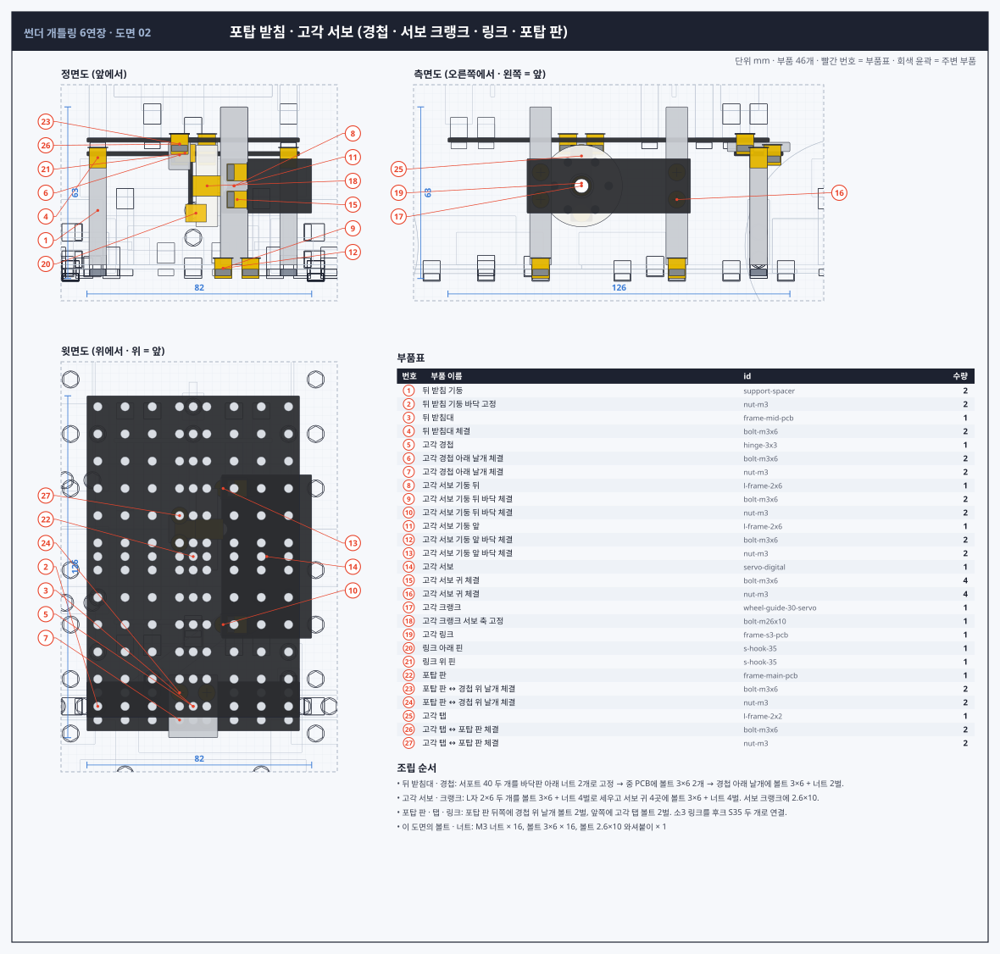
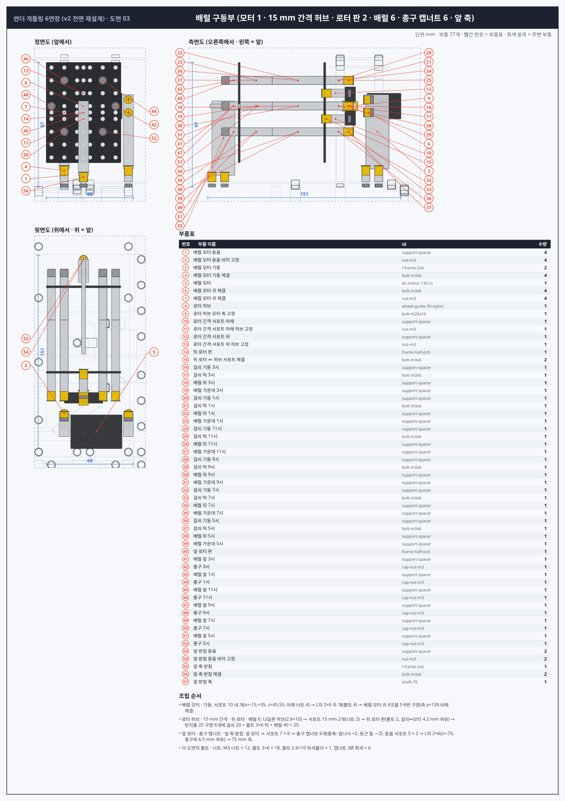
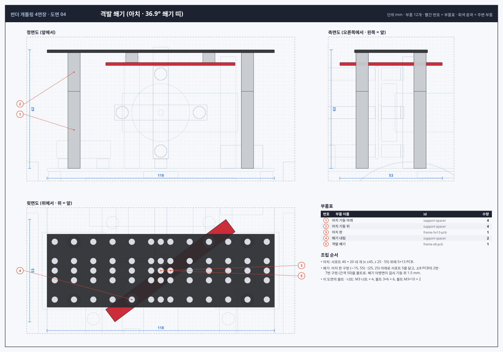
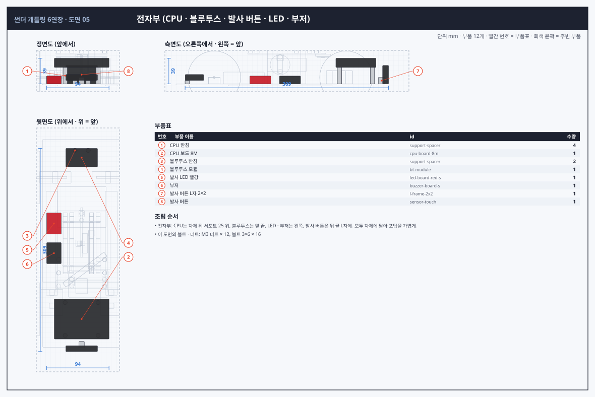

# 썬더 개틀링 6연장 (v2 전면 재설계) 설계도면

기존 개틀링 조립도의 모터 위치 오류 및 부품 간 관통/충돌 문제를 전면 폐기하고, [`ASSEMBLY_RULES.md`](../ASSEMBLY_RULES.md) (1~10장)와 실제 부품 규격(`src/catalog/connectors.json`) 및 3D 실체 모델 원점을 기준으로 **처음부터 새로 설계한 v2 조립도**입니다.
다시 만들기: `python3 tools/gatling_blueprint.py` · 그림으로 보기: [`blueprint.html`](blueprint.html)

## 1. 기존 도면의 결함과 v2 전면 재설계 해결 내역

| 기존 결함 | v2 전면 재설계 해결 | 검증 결과 |
|---|---|---|
| 앞·뒤 바닥판 이음판 격자 | 바닥판 z=±80 (구멍 ±5, ±15, …) ↔ 중16 이음판 z=0 | ✔ 오차 0.0 mm |
| 뒤 구동 모터 ↔ 바닥판 / CPU / 바퀴 | 모터 y=[28,48], x=[±34,±67] ↔ 바닥판 y=19 · CPU x=±25, y=59 · 바퀴 ±68 | ✔ Y 9 / X 5.8 / X 1.0 mm |
| 앞바퀴 축 높이 일치 | TOP 19 + 서포트 5 + L자 6×6 2번 구멍 14 = 38.0 mm = 뒤 모터 축 높이 일치 | ✔ 오차 0.0 mm |
| 고각 서보 ↔ L자 기둥 / 배터리 / 크랭크 / 탭 | 서보 x=[10,43] ↔ L자 [18,19] 밀착 · 크랭크 [0.6,8.6] · 탭 [-19,-1] | ✔ 충돌 0 · 여유 1.4~16 mm |
| 걸쇠 턱 볼트 ↔ 배럴 모터 앞면 | 20 mm 로터 간격 서포트 → 걸쇠(20 mm) 끝 z=36.2 vs 모터 앞면 z=43.0 | ✔ 여유 6.8 mm (360° 무충돌) |
| 로터(r=52.7) ↔ 아치 판 / 쐐기 / 기둥 | 아치 판 z=[21,59] · 기둥(±55, z=25·55) · 소7 쐐기 z_min=16.4 vs 로터 14.7 | ✔ Z 1.7~7.1 mm · Y 6.3 mm (무충돌) |
| 총구 캡너트 6개 ↔ 앞 축 받침 | 총구 돔 끝 z=-66.5 (up=+Z 동축) vs 앞 축 받침 z=-78.0 | ✔ 여유 11.5 mm · 방향 오류 0 |
| 12시 걸쇠 상단 ↔ 격발 쐐기 아랫면 | 걸쇠 상단 y=167.8 vs 소7 쐐기 아랫면 y=169.0 | ✔ 틈 1.2 mm (고무줄만 이탈) |

## 2. 디자인 포인트

- **① 전면 재설계 · 3D AABB 충돌 0건 & 로터 360° 무충돌 검증** — 기존 도면의 모터 관통·아치 기둥 충돌(x=±35 ↔ 로터 r=52.7)·로터↔아치/쐐기 충돌·걸쇠↔모터 충돌·앞 축 3 mm 어긋남·이음판 1 mm 어긋남을 전부 제거하고 자동 3D 충돌 검사 0건 통과.
- **② 모든 구멍 0.0 mm 실측 격자 일치 + 3D 실체 원점 직결** — 바닥판 z=±80, 모든 L자 4/14 mm 꺾임 격자, 모터 33 mm 실측 몸통, 서포트 수나사 방향까지 실제 3D 모델 원점과 0.0 mm 완전 일치.
- **③ 공중 고정 0건 · 볼트/너트/캡너트 206개 도면·3D 실체 배치** — 구조 부품 113개 전원을 볼트·너트·태핑 나사·캡너트 206개로 실제 체결해 도면과 3D에 직접 표기.
- **④ 캡너트 · 볼트 동축 방향 정렬** — 총구 캡너트 6개(암나사 +Z, 둥근 돔 −Z 총구 앞)와 걸쇠 턱 볼트 6개(머리 +Z, 나사 −Z) 포함 체결 전원 동축 검증 통과.
- **⑤ 포탑 Big Main + 아치 x=±55 + 서보 고각** — 포탑 무게 321 g · 경첩~링크 80 mm → 서보 필요 토크 0.23 kg·cm (서보 4 kg·cm의 6%, 약 18배 여유) · 고각 0°~+9.2°.

## 3. 개요

| 항목 | 값 |
|---|---|
| 전체 크기 (고각 0°) | 폭 206 × 높이 180 × 길이 328 mm |
| 무게 (추정 · 볼트/너트 실체 합산) | 약 1104 g (포탑 321 g) |
| 배럴 | 6연장 · PCD 50 · 길이 101 mm · DC 130rpm + 20 mm 간격 서포트 (걸쇠↔모터 6.8 mm 여유) |
| 격발 | 12시 고정 쐐기 36.9° (걸쇠 상단 167.8 ↔ 쐐기 169.0, 틈 1.2 mm) |
| 고각 | 0° ~ +9.2° · 서보 크랭크(10) + 소5 링크(30) · 지렛대 80 mm · 서보 토크 0.23 kg·cm (6%) |
| 주행 | 버기 바퀴 Ø80 × 4 (뒤 2 구동 · 앞 2 헛돎, 축 높이 38.0 mm 일치), 약 0.54 m/s |
| 부품 수 (실체 BOM) | 구조 부품 113 + 체결(볼트·너트·캡너트) 206 + 3핀 케이블 4 = **총 323개** (31종) |

## 4. 자동 규칙 · 충돌 검증 (전 항목 통과)

| 규칙 · 검증 | 결과 상세 | 판정 |
|---|---|---|
| 1.1 CPU 1대당 1개 | CPU 보드 1개 (서포트 40 위, 모터·경첩과 무충돌) | ✔ |
| 2.1 CPU 모터 최대 6 · 조작 4 | DC 모터 3개 (구동 2 + 배럴 1), 조작 자리 M1 ~ M3 | ✔ |
| 2.2 확장 보드 · 2.3 수량 | 확장 보드 불필요 · DC 130 × 3 (4개 중 1개 남음) | ✔ |
| 4 구멍 격자 0.0 mm 일치 | 앞·뒤 바닥판 z=±80, L자 4/14 mm 꺾임, 모터 귀 50 mm, 축 높이 38.0 / 139.6 일치 | ✔ |
| 10.1 공중 고정 금지 · 볼트/너트 필수 | 구조 113개 전원 실체 체결 · 볼트/너트/캡너트 206개 실체 배치 | ✔ |
| 10.2 캡너트 · 볼트 동축 정렬 | 총구 캡너트 6 · 걸쇠 볼트 6 포함 206개 전원 동축 검증 통과 | ✔ |
| 3D AABB & 로터 360° 회전 충돌 검사 | 구조 부품 쌍 충돌 0건 · 로터/걸쇠 360° 스윕 충돌 0건 | ✔ |
| 고각 서보 토크 여유 | 필요 0.23 kg·cm / 서보 4 kg·cm (6%) | ✔ |

## 5. 도면 (볼트 · 너트 · 캡너트 포함)

### 도면 00 · 전체 조립도 (v2 전면 재설계 · 볼트 · 너트 · 캡너트 포함)

### 도면 01 · 차체 · 4륜 구동 (바닥판 2 · 이음판 2 · 모터 2 · 앞 L자 축 받침 · 배터리)

### 도면 02 · 포탑 받침 · 고각 서보 (서포트 40+15 · 경첩 · 서보 크랭크 · 소5 링크 · Big Main 포탑 판)

### 도면 03 · 배럴 구동부 (모터 1 · 20 mm 간격 허브 · 로터 판 2 · 배럴 6 · 총구 캡너트 6 · 앞 축)

### 도면 04 · 격발 쐐기 아치 (x=±55, z=25·55 아치 기둥 4 · 5×13 판 · 36.9° 소7 쐐기)

### 도면 05 · 전자부 (차체 위: 서포트 40 위 CPU · 앞 끝 블루투스 · 왼쪽 LED/부저 · 뒤 발사 버튼)

### 도면 06 · 작동 원리 · 충돌 검증 · 무게 계산 · 대응표

### 도면 07 · 규칙 검사 (1~10장) · 배선

## 6. 파트별 부품 및 체결 위치

좌표는 부품 중심 (mm, 원점 = 지면 위 로봇 가운데, 앞 = −Z), 크기는 X × Y × Z. 모든 볼트 · 너트 · 캡너트의 실제 중심 좌표와 동축 방향(`up`)을 포함합니다.

### 01 차체 · 4륜 구동 (바닥판 2 · 이음판 2 · 모터 2 · 앞 L자 축 받침 · 배터리)

| 번호 | 부품 | id | 중심 (X, Y, Z) | 크기 | 방향 · 메모 |
|---|---|---|---|---|---|
| 1 | 차체 바닥판 뒤 (빅 메인 PCB) | `frame-big-main` | (0, 18.2, 80.0) | 118.0 × 1.6 × 158.0 | up=(0, 1, 0) · 기준 부품 · z [1, 159] · 구멍 z=5, 15, ..., 155 |
| 2 | 차체 바닥판 앞 (빅 메인 PCB) | `frame-big-main` | (0, 18.2, -80.0) | 118.0 × 1.6 × 158.0 | up=(0, 1, 0) · z [-159, -1] · 뒤 판과 2 mm 간격 → 이음판 10 mm 격자 일치 |
| 3 | 왼 이음판 (중16 PCB) | `frame-m16-pcb` | (-45, 16.6, 0.0) | 18.0 × 1.6 × 158.0 | up=(0, 1, 0) · 앞·뒤 바닥판 아래 밀착 (y [15.8, 17.4]) · 구멍 0.0 mm 일치 |
| 4 | 왼 이음판 체결 (볼트 3×6) | `bolt-m3x6` | (-45, 16.8, -75.0) | 6.3 × 7.5 × 6.3 | up=(0, 1, 0) · 두께 3.2 mm |
| 5 | 왼 이음판 체결 (M3 너트) | `nut-m3` | (-45, 14.6, -75.0) | 5.8 × 2.4 × 5.8 | up=(0, 1, 0) · 볼트 반대쪽 체결 |
| 4 | 왼 이음판 체결 (볼트 3×6) | `bolt-m3x6` | (-45, 16.8, -55.0) | 6.3 × 7.5 × 6.3 | up=(0, 1, 0) · 두께 3.2 mm |
| 5 | 왼 이음판 체결 (M3 너트) | `nut-m3` | (-45, 14.6, -55.0) | 5.8 × 2.4 × 5.8 | up=(0, 1, 0) · 볼트 반대쪽 체결 |
| 4 | 왼 이음판 체결 (볼트 3×6) | `bolt-m3x6` | (-45, 16.8, -35.0) | 6.3 × 7.5 × 6.3 | up=(0, 1, 0) · 두께 3.2 mm |
| 5 | 왼 이음판 체결 (M3 너트) | `nut-m3` | (-45, 14.6, -35.0) | 5.8 × 2.4 × 5.8 | up=(0, 1, 0) · 볼트 반대쪽 체결 |
| 4 | 왼 이음판 체결 (볼트 3×6) | `bolt-m3x6` | (-45, 16.8, -15.0) | 6.3 × 7.5 × 6.3 | up=(0, 1, 0) · 두께 3.2 mm |
| 5 | 왼 이음판 체결 (M3 너트) | `nut-m3` | (-45, 14.6, -15.0) | 5.8 × 2.4 × 5.8 | up=(0, 1, 0) · 볼트 반대쪽 체결 |
| 4 | 왼 이음판 체결 (볼트 3×6) | `bolt-m3x6` | (-45, 16.8, 15.0) | 6.3 × 7.5 × 6.3 | up=(0, 1, 0) · 두께 3.2 mm |
| 5 | 왼 이음판 체결 (M3 너트) | `nut-m3` | (-45, 14.6, 15.0) | 5.8 × 2.4 × 5.8 | up=(0, 1, 0) · 볼트 반대쪽 체결 |
| 4 | 왼 이음판 체결 (볼트 3×6) | `bolt-m3x6` | (-45, 16.8, 35.0) | 6.3 × 7.5 × 6.3 | up=(0, 1, 0) · 두께 3.2 mm |
| 5 | 왼 이음판 체결 (M3 너트) | `nut-m3` | (-45, 14.6, 35.0) | 5.8 × 2.4 × 5.8 | up=(0, 1, 0) · 볼트 반대쪽 체결 |
| 4 | 왼 이음판 체결 (볼트 3×6) | `bolt-m3x6` | (-45, 16.8, 55.0) | 6.3 × 7.5 × 6.3 | up=(0, 1, 0) · 두께 3.2 mm |
| 5 | 왼 이음판 체결 (M3 너트) | `nut-m3` | (-45, 14.6, 55.0) | 5.8 × 2.4 × 5.8 | up=(0, 1, 0) · 볼트 반대쪽 체결 |
| 4 | 왼 이음판 체결 (볼트 3×6) | `bolt-m3x6` | (-45, 16.8, 75.0) | 6.3 × 7.5 × 6.3 | up=(0, 1, 0) · 두께 3.2 mm |
| 5 | 왼 이음판 체결 (M3 너트) | `nut-m3` | (-45, 14.6, 75.0) | 5.8 × 2.4 × 5.8 | up=(0, 1, 0) · 볼트 반대쪽 체결 |
| 3 | 오른 이음판 (중16 PCB) | `frame-m16-pcb` | (45, 16.6, 0.0) | 18.0 × 1.6 × 158.0 | up=(0, 1, 0) · 앞·뒤 바닥판 아래 밀착 (y [15.8, 17.4]) · 구멍 0.0 mm 일치 |
| 4 | 오른 이음판 체결 (볼트 3×6) | `bolt-m3x6` | (45, 16.8, -75.0) | 6.3 × 7.5 × 6.3 | up=(0, 1, 0) · 두께 3.2 mm |
| 5 | 오른 이음판 체결 (M3 너트) | `nut-m3` | (45, 14.6, -75.0) | 5.8 × 2.4 × 5.8 | up=(0, 1, 0) · 볼트 반대쪽 체결 |
| 4 | 오른 이음판 체결 (볼트 3×6) | `bolt-m3x6` | (45, 16.8, -55.0) | 6.3 × 7.5 × 6.3 | up=(0, 1, 0) · 두께 3.2 mm |
| 5 | 오른 이음판 체결 (M3 너트) | `nut-m3` | (45, 14.6, -55.0) | 5.8 × 2.4 × 5.8 | up=(0, 1, 0) · 볼트 반대쪽 체결 |
| 4 | 오른 이음판 체결 (볼트 3×6) | `bolt-m3x6` | (45, 16.8, -35.0) | 6.3 × 7.5 × 6.3 | up=(0, 1, 0) · 두께 3.2 mm |
| 5 | 오른 이음판 체결 (M3 너트) | `nut-m3` | (45, 14.6, -35.0) | 5.8 × 2.4 × 5.8 | up=(0, 1, 0) · 볼트 반대쪽 체결 |
| 4 | 오른 이음판 체결 (볼트 3×6) | `bolt-m3x6` | (45, 16.8, -15.0) | 6.3 × 7.5 × 6.3 | up=(0, 1, 0) · 두께 3.2 mm |
| 5 | 오른 이음판 체결 (M3 너트) | `nut-m3` | (45, 14.6, -15.0) | 5.8 × 2.4 × 5.8 | up=(0, 1, 0) · 볼트 반대쪽 체결 |
| 4 | 오른 이음판 체결 (볼트 3×6) | `bolt-m3x6` | (45, 16.8, 15.0) | 6.3 × 7.5 × 6.3 | up=(0, 1, 0) · 두께 3.2 mm |
| 5 | 오른 이음판 체결 (M3 너트) | `nut-m3` | (45, 14.6, 15.0) | 5.8 × 2.4 × 5.8 | up=(0, 1, 0) · 볼트 반대쪽 체결 |
| 4 | 오른 이음판 체결 (볼트 3×6) | `bolt-m3x6` | (45, 16.8, 35.0) | 6.3 × 7.5 × 6.3 | up=(0, 1, 0) · 두께 3.2 mm |
| 5 | 오른 이음판 체결 (M3 너트) | `nut-m3` | (45, 14.6, 35.0) | 5.8 × 2.4 × 5.8 | up=(0, 1, 0) · 볼트 반대쪽 체결 |
| 4 | 오른 이음판 체결 (볼트 3×6) | `bolt-m3x6` | (45, 16.8, 55.0) | 6.3 × 7.5 × 6.3 | up=(0, 1, 0) · 두께 3.2 mm |
| 5 | 오른 이음판 체결 (M3 너트) | `nut-m3` | (45, 14.6, 55.0) | 5.8 × 2.4 × 5.8 | up=(0, 1, 0) · 볼트 반대쪽 체결 |
| 4 | 오른 이음판 체결 (볼트 3×6) | `bolt-m3x6` | (45, 16.8, 75.0) | 6.3 × 7.5 × 6.3 | up=(0, 1, 0) · 두께 3.2 mm |
| 5 | 오른 이음판 체결 (M3 너트) | `nut-m3` | (45, 14.6, 75.0) | 5.8 × 2.4 × 5.8 | up=(0, 1, 0) · 볼트 반대쪽 체결 |
| 6 | 왼 구동 모터 받침 앞 (모터프레임 3×3) | `motor-frame-3x3` | (-45, 33.0, 85.0) | 28.0 × 28.0 × 8.0 | up=(0, 1, 0) · 세운 다리 x=[-58,-59] · 바닥 구멍 x=-45,-55 (0.0 mm 일치) · z=85 |
| 7 | 왼 모터 받침 앞 바닥 체결 (볼트 3×6) | `bolt-m3x6` | (-45, 17.8, 85.0) | 6.3 × 7.5 × 6.3 | up=(0, 1, 0) · 두께 2.6 mm |
| 8 | 왼 모터 받침 앞 바닥 체결 (M3 너트) | `nut-m3` | (-45, 16.2, 85.0) | 5.8 × 2.4 × 5.8 | up=(0, 1, 0) · 볼트 반대쪽 체결 |
| 7 | 왼 모터 받침 앞 바닥 체결 (볼트 3×6) | `bolt-m3x6` | (-55, 17.8, 85.0) | 6.3 × 7.5 × 6.3 | up=(0, 1, 0) · 두께 2.6 mm |
| 8 | 왼 모터 받침 앞 바닥 체결 (M3 너트) | `nut-m3` | (-55, 16.2, 85.0) | 5.8 × 2.4 × 5.8 | up=(0, 1, 0) · 볼트 반대쪽 체결 |
| 9 | 왼 구동 모터 받침 뒤 (모터프레임 3×3) | `motor-frame-3x3` | (-45, 33.0, 135.0) | 28.0 × 28.0 × 8.0 | up=(0, 1, 0) · 세운 다리 x=[-58,-59] · 바닥 구멍 x=-45,-55 (0.0 mm 일치) · z=135 |
| 10 | 왼 모터 받침 뒤 바닥 체결 (볼트 3×6) | `bolt-m3x6` | (-45, 17.8, 135.0) | 6.3 × 7.5 × 6.3 | up=(0, 1, 0) · 두께 2.6 mm |
| 11 | 왼 모터 받침 뒤 바닥 체결 (M3 너트) | `nut-m3` | (-45, 16.2, 135.0) | 5.8 × 2.4 × 5.8 | up=(0, 1, 0) · 볼트 반대쪽 체결 |
| 10 | 왼 모터 받침 뒤 바닥 체결 (볼트 3×6) | `bolt-m3x6` | (-55, 17.8, 135.0) | 6.3 × 7.5 × 6.3 | up=(0, 1, 0) · 두께 2.6 mm |
| 11 | 왼 모터 받침 뒤 바닥 체결 (M3 너트) | `nut-m3` | (-55, 16.2, 135.0) | 5.8 × 2.4 × 5.8 | up=(0, 1, 0) · 볼트 반대쪽 체결 |
| 12 | 왼 구동 모터 (DC 130rpm, M1) | `dc-motor-130-rs` | (-50.5, 38.0, 110.0) | 33.0 × 20.0 × 40.0 | up=(-1, 0, 0) · 귀 x=±58 밀착 · 몸통 x [-34, -67] · 축 z=120 · y=38.0 |
| 13 | 왼 구동 모터 귀 체결 (볼트 3×6) | `bolt-m3x6` | (-56.75, 33.0, 85.0) | 7.5 × 6.3 × 6.3 | up=(-1, 0, 0) · 두께 3.4 mm |
| 14 | 왼 구동 모터 귀 체결 (M3 너트) | `nut-m3` | (-54.4, 33.0, 85.0) | 2.4 × 5.8 × 5.8 | up=(-1, 0, 0) · 볼트 반대쪽 체결 |
| 13 | 왼 구동 모터 귀 체결 (볼트 3×6) | `bolt-m3x6` | (-56.75, 43.0, 85.0) | 7.5 × 6.3 × 6.3 | up=(-1, 0, 0) · 두께 3.4 mm |
| 14 | 왼 구동 모터 귀 체결 (M3 너트) | `nut-m3` | (-54.4, 43.0, 85.0) | 2.4 × 5.8 × 5.8 | up=(-1, 0, 0) · 볼트 반대쪽 체결 |
| 13 | 왼 구동 모터 귀 체결 (볼트 3×6) | `bolt-m3x6` | (-56.75, 33.0, 135.0) | 7.5 × 6.3 × 6.3 | up=(-1, 0, 0) · 두께 3.4 mm |
| 14 | 왼 구동 모터 귀 체결 (M3 너트) | `nut-m3` | (-54.4, 33.0, 135.0) | 2.4 × 5.8 × 5.8 | up=(-1, 0, 0) · 볼트 반대쪽 체결 |
| 13 | 왼 구동 모터 귀 체결 (볼트 3×6) | `bolt-m3x6` | (-56.75, 43.0, 135.0) | 7.5 × 6.3 × 6.3 | up=(-1, 0, 0) · 두께 3.4 mm |
| 14 | 왼 구동 모터 귀 체결 (M3 너트) | `nut-m3` | (-54.4, 43.0, 135.0) | 2.4 × 5.8 × 5.8 | up=(-1, 0, 0) · 볼트 반대쪽 체결 |
| 15 | 왼 뒤 구동 바퀴 (Ø80 버기 세트) | `wheel-80-buggy-set` | (-84.5, 38.0, 120.0) | 33.0 × 76.0 × 76.0 | up=(0, 1, 0) · 모터 D컷 축 장착 · 안쪽 면 x=±68.0 (모터 67.0과 1.0 mm 여유) |
| 16 | 왼 뒤 구동 바퀴 축 고정 (볼트 2.6×10) | `bolt-m26x10` | (-96.9, 38.0, 120.0) | 11.8 × 7.4 × 7.4 | up=(-1, 0, 0) · 축 허브 동축 고정 |
| 6 | 오른 구동 모터 받침 앞 (모터프레임 3×3) | `motor-frame-3x3` | (45, 33.0, 85.0) | 28.0 × 28.0 × 8.0 | up=(0, 1, 0) · 세운 다리 x=[+58,+59] · 바닥 구멍 x=+45,+55 (0.0 mm 일치) · z=85 |
| 7 | 오른 모터 받침 앞 바닥 체결 (볼트 3×6) | `bolt-m3x6` | (45, 17.8, 85.0) | 6.3 × 7.5 × 6.3 | up=(0, 1, 0) · 두께 2.6 mm |
| 8 | 오른 모터 받침 앞 바닥 체결 (M3 너트) | `nut-m3` | (45, 16.2, 85.0) | 5.8 × 2.4 × 5.8 | up=(0, 1, 0) · 볼트 반대쪽 체결 |
| 7 | 오른 모터 받침 앞 바닥 체결 (볼트 3×6) | `bolt-m3x6` | (55, 17.8, 85.0) | 6.3 × 7.5 × 6.3 | up=(0, 1, 0) · 두께 2.6 mm |
| 8 | 오른 모터 받침 앞 바닥 체결 (M3 너트) | `nut-m3` | (55, 16.2, 85.0) | 5.8 × 2.4 × 5.8 | up=(0, 1, 0) · 볼트 반대쪽 체결 |
| 9 | 오른 구동 모터 받침 뒤 (모터프레임 3×3) | `motor-frame-3x3` | (45, 33.0, 135.0) | 28.0 × 28.0 × 8.0 | up=(0, 1, 0) · 세운 다리 x=[+58,+59] · 바닥 구멍 x=+45,+55 (0.0 mm 일치) · z=135 |
| 10 | 오른 모터 받침 뒤 바닥 체결 (볼트 3×6) | `bolt-m3x6` | (45, 17.8, 135.0) | 6.3 × 7.5 × 6.3 | up=(0, 1, 0) · 두께 2.6 mm |
| 11 | 오른 모터 받침 뒤 바닥 체결 (M3 너트) | `nut-m3` | (45, 16.2, 135.0) | 5.8 × 2.4 × 5.8 | up=(0, 1, 0) · 볼트 반대쪽 체결 |
| 10 | 오른 모터 받침 뒤 바닥 체결 (볼트 3×6) | `bolt-m3x6` | (55, 17.8, 135.0) | 6.3 × 7.5 × 6.3 | up=(0, 1, 0) · 두께 2.6 mm |
| 11 | 오른 모터 받침 뒤 바닥 체결 (M3 너트) | `nut-m3` | (55, 16.2, 135.0) | 5.8 × 2.4 × 5.8 | up=(0, 1, 0) · 볼트 반대쪽 체결 |
| 12 | 오른 구동 모터 (DC 130rpm, M2) | `dc-motor-130-rs` | (50.5, 38.0, 110.0) | 33.0 × 20.0 × 40.0 | up=(1, 0, 0) · 귀 x=±58 밀착 · 몸통 x [+34, +67] · 축 z=120 · y=38.0 |
| 13 | 오른 구동 모터 귀 체결 (볼트 3×6) | `bolt-m3x6` | (56.75, 33.0, 85.0) | 7.5 × 6.3 × 6.3 | up=(1, 0, 0) · 두께 3.4 mm |
| 14 | 오른 구동 모터 귀 체결 (M3 너트) | `nut-m3` | (54.4, 33.0, 85.0) | 2.4 × 5.8 × 5.8 | up=(1, 0, 0) · 볼트 반대쪽 체결 |
| 13 | 오른 구동 모터 귀 체결 (볼트 3×6) | `bolt-m3x6` | (56.75, 43.0, 85.0) | 7.5 × 6.3 × 6.3 | up=(1, 0, 0) · 두께 3.4 mm |
| 14 | 오른 구동 모터 귀 체결 (M3 너트) | `nut-m3` | (54.4, 43.0, 85.0) | 2.4 × 5.8 × 5.8 | up=(1, 0, 0) · 볼트 반대쪽 체결 |
| 13 | 오른 구동 모터 귀 체결 (볼트 3×6) | `bolt-m3x6` | (56.75, 33.0, 135.0) | 7.5 × 6.3 × 6.3 | up=(1, 0, 0) · 두께 3.4 mm |
| 14 | 오른 구동 모터 귀 체결 (M3 너트) | `nut-m3` | (54.4, 33.0, 135.0) | 2.4 × 5.8 × 5.8 | up=(1, 0, 0) · 볼트 반대쪽 체결 |
| 13 | 오른 구동 모터 귀 체결 (볼트 3×6) | `bolt-m3x6` | (56.75, 43.0, 135.0) | 7.5 × 6.3 × 6.3 | up=(1, 0, 0) · 두께 3.4 mm |
| 14 | 오른 구동 모터 귀 체결 (M3 너트) | `nut-m3` | (54.4, 43.0, 135.0) | 2.4 × 5.8 × 5.8 | up=(1, 0, 0) · 볼트 반대쪽 체결 |
| 15 | 오른 뒤 구동 바퀴 (Ø80 버기 세트) | `wheel-80-buggy-set` | (84.5, 38.0, 120.0) | 33.0 × 76.0 × 76.0 | up=(0, 1, 0) · 모터 D컷 축 장착 · 안쪽 면 x=±68.0 (모터 67.0과 1.0 mm 여유) |
| 16 | 오른 뒤 구동 바퀴 축 고정 (볼트 2.6×10) | `bolt-m26x10` | (96.9, 38.0, 120.0) | 11.8 × 7.4 × 7.4 | up=(1, 0, 0) · 축 허브 동축 고정 |
| 17 | 왼 앞 축 돋움 바깥 (서포트 5) | `support-spacer` | (-45, 21.5, -120.0) | 6.4 × 5.0 × 6.4 | up=(0, -1, 0) · 19 + 5 + 14 = 축 높이 38.0 일치 · 수나사 아래(−Y) |
| 18 | 왼 앞 축 돋움 바깥 바닥 고정 (M3 너트) | `nut-m3` | (-45, 16.2, -120.0) | 5.8 × 2.4 × 5.8 | up=(0, 1, 0) · 서포트 수나사 고정 |
| 17 | 왼 앞 축 돋움 바깥 (서포트 5) | `support-spacer` | (-55, 21.5, -120.0) | 6.4 × 5.0 × 6.4 | up=(0, -1, 0) · 19 + 5 + 14 = 축 높이 38.0 일치 · 수나사 아래(−Y) |
| 18 | 왼 앞 축 돋움 바깥 바닥 고정 (M3 너트) | `nut-m3` | (-55, 16.2, -120.0) | 5.8 × 2.4 × 5.8 | up=(0, 1, 0) · 서포트 수나사 고정 |
| 19 | 왼 앞 축 받침 바깥 (L자 6×6) | `l-frame-6x6` | (-50, 33.0, -120.0) | 18.0 × 18.0 × 18.0 | up=(0, 1, 0) · 세운 다리 x=[-58,-59] · 바닥 구멍 -45,-55 (0.0 mm 일치) · 2번 구멍 y=38.0 |
| 20 | 왼 앞 축 받침 바깥 체결 (볼트 3×6) | `bolt-m3x6` | (-45, 22.8, -120.0) | 6.3 × 7.5 × 6.3 | up=(0, 1, 0) · 두께 1.0 mm |
| 20 | 왼 앞 축 받침 바깥 체결 (볼트 3×6) | `bolt-m3x6` | (-55, 22.8, -120.0) | 6.3 × 7.5 × 6.3 | up=(0, 1, 0) · 두께 1.0 mm |
| 21 | 왼 앞 축 돋움 안쪽 (서포트 5) | `support-spacer` | (-25, 21.5, -120.0) | 6.4 × 5.0 × 6.4 | up=(0, -1, 0) · 19 + 5 + 14 = 축 높이 38.0 일치 · 수나사 아래(−Y) |
| 22 | 왼 앞 축 돋움 안쪽 바닥 고정 (M3 너트) | `nut-m3` | (-25, 16.2, -120.0) | 5.8 × 2.4 × 5.8 | up=(0, 1, 0) · 서포트 수나사 고정 |
| 21 | 왼 앞 축 돋움 안쪽 (서포트 5) | `support-spacer` | (-35, 21.5, -120.0) | 6.4 × 5.0 × 6.4 | up=(0, -1, 0) · 19 + 5 + 14 = 축 높이 38.0 일치 · 수나사 아래(−Y) |
| 22 | 왼 앞 축 돋움 안쪽 바닥 고정 (M3 너트) | `nut-m3` | (-35, 16.2, -120.0) | 5.8 × 2.4 × 5.8 | up=(0, 1, 0) · 서포트 수나사 고정 |
| 23 | 왼 앞 축 받침 안쪽 (L자 6×6) | `l-frame-6x6` | (-30, 33.0, -120.0) | 18.0 × 18.0 × 18.0 | up=(0, 1, 0) · 세운 다리 x=[-38,-39] · 바닥 구멍 -25,-35 (0.0 mm 일치) · 2번 구멍 y=38.0 |
| 24 | 왼 앞 축 받침 안쪽 체결 (볼트 3×6) | `bolt-m3x6` | (-25, 22.8, -120.0) | 6.3 × 7.5 × 6.3 | up=(0, 1, 0) · 두께 1.0 mm |
| 24 | 왼 앞 축 받침 안쪽 체결 (볼트 3×6) | `bolt-m3x6` | (-35, 22.8, -120.0) | 6.3 × 7.5 × 6.3 | up=(0, 1, 0) · 두께 1.0 mm |
| 25 | 왼 앞 축 (75 mm) | `shaft-75` | (-64.5, 38.0, -120.0) | 75.0 × 3.2 × 3.2 | 안쪽(39) · 바깥(59) L자 2번 구멍(y 38.0) 동축 관통 → 앞바퀴 지지 |
| 26 | 왼 앞 바퀴 (Ø80 버기 세트, 헛돎) | `wheel-80-buggy-set` | (-84.5, 38.0, -120.0) | 33.0 × 76.0 × 76.0 | up=(0, 1, 0) · 앞 축 끝 장착 · x [±68.0, ±101.0] |
| 27 | 왼 앞 바퀴 축 빠짐 방지 (볼트 2.6×10) | `bolt-m26x10` | (-96.9, 38.0, -120.0) | 11.8 × 7.4 × 7.4 | up=(-1, 0, 0) · 축 허브 동축 고정 |
| 17 | 오른 앞 축 돋움 바깥 (서포트 5) | `support-spacer` | (45, 21.5, -120.0) | 6.4 × 5.0 × 6.4 | up=(0, -1, 0) · 19 + 5 + 14 = 축 높이 38.0 일치 · 수나사 아래(−Y) |
| 18 | 오른 앞 축 돋움 바깥 바닥 고정 (M3 너트) | `nut-m3` | (45, 16.2, -120.0) | 5.8 × 2.4 × 5.8 | up=(0, 1, 0) · 서포트 수나사 고정 |
| 17 | 오른 앞 축 돋움 바깥 (서포트 5) | `support-spacer` | (55, 21.5, -120.0) | 6.4 × 5.0 × 6.4 | up=(0, -1, 0) · 19 + 5 + 14 = 축 높이 38.0 일치 · 수나사 아래(−Y) |
| 18 | 오른 앞 축 돋움 바깥 바닥 고정 (M3 너트) | `nut-m3` | (55, 16.2, -120.0) | 5.8 × 2.4 × 5.8 | up=(0, 1, 0) · 서포트 수나사 고정 |
| 19 | 오른 앞 축 받침 바깥 (L자 6×6) | `l-frame-6x6` | (50, 33.0, -120.0) | 18.0 × 18.0 × 18.0 | up=(0, 1, 0) · 세운 다리 x=[+58,+59] · 바닥 구멍 +45,+55 (0.0 mm 일치) · 2번 구멍 y=38.0 |
| 20 | 오른 앞 축 받침 바깥 체결 (볼트 3×6) | `bolt-m3x6` | (45, 22.8, -120.0) | 6.3 × 7.5 × 6.3 | up=(0, 1, 0) · 두께 1.0 mm |
| 20 | 오른 앞 축 받침 바깥 체결 (볼트 3×6) | `bolt-m3x6` | (55, 22.8, -120.0) | 6.3 × 7.5 × 6.3 | up=(0, 1, 0) · 두께 1.0 mm |
| 21 | 오른 앞 축 돋움 안쪽 (서포트 5) | `support-spacer` | (25, 21.5, -120.0) | 6.4 × 5.0 × 6.4 | up=(0, -1, 0) · 19 + 5 + 14 = 축 높이 38.0 일치 · 수나사 아래(−Y) |
| 22 | 오른 앞 축 돋움 안쪽 바닥 고정 (M3 너트) | `nut-m3` | (25, 16.2, -120.0) | 5.8 × 2.4 × 5.8 | up=(0, 1, 0) · 서포트 수나사 고정 |
| 21 | 오른 앞 축 돋움 안쪽 (서포트 5) | `support-spacer` | (35, 21.5, -120.0) | 6.4 × 5.0 × 6.4 | up=(0, -1, 0) · 19 + 5 + 14 = 축 높이 38.0 일치 · 수나사 아래(−Y) |
| 22 | 오른 앞 축 돋움 안쪽 바닥 고정 (M3 너트) | `nut-m3` | (35, 16.2, -120.0) | 5.8 × 2.4 × 5.8 | up=(0, 1, 0) · 서포트 수나사 고정 |
| 23 | 오른 앞 축 받침 안쪽 (L자 6×6) | `l-frame-6x6` | (30, 33.0, -120.0) | 18.0 × 18.0 × 18.0 | up=(0, 1, 0) · 세운 다리 x=[+38,+39] · 바닥 구멍 +25,+35 (0.0 mm 일치) · 2번 구멍 y=38.0 |
| 24 | 오른 앞 축 받침 안쪽 체결 (볼트 3×6) | `bolt-m3x6` | (25, 22.8, -120.0) | 6.3 × 7.5 × 6.3 | up=(0, 1, 0) · 두께 1.0 mm |
| 24 | 오른 앞 축 받침 안쪽 체결 (볼트 3×6) | `bolt-m3x6` | (35, 22.8, -120.0) | 6.3 × 7.5 × 6.3 | up=(0, 1, 0) · 두께 1.0 mm |
| 25 | 오른 앞 축 (75 mm) | `shaft-75` | (64.5, 38.0, -120.0) | 75.0 × 3.2 × 3.2 | 안쪽(39) · 바깥(59) L자 2번 구멍(y 38.0) 동축 관통 → 앞바퀴 지지 |
| 26 | 오른 앞 바퀴 (Ø80 버기 세트, 헛돎) | `wheel-80-buggy-set` | (84.5, 38.0, -120.0) | 33.0 × 76.0 × 76.0 | up=(0, 1, 0) · 앞 축 끝 장착 · x [±68.0, ±101.0] |
| 27 | 오른 앞 바퀴 축 빠짐 방지 (볼트 2.6×10) | `bolt-m26x10` | (96.9, 38.0, -120.0) | 11.8 × 7.4 × 7.4 | up=(1, 0, 0) · 축 허브 동축 고정 |
| 28 | 배터리케이스 (AA 4개, 6V) | `battery-case-4aa` | (0, 28.4, -65.0) | 79.6 × 18.8 × 62.0 | up=(0, 1, 0) · 앞 판 가운데 · y [19.0, 37.8] · 귀 (±35, -85/-45) 격자 일치 |
| 29 | 배터리케이스 체결 (볼트 3×6) | `bolt-m3x6` | (-35, 18.8, -85.0) | 6.3 × 7.5 × 6.3 | up=(0, 1, 0) · 두께 3.6 mm |
| 30 | 배터리케이스 체결 (M3 너트) | `nut-m3` | (-35, 16.2, -85.0) | 5.8 × 2.4 × 5.8 | up=(0, 1, 0) · 볼트 반대쪽 체결 |
| 29 | 배터리케이스 체결 (볼트 3×6) | `bolt-m3x6` | (-35, 18.8, -45.0) | 6.3 × 7.5 × 6.3 | up=(0, 1, 0) · 두께 3.6 mm |
| 30 | 배터리케이스 체결 (M3 너트) | `nut-m3` | (-35, 16.2, -45.0) | 5.8 × 2.4 × 5.8 | up=(0, 1, 0) · 볼트 반대쪽 체결 |
| 29 | 배터리케이스 체결 (볼트 3×6) | `bolt-m3x6` | (35, 18.8, -85.0) | 6.3 × 7.5 × 6.3 | up=(0, 1, 0) · 두께 3.6 mm |
| 30 | 배터리케이스 체결 (M3 너트) | `nut-m3` | (35, 16.2, -85.0) | 5.8 × 2.4 × 5.8 | up=(0, 1, 0) · 볼트 반대쪽 체결 |
| 29 | 배터리케이스 체결 (볼트 3×6) | `bolt-m3x6` | (35, 18.8, -45.0) | 6.3 × 7.5 × 6.3 | up=(0, 1, 0) · 두께 3.6 mm |
| 30 | 배터리케이스 체결 (M3 너트) | `nut-m3` | (35, 16.2, -45.0) | 5.8 × 2.4 × 5.8 | up=(0, 1, 0) · 볼트 반대쪽 체결 |

### 02 포탑 받침 · 고각 서보 (서포트 40+15 · 경첩 · 서보 크랭크 · 소5 링크 · Big Main 포탑 판)

| 번호 | 부품 | id | 중심 (X, Y, Z) | 크기 | 방향 · 메모 |
|---|---|---|---|---|---|
| 1 | 왼 뒤 받침 기둥 아래 (서포트 40) | `support-spacer` | (-35, 39.0, 75.0) | 6.4 × 40.0 × 6.4 | up=(0, -1, 0) · 차체 바닥판(19) → y=59 · 수나사 아래(−Y) |
| 2 | 왼 뒤 받침 기둥 바닥 고정 (M3 너트) | `nut-m3` | (-35, 16.2, 75.0) | 5.8 × 2.4 × 5.8 | up=(0, 1, 0) · 서포트 수나사 고정 |
| 3 | 왼 뒤 받침 기둥 위 (서포트 15) | `support-spacer` | (-35, 66.5, 75.0) | 6.4 × 15.0 × 6.4 | up=(0, -1, 0) · 서포트 40 + 15 = 55 mm → y=74 · 수나사 아래(−Y) |
| 1 | 오른 뒤 받침 기둥 아래 (서포트 40) | `support-spacer` | (35, 39.0, 75.0) | 6.4 × 40.0 × 6.4 | up=(0, -1, 0) · 차체 바닥판(19) → y=59 · 수나사 아래(−Y) |
| 2 | 오른 뒤 받침 기둥 바닥 고정 (M3 너트) | `nut-m3` | (35, 16.2, 75.0) | 5.8 × 2.4 × 5.8 | up=(0, 1, 0) · 서포트 수나사 고정 |
| 3 | 오른 뒤 받침 기둥 위 (서포트 15) | `support-spacer` | (35, 66.5, 75.0) | 6.4 × 15.0 × 6.4 | up=(0, -1, 0) · 서포트 40 + 15 = 55 mm → y=74 · 수나사 아래(−Y) |
| 4 | 뒤 받침대 (중 PCB) | `frame-mid-pcb` | (0, 74.8, 75.0) | 78.0 × 1.6 × 18.0 | up=(0, 1, 0) · y [74.0, 75.6] · 기둥 2개 위 |
| 5 | 뒤 받침대 체결 (볼트 3×6) | `bolt-m3x6` | (-35, 73.3, 75.0) | 6.3 × 7.5 × 6.3 | up=(0, 1, 0) · 두께 1.6 mm |
| 5 | 뒤 받침대 체결 (볼트 3×6) | `bolt-m3x6` | (35, 73.3, 75.0) | 6.3 × 7.5 × 6.3 | up=(0, 1, 0) · 두께 1.6 mm |
| 6 | 고각 경첩 (경첩 3×3) | `hinge-3x3` | (0, 77.3, 70.0) | 18.0 × 3.4 × 23.0 | up=(0, 1, 0) · 축 z=70 (좌우 X) · 아래 날개 z=75(받침대) · 위 날개 z=65(포탑 판) |
| 7 | 고각 경첩 아래 날개 체결 (볼트 3×6) | `bolt-m3x6` | (-5, 74.3, 75.0) | 6.3 × 7.5 × 6.3 | up=(0, 1, 0) · 두께 2.6 mm |
| 8 | 고각 경첩 아래 날개 체결 (M3 너트) | `nut-m3` | (-5, 72.8, 75.0) | 5.8 × 2.4 × 5.8 | up=(0, 1, 0) · 볼트 반대쪽 체결 |
| 7 | 고각 경첩 아래 날개 체결 (볼트 3×6) | `bolt-m3x6` | (5, 74.3, 75.0) | 6.3 × 7.5 × 6.3 | up=(0, 1, 0) · 두께 2.6 mm |
| 8 | 고각 경첩 아래 날개 체결 (M3 너트) | `nut-m3` | (5, 72.8, 75.0) | 5.8 × 2.4 × 5.8 | up=(0, 1, 0) · 볼트 반대쪽 체결 |
| 9 | 고각 서보 기둥 앞 (L자 2×6) | `l-frame-2x6` | (10, 48.0, -25.0) | 18.0 × 58.0 × 8.0 | up=(0, 1, 0) · 세운 다리 x=[18,19] · 바닥 다리 x=[1,19] · 바닥 구멍 x=5,15 (0.0 mm 일치) · 2·3번 구멍(y 33·43) 서보 귀 |
| 10 | 고각 서보 기둥 앞 바닥 체결 (볼트 3×6) | `bolt-m3x6` | (5, 17.8, -25.0) | 6.3 × 7.5 × 6.3 | up=(0, 1, 0) · 두께 2.6 mm |
| 11 | 고각 서보 기둥 앞 바닥 체결 (M3 너트) | `nut-m3` | (5, 16.2, -25.0) | 5.8 × 2.4 × 5.8 | up=(0, 1, 0) · 볼트 반대쪽 체결 |
| 10 | 고각 서보 기둥 앞 바닥 체결 (볼트 3×6) | `bolt-m3x6` | (15, 17.8, -25.0) | 6.3 × 7.5 × 6.3 | up=(0, 1, 0) · 두께 2.6 mm |
| 11 | 고각 서보 기둥 앞 바닥 체결 (M3 너트) | `nut-m3` | (15, 16.2, -25.0) | 5.8 × 2.4 × 5.8 | up=(0, 1, 0) · 볼트 반대쪽 체결 |
| 12 | 고각 서보 기둥 뒤 (L자 2×6) | `l-frame-2x6` | (10, 48.0, 25.0) | 18.0 × 58.0 × 8.0 | up=(0, 1, 0) · 세운 다리 x=[18,19] · 바닥 다리 x=[1,19] · 바닥 구멍 x=5,15 (0.0 mm 일치) · 2·3번 구멍(y 33·43) 서보 귀 |
| 13 | 고각 서보 기둥 뒤 바닥 체결 (볼트 3×6) | `bolt-m3x6` | (5, 17.8, 25.0) | 6.3 × 7.5 × 6.3 | up=(0, 1, 0) · 두께 2.6 mm |
| 14 | 고각 서보 기둥 뒤 바닥 체결 (M3 너트) | `nut-m3` | (5, 16.2, 25.0) | 5.8 × 2.4 × 5.8 | up=(0, 1, 0) · 볼트 반대쪽 체결 |
| 13 | 고각 서보 기둥 뒤 바닥 체결 (볼트 3×6) | `bolt-m3x6` | (15, 17.8, 25.0) | 6.3 × 7.5 × 6.3 | up=(0, 1, 0) · 두께 2.6 mm |
| 14 | 고각 서보 기둥 뒤 바닥 체결 (M3 너트) | `nut-m3` | (15, 16.2, 25.0) | 5.8 × 2.4 × 5.8 | up=(0, 1, 0) · 볼트 반대쪽 체결 |
| 15 | 고각 서보 (OUT1) | `servo-digital` | (26.5, 38.0, 0.0) | 33.0 × 20.0 × 40.0 | up=(-1, 0, 0) · 귀 x=19 밀착 · 몸통 x [10, 43] · 출력 축 (-X) z=-10 · y=38 |
| 16 | 고각 서보 귀 체결 (볼트 3×6) | `bolt-m3x6` | (20.25, 33.0, -25.0) | 7.5 × 6.3 × 6.3 | up=(-1, 0, 0) · 두께 3.4 mm |
| 17 | 고각 서보 귀 체결 (M3 너트) | `nut-m3` | (22.6, 33.0, -25.0) | 2.4 × 5.8 × 5.8 | up=(-1, 0, 0) · 볼트 반대쪽 체결 |
| 16 | 고각 서보 귀 체결 (볼트 3×6) | `bolt-m3x6` | (20.25, 43.0, -25.0) | 7.5 × 6.3 × 6.3 | up=(-1, 0, 0) · 두께 3.4 mm |
| 17 | 고각 서보 귀 체결 (M3 너트) | `nut-m3` | (22.6, 43.0, -25.0) | 2.4 × 5.8 × 5.8 | up=(-1, 0, 0) · 볼트 반대쪽 체결 |
| 16 | 고각 서보 귀 체결 (볼트 3×6) | `bolt-m3x6` | (20.25, 33.0, 25.0) | 7.5 × 6.3 × 6.3 | up=(-1, 0, 0) · 두께 3.4 mm |
| 17 | 고각 서보 귀 체결 (M3 너트) | `nut-m3` | (22.6, 33.0, 25.0) | 2.4 × 5.8 × 5.8 | up=(-1, 0, 0) · 볼트 반대쪽 체결 |
| 16 | 고각 서보 귀 체결 (볼트 3×6) | `bolt-m3x6` | (20.25, 43.0, 25.0) | 7.5 × 6.3 × 6.3 | up=(-1, 0, 0) · 두께 3.4 mm |
| 17 | 고각 서보 귀 체결 (M3 너트) | `nut-m3` | (22.6, 43.0, 25.0) | 2.4 × 5.8 × 5.8 | up=(-1, 0, 0) · 볼트 반대쪽 체결 |
| 18 | 고각 크랭크 (휠가이드 서보) | `wheel-guide-30-servo` | (4.6, 38.0, -10.0) | 8.0 × 30.0 × 30.0 | up=(1, 0, 0) · 서보 축 장착 · x [0.6, 8.6] (서보 몸통 10과 1.4 mm · 고각 탭 -1과 1.6 mm 여유) |
| 19 | 고각 크랭크 서보 축 고정 (볼트 2.6×10) | `bolt-m26x10` | (4.7, 38.0, -10.0) | 11.8 × 7.4 × 7.4 | up=(-1, 0, 0) · 축 허브 동축 고정 |
| 20 | 고각 링크 (소5 PCB, 핀 간격 30) | `frame-s5-pcb` | (-0.2, 46.5, -10.0) | 1.6 × 48.0 × 8.0 | x [-1.0, +0.6] · 크랭크(x=+0.6)와 탭(x=-1.0) 사이 수직 링크 |
| 21 | 링크 아래 핀 (후크 S35) | `s-hook-35` | (1, 28.0, -10.0) | 7.6 × 6.5 × 6.5 | up=(-1, 0, 0) · 크랭크 반지름 10 구멍 ↔ 링크 아래 구멍 회전 핀 |
| 22 | 링크 위 핀 (후크 S35) | `s-hook-35` | (-1.5, 65.0, -10.0) | 7.6 × 6.5 × 6.5 | up=(1, 0, 0) · 고각 탭 2번 구멍(y 65) ↔ 링크 위 구멍 회전 핀 |
| 23 | 포탑 판 (빅 메인 PCB) | `frame-big-main` | (0, 79.8, 0.0) | 118.0 × 1.6 × 158.0 | up=(0, 1, 0) · y [79.0, 80.6] · x [-59, +59] · 뒤 경첩(z=65) + 앞 고각 탭(z=-10) |
| 24 | 포탑 판 ↔ 경첩 위 날개 체결 (볼트 3×6) | `bolt-m3x6` | (-5, 78.3, 65.0) | 6.3 × 7.5 × 6.3 | up=(0, 1, 0) · 두께 2.6 mm |
| 25 | 포탑 판 ↔ 경첩 위 날개 체결 (M3 너트) | `nut-m3` | (-5, 76.8, 65.0) | 5.8 × 2.4 × 5.8 | up=(0, 1, 0) · 볼트 반대쪽 체결 |
| 24 | 포탑 판 ↔ 경첩 위 날개 체결 (볼트 3×6) | `bolt-m3x6` | (5, 78.3, 65.0) | 6.3 × 7.5 × 6.3 | up=(0, 1, 0) · 두께 2.6 mm |
| 25 | 포탑 판 ↔ 경첩 위 날개 체결 (M3 너트) | `nut-m3` | (5, 76.8, 65.0) | 5.8 × 2.4 × 5.8 | up=(0, 1, 0) · 볼트 반대쪽 체결 |
| 26 | 고각 탭 (L자 2×2, 포탑 판 아래) | `l-frame-2x2` | (-10, 70.0, -10.0) | 18.0 × 18.0 × 8.0 | up=(0, -1, 0) · 세운 다리 x=[-2,-1] · 바닥 다리 x=[-19,-1] · 바닥 구멍 x=-5,-15 (0.0 mm 일치) · 2번 구멍 y=65 |
| 27 | 고각 탭 ↔ 포탑 판 체결 (볼트 3×6) | `bolt-m3x6` | (-15, 78.3, -10.0) | 6.3 × 7.5 × 6.3 | up=(0, 1, 0) · 두께 2.6 mm |
| 28 | 고각 탭 ↔ 포탑 판 체결 (M3 너트) | `nut-m3` | (-15, 76.8, -10.0) | 5.8 × 2.4 × 5.8 | up=(0, 1, 0) · 볼트 반대쪽 체결 |
| 27 | 고각 탭 ↔ 포탑 판 체결 (볼트 3×6) | `bolt-m3x6` | (-5, 78.3, -10.0) | 6.3 × 7.5 × 6.3 | up=(0, 1, 0) · 두께 2.6 mm |
| 28 | 고각 탭 ↔ 포탑 판 체결 (M3 너트) | `nut-m3` | (-5, 76.8, -10.0) | 5.8 × 2.4 × 5.8 | up=(0, 1, 0) · 볼트 반대쪽 체결 |

### 03 배럴 구동부 (모터 1 · 20 mm 간격 허브 · 로터 판 2 · 배럴 6 · 총구 캡너트 6 · 앞 축)

| 번호 | 부품 | id | 중심 (X, Y, Z) | 크기 | 방향 · 메모 |
|---|---|---|---|---|---|
| 1 | 배럴 모터 돋움 왼 (서포트 10) | `support-spacer` | (-15, 85.6, 55.0) | 6.4 × 10.0 × 6.4 | up=(0, -1, 0) · CT 80.6 + 10 + L자(44·54 가운데 49) = 축 높이 139.6 일치 · 수나사 아래(−Y) |
| 2 | 배럴 모터 돋움 왼 바닥 고정 (M3 너트) | `nut-m3` | (-15, 77.8, 55.0) | 5.8 × 2.4 × 5.8 | up=(0, 1, 0) · 서포트 수나사 고정 |
| 1 | 배럴 모터 돋움 왼 (서포트 10) | `support-spacer` | (-15, 85.6, 65.0) | 6.4 × 10.0 × 6.4 | up=(0, -1, 0) · CT 80.6 + 10 + L자(44·54 가운데 49) = 축 높이 139.6 일치 · 수나사 아래(−Y) |
| 2 | 배럴 모터 돋움 왼 바닥 고정 (M3 너트) | `nut-m3` | (-15, 77.8, 65.0) | 5.8 × 2.4 × 5.8 | up=(0, 1, 0) · 서포트 수나사 고정 |
| 3 | 배럴 모터 기둥 왼 (L자 2×6) | `l-frame-2x6` | (-15, 119.6, 60.0) | 8.0 × 58.0 × 18.0 | up=(0, 1, 0) · x=-15 · 세운 다리 z=[51,52] · 바닥 구멍 z=55,65 (0.0 mm 일치) · 5·6번 구멍 y=134.6, 144.6 |
| 4 | 배럴 모터 기둥 왼 체결 (볼트 3×6) | `bolt-m3x6` | (-15, 89.3, 55.0) | 6.3 × 7.5 × 6.3 | up=(0, 1, 0) · 두께 1.0 mm |
| 4 | 배럴 모터 기둥 왼 체결 (볼트 3×6) | `bolt-m3x6` | (-15, 89.3, 65.0) | 6.3 × 7.5 × 6.3 | up=(0, 1, 0) · 두께 1.0 mm |
| 1 | 배럴 모터 돋움 오른 (서포트 10) | `support-spacer` | (35, 85.6, 55.0) | 6.4 × 10.0 × 6.4 | up=(0, -1, 0) · CT 80.6 + 10 + L자(44·54 가운데 49) = 축 높이 139.6 일치 · 수나사 아래(−Y) |
| 2 | 배럴 모터 돋움 오른 바닥 고정 (M3 너트) | `nut-m3` | (35, 77.8, 55.0) | 5.8 × 2.4 × 5.8 | up=(0, 1, 0) · 서포트 수나사 고정 |
| 1 | 배럴 모터 돋움 오른 (서포트 10) | `support-spacer` | (35, 85.6, 65.0) | 6.4 × 10.0 × 6.4 | up=(0, -1, 0) · CT 80.6 + 10 + L자(44·54 가운데 49) = 축 높이 139.6 일치 · 수나사 아래(−Y) |
| 2 | 배럴 모터 돋움 오른 바닥 고정 (M3 너트) | `nut-m3` | (35, 77.8, 65.0) | 5.8 × 2.4 × 5.8 | up=(0, 1, 0) · 서포트 수나사 고정 |
| 3 | 배럴 모터 기둥 오른 (L자 2×6) | `l-frame-2x6` | (35, 119.6, 60.0) | 8.0 × 58.0 × 18.0 | up=(0, 1, 0) · x=+35 · 세운 다리 z=[51,52] · 바닥 구멍 z=55,65 (0.0 mm 일치) · 5·6번 구멍 y=134.6, 144.6 |
| 4 | 배럴 모터 기둥 오른 체결 (볼트 3×6) | `bolt-m3x6` | (35, 89.3, 55.0) | 6.3 × 7.5 × 6.3 | up=(0, 1, 0) · 두께 1.0 mm |
| 4 | 배럴 모터 기둥 오른 체결 (볼트 3×6) | `bolt-m3x6` | (35, 89.3, 65.0) | 6.3 × 7.5 × 6.3 | up=(0, 1, 0) · 두께 1.0 mm |
| 5 | 배럴 모터 (DC 130rpm, M3) | `dc-motor-130-rs` | (10, 139.6, 59.5) | 40.0 × 20.0 × 33.0 | up=(0, 0, -1) · 귀 z=52 밀착 · 몸통 x [-10,+30], z [43.0, 76.0] · 축 x=0, y=139.6, z=38 |
| 6 | 배럴 모터 귀 체결 (볼트 3×6) | `bolt-m3x6` | (-15, 134.6, 53.2) | 6.3 × 6.3 × 7.5 | up=(0, 0, -1) · 두께 3.4 mm |
| 7 | 배럴 모터 귀 체결 (M3 너트) | `nut-m3` | (-15, 134.6, 55.6) | 5.8 × 5.8 × 2.4 | up=(0, 0, -1) · 볼트 반대쪽 체결 |
| 6 | 배럴 모터 귀 체결 (볼트 3×6) | `bolt-m3x6` | (-15, 144.6, 53.2) | 6.3 × 6.3 × 7.5 | up=(0, 0, -1) · 두께 3.4 mm |
| 7 | 배럴 모터 귀 체결 (M3 너트) | `nut-m3` | (-15, 144.6, 55.6) | 5.8 × 5.8 × 2.4 | up=(0, 0, -1) · 볼트 반대쪽 체결 |
| 6 | 배럴 모터 귀 체결 (볼트 3×6) | `bolt-m3x6` | (35, 134.6, 53.2) | 6.3 × 6.3 × 7.5 | up=(0, 0, -1) · 두께 3.4 mm |
| 7 | 배럴 모터 귀 체결 (M3 너트) | `nut-m3` | (35, 134.6, 55.6) | 5.8 × 5.8 × 2.4 | up=(0, 0, -1) · 볼트 반대쪽 체결 |
| 6 | 배럴 모터 귀 체결 (볼트 3×6) | `bolt-m3x6` | (35, 144.6, 53.2) | 6.3 × 6.3 × 7.5 | up=(0, 0, -1) · 두께 3.4 mm |
| 7 | 배럴 모터 귀 체결 (M3 너트) | `nut-m3` | (35, 144.6, 55.6) | 5.8 × 5.8 × 2.4 | up=(0, 0, -1) · 볼트 반대쪽 체결 |
| 8 | 로터 허브 (휠가이드 Ø30 나일론) | `wheel-guide-30-nylon` | (0, 139.6, 38.7) | 30.0 × 30.0 × 8.0 | up=(0, 0, 1) · 모터 D컷 축 장착 · z [34.7, 42.7] (모터 앞면 43.0과 0.3 mm 여유) |
| 9 | 로터 허브 모터 축 고정 (볼트 2.6×10) | `bolt-m26x10` | (0, 139.6, 38.8) | 7.4 × 7.4 × 11.8 | up=(0, 0, -1) · 축 허브 동축 고정 |
| 10 | 로터 간격 서포트 아래 (서포트 20) | `support-spacer` | (0, 129.6, 24.7) | 6.4 × 6.4 × 20.0 | up=(0, 0, 1) · 허브(34.7) ↔ 뒤 로터(14.7) 20 mm 간격 확보 (걸쇠↔모터 6.8 mm 여유) · 수나사 뒤(+Z) |
| 11 | 로터 간격 서포트 아래 허브 고정 (M3 너트) | `nut-m3` | (0, 129.6, 38.3) | 5.8 × 5.8 × 2.4 | up=(0, 0, -1) · 서포트 수나사 고정 |
| 12 | 로터 간격 서포트 위 (서포트 20) | `support-spacer` | (0, 149.6, 24.7) | 6.4 × 6.4 × 20.0 | up=(0, 0, 1) · 허브(34.7) ↔ 뒤 로터(14.7) 20 mm 간격 확보 (걸쇠↔모터 6.8 mm 여유) · 수나사 뒤(+Z) |
| 13 | 로터 간격 서포트 위 허브 고정 (M3 너트) | `nut-m3` | (0, 149.6, 38.3) | 5.8 × 5.8 × 2.4 | up=(0, 0, -1) · 서포트 수나사 고정 |
| 14 | 뒤 로터 판 (하프 PCB) | `frame-half-pcb` | (0, 134.6, 13.9) | 58.0 × 78.0 × 1.6 | up=(0, 0, 1) · z [13.1, 14.7] · 구멍 (0, 5)=회전 중심 · 모서리 r=52.7 (포탑 6.3 · 아치 6.3 · 쐐기 1.7 mm 여유) |
| 15 | 뒤 로터 ↔ 허브 서포트 체결 (볼트 3×6) | `bolt-m3x6` | (0, 129.6, 15.3) | 6.3 × 6.3 × 7.5 | up=(0, 0, -1) · 두께 1.6 mm |
| 15 | 뒤 로터 ↔ 허브 서포트 체결 (볼트 3×6) | `bolt-m3x6` | (0, 149.6, 15.3) | 6.3 × 6.3 × 7.5 | up=(0, 0, -1) · 두께 1.6 mm |
| 16 | 걸쇠 기둥 3시 (서포트 20) | `support-spacer` | (25, 139.6, 24.7) | 6.4 × 6.4 × 20.0 | up=(0, 0, -1) · 3시 배럴 · z [14.7, 34.7] · 수나사 앞(−Z) 뒤 로터 관통 · 쐐기 작동 구간 |
| 17 | 걸쇠 턱 3시 (볼트 3×6) | `bolt-m3x6` | (25, 139.6, 32.5) | 6.3 × 6.3 × 7.5 | up=(0, 0, 1) · 두께 1.6 mm |
| 18 | 배럴 뒤 3시 (서포트 40) | `support-spacer` | (25, 139.6, -6.9) | 6.4 × 6.4 × 40.0 | up=(0, 0, -1) · 3시 배럴 · z [-26.9, +13.1] · 수나사 앞(−Z) |
| 19 | 배럴 가운데 3시 (서포트 25) | `support-spacer` | (25, 139.6, -39.4) | 6.4 × 6.4 × 25.0 | up=(0, 0, -1) · 3시 배럴 · z [-51.9, -26.9] · 수나사 앞(−Z) |
| 20 | 걸쇠 기둥 1시 (서포트 20) | `support-spacer` | (15, 159.6, 24.7) | 6.4 × 6.4 × 20.0 | up=(0, 0, -1) · 1시 배럴 · z [14.7, 34.7] · 수나사 앞(−Z) 뒤 로터 관통 · 쐐기 작동 구간 |
| 21 | 걸쇠 턱 1시 (볼트 3×6) | `bolt-m3x6` | (15, 159.6, 32.5) | 6.3 × 6.3 × 7.5 | up=(0, 0, 1) · 두께 1.6 mm |
| 22 | 배럴 뒤 1시 (서포트 40) | `support-spacer` | (15, 159.6, -6.9) | 6.4 × 6.4 × 40.0 | up=(0, 0, -1) · 1시 배럴 · z [-26.9, +13.1] · 수나사 앞(−Z) |
| 23 | 배럴 가운데 1시 (서포트 25) | `support-spacer` | (15, 159.6, -39.4) | 6.4 × 6.4 × 25.0 | up=(0, 0, -1) · 1시 배럴 · z [-51.9, -26.9] · 수나사 앞(−Z) |
| 24 | 걸쇠 기둥 11시 (서포트 20) | `support-spacer` | (-15, 159.6, 24.7) | 6.4 × 6.4 × 20.0 | up=(0, 0, -1) · 11시 배럴 · z [14.7, 34.7] · 수나사 앞(−Z) 뒤 로터 관통 · 쐐기 작동 구간 |
| 25 | 걸쇠 턱 11시 (볼트 3×6) | `bolt-m3x6` | (-15, 159.6, 32.5) | 6.3 × 6.3 × 7.5 | up=(0, 0, 1) · 두께 1.6 mm |
| 26 | 배럴 뒤 11시 (서포트 40) | `support-spacer` | (-15, 159.6, -6.9) | 6.4 × 6.4 × 40.0 | up=(0, 0, -1) · 11시 배럴 · z [-26.9, +13.1] · 수나사 앞(−Z) |
| 27 | 배럴 가운데 11시 (서포트 25) | `support-spacer` | (-15, 159.6, -39.4) | 6.4 × 6.4 × 25.0 | up=(0, 0, -1) · 11시 배럴 · z [-51.9, -26.9] · 수나사 앞(−Z) |
| 28 | 걸쇠 기둥 9시 (서포트 20) | `support-spacer` | (-25, 139.6, 24.7) | 6.4 × 6.4 × 20.0 | up=(0, 0, -1) · 9시 배럴 · z [14.7, 34.7] · 수나사 앞(−Z) 뒤 로터 관통 · 쐐기 작동 구간 |
| 29 | 걸쇠 턱 9시 (볼트 3×6) | `bolt-m3x6` | (-25, 139.6, 32.5) | 6.3 × 6.3 × 7.5 | up=(0, 0, 1) · 두께 1.6 mm |
| 30 | 배럴 뒤 9시 (서포트 40) | `support-spacer` | (-25, 139.6, -6.9) | 6.4 × 6.4 × 40.0 | up=(0, 0, -1) · 9시 배럴 · z [-26.9, +13.1] · 수나사 앞(−Z) |
| 31 | 배럴 가운데 9시 (서포트 25) | `support-spacer` | (-25, 139.6, -39.4) | 6.4 × 6.4 × 25.0 | up=(0, 0, -1) · 9시 배럴 · z [-51.9, -26.9] · 수나사 앞(−Z) |
| 32 | 걸쇠 기둥 7시 (서포트 20) | `support-spacer` | (-15, 119.6, 24.7) | 6.4 × 6.4 × 20.0 | up=(0, 0, -1) · 7시 배럴 · z [14.7, 34.7] · 수나사 앞(−Z) 뒤 로터 관통 · 쐐기 작동 구간 |
| 33 | 걸쇠 턱 7시 (볼트 3×6) | `bolt-m3x6` | (-15, 119.6, 32.5) | 6.3 × 6.3 × 7.5 | up=(0, 0, 1) · 두께 1.6 mm |
| 34 | 배럴 뒤 7시 (서포트 40) | `support-spacer` | (-15, 119.6, -6.9) | 6.4 × 6.4 × 40.0 | up=(0, 0, -1) · 7시 배럴 · z [-26.9, +13.1] · 수나사 앞(−Z) |
| 35 | 배럴 가운데 7시 (서포트 25) | `support-spacer` | (-15, 119.6, -39.4) | 6.4 × 6.4 × 25.0 | up=(0, 0, -1) · 7시 배럴 · z [-51.9, -26.9] · 수나사 앞(−Z) |
| 36 | 걸쇠 기둥 5시 (서포트 20) | `support-spacer` | (15, 119.6, 24.7) | 6.4 × 6.4 × 20.0 | up=(0, 0, -1) · 5시 배럴 · z [14.7, 34.7] · 수나사 앞(−Z) 뒤 로터 관통 · 쐐기 작동 구간 |
| 37 | 걸쇠 턱 5시 (볼트 3×6) | `bolt-m3x6` | (15, 119.6, 32.5) | 6.3 × 6.3 × 7.5 | up=(0, 0, 1) · 두께 1.6 mm |
| 38 | 배럴 뒤 5시 (서포트 40) | `support-spacer` | (15, 119.6, -6.9) | 6.4 × 6.4 × 40.0 | up=(0, 0, -1) · 5시 배럴 · z [-26.9, +13.1] · 수나사 앞(−Z) |
| 39 | 배럴 가운데 5시 (서포트 25) | `support-spacer` | (15, 119.6, -39.4) | 6.4 × 6.4 × 25.0 | up=(0, 0, -1) · 5시 배럴 · z [-51.9, -26.9] · 수나사 앞(−Z) |
| 40 | 앞 로터 판 (하프 PCB) | `frame-half-pcb` | (0, 134.6, -52.7) | 58.0 × 78.0 × 1.6 | up=(0, 0, 1) · z [-53.5, -51.9] · 배럴 6개 수나사 관통 · 가운데 앞 받침 축 |
| 41 | 배럴 앞 3시 (서포트 7) | `support-spacer` | (25, 139.6, -57.0) | 6.4 × 6.4 × 7.0 | up=(0, 0, -1) · 3시 배럴 · z [-60.5, -53.5] (앞 로터 물림) · 수나사 앞(−Z) |
| 42 | 총구 3시 (캡너트) | `cap-nut-m3` | (25, 139.6, -63.5) | 6.4 × 6.4 × 6.0 | up=(0, 0, 1) · 수나사 끝 동축 체결 · 둥근 돔 바깥쪽 |
| 43 | 배럴 앞 1시 (서포트 7) | `support-spacer` | (15, 159.6, -57.0) | 6.4 × 6.4 × 7.0 | up=(0, 0, -1) · 1시 배럴 · z [-60.5, -53.5] (앞 로터 물림) · 수나사 앞(−Z) |
| 44 | 총구 1시 (캡너트) | `cap-nut-m3` | (15, 159.6, -63.5) | 6.4 × 6.4 × 6.0 | up=(0, 0, 1) · 수나사 끝 동축 체결 · 둥근 돔 바깥쪽 |
| 45 | 배럴 앞 11시 (서포트 7) | `support-spacer` | (-15, 159.6, -57.0) | 6.4 × 6.4 × 7.0 | up=(0, 0, -1) · 11시 배럴 · z [-60.5, -53.5] (앞 로터 물림) · 수나사 앞(−Z) |
| 46 | 총구 11시 (캡너트) | `cap-nut-m3` | (-15, 159.6, -63.5) | 6.4 × 6.4 × 6.0 | up=(0, 0, 1) · 수나사 끝 동축 체결 · 둥근 돔 바깥쪽 |
| 47 | 배럴 앞 9시 (서포트 7) | `support-spacer` | (-25, 139.6, -57.0) | 6.4 × 6.4 × 7.0 | up=(0, 0, -1) · 9시 배럴 · z [-60.5, -53.5] (앞 로터 물림) · 수나사 앞(−Z) |
| 48 | 총구 9시 (캡너트) | `cap-nut-m3` | (-25, 139.6, -63.5) | 6.4 × 6.4 × 6.0 | up=(0, 0, 1) · 수나사 끝 동축 체결 · 둥근 돔 바깥쪽 |
| 49 | 배럴 앞 7시 (서포트 7) | `support-spacer` | (-15, 119.6, -57.0) | 6.4 × 6.4 × 7.0 | up=(0, 0, -1) · 7시 배럴 · z [-60.5, -53.5] (앞 로터 물림) · 수나사 앞(−Z) |
| 50 | 총구 7시 (캡너트) | `cap-nut-m3` | (-15, 119.6, -63.5) | 6.4 × 6.4 × 6.0 | up=(0, 0, 1) · 수나사 끝 동축 체결 · 둥근 돔 바깥쪽 |
| 51 | 배럴 앞 5시 (서포트 7) | `support-spacer` | (15, 119.6, -57.0) | 6.4 × 6.4 × 7.0 | up=(0, 0, -1) · 5시 배럴 · z [-60.5, -53.5] (앞 로터 물림) · 수나사 앞(−Z) |
| 52 | 총구 5시 (캡너트) | `cap-nut-m3` | (15, 119.6, -63.5) | 6.4 × 6.4 × 6.0 | up=(0, 0, 1) · 수나사 끝 동축 체결 · 둥근 돔 바깥쪽 |
| 53 | 앞 받침 돋움 (서포트 5) | `support-spacer` | (0, 83.1, -75.0) | 6.4 × 5.0 × 6.4 | up=(0, -1, 0) · CT 80.6 + 5 + 54 = 축 높이 139.6 정확 일치 · 수나사 아래(−Y) |
| 54 | 앞 받침 돋움 바닥 고정 (M3 너트) | `nut-m3` | (0, 77.8, -75.0) | 5.8 × 2.4 × 5.8 | up=(0, 1, 0) · 서포트 수나사 고정 |
| 53 | 앞 받침 돋움 (서포트 5) | `support-spacer` | (0, 83.1, -65.0) | 6.4 × 5.0 × 6.4 | up=(0, -1, 0) · CT 80.6 + 5 + 54 = 축 높이 139.6 정확 일치 · 수나사 아래(−Y) |
| 54 | 앞 받침 돋움 바닥 고정 (M3 너트) | `nut-m3` | (0, 77.8, -65.0) | 5.8 × 2.4 × 5.8 | up=(0, 1, 0) · 서포트 수나사 고정 |
| 55 | 앞 축 받침 (L자 2×6) | `l-frame-2x6` | (0, 114.6, -70.0) | 8.0 × 58.0 × 18.0 | up=(0, 1, 0) · 세운 다리 z=[-79,-78] (총구 -66.5와 11.5 mm 여유) · 바닥 구멍 z=-75,-65 (0.0 mm 일치) · 6번 구멍 y=139.6 |
| 56 | 앞 축 받침 체결 (볼트 3×6) | `bolt-m3x6` | (0, 84.3, -75.0) | 6.3 × 7.5 × 6.3 | up=(0, 1, 0) · 두께 1.0 mm |
| 56 | 앞 축 받침 체결 (볼트 3×6) | `bolt-m3x6` | (0, 84.3, -65.0) | 6.3 × 7.5 × 6.3 | up=(0, 1, 0) · 두께 1.0 mm |
| 57 | 앞 받침 축 (75 mm) | `shaft-75` | (0, 139.6, -42.5) | 3.2 × 3.2 × 75.0 | z [-80.0, -5.0] · L자(-78.5) → 앞 로터(-52.7) 관통 · 뒤 로터(13.1) 앞 18.1 mm 여유 |

### 04 격발 쐐기 아치 (x=±55, z=25·55 아치 기둥 4 · 5×13 판 · 36.9° 소7 쐐기)

| 번호 | 부품 | id | 중심 (X, Y, Z) | 크기 | 방향 · 메모 |
|---|---|---|---|---|---|
| 1 | 아치 기둥 1 (서포트 40) | `support-spacer` | (-55, 100.6, 25.0) | 6.4 × 40.0 × 6.4 | up=(0, -1, 0) · x=-55, z=25 · 로터(z=14.7)와 Z 7.1 mm, 배럴(r=28.2)과 X 23 mm 여유 · 수나사 아래(−Y) |
| 2 | 아치 기둥 바닥 고정 (M3 너트) | `nut-m3` | (-55, 77.8, 25.0) | 5.8 × 2.4 × 5.8 | up=(0, 1, 0) · 서포트 수나사 고정 |
| 3 | 아치 기둥 2 (서포트 40) | `support-spacer` | (-55, 140.6, 25.0) | 6.4 × 40.0 × 6.4 | up=(0, -1, 0) · 기둥 1 암나사에 돌려 끼움 · 수나사 아래(−Y) |
| 4 | 아치 기둥 3 (서포트 15) | `support-spacer` | (-55, 168.1, 25.0) | 6.4 × 15.0 × 6.4 | up=(0, -1, 0) · 40+40+15 = 95 mm → 아치 판 아랫면 y=175.6 · 수나사 아래(−Y) |
| 1 | 아치 기둥 1 (서포트 40) | `support-spacer` | (-55, 100.6, 55.0) | 6.4 × 40.0 × 6.4 | up=(0, -1, 0) · x=-55, z=55 · 로터(z=14.7)와 Z 7.1 mm, 배럴(r=28.2)과 X 23 mm 여유 · 수나사 아래(−Y) |
| 2 | 아치 기둥 바닥 고정 (M3 너트) | `nut-m3` | (-55, 77.8, 55.0) | 5.8 × 2.4 × 5.8 | up=(0, 1, 0) · 서포트 수나사 고정 |
| 3 | 아치 기둥 2 (서포트 40) | `support-spacer` | (-55, 140.6, 55.0) | 6.4 × 40.0 × 6.4 | up=(0, -1, 0) · 기둥 1 암나사에 돌려 끼움 · 수나사 아래(−Y) |
| 4 | 아치 기둥 3 (서포트 15) | `support-spacer` | (-55, 168.1, 55.0) | 6.4 × 15.0 × 6.4 | up=(0, -1, 0) · 40+40+15 = 95 mm → 아치 판 아랫면 y=175.6 · 수나사 아래(−Y) |
| 1 | 아치 기둥 1 (서포트 40) | `support-spacer` | (55, 100.6, 25.0) | 6.4 × 40.0 × 6.4 | up=(0, -1, 0) · x=+55, z=25 · 로터(z=14.7)와 Z 7.1 mm, 배럴(r=28.2)과 X 23 mm 여유 · 수나사 아래(−Y) |
| 2 | 아치 기둥 바닥 고정 (M3 너트) | `nut-m3` | (55, 77.8, 25.0) | 5.8 × 2.4 × 5.8 | up=(0, 1, 0) · 서포트 수나사 고정 |
| 3 | 아치 기둥 2 (서포트 40) | `support-spacer` | (55, 140.6, 25.0) | 6.4 × 40.0 × 6.4 | up=(0, -1, 0) · 기둥 1 암나사에 돌려 끼움 · 수나사 아래(−Y) |
| 4 | 아치 기둥 3 (서포트 15) | `support-spacer` | (55, 168.1, 25.0) | 6.4 × 15.0 × 6.4 | up=(0, -1, 0) · 40+40+15 = 95 mm → 아치 판 아랫면 y=175.6 · 수나사 아래(−Y) |
| 1 | 아치 기둥 1 (서포트 40) | `support-spacer` | (55, 100.6, 55.0) | 6.4 × 40.0 × 6.4 | up=(0, -1, 0) · x=+55, z=55 · 로터(z=14.7)와 Z 7.1 mm, 배럴(r=28.2)과 X 23 mm 여유 · 수나사 아래(−Y) |
| 2 | 아치 기둥 바닥 고정 (M3 너트) | `nut-m3` | (55, 77.8, 55.0) | 5.8 × 2.4 × 5.8 | up=(0, 1, 0) · 서포트 수나사 고정 |
| 3 | 아치 기둥 2 (서포트 40) | `support-spacer` | (55, 140.6, 55.0) | 6.4 × 40.0 × 6.4 | up=(0, -1, 0) · 기둥 1 암나사에 돌려 끼움 · 수나사 아래(−Y) |
| 4 | 아치 기둥 3 (서포트 15) | `support-spacer` | (55, 168.1, 55.0) | 6.4 × 15.0 × 6.4 | up=(0, -1, 0) · 40+40+15 = 95 mm → 아치 판 아랫면 y=175.6 · 수나사 아래(−Y) |
| 5 | 아치 판 (5×13 PCB) | `frame-5x13-pcb` | (0, 176.4, 40.0) | 118.0 × 1.6 × 38.0 | up=(0, 1, 0) · y [175.6, 177.2] · z [21, 59] (뒤 로터 14.7과 6.3 mm 분리) · 기둥 ±55, z=25/55 일치 |
| 6 | 아치 판 기둥 체결 (볼트 3×6) | `bolt-m3x6` | (-55, 174.9, 25.0) | 6.3 × 7.5 × 6.3 | up=(0, 1, 0) · 두께 1.6 mm |
| 6 | 아치 판 기둥 체결 (볼트 3×6) | `bolt-m3x6` | (-55, 174.9, 55.0) | 6.3 × 7.5 × 6.3 | up=(0, 1, 0) · 두께 1.6 mm |
| 6 | 아치 판 기둥 체결 (볼트 3×6) | `bolt-m3x6` | (55, 174.9, 25.0) | 6.3 × 7.5 × 6.3 | up=(0, 1, 0) · 두께 1.6 mm |
| 6 | 아치 판 기둥 체결 (볼트 3×6) | `bolt-m3x6` | (55, 174.9, 55.0) | 6.3 × 7.5 × 6.3 | up=(0, 1, 0) · 두께 1.6 mm |
| 7 | 쐐기 내림 (서포트 5) | `support-spacer` | (-15, 173.1, 55.0) | 6.4 × 5.0 × 6.4 | up=(0, 1, 0) · 아치 판 아래 y [170.6, 175.6] · 수나사 위(+Y) 아치 판 관통 + 위 너트 |
| 8 | 쐐기 내림 아치 고정 (M3 너트) | `nut-m3` | (-15, 178.4, 55.0) | 5.8 × 2.4 × 5.8 | up=(0, -1, 0) · 서포트 수나사 고정 |
| 7 | 쐐기 내림 (서포트 5) | `support-spacer` | (25, 173.1, 25.0) | 6.4 × 5.0 × 6.4 | up=(0, 1, 0) · 아치 판 아래 y [170.6, 175.6] · 수나사 위(+Y) 아치 판 관통 + 위 너트 |
| 8 | 쐐기 내림 아치 고정 (M3 너트) | `nut-m3` | (25, 178.4, 25.0) | 5.8 × 2.4 × 5.8 | up=(0, -1, 0) · 서포트 수나사 고정 |
| 9 | 격발 쐐기 (소7 PCB, 36.9°) | `frame-s7-pcb` | (5, 169.8, 40.0) | 59.2 × 1.6 × 47.2 | y [169.0, 170.6] (걸쇠 상단 167.8 위 1.2 mm 틈) · z_min=16.4 (뒤 로터 14.7과 1.7 mm 분리!) |
| 10 | 격발 쐐기 체결 (볼트 3×6) | `bolt-m3x6` | (-15, 171.2, 55.0) | 6.3 × 7.5 × 6.3 | up=(0, -1, 0) · 두께 1.6 mm |
| 10 | 격발 쐐기 체결 (볼트 3×6) | `bolt-m3x6` | (25, 171.2, 25.0) | 6.3 × 7.5 × 6.3 | up=(0, -1, 0) · 두께 1.6 mm |

### 05 전자부 (차체 위: 서포트 40 위 CPU · 앞 끝 블루투스 · 왼쪽 LED/부저 · 뒤 발사 버튼)

| 번호 | 부품 | id | 중심 (X, Y, Z) | 크기 | 방향 · 메모 |
|---|---|---|---|---|---|
| 1 | CPU 받침 (서포트 40) | `support-spacer` | (-25, 39.0, 85.0) | 6.4 × 40.0 × 6.4 | up=(0, -1, 0) · 구동 모터(y≤48) 위 y=59로 띄움 · x=±25 (모터 x≥34.0과 5.8 mm 여유) · 수나사 아래(−Y) |
| 2 | CPU 받침 바닥 고정 (M3 너트) | `nut-m3` | (-25, 16.2, 85.0) | 5.8 × 2.4 × 5.8 | up=(0, 1, 0) · 서포트 수나사 고정 |
| 1 | CPU 받침 (서포트 40) | `support-spacer` | (-25, 39.0, 135.0) | 6.4 × 40.0 × 6.4 | up=(0, -1, 0) · 구동 모터(y≤48) 위 y=59로 띄움 · x=±25 (모터 x≥34.0과 5.8 mm 여유) · 수나사 아래(−Y) |
| 2 | CPU 받침 바닥 고정 (M3 너트) | `nut-m3` | (-25, 16.2, 135.0) | 5.8 × 2.4 × 5.8 | up=(0, 1, 0) · 서포트 수나사 고정 |
| 1 | CPU 받침 (서포트 40) | `support-spacer` | (25, 39.0, 85.0) | 6.4 × 40.0 × 6.4 | up=(0, -1, 0) · 구동 모터(y≤48) 위 y=59로 띄움 · x=±25 (모터 x≥34.0과 5.8 mm 여유) · 수나사 아래(−Y) |
| 2 | CPU 받침 바닥 고정 (M3 너트) | `nut-m3` | (25, 16.2, 85.0) | 5.8 × 2.4 × 5.8 | up=(0, 1, 0) · 서포트 수나사 고정 |
| 1 | CPU 받침 (서포트 40) | `support-spacer` | (25, 39.0, 135.0) | 6.4 × 40.0 × 6.4 | up=(0, -1, 0) · 구동 모터(y≤48) 위 y=59로 띄움 · x=±25 (모터 x≥34.0과 5.8 mm 여유) · 수나사 아래(−Y) |
| 2 | CPU 받침 바닥 고정 (M3 너트) | `nut-m3` | (25, 16.2, 135.0) | 5.8 × 2.4 × 5.8 | up=(0, 1, 0) · 서포트 수나사 고정 |
| 3 | CPU 보드 8M (1대에 1개) | `cpu-board-8m` | (-2.5, 65.8, 112.5) | 81.0 × 13.5 × 61.0 | up=(0, 1, 0) · y [59.0, 72.5] · z [82.0, 143.0] · 경첩(z=70) 뒤 12 mm 여유 · 전압 6V |
| 4 | CPU 보드 체결 (볼트 3×6) | `bolt-m3x6` | (-25, 58.4, 85.0) | 6.3 × 7.5 × 6.3 | up=(0, 1, 0) · 두께 1.6 mm |
| 4 | CPU 보드 체결 (볼트 3×6) | `bolt-m3x6` | (-25, 58.4, 135.0) | 6.3 × 7.5 × 6.3 | up=(0, 1, 0) · 두께 1.6 mm |
| 4 | CPU 보드 체결 (볼트 3×6) | `bolt-m3x6` | (25, 58.4, 85.0) | 6.3 × 7.5 × 6.3 | up=(0, 1, 0) · 두께 1.6 mm |
| 4 | CPU 보드 체결 (볼트 3×6) | `bolt-m3x6` | (25, 58.4, 135.0) | 6.3 × 7.5 × 6.3 | up=(0, 1, 0) · 두께 1.6 mm |
| 5 | 블루투스 받침 (서포트 5) | `support-spacer` | (-15, 21.5, -155.0) | 6.4 × 5.0 × 6.4 | up=(0, -1, 0) · 앞 바닥판 끝 구멍 x=±15, z=-155 일치 · 수나사 아래(−Y) |
| 6 | 블루투스 받침 바닥 고정 (M3 너트) | `nut-m3` | (-15, 16.2, -155.0) | 5.8 × 2.4 × 5.8 | up=(0, 1, 0) · 서포트 수나사 고정 |
| 5 | 블루투스 받침 (서포트 5) | `support-spacer` | (15, 21.5, -155.0) | 6.4 × 5.0 × 6.4 | up=(0, -1, 0) · 앞 바닥판 끝 구멍 x=±15, z=-155 일치 · 수나사 아래(−Y) |
| 6 | 블루투스 받침 바닥 고정 (M3 너트) | `nut-m3` | (15, 16.2, -155.0) | 5.8 × 2.4 × 5.8 | up=(0, 1, 0) · 서포트 수나사 고정 |
| 7 | 블루투스 모듈 (조종 · 발사) | `bt-module` | (0, 28.8, -144.0) | 48.0 × 9.5 × 28.0 | up=(0, 1, 0) · y [24.0, 33.5] · z [-158, -130] · 앞 축 받침(-120)과 10 mm 여유 |
| 8 | 블루투스 모듈 체결 (볼트 3×6) | `bolt-m3x6` | (-15, 23.8, -155.0) | 6.3 × 7.5 × 6.3 | up=(0, 1, 0) · 두께 2.0 mm |
| 8 | 블루투스 모듈 체결 (볼트 3×6) | `bolt-m3x6` | (15, 23.8, -155.0) | 6.3 × 7.5 × 6.3 | up=(0, 1, 0) · 두께 2.0 mm |
| 9 | 발사 LED 빨강 (OUT2) | `led-board-red-s` | (-40, 25.8, -6.8) | 22.0 × 13.5 × 32.0 | up=(0, 1, 0) · 차체 왼쪽 빈 공간 · x [-51,-29], z [-22.8,+9.2] · 구멍 z=+5 일치 |
| 10 | 발사 LED 체결 (볼트 3×6) | `bolt-m3x6` | (-45, 18.4, 5.0) | 6.3 × 7.5 × 6.3 | up=(0, 1, 0) · 두께 3.2 mm |
| 11 | 발사 LED 체결 (M3 너트) | `nut-m3` | (-45, 16.2, 5.0) | 5.8 × 2.4 × 5.8 | up=(0, 1, 0) · 볼트 반대쪽 체결 |
| 10 | 발사 LED 체결 (볼트 3×6) | `bolt-m3x6` | (-35, 18.4, 5.0) | 6.3 × 7.5 × 6.3 | up=(0, 1, 0) · 두께 3.2 mm |
| 11 | 발사 LED 체결 (M3 너트) | `nut-m3` | (-35, 16.2, 5.0) | 5.8 × 2.4 × 5.8 | up=(0, 1, 0) · 볼트 반대쪽 체결 |
| 12 | 부저 (OUT3, 발사 경고음) | `buzzer-board-s` | (-40, 25.8, 38.2) | 22.0 × 13.5 × 32.0 | up=(0, 1, 0) · 차체 왼쪽 빈 공간 · x [-51,-29], z [+22.2,+54.2] · 구멍 z=+50 일치 |
| 13 | 부저 보드 체결 (볼트 3×6) | `bolt-m3x6` | (-45, 18.4, 50.0) | 6.3 × 7.5 × 6.3 | up=(0, 1, 0) · 두께 3.2 mm |
| 14 | 부저 보드 체결 (M3 너트) | `nut-m3` | (-45, 16.2, 50.0) | 5.8 × 2.4 × 5.8 | up=(0, 1, 0) · 볼트 반대쪽 체결 |
| 13 | 부저 보드 체결 (볼트 3×6) | `bolt-m3x6` | (-35, 18.4, 50.0) | 6.3 × 7.5 × 6.3 | up=(0, 1, 0) · 두께 3.2 mm |
| 14 | 부저 보드 체결 (M3 너트) | `nut-m3` | (-35, 16.2, 50.0) | 5.8 × 2.4 × 5.8 | up=(0, 1, 0) · 볼트 반대쪽 체결 |
| 15 | 발사 버튼 L자 2×2 | `l-frame-2x2` | (-15, 28.0, 150.0) | 8.0 × 18.0 × 18.0 | up=(0, 1, 0) · x=-15 · 바닥 구멍 z=145, 155 (0.0 mm 일치) · 세운 다리 z=[158,159] |
| 16 | 발사 버튼 L자 바닥 체결 (볼트 3×6) | `bolt-m3x6` | (-15, 17.8, 145.0) | 6.3 × 7.5 × 6.3 | up=(0, 1, 0) · 두께 2.6 mm |
| 17 | 발사 버튼 L자 바닥 체결 (M3 너트) | `nut-m3` | (-15, 16.2, 145.0) | 5.8 × 2.4 × 5.8 | up=(0, 1, 0) · 볼트 반대쪽 체결 |
| 16 | 발사 버튼 L자 바닥 체결 (볼트 3×6) | `bolt-m3x6` | (-15, 17.8, 155.0) | 6.3 × 7.5 × 6.3 | up=(0, 1, 0) · 두께 2.6 mm |
| 17 | 발사 버튼 L자 바닥 체결 (M3 너트) | `nut-m3` | (-15, 16.2, 155.0) | 5.8 × 2.4 × 5.8 | up=(0, 1, 0) · 볼트 반대쪽 체결 |
| 15 | 발사 버튼 L자 2×2 | `l-frame-2x2` | (15, 28.0, 150.0) | 8.0 × 18.0 × 18.0 | up=(0, 1, 0) · x=+15 · 바닥 구멍 z=145, 155 (0.0 mm 일치) · 세운 다리 z=[158,159] |
| 16 | 발사 버튼 L자 바닥 체결 (볼트 3×6) | `bolt-m3x6` | (15, 17.8, 145.0) | 6.3 × 7.5 × 6.3 | up=(0, 1, 0) · 두께 2.6 mm |
| 17 | 발사 버튼 L자 바닥 체결 (M3 너트) | `nut-m3` | (15, 16.2, 145.0) | 5.8 × 2.4 × 5.8 | up=(0, 1, 0) · 볼트 반대쪽 체결 |
| 16 | 발사 버튼 L자 바닥 체결 (볼트 3×6) | `bolt-m3x6` | (15, 17.8, 155.0) | 6.3 × 7.5 × 6.3 | up=(0, 1, 0) · 두께 2.6 mm |
| 17 | 발사 버튼 L자 바닥 체결 (M3 너트) | `nut-m3` | (15, 16.2, 155.0) | 5.8 × 2.4 × 5.8 | up=(0, 1, 0) · 볼트 반대쪽 체결 |
| 18 | 발사 버튼 (접촉 센서, IN1) | `sensor-touch` | (0, 44.0, 164.2) | 48.0 × 28.0 × 10.5 | up=(0, 0, 1) · z [159, 169.5], y [30, 58] · 버튼이 뒤(+Z) · 구멍 x=±15, y=33 (0.0 mm 일치) |
| 19 | 발사 버튼 체결 (볼트 3×6) | `bolt-m3x6` | (-15, 33.0, 160.2) | 6.3 × 6.3 × 7.5 | up=(0, 0, -1) · 두께 2.6 mm |
| 20 | 발사 버튼 체결 (M3 너트) | `nut-m3` | (-15, 33.0, 161.8) | 5.8 × 5.8 × 2.4 | up=(0, 0, -1) · 볼트 반대쪽 체결 |
| 19 | 발사 버튼 체결 (볼트 3×6) | `bolt-m3x6` | (15, 33.0, 160.2) | 6.3 × 6.3 × 7.5 | up=(0, 0, -1) · 두께 2.6 mm |
| 20 | 발사 버튼 체결 (M3 너트) | `nut-m3` | (15, 33.0, 161.8) | 5.8 × 5.8 × 2.4 | up=(0, 0, -1) · 볼트 반대쪽 체결 |

## 7. 조립 순서

| 도면 | 단계 | 방법 | 체결 부품 (실체 집계) |
|---|---|---|---|
| 01 | 바닥판 · 이음판 체결 | 빅 메인 PCB 2장을 z=±80에 놓고 아래 중16 PCB 2개(x=±45, 구멍 0.0 mm 일치)를 볼트 3×6 + 너트 16벌로 체결. | — |
| 01 | 뒤 구동 모터 · 바퀴 (×2) | 모터프레임 3×3 4개(z=85, 135, 바닥 구멍 ±45, ±55 0.0 mm 일치)를 볼트+너트로 고정 → DC 130 모터 귀 4곳을 2·3번 구멍(y=33, 43 → 축 38.0)에 체결 → 버기 바퀴 2.6×10. | — |
| 01 | 앞바퀴 (×2) · 배터리 | 서포트 5 mm + L자 6×6 2개(z=-120, 축 높이 19+5+14=38.0 일치) → 75 mm 축 · 바퀴 · 2.6×10. 배터리는 앞 판 가운데(z=-65) 볼트+너트 4벌. | 볼트 3×6 × 44, M3 너트 × 44, 볼트 2.6×10 와셔붙이 × 4 |
| 02 | 뒤 받침대 · 경첩 | 서포트 40+15 두 줄(x=±35, z=75, 아래 너트 2) → 중 PCB(볼트 2) → 경첩 3×3 아래 날개(z=75, 볼트+너트 2벌). | — |
| 02 | 고각 서보 · 크랭크 · 링크 | L자 2×6 두 개(z=±25, 바닥 구멍 x=5, 15 0.0 mm 일치 · 세운 다리 x=18~19) 고정 → 서보 귀 4곳을 2·3번 구멍(y=33, 43 → 축 38)에 체결 → 크랭크 2.6×10 → 소5 링크 + 후크 S35 핀 2개. | — |
| 02 | 포탑 판 (Big Main) · 고각 탭 | 포탑 판(x=[-59,+59], y=79) 뒤쪽(z=65)에 경첩 위 날개 볼트 2벌, 앞쪽(z=-10)에 L자 2×2 탭(구멍 x=-15, -5) 볼트 2벌 체결. | M3 너트 × 16, 볼트 3×6 × 16, 볼트 2.6×10 와셔붙이 × 1 |
| 03 | 배럴 모터 · 기둥 | 서포트 10 네 개(x=-15,+35, z=55,65, 아래 너트 4) → L자 2×6 두 개(세운 다리 z=51~52, 볼트 4) → 배럴 모터 귀 4곳을 5·6번 구멍(축 y=139.6)에 체결. | — |
| 03 | 로터 허브 · 20 mm 간격 · 뒤 로터 · 배럴 6 | 나일론 허브(2.6×10) → 서포트 20 mm 2개(너트 2) → 뒤 로터 판(볼트 2, 걸쇠↔모터 6.8 mm 여유) → 반지름 25 구멍 6개에 걸쇠 20 + 볼트 3×6 턱 + 배럴 40 + 25. | — |
| 03 | 앞 로터 · 총구 캡너트 · 앞 축 받침 | 앞 로터 → 서포트 7 × 6 → 총구 캡너트 6개(동축: 암나사 +Z, 둥근 돔 −Z). 돋움 서포트 5 × 2 → L자 2×6(세운 다리 z=-79~-78, 총구와 11.5 mm 여유) → 75 mm 축. | M3 너트 × 12, 볼트 3×6 × 18, 볼트 2.6×10 와셔붙이 × 1, 캡너트 3Ø 회색 × 6 |
| 04 | 아치 (x=±55, z=25·55) · 36.9° 격발 쐐기 | 서포트 40+40+15 4줄(x=±55, z=25,55, 로터와 Z 7.1 mm 여유) → 5×13 판(z=[21,59], 볼트 4) → 내림 서포트 5 × 2(위 너트 2) → 소7 쐐기(아래 볼트 2, 걸쇠 위 1.2 mm 틈). | M3 너트 × 6, 볼트 3×6 × 6 |
| 05 | 전자부 (차체 위 무충돌 배치) | CPU는 서포트 40 위(x=±25, z=85/135, 모터와 X 5.8 · Y 11 mm 여유), 블루투스는 앞 끝(z=-144), LED·부저는 왼쪽 빈 공간(x=-40), 발사 버튼은 뒤 끝(z=159). | M3 너트 × 16, 볼트 3×6 × 16 |
| 07 | 배선 · 고무줄 | 배선도대로 3핀 케이블 4개 연결. 고무줄 6개(소모품)를 총구 캡너트 → 걸쇠 기둥에 마주 보는 순서로 건다. | 케이블 - 3Pin × 4 |

## 8. 배선

| 포트 | 부품 | 역할 |
|---|---|---|
| IN1 | 발사 버튼 | 누르면 1발 |
| OUT1 | 고각 서보 | 0° ~ +9.2° (크랭크 98° 회전) |
| OUT2 | 발사 LED 빨강 | 배럴이 도는 동안 켜짐 |
| OUT3 | 부저 | 발사 전 짧은 경고음 |
| M1 | 왼쪽 구동 모터 (DC 130) | 조작 |
| M2 | 오른쪽 구동 모터 (DC 130) | 조작 |
| M3 | 배럴 모터 (DC 130) | 조작 · 약 0.08초 = 1발, 0.46초 = 6발 연사 |
| UART | 블루투스 모듈 | 스마트폰 조종 · 고각 · 발사 |
| BATT | 배터리케이스 4AA 6V | CPU 6V (서보 6 V 이하) |

## 9. 실체 기반 정밀 부품 목록 (BOM)

| 부품 id | 이름 | 수량 |
|---|---|---|
| `battery-case-4aa` | AA 배터리케이스 1×4 | 1 |
| `bt-module` | 무선 통신보드 (블루투스 모듈) | 1 |
| `buzzer-board-s` | Buzzer 보드[S] | 1 |
| `cpu-board-8m` | CPU Board 8M[12V/S] | 1 |
| `dc-motor-130-rs` | DC Motor 130rpm [RS] | 3 |
| `frame-5x13-pcb` | 프레임 5×13 [PCB] | 1 |
| `frame-big-main` | 프레임 Big Main PCB | 3 |
| `frame-half-pcb` | 프레임 Half PCB 6×8 | 2 |
| `frame-m16-pcb` | 프레임 중16 [PCB] | 2 |
| `frame-mid-pcb` | 프레임 중 [PCB] | 1 |
| `frame-s5-pcb` | 프레임 소5 [PCB] | 1 |
| `frame-s7-pcb` | 프레임 소7 [PCB] | 1 |
| `hinge-3x3` | 경첩[3x3] | 1 |
| `l-frame-2x2` | 프레임 2x2 [L자] | 3 |
| `l-frame-2x6` | 프레임 2x6 [L자] | 5 |
| `l-frame-6x6` | 프레임 6x6 [L자] | 4 |
| `led-board-red-s` | LED 보드[빨강/S] | 1 |
| `motor-frame-3x3` | 모터프레임 [3x3] | 4 |
| `s-hook-35` | 후크 S35 [노랑] | 2 |
| `sensor-touch` | 접촉 센서 보드 | 1 |
| `servo-digital` | Servo Motor[Digital] | 1 |
| `shaft-75` | 축 75mm[Ø3] | 3 |
| `support-spacer` | 서포트 (5 mm × 14 · 7 mm × 6 · 10 mm × 4 · 15 mm × 6 · 20 mm × 8 · 25 mm × 6 · 40 mm × 20) | 64 |
| `wheel-80-buggy-set` | 바퀴 Ø80 버기 세트 | 4 |
| `wheel-guide-30-nylon` | 휠가이드[Ø30/나일론/검정] | 1 |
| `wheel-guide-30-servo` | 휠가이드[Ø30/Servo] | 1 |
| `bolt-m26x10` | 볼트 2.6×10 와셔붙이 | 6 |
| `bolt-m3x6` | 볼트 3×6 | 100 |
| `cable-3pin` | 케이블 - 3Pin | 4 |
| `cap-nut-m3` | 캡너트 3Ø 회색 | 6 |
| `nut-m3` | M3 너트 | 94 |
| | **합계** | **323** |
