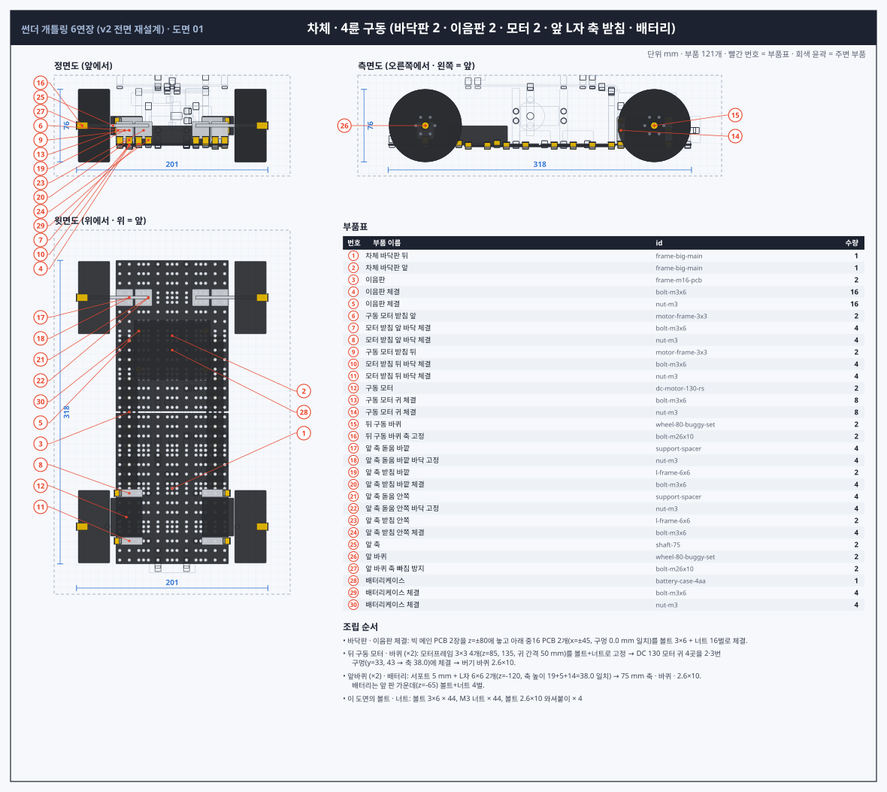

# 썬더 개틀링 6연장 설계도면

사용자가 준 "PROBO Technic 6연장 개틀링 머신"을 분석해 **로보로보 부품**으로 옮기고, 개정된 [`ASSEMBLY_RULES.md`](../ASSEMBLY_RULES.md) (1~10장: **볼트·너트 필수 체결, 공중 고정 금지, 캡너트 동축 정렬, 조립도 볼트·너트 표기, 최대 세분화 단계, 모든 부품·볼트·너트 완전 분해**)에 맞춰 재설계한 도면입니다.
다시 만들기: `python3 tools/gatling_blueprint.py` · 그림으로 보기: [`blueprint.html`](blueprint.html)

## 1. 주요 개선 (개정 조립 규칙 적용)

- **공중 고정 0건 · 볼트/너트 필수 체결:** 구조 부품 100개 전원에 실제 볼트 · 너트 · 태핑 나사 · 캡너트 202개를 도면과 3D에 직접 배치했습니다.
- **앞 축가이드 · 구동 모터 귀 치수 정밀 교정:** 바닥판 윗면을 `TOP = 33.0 mm`로 맞춰 앞 축가이드 구멍(`33 + 7 = 40.0 mm`)과 앞바퀴 축(`40.0 mm`)이 0.0 mm 일치하고, 뒤 구동 모터프레임을 `z = 65, 115` (귀 간격 50 mm)에 정확히 정렬했습니다.
- **캡너트 · 볼트 동축 방향 정렬:** 총구 캡너트 6개(`up = (0, 0, +1)` → 암나사 `+Z` 수나사 감쌈, 둥근 돔 `−Z` 총구 앞)와 걸쇠 턱 볼트 6개(`up = (0, 0, +1)`)를 포함한 모든 체결 부품이 체결 축과 동축 정렬되어 옆으로 눕는 오류를 원천 차단했습니다.
- **최대 세분화 & 완전 분해:** 부품 1개 배치 + 볼트/너트 1개 체결씩 총 **302단계**로 세분화하며, 분해 보기 시 모든 부품·볼트·너트·캡너트가 결합 축을 따라 나사 회전하며 완전히 분해됩니다.

## 2. 고각 서보 무게 계산

포탑 약 282 g (볼트 · 너트 · 캡너트 실체 합산) · 무게 중심이 경첩에서 42 mm → 1.17 kg·cm. 링크 (65 mm 지점) 힘 0.18 kgf × 크랭크 1 cm = **0.18 kg·cm** (서보 4 kg·cm의 5%).

## 3. 디자인 포인트

- **① 볼트 · 너트 필수 체결 (공중 고정 0건)** — 모든 구조 부품 100개를 실제 볼트 · 너트 · 태핑 나사 · 캡너트 202개와 동축 체결해 공중 고정 오류를 원천 제거했습니다. 앞 축가이드 구멍 높이(TOP 33 + 7 = 40 mm)와 모터 귀 간격(50 mm)도 실측 격자에 맞췄습니다.
- **② 캡너트 · 볼트 동축 방향 정렬** — 총구 캡너트 6개(암나사 +Z, 둥근 돔 −Z 총구 앞)와 걸쇠 턱 볼트 6개(머리 +Z, 나사 −Z)를 비롯한 모든 체결 부품에 명시적 up 축을 지정해 옆으로 눕는 오류를 완벽히 차단했습니다.
- **③ 최대 세분화 단계 & 완전 분해** — 부품 1개 배치와 볼트 · 너트 1개 체결을 각각 독립 단계(총 302단계)로 세분화하고, 분해 보기 시 모든 부품 + 볼트 + 너트 + 캡너트가 각자 결합 축을 따라 나사 회전하며 완전히 분해됩니다.
- **④ 모터 1개로 회전 + 격발 (6연장 PCD 50)** — 배럴 모터가 반지름 25 구멍 6개 로터를 돌리고, 12시에 고정된 36.9° 쐐기가 지나가는 고무줄 고리만 밀어 내 한 발씩 쏩니다.
- **⑤ 고각은 서보 모터로** — 경첩 + 서보 크랭크(반지름 10) + 소3 링크로 0° → +15.9°. 포탑 무게 약 282 g → 서보 토크 0.18 kg·cm (5%).
- **⑥ 조립도(SVG) 볼트 · 너트 필수 표기** — 정면 · 측면 · 윗면 조립도 모두에 모든 볼트(십자 원형) · 너트(육각) · 캡너트(육각 돔)를 실제 위치·방향대로 그려 넣고, 실체 기반 BOM으로 100% 자동 집계합니다.

## 4. 개요

| 항목 | 값 |
|---|---|
| 전체 크기 (고각 0°) | 폭 197 × 높이 179 × 길이 322 mm |
| 무게 (추정) | 약 1054 g |
| 배럴 | 6연장 · PCD 50 · 길이 91 mm (걸쇠 끝 ~ 총구 캡너트) · DC 130rpm 직결 |
| 격발 | 12시 고정 쐐기 36.9° · 1/6바퀴쯤마다 1발 (약 0.08초) |
| 고각 | 0° ~ +15.9° · 서보 모터 (크랭크 + 링크), 서보 힘의 5% 사용 |
| 주행 | 버기 바퀴 Ø80 × 4 (뒤 2 구동), 약 0.54 m/s |
| 부품 수 (실체 BOM) | 구조 부품 100 + 체결(볼트·너트·캡너트) 202 + 3핀 케이블 4 = **총 306개** (33종) |

## 5. 조립 규칙 검사 (1~10장)

| 규칙 | 이 설계 | 결과 |
|---|---|---|
| 1.1 CPU 1대당 1개 | CPU 보드 1개 | ✔ |
| 2.1 CPU 모터 최대 6 · 조작 4 | DC 모터 3개 (구동 2 + 배럴 1), 모두 조작 자리 M1 ~ M3 | ✔ |
| 2.2 확장 보드 | 필요 없음 | ✔ |
| 2.3 수량 130 × 4 | 130 모터 3개 사용 (1개 남음) | ✔ |
| 2.4 배틀 무기 = 400 모터 | 배틀무기 판을 쓰지 않음. 배럴은 130 모터 (고무줄 발사) | ✔ |
| 10.1 공중 고정 금지 · 볼트/너트 필수 | 구조 부품 100개 전원 실체 체결 · 볼트/너트/캡너트 202개 도면+3D 구현 | ✔ |
| 10.2 캡너트 · 볼트 동축 방향 정렬 | 총구 캡너트 6 · 걸쇠 볼트 6 포함 체결 202개 전원 동축 검증 통과 (옆으로 누움 0건) | ✔ |
| 10.3 최대 세분화 · 10.4 완전 분해 | 총 302단계 세분화 (묶기 0) · 모든 부품 + 볼트 + 너트 + 캡너트 축 분해 + 가이드선 | ✔ |
| 고각 서보 힘 | 필요 0.18 kg·cm / 서보 4 kg·cm (5%) | ✔ |

## 6. 도면 (볼트 · 너트 · 캡너트 포함)

### 도면 00 · 전체 조립도 (볼트 · 너트 · 캡너트 포함)

### 도면 01 · 차체 · 구동 (바닥판 2 · 이음판 2 · 모터 2 · 버기 바퀴 4 · 배터리)

### 도면 02 · 포탑 받침 · 고각 서보 (경첩 · 서보 크랭크 · 링크 · 포탑 판)

### 도면 03 · 배럴 구동부 (모터 1 · 로터 판 2 · 배럴 6 · 총구 캡너트 6 · 앞 축)

### 도면 04 · 격발 쐐기 (아치 · 36.9° 쐐기 띠)

### 도면 05 · 전자부 (CPU · 블루투스 · 발사 버튼 · LED · 부저)

### 도면 06 · 작동 원리 (쐐기 격발 · 서보 고각 · 무게 계산 · 대응표)

### 도면 07 · 규칙 검사 · 배선

## 7. 파트별 부품 및 체결 위치

좌표는 부품 중심 (mm, 원점 = 지면 위 로봇 가운데, 앞 = −Z), 크기는 X × Y × Z. 모든 볼트 · 너트 · 캡너트의 실제 중심 좌표와 축 방향(`up`)을 포함합니다.

### 01 차체 · 구동 (바닥판 2 · 이음판 2 · 모터 2 · 버기 바퀴 4 · 배터리)

| 번호 | 부품 | id | 중심 (X, Y, Z) | 크기 | 방향 · 메모 |
|---|---|---|---|---|---|
| 1 | 차체 바닥판 뒤 (빅 메인 PCB) | `frame-big-main` | (0, 32.2, 79.0) | 118.0 × 1.6 × 158.0 | 기준 부품 · 수평 |
| 2 | 차체 바닥판 앞 (빅 메인 PCB) | `frame-big-main` | (0, 32.2, -79.0) | 118.0 × 1.6 × 158.0 | 뒤 판 앞에 맞댐 · 이음판으로 체결 |
| 3 | 왼 이음판 (중16 PCB) | `frame-m16-pcb` | (-45, 30.6, 0.0) | 18.0 × 1.6 × 158.0 | 앞 · 뒤 바닥판 아래에서 가로질러 체결 |
| 4 | 왼 이음판 체결 (볼트 3×6) | `bolt-m3x6` | (-45, 30.8, -75.0) | 6.3 × 7.5 × 6.3 | up=(0, 1, 0) · 두께 3.2 mm |
| 5 | 왼 이음판 체결 (M3 너트) | `nut-m3` | (-45, 28.6, -75.0) | 5.8 × 2.4 × 5.8 | up=(0, 1, 0) · 볼트 반대쪽 체결 |
| 4 | 왼 이음판 체결 (볼트 3×6) | `bolt-m3x6` | (-45, 30.8, -55.0) | 6.3 × 7.5 × 6.3 | up=(0, 1, 0) · 두께 3.2 mm |
| 5 | 왼 이음판 체결 (M3 너트) | `nut-m3` | (-45, 28.6, -55.0) | 5.8 × 2.4 × 5.8 | up=(0, 1, 0) · 볼트 반대쪽 체결 |
| 4 | 왼 이음판 체결 (볼트 3×6) | `bolt-m3x6` | (-45, 30.8, -35.0) | 6.3 × 7.5 × 6.3 | up=(0, 1, 0) · 두께 3.2 mm |
| 5 | 왼 이음판 체결 (M3 너트) | `nut-m3` | (-45, 28.6, -35.0) | 5.8 × 2.4 × 5.8 | up=(0, 1, 0) · 볼트 반대쪽 체결 |
| 4 | 왼 이음판 체결 (볼트 3×6) | `bolt-m3x6` | (-45, 30.8, -15.0) | 6.3 × 7.5 × 6.3 | up=(0, 1, 0) · 두께 3.2 mm |
| 5 | 왼 이음판 체결 (M3 너트) | `nut-m3` | (-45, 28.6, -15.0) | 5.8 × 2.4 × 5.8 | up=(0, 1, 0) · 볼트 반대쪽 체결 |
| 4 | 왼 이음판 체결 (볼트 3×6) | `bolt-m3x6` | (-45, 30.8, 15.0) | 6.3 × 7.5 × 6.3 | up=(0, 1, 0) · 두께 3.2 mm |
| 5 | 왼 이음판 체결 (M3 너트) | `nut-m3` | (-45, 28.6, 15.0) | 5.8 × 2.4 × 5.8 | up=(0, 1, 0) · 볼트 반대쪽 체결 |
| 4 | 왼 이음판 체결 (볼트 3×6) | `bolt-m3x6` | (-45, 30.8, 35.0) | 6.3 × 7.5 × 6.3 | up=(0, 1, 0) · 두께 3.2 mm |
| 5 | 왼 이음판 체결 (M3 너트) | `nut-m3` | (-45, 28.6, 35.0) | 5.8 × 2.4 × 5.8 | up=(0, 1, 0) · 볼트 반대쪽 체결 |
| 4 | 왼 이음판 체결 (볼트 3×6) | `bolt-m3x6` | (-45, 30.8, 55.0) | 6.3 × 7.5 × 6.3 | up=(0, 1, 0) · 두께 3.2 mm |
| 5 | 왼 이음판 체결 (M3 너트) | `nut-m3` | (-45, 28.6, 55.0) | 5.8 × 2.4 × 5.8 | up=(0, 1, 0) · 볼트 반대쪽 체결 |
| 4 | 왼 이음판 체결 (볼트 3×6) | `bolt-m3x6` | (-45, 30.8, 75.0) | 6.3 × 7.5 × 6.3 | up=(0, 1, 0) · 두께 3.2 mm |
| 5 | 왼 이음판 체결 (M3 너트) | `nut-m3` | (-45, 28.6, 75.0) | 5.8 × 2.4 × 5.8 | up=(0, 1, 0) · 볼트 반대쪽 체결 |
| 3 | 오른 이음판 (중16 PCB) | `frame-m16-pcb` | (45, 30.6, 0.0) | 18.0 × 1.6 × 158.0 | 앞 · 뒤 바닥판 아래에서 가로질러 체결 |
| 4 | 오른 이음판 체결 (볼트 3×6) | `bolt-m3x6` | (45, 30.8, -75.0) | 6.3 × 7.5 × 6.3 | up=(0, 1, 0) · 두께 3.2 mm |
| 5 | 오른 이음판 체결 (M3 너트) | `nut-m3` | (45, 28.6, -75.0) | 5.8 × 2.4 × 5.8 | up=(0, 1, 0) · 볼트 반대쪽 체결 |
| 4 | 오른 이음판 체결 (볼트 3×6) | `bolt-m3x6` | (45, 30.8, -55.0) | 6.3 × 7.5 × 6.3 | up=(0, 1, 0) · 두께 3.2 mm |
| 5 | 오른 이음판 체결 (M3 너트) | `nut-m3` | (45, 28.6, -55.0) | 5.8 × 2.4 × 5.8 | up=(0, 1, 0) · 볼트 반대쪽 체결 |
| 4 | 오른 이음판 체결 (볼트 3×6) | `bolt-m3x6` | (45, 30.8, -35.0) | 6.3 × 7.5 × 6.3 | up=(0, 1, 0) · 두께 3.2 mm |
| 5 | 오른 이음판 체결 (M3 너트) | `nut-m3` | (45, 28.6, -35.0) | 5.8 × 2.4 × 5.8 | up=(0, 1, 0) · 볼트 반대쪽 체결 |
| 4 | 오른 이음판 체결 (볼트 3×6) | `bolt-m3x6` | (45, 30.8, -15.0) | 6.3 × 7.5 × 6.3 | up=(0, 1, 0) · 두께 3.2 mm |
| 5 | 오른 이음판 체결 (M3 너트) | `nut-m3` | (45, 28.6, -15.0) | 5.8 × 2.4 × 5.8 | up=(0, 1, 0) · 볼트 반대쪽 체결 |
| 4 | 오른 이음판 체결 (볼트 3×6) | `bolt-m3x6` | (45, 30.8, 15.0) | 6.3 × 7.5 × 6.3 | up=(0, 1, 0) · 두께 3.2 mm |
| 5 | 오른 이음판 체결 (M3 너트) | `nut-m3` | (45, 28.6, 15.0) | 5.8 × 2.4 × 5.8 | up=(0, 1, 0) · 볼트 반대쪽 체결 |
| 4 | 오른 이음판 체결 (볼트 3×6) | `bolt-m3x6` | (45, 30.8, 35.0) | 6.3 × 7.5 × 6.3 | up=(0, 1, 0) · 두께 3.2 mm |
| 5 | 오른 이음판 체결 (M3 너트) | `nut-m3` | (45, 28.6, 35.0) | 5.8 × 2.4 × 5.8 | up=(0, 1, 0) · 볼트 반대쪽 체결 |
| 4 | 오른 이음판 체결 (볼트 3×6) | `bolt-m3x6` | (45, 30.8, 55.0) | 6.3 × 7.5 × 6.3 | up=(0, 1, 0) · 두께 3.2 mm |
| 5 | 오른 이음판 체결 (M3 너트) | `nut-m3` | (45, 28.6, 55.0) | 5.8 × 2.4 × 5.8 | up=(0, 1, 0) · 볼트 반대쪽 체결 |
| 4 | 오른 이음판 체결 (볼트 3×6) | `bolt-m3x6` | (45, 30.8, 75.0) | 6.3 × 7.5 × 6.3 | up=(0, 1, 0) · 두께 3.2 mm |
| 5 | 오른 이음판 체결 (M3 너트) | `nut-m3` | (45, 28.6, 75.0) | 5.8 × 2.4 × 5.8 | up=(0, 1, 0) · 볼트 반대쪽 체결 |
| 6 | 왼 구동 모터 받침 앞 (모터프레임 3×3) | `motor-frame-3x3` | (-45, 45.0, 65.0) | 24.0 × 24.0 × 8.0 | 바닥판에 밀착 · z 65 모터 귀 지지 |
| 7 | 왼 모터 받침 앞 바닥 체결 (볼트 3×6) | `bolt-m3x6` | (-50, 31.8, 65.0) | 6.3 × 7.5 × 6.3 | up=(0, 1, 0) · 두께 2.6 mm |
| 8 | 왼 모터 받침 앞 바닥 체결 (M3 너트) | `nut-m3` | (-50, 30.2, 65.0) | 5.8 × 2.4 × 5.8 | up=(0, 1, 0) · 볼트 반대쪽 체결 |
| 7 | 왼 모터 받침 앞 바닥 체결 (볼트 3×6) | `bolt-m3x6` | (-40, 31.8, 65.0) | 6.3 × 7.5 × 6.3 | up=(0, 1, 0) · 두께 2.6 mm |
| 8 | 왼 모터 받침 앞 바닥 체결 (M3 너트) | `nut-m3` | (-40, 30.2, 65.0) | 5.8 × 2.4 × 5.8 | up=(0, 1, 0) · 볼트 반대쪽 체결 |
| 9 | 왼 구동 모터 받침 뒤 (모터프레임 3×3) | `motor-frame-3x3` | (-45, 45.0, 115.0) | 24.0 × 24.0 × 8.0 | 바닥판에 밀착 · z 115 모터 귀 지지 |
| 10 | 왼 모터 받침 뒤 바닥 체결 (볼트 3×6) | `bolt-m3x6` | (-50, 31.8, 115.0) | 6.3 × 7.5 × 6.3 | up=(0, 1, 0) · 두께 2.6 mm |
| 11 | 왼 모터 받침 뒤 바닥 체결 (M3 너트) | `nut-m3` | (-50, 30.2, 115.0) | 5.8 × 2.4 × 5.8 | up=(0, 1, 0) · 볼트 반대쪽 체결 |
| 10 | 왼 모터 받침 뒤 바닥 체결 (볼트 3×6) | `bolt-m3x6` | (-40, 31.8, 115.0) | 6.3 × 7.5 × 6.3 | up=(0, 1, 0) · 두께 2.6 mm |
| 11 | 왼 모터 받침 뒤 바닥 체결 (M3 너트) | `nut-m3` | (-40, 30.2, 115.0) | 5.8 × 2.4 × 5.8 | up=(0, 1, 0) · 볼트 반대쪽 체결 |
| 12 | 왼 구동 모터 (DC 130rpm, M1) | `dc-motor-130-rs` | (-45, 40.0, 90.0) | 33.0 × 20.0 × 40.0 | up=(-1, 0, 0) · 눕힘, 축 바깥 · 귀 z 65/115 |
| 13 | 왼 구동 모터 귀 체결 (볼트 3×6) | `bolt-m3x6` | (-44.45, 35.0, 65.0) | 7.5 × 6.3 × 6.3 | up=(-1, 0, 0) · 두께 3.4 mm |
| 14 | 왼 구동 모터 귀 체결 (M3 너트) | `nut-m3` | (-42.1, 35.0, 65.0) | 2.4 × 5.8 × 5.8 | up=(-1, 0, 0) · 볼트 반대쪽 체결 |
| 13 | 왼 구동 모터 귀 체결 (볼트 3×6) | `bolt-m3x6` | (-44.45, 45.0, 65.0) | 7.5 × 6.3 × 6.3 | up=(-1, 0, 0) · 두께 3.4 mm |
| 14 | 왼 구동 모터 귀 체결 (M3 너트) | `nut-m3` | (-42.1, 45.0, 65.0) | 2.4 × 5.8 × 5.8 | up=(-1, 0, 0) · 볼트 반대쪽 체결 |
| 13 | 왼 구동 모터 귀 체결 (볼트 3×6) | `bolt-m3x6` | (-44.45, 35.0, 115.0) | 7.5 × 6.3 × 6.3 | up=(-1, 0, 0) · 두께 3.4 mm |
| 14 | 왼 구동 모터 귀 체결 (M3 너트) | `nut-m3` | (-42.1, 35.0, 115.0) | 2.4 × 5.8 × 5.8 | up=(-1, 0, 0) · 볼트 반대쪽 체결 |
| 13 | 왼 구동 모터 귀 체결 (볼트 3×6) | `bolt-m3x6` | (-44.45, 45.0, 115.0) | 7.5 × 6.3 × 6.3 | up=(-1, 0, 0) · 두께 3.4 mm |
| 14 | 왼 구동 모터 귀 체결 (M3 너트) | `nut-m3` | (-42.1, 45.0, 115.0) | 2.4 × 5.8 × 5.8 | up=(-1, 0, 0) · 볼트 반대쪽 체결 |
| 15 | 왼 뒤 구동 바퀴 (Ø80 버기 세트) | `wheel-80-buggy-set` | (-80, 40.0, 100.0) | 33.0 × 80.0 × 80.0 | 모터 D컷 축 |
| 16 | 왼 뒤 구동 바퀴 축 고정 (볼트 2.6×10) | `bolt-m26x10` | (-92.4, 40.0, 100.0) | 11.8 × 7.4 × 7.4 | up=(-1, 0, 0) · 축 허브 고정 |
| 6 | 오른 구동 모터 받침 앞 (모터프레임 3×3) | `motor-frame-3x3` | (45, 45.0, 65.0) | 24.0 × 24.0 × 8.0 | 바닥판에 밀착 · z 65 모터 귀 지지 |
| 7 | 오른 모터 받침 앞 바닥 체결 (볼트 3×6) | `bolt-m3x6` | (40, 31.8, 65.0) | 6.3 × 7.5 × 6.3 | up=(0, 1, 0) · 두께 2.6 mm |
| 8 | 오른 모터 받침 앞 바닥 체결 (M3 너트) | `nut-m3` | (40, 30.2, 65.0) | 5.8 × 2.4 × 5.8 | up=(0, 1, 0) · 볼트 반대쪽 체결 |
| 7 | 오른 모터 받침 앞 바닥 체결 (볼트 3×6) | `bolt-m3x6` | (50, 31.8, 65.0) | 6.3 × 7.5 × 6.3 | up=(0, 1, 0) · 두께 2.6 mm |
| 8 | 오른 모터 받침 앞 바닥 체결 (M3 너트) | `nut-m3` | (50, 30.2, 65.0) | 5.8 × 2.4 × 5.8 | up=(0, 1, 0) · 볼트 반대쪽 체결 |
| 9 | 오른 구동 모터 받침 뒤 (모터프레임 3×3) | `motor-frame-3x3` | (45, 45.0, 115.0) | 24.0 × 24.0 × 8.0 | 바닥판에 밀착 · z 115 모터 귀 지지 |
| 10 | 오른 모터 받침 뒤 바닥 체결 (볼트 3×6) | `bolt-m3x6` | (40, 31.8, 115.0) | 6.3 × 7.5 × 6.3 | up=(0, 1, 0) · 두께 2.6 mm |
| 11 | 오른 모터 받침 뒤 바닥 체결 (M3 너트) | `nut-m3` | (40, 30.2, 115.0) | 5.8 × 2.4 × 5.8 | up=(0, 1, 0) · 볼트 반대쪽 체결 |
| 10 | 오른 모터 받침 뒤 바닥 체결 (볼트 3×6) | `bolt-m3x6` | (50, 31.8, 115.0) | 6.3 × 7.5 × 6.3 | up=(0, 1, 0) · 두께 2.6 mm |
| 11 | 오른 모터 받침 뒤 바닥 체결 (M3 너트) | `nut-m3` | (50, 30.2, 115.0) | 5.8 × 2.4 × 5.8 | up=(0, 1, 0) · 볼트 반대쪽 체결 |
| 12 | 오른 구동 모터 (DC 130rpm, M2) | `dc-motor-130-rs` | (45, 40.0, 90.0) | 33.0 × 20.0 × 40.0 | up=(1, 0, 0) · 눕힘, 축 바깥 · 귀 z 65/115 |
| 13 | 오른 구동 모터 귀 체결 (볼트 3×6) | `bolt-m3x6` | (44.45, 35.0, 65.0) | 7.5 × 6.3 × 6.3 | up=(1, 0, 0) · 두께 3.4 mm |
| 14 | 오른 구동 모터 귀 체결 (M3 너트) | `nut-m3` | (42.1, 35.0, 65.0) | 2.4 × 5.8 × 5.8 | up=(1, 0, 0) · 볼트 반대쪽 체결 |
| 13 | 오른 구동 모터 귀 체결 (볼트 3×6) | `bolt-m3x6` | (44.45, 45.0, 65.0) | 7.5 × 6.3 × 6.3 | up=(1, 0, 0) · 두께 3.4 mm |
| 14 | 오른 구동 모터 귀 체결 (M3 너트) | `nut-m3` | (42.1, 45.0, 65.0) | 2.4 × 5.8 × 5.8 | up=(1, 0, 0) · 볼트 반대쪽 체결 |
| 13 | 오른 구동 모터 귀 체결 (볼트 3×6) | `bolt-m3x6` | (44.45, 35.0, 115.0) | 7.5 × 6.3 × 6.3 | up=(1, 0, 0) · 두께 3.4 mm |
| 14 | 오른 구동 모터 귀 체결 (M3 너트) | `nut-m3` | (42.1, 35.0, 115.0) | 2.4 × 5.8 × 5.8 | up=(1, 0, 0) · 볼트 반대쪽 체결 |
| 13 | 오른 구동 모터 귀 체결 (볼트 3×6) | `bolt-m3x6` | (44.45, 45.0, 115.0) | 7.5 × 6.3 × 6.3 | up=(1, 0, 0) · 두께 3.4 mm |
| 14 | 오른 구동 모터 귀 체결 (M3 너트) | `nut-m3` | (42.1, 45.0, 115.0) | 2.4 × 5.8 × 5.8 | up=(1, 0, 0) · 볼트 반대쪽 체결 |
| 15 | 오른 뒤 구동 바퀴 (Ø80 버기 세트) | `wheel-80-buggy-set` | (80, 40.0, 100.0) | 33.0 × 80.0 × 80.0 | 모터 D컷 축 |
| 16 | 오른 뒤 구동 바퀴 축 고정 (볼트 2.6×10) | `bolt-m26x10` | (92.4, 40.0, 100.0) | 11.8 × 7.4 × 7.4 | up=(1, 0, 0) · 축 허브 고정 |
| 17 | 왼 앞 축가이드 | `axle-guide` | (-30, 38.0, -100.0) | 28.0 × 10.0 × 18.0 | 축 구멍 높이 TOP+7 = 40.0 일치 |
| 18 | 왼 앞 축가이드 체결 (볼트 M3×10) | `bolt-m3x10` | (-30, 33.8, -105.0) | 6.3 × 11.5 × 6.3 | up=(0, 1, 0) · 두께 6.6 mm |
| 19 | 왼 앞 축가이드 체결 (M3 너트) | `nut-m3` | (-30, 30.2, -105.0) | 5.8 × 2.4 × 5.8 | up=(0, 1, 0) · 볼트 반대쪽 체결 |
| 18 | 왼 앞 축가이드 체결 (볼트 M3×10) | `bolt-m3x10` | (-30, 33.8, -95.0) | 6.3 × 11.5 × 6.3 | up=(0, 1, 0) · 두께 6.6 mm |
| 19 | 왼 앞 축가이드 체결 (M3 너트) | `nut-m3` | (-30, 30.2, -95.0) | 5.8 × 2.4 × 5.8 | up=(0, 1, 0) · 볼트 반대쪽 체결 |
| 17 | 왼 앞 축가이드 | `axle-guide` | (-50, 38.0, -100.0) | 28.0 × 10.0 × 18.0 | 축 구멍 높이 TOP+7 = 40.0 일치 |
| 18 | 왼 앞 축가이드 체결 (볼트 M3×10) | `bolt-m3x10` | (-50, 33.8, -105.0) | 6.3 × 11.5 × 6.3 | up=(0, 1, 0) · 두께 6.6 mm |
| 19 | 왼 앞 축가이드 체결 (M3 너트) | `nut-m3` | (-50, 30.2, -105.0) | 5.8 × 2.4 × 5.8 | up=(0, 1, 0) · 볼트 반대쪽 체결 |
| 18 | 왼 앞 축가이드 체결 (볼트 M3×10) | `bolt-m3x10` | (-50, 33.8, -95.0) | 6.3 × 11.5 × 6.3 | up=(0, 1, 0) · 두께 6.6 mm |
| 19 | 왼 앞 축가이드 체결 (M3 너트) | `nut-m3` | (-50, 30.2, -95.0) | 5.8 × 2.4 × 5.8 | up=(0, 1, 0) · 볼트 반대쪽 체결 |
| 20 | 왼 앞 축 (75 mm) | `shaft-75` | (-60, 40.0, -100.0) | 75.0 × 3.0 × 3.0 | 축가이드 2개 관통 (y 40.0) |
| 21 | 왼 앞 바퀴 (Ø80 버기 세트, 헛돎) | `wheel-80-buggy-set` | (-80, 40.0, -100.0) | 33.0 × 80.0 × 80.0 | 축 끝 장착 |
| 22 | 왼 앞 바퀴 축 빠짐 방지 (볼트 2.6×10) | `bolt-m26x10` | (-92.4, 40.0, -100.0) | 11.8 × 7.4 × 7.4 | up=(-1, 0, 0) · 축 허브 고정 |
| 17 | 오른 앞 축가이드 | `axle-guide` | (30, 38.0, -100.0) | 28.0 × 10.0 × 18.0 | 축 구멍 높이 TOP+7 = 40.0 일치 |
| 18 | 오른 앞 축가이드 체결 (볼트 M3×10) | `bolt-m3x10` | (30, 33.8, -105.0) | 6.3 × 11.5 × 6.3 | up=(0, 1, 0) · 두께 6.6 mm |
| 19 | 오른 앞 축가이드 체결 (M3 너트) | `nut-m3` | (30, 30.2, -105.0) | 5.8 × 2.4 × 5.8 | up=(0, 1, 0) · 볼트 반대쪽 체결 |
| 18 | 오른 앞 축가이드 체결 (볼트 M3×10) | `bolt-m3x10` | (30, 33.8, -95.0) | 6.3 × 11.5 × 6.3 | up=(0, 1, 0) · 두께 6.6 mm |
| 19 | 오른 앞 축가이드 체결 (M3 너트) | `nut-m3` | (30, 30.2, -95.0) | 5.8 × 2.4 × 5.8 | up=(0, 1, 0) · 볼트 반대쪽 체결 |
| 17 | 오른 앞 축가이드 | `axle-guide` | (50, 38.0, -100.0) | 28.0 × 10.0 × 18.0 | 축 구멍 높이 TOP+7 = 40.0 일치 |
| 18 | 오른 앞 축가이드 체결 (볼트 M3×10) | `bolt-m3x10` | (50, 33.8, -105.0) | 6.3 × 11.5 × 6.3 | up=(0, 1, 0) · 두께 6.6 mm |
| 19 | 오른 앞 축가이드 체결 (M3 너트) | `nut-m3` | (50, 30.2, -105.0) | 5.8 × 2.4 × 5.8 | up=(0, 1, 0) · 볼트 반대쪽 체결 |
| 18 | 오른 앞 축가이드 체결 (볼트 M3×10) | `bolt-m3x10` | (50, 33.8, -95.0) | 6.3 × 11.5 × 6.3 | up=(0, 1, 0) · 두께 6.6 mm |
| 19 | 오른 앞 축가이드 체결 (M3 너트) | `nut-m3` | (50, 30.2, -95.0) | 5.8 × 2.4 × 5.8 | up=(0, 1, 0) · 볼트 반대쪽 체결 |
| 20 | 오른 앞 축 (75 mm) | `shaft-75` | (60, 40.0, -100.0) | 75.0 × 3.0 × 3.0 | 축가이드 2개 관통 (y 40.0) |
| 21 | 오른 앞 바퀴 (Ø80 버기 세트, 헛돎) | `wheel-80-buggy-set` | (80, 40.0, -100.0) | 33.0 × 80.0 × 80.0 | 축 끝 장착 |
| 22 | 오른 앞 바퀴 축 빠짐 방지 (볼트 2.6×10) | `bolt-m26x10` | (92.4, 40.0, -100.0) | 11.8 × 7.4 × 7.4 | up=(1, 0, 0) · 축 허브 고정 |
| 23 | 배터리케이스 (AA 4개, 6V) | `battery-case-4aa` | (0, 42.0, -55.0) | 74.0 × 18.0 × 62.0 | 앞 판 가운데 · 가장 낮게 |
| 24 | 배터리케이스 체결 (볼트 3×6) | `bolt-m3x6` | (-35, 32.8, -75.0) | 6.3 × 7.5 × 6.3 | up=(0, 1, 0) · 두께 3.6 mm |
| 25 | 배터리케이스 체결 (M3 너트) | `nut-m3` | (-35, 30.2, -75.0) | 5.8 × 2.4 × 5.8 | up=(0, 1, 0) · 볼트 반대쪽 체결 |
| 24 | 배터리케이스 체결 (볼트 3×6) | `bolt-m3x6` | (-35, 32.8, -35.0) | 6.3 × 7.5 × 6.3 | up=(0, 1, 0) · 두께 3.6 mm |
| 25 | 배터리케이스 체결 (M3 너트) | `nut-m3` | (-35, 30.2, -35.0) | 5.8 × 2.4 × 5.8 | up=(0, 1, 0) · 볼트 반대쪽 체결 |
| 24 | 배터리케이스 체결 (볼트 3×6) | `bolt-m3x6` | (35, 32.8, -75.0) | 6.3 × 7.5 × 6.3 | up=(0, 1, 0) · 두께 3.6 mm |
| 25 | 배터리케이스 체결 (M3 너트) | `nut-m3` | (35, 30.2, -75.0) | 5.8 × 2.4 × 5.8 | up=(0, 1, 0) · 볼트 반대쪽 체결 |
| 24 | 배터리케이스 체결 (볼트 3×6) | `bolt-m3x6` | (35, 32.8, -35.0) | 6.3 × 7.5 × 6.3 | up=(0, 1, 0) · 두께 3.6 mm |
| 25 | 배터리케이스 체결 (M3 너트) | `nut-m3` | (35, 30.2, -35.0) | 5.8 × 2.4 × 5.8 | up=(0, 1, 0) · 볼트 반대쪽 체결 |

### 02 포탑 받침 · 고각 서보 (경첩 · 서보 크랭크 · 링크 · 포탑 판)

| 번호 | 부품 | id | 중심 (X, Y, Z) | 크기 | 방향 · 메모 |
|---|---|---|---|---|---|
| 1 | 왼 뒤 받침 기둥 (서포트 40) | `support-spacer` | (-35, 53.0, 65.0) | 6.4 × 40.0 × 6.4 | 차체 → 뒤 받침대 |
| 2 | 왼 뒤 받침 기둥 바닥 고정 (M3 너트) | `nut-m3` | (-35, 30.2, 65.0) | 5.8 × 2.4 × 5.8 | up=(0, 1, 0) · 서포트 수나사 고정 |
| 1 | 오른 뒤 받침 기둥 (서포트 40) | `support-spacer` | (35, 53.0, 65.0) | 6.4 × 40.0 × 6.4 | 차체 → 뒤 받침대 |
| 2 | 오른 뒤 받침 기둥 바닥 고정 (M3 너트) | `nut-m3` | (35, 30.2, 65.0) | 5.8 × 2.4 × 5.8 | up=(0, 1, 0) · 서포트 수나사 고정 |
| 3 | 뒤 받침대 (중 PCB) | `frame-mid-pcb` | (0, 73.8, 65.0) | 78.0 × 1.6 × 18.0 | 기둥 2개 위 |
| 4 | 뒤 받침대 체결 (볼트 3×6) | `bolt-m3x6` | (-35, 72.3, 65.0) | 6.3 × 7.5 × 6.3 | up=(0, 1, 0) · 두께 1.6 mm |
| 4 | 뒤 받침대 체결 (볼트 3×6) | `bolt-m3x6` | (35, 72.3, 65.0) | 6.3 × 7.5 × 6.3 | up=(0, 1, 0) · 두께 1.6 mm |
| 5 | 고각 경첩 (경첩 3×3) | `hinge-3x3` | (0, 76.3, 65.0) | 18.0 × 3.4 × 23.0 | 축이 좌우 · 아래 날개=받침대, 위 날개=포탑 판 |
| 6 | 고각 경첩 아래 날개 체결 (볼트 3×6) | `bolt-m3x6` | (-5, 73.3, 70.0) | 6.3 × 7.5 × 6.3 | up=(0, 1, 0) · 두께 2.6 mm |
| 7 | 고각 경첩 아래 날개 체결 (M3 너트) | `nut-m3` | (-5, 71.8, 70.0) | 5.8 × 2.4 × 5.8 | up=(0, 1, 0) · 볼트 반대쪽 체결 |
| 6 | 고각 경첩 아래 날개 체결 (볼트 3×6) | `bolt-m3x6` | (5, 73.3, 70.0) | 6.3 × 7.5 × 6.3 | up=(0, 1, 0) · 두께 2.6 mm |
| 7 | 고각 경첩 아래 날개 체결 (M3 너트) | `nut-m3` | (5, 71.8, 70.0) | 5.8 × 2.4 × 5.8 | up=(0, 1, 0) · 볼트 반대쪽 체결 |
| 8 | 고각 서보 기둥 뒤 (L자 2×6) | `l-frame-2x6` | (15, 62.0, 35.0) | 10.0 × 58.0 × 8.0 | 세운 다리 구멍 24 · 34에 서보 귀 |
| 9 | 고각 서보 기둥 뒤 바닥 체결 (볼트 3×6) | `bolt-m3x6` | (11, 31.8, 35.0) | 6.3 × 7.5 × 6.3 | up=(0, 1, 0) · 두께 2.6 mm |
| 10 | 고각 서보 기둥 뒤 바닥 체결 (M3 너트) | `nut-m3` | (11, 30.2, 35.0) | 5.8 × 2.4 × 5.8 | up=(0, 1, 0) · 볼트 반대쪽 체결 |
| 9 | 고각 서보 기둥 뒤 바닥 체결 (볼트 3×6) | `bolt-m3x6` | (21, 31.8, 35.0) | 6.3 × 7.5 × 6.3 | up=(0, 1, 0) · 두께 2.6 mm |
| 10 | 고각 서보 기둥 뒤 바닥 체결 (M3 너트) | `nut-m3` | (21, 30.2, 35.0) | 5.8 × 2.4 × 5.8 | up=(0, 1, 0) · 볼트 반대쪽 체결 |
| 11 | 고각 서보 기둥 앞 (L자 2×6) | `l-frame-2x6` | (15, 62.0, -15.0) | 10.0 × 58.0 × 8.0 | 세운 다리 구멍 24 · 34에 서보 귀 |
| 12 | 고각 서보 기둥 앞 바닥 체결 (볼트 3×6) | `bolt-m3x6` | (11, 31.8, -15.0) | 6.3 × 7.5 × 6.3 | up=(0, 1, 0) · 두께 2.6 mm |
| 13 | 고각 서보 기둥 앞 바닥 체결 (M3 너트) | `nut-m3` | (11, 30.2, -15.0) | 5.8 × 2.4 × 5.8 | up=(0, 1, 0) · 볼트 반대쪽 체결 |
| 12 | 고각 서보 기둥 앞 바닥 체결 (볼트 3×6) | `bolt-m3x6` | (21, 31.8, -15.0) | 6.3 × 7.5 × 6.3 | up=(0, 1, 0) · 두께 2.6 mm |
| 13 | 고각 서보 기둥 앞 바닥 체결 (M3 너트) | `nut-m3` | (21, 30.2, -15.0) | 5.8 × 2.4 × 5.8 | up=(0, 1, 0) · 볼트 반대쪽 체결 |
| 14 | 고각 서보 (OUT1) | `servo-digital` | (27, 62.0, 10.0) | 33.0 × 20.0 × 60.0 | up=(-1, 0, 0) · 축이 왼쪽(−X) · z 0 |
| 15 | 고각 서보 귀 체결 (볼트 3×6) | `bolt-m3x6` | (16.15, 57.0, 35.0) | 7.5 × 6.3 × 6.3 | up=(1, 0, 0) · 두께 3.4 mm |
| 16 | 고각 서보 귀 체결 (M3 너트) | `nut-m3` | (13.8, 57.0, 35.0) | 2.4 × 5.8 × 5.8 | up=(1, 0, 0) · 볼트 반대쪽 체결 |
| 15 | 고각 서보 귀 체결 (볼트 3×6) | `bolt-m3x6` | (16.15, 67.0, 35.0) | 7.5 × 6.3 × 6.3 | up=(1, 0, 0) · 두께 3.4 mm |
| 16 | 고각 서보 귀 체결 (M3 너트) | `nut-m3` | (13.8, 67.0, 35.0) | 2.4 × 5.8 × 5.8 | up=(1, 0, 0) · 볼트 반대쪽 체결 |
| 15 | 고각 서보 귀 체결 (볼트 3×6) | `bolt-m3x6` | (16.15, 57.0, -15.0) | 7.5 × 6.3 × 6.3 | up=(1, 0, 0) · 두께 3.4 mm |
| 16 | 고각 서보 귀 체결 (M3 너트) | `nut-m3` | (13.8, 57.0, -15.0) | 2.4 × 5.8 × 5.8 | up=(1, 0, 0) · 볼트 반대쪽 체결 |
| 15 | 고각 서보 귀 체결 (볼트 3×6) | `bolt-m3x6` | (16.15, 67.0, -15.0) | 7.5 × 6.3 × 6.3 | up=(1, 0, 0) · 두께 3.4 mm |
| 16 | 고각 서보 귀 체결 (M3 너트) | `nut-m3` | (13.8, 67.0, -15.0) | 2.4 × 5.8 × 5.8 | up=(1, 0, 0) · 볼트 반대쪽 체결 |
| 17 | 고각 크랭크 (휠가이드 서보) | `wheel-guide-30-servo` | (5, 62.0, 0.0) | 8.0 × 30.0 × 30.0 | 서보 축 · 반지름 10 구멍에 핀 |
| 18 | 고각 크랭크 서보 축 고정 (볼트 2.6×10) | `bolt-m26x10` | (5.1, 62.0, 0.0) | 11.8 × 7.4 × 7.4 | up=(-1, 0, 0) · 축 허브 고정 |
| 19 | 고각 링크 (소3 PCB, 핀 간격 20) | `frame-s3-pcb` | (-1, 63.0, 0.0) | 1.6 × 28.0 × 8.0 | 크랭크 핀 ↔ 포탑 판 아래 탭 |
| 20 | 링크 아래 핀 (후크 S35) | `s-hook-35` | (1, 52.0, 0.0) | 7.6 × 6.5 × 6.5 | 크랭크 쪽 회전 핀 |
| 21 | 링크 위 핀 (후크 S35) | `s-hook-35` | (-3, 74.0, 0.0) | 7.6 × 6.5 × 6.5 | 탭 쪽 회전 핀 |
| 22 | 포탑 판 (메인 PCB) | `frame-main-pcb` | (0, 78.8, 10.0) | 78.0 × 1.6 × 118.0 | 뒤=경첩 볼트 2, 앞=고각 탭 볼트 2 |
| 23 | 포탑 판 ↔ 경첩 위 날개 체결 (볼트 3×6) | `bolt-m3x6` | (-5, 77.3, 60.0) | 6.3 × 7.5 × 6.3 | up=(0, 1, 0) · 두께 2.6 mm |
| 24 | 포탑 판 ↔ 경첩 위 날개 체결 (M3 너트) | `nut-m3` | (-5, 75.8, 60.0) | 5.8 × 2.4 × 5.8 | up=(0, 1, 0) · 볼트 반대쪽 체결 |
| 23 | 포탑 판 ↔ 경첩 위 날개 체결 (볼트 3×6) | `bolt-m3x6` | (5, 77.3, 60.0) | 6.3 × 7.5 × 6.3 | up=(0, 1, 0) · 두께 2.6 mm |
| 24 | 포탑 판 ↔ 경첩 위 날개 체결 (M3 너트) | `nut-m3` | (5, 75.8, 60.0) | 5.8 × 2.4 × 5.8 | up=(0, 1, 0) · 볼트 반대쪽 체결 |
| 25 | 고각 탭 (L자 2×2, 포탑 판 아래) | `l-frame-2x2` | (-5, 73.0, 0.0) | 8.0 × 10.0 × 10.0 | 포탑 판 아랫면에 볼트 체결 · 경첩에서 65 |
| 26 | 고각 탭 ↔ 포탑 판 체결 (볼트 3×6) | `bolt-m3x6` | (-5, 77.3, -5.0) | 6.3 × 7.5 × 6.3 | up=(0, 1, 0) · 두께 2.6 mm |
| 27 | 고각 탭 ↔ 포탑 판 체결 (M3 너트) | `nut-m3` | (-5, 75.8, -5.0) | 5.8 × 2.4 × 5.8 | up=(0, 1, 0) · 볼트 반대쪽 체결 |
| 26 | 고각 탭 ↔ 포탑 판 체결 (볼트 3×6) | `bolt-m3x6` | (-5, 77.3, 5.0) | 6.3 × 7.5 × 6.3 | up=(0, 1, 0) · 두께 2.6 mm |
| 27 | 고각 탭 ↔ 포탑 판 체결 (M3 너트) | `nut-m3` | (-5, 75.8, 5.0) | 5.8 × 2.4 × 5.8 | up=(0, 1, 0) · 볼트 반대쪽 체결 |

### 03 배럴 구동부 (모터 1 · 로터 판 2 · 배럴 6 · 총구 캡너트 6 · 앞 축)

| 번호 | 부품 | id | 중심 (X, Y, Z) | 크기 | 방향 · 메모 |
|---|---|---|---|---|---|
| 1 | 배럴 모터 돋움 왼 (서포트 10) | `support-spacer` | (-15, 84.6, 55.0) | 6.4 × 10.0 × 6.4 | 축 높이 59에 맞춤 |
| 2 | 배럴 모터 돋움 왼 바닥 고정 (M3 너트) | `nut-m3` | (-15, 76.8, 55.0) | 5.8 × 2.4 × 5.8 | up=(0, 1, 0) · 서포트 수나사 고정 |
| 1 | 배럴 모터 돋움 왼 (서포트 10) | `support-spacer` | (-15, 84.6, 65.0) | 6.4 × 10.0 × 6.4 | 축 높이 59에 맞춤 |
| 2 | 배럴 모터 돋움 왼 바닥 고정 (M3 너트) | `nut-m3` | (-15, 76.8, 65.0) | 5.8 × 2.4 × 5.8 | up=(0, 1, 0) · 서포트 수나사 고정 |
| 3 | 배럴 모터 기둥 왼 (L자 2×6) | `l-frame-2x6` | (-15, 118.6, 58.0) | 8.0 × 58.0 × 14.0 | 구멍 44 · 54에 모터 귀 |
| 4 | 배럴 모터 기둥 왼 체결 (볼트 3×6) | `bolt-m3x6` | (-15, 88.3, 55.0) | 6.3 × 7.5 × 6.3 | up=(0, 1, 0) · 두께 1.0 mm |
| 4 | 배럴 모터 기둥 왼 체결 (볼트 3×6) | `bolt-m3x6` | (-15, 88.3, 65.0) | 6.3 × 7.5 × 6.3 | up=(0, 1, 0) · 두께 1.0 mm |
| 1 | 배럴 모터 돋움 오른 (서포트 10) | `support-spacer` | (35, 84.6, 55.0) | 6.4 × 10.0 × 6.4 | 축 높이 59에 맞춤 |
| 2 | 배럴 모터 돋움 오른 바닥 고정 (M3 너트) | `nut-m3` | (35, 76.8, 55.0) | 5.8 × 2.4 × 5.8 | up=(0, 1, 0) · 서포트 수나사 고정 |
| 1 | 배럴 모터 돋움 오른 (서포트 10) | `support-spacer` | (35, 84.6, 65.0) | 6.4 × 10.0 × 6.4 | 축 높이 59에 맞춤 |
| 2 | 배럴 모터 돋움 오른 바닥 고정 (M3 너트) | `nut-m3` | (35, 76.8, 65.0) | 5.8 × 2.4 × 5.8 | up=(0, 1, 0) · 서포트 수나사 고정 |
| 3 | 배럴 모터 기둥 오른 (L자 2×6) | `l-frame-2x6` | (35, 118.6, 58.0) | 8.0 × 58.0 × 14.0 | 구멍 44 · 54에 모터 귀 |
| 4 | 배럴 모터 기둥 오른 체결 (볼트 3×6) | `bolt-m3x6` | (35, 88.3, 55.0) | 6.3 × 7.5 × 6.3 | up=(0, 1, 0) · 두께 1.0 mm |
| 4 | 배럴 모터 기둥 오른 체결 (볼트 3×6) | `bolt-m3x6` | (35, 88.3, 65.0) | 6.3 × 7.5 × 6.3 | up=(0, 1, 0) · 두께 1.0 mm |
| 5 | 배럴 모터 (DC 130rpm, M3) | `dc-motor-130-rs` | (10, 138.6, 62.0) | 60.0 × 20.0 × 40.0 | up=(0, 0, -1) · 축이 앞(−Z) · 가운데 (x 0) |
| 6 | 배럴 모터 귀 체결 (볼트 3×6) | `bolt-m3x6` | (-15, 133.6, 57.5) | 6.3 × 6.3 × 7.5 | up=(0, 0, 1) · 두께 3.4 mm |
| 7 | 배럴 모터 귀 체결 (M3 너트) | `nut-m3` | (-15, 133.6, 55.1) | 5.8 × 5.8 × 2.4 | up=(0, 0, 1) · 볼트 반대쪽 체결 |
| 6 | 배럴 모터 귀 체결 (볼트 3×6) | `bolt-m3x6` | (-15, 143.6, 57.5) | 6.3 × 6.3 × 7.5 | up=(0, 0, 1) · 두께 3.4 mm |
| 7 | 배럴 모터 귀 체결 (M3 너트) | `nut-m3` | (-15, 143.6, 55.1) | 5.8 × 5.8 × 2.4 | up=(0, 0, 1) · 볼트 반대쪽 체결 |
| 6 | 배럴 모터 귀 체결 (볼트 3×6) | `bolt-m3x6` | (35, 133.6, 57.5) | 6.3 × 6.3 × 7.5 | up=(0, 0, 1) · 두께 3.4 mm |
| 7 | 배럴 모터 귀 체결 (M3 너트) | `nut-m3` | (35, 133.6, 55.1) | 5.8 × 5.8 × 2.4 | up=(0, 0, 1) · 볼트 반대쪽 체결 |
| 6 | 배럴 모터 귀 체결 (볼트 3×6) | `bolt-m3x6` | (35, 143.6, 57.5) | 6.3 × 6.3 × 7.5 | up=(0, 0, 1) · 두께 3.4 mm |
| 7 | 배럴 모터 귀 체결 (M3 너트) | `nut-m3` | (35, 143.6, 55.1) | 5.8 × 5.8 × 2.4 | up=(0, 0, 1) · 볼트 반대쪽 체결 |
| 8 | 로터 허브 (휠가이드 Ø30 나일론) | `wheel-guide-30-nylon` | (0, 138.6, 39.0) | 30.0 × 30.0 × 8.0 | 모터 D컷 축 |
| 9 | 로터 허브 모터 축 고정 (볼트 2.6×10) | `bolt-m26x10` | (0, 138.6, 39.1) | 7.4 × 7.4 × 11.8 | up=(0, 0, -1) · 축 허브 고정 |
| 10 | 뒤 로터 판 (하프 PCB) | `frame-half-pcb` | (0, 133.6, 34.0) | 58.0 × 78.0 × 1.6 | 구멍 (0, 5)가 회전 가운데 · 위아래 2곳 허브 체결 |
| 11 | 뒤 로터 ↔ 허브 체결 (볼트 M3×10) | `bolt-m3x10` | (0, 128.6, 37.5) | 6.3 × 6.3 × 11.5 | up=(0, 0, -1) · 두께 4.0 mm |
| 12 | 뒤 로터 ↔ 허브 체결 (M3 너트) | `nut-m3` | (0, 128.6, 38.4) | 5.8 × 5.8 × 2.4 | up=(0, 0, -1) · 볼트 반대쪽 체결 |
| 11 | 뒤 로터 ↔ 허브 체결 (볼트 M3×10) | `bolt-m3x10` | (0, 148.6, 37.5) | 6.3 × 6.3 × 11.5 | up=(0, 0, -1) · 두께 4.0 mm |
| 12 | 뒤 로터 ↔ 허브 체결 (M3 너트) | `nut-m3` | (0, 148.6, 38.4) | 5.8 × 5.8 × 2.4 | up=(0, 0, -1) · 볼트 반대쪽 체결 |
| 13 | 걸쇠 기둥 3시 (서포트 10) | `support-spacer` | (25, 138.6, 39.8) | 6.4 × 6.4 × 10.0 | 3시 배럴 · 뒤 로터 뒤로 10 mm |
| 14 | 걸쇠 턱 3시 (볼트 3×6) | `bolt-m3x6` | (25, 138.6, 42.5) | 6.3 × 6.3 × 7.5 | up=(0, 0, 1) · 두께 1.6 mm |
| 15 | 배럴 뒤 3시 (서포트 40) | `support-spacer` | (25, 138.6, 13.2) | 6.4 × 6.4 × 40.0 | 3시 배럴 |
| 16 | 배럴 가운데 3시 (서포트 25) | `support-spacer` | (25, 138.6, -19.3) | 6.4 × 6.4 × 25.0 | 3시 배럴 연장 |
| 17 | 걸쇠 기둥 1시 (서포트 10) | `support-spacer` | (15, 158.6, 39.8) | 6.4 × 6.4 × 10.0 | 1시 배럴 · 뒤 로터 뒤로 10 mm |
| 18 | 걸쇠 턱 1시 (볼트 3×6) | `bolt-m3x6` | (15, 158.6, 42.5) | 6.3 × 6.3 × 7.5 | up=(0, 0, 1) · 두께 1.6 mm |
| 19 | 배럴 뒤 1시 (서포트 40) | `support-spacer` | (15, 158.6, 13.2) | 6.4 × 6.4 × 40.0 | 1시 배럴 |
| 20 | 배럴 가운데 1시 (서포트 25) | `support-spacer` | (15, 158.6, -19.3) | 6.4 × 6.4 × 25.0 | 1시 배럴 연장 |
| 21 | 걸쇠 기둥 11시 (서포트 10) | `support-spacer` | (-15, 158.6, 39.8) | 6.4 × 6.4 × 10.0 | 11시 배럴 · 뒤 로터 뒤로 10 mm |
| 22 | 걸쇠 턱 11시 (볼트 3×6) | `bolt-m3x6` | (-15, 158.6, 42.5) | 6.3 × 6.3 × 7.5 | up=(0, 0, 1) · 두께 1.6 mm |
| 23 | 배럴 뒤 11시 (서포트 40) | `support-spacer` | (-15, 158.6, 13.2) | 6.4 × 6.4 × 40.0 | 11시 배럴 |
| 24 | 배럴 가운데 11시 (서포트 25) | `support-spacer` | (-15, 158.6, -19.3) | 6.4 × 6.4 × 25.0 | 11시 배럴 연장 |
| 25 | 걸쇠 기둥 9시 (서포트 10) | `support-spacer` | (-25, 138.6, 39.8) | 6.4 × 6.4 × 10.0 | 9시 배럴 · 뒤 로터 뒤로 10 mm |
| 26 | 걸쇠 턱 9시 (볼트 3×6) | `bolt-m3x6` | (-25, 138.6, 42.5) | 6.3 × 6.3 × 7.5 | up=(0, 0, 1) · 두께 1.6 mm |
| 27 | 배럴 뒤 9시 (서포트 40) | `support-spacer` | (-25, 138.6, 13.2) | 6.4 × 6.4 × 40.0 | 9시 배럴 |
| 28 | 배럴 가운데 9시 (서포트 25) | `support-spacer` | (-25, 138.6, -19.3) | 6.4 × 6.4 × 25.0 | 9시 배럴 연장 |
| 29 | 걸쇠 기둥 7시 (서포트 10) | `support-spacer` | (-15, 118.6, 39.8) | 6.4 × 6.4 × 10.0 | 7시 배럴 · 뒤 로터 뒤로 10 mm |
| 30 | 걸쇠 턱 7시 (볼트 3×6) | `bolt-m3x6` | (-15, 118.6, 42.5) | 6.3 × 6.3 × 7.5 | up=(0, 0, 1) · 두께 1.6 mm |
| 31 | 배럴 뒤 7시 (서포트 40) | `support-spacer` | (-15, 118.6, 13.2) | 6.4 × 6.4 × 40.0 | 7시 배럴 |
| 32 | 배럴 가운데 7시 (서포트 25) | `support-spacer` | (-15, 118.6, -19.3) | 6.4 × 6.4 × 25.0 | 7시 배럴 연장 |
| 33 | 걸쇠 기둥 5시 (서포트 10) | `support-spacer` | (15, 118.6, 39.8) | 6.4 × 6.4 × 10.0 | 5시 배럴 · 뒤 로터 뒤로 10 mm |
| 34 | 걸쇠 턱 5시 (볼트 3×6) | `bolt-m3x6` | (15, 118.6, 42.5) | 6.3 × 6.3 × 7.5 | up=(0, 0, 1) · 두께 1.6 mm |
| 35 | 배럴 뒤 5시 (서포트 40) | `support-spacer` | (15, 118.6, 13.2) | 6.4 × 6.4 × 40.0 | 5시 배럴 |
| 36 | 배럴 가운데 5시 (서포트 25) | `support-spacer` | (15, 118.6, -19.3) | 6.4 × 6.4 × 25.0 | 5시 배럴 연장 |
| 37 | 앞 로터 판 (하프 PCB) | `frame-half-pcb` | (0, 133.6, -32.6) | 58.0 × 78.0 × 1.6 | 배럴 6개 수나사에 관통 · 가운데 앞 받침 축 |
| 38 | 배럴 앞 3시 (서포트 7) | `support-spacer` | (25, 138.6, -36.9) | 6.4 × 6.4 × 7.0 | 앞 로터를 사이에 물림 |
| 39 | 총구 3시 (캡너트) | `cap-nut-m3` | (25, 138.6, -43.4) | 6.4 × 6.4 × 6.0 | up=(0, 0, 1) · 수나사 끝에 동축 체결 · 둥근 돔 바깥쪽 |
| 40 | 배럴 앞 1시 (서포트 7) | `support-spacer` | (15, 158.6, -36.9) | 6.4 × 6.4 × 7.0 | 앞 로터를 사이에 물림 |
| 41 | 총구 1시 (캡너트) | `cap-nut-m3` | (15, 158.6, -43.4) | 6.4 × 6.4 × 6.0 | up=(0, 0, 1) · 수나사 끝에 동축 체결 · 둥근 돔 바깥쪽 |
| 42 | 배럴 앞 11시 (서포트 7) | `support-spacer` | (-15, 158.6, -36.9) | 6.4 × 6.4 × 7.0 | 앞 로터를 사이에 물림 |
| 43 | 총구 11시 (캡너트) | `cap-nut-m3` | (-15, 158.6, -43.4) | 6.4 × 6.4 × 6.0 | up=(0, 0, 1) · 수나사 끝에 동축 체결 · 둥근 돔 바깥쪽 |
| 44 | 배럴 앞 9시 (서포트 7) | `support-spacer` | (-25, 138.6, -36.9) | 6.4 × 6.4 × 7.0 | 앞 로터를 사이에 물림 |
| 45 | 총구 9시 (캡너트) | `cap-nut-m3` | (-25, 138.6, -43.4) | 6.4 × 6.4 × 6.0 | up=(0, 0, 1) · 수나사 끝에 동축 체결 · 둥근 돔 바깥쪽 |
| 46 | 배럴 앞 7시 (서포트 7) | `support-spacer` | (-15, 118.6, -36.9) | 6.4 × 6.4 × 7.0 | 앞 로터를 사이에 물림 |
| 47 | 총구 7시 (캡너트) | `cap-nut-m3` | (-15, 118.6, -43.4) | 6.4 × 6.4 × 6.0 | up=(0, 0, 1) · 수나사 끝에 동축 체결 · 둥근 돔 바깥쪽 |
| 48 | 배럴 앞 5시 (서포트 7) | `support-spacer` | (15, 118.6, -36.9) | 6.4 × 6.4 × 7.0 | 앞 로터를 사이에 물림 |
| 49 | 총구 5시 (캡너트) | `cap-nut-m3` | (15, 118.6, -43.4) | 6.4 × 6.4 × 6.0 | up=(0, 0, 1) · 수나사 끝에 동축 체결 · 둥근 돔 바깥쪽 |
| 50 | 앞 받침 돋움 (서포트 5) | `support-spacer` | (0, 82.1, -45.0) | 6.4 × 5.0 × 6.4 | 5 + 54 = 축 높이 59 |
| 51 | 앞 받침 돋움 바닥 고정 (M3 너트) | `nut-m3` | (0, 76.8, -45.0) | 5.8 × 2.4 × 5.8 | up=(0, 1, 0) · 서포트 수나사 고정 |
| 50 | 앞 받침 돋움 (서포트 5) | `support-spacer` | (0, 82.1, -35.0) | 6.4 × 5.0 × 6.4 | 5 + 54 = 축 높이 59 |
| 51 | 앞 받침 돋움 바닥 고정 (M3 너트) | `nut-m3` | (0, 76.8, -35.0) | 5.8 × 2.4 × 5.8 | up=(0, 1, 0) · 서포트 수나사 고정 |
| 52 | 앞 축 받침 (L자 2×6) | `l-frame-2x6` | (0, 113.6, -45.0) | 8.0 × 58.0 × 10.0 | 총구보다 앞 (세운 다리 z −59) · 구멍 54에 축 |
| 53 | 앞 축 받침 체결 (볼트 3×6) | `bolt-m3x6` | (0, 83.3, -45.0) | 6.3 × 7.5 × 6.3 | up=(0, 1, 0) · 두께 1.0 mm |
| 53 | 앞 축 받침 체결 (볼트 3×6) | `bolt-m3x6` | (0, 83.3, -35.0) | 6.3 × 7.5 × 6.3 | up=(0, 1, 0) · 두께 1.0 mm |
| 54 | 앞 받침 축 (75 mm) | `shaft-75` | (0, 138.6, -16.5) | 3.0 × 3.0 × 75.0 | L자 구멍 → 앞 로터 가운데 구멍 |

### 04 격발 쐐기 (아치 · 36.9° 쐐기 띠)

| 번호 | 부품 | id | 중심 (X, Y, Z) | 크기 | 방향 · 메모 |
|---|---|---|---|---|---|
| 1 | 아치 기둥 1 (서포트 40) | `support-spacer` | (-35, 99.6, 25.0) | 6.4 × 40.0 × 6.4 | 포탑 판 관통 + 너트 |
| 2 | 아치 기둥 바닥 고정 (M3 너트) | `nut-m3` | (-35, 76.8, 25.0) | 5.8 × 2.4 × 5.8 | up=(0, 1, 0) · 서포트 수나사 고정 |
| 3 | 아치 기둥 2 (서포트 40) | `support-spacer` | (-35, 139.6, 25.0) | 6.4 × 40.0 × 6.4 | 기둥 1 수나사에 돌려 끼움 |
| 4 | 아치 기둥 3 (서포트 15) | `support-spacer` | (-35, 167.1, 25.0) | 6.4 × 15.0 × 6.4 | 기둥 2 수나사에 돌려 끼움 |
| 1 | 아치 기둥 1 (서포트 40) | `support-spacer` | (-35, 99.6, 45.0) | 6.4 × 40.0 × 6.4 | 포탑 판 관통 + 너트 |
| 2 | 아치 기둥 바닥 고정 (M3 너트) | `nut-m3` | (-35, 76.8, 45.0) | 5.8 × 2.4 × 5.8 | up=(0, 1, 0) · 서포트 수나사 고정 |
| 3 | 아치 기둥 2 (서포트 40) | `support-spacer` | (-35, 139.6, 45.0) | 6.4 × 40.0 × 6.4 | 기둥 1 수나사에 돌려 끼움 |
| 4 | 아치 기둥 3 (서포트 15) | `support-spacer` | (-35, 167.1, 45.0) | 6.4 × 15.0 × 6.4 | 기둥 2 수나사에 돌려 끼움 |
| 1 | 아치 기둥 1 (서포트 40) | `support-spacer` | (35, 99.6, 25.0) | 6.4 × 40.0 × 6.4 | 포탑 판 관통 + 너트 |
| 2 | 아치 기둥 바닥 고정 (M3 너트) | `nut-m3` | (35, 76.8, 25.0) | 5.8 × 2.4 × 5.8 | up=(0, 1, 0) · 서포트 수나사 고정 |
| 3 | 아치 기둥 2 (서포트 40) | `support-spacer` | (35, 139.6, 25.0) | 6.4 × 40.0 × 6.4 | 기둥 1 수나사에 돌려 끼움 |
| 4 | 아치 기둥 3 (서포트 15) | `support-spacer` | (35, 167.1, 25.0) | 6.4 × 15.0 × 6.4 | 기둥 2 수나사에 돌려 끼움 |
| 1 | 아치 기둥 1 (서포트 40) | `support-spacer` | (35, 99.6, 45.0) | 6.4 × 40.0 × 6.4 | 포탑 판 관통 + 너트 |
| 2 | 아치 기둥 바닥 고정 (M3 너트) | `nut-m3` | (35, 76.8, 45.0) | 5.8 × 2.4 × 5.8 | up=(0, 1, 0) · 서포트 수나사 고정 |
| 3 | 아치 기둥 2 (서포트 40) | `support-spacer` | (35, 139.6, 45.0) | 6.4 × 40.0 × 6.4 | 기둥 1 수나사에 돌려 끼움 |
| 4 | 아치 기둥 3 (서포트 15) | `support-spacer` | (35, 167.1, 45.0) | 6.4 × 15.0 × 6.4 | 기둥 2 수나사에 돌려 끼움 |
| 5 | 아치 판 (5×13 PCB) | `frame-5x13-pcb` | (0, 175.4, 40.0) | 118.0 × 1.6 × 38.0 | 배럴 뒤쪽 위를 가로지름 |
| 6 | 아치 판 기둥 체결 (볼트 3×6) | `bolt-m3x6` | (-35, 173.9, 25.0) | 6.3 × 7.5 × 6.3 | up=(0, 1, 0) · 두께 1.6 mm |
| 6 | 아치 판 기둥 체결 (볼트 3×6) | `bolt-m3x6` | (-35, 173.9, 45.0) | 6.3 × 7.5 × 6.3 | up=(0, 1, 0) · 두께 1.6 mm |
| 6 | 아치 판 기둥 체결 (볼트 3×6) | `bolt-m3x6` | (35, 173.9, 25.0) | 6.3 × 7.5 × 6.3 | up=(0, 1, 0) · 두께 1.6 mm |
| 6 | 아치 판 기둥 체결 (볼트 3×6) | `bolt-m3x6` | (35, 173.9, 45.0) | 6.3 × 7.5 × 6.3 | up=(0, 1, 0) · 두께 1.6 mm |
| 7 | 쐐기 내림 (서포트 5) | `support-spacer` | (-15, 172.1, 55.0) | 6.4 × 5.0 × 6.4 | 아치 판 아래로 · 위에서 너트 |
| 8 | 쐐기 내림 아치 고정 (M3 너트) | `nut-m3` | (-15, 177.4, 55.0) | 5.8 × 2.4 × 5.8 | up=(0, -1, 0) · 서포트 수나사 고정 |
| 7 | 쐐기 내림 (서포트 5) | `support-spacer` | (25, 172.1, 25.0) | 6.4 × 5.0 × 6.4 | 아치 판 아래로 · 위에서 너트 |
| 8 | 쐐기 내림 아치 고정 (M3 너트) | `nut-m3` | (25, 177.4, 25.0) | 5.8 × 2.4 × 5.8 | up=(0, -1, 0) · 서포트 수나사 고정 |
| 9 | 격발 쐐기 (소8 PCB, 36.9°) | `frame-s8-pcb` | (5, 168.8, 40.0) | 67.2 × 1.6 × 53.2 | 아치 판 구멍 (−15, 45) · (25, 15) = 가로 40 · 세로 30 → 36.9° |
| 10 | 격발 쐐기 체결 (볼트 3×6) | `bolt-m3x6` | (-15, 170.2, 55.0) | 6.3 × 7.5 × 6.3 | up=(0, -1, 0) · 두께 1.6 mm |
| 10 | 격발 쐐기 체결 (볼트 3×6) | `bolt-m3x6` | (25, 170.2, 25.0) | 6.3 × 7.5 × 6.3 | up=(0, -1, 0) · 두께 1.6 mm |

### 05 전자부 (CPU · 블루투스 · 발사 버튼 · LED · 부저)

| 번호 | 부품 | id | 중심 (X, Y, Z) | 크기 | 방향 · 메모 |
|---|---|---|---|---|---|
| 1 | CPU 받침 (서포트 25) | `support-spacer` | (-25, 45.5, 90.0) | 6.4 × 25.0 × 6.4 | 구동 모터 위로 띄움 |
| 2 | CPU 받침 바닥 고정 (M3 너트) | `nut-m3` | (-25, 30.2, 90.0) | 5.8 × 2.4 × 5.8 | up=(0, 1, 0) · 서포트 수나사 고정 |
| 1 | CPU 받침 (서포트 25) | `support-spacer` | (-25, 45.5, 140.0) | 6.4 × 25.0 × 6.4 | 구동 모터 위로 띄움 |
| 2 | CPU 받침 바닥 고정 (M3 너트) | `nut-m3` | (-25, 30.2, 140.0) | 5.8 × 2.4 × 5.8 | up=(0, 1, 0) · 서포트 수나사 고정 |
| 1 | CPU 받침 (서포트 25) | `support-spacer` | (25, 45.5, 90.0) | 6.4 × 25.0 × 6.4 | 구동 모터 위로 띄움 |
| 2 | CPU 받침 바닥 고정 (M3 너트) | `nut-m3` | (25, 30.2, 90.0) | 5.8 × 2.4 × 5.8 | up=(0, 1, 0) · 서포트 수나사 고정 |
| 1 | CPU 받침 (서포트 25) | `support-spacer` | (25, 45.5, 140.0) | 6.4 × 25.0 × 6.4 | 구동 모터 위로 띄움 |
| 2 | CPU 받침 바닥 고정 (M3 너트) | `nut-m3` | (25, 30.2, 140.0) | 5.8 × 2.4 × 5.8 | up=(0, 1, 0) · 서포트 수나사 고정 |
| 3 | CPU 보드 8M (1대에 1개) | `cpu-board-8m` | (0, 65.0, 115.0) | 83.0 × 14.0 × 61.0 | 차체 뒤쪽 · 전압 6V |
| 4 | CPU 보드 체결 (볼트 3×6) | `bolt-m3x6` | (-25, 57.4, 90.0) | 6.3 × 7.5 × 6.3 | up=(0, 1, 0) · 두께 1.6 mm |
| 4 | CPU 보드 체결 (볼트 3×6) | `bolt-m3x6` | (-25, 57.4, 140.0) | 6.3 × 7.5 × 6.3 | up=(0, 1, 0) · 두께 1.6 mm |
| 4 | CPU 보드 체결 (볼트 3×6) | `bolt-m3x6` | (25, 57.4, 90.0) | 6.3 × 7.5 × 6.3 | up=(0, 1, 0) · 두께 1.6 mm |
| 4 | CPU 보드 체결 (볼트 3×6) | `bolt-m3x6` | (25, 57.4, 140.0) | 6.3 × 7.5 × 6.3 | up=(0, 1, 0) · 두께 1.6 mm |
| 5 | 블루투스 받침 (서포트 5) | `support-spacer` | (-10, 35.5, -141.0) | 6.4 × 5.0 × 6.4 |  |
| 6 | 블루투스 받침 바닥 고정 (M3 너트) | `nut-m3` | (-10, 30.2, -141.0) | 5.8 × 2.4 × 5.8 | up=(0, 1, 0) · 서포트 수나사 고정 |
| 5 | 블루투스 받침 (서포트 5) | `support-spacer` | (10, 35.5, -141.0) | 6.4 × 5.0 × 6.4 |  |
| 6 | 블루투스 받침 바닥 고정 (M3 너트) | `nut-m3` | (10, 30.2, -141.0) | 5.8 × 2.4 × 5.8 | up=(0, 1, 0) · 서포트 수나사 고정 |
| 7 | 블루투스 모듈 (조종 · 발사) | `bt-module` | (0, 42.8, -130.0) | 48.0 × 9.0 × 28.0 | 차체 앞 끝 |
| 8 | 블루투스 모듈 체결 (볼트 3×6) | `bolt-m3x6` | (-10, 37.4, -141.0) | 6.3 × 7.5 × 6.3 | up=(0, 1, 0) · 두께 1.6 mm |
| 8 | 블루투스 모듈 체결 (볼트 3×6) | `bolt-m3x6` | (10, 37.4, -141.0) | 6.3 × 7.5 × 6.3 | up=(0, 1, 0) · 두께 1.6 mm |
| 9 | 발사 LED 빨강 (OUT2) | `led-board-red-s` | (-42, 39.0, -30.0) | 22.0 × 12.0 × 32.0 | 차체 왼쪽 |
| 10 | 발사 LED 체결 (볼트 3×6) | `bolt-m3x6` | (-47, 32.4, -18.0) | 6.3 × 7.5 × 6.3 | up=(0, 1, 0) · 두께 3.2 mm |
| 11 | 발사 LED 체결 (M3 너트) | `nut-m3` | (-47, 30.2, -18.0) | 5.8 × 2.4 × 5.8 | up=(0, 1, 0) · 볼트 반대쪽 체결 |
| 10 | 발사 LED 체결 (볼트 3×6) | `bolt-m3x6` | (-37, 32.4, -18.0) | 6.3 × 7.5 × 6.3 | up=(0, 1, 0) · 두께 3.2 mm |
| 11 | 발사 LED 체결 (M3 너트) | `nut-m3` | (-37, 30.2, -18.0) | 5.8 × 2.4 × 5.8 | up=(0, 1, 0) · 볼트 반대쪽 체결 |
| 12 | 부저 (OUT3, 발사 경고음) | `buzzer-board-s` | (-42, 39.0, 15.0) | 22.0 × 12.0 × 32.0 | 차체 왼쪽 |
| 13 | 부저 보드 체결 (볼트 3×6) | `bolt-m3x6` | (-47, 32.4, 27.0) | 6.3 × 7.5 × 6.3 | up=(0, 1, 0) · 두께 3.2 mm |
| 14 | 부저 보드 체결 (M3 너트) | `nut-m3` | (-47, 30.2, 27.0) | 5.8 × 2.4 × 5.8 | up=(0, 1, 0) · 볼트 반대쪽 체결 |
| 13 | 부저 보드 체결 (볼트 3×6) | `bolt-m3x6` | (-37, 32.4, 27.0) | 6.3 × 7.5 × 6.3 | up=(0, 1, 0) · 두께 3.2 mm |
| 14 | 부저 보드 체결 (M3 너트) | `nut-m3` | (-37, 30.2, 27.0) | 5.8 × 2.4 × 5.8 | up=(0, 1, 0) · 볼트 반대쪽 체결 |
| 15 | 발사 버튼 L자 2×2 | `l-frame-2x2` | (0, 38.0, 154.0) | 8.0 × 10.0 × 10.0 | 차체 뒤 끝 |
| 16 | 발사 버튼 L자 바닥 체결 (볼트 3×6) | `bolt-m3x6` | (0, 31.8, 148.0) | 6.3 × 7.5 × 6.3 | up=(0, 1, 0) · 두께 2.6 mm |
| 17 | 발사 버튼 L자 바닥 체결 (M3 너트) | `nut-m3` | (0, 30.2, 148.0) | 5.8 × 2.4 × 5.8 | up=(0, 1, 0) · 볼트 반대쪽 체결 |
| 16 | 발사 버튼 L자 바닥 체결 (볼트 3×6) | `bolt-m3x6` | (0, 31.8, 158.0) | 6.3 × 7.5 × 6.3 | up=(0, 1, 0) · 두께 2.6 mm |
| 17 | 발사 버튼 L자 바닥 체결 (M3 너트) | `nut-m3` | (0, 30.2, 158.0) | 5.8 × 2.4 × 5.8 | up=(0, 1, 0) · 볼트 반대쪽 체결 |
| 18 | 발사 버튼 (접촉 센서, IN1) | `sensor-touch` | (0, 47.0, 160.0) | 48.0 × 28.0 × 9.0 | up=(0, 0, 1) · 세움, 버튼이 뒤 |
| 19 | 발사 버튼 체결 (볼트 3×6) | `bolt-m3x6` | (0, 43.0, 156.3) | 6.3 × 6.3 × 7.5 | up=(0, 0, 1) · 두께 2.6 mm |
| 20 | 발사 버튼 체결 (M3 너트) | `nut-m3` | (0, 43.0, 154.8) | 5.8 × 5.8 × 2.4 | up=(0, 0, 1) · 볼트 반대쪽 체결 |
| 19 | 발사 버튼 체결 (볼트 3×6) | `bolt-m3x6` | (0, 53.0, 156.3) | 6.3 × 6.3 × 7.5 | up=(0, 0, 1) · 두께 2.6 mm |
| 20 | 발사 버튼 체결 (M3 너트) | `nut-m3` | (0, 53.0, 154.8) | 5.8 × 5.8 × 2.4 | up=(0, 0, 1) · 볼트 반대쪽 체결 |

## 8. 조립 순서

| 도면 | 단계 | 방법 | 체결 부품 (실체 집계) |
|---|---|---|---|
| 01 | 바닥판 · 이음판 체결 | 빅 메인 PCB 2장을 앞뒤로 맞대고 아래 중16 PCB 2개 (x ±45)에 볼트 3×6 + 너트 16벌로 1곳씩 체결. | — |
| 01 | 구동 모터 · 뒤 바퀴 (×2) | 모터프레임 3×3 (z 65 · 115, 귀 간격 50 mm 일치)을 볼트 3×6 + 너트로 고정하고, DC 130rpm 모터 귀 4곳 체결 후 버기 바퀴에 2.6×10. | — |
| 01 | 앞바퀴 (×2) · 배터리 | 축가이드 4개(축 높이 TOP+7 = 40.0 일치)를 볼트 M3×10 + 너트로 고정 → 75 mm 축 · 바퀴 · 2.6×10. 배터리는 볼트 3×6 + 너트 4벌. | 볼트 3×6 × 36, M3 너트 × 44, 볼트 2.6×10 와셔붙이 × 4, 볼트 M3×10 × 8 |
| 02 | 뒤 받침대 · 경첩 | 서포트 40 두 개를 바닥판 아래 너트 2개로 고정 → 중 PCB에 볼트 3×6 2개 → 경첩 아래 날개에 볼트 3×6 + 너트 2벌. | — |
| 02 | 고각 서보 · 크랭크 | L자 2×6 두 개를 볼트 3×6 + 너트 4벌로 세우고 서보 귀 4곳에 볼트 3×6 + 너트 4벌. 서보 크랭크에 2.6×10. | — |
| 02 | 포탑 판 · 탭 · 링크 | 포탑 판 뒤쪽에 경첩 위 날개 볼트 2벌, 앞쪽에 고각 탭 볼트 2벌. 소3 링크를 후크 S35 두 개로 연결. | M3 너트 × 16, 볼트 3×6 × 16, 볼트 2.6×10 와셔붙이 × 1 |
| 03 | 배럴 모터 | 서포트 10 네 개(아래 너트 4) → L자 2×6 두 개(볼트 4) → 배럴 모터 귀 4곳(볼트 3×6 + 너트 4벌). | — |
| 03 | 뒤 로터 · 6연장 배럴 · 걸쇠 턱 | 나일론 허브(2.6×10) → 뒤 로터(볼트 3×10 + 너트 2) → 반지름 25 구멍 6개에 걸쇠 기둥 10 + 걸쇠 턱 볼트 3×6 (동축 +Z) + 서포트 40 + 25. | — |
| 03 | 앞 로터 · 총구 캡너트 · 앞 축 | 앞 로터 → 서포트 7 × 6 → 총구 캡너트 6개(동축: 암나사 +Z, 둥근 돔 −Z 앞). 앞 받침 돋움(너트 2) → L자 2×6(볼트 2) → 75 mm 축. | M3 너트 × 12, 볼트 3×6 × 16, 볼트 2.6×10 와셔붙이 × 1, 볼트 M3×10 × 2, 캡너트 3Ø 회색 × 6 |
| 04 | 아치 · 36.9° 격발 쐐기 | 서포트 40+40+15 4줄(아래 너트 4) → 5×13 아치 판(볼트 4) → 내림 서포트 5 × 2(위 너트 2) → 소8 쐐기(아래 볼트 2). | M3 너트 × 6, 볼트 3×6 × 6 |
| 05 | 전자부 (차체 위) | CPU 받침(너트 4)·보드(볼트 4), 블루투스 받침(너트 2)·모듈(볼트 2), LED(볼트·너트 2), 부저(볼트·너트 2), 발사 버튼 L자·센서(볼트·너트 4). | M3 너트 × 14, 볼트 3×6 × 14 |
| 07 | 배선 · 고무줄 | 배선도대로 3핀 케이블 4개 연결. 고무줄 6개(소모품)를 총구 캡너트 → 걸쇠 기둥에 마주 보는 순서로 건다. | 케이블 - 3Pin × 4 |

## 9. 배선

| 포트 | 부품 | 역할 |
|---|---|---|
| IN1 | 발사 버튼 | 누르면 1발 |
| OUT1 | 고각 서보 | 0° ~ +15.9° (크랭크 131° 회전) |
| OUT2 | 발사 LED 빨강 | 배럴이 도는 동안 켜짐 |
| OUT3 | 부저 | 발사 전 짧은 경고음 |
| M1 | 왼쪽 구동 모터 (DC 130) | 조작 |
| M2 | 오른쪽 구동 모터 (DC 130) | 조작 |
| M3 | 배럴 모터 (DC 130) | 조작 · 약 0.08초 = 1발, 0.46초 = 6발 연사 |
| UART | 블루투스 모듈 | 스마트폰 조종 · 고각 · 발사 |
| BATT | 배터리케이스 4AA 6V | CPU 6V (서보 6 V 이하) |

## 10. 실체 기반 정밀 부품 목록 (BOM)

| 부품 id | 이름 | 수량 |
|---|---|---|
| `axle-guide` | 축가이드 | 4 |
| `battery-case-4aa` | AA 배터리케이스 1×4 | 1 |
| `bt-module` | 무선 통신보드 (블루투스 모듈) | 1 |
| `buzzer-board-s` | Buzzer 보드[S] | 1 |
| `cpu-board-8m` | CPU Board 8M[12V/S] | 1 |
| `dc-motor-130-rs` | DC Motor 130rpm [RS] | 3 |
| `frame-5x13-pcb` | 프레임 5×13 [PCB] | 1 |
| `frame-big-main` | 프레임 Big Main PCB | 2 |
| `frame-half-pcb` | 프레임 Half PCB 6×8 | 2 |
| `frame-m16-pcb` | 프레임 중16 [PCB] | 2 |
| `frame-main-pcb` | 프레임 Main PCB 8×12 | 1 |
| `frame-mid-pcb` | 프레임 중 [PCB] | 1 |
| `frame-s3-pcb` | 프레임 소3 [PCB] | 1 |
| `frame-s8-pcb` | 프레임 소8 [PCB] | 1 |
| `hinge-3x3` | 경첩[3x3] | 1 |
| `l-frame-2x2` | 프레임 2x2 [L자] | 2 |
| `l-frame-2x6` | 프레임 2x6 [L자] | 5 |
| `led-board-red-s` | LED 보드[빨강/S] | 1 |
| `motor-frame-3x3` | 모터프레임 [3x3] | 4 |
| `s-hook-35` | 후크 S35 [노랑] | 2 |
| `sensor-touch` | 접촉 센서 보드 | 1 |
| `servo-digital` | Servo Motor[Digital] | 1 |
| `shaft-75` | 축 75mm[Ø3] | 3 |
| `support-spacer` | 서포트 (5 mm × 6 · 7 mm × 6 · 10 mm × 10 · 15 mm × 4 · 25 mm × 10 · 40 mm × 16) | 52 |
| `wheel-80-buggy-set` | 바퀴 Ø80 버기 세트 | 4 |
| `wheel-guide-30-nylon` | 휠가이드[Ø30/나일론/검정] | 1 |
| `wheel-guide-30-servo` | 휠가이드[Ø30/Servo] | 1 |
| `bolt-m26x10` | 볼트 2.6×10 와셔붙이 | 6 |
| `bolt-m3x10` | 볼트 M3×10 | 10 |
| `bolt-m3x6` | 볼트 3×6 | 88 |
| `cable-3pin` | 케이블 - 3Pin | 4 |
| `cap-nut-m3` | 캡너트 3Ø 회색 | 6 |
| `nut-m3` | M3 너트 | 92 |
| | **합계** | **306** |
