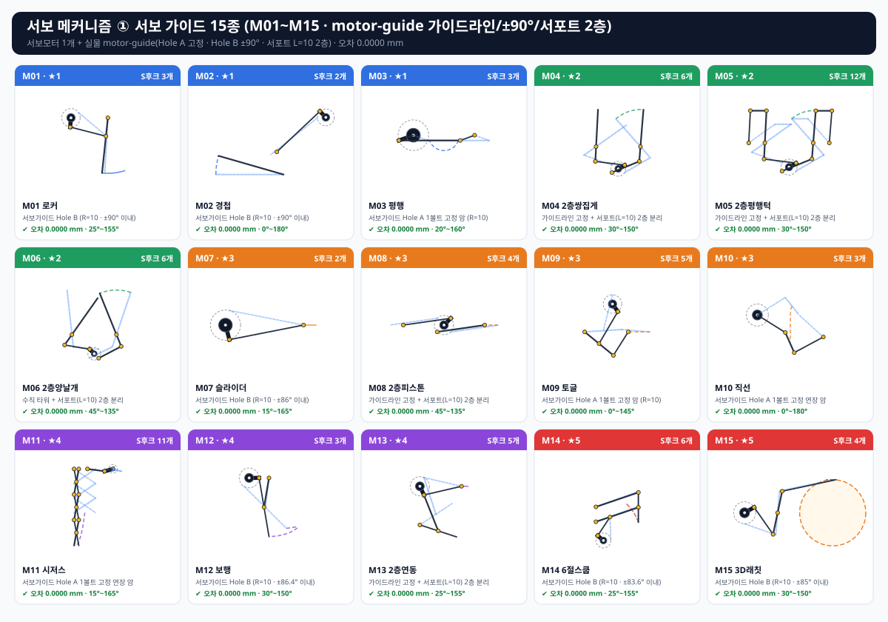
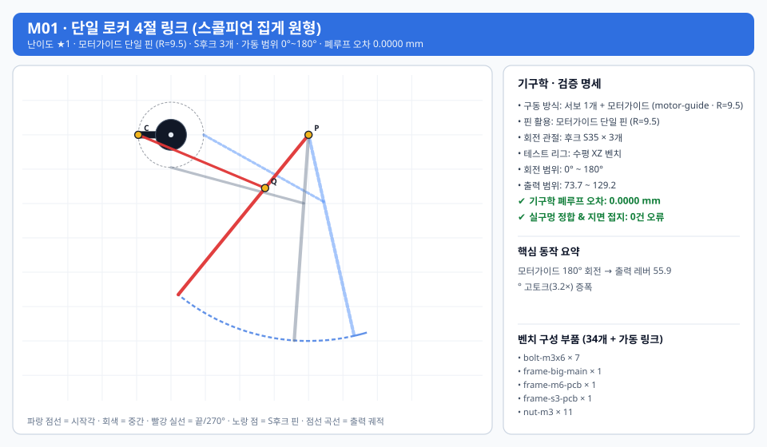
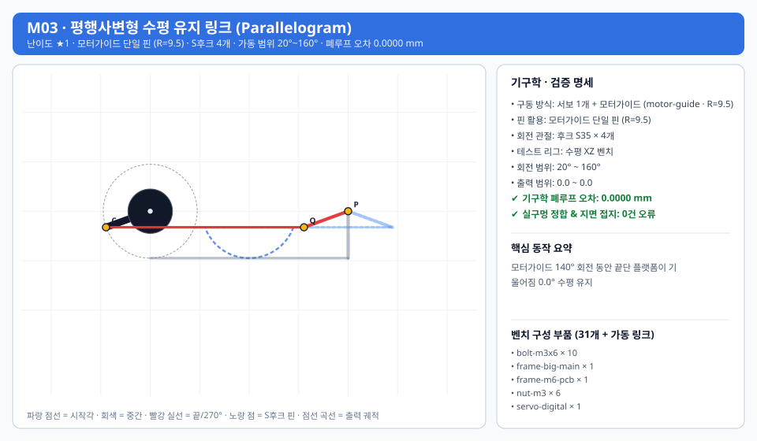
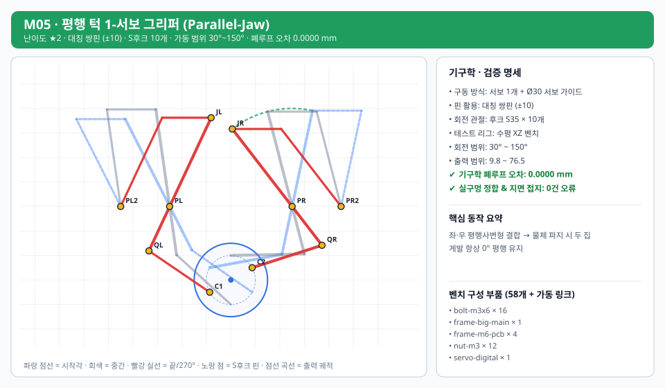
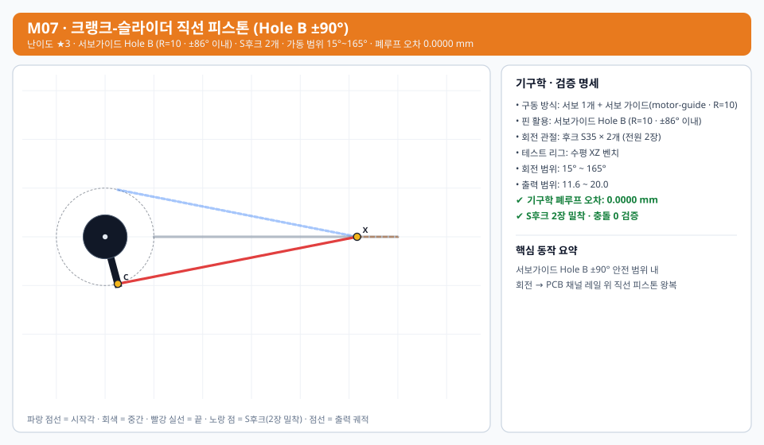
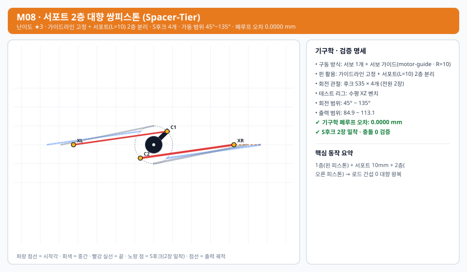
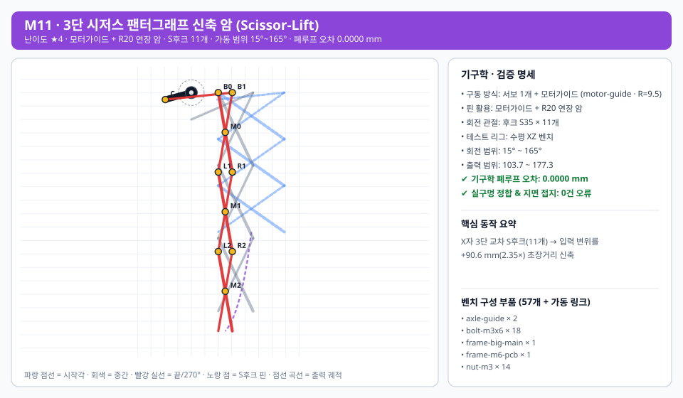
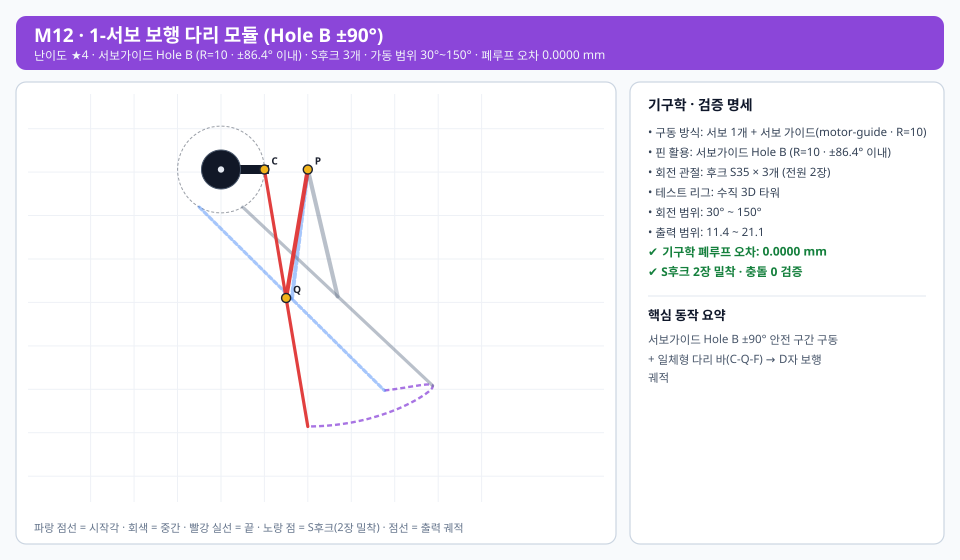
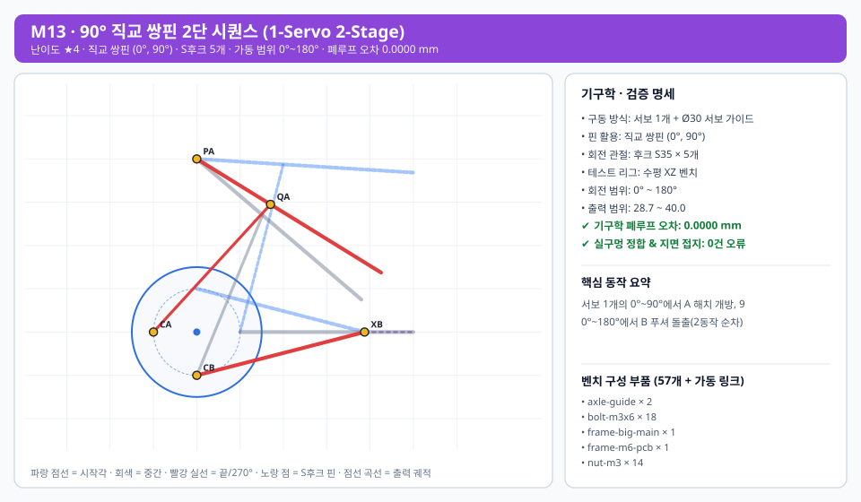
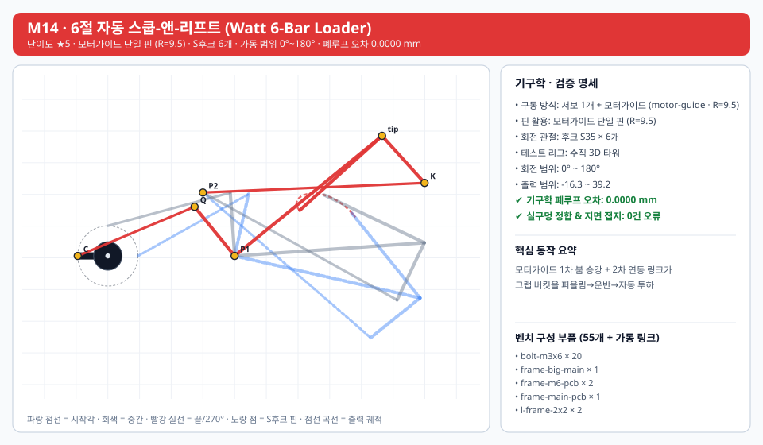

# 서보 가이드 + S후크 메커니즘 15종 설계도면 (M01~M15)

디지털 서보모터 1개(`servo-digital`) + 서보 가이드(`wheel-guide-30-servo`) + S후크(`s-hook-35`)만으로 구현한 **15종 엔지니어링 메커니즘(★1 기초 → ★5 복합)** 마스터 설계도입니다.
다시 만들기: `python3 tools/mechlab_blueprint.py` · 인터랙티브 뷰어: [`blueprint.html`](blueprint.html)

## 1. 15종 기구학 검증 일람표

| 코드 | 난이도 | 메커니즘 이름 | 가이드 핀 활용 | S후크 | 가동 범위 | 최대 오차 | 동작 요약 |
|---|:---:|---|---|:---:|:---:|:---:|---|
| **M01** | ★1 | 단일 로커 4절 링크 (스콜피언 집게 원형) | 단일 핀 (R=10) | 3개 | 0°~180° | ✔ `0.0000 mm` | 서보 180° 회전 → 출력 레버 58.8° 고토크(3.06×) 증폭 |
| **M02** | ★1 | 경첩 승강 4절 링크 (썬더 웨지 원형) | 단일 핀 (R=10) | 2개 | 0°~180° | ✔ `0.0000 mm` | 수평 서보 → 소12 푸시로드(L=80) → 경첩 판 0°~38° 승강 (토크 3.12×) |
| **M03** | ★1 | 평행사변형 수평 유지 링크 (Parallelogram) | 단일 핀 (R=10) | 4개 | 20°~160° | ✔ `0.0000 mm` | 서보 140° 회전 동안 끝단 플랫폼이 기울어짐 0.0° 수평 유지 |
| **M04** | ★2 | 1-서보 대칭 집게 크러셔 (Dual Gripper) | 대칭 쌍핀 (±10) | 6개 | 30°~150° | ✔ `0.0000 mm` | 서보 가이드 ±10 mm 양쪽 핀으로 좌·우 집게(~51°) 동시 개폐 |
| **M05** | ★2 | 평행 턱 1-서보 그리퍼 (Parallel-Jaw) | 대칭 쌍핀 (±10) | 10개 | 30°~150° | ✔ `0.0000 mm` | 좌·우 평행사변형 결합 → 물체 파지 시 두 집게발 항상 0° 평행 유지 |
| **M06** | ★2 | 양날개 날갯짓 메커니즘 (Flapping Wing) | 대칭 쌍핀 (±10) | 6개 | 30°~150° | ✔ `0.0000 mm` | 수직 타워 + ±10 쌍핀 → 좌·우 118 mm 날개 ~51° 동시 상하 펄럭임 |
| **M07** | ★3 | 크랭크-슬라이더 직선 피스톤 (Crank-Slider) | 단일 핀 (R=10) | 2개 | 0°~180° | ✔ `0.0000 mm` | 서보 0°~180° 회전 → 축가이드 레일 위 직선 왕복 스트로크 20.0 mm |
| **M08** | ★3 | 대향 쌍발 피스톤 / 양방향 펀처 (Dual Slider) | 대칭 쌍핀 (±10) | 4개 | 0°~180° | ✔ `0.0000 mm` | ±10 쌍핀 → 좌·우 축가이드 슬라이더 교대 왕복(±20 mm 양방향 펀치) |
| **M09** | ★3 | 오버센터 토글 클램프 (Self-Locking Toggle) | 단일 핀 (R=10) | 5개 | 0°~145° | ✔ `0.0000 mm` | 무릎 관절이 180° 일직선을 +2.2 mm 넘어 기계식 자가잠금 & 고배율 압착 |
| **M10** | ★3 | 와트 무레일 직선 링크 (Watt Straight-Line) | 단일 핀 + R30 암 | 4개 | 0°~180° | ✔ `0.0000 mm` | 슬라이더 레일 0개 · 순수 S후크 4절만으로 중심점이 25 mm 근사 직선 운동 |
| **M11** | ★4 | 3단 시저스 팬터그래프 신축 암 (Scissor-Lift) | 확장 크랭크 (R=20) | 11개 | 15°~165° | ✔ `0.0000 mm` | X자 3단 교차 S후크(11개) → 입력 변위를 +90.6 mm(2.35×) 초장거리 신축 |
| **M12** | ★4 | 1-서보 6절 보행 다리 모듈 (Walking Leg) | 단일 핀 (R=10) | 6개 | 0°~180° | ✔ `0.0000 mm` | 삼각 커플러(중6 PCB) + 보조 링크 → 발끝이 D자 보행 궤적(폭 20 × 높이 23 mm) 생성 |
| **M13** | ★4 | 90° 직교 쌍핀 2단 시퀀스 (1-Servo 2-Stage) | 직교 쌍핀 (0°, 90°) | 5개 | 0°~180° | ✔ `0.0000 mm` | 서보 1개의 0°~90°에서 A 해치 개방, 90°~180°에서 B 푸셔 돌출(2동작 순차) |
| **M14** | ★5 | 6절 자동 스쿱-앤-리프트 (Watt 6-Bar Loader) | 단일 핀 (R=10) | 6개 | 0°~180° | ✔ `0.0000 mm` | 1차 4절 붐 승강(-18°→+41°) + 2차 연동 링크가 그랩 버킷을 퍼올림→운반→자동 투하 |
| **M15** | ★5 | 3D 직각 벨크랭크 + 래칫 스텝퍼 (180°→360°) | 단일 핀 (R=10) | 5개 | 0°~180° | ✔ `0.0000 mm` | 90° 벨크랭크 방향 전환 + 폴(Pawl)이 12톱니 휠을 1회 왕복당 +30°씩 360° 무한 전진 |

## 2. 개별 상세 설계도 (01~15)

### M01 · 단일 로커 4절 링크 (스콜피언 집게 원형) (★1)

### M02 · 경첩 승강 4절 링크 (썬더 웨지 원형) (★1)

### M03 · 평행사변형 수평 유지 링크 (Parallelogram) (★1)

### M04 · 1-서보 대칭 집게 크러셔 (Dual Gripper) (★2)

### M05 · 평행 턱 1-서보 그리퍼 (Parallel-Jaw) (★2)

### M06 · 양날개 날갯짓 메커니즘 (Flapping Wing) (★2)

### M07 · 크랭크-슬라이더 직선 피스톤 (Crank-Slider) (★3)

### M08 · 대향 쌍발 피스톤 / 양방향 펀처 (Dual Slider) (★3)

### M09 · 오버센터 토글 클램프 (Self-Locking Toggle) (★3)

### M10 · 와트 무레일 직선 링크 (Watt Straight-Line) (★3)

### M11 · 3단 시저스 팬터그래프 신축 암 (Scissor-Lift) (★4)

### M12 · 1-서보 6절 보행 다리 모듈 (Walking Leg) (★4)

### M13 · 90° 직교 쌍핀 2단 시퀀스 (1-Servo 2-Stage) (★4)

### M14 · 6절 자동 스쿱-앤-리프트 (Watt 6-Bar Loader) (★5)

### M15 · 3D 직각 벨크랭크 + 래칫 스텝퍼 (180°→360°) (★5)

