# 서보·휠 가이드 + S후크 메커니즘 30종 마스터 설계도면 (M01~M15 · W01~W15)

로보로보 7호 실물 부품으로 구현한 **서보 가이드 15종(0°~180° 정밀 왕복)** + **DC 모터 휠 가이드 15종(360° 연속 그라쇼프)** = 총 **30종** 설계도입니다.
다시 만들기: `python3 tools/mechlab_blueprint.py` · 인터랙티브 뷰어: [`blueprint.html`](blueprint.html)

## Part 1. 서보 가이드 15종 (M01~M15 · `servo-digital` + `motor-guide` 모터가이드 · 단일 핀 R=9.5)

| 코드 | 난이도 | 메커니즘 이름 | 가이드 핀 활용 | S후크 | 범위 | 최대 오차 | 동작 요약 |
|---|:---:|---|---|:---:|:---:|:---:|---|
| **M01** | ★1 | 단일 로커 4절 링크 (스콜피언 집게 원형) | 모터가이드 단일 핀 (R=9.5) | 3개 | 0°~180° | ✔ `0.0000 mm` | 모터가이드 180° 회전 → 출력 레버 55.9° 고토크(3.2×) 증폭 |
| **M02** | ★1 | 경첩 승강 4절 링크 (썬더 웨지 원형) | 모터가이드 단일 핀 (R=9.5) | 2개 | 0°~180° | ✔ `0.0000 mm` | 수평 서보 + 모터가이드 → 소12 푸시로드(L=80) → 경첩 판 0°~38° 승강 |
| **M03** | ★1 | 평행사변형 수평 유지 링크 (Parallelogram) | 모터가이드 + R10 크랭크 바 | 3개 | 20°~160° | ✔ `0.0000 mm` | 모터가이드 140° 회전 동안 끝단 플랫폼이 기울어짐 0.0° 수평 유지 |
| **M04** | ★2 | 1-서보 2장밀착 대칭 집게 (Dual Gripper) | 모터가이드 1차 링크 분기 (2장 밀착) | 6개 | 15°~165° | ✔ `0.0000 mm` | 모터가이드 → 1차 커플러(L1) + 중간 구멍 분기(L2) → 양쪽 집게 2장 밀착 동시 개폐 |
| **M05** | ★2 | 평행 턱 1-서보 그리퍼 (Parallel-Jaw) | 모터가이드 1차 링크 분기 (2장 밀착) | 12개 | 15°~165° | ✔ `0.0000 mm` | 1차 분기 구동 + 좌·우 평행사변형 → 모든 S후크 2장 밀착으로 0° 평행 파지 |
| **M06** | ★2 | 양날개 날갯짓 메커니즘 (Flapping Wing) | 모터가이드 1차 링크 분기 (수직 2장 밀착) | 6개 | 15°~165° | ✔ `0.0000 mm` | 수직 타워 + 1차 커플러 분기 → 좌·우 90 mm 일체형 날개 대칭 펄럭임 |
| **M07** | ★3 | 크랭크-슬라이더 직선 피스톤 (Crank-Slider) | 모터가이드 단일 핀 (R=9.5) | 2개 | 0°~180° | ✔ `0.0000 mm` | 모터가이드 0°~180° 회전 → PCB 채널 레일 위 직선 왕복 스트로크 19.0 mm |
| **M08** | ★3 | 2장밀착 대향 교대 피스톤 (Dual Slider) | 모터가이드 1차 로드 분기 (좌/우) | 4개 | 0°~180° | ✔ `0.0000 mm` | 1차 로드(L1) 중간 구멍에서 2차 로드(L2) 분기 → 좌·우 채널 레일 동시 구동 |
| **M09** | ★3 | 오버센터 토글 클램프 (Self-Locking Toggle) | 모터가이드 + 2구멍 토글 암 (2장 밀착) | 5개 | 0°~145° | ✔ `0.0000 mm` | 2구멍 토글 암(20/40 mm)으로 3장 적층 없이 기계식 자가잠금 & 고배율 압착 |
| **M10** | ★3 | 와트 무레일 직선 링크 (Watt Straight-Line) | 모터가이드 + R30 연장 암 | 3개 | 0°~180° | ✔ `0.0000 mm` | 슬라이더 레일 0개 · 순수 S후크 3개(2장 밀착)만으로 중심점 근사 직선 운동 |
| **M11** | ★4 | 3단 시저스 팬터그래프 신축 암 (Scissor-Lift) | 모터가이드 + R20 연장 암 (2장 밀착) | 11개 | 15°~165° | ✔ `0.0000 mm` | X자 3단 교차 S후크(11개 전원 2장 밀착) → 입력 변위를 +75.9 mm 초장거리 신축 |
| **M12** | ★4 | 1-서보 보행 다리 모듈 (Walking Leg) | 모터가이드 단일 핀 (R=9.5) | 3개 | 0°~180° | ✔ `0.0000 mm` | 일체형 다리 바(C-Q-F) + 로커 → S후크 3개(2장 밀착)로 D자 보행 궤적 생성 |
| **M13** | ★4 | 2장밀착 2축 시퀀스 연동 (Dual-Axis Sync) | 모터가이드 1차 로드 분기 (2축) | 5개 | 0°~180° | ✔ `0.0000 mm` | 1차 푸셔 로드 중간 구멍에서 해치 링크 분기 → 해치 로커 + 직선 푸셔 동시 연동 |
| **M14** | ★5 | 6절 자동 스쿱-앤-리프트 (Watt 6-Bar Loader) | 모터가이드 단일 핀 (R=9.5) | 6개 | 0°~180° | ✔ `0.0000 mm` | 일체형 직선 붐(P1-Q-tip) + 평행 틸트 링크 → S후크 6개 전원 2장 밀착 스쿱 승강 |
| **M15** | ★5 | 3D 직각 시소 + 래칫 스텝퍼 (180°→360°) | 모터가이드 단일 핀 (R=9.5) | 4개 | 0°~180° | ✔ `0.0000 mm` | 일체형 시소 로커(Q1-PB-Q2) + 폴(Pawl) → S후크 4개(2장 밀착)로 12톱니 휠 무한 전진 |

## Part 2. DC 모터 + 휠 가이드 15종 (W01~W15 · `dc-motor-130-rs` + `wheel-guide-30-nylon`/`40-yellow`)

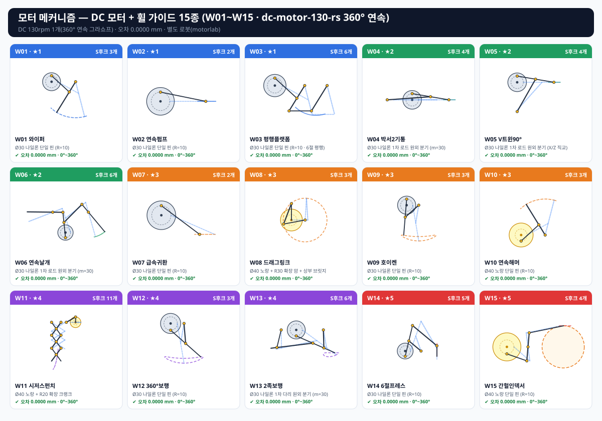

| 코드 | 난이도 | 메커니즘 이름 | 휠 가이드 · 핀 활용 | S후크 | 범위 | 최대 오차 | 동작 요약 |
|---|:---:|---|---|:---:|:---:|:---:|---|
| **W01** | ★1 | 그라쇼프 크랭크-로커 와이퍼 (360° 연속) | Ø30 나일론 단일 핀 (R=10) | 3개 | 0°~360° | ✔ `0.0000 mm` | DC 360° 연속 회전 → 와이퍼 레버 61.6° 무정지 연속 왕복 (s+l=50 < p+q=60) |
| **W02** | ★1 | 연속 360° 왕복 피스톤 펌프 (Slider-Crank) | Ø30 나일론 단일 핀 (R=10) | 2개 | 0°~360° | ✔ `0.0000 mm` | DC 360° 회전 → PCB 채널 레일 위 매 회전 20.0 mm 정현파 연속 피스톤 왕복 |
| **W03** | ★1 | 평행 2축 360° 오비탈 셰이커 (Orbital Shaker) | Ø40 노랑 + R10 크랭크 바 | 3개 | 0°~360° | ✔ `0.0000 mm` | 360° 원궤도 평행 이동 · 트레이가 기울지 않고(0.0°) 연속 원형 진동(연마·교반기) |
| **W04** | ★2 | 2장밀착 2기통 수평대향 엔진 (Boxer Twin) | Ø40 노랑 1차 로드 분기 (L1/L2) | 4개 | 0°~360° | ✔ `0.0000 mm` | 1차 로드(L1) + 중간 구멍 분기(L2) → 좌·우 피스톤 2조 간섭 0 수평대향 연속 왕복 |
| **W05** | ★2 | 90° 직교 2기통 V-트윈 펌프 (Orthogonal Twin) | Ø40 노랑 1차 로드 분기 (X/Z 직교) | 4개 | 0°~360° | ✔ `0.0000 mm` | X축(L1)·Z축(L2) 직교 피스톤 2조가 90° 위상차·충돌 0으로 연속 왕복 |
| **W06** | ★2 | 360° 연속 날갯짓 오니톱터 (Ornithopter) | Ø40 노랑 1차 링크 분기 (2장 밀착) | 6개 | 0°~360° | ✔ `0.0000 mm` | 그라쇼프 1차 분기 + 일체형 양 날개(90 mm) → 간섭 0으로 360° 연속 무한 펄럭임 |
| **W07** | ★3 | 오프셋 급속귀환 피스톤 (Quick-Return) | Ø30 나일론 단일 핀 (R=10) | 2개 | 0°~360° | ✔ `0.0000 mm` | 레일 오프셋 e=20 mm → 전진 절삭(202° 느리고 강하게) / 복귀(158° 1.28× 빠르게) |
| **W08** | ★3 | 드래그링크 비등속 360° 변속기 (Double-Crank) | Ø40 노랑 + R30 확장 암 | 3개 | 0°~360° | ✔ `0.0000 mm` | 상부 브릿지 피벗(25 mm)이 최단 링크 → 간섭 0으로 매 회전 0.4×↔2.5× 비등속 360° 출력 |
| **W09** | ★3 | 호이켄 360° D-커브 직선 링크 (Hoeken) | Ø30 나일론 단일 핀 (R=10) | 3개 | 0°~360° | ✔ `0.0000 mm` | 360° 회전 중 절반(180°)은 레이저처럼 평탄한 직선 이송, 나머지 절반은 반원 복귀 |
| **W10** | ★3 | 360° 연속 배틀 해머 타격기 (Crank Smasher) | Ø40 노랑 단일 핀 (R=10) | 3개 | 0°~360° | ✔ `0.0000 mm` | 수직 그라쇼프 크랭크-로커 + battle-g 해머 헤드 → 매 회전 61.6° 연속 연타 타격 |
| **W11** | ★4 | 360° 연속 3단 시저스 펀처 (Scissor Punch) | Ø40 노랑 + R20 확장 크랭크 | 11개 | 0°~360° | ✔ `0.0000 mm` | 360° 연속 회전 → X자 3단 S후크(11개 전원 2장 밀착)가 99.5↔177.5 mm(+78 mm) 연속 신축 |
| **W12** | ★4 | 360° 완전 폐곡선 보행 다리 (Full Walking Leg) | Ø30 나일론 단일 핀 (R=10) | 3개 | 0°~360° | ✔ `0.0000 mm` | 일체형 다리 바(C-Q-F) + 로커 → S후크 3개(2장 밀착)로 완전한 D자 폐곡선 무한 보행 |
| **W13** | ★4 | 2장밀착 2족 교대 보행 (Dual Walking Pair) | Ø40 노랑 1차 다리 분기 (L1/L2) | 6개 | 0°~360° | ✔ `0.0000 mm` | DC 1개 + 1차 다리 분기(L1→L2)로 왼발·오른발 간섭 0 · S후크 6개 전원 2장 밀착 보행 |
| **W14** | ★5 | 6절 정지(Dwell) 자동 프레스 (Stamping Press) | Ø40 노랑 단일 핀 (R=10) | 5개 | 0°~360° | ✔ `0.0000 mm` | 호이켄 1차 4절 + 2차 프레스 링크 → S후크 5개(2장 밀착)로 하단 정지 압착 후 급상승 |
| **W15** | ★5 | 360° 연속 간헐 스텝 인덱서 (Intermittent Step) | Ø40 노랑 단일 핀 (R=10) | 4개 | 0°~360° | ✔ `0.0000 mm` | 일체형 시소 로커(Q1-PB-Q2) + 폴 → S후크 4개(2장 밀착)로 12톱니 휠 매 회전 1칸 간헐 구동 |

## 개별 상세 설계도

### M01 · 단일 로커 4절 링크 (스콜피언 집게 원형) (★1)

### M02 · 경첩 승강 4절 링크 (썬더 웨지 원형) (★1)

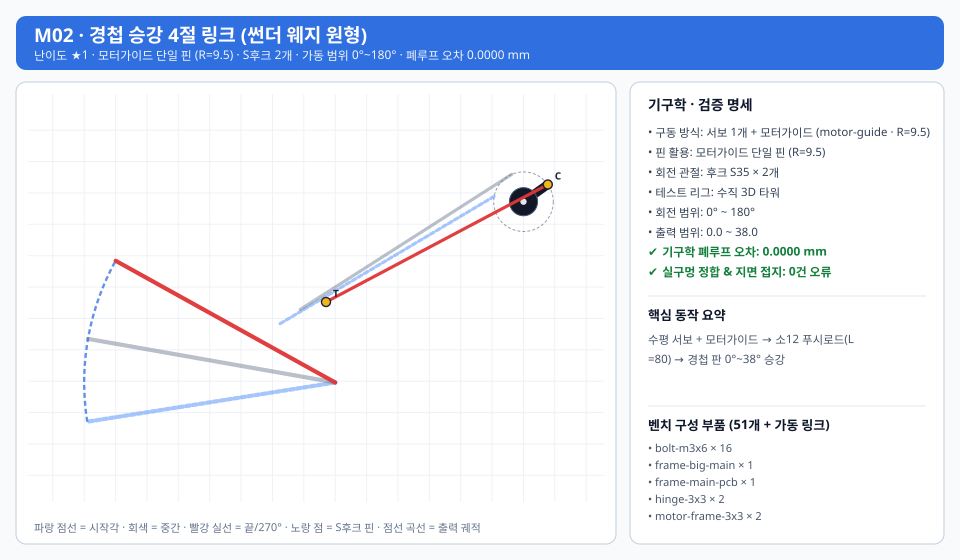

### M03 · 평행사변형 수평 유지 링크 (Parallelogram) (★1)

### M04 · 1-서보 2장밀착 대칭 집게 (Dual Gripper) (★2)

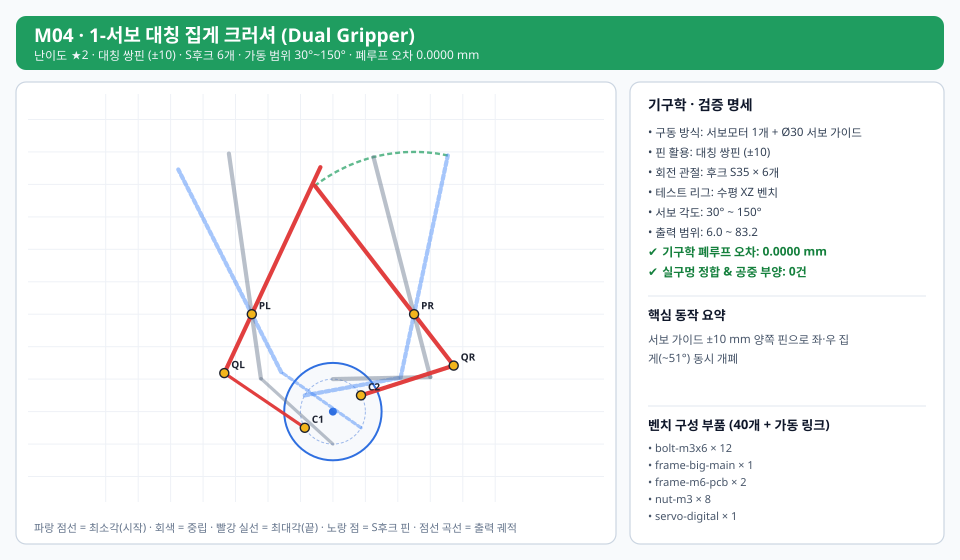

### M05 · 평행 턱 1-서보 그리퍼 (Parallel-Jaw) (★2)

### M06 · 양날개 날갯짓 메커니즘 (Flapping Wing) (★2)

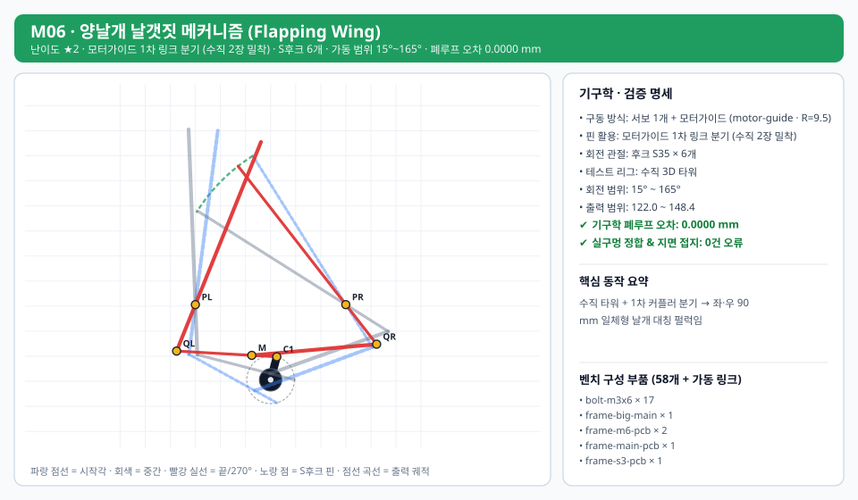

### M07 · 크랭크-슬라이더 직선 피스톤 (Crank-Slider) (★3)

### M08 · 2장밀착 대향 교대 피스톤 (Dual Slider) (★3)

### M09 · 오버센터 토글 클램프 (Self-Locking Toggle) (★3)

### M10 · 와트 무레일 직선 링크 (Watt Straight-Line) (★3)

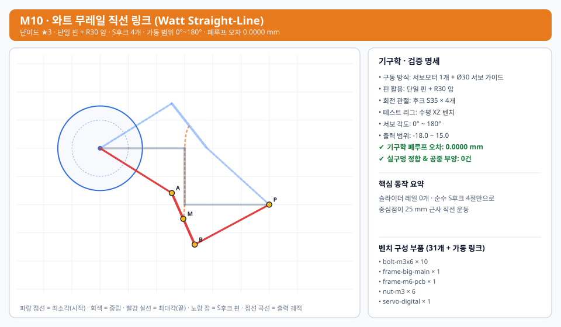

### M11 · 3단 시저스 팬터그래프 신축 암 (Scissor-Lift) (★4)

### M12 · 1-서보 보행 다리 모듈 (Walking Leg) (★4)

### M13 · 2장밀착 2축 시퀀스 연동 (Dual-Axis Sync) (★4)

### M14 · 6절 자동 스쿱-앤-리프트 (Watt 6-Bar Loader) (★5)

### M15 · 3D 직각 시소 + 래칫 스텝퍼 (180°→360°) (★5)

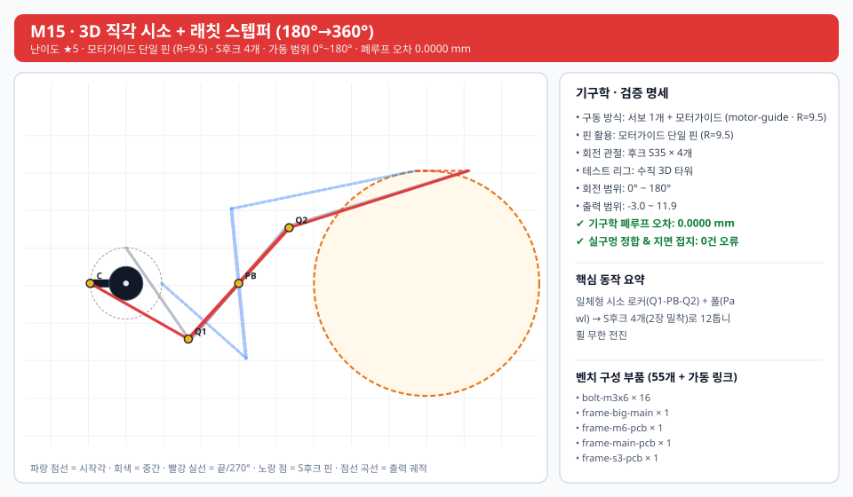

### W01 · 그라쇼프 크랭크-로커 와이퍼 (360° 연속) (★1)

### W02 · 연속 360° 왕복 피스톤 펌프 (Slider-Crank) (★1)

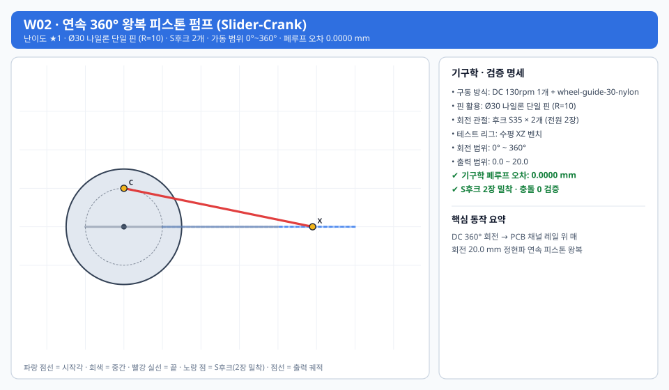

### W03 · 평행 2축 360° 오비탈 셰이커 (Orbital Shaker) (★1)

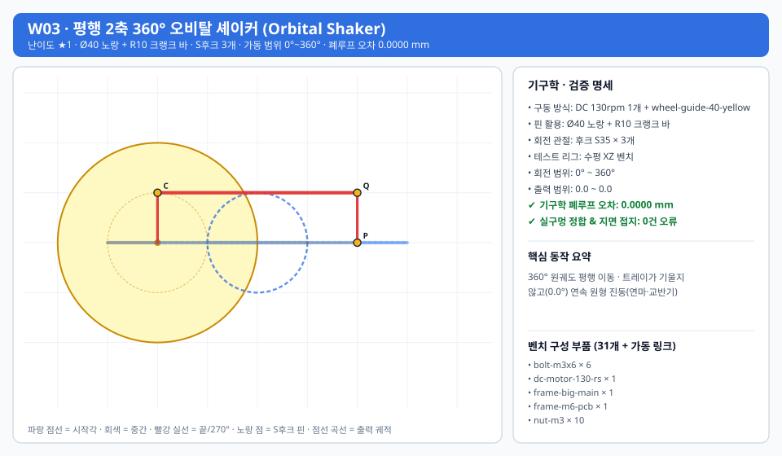

### W04 · 2장밀착 2기통 수평대향 엔진 (Boxer Twin) (★2)

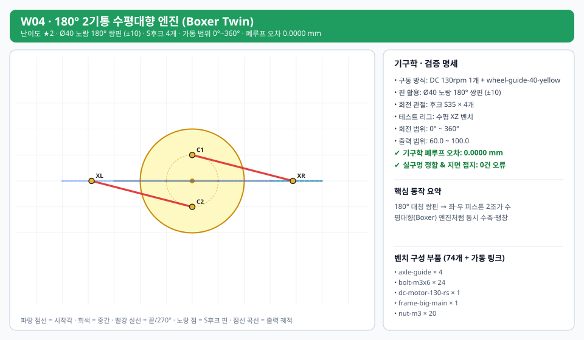

### W05 · 90° 직교 2기통 V-트윈 펌프 (Orthogonal Twin) (★2)

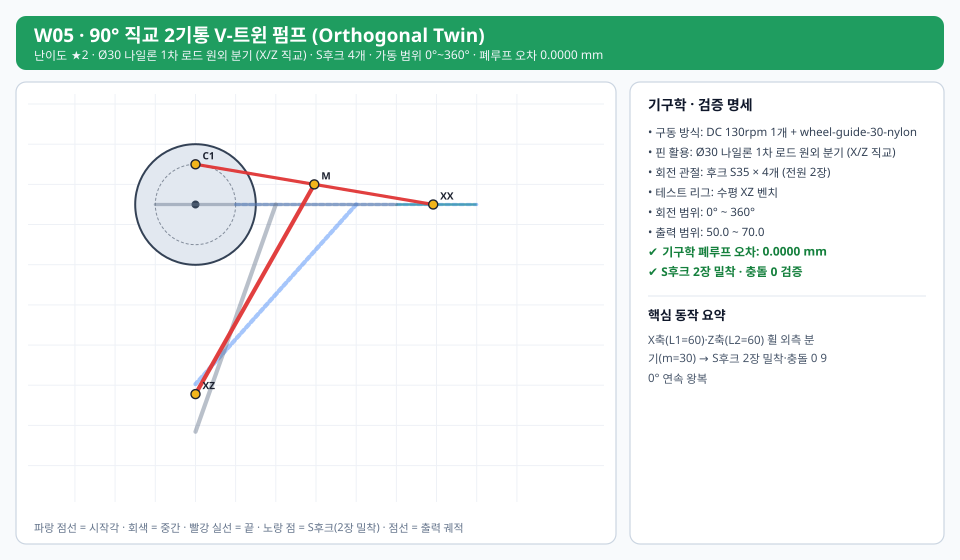

### W06 · 360° 연속 날갯짓 오니톱터 (Ornithopter) (★2)

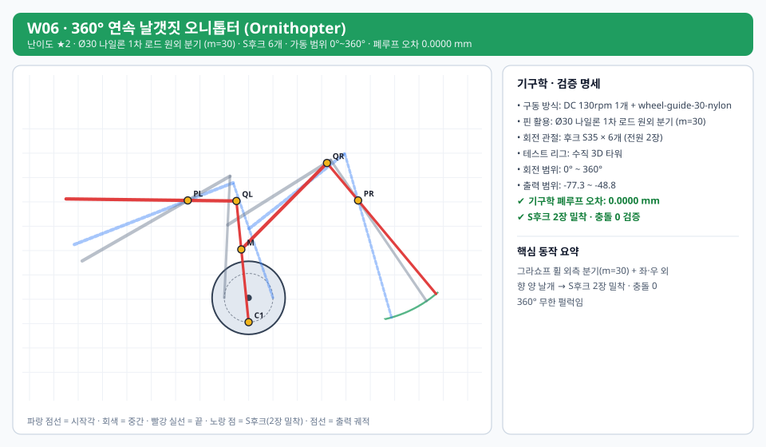

### W07 · 오프셋 급속귀환 피스톤 (Quick-Return) (★3)

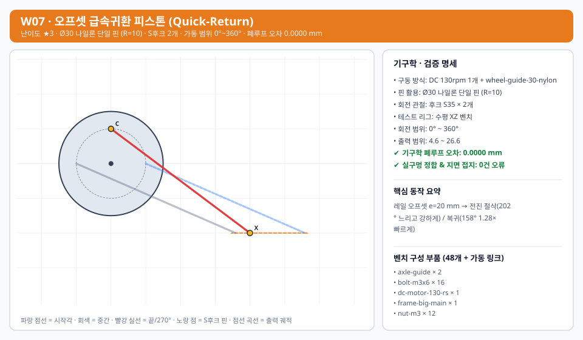

### W08 · 드래그링크 비등속 360° 변속기 (Double-Crank) (★3)

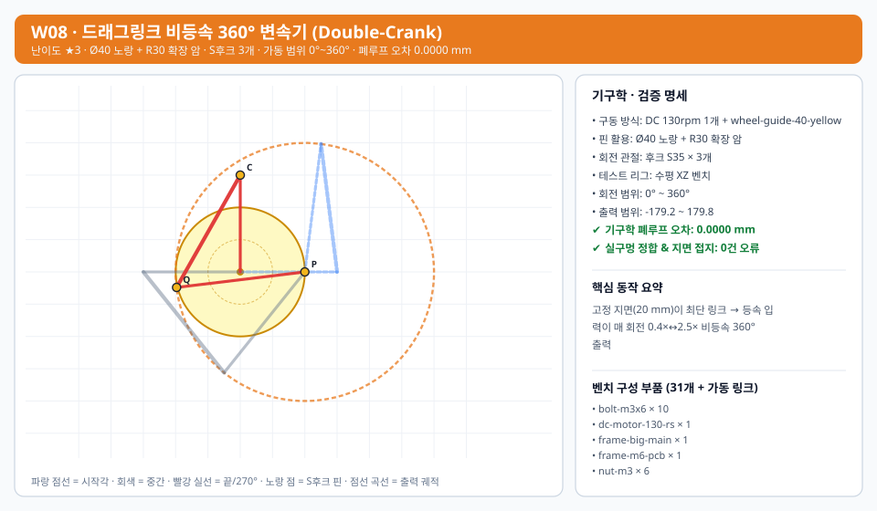

### W09 · 호이켄 360° D-커브 직선 링크 (Hoeken) (★3)

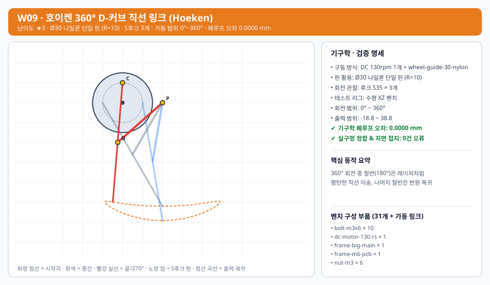

### W10 · 360° 연속 배틀 해머 타격기 (Crank Smasher) (★3)

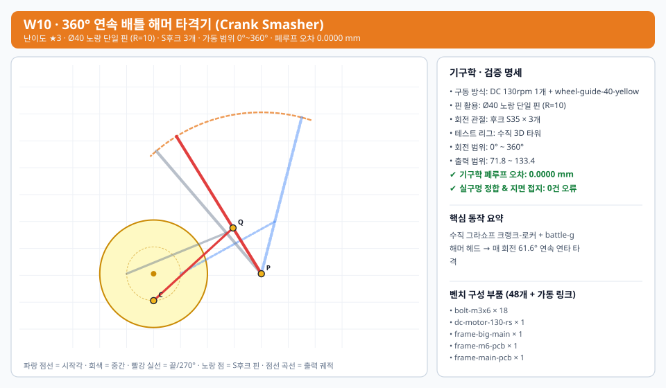

### W11 · 360° 연속 3단 시저스 펀처 (Scissor Punch) (★4)

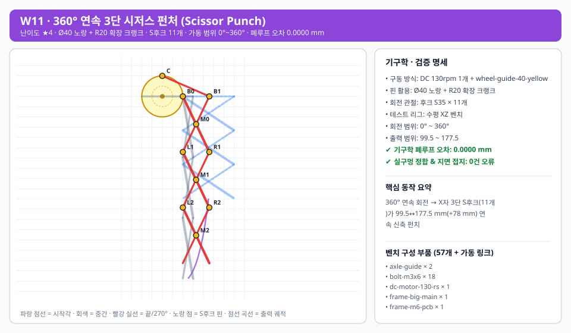

### W12 · 360° 완전 폐곡선 보행 다리 (Full Walking Leg) (★4)

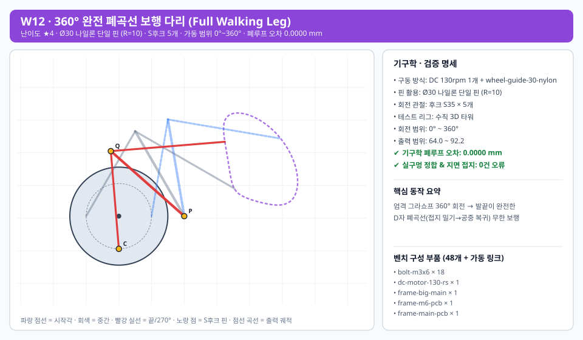

### W13 · 2장밀착 2족 교대 보행 (Dual Walking Pair) (★4)

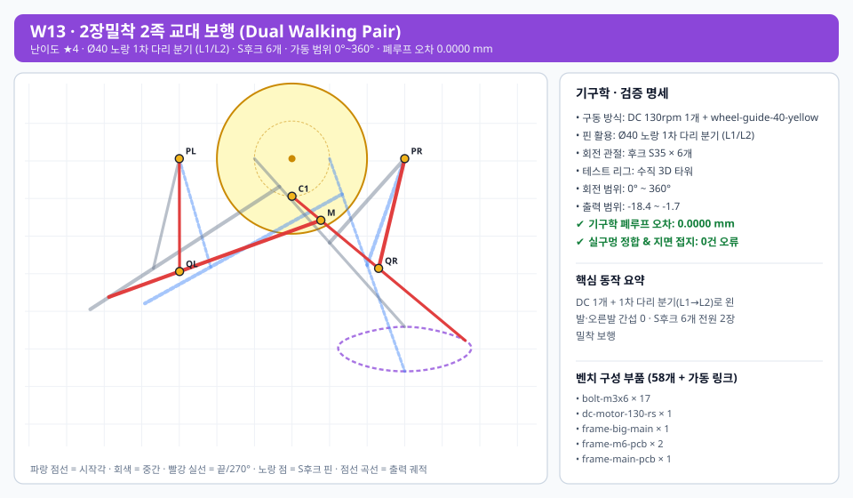

### W14 · 6절 정지(Dwell) 자동 프레스 (Stamping Press) (★5)

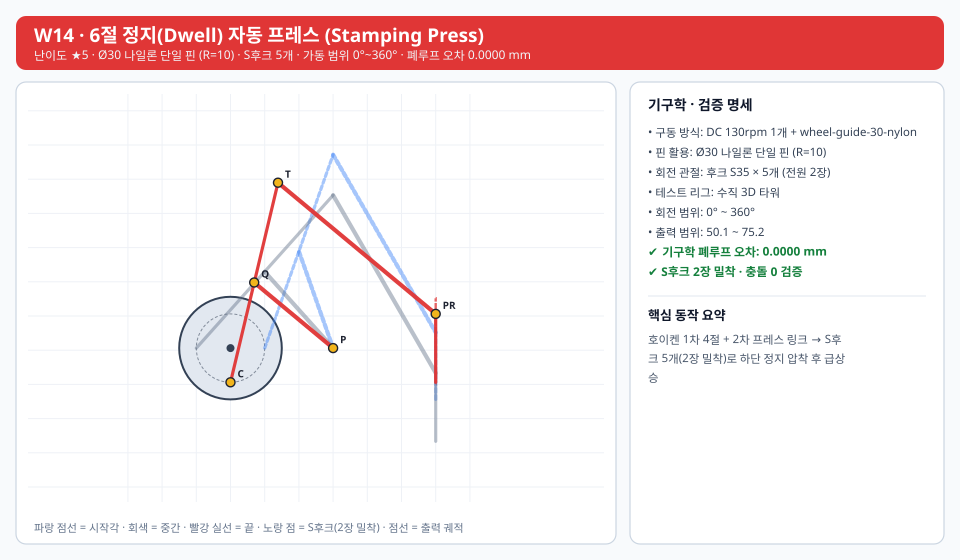

### W15 · 360° 연속 간헐 스텝 인덱서 (Intermittent Step) (★5)

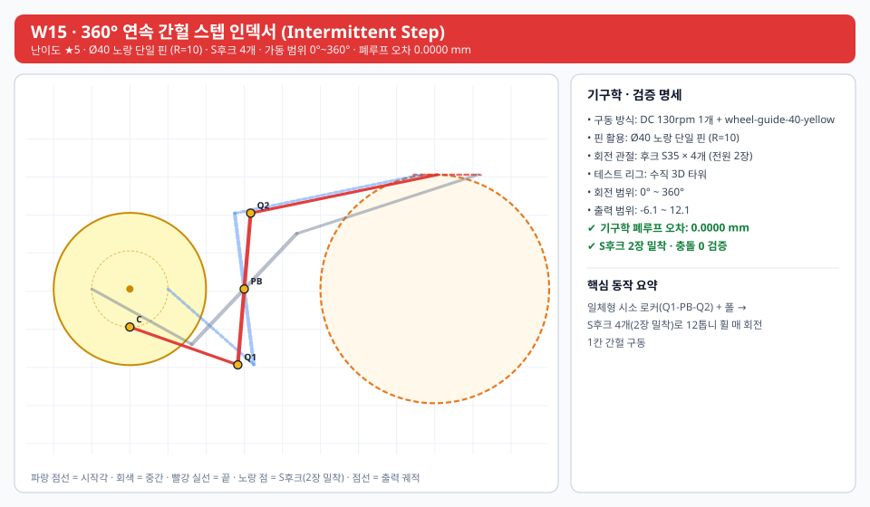
