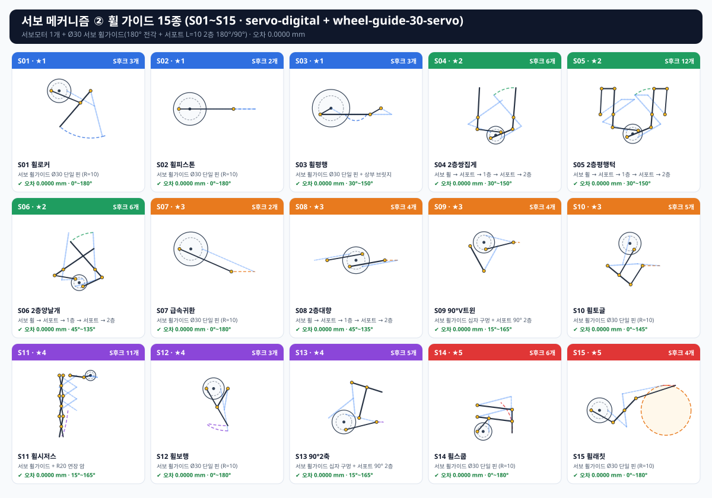

# 서보 메커니즘 (30종) · 모터 메커니즘 (15종) 마스터 설계도면 (총 45종)

- **로봇 1 · 서보 메커니즘 (`mechlab`):** 서보 모터(`servo-digital`) 전용 — 서보 가이드 15종(`M01~M15`) + 서보 휠가이드 15종(`S01~S15`)
- **로봇 2 · 모터 메커니즘 (`motorlab`):** DC 모터(`dc-motor-130-rs`) 전용 — 휠 가이드 360° 연속 15종(`W01~W15`)

## 1. 서보 메커니즘 ① 서보 가이드 15종 (M01~M15 · `motor-guide` 실물 가이드라인 · ±90° · 서포트 2층)

| 코드 | 난이도 | 메커니즘 이름 | 가이드 활용 | S후크 | 범위 | 최대 오차 | 동작 요약 |
|---|:---:|---|---|:---:|:---:|:---:|---|
| **M01** | ★1 | 단일 로커 4절 링크 (Hole B ±90°) | 서보가이드 Hole B (R=10 · ±90° 이내) | 3개 | 25°~155° | ✔ `0.0000 mm` | 서보가이드 Hole B S후크(±80.6° < 90° 가이드라인 안전) → 출력 로커 고토크 증폭 |
| **M02** | ★1 | 경첩 승강 4절 링크 (썬더 웨지 ±90°) | 서보가이드 Hole B (R=10 · ±90° 이내) | 2개 | 0°~180° | ✔ `0.0000 mm` | 수평 서보 + 서보가이드 Hole B(±84.7° 안전) → 소8 푸시로드(L=70) → 경첩 판 16° 승강 |
| **M03** | ★1 | 평행사변형 수평 유지 (Hole A 가이드라인 고정) | 서보가이드 Hole A 1볼트 고정 암 (R=10) | 3개 | 20°~160° | ✔ `0.0000 mm` | Hole A 양옆 가이드라인에 1열 소3 프레임을 볼트 1개로 회전 고정 → 0.0° 수평 유지 |
| **M04** | ★2 | 서포트 2층 분리 대칭 집게 (Spacer-Tier) | 가이드라인 고정 + 서포트(L=10) 2층 분리 | 6개 | 30°~150° | ✔ `0.0000 mm` | 1층(왼집게) + 서포트 10mm + 2층(오른집게) 층 분리 → 충돌 0 · S후크 2장 밀착 대칭 파지 |
| **M05** | ★2 | 서포트 2층 평행 턱 그리퍼 (Spacer-Tier) | 가이드라인 고정 + 서포트(L=10) 2층 분리 | 12개 | 30°~150° | ✔ `0.0000 mm` | 서포트 10mm 이격 2층 구동 + 좌·우 평행사변형 턱 → 모든 S후크 2장 밀착 0° 평행 파지 |
| **M06** | ★2 | 서포트 2층 양날개 날갯짓 (Spacer-Tier) | 수직 타워 + 서포트(L=10) 2층 분리 | 6개 | 45°~135° | ✔ `0.0000 mm` | 1층 왼날개 + 서포트 10mm + 2층 오른날개 → 간섭 0 · S후크 2장 밀착 대칭 펄럭임 |
| **M07** | ★3 | 크랭크-슬라이더 직선 피스톤 (Hole B ±90°) | 서보가이드 Hole B (R=10 · ±86° 이내) | 2개 | 15°~165° | ✔ `0.0000 mm` | 서보가이드 Hole B ±90° 안전 범위 내 회전 → PCB 채널 레일 위 직선 피스톤 왕복 |
| **M08** | ★3 | 서포트 2층 대향 쌍피스톤 (Spacer-Tier) | 가이드라인 고정 + 서포트(L=10) 2층 분리 | 4개 | 45°~135° | ✔ `0.0000 mm` | 1층(왼 피스톤) + 서포트 10mm + 2층(오른 피스톤) → 로드 간섭 0 대향 왕복 |
| **M09** | ★3 | 오버센터 토글 클램프 (Hole A 고정 암) | 서보가이드 Hole A 1볼트 고정 암 (R=10) | 5개 | 0°~145° | ✔ `0.0000 mm` | Hole A 가이드라인 고정 1열 크랭크 + 2구멍 토글 암 → 3장 적층 없이 기계식 자가잠금 |
| **M10** | ★3 | 와트 무레일 직선 링크 (Hole A R30 고정 암) | 서보가이드 Hole A 1볼트 고정 연장 암 | 3개 | 0°~180° | ✔ `0.0000 mm` | Hole A 가이드라인에 소4 연장 암을 볼트 1개로 고정 → 순수 S후크 3개 직선 운동 |
| **M11** | ★4 | 3단 시저스 신축 암 (Hole A R20 고정 암) | 서보가이드 Hole A 1볼트 고정 연장 암 | 11개 | 15°~165° | ✔ `0.0000 mm` | Hole A 가이드라인 고정 R20 암 + X자 3단 S후크(11개 전원 2장) → +75.9 mm 신축 |
| **M12** | ★4 | 1-서보 보행 다리 모듈 (Hole B ±90°) | 서보가이드 Hole B (R=10 · ±86.4° 이내) | 3개 | 30°~150° | ✔ `0.0000 mm` | 서보가이드 Hole B ±90° 안전 구간 구동 + 일체형 다리 바(C-Q-F) → D자 보행 궤적 |
| **M13** | ★4 | 서포트 2층 2축 시퀀스 연동 (Spacer-Tier) | 가이드라인 고정 + 서포트(L=10) 2층 분리 | 5개 | 25°~155° | ✔ `0.0000 mm` | 1층(직선 푸셔) + 서포트 10mm + 2층(해치 로커) → 층 분리 충돌 0 동시 2축 연동 |
| **M14** | ★5 | 6절 자동 스쿱 로더 (Hole B ±90°) | 서보가이드 Hole B (R=10 · ±83.6° 이내) | 6개 | 25°~155° | ✔ `0.0000 mm` | 서보가이드 Hole B ±90° 안전 구간 + 일체형 직선 붐·평행 틸트 → 6절 스쿱 승강 |
| **M15** | ★5 | 3D 시소 래칫 스텝퍼 (Hole B ±90°) | 서보가이드 Hole B (R=10 · ±85° 이내) | 4개 | 30°~150° | ✔ `0.0000 mm` | 서보가이드 Hole B ±90° 안전 구간 + 일체형 시소 로커 → 12톱니 휠 단계 전진 |

## 2. 서보 메커니즘 ② 휠 가이드 15종 (S01~S15 · `servo-digital` + `wheel-guide-30-servo`)

| 코드 | 난이도 | 메커니즘 이름 | 휠 가이드 · 서포트 활용 | S후크 | 범위 | 최대 오차 | 동작 요약 |
|---|:---:|---|---|:---:|:---:|:---:|---|
| **S01** | ★1 | 서보 휠가이드 180° 전각 로커 | 서보 휠가이드 Ø30 단일 핀 (R=10) | 3개 | 0°~180° | ✔ `0.0000 mm` | 서보 + Ø30 서보 휠가이드 0°~180° 전각 회전 → 출력 로커 61.6° 풀스트로크 |
| **S02** | ★1 | 서보 휠가이드 20mm 풀행정 피스톤 | 서보 휠가이드 Ø30 단일 핀 (R=10) | 2개 | 0°~180° | ✔ `0.0000 mm` | 가이드라인 제한 없이 0°~180° 전각 회전 → PCB 채널 위 20.0 mm 풀스트로크 |
| **S03** | ★1 | 서보 휠가이드 평행 수평 플랫폼 | 서보 휠가이드 Ø30 단일 핀 + 상부 브릿지 | 3개 | 30°~150° | ✔ `0.0000 mm` | 서보 120° 회전 동안 상단 트레이가 기울어짐 0.0° 수평 유지 이동 |
| **S04** | ★2 | 서보휠 서포트 다층 대칭 쌍집게 | 서보 휠 → 서포트 → 1층 → 서포트 → 2층 | 6개 | 30°~150° | ✔ `0.0000 mm` | 서보휠 → 서포트 10mm → 1층(왼집게) → 서포트 10mm → 2층(오른집게) 층 분리 대칭 파지 |
| **S05** | ★2 | 서보휠 서포트 다층 평행 턱 그리퍼 | 서보 휠 → 서포트 → 1층 → 서포트 → 2층 | 12개 | 30°~150° | ✔ `0.0000 mm` | 서포트 10mm 다층 이격 + 좌·우 평행사변형 턱 → 전 관절 S후크 2장 밀착 0° 평행 파지 |
| **S06** | ★2 | 서보휠 서포트 다층 양날개 오니톱터 | 서보 휠 → 서포트 → 1층 → 서포트 → 2층 | 6개 | 45°~135° | ✔ `0.0000 mm` | 서보휠 → 서포트 10mm → 1층 왼날개 → 서포트 10mm → 2층 오른날개 완벽 대칭 펄럭임 |
| **S07** | ★3 | 서보휠 오프셋 급속귀환 피스톤 | 서보 휠가이드 Ø30 단일 핀 (R=10) | 2개 | 0°~180° | ✔ `0.0000 mm` | 레일 오프셋 e=20 mm → 전진·복귀 비대칭 속도비 피스톤 구동 |
| **S08** | ★3 | 서보휠 서포트 다층 수평대향 피스톤 | 서보 휠 → 서포트 → 1층 → 서포트 → 2층 | 4개 | 45°~135° | ✔ `0.0000 mm` | 서보휠 → 서포트 10mm → 1층(왼 피스톤) → 서포트 10mm → 2층(오른 피스톤) 대향 왕복 |
| **S09** | ★3 | 서보휠 서포트 2층 90° 직교 V-트윈 | 서보 휠가이드 십자 구멍 + 서포트 90° 2층 | 4개 | 15°~165° | ✔ `0.0000 mm` | 1층 X축(+10) + 서포트 10mm + 2층 Z축(+20 · 90° 직교) → 충돌 0 2축 직교 펌프 |
| **S10** | ★3 | 서보휠 오버센터 토글 클램프 | 서보 휠가이드 Ø30 단일 핀 (R=10) | 5개 | 0°~145° | ✔ `0.0000 mm` | 서보 휠가이드 + 2구멍 토글 암(20/40 mm) → 3장 적층 0 기계식 자가잠금 클램프 |
| **S11** | ★4 | 서보휠 3단 시저스 신축 암 | 서보 휠가이드 + R20 연장 암 | 11개 | 15°~165° | ✔ `0.0000 mm` | 서보 휠가이드 R20 크랭크 + X자 3단 S후크(11개 전원 2장) → +75.9 mm 장거리 신축 |
| **S12** | ★4 | 서보휠 보행 다리 모듈 (180°) | 서보 휠가이드 Ø30 단일 핀 (R=10) | 3개 | 0°~180° | ✔ `0.0000 mm` | 서보 휠가이드 180° 전각 + 일체형 다리 바(C-Q-F) → S후크 3개 D자 보행 궤적 |
| **S13** | ★4 | 서보휠 서포트 2층 90° 2축 시퀀스 | 서보 휠가이드 십자 구멍 + 서포트 90° 2층 | 5개 | 15°~165° | ✔ `0.0000 mm` | 1층 직선 푸셔(+10) + 서포트 10mm + 2층 90° 해치 로커(-20) → 90° 위상차 시퀀스 |
| **S14** | ★5 | 서보휠 6절 자동 스쿱 로더 (180°) | 서보 휠가이드 Ø30 단일 핀 (R=10) | 6개 | 0°~180° | ✔ `0.0000 mm` | 서보 휠가이드 180° 전각 + 일체형 직선 붐·평행 틸트 → 51.6° 풀 스쿱 승강 |
| **S15** | ★5 | 서보휠 3D 시소 래칫 스텝퍼 (180°) | 서보 휠가이드 Ø30 단일 핀 (R=10) | 4개 | 0°~180° | ✔ `0.0000 mm` | 서보 휠가이드 180° 전각 + 일체형 시소 로커 → 12톱니 휠 풀스트로크 단계 전진 |

## 3. 모터 메커니즘 — DC 모터 + 휠 가이드 15종 (W01~W15 · `dc-motor-130-rs` 360° 연속)

| 코드 | 난이도 | 메커니즘 이름 | 휠 가이드 · 핀 활용 | S후크 | 범위 | 최대 오차 | 동작 요약 |
|---|:---:|---|---|:---:|:---:|:---:|---|
| **W01** | ★1 | 그라쇼프 크랭크-로커 와이퍼 (360° 연속) | Ø30 나일론 단일 핀 (R=10) | 3개 | 0°~360° | ✔ `0.0000 mm` | DC 360° 연속 회전 → 와이퍼 레버 61.6° 무정지 연속 왕복 (s+l=50 < p+q=60) |
| **W02** | ★1 | 연속 360° 왕복 피스톤 펌프 (Slider-Crank) | Ø30 나일론 단일 핀 (R=10) | 2개 | 0°~360° | ✔ `0.0000 mm` | DC 360° 회전 → PCB 채널 레일 위 매 회전 20.0 mm 정현파 연속 피스톤 왕복 |
| **W03** | ★1 | 360° 연속 평행 수평 플랫폼 (Parallel Platform) | Ø30 나일론 단일 핀 (R=10 · 6절 평행) | 6개 | 0°~360° | ✔ `0.0000 mm` | DC 360° 회전 → 크랭크-로커 + 평행 2링크 구동 → 전 각도(360°) 충돌 0 · 기울어짐 0.0° 수평 유지 |
| **W04** | ★2 | 2장밀착 2기통 수평대향 엔진 (Boxer Twin) | Ø30 나일론 1차 로드 원외 분기 (m=30) | 4개 | 0°~360° | ✔ `0.0000 mm` | 1차 로드(L1=60) 휠 외측 구멍(30mm) 분기 → 전 각도 S후크 2장 밀착 수평대향 연속 왕복 |
| **W05** | ★2 | 90° 직교 2기통 V-트윈 펌프 (Orthogonal Twin) | Ø30 나일론 1차 로드 원외 분기 (X/Z 직교) | 4개 | 0°~360° | ✔ `0.0000 mm` | X축(L1=60)·Z축(L2=60) 휠 외측 분기(m=30) → S후크 2장 밀착·충돌 0 90° 연속 왕복 |
| **W06** | ★2 | 360° 연속 날갯짓 오니톱터 (Ornithopter) | Ø30 나일론 1차 로드 원외 분기 (m=30) | 6개 | 0°~360° | ✔ `0.0000 mm` | 그라쇼프 휠 외측 분기(m=30) + 좌·우 외향 양 날개 → S후크 2장 밀착 · 충돌 0 360° 무한 펄럭임 |
| **W07** | ★3 | 오프셋 급속귀환 피스톤 (Quick-Return) | Ø30 나일론 단일 핀 (R=10) | 2개 | 0°~360° | ✔ `0.0000 mm` | 레일 오프셋 e=20 mm → 전진 절삭(202° 느리고 강하게) / 복귀(158° 1.28× 빠르게) |
| **W08** | ★3 | 드래그링크 비등속 360° 변속기 (Double-Crank) | Ø40 노랑 + R30 확장 암 + 상부 브릿지 | 3개 | 0°~360° | ✔ `0.0000 mm` | 상부 브릿지 피벗(25 mm)이 최단 링크 → 간섭 0으로 매 회전 0.4×↔2.5× 비등속 360° 출력 |
| **W09** | ★3 | 호이켄 360° D-커브 직선 링크 (Hoeken) | Ø30 나일론 단일 핀 (R=10) | 3개 | 0°~360° | ✔ `0.0000 mm` | 360° 회전 중 절반(180°)은 레이저처럼 평탄한 직선 이송, 나머지 절반은 반원 복귀 |
| **W10** | ★3 | 360° 연속 배틀 해머 타격기 (Crank Smasher) | Ø40 노랑 단일 핀 (R=10) | 3개 | 0°~360° | ✔ `0.0000 mm` | 수직 그라쇼프 크랭크-로커 + battle-g 해머 헤드 → 매 회전 61.6° 연속 연타 타격 |
| **W11** | ★4 | 360° 연속 3단 시저스 펀처 (Scissor Punch) | Ø40 노랑 + R20 확장 크랭크 | 11개 | 0°~360° | ✔ `0.0000 mm` | 360° 연속 회전 → X자 3단 S후크(11개 전원 2장 밀착)가 99.5↔177.5 mm(+78 mm) 연속 신축 |
| **W12** | ★4 | 360° 완전 폐곡선 보행 다리 (Full Walking Leg) | Ø30 나일론 단일 핀 (R=10) | 3개 | 0°~360° | ✔ `0.0000 mm` | 일체형 다리 바(C-Q-F) + 로커 → S후크 3개(2장 밀착)로 완전한 D자 폐곡선 무한 보행 |
| **W13** | ★4 | 2장밀착 2족 교대 보행 (Dual Walking Pair) | Ø30 나일론 1차 다리 원외 분기 (m=30) | 6개 | 0°~360° | ✔ `0.0000 mm` | DC 1개 + 1차 다리 원외 분기(m=30)로 왼발·오른발 간섭 0 · S후크 6개 전원 2장 밀착 |
| **W14** | ★5 | 6절 정지(Dwell) 자동 프레스 (Stamping Press) | Ø30 나일론 단일 핀 (R=10) | 5개 | 0°~360° | ✔ `0.0000 mm` | 호이켄 1차 4절 + 2차 프레스 링크 → S후크 5개(2장 밀착)로 하단 정지 압착 후 급상승 |
| **W15** | ★5 | 360° 연속 간헐 스텝 인덱서 (Intermittent Step) | Ø40 노랑 단일 핀 (R=10) | 4개 | 0°~360° | ✔ `0.0000 mm` | 일체형 시소 로커(Q1-PB-Q2) + 폴 → S후크 4개(2장 밀착)로 12톱니 휠 매 회전 1칸 간헐 구동 |