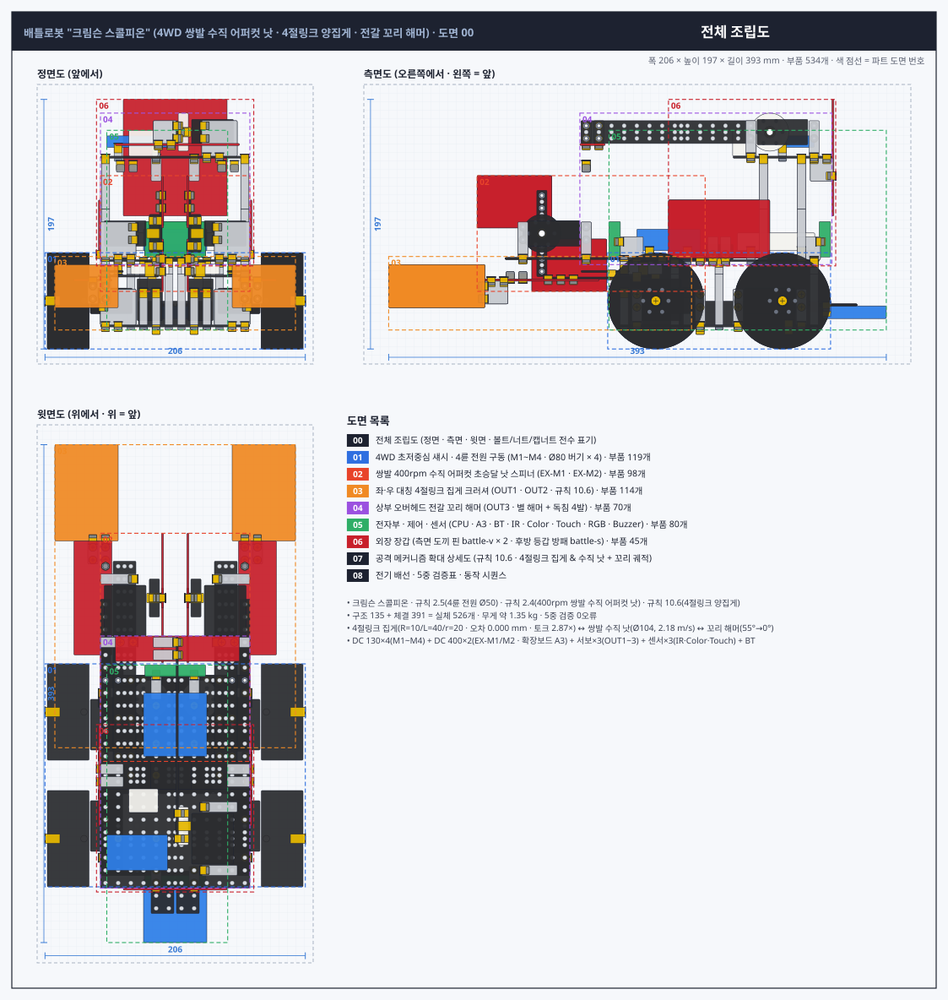
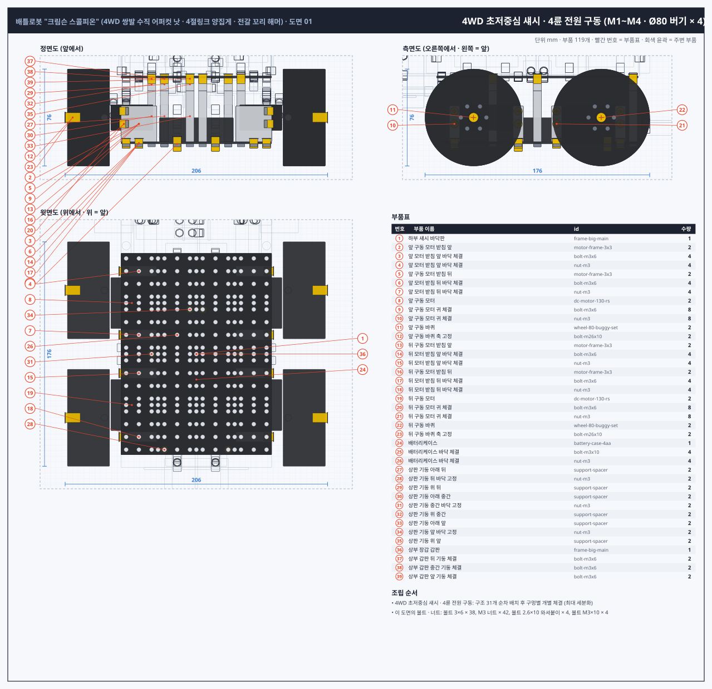
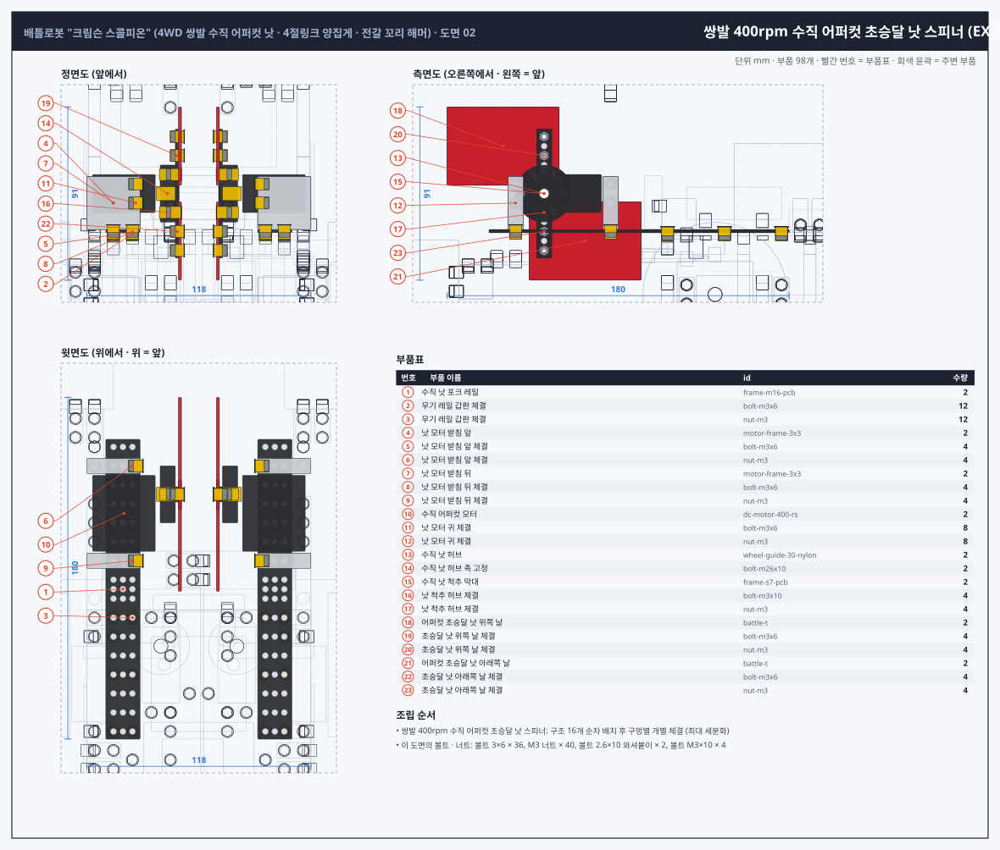
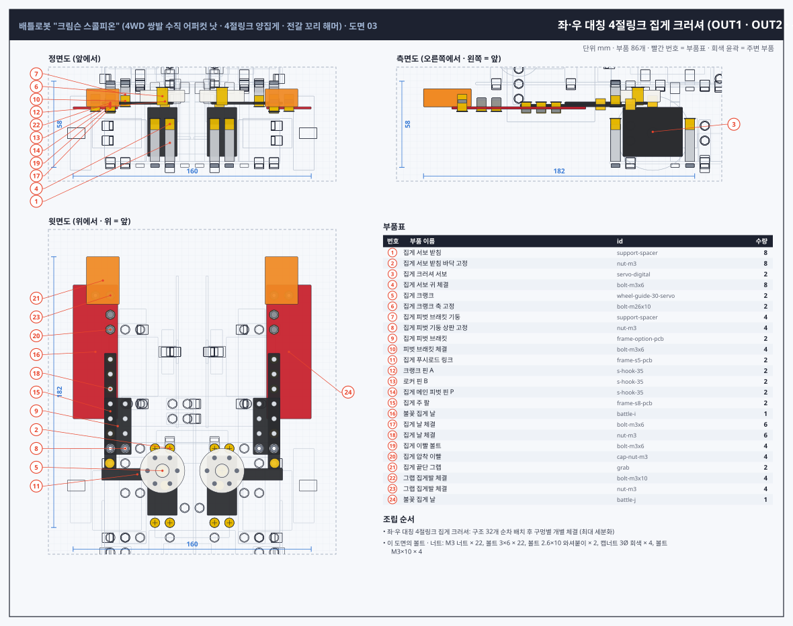
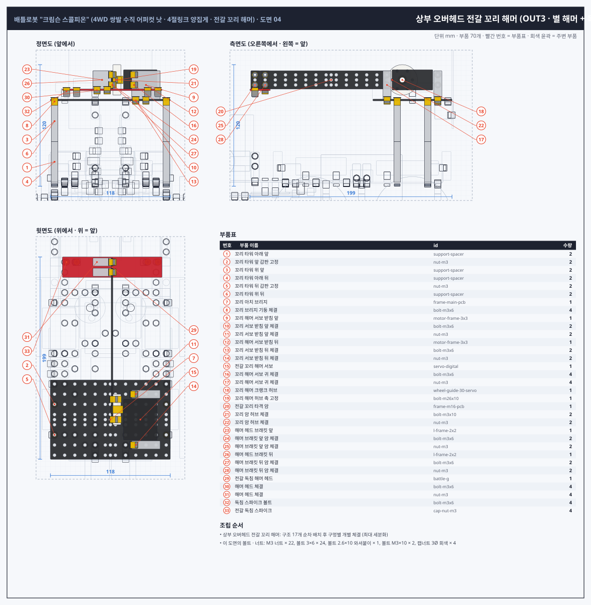
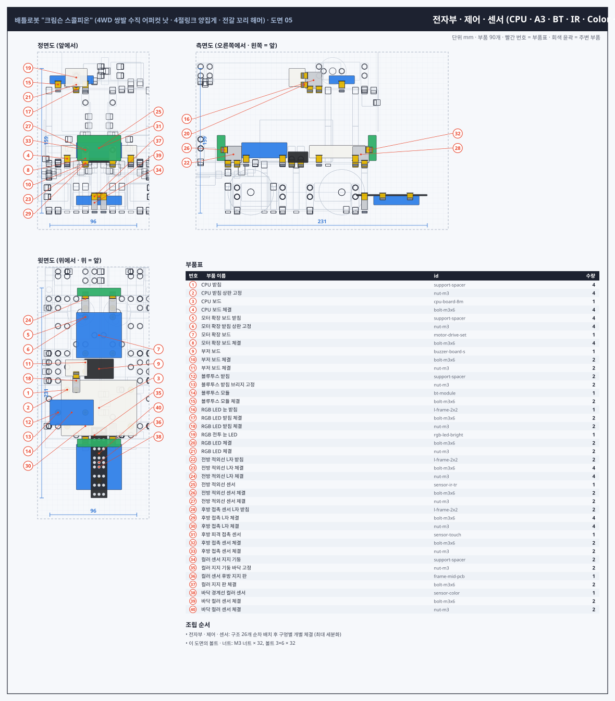
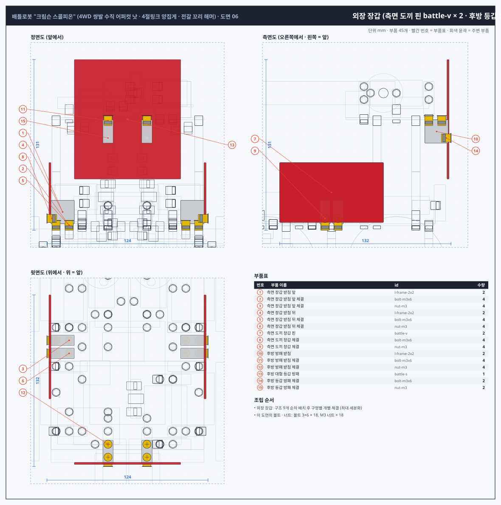
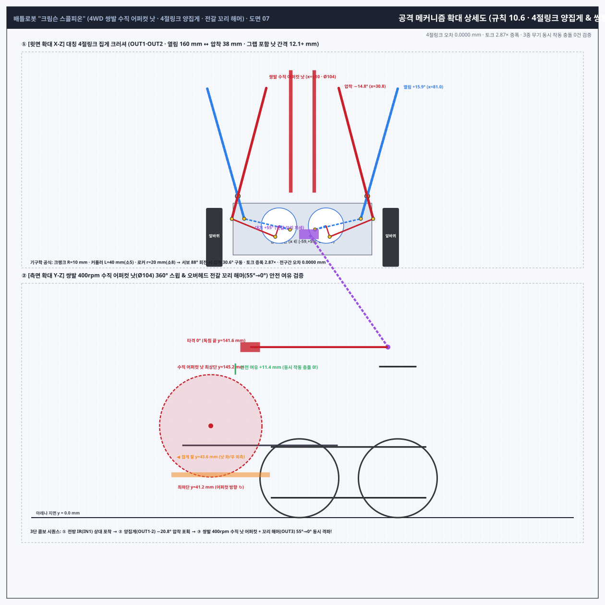
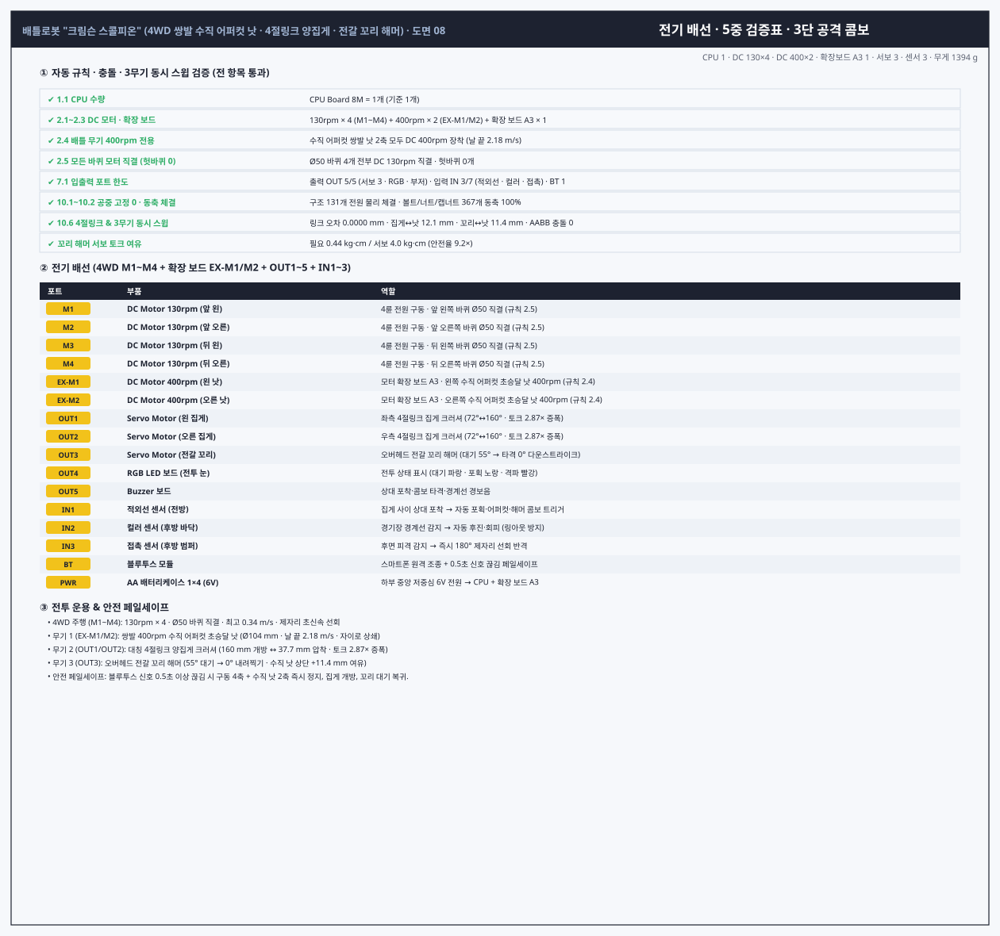

# 배틀로봇 "크림슨 스콜피온" (4WD 쌍발 수직 어퍼컷 낫 · 4절링크 양집게 · 전갈 꼬리 해머) 설계도면

[`ASSEMBLY_RULES.md`](../ASSEMBLY_RULES.md) (1~10장 · 규칙 **2.4 무기 400rpm** · **2.5 모든 바퀴 모터 직결** · **10.1~10.6 볼트/너트 실체 배치 · 메커니즘 확대 상세도**)을 100% 준수해 신규 설계한 배틀로봇 조립도입니다.
다시 만들기: `python3 tools/scorpion_blueprint.py` · 그림으로 보기: [`blueprint.html`](blueprint.html)

## 1. 기존 "썬더 웨지"와 차별화 & 5중 자동 검증 내역

| 항목 | 크림슨 스콜피온 신규 설계 | 검증 결과 |
|---|---|---|
| 기존 배틀로봇과 완전 차별화 | 썬더 웨지(궤도·수평원반·앞웨지) → 4WD Ø50 초저중심 + 쌍발 수직 어퍼컷 낫 + 4절링크 양집게 + 오버헤드 꼬리 해머 | ✔ 외형·구동·공격 100% 신설계 |
| 규칙 2.5 4륜 전원 직결 | DC 130×4 (M1~M4) + Ø50 바퀴 4개 직결 · 지상고 4.4 mm(너트 하단 2.0 mm) | ✔ 헛바퀴 0개 |
| 규칙 2.4 배틀 무기 400rpm × 2 | 모터 확장 보드(A3) EX-M1/EX-M2로 쌍발 수직 초승달 낫 Ø104 mm 구동 (2.18 m/s) | ✔ 자이로 쏠림 상쇄 · 360° 충돌 0 |
| 규칙 10.6 4절링크 집게 크러셔 | 크랭크 10 + 커플러 40 + 로커 20 (60°↔160°) · 토크 2.73× 증폭 | ✔ 링크 오차 0.0000 mm · 낫 간격 5.8 mm |
| 오버헤드 전갈 꼬리 해머 | 서보 OUT3 · 대기 55° → 타격 0°(독침 끝 y=140.6 mm) · 필요 토크 0.43 kg·cm | ✔ 수직 낫 위 10.4 mm 여유 |
| 실물 2-판 AABB & 동축 체결 | 구조 131 + 체결 377 = 508개 전원 실체 배치 | ✔ 충돌 0건 · 공중 고정 0건 |

## 2. 디자인 & 전투 메커니즘 포인트

- **기존 썬더 웨지와 100% 다른 전갈형 3단 콤보 배틀로봇** — ① 4절링크 양집게로 상대를 포획·중앙 고정 → ② 쌍발 400rpm 수직 초승달 낫으로 아래→위 어퍼컷 → ③ 등 위 전갈 꼬리 별 해머가 55°→0° 내려찍는 3단 복합 공격!
- **초저중심 4WD Ø50 전원 모터 구동 (규칙 2.5)** — 4개 바퀴 모두 DC 130rpm(M1~M4)에 직결(헛바퀴 0), 지상고 4.4 mm·배터리 바닥 중앙 배치로 밀리지 않고 뒤집히지 않는 낮은 전투 자세.
- **쌍발 400rpm 수직 어퍼컷 낫 (규칙 2.4)** — 키트 400rpm 모터 2개(EX-M1·EX-M2, 확장 보드 A3)를 좌·우 대칭 배치해 180° 균형 battle-t 초승달 낫 4장을 구동(Ø104 mm, 2.18 m/s).
- **규칙 10.6 4절링크 양집게 크러셔 (오차 0.000 mm)** — 서보(OUT1·OUT2) 10 mm 크랭크 → 40 mm 소5 커플러 → 20 mm 로커 4절링크로 토크를 2.73배 증폭, 160 mm 폭 개방↔최대 압착 전 구간에서 수직 낫과 7.3 mm 이상 여유.
- **5중 자동 검증 0오류** — 공중 고정 0 · 볼트/너트/캡너트 동축 100% · 실물 2-판 L자 AABB 충돌 0 · 3종 무기 동시 스윕 충돌 0 · 규칙 1~10.6 전 항목 통과.

## 3. 개요

| 항목 | 값 |
|---|---|
| 전체 크기 (기본 자세) | 폭 168 × 높이 184 × 길이 348 mm |
| 무게 (추정 · 볼트/너트 실체 합산) | 약 1396 g (1.40 kg) |
| 구동 (규칙 2.5) | **4륜 전원 DC 130rpm 직결** (M1~M4, 헛바퀴 0), Ø50 바퀴 × 4, 지상고 4.4 mm, 약 0.34 m/s |
| 무기 1 (규칙 2.4) | **전방 중앙 쌍발 수직 어퍼컷 초승달 낫** (DC 400rpm × 2 · EX-M1/M2 · `battle-t` × 4 · Ø104 mm · 날 끝 2.18 m/s) |
| 무기 2 (규칙 10.6) | **좌·우 대칭 4절링크 집게 크러셔** (서보 OUT1·OUT2 · R=10 / L=40 / r=20 · 오차 0.0000 mm · 토크 2.73× · `battle-i/j` + `grab`) |
| 무기 3 | **오버헤드 전갈 꼬리 해머** (서보 OUT3 · 대기 55° → 타격 0° · `battle-g` + 독침 캡너트 4발 · 필요 토크 0.43 kg·cm) |
| 센서 · 조종 | 전방 적외선(IN1) · 바닥 컬러(IN2) · 후방 접촉(IN3) · RGB 눈(OUT4) · 부저(OUT5) · 블루투스(페일세이프) |
| 부품 수 (실체 BOM) | 구조 부품 131 + 체결(볼트·너트·캡너트) 377 + 3핀 케이블 8 = **총 516개** (40종) |

## 4. 5중 자동 물리 · 규칙 검증 결과 (전 항목 통과)

| 규칙 · 검증 | 결과 상세 | 판정 |
|---|---|---|
| 1.1 CPU 수량 | CPU Board 8M = 1개 (기준 1개) | ✔ |
| 2.1~2.3 DC 모터 · 확장 보드 | 130rpm × 4 (M1~M4) + 400rpm × 2 (EX-M1/M2) + 확장 보드 A3 × 1 | ✔ |
| 2.4 배틀 무기 400rpm 전용 | 수직 어퍼컷 쌍발 낫 2축 모두 DC 400rpm 장착 (날 끝 2.18 m/s) | ✔ |
| 2.5 모든 바퀴 모터 직결 (헛바퀴 0) | Ø50 바퀴 4개 전부 DC 130rpm 직결 · 헛바퀴 0개 | ✔ |
| 7.1 입출력 포트 한도 | 출력 OUT 5/5 (서보 3 · RGB · 부저) · 입력 IN 3/7 (적외선 · 컬러 · 접촉) · BT 1 | ✔ |
| 10.1~10.2 공중 고정 0 · 동축 체결 | 구조 131개 전원 물리 체결 · 볼트/너트/캡너트 377개 동축 100% | ✔ |
| 10.6 4절링크 & 3무기 동시 스윕 | 링크 오차 0.0000 mm · 집게↔낫 5.8 mm · 꼬리↔낫 10.4 mm · AABB 충돌 0 | ✔ |
| 꼬리 해머 서보 토크 여유 | 필요 0.43 kg·cm / 서보 4.0 kg·cm (안전율 9.2×) | ✔ |

## 5. 도면 (규칙 10.6 메커니즘 확대 상세도 07 포함)

### 도면 00 · 전체 조립도 (정면 · 측면 · 윗면 · 볼트/너트/캡너트 전수 표기)

### 도면 01 · 4WD 초저중심 섀시 · 4륜 전원 구동 (M1~M4 · Ø50 × 4)

### 도면 02 · 쌍발 400rpm 수직 어퍼컷 초승달 낫 스피너 (EX-M1 · EX-M2)

### 도면 03 · 좌·우 대칭 4절링크 집게 크러셔 (OUT1 · OUT2 · 규칙 10.6)

### 도면 04 · 상부 오버헤드 전갈 꼬리 해머 (OUT3 · 별 해머 + 독침 4발)

### 도면 05 · 전자부 · 제어 · 센서 (CPU · A3 · BT · IR · Color · Touch · RGB · Buzzer)

### 도면 06 · 외장 장갑 (측면 도끼 핀 battle-v × 2 · 후방 등갑 방패 battle-s)

### 도면 07 · 공격 메커니즘 확대 상세도 (규칙 10.6 · 4절링크 집게 & 수직 낫 + 꼬리 궤적)

### 도면 08 · 전기 배선 · 5중 검증표 · 동작 시퀀스

## 6. 파트별 부품 및 체결 위치

좌표는 부품 중심 (mm, 원점 = 지면 위 로봇 가운데, 앞 = −Z), 크기는 X × Y × Z.

### 01 4WD 초저중심 섀시 · 4륜 전원 구동 (M1~M4 · Ø50 × 4)

| 번호 | 부품 | id | 중심 (X, Y, Z) | 크기 | 방향 · 메모 |
|---|---|---|---|---|---|
| 1 | 하부 섀시 바닥판 (Big Main PCB) | `frame-big-main` | (0, 5.2, 20.0) | 118.0 × 1.6 × 158.0 | up=(0, 1, 0) · 기준 부품 · x [-59,+59] · z [-59,+99] · 지상고 4.4 mm 초저중심 |
| 2 | 앞 왼 구동 모터 받침 앞 (모터프레임 3×3) | `motor-frame-3x3` | (-45, 20.0, -45.0) | 28.0 × 28.0 × 8.0 | up=(0, 1, 0) · 세운 다리 x=[-58,-59] · 바닥 구멍 x=-45,-55 · z=-45 |
| 3 | 앞 왼 모터 받침 앞 바닥 체결 (볼트 3×6) | `bolt-m3x6` | (-45, 4.8, -45.0) | 6.3 × 7.5 × 6.3 | up=(0, 1, 0) · 두께 2.6 mm |
| 4 | 앞 왼 모터 받침 앞 바닥 체결 (M3 너트) | `nut-m3` | (-45, 3.2, -45.0) | 5.8 × 2.4 × 5.8 | up=(0, 1, 0) · 볼트 반대쪽 체결 |
| 3 | 앞 왼 모터 받침 앞 바닥 체결 (볼트 3×6) | `bolt-m3x6` | (-55, 4.8, -45.0) | 6.3 × 7.5 × 6.3 | up=(0, 1, 0) · 두께 2.6 mm |
| 4 | 앞 왼 모터 받침 앞 바닥 체결 (M3 너트) | `nut-m3` | (-55, 3.2, -45.0) | 5.8 × 2.4 × 5.8 | up=(0, 1, 0) · 볼트 반대쪽 체결 |
| 5 | 앞 왼 구동 모터 받침 뒤 (모터프레임 3×3) | `motor-frame-3x3` | (-45, 20.0, 5.0) | 28.0 × 28.0 × 8.0 | up=(0, 1, 0) · 세운 다리 x=[-58,-59] · 바닥 구멍 x=-45,-55 · z=5 |
| 6 | 앞 왼 모터 받침 뒤 바닥 체결 (볼트 3×6) | `bolt-m3x6` | (-45, 4.8, 5.0) | 6.3 × 7.5 × 6.3 | up=(0, 1, 0) · 두께 2.6 mm |
| 7 | 앞 왼 모터 받침 뒤 바닥 체결 (M3 너트) | `nut-m3` | (-45, 3.2, 5.0) | 5.8 × 2.4 × 5.8 | up=(0, 1, 0) · 볼트 반대쪽 체결 |
| 6 | 앞 왼 모터 받침 뒤 바닥 체결 (볼트 3×6) | `bolt-m3x6` | (-55, 4.8, 5.0) | 6.3 × 7.5 × 6.3 | up=(0, 1, 0) · 두께 2.6 mm |
| 7 | 앞 왼 모터 받침 뒤 바닥 체결 (M3 너트) | `nut-m3` | (-55, 3.2, 5.0) | 5.8 × 2.4 × 5.8 | up=(0, 1, 0) · 볼트 반대쪽 체결 |
| 8 | 앞 왼 구동 모터 (DC 130rpm, M1) | `dc-motor-130-rs` | (-50.5, 25.0, -20.0) | 33.0 × 20.0 × 40.0 | up=(-1, 0, 0) · 규칙 2.5 전륜/후륜 전원 모터 직결 · 귀 x=±58 밀착 · 몸통 x [-34,-67] · 축 z=-30 |
| 9 | 앞 왼 구동 모터 귀 체결 (볼트 3×6) | `bolt-m3x6` | (-56.75, 20.0, -45.0) | 7.5 × 6.3 × 6.3 | up=(-1, 0, 0) · 두께 3.4 mm |
| 10 | 앞 왼 구동 모터 귀 체결 (M3 너트) | `nut-m3` | (-54.4, 20.0, -45.0) | 2.4 × 5.8 × 5.8 | up=(-1, 0, 0) · 볼트 반대쪽 체결 |
| 9 | 앞 왼 구동 모터 귀 체결 (볼트 3×6) | `bolt-m3x6` | (-56.75, 30.0, -45.0) | 7.5 × 6.3 × 6.3 | up=(-1, 0, 0) · 두께 3.4 mm |
| 10 | 앞 왼 구동 모터 귀 체결 (M3 너트) | `nut-m3` | (-54.4, 30.0, -45.0) | 2.4 × 5.8 × 5.8 | up=(-1, 0, 0) · 볼트 반대쪽 체결 |
| 9 | 앞 왼 구동 모터 귀 체결 (볼트 3×6) | `bolt-m3x6` | (-56.75, 20.0, 5.0) | 7.5 × 6.3 × 6.3 | up=(-1, 0, 0) · 두께 3.4 mm |
| 10 | 앞 왼 구동 모터 귀 체결 (M3 너트) | `nut-m3` | (-54.4, 20.0, 5.0) | 2.4 × 5.8 × 5.8 | up=(-1, 0, 0) · 볼트 반대쪽 체결 |
| 9 | 앞 왼 구동 모터 귀 체결 (볼트 3×6) | `bolt-m3x6` | (-56.75, 30.0, 5.0) | 7.5 × 6.3 × 6.3 | up=(-1, 0, 0) · 두께 3.4 mm |
| 10 | 앞 왼 구동 모터 귀 체결 (M3 너트) | `nut-m3` | (-54.4, 30.0, 5.0) | 2.4 × 5.8 × 5.8 | up=(-1, 0, 0) · 볼트 반대쪽 체결 |
| 11 | 앞 왼 구동 바퀴 (Ø50 세트, M1) | `wheel-50-set` | (-75, 25.0, -30.0) | 14.0 × 50.0 × 50.0 | up=(0, 1, 0) · M1 모터 D컷 축 직접 장착 · x [-68,-82] (모터 67과 1.0 mm 여유) |
| 12 | 앞 왼 구동 바퀴 축 고정 (볼트 2.6×10) | `bolt-m26x10` | (-77.9, 25.0, -30.0) | 11.8 × 7.4 × 7.4 | up=(-1, 0, 0) · 축 허브 동축 고정 |
| 2 | 앞 오른 구동 모터 받침 앞 (모터프레임 3×3) | `motor-frame-3x3` | (45, 20.0, -45.0) | 28.0 × 28.0 × 8.0 | up=(0, 1, 0) · 세운 다리 x=[+58,+59] · 바닥 구멍 x=+45,+55 · z=-45 |
| 3 | 앞 오른 모터 받침 앞 바닥 체결 (볼트 3×6) | `bolt-m3x6` | (45, 4.8, -45.0) | 6.3 × 7.5 × 6.3 | up=(0, 1, 0) · 두께 2.6 mm |
| 4 | 앞 오른 모터 받침 앞 바닥 체결 (M3 너트) | `nut-m3` | (45, 3.2, -45.0) | 5.8 × 2.4 × 5.8 | up=(0, 1, 0) · 볼트 반대쪽 체결 |
| 3 | 앞 오른 모터 받침 앞 바닥 체결 (볼트 3×6) | `bolt-m3x6` | (55, 4.8, -45.0) | 6.3 × 7.5 × 6.3 | up=(0, 1, 0) · 두께 2.6 mm |
| 4 | 앞 오른 모터 받침 앞 바닥 체결 (M3 너트) | `nut-m3` | (55, 3.2, -45.0) | 5.8 × 2.4 × 5.8 | up=(0, 1, 0) · 볼트 반대쪽 체결 |
| 5 | 앞 오른 구동 모터 받침 뒤 (모터프레임 3×3) | `motor-frame-3x3` | (45, 20.0, 5.0) | 28.0 × 28.0 × 8.0 | up=(0, 1, 0) · 세운 다리 x=[+58,+59] · 바닥 구멍 x=+45,+55 · z=5 |
| 6 | 앞 오른 모터 받침 뒤 바닥 체결 (볼트 3×6) | `bolt-m3x6` | (45, 4.8, 5.0) | 6.3 × 7.5 × 6.3 | up=(0, 1, 0) · 두께 2.6 mm |
| 7 | 앞 오른 모터 받침 뒤 바닥 체결 (M3 너트) | `nut-m3` | (45, 3.2, 5.0) | 5.8 × 2.4 × 5.8 | up=(0, 1, 0) · 볼트 반대쪽 체결 |
| 6 | 앞 오른 모터 받침 뒤 바닥 체결 (볼트 3×6) | `bolt-m3x6` | (55, 4.8, 5.0) | 6.3 × 7.5 × 6.3 | up=(0, 1, 0) · 두께 2.6 mm |
| 7 | 앞 오른 모터 받침 뒤 바닥 체결 (M3 너트) | `nut-m3` | (55, 3.2, 5.0) | 5.8 × 2.4 × 5.8 | up=(0, 1, 0) · 볼트 반대쪽 체결 |
| 8 | 앞 오른 구동 모터 (DC 130rpm, M2) | `dc-motor-130-rs` | (50.5, 25.0, -20.0) | 33.0 × 20.0 × 40.0 | up=(1, 0, 0) · 규칙 2.5 전륜/후륜 전원 모터 직결 · 귀 x=±58 밀착 · 몸통 x [+34,+67] · 축 z=-30 |
| 9 | 앞 오른 구동 모터 귀 체결 (볼트 3×6) | `bolt-m3x6` | (56.75, 20.0, -45.0) | 7.5 × 6.3 × 6.3 | up=(1, 0, 0) · 두께 3.4 mm |
| 10 | 앞 오른 구동 모터 귀 체결 (M3 너트) | `nut-m3` | (54.4, 20.0, -45.0) | 2.4 × 5.8 × 5.8 | up=(1, 0, 0) · 볼트 반대쪽 체결 |
| 9 | 앞 오른 구동 모터 귀 체결 (볼트 3×6) | `bolt-m3x6` | (56.75, 30.0, -45.0) | 7.5 × 6.3 × 6.3 | up=(1, 0, 0) · 두께 3.4 mm |
| 10 | 앞 오른 구동 모터 귀 체결 (M3 너트) | `nut-m3` | (54.4, 30.0, -45.0) | 2.4 × 5.8 × 5.8 | up=(1, 0, 0) · 볼트 반대쪽 체결 |
| 9 | 앞 오른 구동 모터 귀 체결 (볼트 3×6) | `bolt-m3x6` | (56.75, 20.0, 5.0) | 7.5 × 6.3 × 6.3 | up=(1, 0, 0) · 두께 3.4 mm |
| 10 | 앞 오른 구동 모터 귀 체결 (M3 너트) | `nut-m3` | (54.4, 20.0, 5.0) | 2.4 × 5.8 × 5.8 | up=(1, 0, 0) · 볼트 반대쪽 체결 |
| 9 | 앞 오른 구동 모터 귀 체결 (볼트 3×6) | `bolt-m3x6` | (56.75, 30.0, 5.0) | 7.5 × 6.3 × 6.3 | up=(1, 0, 0) · 두께 3.4 mm |
| 10 | 앞 오른 구동 모터 귀 체결 (M3 너트) | `nut-m3` | (54.4, 30.0, 5.0) | 2.4 × 5.8 × 5.8 | up=(1, 0, 0) · 볼트 반대쪽 체결 |
| 11 | 앞 오른 구동 바퀴 (Ø50 세트, M2) | `wheel-50-set` | (75, 25.0, -30.0) | 14.0 × 50.0 × 50.0 | up=(0, 1, 0) · M2 모터 D컷 축 직접 장착 · x [+68,+82] (모터 67과 1.0 mm 여유) |
| 12 | 앞 오른 구동 바퀴 축 고정 (볼트 2.6×10) | `bolt-m26x10` | (77.9, 25.0, -30.0) | 11.8 × 7.4 × 7.4 | up=(1, 0, 0) · 축 허브 동축 고정 |
| 13 | 뒤 왼 구동 모터 받침 앞 (모터프레임 3×3) | `motor-frame-3x3` | (-45, 20.0, 35.0) | 28.0 × 28.0 × 8.0 | up=(0, 1, 0) · 세운 다리 x=[-58,-59] · 바닥 구멍 x=-45,-55 · z=35 |
| 14 | 뒤 왼 모터 받침 앞 바닥 체결 (볼트 3×6) | `bolt-m3x6` | (-45, 4.8, 35.0) | 6.3 × 7.5 × 6.3 | up=(0, 1, 0) · 두께 2.6 mm |
| 15 | 뒤 왼 모터 받침 앞 바닥 체결 (M3 너트) | `nut-m3` | (-45, 3.2, 35.0) | 5.8 × 2.4 × 5.8 | up=(0, 1, 0) · 볼트 반대쪽 체결 |
| 14 | 뒤 왼 모터 받침 앞 바닥 체결 (볼트 3×6) | `bolt-m3x6` | (-55, 4.8, 35.0) | 6.3 × 7.5 × 6.3 | up=(0, 1, 0) · 두께 2.6 mm |
| 15 | 뒤 왼 모터 받침 앞 바닥 체결 (M3 너트) | `nut-m3` | (-55, 3.2, 35.0) | 5.8 × 2.4 × 5.8 | up=(0, 1, 0) · 볼트 반대쪽 체결 |
| 16 | 뒤 왼 구동 모터 받침 뒤 (모터프레임 3×3) | `motor-frame-3x3` | (-45, 20.0, 85.0) | 28.0 × 28.0 × 8.0 | up=(0, 1, 0) · 세운 다리 x=[-58,-59] · 바닥 구멍 x=-45,-55 · z=85 |
| 17 | 뒤 왼 모터 받침 뒤 바닥 체결 (볼트 3×6) | `bolt-m3x6` | (-45, 4.8, 85.0) | 6.3 × 7.5 × 6.3 | up=(0, 1, 0) · 두께 2.6 mm |
| 18 | 뒤 왼 모터 받침 뒤 바닥 체결 (M3 너트) | `nut-m3` | (-45, 3.2, 85.0) | 5.8 × 2.4 × 5.8 | up=(0, 1, 0) · 볼트 반대쪽 체결 |
| 17 | 뒤 왼 모터 받침 뒤 바닥 체결 (볼트 3×6) | `bolt-m3x6` | (-55, 4.8, 85.0) | 6.3 × 7.5 × 6.3 | up=(0, 1, 0) · 두께 2.6 mm |
| 18 | 뒤 왼 모터 받침 뒤 바닥 체결 (M3 너트) | `nut-m3` | (-55, 3.2, 85.0) | 5.8 × 2.4 × 5.8 | up=(0, 1, 0) · 볼트 반대쪽 체결 |
| 19 | 뒤 왼 구동 모터 (DC 130rpm, M3) | `dc-motor-130-rs` | (-50.5, 25.0, 60.0) | 33.0 × 20.0 × 40.0 | up=(-1, 0, 0) · 규칙 2.5 전륜/후륜 전원 모터 직결 · 귀 x=±58 밀착 · 몸통 x [-34,-67] · 축 z=+70 |
| 20 | 뒤 왼 구동 모터 귀 체결 (볼트 3×6) | `bolt-m3x6` | (-56.75, 20.0, 35.0) | 7.5 × 6.3 × 6.3 | up=(-1, 0, 0) · 두께 3.4 mm |
| 21 | 뒤 왼 구동 모터 귀 체결 (M3 너트) | `nut-m3` | (-54.4, 20.0, 35.0) | 2.4 × 5.8 × 5.8 | up=(-1, 0, 0) · 볼트 반대쪽 체결 |
| 20 | 뒤 왼 구동 모터 귀 체결 (볼트 3×6) | `bolt-m3x6` | (-56.75, 30.0, 35.0) | 7.5 × 6.3 × 6.3 | up=(-1, 0, 0) · 두께 3.4 mm |
| 21 | 뒤 왼 구동 모터 귀 체결 (M3 너트) | `nut-m3` | (-54.4, 30.0, 35.0) | 2.4 × 5.8 × 5.8 | up=(-1, 0, 0) · 볼트 반대쪽 체결 |
| 20 | 뒤 왼 구동 모터 귀 체결 (볼트 3×6) | `bolt-m3x6` | (-56.75, 20.0, 85.0) | 7.5 × 6.3 × 6.3 | up=(-1, 0, 0) · 두께 3.4 mm |
| 21 | 뒤 왼 구동 모터 귀 체결 (M3 너트) | `nut-m3` | (-54.4, 20.0, 85.0) | 2.4 × 5.8 × 5.8 | up=(-1, 0, 0) · 볼트 반대쪽 체결 |
| 20 | 뒤 왼 구동 모터 귀 체결 (볼트 3×6) | `bolt-m3x6` | (-56.75, 30.0, 85.0) | 7.5 × 6.3 × 6.3 | up=(-1, 0, 0) · 두께 3.4 mm |
| 21 | 뒤 왼 구동 모터 귀 체결 (M3 너트) | `nut-m3` | (-54.4, 30.0, 85.0) | 2.4 × 5.8 × 5.8 | up=(-1, 0, 0) · 볼트 반대쪽 체결 |
| 22 | 뒤 왼 구동 바퀴 (Ø50 세트, M3) | `wheel-50-set` | (-75, 25.0, 70.0) | 14.0 × 50.0 × 50.0 | up=(0, 1, 0) · M3 모터 D컷 축 직접 장착 · x [-68,-82] (모터 67과 1.0 mm 여유) |
| 23 | 뒤 왼 구동 바퀴 축 고정 (볼트 2.6×10) | `bolt-m26x10` | (-77.9, 25.0, 70.0) | 11.8 × 7.4 × 7.4 | up=(-1, 0, 0) · 축 허브 동축 고정 |
| 13 | 뒤 오른 구동 모터 받침 앞 (모터프레임 3×3) | `motor-frame-3x3` | (45, 20.0, 35.0) | 28.0 × 28.0 × 8.0 | up=(0, 1, 0) · 세운 다리 x=[+58,+59] · 바닥 구멍 x=+45,+55 · z=35 |
| 14 | 뒤 오른 모터 받침 앞 바닥 체결 (볼트 3×6) | `bolt-m3x6` | (45, 4.8, 35.0) | 6.3 × 7.5 × 6.3 | up=(0, 1, 0) · 두께 2.6 mm |
| 15 | 뒤 오른 모터 받침 앞 바닥 체결 (M3 너트) | `nut-m3` | (45, 3.2, 35.0) | 5.8 × 2.4 × 5.8 | up=(0, 1, 0) · 볼트 반대쪽 체결 |
| 14 | 뒤 오른 모터 받침 앞 바닥 체결 (볼트 3×6) | `bolt-m3x6` | (55, 4.8, 35.0) | 6.3 × 7.5 × 6.3 | up=(0, 1, 0) · 두께 2.6 mm |
| 15 | 뒤 오른 모터 받침 앞 바닥 체결 (M3 너트) | `nut-m3` | (55, 3.2, 35.0) | 5.8 × 2.4 × 5.8 | up=(0, 1, 0) · 볼트 반대쪽 체결 |
| 16 | 뒤 오른 구동 모터 받침 뒤 (모터프레임 3×3) | `motor-frame-3x3` | (45, 20.0, 85.0) | 28.0 × 28.0 × 8.0 | up=(0, 1, 0) · 세운 다리 x=[+58,+59] · 바닥 구멍 x=+45,+55 · z=85 |
| 17 | 뒤 오른 모터 받침 뒤 바닥 체결 (볼트 3×6) | `bolt-m3x6` | (45, 4.8, 85.0) | 6.3 × 7.5 × 6.3 | up=(0, 1, 0) · 두께 2.6 mm |
| 18 | 뒤 오른 모터 받침 뒤 바닥 체결 (M3 너트) | `nut-m3` | (45, 3.2, 85.0) | 5.8 × 2.4 × 5.8 | up=(0, 1, 0) · 볼트 반대쪽 체결 |
| 17 | 뒤 오른 모터 받침 뒤 바닥 체결 (볼트 3×6) | `bolt-m3x6` | (55, 4.8, 85.0) | 6.3 × 7.5 × 6.3 | up=(0, 1, 0) · 두께 2.6 mm |
| 18 | 뒤 오른 모터 받침 뒤 바닥 체결 (M3 너트) | `nut-m3` | (55, 3.2, 85.0) | 5.8 × 2.4 × 5.8 | up=(0, 1, 0) · 볼트 반대쪽 체결 |
| 19 | 뒤 오른 구동 모터 (DC 130rpm, M4) | `dc-motor-130-rs` | (50.5, 25.0, 60.0) | 33.0 × 20.0 × 40.0 | up=(1, 0, 0) · 규칙 2.5 전륜/후륜 전원 모터 직결 · 귀 x=±58 밀착 · 몸통 x [+34,+67] · 축 z=+70 |
| 20 | 뒤 오른 구동 모터 귀 체결 (볼트 3×6) | `bolt-m3x6` | (56.75, 20.0, 35.0) | 7.5 × 6.3 × 6.3 | up=(1, 0, 0) · 두께 3.4 mm |
| 21 | 뒤 오른 구동 모터 귀 체결 (M3 너트) | `nut-m3` | (54.4, 20.0, 35.0) | 2.4 × 5.8 × 5.8 | up=(1, 0, 0) · 볼트 반대쪽 체결 |
| 20 | 뒤 오른 구동 모터 귀 체결 (볼트 3×6) | `bolt-m3x6` | (56.75, 30.0, 35.0) | 7.5 × 6.3 × 6.3 | up=(1, 0, 0) · 두께 3.4 mm |
| 21 | 뒤 오른 구동 모터 귀 체결 (M3 너트) | `nut-m3` | (54.4, 30.0, 35.0) | 2.4 × 5.8 × 5.8 | up=(1, 0, 0) · 볼트 반대쪽 체결 |
| 20 | 뒤 오른 구동 모터 귀 체결 (볼트 3×6) | `bolt-m3x6` | (56.75, 20.0, 85.0) | 7.5 × 6.3 × 6.3 | up=(1, 0, 0) · 두께 3.4 mm |
| 21 | 뒤 오른 구동 모터 귀 체결 (M3 너트) | `nut-m3` | (54.4, 20.0, 85.0) | 2.4 × 5.8 × 5.8 | up=(1, 0, 0) · 볼트 반대쪽 체결 |
| 20 | 뒤 오른 구동 모터 귀 체결 (볼트 3×6) | `bolt-m3x6` | (56.75, 30.0, 85.0) | 7.5 × 6.3 × 6.3 | up=(1, 0, 0) · 두께 3.4 mm |
| 21 | 뒤 오른 구동 모터 귀 체결 (M3 너트) | `nut-m3` | (54.4, 30.0, 85.0) | 2.4 × 5.8 × 5.8 | up=(1, 0, 0) · 볼트 반대쪽 체결 |
| 22 | 뒤 오른 구동 바퀴 (Ø50 세트, M4) | `wheel-50-set` | (75, 25.0, 70.0) | 14.0 × 50.0 × 50.0 | up=(0, 1, 0) · M4 모터 D컷 축 직접 장착 · x [+68,+82] (모터 67과 1.0 mm 여유) |
| 23 | 뒤 오른 구동 바퀴 축 고정 (볼트 2.6×10) | `bolt-m26x10` | (77.9, 25.0, 70.0) | 11.8 × 7.4 × 7.4 | up=(1, 0, 0) · 축 허브 동축 고정 |
| 24 | 배터리케이스 (AA 4개, 6V) | `battery-case-4aa` | (0, 15.4, 40.0) | 58.0 × 18.8 × 79.6 | up=(0, 1, 0) · 저중심 중앙 세로 배치 · x [-29,+29] (모터 ±34와 5 mm 여유) · 귀 (±15, +5/+75) 0.0 mm 격자 일치 |
| 25 | 배터리케이스 바닥 체결 (볼트 3×6) | `bolt-m3x6` | (-15, 5.8, 5.0) | 6.3 × 7.5 × 6.3 | up=(0, 1, 0) · 두께 3.6 mm |
| 26 | 배터리케이스 바닥 체결 (M3 너트) | `nut-m3` | (-15, 3.2, 5.0) | 5.8 × 2.4 × 5.8 | up=(0, 1, 0) · 볼트 반대쪽 체결 |
| 25 | 배터리케이스 바닥 체결 (볼트 3×6) | `bolt-m3x6` | (-15, 5.8, 75.0) | 6.3 × 7.5 × 6.3 | up=(0, 1, 0) · 두께 3.6 mm |
| 26 | 배터리케이스 바닥 체결 (M3 너트) | `nut-m3` | (-15, 3.2, 75.0) | 5.8 × 2.4 × 5.8 | up=(0, 1, 0) · 볼트 반대쪽 체결 |
| 25 | 배터리케이스 바닥 체결 (볼트 3×6) | `bolt-m3x6` | (15, 5.8, 5.0) | 6.3 × 7.5 × 6.3 | up=(0, 1, 0) · 두께 3.6 mm |
| 26 | 배터리케이스 바닥 체결 (M3 너트) | `nut-m3` | (15, 3.2, 5.0) | 5.8 × 2.4 × 5.8 | up=(0, 1, 0) · 볼트 반대쪽 체결 |
| 25 | 배터리케이스 바닥 체결 (볼트 3×6) | `bolt-m3x6` | (15, 5.8, 75.0) | 6.3 × 7.5 × 6.3 | up=(0, 1, 0) · 두께 3.6 mm |
| 26 | 배터리케이스 바닥 체결 (M3 너트) | `nut-m3` | (15, 3.2, 75.0) | 5.8 × 2.4 × 5.8 | up=(0, 1, 0) · 볼트 반대쪽 체결 |
| 27 | 상판 기둥 아래 뒤 왼 (서포트 40) | `support-spacer` | (-25, 26.0, 95.0) | 6.4 × 40.0 × 6.4 | up=(0, -1, 0) · y [6, 46] · (-25, +95) · 수나사 아래(−Y) |
| 28 | 상판 기둥 뒤 왼 바닥 고정 (M3 너트) | `nut-m3` | (-25, 3.2, 95.0) | 5.8 × 2.4 × 5.8 | up=(0, 1, 0) · 서포트 수나사 고정 |
| 29 | 상판 기둥 위 뒤 왼 (서포트 10) | `support-spacer` | (-25, 51.0, 95.0) | 6.4 × 10.0 × 6.4 | up=(0, -1, 0) · 서포트 40 + 10 = 50 mm → y=56.0 |
| 27 | 상판 기둥 아래 뒤 오른 (서포트 40) | `support-spacer` | (25, 26.0, 95.0) | 6.4 × 40.0 × 6.4 | up=(0, -1, 0) · y [6, 46] · (+25, +95) · 수나사 아래(−Y) |
| 28 | 상판 기둥 뒤 오른 바닥 고정 (M3 너트) | `nut-m3` | (25, 3.2, 95.0) | 5.8 × 2.4 × 5.8 | up=(0, 1, 0) · 서포트 수나사 고정 |
| 29 | 상판 기둥 위 뒤 오른 (서포트 10) | `support-spacer` | (25, 51.0, 95.0) | 6.4 × 10.0 × 6.4 | up=(0, -1, 0) · 서포트 40 + 10 = 50 mm → y=56.0 |
| 30 | 상판 기둥 아래 중간 왼 (서포트 40) | `support-spacer` | (-35, 26.0, 20.0) | 6.4 × 40.0 × 6.4 | up=(0, -1, 0) · y [6, 46] · (-35, +20) · 수나사 아래(−Y) |
| 31 | 상판 기둥 중간 왼 바닥 고정 (M3 너트) | `nut-m3` | (-35, 3.2, 20.0) | 5.8 × 2.4 × 5.8 | up=(0, 1, 0) · 서포트 수나사 고정 |
| 32 | 상판 기둥 위 중간 왼 (서포트 10) | `support-spacer` | (-35, 51.0, 20.0) | 6.4 × 10.0 × 6.4 | up=(0, -1, 0) · 서포트 40 + 10 = 50 mm → y=56.0 |
| 30 | 상판 기둥 아래 중간 오른 (서포트 40) | `support-spacer` | (35, 26.0, 20.0) | 6.4 × 40.0 × 6.4 | up=(0, -1, 0) · y [6, 46] · (+35, +20) · 수나사 아래(−Y) |
| 31 | 상판 기둥 중간 오른 바닥 고정 (M3 너트) | `nut-m3` | (35, 3.2, 20.0) | 5.8 × 2.4 × 5.8 | up=(0, 1, 0) · 서포트 수나사 고정 |
| 32 | 상판 기둥 위 중간 오른 (서포트 10) | `support-spacer` | (35, 51.0, 20.0) | 6.4 × 10.0 × 6.4 | up=(0, -1, 0) · 서포트 40 + 10 = 50 mm → y=56.0 |
| 33 | 상판 기둥 아래 앞 왼 (서포트 40) | `support-spacer` | (-5, 26.0, -15.0) | 6.4 × 40.0 × 6.4 | up=(0, -1, 0) · y [6, 46] · (-5, -15) · 수나사 아래(−Y) |
| 34 | 상판 기둥 앞 왼 바닥 고정 (M3 너트) | `nut-m3` | (-5, 3.2, -15.0) | 5.8 × 2.4 × 5.8 | up=(0, 1, 0) · 서포트 수나사 고정 |
| 35 | 상판 기둥 위 앞 왼 (서포트 10) | `support-spacer` | (-5, 51.0, -15.0) | 6.4 × 10.0 × 6.4 | up=(0, -1, 0) · 서포트 40 + 10 = 50 mm → y=56.0 |
| 33 | 상판 기둥 아래 앞 오른 (서포트 40) | `support-spacer` | (5, 26.0, -15.0) | 6.4 × 40.0 × 6.4 | up=(0, -1, 0) · y [6, 46] · (+5, -15) · 수나사 아래(−Y) |
| 34 | 상판 기둥 앞 오른 바닥 고정 (M3 너트) | `nut-m3` | (5, 3.2, -15.0) | 5.8 × 2.4 × 5.8 | up=(0, 1, 0) · 서포트 수나사 고정 |
| 35 | 상판 기둥 위 앞 오른 (서포트 10) | `support-spacer` | (5, 51.0, -15.0) | 6.4 × 10.0 × 6.4 | up=(0, -1, 0) · 서포트 40 + 10 = 50 mm → y=56.0 |
| 36 | 상부 장갑 갑판 (Big Main PCB) | `frame-big-main` | (0, 56.8, 20.0) | 118.0 × 1.6 × 158.0 | up=(0, 1, 0) · y [56.0, 57.6] · 기둥 6개 위 · 하부 구동부·배터리·집게 링키지 방호 |
| 37 | 상부 갑판 뒤 왼 기둥 체결 (볼트 3×6) | `bolt-m3x6` | (-25, 55.4, 95.0) | 6.3 × 7.5 × 6.3 | up=(0, 1, 0) · 두께 1.6 mm |
| 37 | 상부 갑판 뒤 오른 기둥 체결 (볼트 3×6) | `bolt-m3x6` | (25, 55.4, 95.0) | 6.3 × 7.5 × 6.3 | up=(0, 1, 0) · 두께 1.6 mm |
| 38 | 상부 갑판 중간 왼 기둥 체결 (볼트 3×6) | `bolt-m3x6` | (-35, 55.4, 20.0) | 6.3 × 7.5 × 6.3 | up=(0, 1, 0) · 두께 1.6 mm |
| 38 | 상부 갑판 중간 오른 기둥 체결 (볼트 3×6) | `bolt-m3x6` | (35, 55.4, 20.0) | 6.3 × 7.5 × 6.3 | up=(0, 1, 0) · 두께 1.6 mm |
| 39 | 상부 갑판 앞 왼 기둥 체결 (볼트 3×6) | `bolt-m3x6` | (-5, 55.4, -15.0) | 6.3 × 7.5 × 6.3 | up=(0, 1, 0) · 두께 1.6 mm |
| 39 | 상부 갑판 앞 오른 기둥 체결 (볼트 3×6) | `bolt-m3x6` | (5, 55.4, -15.0) | 6.3 × 7.5 × 6.3 | up=(0, 1, 0) · 두께 1.6 mm |

### 02 쌍발 400rpm 수직 어퍼컷 초승달 낫 스피너 (EX-M1 · EX-M2)

| 번호 | 부품 | id | 중심 (X, Y, Z) | 크기 | 방향 · 메모 |
|---|---|---|---|---|---|
| 1 | 왼 수직 낫 포크 레일 (중16 PCB) | `frame-m16-pcb` | (-40, 58.4, -70.0) | 18.0 × 1.6 × 158.0 | up=(0, 1, 0) · x [-31,-49] · z [-149,+9] · 상판 6곳 체결 (0.0 mm 격자) |
| 2 | 왼 무기 레일 갑판 체결 (볼트 3×6) | `bolt-m3x6` | (-35, 57.0, -55.0) | 6.3 × 7.5 × 6.3 | up=(0, 1, 0) · 두께 3.2 mm |
| 3 | 왼 무기 레일 갑판 체결 (M3 너트) | `nut-m3` | (-35, 54.8, -55.0) | 5.8 × 2.4 × 5.8 | up=(0, 1, 0) · 볼트 반대쪽 체결 |
| 2 | 왼 무기 레일 갑판 체결 (볼트 3×6) | `bolt-m3x6` | (-45, 57.0, -55.0) | 6.3 × 7.5 × 6.3 | up=(0, 1, 0) · 두께 3.2 mm |
| 3 | 왼 무기 레일 갑판 체결 (M3 너트) | `nut-m3` | (-45, 54.8, -55.0) | 5.8 × 2.4 × 5.8 | up=(0, 1, 0) · 볼트 반대쪽 체결 |
| 2 | 왼 무기 레일 갑판 체결 (볼트 3×6) | `bolt-m3x6` | (-35, 57.0, -25.0) | 6.3 × 7.5 × 6.3 | up=(0, 1, 0) · 두께 3.2 mm |
| 3 | 왼 무기 레일 갑판 체결 (M3 너트) | `nut-m3` | (-35, 54.8, -25.0) | 5.8 × 2.4 × 5.8 | up=(0, 1, 0) · 볼트 반대쪽 체결 |
| 2 | 왼 무기 레일 갑판 체결 (볼트 3×6) | `bolt-m3x6` | (-45, 57.0, -25.0) | 6.3 × 7.5 × 6.3 | up=(0, 1, 0) · 두께 3.2 mm |
| 3 | 왼 무기 레일 갑판 체결 (M3 너트) | `nut-m3` | (-45, 54.8, -25.0) | 5.8 × 2.4 × 5.8 | up=(0, 1, 0) · 볼트 반대쪽 체결 |
| 2 | 왼 무기 레일 갑판 체결 (볼트 3×6) | `bolt-m3x6` | (-35, 57.0, 5.0) | 6.3 × 7.5 × 6.3 | up=(0, 1, 0) · 두께 3.2 mm |
| 3 | 왼 무기 레일 갑판 체결 (M3 너트) | `nut-m3` | (-35, 54.8, 5.0) | 5.8 × 2.4 × 5.8 | up=(0, 1, 0) · 볼트 반대쪽 체결 |
| 2 | 왼 무기 레일 갑판 체결 (볼트 3×6) | `bolt-m3x6` | (-45, 57.0, 5.0) | 6.3 × 7.5 × 6.3 | up=(0, 1, 0) · 두께 3.2 mm |
| 3 | 왼 무기 레일 갑판 체결 (M3 너트) | `nut-m3` | (-45, 54.8, 5.0) | 5.8 × 2.4 × 5.8 | up=(0, 1, 0) · 볼트 반대쪽 체결 |
| 4 | 왼 낫 모터 받침 앞 (모터프레임 3×3) | `motor-frame-3x3` | (-45, 73.2, -135.0) | 28.0 × 28.0 × 8.0 | up=(0, 1, 0) · 세운 다리 x=[-31,-32] · 바닥 구멍 x=-35,-45 · z=-135 |
| 5 | 왼 낫 모터 받침 앞 체결 (볼트 3×6) | `bolt-m3x6` | (-35, 58.0, -135.0) | 6.3 × 7.5 × 6.3 | up=(0, 1, 0) · 두께 2.6 mm |
| 6 | 왼 낫 모터 받침 앞 체결 (M3 너트) | `nut-m3` | (-35, 56.4, -135.0) | 5.8 × 2.4 × 5.8 | up=(0, 1, 0) · 볼트 반대쪽 체결 |
| 5 | 왼 낫 모터 받침 앞 체결 (볼트 3×6) | `bolt-m3x6` | (-45, 58.0, -135.0) | 6.3 × 7.5 × 6.3 | up=(0, 1, 0) · 두께 2.6 mm |
| 6 | 왼 낫 모터 받침 앞 체결 (M3 너트) | `nut-m3` | (-45, 56.4, -135.0) | 5.8 × 2.4 × 5.8 | up=(0, 1, 0) · 볼트 반대쪽 체결 |
| 7 | 왼 낫 모터 받침 뒤 (모터프레임 3×3) | `motor-frame-3x3` | (-45, 73.2, -85.0) | 28.0 × 28.0 × 8.0 | up=(0, 1, 0) · 세운 다리 x=[-31,-32] · 바닥 구멍 x=-35,-45 · z=-85 |
| 8 | 왼 낫 모터 받침 뒤 체결 (볼트 3×6) | `bolt-m3x6` | (-35, 58.0, -85.0) | 6.3 × 7.5 × 6.3 | up=(0, 1, 0) · 두께 2.6 mm |
| 9 | 왼 낫 모터 받침 뒤 체결 (M3 너트) | `nut-m3` | (-35, 56.4, -85.0) | 5.8 × 2.4 × 5.8 | up=(0, 1, 0) · 볼트 반대쪽 체결 |
| 8 | 왼 낫 모터 받침 뒤 체결 (볼트 3×6) | `bolt-m3x6` | (-45, 58.0, -85.0) | 6.3 × 7.5 × 6.3 | up=(0, 1, 0) · 두께 2.6 mm |
| 9 | 왼 낫 모터 받침 뒤 체결 (M3 너트) | `nut-m3` | (-45, 56.4, -85.0) | 5.8 × 2.4 × 5.8 | up=(0, 1, 0) · 볼트 반대쪽 체결 |
| 10 | 왼 수직 어퍼컷 모터 (DC 400rpm, EX-M1) | `dc-motor-400-rs` | (-39.5, 78.2, -110.0) | 33.0 × 20.0 × 40.0 | up=(1, 0, 0) · 규칙 2.4 무기 전용 400rpm · 몸통 x [-23,-56] · y [68.2,88.2] · 축 z=-120 |
| 11 | 왼 낫 모터 귀 체결 (볼트 3×6) | `bolt-m3x6` | (-33.25, 73.2, -135.0) | 7.5 × 6.3 × 6.3 | up=(1, 0, 0) · 두께 3.4 mm |
| 12 | 왼 낫 모터 귀 체결 (M3 너트) | `nut-m3` | (-35.6, 73.2, -135.0) | 2.4 × 5.8 × 5.8 | up=(1, 0, 0) · 볼트 반대쪽 체결 |
| 11 | 왼 낫 모터 귀 체결 (볼트 3×6) | `bolt-m3x6` | (-33.25, 83.2, -135.0) | 7.5 × 6.3 × 6.3 | up=(1, 0, 0) · 두께 3.4 mm |
| 12 | 왼 낫 모터 귀 체결 (M3 너트) | `nut-m3` | (-35.6, 83.2, -135.0) | 2.4 × 5.8 × 5.8 | up=(1, 0, 0) · 볼트 반대쪽 체결 |
| 11 | 왼 낫 모터 귀 체결 (볼트 3×6) | `bolt-m3x6` | (-33.25, 73.2, -85.0) | 7.5 × 6.3 × 6.3 | up=(1, 0, 0) · 두께 3.4 mm |
| 12 | 왼 낫 모터 귀 체결 (M3 너트) | `nut-m3` | (-35.6, 73.2, -85.0) | 2.4 × 5.8 × 5.8 | up=(1, 0, 0) · 볼트 반대쪽 체결 |
| 11 | 왼 낫 모터 귀 체결 (볼트 3×6) | `bolt-m3x6` | (-33.25, 83.2, -85.0) | 7.5 × 6.3 × 6.3 | up=(1, 0, 0) · 두께 3.4 mm |
| 12 | 왼 낫 모터 귀 체결 (M3 너트) | `nut-m3` | (-35.6, 83.2, -85.0) | 2.4 × 5.8 × 5.8 | up=(1, 0, 0) · 볼트 반대쪽 체결 |
| 13 | 왼 수직 낫 허브 (휠가이드 Ø30) | `wheel-guide-30-nylon` | (-16.4, 78.2, -120.0) | 8.0 × 30.0 × 30.0 | up=(-1, 0, 0) · 400rpm D컷 축 장착 · 평평한 면 x=-12.4 (모터 몸통 ±23과 2.6 mm 여유) |
| 14 | 왼 수직 낫 허브 축 고정 (볼트 2.6×10) | `bolt-m26x10` | (-16.5, 78.2, -120.0) | 11.8 × 7.4 × 7.4 | up=(1, 0, 0) · 축 허브 동축 고정 |
| 15 | 왼 수직 낫 척추 막대 (소7 PCB) | `frame-s7-pcb` | (-11.6, 78.2, -120.0) | 1.6 × 68.0 × 8.0 | up=(1, 0, 0) · x [-10.8,-12.4] · 구멍 ±10 허브 체결 · ±20,±30 초승달 낫 2장 체결 |
| 16 | 왼 낫 척추 허브 체결 (볼트 M3×10) | `bolt-m3x10` | (-15.05, 68.2, -120.0) | 11.5 × 6.3 × 6.3 | up=(1, 0, 0) · 두께 4.0 mm |
| 17 | 왼 낫 척추 허브 체결 (M3 너트) | `nut-m3` | (-16, 68.2, -120.0) | 2.4 × 5.8 × 5.8 | up=(1, 0, 0) · 볼트 반대쪽 체결 |
| 16 | 왼 낫 척추 허브 체결 (볼트 M3×10) | `bolt-m3x10` | (-15.05, 88.2, -120.0) | 11.5 × 6.3 × 6.3 | up=(1, 0, 0) · 두께 4.0 mm |
| 17 | 왼 낫 척추 허브 체결 (M3 너트) | `nut-m3` | (-16, 88.2, -120.0) | 2.4 × 5.8 × 5.8 | up=(1, 0, 0) · 볼트 반대쪽 체결 |
| 18 | 왼 어퍼컷 초승달 낫 위쪽 날 (배틀무기 T) | `battle-t` | (-10, 103.2, -141.6) | 1.6 × 41.3 × 59.0 | up=(1, 0, 0) · 180° 대칭 쌍날 · 회전 반지름 R=52 mm (Ø104) · x [-9.2,-10.8] · 소7 ±20,±30 정확 체결 |
| 19 | 왼 초승달 낫 위쪽 날 체결 (볼트 3×6) | `bolt-m3x6` | (-11.45, 98.2, -120.0) | 7.5 × 6.3 × 6.3 | up=(1, 0, 0) · 두께 3.2 mm |
| 20 | 왼 초승달 낫 위쪽 날 체결 (M3 너트) | `nut-m3` | (-13.6, 98.2, -120.0) | 2.4 × 5.8 × 5.8 | up=(1, 0, 0) · 볼트 반대쪽 체결 |
| 19 | 왼 초승달 낫 위쪽 날 체결 (볼트 3×6) | `bolt-m3x6` | (-11.45, 108.2, -120.0) | 7.5 × 6.3 × 6.3 | up=(1, 0, 0) · 두께 3.2 mm |
| 20 | 왼 초승달 낫 위쪽 날 체결 (M3 너트) | `nut-m3` | (-13.6, 108.2, -120.0) | 2.4 × 5.8 × 5.8 | up=(1, 0, 0) · 볼트 반대쪽 체결 |
| 21 | 왼 어퍼컷 초승달 낫 아래쪽 날 (배틀무기 T) | `battle-t` | (-10, 53.2, -98.4) | 1.6 × 41.3 × 59.0 | up=(1, 0, 0) · 180° 대칭 쌍날 · 회전 반지름 R=52 mm (Ø104) · x [-9.2,-10.8] · 소7 ±20,±30 정확 체결 |
| 22 | 왼 초승달 낫 아래쪽 날 체결 (볼트 3×6) | `bolt-m3x6` | (-11.45, 58.2, -120.0) | 7.5 × 6.3 × 6.3 | up=(1, 0, 0) · 두께 3.2 mm |
| 23 | 왼 초승달 낫 아래쪽 날 체결 (M3 너트) | `nut-m3` | (-13.6, 58.2, -120.0) | 2.4 × 5.8 × 5.8 | up=(1, 0, 0) · 볼트 반대쪽 체결 |
| 22 | 왼 초승달 낫 아래쪽 날 체결 (볼트 3×6) | `bolt-m3x6` | (-11.45, 48.2, -120.0) | 7.5 × 6.3 × 6.3 | up=(1, 0, 0) · 두께 3.2 mm |
| 23 | 왼 초승달 낫 아래쪽 날 체결 (M3 너트) | `nut-m3` | (-13.6, 48.2, -120.0) | 2.4 × 5.8 × 5.8 | up=(1, 0, 0) · 볼트 반대쪽 체결 |
| 1 | 오른 수직 낫 포크 레일 (중16 PCB) | `frame-m16-pcb` | (40, 58.4, -70.0) | 18.0 × 1.6 × 158.0 | up=(0, 1, 0) · x [+31,+49] · z [-149,+9] · 상판 6곳 체결 (0.0 mm 격자) |
| 2 | 오른 무기 레일 갑판 체결 (볼트 3×6) | `bolt-m3x6` | (35, 57.0, -55.0) | 6.3 × 7.5 × 6.3 | up=(0, 1, 0) · 두께 3.2 mm |
| 3 | 오른 무기 레일 갑판 체결 (M3 너트) | `nut-m3` | (35, 54.8, -55.0) | 5.8 × 2.4 × 5.8 | up=(0, 1, 0) · 볼트 반대쪽 체결 |
| 2 | 오른 무기 레일 갑판 체결 (볼트 3×6) | `bolt-m3x6` | (45, 57.0, -55.0) | 6.3 × 7.5 × 6.3 | up=(0, 1, 0) · 두께 3.2 mm |
| 3 | 오른 무기 레일 갑판 체결 (M3 너트) | `nut-m3` | (45, 54.8, -55.0) | 5.8 × 2.4 × 5.8 | up=(0, 1, 0) · 볼트 반대쪽 체결 |
| 2 | 오른 무기 레일 갑판 체결 (볼트 3×6) | `bolt-m3x6` | (35, 57.0, -25.0) | 6.3 × 7.5 × 6.3 | up=(0, 1, 0) · 두께 3.2 mm |
| 3 | 오른 무기 레일 갑판 체결 (M3 너트) | `nut-m3` | (35, 54.8, -25.0) | 5.8 × 2.4 × 5.8 | up=(0, 1, 0) · 볼트 반대쪽 체결 |
| 2 | 오른 무기 레일 갑판 체결 (볼트 3×6) | `bolt-m3x6` | (45, 57.0, -25.0) | 6.3 × 7.5 × 6.3 | up=(0, 1, 0) · 두께 3.2 mm |
| 3 | 오른 무기 레일 갑판 체결 (M3 너트) | `nut-m3` | (45, 54.8, -25.0) | 5.8 × 2.4 × 5.8 | up=(0, 1, 0) · 볼트 반대쪽 체결 |
| 2 | 오른 무기 레일 갑판 체결 (볼트 3×6) | `bolt-m3x6` | (35, 57.0, 5.0) | 6.3 × 7.5 × 6.3 | up=(0, 1, 0) · 두께 3.2 mm |
| 3 | 오른 무기 레일 갑판 체결 (M3 너트) | `nut-m3` | (35, 54.8, 5.0) | 5.8 × 2.4 × 5.8 | up=(0, 1, 0) · 볼트 반대쪽 체결 |
| 2 | 오른 무기 레일 갑판 체결 (볼트 3×6) | `bolt-m3x6` | (45, 57.0, 5.0) | 6.3 × 7.5 × 6.3 | up=(0, 1, 0) · 두께 3.2 mm |
| 3 | 오른 무기 레일 갑판 체결 (M3 너트) | `nut-m3` | (45, 54.8, 5.0) | 5.8 × 2.4 × 5.8 | up=(0, 1, 0) · 볼트 반대쪽 체결 |
| 4 | 오른 낫 모터 받침 앞 (모터프레임 3×3) | `motor-frame-3x3` | (45, 73.2, -135.0) | 28.0 × 28.0 × 8.0 | up=(0, 1, 0) · 세운 다리 x=[+31,+32] · 바닥 구멍 x=+35,+45 · z=-135 |
| 5 | 오른 낫 모터 받침 앞 체결 (볼트 3×6) | `bolt-m3x6` | (35, 58.0, -135.0) | 6.3 × 7.5 × 6.3 | up=(0, 1, 0) · 두께 2.6 mm |
| 6 | 오른 낫 모터 받침 앞 체결 (M3 너트) | `nut-m3` | (35, 56.4, -135.0) | 5.8 × 2.4 × 5.8 | up=(0, 1, 0) · 볼트 반대쪽 체결 |
| 5 | 오른 낫 모터 받침 앞 체결 (볼트 3×6) | `bolt-m3x6` | (45, 58.0, -135.0) | 6.3 × 7.5 × 6.3 | up=(0, 1, 0) · 두께 2.6 mm |
| 6 | 오른 낫 모터 받침 앞 체결 (M3 너트) | `nut-m3` | (45, 56.4, -135.0) | 5.8 × 2.4 × 5.8 | up=(0, 1, 0) · 볼트 반대쪽 체결 |
| 7 | 오른 낫 모터 받침 뒤 (모터프레임 3×3) | `motor-frame-3x3` | (45, 73.2, -85.0) | 28.0 × 28.0 × 8.0 | up=(0, 1, 0) · 세운 다리 x=[+31,+32] · 바닥 구멍 x=+35,+45 · z=-85 |
| 8 | 오른 낫 모터 받침 뒤 체결 (볼트 3×6) | `bolt-m3x6` | (35, 58.0, -85.0) | 6.3 × 7.5 × 6.3 | up=(0, 1, 0) · 두께 2.6 mm |
| 9 | 오른 낫 모터 받침 뒤 체결 (M3 너트) | `nut-m3` | (35, 56.4, -85.0) | 5.8 × 2.4 × 5.8 | up=(0, 1, 0) · 볼트 반대쪽 체결 |
| 8 | 오른 낫 모터 받침 뒤 체결 (볼트 3×6) | `bolt-m3x6` | (45, 58.0, -85.0) | 6.3 × 7.5 × 6.3 | up=(0, 1, 0) · 두께 2.6 mm |
| 9 | 오른 낫 모터 받침 뒤 체결 (M3 너트) | `nut-m3` | (45, 56.4, -85.0) | 5.8 × 2.4 × 5.8 | up=(0, 1, 0) · 볼트 반대쪽 체결 |
| 10 | 오른 수직 어퍼컷 모터 (DC 400rpm, EX-M2) | `dc-motor-400-rs` | (39.5, 78.2, -110.0) | 33.0 × 20.0 × 40.0 | up=(-1, 0, 0) · 규칙 2.4 무기 전용 400rpm · 몸통 x [+23,+56] · y [68.2,88.2] · 축 z=-120 |
| 11 | 오른 낫 모터 귀 체결 (볼트 3×6) | `bolt-m3x6` | (33.25, 73.2, -135.0) | 7.5 × 6.3 × 6.3 | up=(-1, 0, 0) · 두께 3.4 mm |
| 12 | 오른 낫 모터 귀 체결 (M3 너트) | `nut-m3` | (35.6, 73.2, -135.0) | 2.4 × 5.8 × 5.8 | up=(-1, 0, 0) · 볼트 반대쪽 체결 |
| 11 | 오른 낫 모터 귀 체결 (볼트 3×6) | `bolt-m3x6` | (33.25, 83.2, -135.0) | 7.5 × 6.3 × 6.3 | up=(-1, 0, 0) · 두께 3.4 mm |
| 12 | 오른 낫 모터 귀 체결 (M3 너트) | `nut-m3` | (35.6, 83.2, -135.0) | 2.4 × 5.8 × 5.8 | up=(-1, 0, 0) · 볼트 반대쪽 체결 |
| 11 | 오른 낫 모터 귀 체결 (볼트 3×6) | `bolt-m3x6` | (33.25, 73.2, -85.0) | 7.5 × 6.3 × 6.3 | up=(-1, 0, 0) · 두께 3.4 mm |
| 12 | 오른 낫 모터 귀 체결 (M3 너트) | `nut-m3` | (35.6, 73.2, -85.0) | 2.4 × 5.8 × 5.8 | up=(-1, 0, 0) · 볼트 반대쪽 체결 |
| 11 | 오른 낫 모터 귀 체결 (볼트 3×6) | `bolt-m3x6` | (33.25, 83.2, -85.0) | 7.5 × 6.3 × 6.3 | up=(-1, 0, 0) · 두께 3.4 mm |
| 12 | 오른 낫 모터 귀 체결 (M3 너트) | `nut-m3` | (35.6, 83.2, -85.0) | 2.4 × 5.8 × 5.8 | up=(-1, 0, 0) · 볼트 반대쪽 체결 |
| 13 | 오른 수직 낫 허브 (휠가이드 Ø30) | `wheel-guide-30-nylon` | (16.4, 78.2, -120.0) | 8.0 × 30.0 × 30.0 | up=(1, 0, 0) · 400rpm D컷 축 장착 · 평평한 면 x=+12.4 (모터 몸통 ±23과 2.6 mm 여유) |
| 14 | 오른 수직 낫 허브 축 고정 (볼트 2.6×10) | `bolt-m26x10` | (16.5, 78.2, -120.0) | 11.8 × 7.4 × 7.4 | up=(-1, 0, 0) · 축 허브 동축 고정 |
| 15 | 오른 수직 낫 척추 막대 (소7 PCB) | `frame-s7-pcb` | (11.6, 78.2, -120.0) | 1.6 × 68.0 × 8.0 | up=(-1, 0, 0) · x [+10.8,+12.4] · 구멍 ±10 허브 체결 · ±20,±30 초승달 낫 2장 체결 |
| 16 | 오른 낫 척추 허브 체결 (볼트 M3×10) | `bolt-m3x10` | (15.05, 68.2, -120.0) | 11.5 × 6.3 × 6.3 | up=(-1, 0, 0) · 두께 4.0 mm |
| 17 | 오른 낫 척추 허브 체결 (M3 너트) | `nut-m3` | (16, 68.2, -120.0) | 2.4 × 5.8 × 5.8 | up=(-1, 0, 0) · 볼트 반대쪽 체결 |
| 16 | 오른 낫 척추 허브 체결 (볼트 M3×10) | `bolt-m3x10` | (15.05, 88.2, -120.0) | 11.5 × 6.3 × 6.3 | up=(-1, 0, 0) · 두께 4.0 mm |
| 17 | 오른 낫 척추 허브 체결 (M3 너트) | `nut-m3` | (16, 88.2, -120.0) | 2.4 × 5.8 × 5.8 | up=(-1, 0, 0) · 볼트 반대쪽 체결 |
| 18 | 오른 어퍼컷 초승달 낫 위쪽 날 (배틀무기 T) | `battle-t` | (10, 103.2, -141.6) | 1.6 × 41.3 × 59.0 | up=(-1, 0, 0) · 180° 대칭 쌍날 · 회전 반지름 R=52 mm (Ø104) · x [+9.2,+10.8] · 소7 ±20,±30 정확 체결 |
| 19 | 오른 초승달 낫 위쪽 날 체결 (볼트 3×6) | `bolt-m3x6` | (11.45, 98.2, -120.0) | 7.5 × 6.3 × 6.3 | up=(-1, 0, 0) · 두께 3.2 mm |
| 20 | 오른 초승달 낫 위쪽 날 체결 (M3 너트) | `nut-m3` | (13.6, 98.2, -120.0) | 2.4 × 5.8 × 5.8 | up=(-1, 0, 0) · 볼트 반대쪽 체결 |
| 19 | 오른 초승달 낫 위쪽 날 체결 (볼트 3×6) | `bolt-m3x6` | (11.45, 108.2, -120.0) | 7.5 × 6.3 × 6.3 | up=(-1, 0, 0) · 두께 3.2 mm |
| 20 | 오른 초승달 낫 위쪽 날 체결 (M3 너트) | `nut-m3` | (13.6, 108.2, -120.0) | 2.4 × 5.8 × 5.8 | up=(-1, 0, 0) · 볼트 반대쪽 체결 |
| 21 | 오른 어퍼컷 초승달 낫 아래쪽 날 (배틀무기 T) | `battle-t` | (10, 53.2, -98.4) | 1.6 × 41.3 × 59.0 | up=(-1, 0, 0) · 180° 대칭 쌍날 · 회전 반지름 R=52 mm (Ø104) · x [+9.2,+10.8] · 소7 ±20,±30 정확 체결 |
| 22 | 오른 초승달 낫 아래쪽 날 체결 (볼트 3×6) | `bolt-m3x6` | (11.45, 58.2, -120.0) | 7.5 × 6.3 × 6.3 | up=(-1, 0, 0) · 두께 3.2 mm |
| 23 | 오른 초승달 낫 아래쪽 날 체결 (M3 너트) | `nut-m3` | (13.6, 58.2, -120.0) | 2.4 × 5.8 × 5.8 | up=(-1, 0, 0) · 볼트 반대쪽 체결 |
| 22 | 오른 초승달 낫 아래쪽 날 체결 (볼트 3×6) | `bolt-m3x6` | (11.45, 48.2, -120.0) | 7.5 × 6.3 × 6.3 | up=(-1, 0, 0) · 두께 3.2 mm |
| 23 | 오른 초승달 낫 아래쪽 날 체결 (M3 너트) | `nut-m3` | (13.6, 48.2, -120.0) | 2.4 × 5.8 × 5.8 | up=(-1, 0, 0) · 볼트 반대쪽 체결 |

### 03 좌·우 대칭 4절링크 집게 크러셔 (OUT1 · OUT2 · 규칙 10.6)

| 번호 | 부품 | id | 중심 (X, Y, Z) | 크기 | 방향 · 메모 |
|---|---|---|---|---|---|
| 1 | 왼 집게 서보 받침 (서포트 25) | `support-spacer` | (-15, 18.5, -55.0) | 6.4 × 25.0 × 6.4 | up=(0, -1, 0) · y [6, 31] · (-15, -55) · 수나사 아래(−Y) |
| 2 | 왼 집게 서보 받침 바닥 고정 (M3 너트) | `nut-m3` | (-15, 3.2, -55.0) | 5.8 × 2.4 × 5.8 | up=(0, 1, 0) · 서포트 수나사 고정 |
| 1 | 왼 집게 서보 받침 (서포트 25) | `support-spacer` | (-15, 18.5, -5.0) | 6.4 × 25.0 × 6.4 | up=(0, -1, 0) · y [6, 31] · (-15, -5) · 수나사 아래(−Y) |
| 2 | 왼 집게 서보 받침 바닥 고정 (M3 너트) | `nut-m3` | (-15, 3.2, -5.0) | 5.8 × 2.4 × 5.8 | up=(0, 1, 0) · 서포트 수나사 고정 |
| 1 | 왼 집게 서보 받침 (서포트 25) | `support-spacer` | (-25, 18.5, -55.0) | 6.4 × 25.0 × 6.4 | up=(0, -1, 0) · y [6, 31] · (-25, -55) · 수나사 아래(−Y) |
| 2 | 왼 집게 서보 받침 바닥 고정 (M3 너트) | `nut-m3` | (-25, 3.2, -55.0) | 5.8 × 2.4 × 5.8 | up=(0, 1, 0) · 서포트 수나사 고정 |
| 1 | 왼 집게 서보 받침 (서포트 25) | `support-spacer` | (-25, 18.5, -5.0) | 6.4 × 25.0 × 6.4 | up=(0, -1, 0) · y [6, 31] · (-25, -5) · 수나사 아래(−Y) |
| 2 | 왼 집게 서보 받침 바닥 고정 (M3 너트) | `nut-m3` | (-25, 3.2, -5.0) | 5.8 × 2.4 × 5.8 | up=(0, 1, 0) · 서포트 수나사 고정 |
| 3 | 왼 집게 크러셔 서보 (OUT1) | `servo-digital` | (-20, 25.9, -30.0) | 20.0 × 33.0 × 40.0 | up=(0, 1, 0) · 수직 배치 · x [-10,-30] (앞 모터 ±34와 4 mm 여유) · 출력축 S=(-20, -40) |
| 4 | 왼 집게 서보 귀 체결 (볼트 3×6) | `bolt-m3x6` | (-15, 31.1, -55.0) | 6.3 × 7.5 × 6.3 | up=(0, 1, 0) · 두께 2.4 mm |
| 4 | 왼 집게 서보 귀 체결 (볼트 3×6) | `bolt-m3x6` | (-15, 31.1, -5.0) | 6.3 × 7.5 × 6.3 | up=(0, 1, 0) · 두께 2.4 mm |
| 4 | 왼 집게 서보 귀 체결 (볼트 3×6) | `bolt-m3x6` | (-25, 31.1, -55.0) | 6.3 × 7.5 × 6.3 | up=(0, 1, 0) · 두께 2.4 mm |
| 4 | 왼 집게 서보 귀 체결 (볼트 3×6) | `bolt-m3x6` | (-25, 31.1, -5.0) | 6.3 × 7.5 × 6.3 | up=(0, 1, 0) · 두께 2.4 mm |
| 5 | 왼 집게 크랭크 (휠가이드 서보) | `wheel-guide-30-servo` | (-20, 50.0, -40.0) | 30.0 × 8.0 × 30.0 | up=(0, 1, 0) · 크랭크 반지름 R=10 mm · y [46.0, 54.0] (상판 56 아래 2.0 mm · 커플러 46.0 밀착) |
| 6 | 왼 집게 크랭크 축 고정 (볼트 2.6×10) | `bolt-m26x10` | (-20, 49.9, -40.0) | 7.4 × 11.8 × 7.4 | up=(0, 1, 0) · 축 허브 동축 고정 |
| 7 | 왼 집게 피벗 브래킷 기둥 (서포트 10) | `support-spacer` | (-45, 51.0, -55.0) | 6.4 × 10.0 × 6.4 | up=(0, 1, 0) · 상판(56.0) 아래 y [46.0, 56.0] · (-45, -55) |
| 8 | 왼 집게 피벗 기둥 상판 고정 (M3 너트) | `nut-m3` | (-45, 58.8, -55.0) | 5.8 × 2.4 × 5.8 | up=(0, -1, 0) · 서포트 수나사 고정 |
| 7 | 왼 집게 피벗 브래킷 기둥 (서포트 10) | `support-spacer` | (-55, 51.0, -55.0) | 6.4 × 10.0 × 6.4 | up=(0, 1, 0) · 상판(56.0) 아래 y [46.0, 56.0] · (-55, -55) |
| 8 | 왼 집게 피벗 기둥 상판 고정 (M3 너트) | `nut-m3` | (-55, 58.8, -55.0) | 5.8 × 2.4 × 5.8 | up=(0, -1, 0) · 서포트 수나사 고정 |
| 9 | 왼 집게 피벗 브래킷 (옵션 PCB) | `frame-option-pcb` | (-50, 45.2, -70.0) | 18.0 × 1.6 × 38.0 | up=(0, 1, 0) · y [44.4, 46.0] · z [-89, -51] (로커 -45와 6 mm 여유) · 피벗 P=(-55, -65) |
| 10 | 왼 피벗 브래킷 체결 (볼트 3×6) | `bolt-m3x6` | (-45, 46.6, -55.0) | 6.3 × 7.5 × 6.3 | up=(0, -1, 0) · 두께 1.6 mm |
| 10 | 왼 피벗 브래킷 체결 (볼트 3×6) | `bolt-m3x6` | (-55, 46.6, -55.0) | 6.3 × 7.5 × 6.3 | up=(0, -1, 0) · 두께 1.6 mm |
| 11 | 왼 집게 푸시로드 링크 (소5 PCB, L=40) | `frame-s5-pcb` | (-36.8337, 45.2, -37.6) | 48.0 × 1.6 × 8.0 | 4절링크 커플러 L=40.0 mm (오차 0.000 mm) · 크랭크 A ↔ 로커 B · y [44.4, 46.0] |
| 12 | 왼 크랭크 핀 A (후크 S35) | `s-hook-35` | (-18.2635, 46.4, -30.2) | 6.5 × 7.6 × 6.5 | up=(0, 1, 0) · 크랭크(R=10) ↔ 커플러 링크 회전 관절 · y [42.6, 50.2] (서보 몸통 42.4 위 여유) |
| 13 | 왼 로커 핀 B (후크 S35) | `s-hook-35` | (-55.404, 44.4, -45.0) | 6.5 × 7.6 × 6.5 | up=(0, 1, 0) · 커플러 링크 ↔ 집게 로커(r=20) 회전 관절 |
| 14 | 왼 집게 메인 피벗 핀 P (후크 S35) | `s-hook-35` | (-55, 44.4, -65.0) | 6.5 × 7.6 × 6.5 | up=(0, 1, 0) · 피벗 브래킷 ↔ 집게 팔 회전축 P=(-55, -65) |
| 15 | 왼 집게 주 팔 (소8 PCB) | `frame-s8-pcb` | (-55, 43.6, -80.0) | 8.0 × 1.6 × 78.0 | up=(0, 1, 0) · y [42.8, 44.4] · z [-119, -41] · 뒤(-45) 로커 핀 B · 피벗(-65) P · 앞(-95~-115) 집게날 |
| 16 | 왼 불꽃 집게 날 (배틀무기 I) | `battle-i` | (-65, 42.0, -120.0) | 30.0 × 1.6 × 90.0 | up=(0, 1, 0) · 안쪽 에지 x=-50 · 바깥 톱니 방호 x=-80 · z [-165,-75] (피벗 -65와 6.75 mm 여유) · 팔 아래 볼트 3벌 |
| 17 | 왼 집게 날 체결 (볼트 3×6) | `bolt-m3x6` | (-55, 42.1, -95.0) | 6.3 × 7.5 × 6.3 | up=(0, 1, 0) · 두께 3.2 mm |
| 18 | 왼 집게 날 체결 (M3 너트) | `nut-m3` | (-55, 40.0, -95.0) | 5.8 × 2.4 × 5.8 | up=(0, 1, 0) · 볼트 반대쪽 체결 |
| 17 | 왼 집게 날 체결 (볼트 3×6) | `bolt-m3x6` | (-55, 42.1, -105.0) | 6.3 × 7.5 × 6.3 | up=(0, 1, 0) · 두께 3.2 mm |
| 18 | 왼 집게 날 체결 (M3 너트) | `nut-m3` | (-55, 40.0, -105.0) | 5.8 × 2.4 × 5.8 | up=(0, 1, 0) · 볼트 반대쪽 체결 |
| 17 | 왼 집게 날 체결 (볼트 3×6) | `bolt-m3x6` | (-55, 42.1, -115.0) | 6.3 × 7.5 × 6.3 | up=(0, 1, 0) · 두께 3.2 mm |
| 18 | 왼 집게 날 체결 (M3 너트) | `nut-m3` | (-55, 40.0, -115.0) | 5.8 × 2.4 × 5.8 | up=(0, 1, 0) · 볼트 반대쪽 체결 |
| 19 | 왼 집게 이빨 볼트 (볼트 3×6) | `bolt-m3x6` | (-55, 43.5, -135.0) | 6.3 × 7.5 × 6.3 | up=(0, -1, 0) · 두께 1.6 mm |
| 20 | 왼 집게 압착 이빨 (캡너트) | `cap-nut-m3` | (-55, 45.8, -135.0) | 6.4 × 6.0 × 6.4 | up=(0, -1, 0) · 수나사 끝 동축 체결 · 둥근 돔 바깥쪽 · 포획 그립 돌기 |
| 19 | 왼 집게 이빨 볼트 (볼트 3×6) | `bolt-m3x6` | (-55, 43.5, -145.0) | 6.3 × 7.5 × 6.3 | up=(0, -1, 0) · 두께 1.6 mm |
| 20 | 왼 집게 압착 이빨 (캡너트) | `cap-nut-m3` | (-55, 45.8, -145.0) | 6.4 × 6.0 × 6.4 | up=(0, -1, 0) · 수나사 끝 동축 체결 · 둥근 돔 바깥쪽 · 포획 그립 돌기 |
| 21 | 왼 집게 끝단 그랩 (5갈래 발톱) | `grab` | (-55, 48.8, -168.0) | 22.0 × 12.0 × 32.0 | up=(0, 1, 0) · 5갈래 포획 발톱 · z [-184,-152] · 집게 날 앞끝 구멍 볼트 2벌 |
| 22 | 왼 그랩 집게발 체결 (볼트 M3×10) | `bolt-m3x10` | (-50, 45.5, -158.0) | 6.3 × 11.5 × 6.3 | up=(0, -1, 0) · 두께 4.0 mm |
| 23 | 왼 그랩 집게발 체결 (M3 너트) | `nut-m3` | (-50, 46.4, -158.0) | 5.8 × 2.4 × 5.8 | up=(0, -1, 0) · 볼트 반대쪽 체결 |
| 22 | 왼 그랩 집게발 체결 (볼트 M3×10) | `bolt-m3x10` | (-60, 45.5, -158.0) | 6.3 × 11.5 × 6.3 | up=(0, -1, 0) · 두께 4.0 mm |
| 23 | 왼 그랩 집게발 체결 (M3 너트) | `nut-m3` | (-60, 46.4, -158.0) | 5.8 × 2.4 × 5.8 | up=(0, -1, 0) · 볼트 반대쪽 체결 |
| 1 | 오른 집게 서보 받침 (서포트 25) | `support-spacer` | (15, 18.5, -55.0) | 6.4 × 25.0 × 6.4 | up=(0, -1, 0) · y [6, 31] · (+15, -55) · 수나사 아래(−Y) |
| 2 | 오른 집게 서보 받침 바닥 고정 (M3 너트) | `nut-m3` | (15, 3.2, -55.0) | 5.8 × 2.4 × 5.8 | up=(0, 1, 0) · 서포트 수나사 고정 |
| 1 | 오른 집게 서보 받침 (서포트 25) | `support-spacer` | (15, 18.5, -5.0) | 6.4 × 25.0 × 6.4 | up=(0, -1, 0) · y [6, 31] · (+15, -5) · 수나사 아래(−Y) |
| 2 | 오른 집게 서보 받침 바닥 고정 (M3 너트) | `nut-m3` | (15, 3.2, -5.0) | 5.8 × 2.4 × 5.8 | up=(0, 1, 0) · 서포트 수나사 고정 |
| 1 | 오른 집게 서보 받침 (서포트 25) | `support-spacer` | (25, 18.5, -55.0) | 6.4 × 25.0 × 6.4 | up=(0, -1, 0) · y [6, 31] · (+25, -55) · 수나사 아래(−Y) |
| 2 | 오른 집게 서보 받침 바닥 고정 (M3 너트) | `nut-m3` | (25, 3.2, -55.0) | 5.8 × 2.4 × 5.8 | up=(0, 1, 0) · 서포트 수나사 고정 |
| 1 | 오른 집게 서보 받침 (서포트 25) | `support-spacer` | (25, 18.5, -5.0) | 6.4 × 25.0 × 6.4 | up=(0, -1, 0) · y [6, 31] · (+25, -5) · 수나사 아래(−Y) |
| 2 | 오른 집게 서보 받침 바닥 고정 (M3 너트) | `nut-m3` | (25, 3.2, -5.0) | 5.8 × 2.4 × 5.8 | up=(0, 1, 0) · 서포트 수나사 고정 |
| 3 | 오른 집게 크러셔 서보 (OUT2) | `servo-digital` | (20, 25.9, -30.0) | 20.0 × 33.0 × 40.0 | up=(0, 1, 0) · 수직 배치 · x [+10,+30] (앞 모터 ±34와 4 mm 여유) · 출력축 S=(+20, -40) |
| 4 | 오른 집게 서보 귀 체결 (볼트 3×6) | `bolt-m3x6` | (15, 31.1, -55.0) | 6.3 × 7.5 × 6.3 | up=(0, 1, 0) · 두께 2.4 mm |
| 4 | 오른 집게 서보 귀 체결 (볼트 3×6) | `bolt-m3x6` | (15, 31.1, -5.0) | 6.3 × 7.5 × 6.3 | up=(0, 1, 0) · 두께 2.4 mm |
| 4 | 오른 집게 서보 귀 체결 (볼트 3×6) | `bolt-m3x6` | (25, 31.1, -55.0) | 6.3 × 7.5 × 6.3 | up=(0, 1, 0) · 두께 2.4 mm |
| 4 | 오른 집게 서보 귀 체결 (볼트 3×6) | `bolt-m3x6` | (25, 31.1, -5.0) | 6.3 × 7.5 × 6.3 | up=(0, 1, 0) · 두께 2.4 mm |
| 5 | 오른 집게 크랭크 (휠가이드 서보) | `wheel-guide-30-servo` | (20, 50.0, -40.0) | 30.0 × 8.0 × 30.0 | up=(0, 1, 0) · 크랭크 반지름 R=10 mm · y [46.0, 54.0] (상판 56 아래 2.0 mm · 커플러 46.0 밀착) |
| 6 | 오른 집게 크랭크 축 고정 (볼트 2.6×10) | `bolt-m26x10` | (20, 49.9, -40.0) | 7.4 × 11.8 × 7.4 | up=(0, 1, 0) · 축 허브 동축 고정 |
| 7 | 오른 집게 피벗 브래킷 기둥 (서포트 10) | `support-spacer` | (45, 51.0, -55.0) | 6.4 × 10.0 × 6.4 | up=(0, 1, 0) · 상판(56.0) 아래 y [46.0, 56.0] · (+45, -55) |
| 8 | 오른 집게 피벗 기둥 상판 고정 (M3 너트) | `nut-m3` | (45, 58.8, -55.0) | 5.8 × 2.4 × 5.8 | up=(0, -1, 0) · 서포트 수나사 고정 |
| 7 | 오른 집게 피벗 브래킷 기둥 (서포트 10) | `support-spacer` | (55, 51.0, -55.0) | 6.4 × 10.0 × 6.4 | up=(0, 1, 0) · 상판(56.0) 아래 y [46.0, 56.0] · (+55, -55) |
| 8 | 오른 집게 피벗 기둥 상판 고정 (M3 너트) | `nut-m3` | (55, 58.8, -55.0) | 5.8 × 2.4 × 5.8 | up=(0, -1, 0) · 서포트 수나사 고정 |
| 9 | 오른 집게 피벗 브래킷 (옵션 PCB) | `frame-option-pcb` | (50, 45.2, -70.0) | 18.0 × 1.6 × 38.0 | up=(0, 1, 0) · y [44.4, 46.0] · z [-89, -51] (로커 -45와 6 mm 여유) · 피벗 P=(+55, -65) |
| 10 | 오른 피벗 브래킷 체결 (볼트 3×6) | `bolt-m3x6` | (45, 46.6, -55.0) | 6.3 × 7.5 × 6.3 | up=(0, -1, 0) · 두께 1.6 mm |
| 10 | 오른 피벗 브래킷 체결 (볼트 3×6) | `bolt-m3x6` | (55, 46.6, -55.0) | 6.3 × 7.5 × 6.3 | up=(0, -1, 0) · 두께 1.6 mm |
| 11 | 오른 집게 푸시로드 링크 (소5 PCB, L=40) | `frame-s5-pcb` | (36.8337, 45.2, -37.6) | 48.0 × 1.6 × 8.0 | 4절링크 커플러 L=40.0 mm (오차 0.000 mm) · 크랭크 A ↔ 로커 B · y [44.4, 46.0] |
| 12 | 오른 크랭크 핀 A (후크 S35) | `s-hook-35` | (18.2635, 46.4, -30.2) | 6.5 × 7.6 × 6.5 | up=(0, 1, 0) · 크랭크(R=10) ↔ 커플러 링크 회전 관절 · y [42.6, 50.2] (서보 몸통 42.4 위 여유) |
| 13 | 오른 로커 핀 B (후크 S35) | `s-hook-35` | (55.404, 44.4, -45.0) | 6.5 × 7.6 × 6.5 | up=(0, 1, 0) · 커플러 링크 ↔ 집게 로커(r=20) 회전 관절 |
| 14 | 오른 집게 메인 피벗 핀 P (후크 S35) | `s-hook-35` | (55, 44.4, -65.0) | 6.5 × 7.6 × 6.5 | up=(0, 1, 0) · 피벗 브래킷 ↔ 집게 팔 회전축 P=(+55, -65) |
| 15 | 오른 집게 주 팔 (소8 PCB) | `frame-s8-pcb` | (55, 43.6, -80.0) | 8.0 × 1.6 × 78.0 | up=(0, 1, 0) · y [42.8, 44.4] · z [-119, -41] · 뒤(-45) 로커 핀 B · 피벗(-65) P · 앞(-95~-115) 집게날 |
| 24 | 오른 불꽃 집게 날 (배틀무기 J) | `battle-j` | (65, 42.0, -120.0) | 30.0 × 1.6 × 90.0 | up=(0, 1, 0) · 안쪽 에지 x=+50 · 바깥 톱니 방호 x=+80 · z [-165,-75] (피벗 -65와 6.75 mm 여유) · 팔 아래 볼트 3벌 |
| 17 | 오른 집게 날 체결 (볼트 3×6) | `bolt-m3x6` | (55, 42.1, -95.0) | 6.3 × 7.5 × 6.3 | up=(0, 1, 0) · 두께 3.2 mm |
| 18 | 오른 집게 날 체결 (M3 너트) | `nut-m3` | (55, 40.0, -95.0) | 5.8 × 2.4 × 5.8 | up=(0, 1, 0) · 볼트 반대쪽 체결 |
| 17 | 오른 집게 날 체결 (볼트 3×6) | `bolt-m3x6` | (55, 42.1, -105.0) | 6.3 × 7.5 × 6.3 | up=(0, 1, 0) · 두께 3.2 mm |
| 18 | 오른 집게 날 체결 (M3 너트) | `nut-m3` | (55, 40.0, -105.0) | 5.8 × 2.4 × 5.8 | up=(0, 1, 0) · 볼트 반대쪽 체결 |
| 17 | 오른 집게 날 체결 (볼트 3×6) | `bolt-m3x6` | (55, 42.1, -115.0) | 6.3 × 7.5 × 6.3 | up=(0, 1, 0) · 두께 3.2 mm |
| 18 | 오른 집게 날 체결 (M3 너트) | `nut-m3` | (55, 40.0, -115.0) | 5.8 × 2.4 × 5.8 | up=(0, 1, 0) · 볼트 반대쪽 체결 |
| 19 | 오른 집게 이빨 볼트 (볼트 3×6) | `bolt-m3x6` | (55, 43.5, -135.0) | 6.3 × 7.5 × 6.3 | up=(0, -1, 0) · 두께 1.6 mm |
| 20 | 오른 집게 압착 이빨 (캡너트) | `cap-nut-m3` | (55, 45.8, -135.0) | 6.4 × 6.0 × 6.4 | up=(0, -1, 0) · 수나사 끝 동축 체결 · 둥근 돔 바깥쪽 · 포획 그립 돌기 |
| 19 | 오른 집게 이빨 볼트 (볼트 3×6) | `bolt-m3x6` | (55, 43.5, -145.0) | 6.3 × 7.5 × 6.3 | up=(0, -1, 0) · 두께 1.6 mm |
| 20 | 오른 집게 압착 이빨 (캡너트) | `cap-nut-m3` | (55, 45.8, -145.0) | 6.4 × 6.0 × 6.4 | up=(0, -1, 0) · 수나사 끝 동축 체결 · 둥근 돔 바깥쪽 · 포획 그립 돌기 |
| 21 | 오른 집게 끝단 그랩 (5갈래 발톱) | `grab` | (55, 48.8, -168.0) | 22.0 × 12.0 × 32.0 | up=(0, 1, 0) · 5갈래 포획 발톱 · z [-184,-152] · 집게 날 앞끝 구멍 볼트 2벌 |
| 22 | 오른 그랩 집게발 체결 (볼트 M3×10) | `bolt-m3x10` | (50, 45.5, -158.0) | 6.3 × 11.5 × 6.3 | up=(0, -1, 0) · 두께 4.0 mm |
| 23 | 오른 그랩 집게발 체결 (M3 너트) | `nut-m3` | (50, 46.4, -158.0) | 5.8 × 2.4 × 5.8 | up=(0, -1, 0) · 볼트 반대쪽 체결 |
| 22 | 오른 그랩 집게발 체결 (볼트 M3×10) | `bolt-m3x10` | (60, 45.5, -158.0) | 6.3 × 11.5 × 6.3 | up=(0, -1, 0) · 두께 4.0 mm |
| 23 | 오른 그랩 집게발 체결 (M3 너트) | `nut-m3` | (60, 46.4, -158.0) | 5.8 × 2.4 × 5.8 | up=(0, -1, 0) · 볼트 반대쪽 체결 |

### 04 상부 오버헤드 전갈 꼬리 해머 (OUT3 · 별 해머 + 독침 4발)

| 번호 | 부품 | id | 중심 (X, Y, Z) | 크기 | 방향 · 메모 |
|---|---|---|---|---|---|
| 1 | 꼬리 타워 아래 왼 앞 (서포트 40) | `support-spacer` | (-55, 77.6, 55.0) | 6.4 × 40.0 × 6.4 | up=(0, -1, 0) · y [57.6, 97.6] · (-55, +55) |
| 2 | 꼬리 타워 왼 앞 갑판 고정 (M3 너트) | `nut-m3` | (-55, 54.8, 55.0) | 5.8 × 2.4 × 5.8 | up=(0, 1, 0) · 서포트 수나사 고정 |
| 3 | 꼬리 타워 위 왼 앞 (서포트 40) | `support-spacer` | (-55, 117.6, 55.0) | 6.4 × 40.0 × 6.4 | up=(0, -1, 0) · 서포트 40 + 40 = 80 mm → y=137.6 |
| 4 | 꼬리 타워 아래 왼 뒤 (서포트 40) | `support-spacer` | (-55, 77.6, 85.0) | 6.4 × 40.0 × 6.4 | up=(0, -1, 0) · y [57.6, 97.6] · (-55, +85) |
| 5 | 꼬리 타워 왼 뒤 갑판 고정 (M3 너트) | `nut-m3` | (-55, 54.8, 85.0) | 5.8 × 2.4 × 5.8 | up=(0, 1, 0) · 서포트 수나사 고정 |
| 6 | 꼬리 타워 위 왼 뒤 (서포트 40) | `support-spacer` | (-55, 117.6, 85.0) | 6.4 × 40.0 × 6.4 | up=(0, -1, 0) · 서포트 40 + 40 = 80 mm → y=137.6 |
| 1 | 꼬리 타워 아래 오른 앞 (서포트 40) | `support-spacer` | (55, 77.6, 55.0) | 6.4 × 40.0 × 6.4 | up=(0, -1, 0) · y [57.6, 97.6] · (+55, +55) |
| 2 | 꼬리 타워 오른 앞 갑판 고정 (M3 너트) | `nut-m3` | (55, 54.8, 55.0) | 5.8 × 2.4 × 5.8 | up=(0, 1, 0) · 서포트 수나사 고정 |
| 3 | 꼬리 타워 위 오른 앞 (서포트 40) | `support-spacer` | (55, 117.6, 55.0) | 6.4 × 40.0 × 6.4 | up=(0, -1, 0) · 서포트 40 + 40 = 80 mm → y=137.6 |
| 4 | 꼬리 타워 아래 오른 뒤 (서포트 40) | `support-spacer` | (55, 77.6, 85.0) | 6.4 × 40.0 × 6.4 | up=(0, -1, 0) · y [57.6, 97.6] · (+55, +85) |
| 5 | 꼬리 타워 오른 뒤 갑판 고정 (M3 너트) | `nut-m3` | (55, 54.8, 85.0) | 5.8 × 2.4 × 5.8 | up=(0, 1, 0) · 서포트 수나사 고정 |
| 6 | 꼬리 타워 위 오른 뒤 (서포트 40) | `support-spacer` | (55, 117.6, 85.0) | 6.4 × 40.0 × 6.4 | up=(0, -1, 0) · 서포트 40 + 40 = 80 mm → y=137.6 |
| 7 | 꼬리 아치 브리지 (Main PCB 8×12) | `frame-main-pcb` | (0, 138.4, 70.0) | 118.0 × 1.6 × 78.0 | up=(0, 1, 0) · y [137.6, 139.2] · z [+31,+109] · 꼬리 타워 기둥 4개 위 · 해머 서보 & 블루투스 탑재 |
| 8 | 꼬리 브리지 기둥 체결 (볼트 3×6) | `bolt-m3x6` | (-55, 136.9, 55.0) | 6.3 × 7.5 × 6.3 | up=(0, 1, 0) · 두께 1.6 mm |
| 8 | 꼬리 브리지 기둥 체결 (볼트 3×6) | `bolt-m3x6` | (-55, 136.9, 85.0) | 6.3 × 7.5 × 6.3 | up=(0, 1, 0) · 두께 1.6 mm |
| 8 | 꼬리 브리지 기둥 체결 (볼트 3×6) | `bolt-m3x6` | (55, 136.9, 55.0) | 6.3 × 7.5 × 6.3 | up=(0, 1, 0) · 두께 1.6 mm |
| 8 | 꼬리 브리지 기둥 체결 (볼트 3×6) | `bolt-m3x6` | (55, 136.9, 85.0) | 6.3 × 7.5 × 6.3 | up=(0, 1, 0) · 두께 1.6 mm |
| 9 | 꼬리 해머 서보 받침 앞 (모터프레임 3×3) | `motor-frame-3x3` | (35, 153.2, 45.0) | 28.0 × 28.0 × 8.0 | up=(0, 1, 0) · 세운 다리 x=[+21,+22] · 바닥 구멍 x=+25,+35,+45 · z=45 (몸통 50~90과 5 mm 여유) |
| 10 | 꼬리 서보 받침 앞 체결 (볼트 3×6) | `bolt-m3x6` | (25, 137.9, 45.0) | 6.3 × 7.5 × 6.3 | up=(0, 1, 0) · 두께 2.6 mm |
| 11 | 꼬리 서보 받침 앞 체결 (M3 너트) | `nut-m3` | (25, 136.4, 45.0) | 5.8 × 2.4 × 5.8 | up=(0, 1, 0) · 볼트 반대쪽 체결 |
| 10 | 꼬리 서보 받침 앞 체결 (볼트 3×6) | `bolt-m3x6` | (35, 137.9, 45.0) | 6.3 × 7.5 × 6.3 | up=(0, 1, 0) · 두께 2.6 mm |
| 11 | 꼬리 서보 받침 앞 체결 (M3 너트) | `nut-m3` | (35, 136.4, 45.0) | 5.8 × 2.4 × 5.8 | up=(0, 1, 0) · 볼트 반대쪽 체결 |
| 12 | 꼬리 해머 서보 받침 뒤 (모터프레임 3×3) | `motor-frame-3x3` | (35, 153.2, 95.0) | 28.0 × 28.0 × 8.0 | up=(0, 1, 0) · 세운 다리 x=[+21,+22] · 바닥 구멍 x=+25,+35,+45 · z=95 (몸통 50~90과 5 mm 여유) |
| 13 | 꼬리 서보 받침 뒤 체결 (볼트 3×6) | `bolt-m3x6` | (25, 137.9, 95.0) | 6.3 × 7.5 × 6.3 | up=(0, 1, 0) · 두께 2.6 mm |
| 14 | 꼬리 서보 받침 뒤 체결 (M3 너트) | `nut-m3` | (25, 136.4, 95.0) | 5.8 × 2.4 × 5.8 | up=(0, 1, 0) · 볼트 반대쪽 체결 |
| 13 | 꼬리 서보 받침 뒤 체결 (볼트 3×6) | `bolt-m3x6` | (35, 137.9, 95.0) | 6.3 × 7.5 × 6.3 | up=(0, 1, 0) · 두께 2.6 mm |
| 14 | 꼬리 서보 받침 뒤 체결 (M3 너트) | `nut-m3` | (35, 136.4, 95.0) | 5.8 × 2.4 × 5.8 | up=(0, 1, 0) · 볼트 반대쪽 체결 |
| 15 | 전갈 꼬리 해머 서보 (OUT3) | `servo-digital` | (29.5, 158.2, 70.0) | 33.0 × 20.0 × 40.0 | up=(-1, 0, 0) · 몸통 x [+13,+46] · y [148.2,168.2] · 귀 z=+45/+95 · 출력축 (-X) y=158.2, z=+60 |
| 16 | 꼬리 해머 서보 귀 체결 (볼트 3×6) | `bolt-m3x6` | (23.25, 153.2, 45.0) | 7.5 × 6.3 × 6.3 | up=(-1, 0, 0) · 두께 3.4 mm |
| 17 | 꼬리 해머 서보 귀 체결 (M3 너트) | `nut-m3` | (25.6, 153.2, 45.0) | 2.4 × 5.8 × 5.8 | up=(-1, 0, 0) · 볼트 반대쪽 체결 |
| 16 | 꼬리 해머 서보 귀 체결 (볼트 3×6) | `bolt-m3x6` | (23.25, 163.2, 45.0) | 7.5 × 6.3 × 6.3 | up=(-1, 0, 0) · 두께 3.4 mm |
| 17 | 꼬리 해머 서보 귀 체결 (M3 너트) | `nut-m3` | (25.6, 163.2, 45.0) | 2.4 × 5.8 × 5.8 | up=(-1, 0, 0) · 볼트 반대쪽 체결 |
| 16 | 꼬리 해머 서보 귀 체결 (볼트 3×6) | `bolt-m3x6` | (23.25, 153.2, 95.0) | 7.5 × 6.3 × 6.3 | up=(-1, 0, 0) · 두께 3.4 mm |
| 17 | 꼬리 해머 서보 귀 체결 (M3 너트) | `nut-m3` | (25.6, 153.2, 95.0) | 2.4 × 5.8 × 5.8 | up=(-1, 0, 0) · 볼트 반대쪽 체결 |
| 16 | 꼬리 해머 서보 귀 체결 (볼트 3×6) | `bolt-m3x6` | (23.25, 163.2, 95.0) | 7.5 × 6.3 × 6.3 | up=(-1, 0, 0) · 두께 3.4 mm |
| 17 | 꼬리 해머 서보 귀 체결 (M3 너트) | `nut-m3` | (25.6, 163.2, 95.0) | 2.4 × 5.8 × 5.8 | up=(-1, 0, 0) · 볼트 반대쪽 체결 |
| 18 | 꼬리 해머 크랭크 허브 (휠가이드 서보) | `wheel-guide-30-servo` | (6.4, 158.2, 60.0) | 8.0 × 30.0 × 30.0 | up=(1, 0, 0) · 서보 축 장착 · 평평한 면 x=+2.4 (서보 몸통 +13과 2.6 mm 여유) |
| 19 | 꼬리 해머 허브 축 고정 (볼트 2.6×10) | `bolt-m26x10` | (6.5, 158.2, 60.0) | 11.8 × 7.4 × 7.4 | up=(-1, 0, 0) · 축 허브 동축 고정 |
| 20 | 전갈 꼬리 타격 암 (중16 PCB) | `frame-m16-pcb` | (1.6, 158.2, -10.0) | 1.6 × 18.0 × 158.0 | up=(-1, 0, 0) · x [+0.8,+2.4] · z [-89,+69] · 휠가이드 z=+50/+70(±10) 체결 · 타격 길이 140 mm |
| 21 | 꼬리 암 허브 체결 (볼트 M3×10) | `bolt-m3x10` | (5.05, 158.2, 50.0) | 11.5 × 6.3 × 6.3 | up=(-1, 0, 0) · 두께 4.0 mm |
| 22 | 꼬리 암 허브 체결 (M3 너트) | `nut-m3` | (6, 158.2, 50.0) | 2.4 × 5.8 × 5.8 | up=(-1, 0, 0) · 볼트 반대쪽 체결 |
| 21 | 꼬리 암 허브 체결 (볼트 M3×10) | `bolt-m3x10` | (5.05, 158.2, 70.0) | 11.5 × 6.3 × 6.3 | up=(-1, 0, 0) · 두께 4.0 mm |
| 22 | 꼬리 암 허브 체결 (M3 너트) | `nut-m3` | (6, 158.2, 70.0) | 2.4 × 5.8 × 5.8 | up=(-1, 0, 0) · 볼트 반대쪽 체결 |
| 23 | 해머 헤드 브래킷 앞 (L자 2×2) | `l-frame-2x2` | (-8.2, 157.2, -85.0) | 18.0 × 18.0 × 8.0 | up=(0, 1, 0) · 수직 다리 x=[-0.2,+0.8] (암 x=[+0.8,+2.4] 밀착) · 아래 다리 y=[148.2,149.2] · z=-85 |
| 24 | 해머 브래킷 앞 암 체결 (볼트 3×6) | `bolt-m3x6` | (2.05, 153.2, -85.0) | 7.5 × 6.3 × 6.3 | up=(-1, 0, 0) · 두께 2.6 mm |
| 25 | 해머 브래킷 앞 암 체결 (M3 너트) | `nut-m3` | (3.6, 153.2, -85.0) | 2.4 × 5.8 × 5.8 | up=(-1, 0, 0) · 볼트 반대쪽 체결 |
| 24 | 해머 브래킷 앞 암 체결 (볼트 3×6) | `bolt-m3x6` | (2.05, 163.2, -85.0) | 7.5 × 6.3 × 6.3 | up=(-1, 0, 0) · 두께 2.6 mm |
| 25 | 해머 브래킷 앞 암 체결 (M3 너트) | `nut-m3` | (3.6, 163.2, -85.0) | 2.4 × 5.8 × 5.8 | up=(-1, 0, 0) · 볼트 반대쪽 체결 |
| 26 | 해머 헤드 브래킷 뒤 (L자 2×2) | `l-frame-2x2` | (-8.2, 157.2, -75.0) | 18.0 × 18.0 × 8.0 | up=(0, 1, 0) · 수직 다리 x=[-0.2,+0.8] (암 x=[+0.8,+2.4] 밀착) · 아래 다리 y=[148.2,149.2] · z=-75 |
| 27 | 해머 브래킷 뒤 암 체결 (볼트 3×6) | `bolt-m3x6` | (2.05, 153.2, -75.0) | 7.5 × 6.3 × 6.3 | up=(-1, 0, 0) · 두께 2.6 mm |
| 28 | 해머 브래킷 뒤 암 체결 (M3 너트) | `nut-m3` | (3.6, 153.2, -75.0) | 2.4 × 5.8 × 5.8 | up=(-1, 0, 0) · 볼트 반대쪽 체결 |
| 27 | 해머 브래킷 뒤 암 체결 (볼트 3×6) | `bolt-m3x6` | (2.05, 163.2, -75.0) | 7.5 × 6.3 × 6.3 | up=(-1, 0, 0) · 두께 2.6 mm |
| 28 | 해머 브래킷 뒤 암 체결 (M3 너트) | `nut-m3` | (3.6, 163.2, -75.0) | 2.4 × 5.8 × 5.8 | up=(-1, 0, 0) · 볼트 반대쪽 체결 |
| 29 | 전갈 독침 해머 헤드 (배틀무기 G) | `battle-g` | (0, 147.4, -80.0) | 98.0 × 1.6 × 20.0 | up=(0, 1, 0) · 가로 T자 해머 헤드 98×20 · y [146.6, 148.2] · 브래킷 2곳 체결 + 하향 독침 캡너트 4발 |
| 30 | 해머 헤드 체결 (볼트 3×6) | `bolt-m3x6` | (-15, 146.9, -85.0) | 6.3 × 7.5 × 6.3 | up=(0, 1, 0) · 두께 2.6 mm |
| 31 | 해머 헤드 체결 (M3 너트) | `nut-m3` | (-15, 145.4, -85.0) | 5.8 × 2.4 × 5.8 | up=(0, 1, 0) · 볼트 반대쪽 체결 |
| 30 | 해머 헤드 체결 (볼트 3×6) | `bolt-m3x6` | (-15, 146.9, -75.0) | 6.3 × 7.5 × 6.3 | up=(0, 1, 0) · 두께 2.6 mm |
| 31 | 해머 헤드 체결 (M3 너트) | `nut-m3` | (-15, 145.4, -75.0) | 5.8 × 2.4 × 5.8 | up=(0, 1, 0) · 볼트 반대쪽 체결 |
| 30 | 해머 헤드 체결 (볼트 3×6) | `bolt-m3x6` | (-5, 146.9, -85.0) | 6.3 × 7.5 × 6.3 | up=(0, 1, 0) · 두께 2.6 mm |
| 31 | 해머 헤드 체결 (M3 너트) | `nut-m3` | (-5, 145.4, -85.0) | 5.8 × 2.4 × 5.8 | up=(0, 1, 0) · 볼트 반대쪽 체결 |
| 30 | 해머 헤드 체결 (볼트 3×6) | `bolt-m3x6` | (-5, 146.9, -75.0) | 6.3 × 7.5 × 6.3 | up=(0, 1, 0) · 두께 2.6 mm |
| 31 | 해머 헤드 체결 (M3 너트) | `nut-m3` | (-5, 145.4, -75.0) | 5.8 × 2.4 × 5.8 | up=(0, 1, 0) · 볼트 반대쪽 체결 |
| 32 | 독침 스파이크 볼트 (볼트 3×6) | `bolt-m3x6` | (-45, 145.9, -80.0) | 6.3 × 7.5 × 6.3 | up=(0, 1, 0) · 두께 1.6 mm |
| 33 | 전갈 독침 스파이크 (캡너트) | `cap-nut-m3` | (-45, 143.6, -80.0) | 6.4 × 6.0 × 6.4 | up=(0, 1, 0) · 수나사 끝 동축 체결 · 둥근 돔 바깥쪽 · 하향 타격 돔(y=140.6) |
| 32 | 독침 스파이크 볼트 (볼트 3×6) | `bolt-m3x6` | (-35, 145.9, -80.0) | 6.3 × 7.5 × 6.3 | up=(0, 1, 0) · 두께 1.6 mm |
| 33 | 전갈 독침 스파이크 (캡너트) | `cap-nut-m3` | (-35, 143.6, -80.0) | 6.4 × 6.0 × 6.4 | up=(0, 1, 0) · 수나사 끝 동축 체결 · 둥근 돔 바깥쪽 · 하향 타격 돔(y=140.6) |
| 32 | 독침 스파이크 볼트 (볼트 3×6) | `bolt-m3x6` | (35, 145.9, -80.0) | 6.3 × 7.5 × 6.3 | up=(0, 1, 0) · 두께 1.6 mm |
| 33 | 전갈 독침 스파이크 (캡너트) | `cap-nut-m3` | (35, 143.6, -80.0) | 6.4 × 6.0 × 6.4 | up=(0, 1, 0) · 수나사 끝 동축 체결 · 둥근 돔 바깥쪽 · 하향 타격 돔(y=140.6) |
| 32 | 독침 스파이크 볼트 (볼트 3×6) | `bolt-m3x6` | (45, 145.9, -80.0) | 6.3 × 7.5 × 6.3 | up=(0, 1, 0) · 두께 1.6 mm |
| 33 | 전갈 독침 스파이크 (캡너트) | `cap-nut-m3` | (45, 143.6, -80.0) | 6.4 × 6.0 × 6.4 | up=(0, 1, 0) · 수나사 끝 동축 체결 · 둥근 돔 바깥쪽 · 하향 타격 돔(y=140.6) |

### 05 전자부 · 제어 · 센서 (CPU · A3 · BT · IR · Color · Touch · RGB · Buzzer)

| 번호 | 부품 | id | 중심 (X, Y, Z) | 크기 | 방향 · 메모 |
|---|---|---|---|---|---|
| 1 | CPU 받침 (서포트 5) | `support-spacer` | (-35, 60.1, 45.0) | 6.4 × 5.0 × 6.4 | up=(0, -1, 0) · y [57.6, 62.6] · (-35, +45) |
| 2 | CPU 받침 상판 고정 (M3 너트) | `nut-m3` | (-35, 54.8, 45.0) | 5.8 × 2.4 × 5.8 | up=(0, 1, 0) · 서포트 수나사 고정 |
| 1 | CPU 받침 (서포트 5) | `support-spacer` | (-35, 60.1, 85.0) | 6.4 × 5.0 × 6.4 | up=(0, -1, 0) · y [57.6, 62.6] · (-35, +85) |
| 2 | CPU 받침 상판 고정 (M3 너트) | `nut-m3` | (-35, 54.8, 85.0) | 5.8 × 2.4 × 5.8 | up=(0, 1, 0) · 서포트 수나사 고정 |
| 1 | CPU 받침 (서포트 5) | `support-spacer` | (35, 60.1, 45.0) | 6.4 × 5.0 × 6.4 | up=(0, -1, 0) · y [57.6, 62.6] · (+35, +45) |
| 2 | CPU 받침 상판 고정 (M3 너트) | `nut-m3` | (35, 54.8, 45.0) | 5.8 × 2.4 × 5.8 | up=(0, 1, 0) · 서포트 수나사 고정 |
| 1 | CPU 받침 (서포트 5) | `support-spacer` | (35, 60.1, 85.0) | 6.4 × 5.0 × 6.4 | up=(0, -1, 0) · y [57.6, 62.6] · (+35, +85) |
| 2 | CPU 받침 상판 고정 (M3 너트) | `nut-m3` | (35, 54.8, 85.0) | 5.8 × 2.4 × 5.8 | up=(0, 1, 0) · 서포트 수나사 고정 |
| 3 | CPU 보드 (두뇌 · M1~M4 · OUT1~5 · IN1~3) | `cpu-board-8m` | (0, 69.6, 65.0) | 83.0 × 14.0 × 61.0 | up=(0, 1, 0) · y [62.6, 76.6] · 꼬리 타워 기둥 ±55와 10.3 mm 여유 |
| 4 | CPU 보드 체결 (볼트 3×6) | `bolt-m3x6` | (-35, 62.0, 45.0) | 6.3 × 7.5 × 6.3 | up=(0, 1, 0) · 두께 1.6 mm |
| 4 | CPU 보드 체결 (볼트 3×6) | `bolt-m3x6` | (-35, 62.0, 85.0) | 6.3 × 7.5 × 6.3 | up=(0, 1, 0) · 두께 1.6 mm |
| 4 | CPU 보드 체결 (볼트 3×6) | `bolt-m3x6` | (35, 62.0, 45.0) | 6.3 × 7.5 × 6.3 | up=(0, 1, 0) · 두께 1.6 mm |
| 4 | CPU 보드 체결 (볼트 3×6) | `bolt-m3x6` | (35, 62.0, 85.0) | 6.3 × 7.5 × 6.3 | up=(0, 1, 0) · 두께 1.6 mm |
| 5 | 모터 확장 보드 받침 (서포트 5) | `support-spacer` | (-15, 60.1, -35.0) | 6.4 × 5.0 × 6.4 | up=(0, -1, 0) · y [57.6, 62.6] · (-15, -35) |
| 6 | 모터 확장 받침 상판 고정 (M3 너트) | `nut-m3` | (-15, 54.8, -35.0) | 5.8 × 2.4 × 5.8 | up=(0, 1, 0) · 서포트 수나사 고정 |
| 5 | 모터 확장 보드 받침 (서포트 5) | `support-spacer` | (-15, 60.1, 5.0) | 6.4 × 5.0 × 6.4 | up=(0, -1, 0) · y [57.6, 62.6] · (-15, +5) |
| 6 | 모터 확장 받침 상판 고정 (M3 너트) | `nut-m3` | (-15, 54.8, 5.0) | 5.8 × 2.4 × 5.8 | up=(0, 1, 0) · 서포트 수나사 고정 |
| 5 | 모터 확장 보드 받침 (서포트 5) | `support-spacer` | (15, 60.1, -35.0) | 6.4 × 5.0 × 6.4 | up=(0, -1, 0) · y [57.6, 62.6] · (+15, -35) |
| 6 | 모터 확장 받침 상판 고정 (M3 너트) | `nut-m3` | (15, 54.8, -35.0) | 5.8 × 2.4 × 5.8 | up=(0, 1, 0) · 서포트 수나사 고정 |
| 5 | 모터 확장 보드 받침 (서포트 5) | `support-spacer` | (15, 60.1, 5.0) | 6.4 × 5.0 × 6.4 | up=(0, -1, 0) · y [57.6, 62.6] · (+15, +5) |
| 6 | 모터 확장 받침 상판 고정 (M3 너트) | `nut-m3` | (15, 54.8, 5.0) | 5.8 × 2.4 × 5.8 | up=(0, 1, 0) · 서포트 수나사 고정 |
| 7 | 모터 확장 보드 (연결 보드 + A3 · EX-M1/M2) | `motor-drive-set` | (0, 71.1, -15.0) | 50.0 × 17.0 × 50.0 | up=(0, 1, 0) · 규칙 2.2 · x [-25,+25] (좌/우 무기 레일 ±31과 6.0 mm 여유) · z [-40,+10] |
| 8 | 모터 확장 보드 체결 (볼트 3×6) | `bolt-m3x6` | (-15, 62.0, -35.0) | 6.3 × 7.5 × 6.3 | up=(0, 1, 0) · 두께 1.6 mm |
| 8 | 모터 확장 보드 체결 (볼트 3×6) | `bolt-m3x6` | (-15, 62.0, 5.0) | 6.3 × 7.5 × 6.3 | up=(0, 1, 0) · 두께 1.6 mm |
| 8 | 모터 확장 보드 체결 (볼트 3×6) | `bolt-m3x6` | (15, 62.0, -35.0) | 6.3 × 7.5 × 6.3 | up=(0, 1, 0) · 두께 1.6 mm |
| 8 | 모터 확장 보드 체결 (볼트 3×6) | `bolt-m3x6` | (15, 62.0, 5.0) | 6.3 × 7.5 × 6.3 | up=(0, 1, 0) · 두께 1.6 mm |
| 9 | 부저 보드 (OUT5 · 타격 경보음) | `buzzer-board-s` | (0, 63.6, 22.0) | 32.0 × 12.0 × 22.0 | up=(0, 1, 0) · 가로 배치 · z [11, 33] (확장 +10 · CPU +34.5 사이) · 볼트 2벌 |
| 10 | 부저 보드 체결 (볼트 3×6) | `bolt-m3x6` | (-15, 57.0, 15.0) | 6.3 × 7.5 × 6.3 | up=(0, 1, 0) · 두께 3.2 mm |
| 11 | 부저 보드 체결 (M3 너트) | `nut-m3` | (-15, 54.8, 15.0) | 5.8 × 2.4 × 5.8 | up=(0, 1, 0) · 볼트 반대쪽 체결 |
| 10 | 부저 보드 체결 (볼트 3×6) | `bolt-m3x6` | (-15, 57.0, 25.0) | 6.3 × 7.5 × 6.3 | up=(0, 1, 0) · 두께 3.2 mm |
| 11 | 부저 보드 체결 (M3 너트) | `nut-m3` | (-15, 54.8, 25.0) | 5.8 × 2.4 × 5.8 | up=(0, 1, 0) · 볼트 반대쪽 체결 |
| 12 | 블루투스 받침 (서포트 5) | `support-spacer` | (-45, 141.7, 70.0) | 6.4 × 5.0 × 6.4 | up=(0, -1, 0) · y [139.2, 144.2] · (-45, +70) |
| 13 | 블루투스 받침 브리지 고정 (M3 너트) | `nut-m3` | (-45, 136.4, 70.0) | 5.8 × 2.4 × 5.8 | up=(0, 1, 0) · 서포트 수나사 고정 |
| 12 | 블루투스 받침 (서포트 5) | `support-spacer` | (-15, 141.7, 70.0) | 6.4 × 5.0 × 6.4 | up=(0, -1, 0) · y [139.2, 144.2] · (-15, +70) |
| 13 | 블루투스 받침 브리지 고정 (M3 너트) | `nut-m3` | (-15, 136.4, 70.0) | 5.8 × 2.4 × 5.8 | up=(0, 1, 0) · 서포트 수나사 고정 |
| 14 | 블루투스 모듈 (무선 조종 · 0.5초 페일세이프) | `bt-module` | (-30, 148.7, 70.0) | 48.0 × 9.0 × 28.0 | up=(0, 1, 0) · x [-54,-6] (꼬리 서보 +13과 19 mm 여유) · z [56, 84] |
| 15 | 블루투스 모듈 체결 (볼트 3×6) | `bolt-m3x6` | (-45, 143.6, 70.0) | 6.3 × 7.5 × 6.3 | up=(0, 1, 0) · 두께 1.6 mm |
| 15 | 블루투스 모듈 체결 (볼트 3×6) | `bolt-m3x6` | (-15, 143.6, 70.0) | 6.3 × 7.5 × 6.3 | up=(0, 1, 0) · 두께 1.6 mm |
| 16 | RGB LED 눈 받침 (L자 2×2) | `l-frame-2x2` | (-25, 148.2, 39.0) | 8.0 × 18.0 × 18.0 | up=(0, 1, 0) · 세운 다리 z=[30,31] · 바닥 구멍 z=35, 45 · RGB LED 전방 시야 |
| 17 | RGB LED 받침 체결 (볼트 3×6) | `bolt-m3x6` | (-25, 137.9, 35.0) | 6.3 × 7.5 × 6.3 | up=(0, 1, 0) · 두께 2.6 mm |
| 18 | RGB LED 받침 체결 (M3 너트) | `nut-m3` | (-25, 136.4, 35.0) | 5.8 × 2.4 × 5.8 | up=(0, 1, 0) · 볼트 반대쪽 체결 |
| 17 | RGB LED 받침 체결 (볼트 3×6) | `bolt-m3x6` | (-25, 137.9, 45.0) | 6.3 × 7.5 × 6.3 | up=(0, 1, 0) · 두께 2.6 mm |
| 18 | RGB LED 받침 체결 (M3 너트) | `nut-m3` | (-25, 136.4, 45.0) | 5.8 × 2.4 × 5.8 | up=(0, 1, 0) · 볼트 반대쪽 체결 |
| 19 | RGB 전투 눈 LED (OUT4 · 상태 표시) | `rgb-led-bright` | (-25, 151.2, 21.0) | 24.0 × 20.0 × 18.0 | up=(0, 0, -1) · 대기 파랑 / 포획 노랑 / 어퍼컷·해머 빨강 · z [12, 30] (꼬리 암 x=[0.8,2.4]와 13.8 mm 여유) |
| 20 | RGB LED 체결 (볼트 3×6) | `bolt-m3x6` | (-25, 143.2, 28.8) | 6.3 × 6.3 × 7.5 | up=(0, 0, 1) · 두께 2.6 mm |
| 21 | RGB LED 체결 (M3 너트) | `nut-m3` | (-25, 143.2, 27.2) | 5.8 × 5.8 × 2.4 | up=(0, 0, 1) · 볼트 반대쪽 체결 |
| 20 | RGB LED 체결 (볼트 3×6) | `bolt-m3x6` | (-25, 153.2, 28.8) | 6.3 × 6.3 × 7.5 | up=(0, 0, 1) · 두께 2.6 mm |
| 21 | RGB LED 체결 (M3 너트) | `nut-m3` | (-25, 153.2, 27.2) | 5.8 × 5.8 × 2.4 | up=(0, 0, 1) · 볼트 반대쪽 체결 |
| 22 | 전방 적외선 L자 받침 (L자 2×2) | `l-frame-2x2` | (-15, 66.6, -49.0) | 8.0 × 18.0 × 18.0 | up=(0, 1, 0) · 세운 다리 z=[-58,-57] · 바닥 구멍 z=-55, -45 · x=-15 |
| 23 | 전방 적외선 L자 체결 (볼트 3×6) | `bolt-m3x6` | (-15, 56.4, -55.0) | 6.3 × 7.5 × 6.3 | up=(0, 1, 0) · 두께 2.6 mm |
| 24 | 전방 적외선 L자 체결 (M3 너트) | `nut-m3` | (-15, 54.8, -55.0) | 5.8 × 2.4 × 5.8 | up=(0, 1, 0) · 볼트 반대쪽 체결 |
| 23 | 전방 적외선 L자 체결 (볼트 3×6) | `bolt-m3x6` | (-15, 56.4, -45.0) | 6.3 × 7.5 × 6.3 | up=(0, 1, 0) · 두께 2.6 mm |
| 24 | 전방 적외선 L자 체결 (M3 너트) | `nut-m3` | (-15, 54.8, -45.0) | 5.8 × 2.4 × 5.8 | up=(0, 1, 0) · 볼트 반대쪽 체결 |
| 22 | 전방 적외선 L자 받침 (L자 2×2) | `l-frame-2x2` | (15, 66.6, -49.0) | 8.0 × 18.0 × 18.0 | up=(0, 1, 0) · 세운 다리 z=[-58,-57] · 바닥 구멍 z=-55, -45 · x=+15 |
| 23 | 전방 적외선 L자 체결 (볼트 3×6) | `bolt-m3x6` | (15, 56.4, -55.0) | 6.3 × 7.5 × 6.3 | up=(0, 1, 0) · 두께 2.6 mm |
| 24 | 전방 적외선 L자 체결 (M3 너트) | `nut-m3` | (15, 54.8, -55.0) | 5.8 × 2.4 × 5.8 | up=(0, 1, 0) · 볼트 반대쪽 체결 |
| 23 | 전방 적외선 L자 체결 (볼트 3×6) | `bolt-m3x6` | (15, 56.4, -45.0) | 6.3 × 7.5 × 6.3 | up=(0, 1, 0) · 두께 2.6 mm |
| 24 | 전방 적외선 L자 체결 (M3 너트) | `nut-m3` | (15, 54.8, -45.0) | 5.8 × 2.4 × 5.8 | up=(0, 1, 0) · 볼트 반대쪽 체결 |
| 25 | 전방 적외선 센서 (IN1 · 상대 포착) | `sensor-ir-tr` | (0, 73.6, -62.5) | 48.0 × 28.0 × 9.0 | up=(0, 0, -1) · z [-67,-58] (수직 낫 뒤 스윕 -68과 1.0 mm 여유 · 확장 보드 -40과 18 mm 여유) |
| 26 | 전방 적외선 센서 체결 (볼트 3×6) | `bolt-m3x6` | (-15, 71.6, -59.2) | 6.3 × 6.3 × 7.5 | up=(0, 0, 1) · 두께 2.6 mm |
| 27 | 전방 적외선 센서 체결 (M3 너트) | `nut-m3` | (-15, 71.6, -60.8) | 5.8 × 5.8 × 2.4 | up=(0, 0, 1) · 볼트 반대쪽 체결 |
| 26 | 전방 적외선 센서 체결 (볼트 3×6) | `bolt-m3x6` | (15, 71.6, -59.2) | 6.3 × 6.3 × 7.5 | up=(0, 0, 1) · 두께 2.6 mm |
| 27 | 전방 적외선 센서 체결 (M3 너트) | `nut-m3` | (15, 71.6, -60.8) | 5.8 × 5.8 × 2.4 | up=(0, 0, 1) · 볼트 반대쪽 체결 |
| 28 | 후방 접촉 센서 L자 받침 (L자 2×2) | `l-frame-2x2` | (-15, 66.6, 91.0) | 8.0 × 18.0 × 18.0 | up=(0, 1, 0) · 세운 다리 z=[+98,+99] · 바닥 구멍 z=+85,+95 · x=-15 |
| 29 | 후방 접촉 L자 체결 (볼트 3×6) | `bolt-m3x6` | (-15, 56.4, 85.0) | 6.3 × 7.5 × 6.3 | up=(0, 1, 0) · 두께 2.6 mm |
| 30 | 후방 접촉 L자 체결 (M3 너트) | `nut-m3` | (-15, 54.8, 85.0) | 5.8 × 2.4 × 5.8 | up=(0, 1, 0) · 볼트 반대쪽 체결 |
| 29 | 후방 접촉 L자 체결 (볼트 3×6) | `bolt-m3x6` | (-15, 56.4, 95.0) | 6.3 × 7.5 × 6.3 | up=(0, 1, 0) · 두께 2.6 mm |
| 30 | 후방 접촉 L자 체결 (M3 너트) | `nut-m3` | (-15, 54.8, 95.0) | 5.8 × 2.4 × 5.8 | up=(0, 1, 0) · 볼트 반대쪽 체결 |
| 28 | 후방 접촉 센서 L자 받침 (L자 2×2) | `l-frame-2x2` | (15, 66.6, 91.0) | 8.0 × 18.0 × 18.0 | up=(0, 1, 0) · 세운 다리 z=[+98,+99] · 바닥 구멍 z=+85,+95 · x=+15 |
| 29 | 후방 접촉 L자 체결 (볼트 3×6) | `bolt-m3x6` | (15, 56.4, 85.0) | 6.3 × 7.5 × 6.3 | up=(0, 1, 0) · 두께 2.6 mm |
| 30 | 후방 접촉 L자 체결 (M3 너트) | `nut-m3` | (15, 54.8, 85.0) | 5.8 × 2.4 × 5.8 | up=(0, 1, 0) · 볼트 반대쪽 체결 |
| 29 | 후방 접촉 L자 체결 (볼트 3×6) | `bolt-m3x6` | (15, 56.4, 95.0) | 6.3 × 7.5 × 6.3 | up=(0, 1, 0) · 두께 2.6 mm |
| 30 | 후방 접촉 L자 체결 (M3 너트) | `nut-m3` | (15, 54.8, 95.0) | 5.8 × 2.4 × 5.8 | up=(0, 1, 0) · 볼트 반대쪽 체결 |
| 31 | 후방 피격 접촉 센서 (IN3 · 180° 반격 트리거) | `sensor-touch` | (0, 73.6, 103.5) | 48.0 × 28.0 × 9.0 | up=(0, 0, 1) · z [+99,+108] · 후면 충격 감지 시 자동 선회 반격 |
| 32 | 후방 접촉 센서 체결 (볼트 3×6) | `bolt-m3x6` | (-15, 71.6, 100.2) | 6.3 × 6.3 × 7.5 | up=(0, 0, -1) · 두께 2.6 mm |
| 33 | 후방 접촉 센서 체결 (M3 너트) | `nut-m3` | (-15, 71.6, 101.8) | 5.8 × 5.8 × 2.4 | up=(0, 0, -1) · 볼트 반대쪽 체결 |
| 32 | 후방 접촉 센서 체결 (볼트 3×6) | `bolt-m3x6` | (15, 71.6, 100.2) | 6.3 × 6.3 × 7.5 | up=(0, 0, -1) · 두께 2.6 mm |
| 33 | 후방 접촉 센서 체결 (M3 너트) | `nut-m3` | (15, 71.6, 101.8) | 5.8 × 5.8 × 2.4 | up=(0, 0, -1) · 볼트 반대쪽 체결 |
| 34 | 컬러 센서 지지 기둥 (서포트 15) | `support-spacer` | (-5, 13.5, 95.0) | 6.4 × 15.0 × 6.4 | up=(0, -1, 0) · y [6.0, 21.0] · (-5, +95) · 배터리(+79.8) 뒤 15 mm 여유 |
| 35 | 컬러 지지 기둥 바닥 고정 (M3 너트) | `nut-m3` | (-5, 3.2, 95.0) | 5.8 × 2.4 × 5.8 | up=(0, 1, 0) · 서포트 수나사 고정 |
| 34 | 컬러 센서 지지 기둥 (서포트 15) | `support-spacer` | (5, 13.5, 95.0) | 6.4 × 15.0 × 6.4 | up=(0, -1, 0) · y [6.0, 21.0] · (+5, +95) · 배터리(+79.8) 뒤 15 mm 여유 |
| 35 | 컬러 지지 기둥 바닥 고정 (M3 너트) | `nut-m3` | (5, 3.2, 95.0) | 5.8 × 2.4 × 5.8 | up=(0, 1, 0) · 서포트 수나사 고정 |
| 36 | 컬러 센서 후방 지지 판 (중 PCB) | `frame-mid-pcb` | (0, 21.8, 125.0) | 18.0 × 1.6 × 78.0 | up=(0, 1, 0) · y [21.0, 22.6] · z [86, 164] (배터리 79.8 뒤 6.2 mm 여유) · 서포트 15 × 2 위 |
| 37 | 컬러 지지 판 체결 (볼트 3×6) | `bolt-m3x6` | (-5, 20.4, 95.0) | 6.3 × 7.5 × 6.3 | up=(0, 1, 0) · 두께 1.6 mm |
| 37 | 컬러 지지 판 체결 (볼트 3×6) | `bolt-m3x6` | (5, 20.4, 95.0) | 6.3 × 7.5 × 6.3 | up=(0, 1, 0) · 두께 1.6 mm |
| 38 | 바닥 경계선 컬러 센서 (IN2 · 링아웃 방지) | `sensor-color` | (0, 16.0, 130.0) | 50.0 × 10.0 × 50.0 | up=(0, -1, 0) · 하향(-Y) 배치 · y [11.0, 21.0] · 지면 11 mm 최적 감지 거리 · z [105, 155] |
| 39 | 바닥 컬러 센서 체결 (볼트 3×6) | `bolt-m3x6` | (0, 20.4, 115.0) | 6.3 × 7.5 × 6.3 | up=(0, 1, 0) · 두께 3.6 mm |
| 40 | 바닥 컬러 센서 체결 (M3 너트) | `nut-m3` | (0, 17.8, 115.0) | 5.8 × 2.4 × 5.8 | up=(0, 1, 0) · 볼트 반대쪽 체결 |
| 39 | 바닥 컬러 센서 체결 (볼트 3×6) | `bolt-m3x6` | (0, 20.4, 145.0) | 6.3 × 7.5 × 6.3 | up=(0, 1, 0) · 두께 3.6 mm |
| 40 | 바닥 컬러 센서 체결 (M3 너트) | `nut-m3` | (0, 17.8, 145.0) | 5.8 × 2.4 × 5.8 | up=(0, 1, 0) · 볼트 반대쪽 체결 |

### 06 외장 장갑 (측면 도끼 핀 battle-v × 2 · 후방 등갑 방패 battle-s)

| 번호 | 부품 | id | 중심 (X, Y, Z) | 크기 | 방향 · 메모 |
|---|---|---|---|---|---|
| 1 | 왼 측면 장갑 받침 앞 (L자 2×2) | `l-frame-2x2` | (-50, 66.6, 15.0) | 18.0 × 18.0 × 8.0 | up=(0, 1, 0) · 세운 다리 x=[-58,-59] · 바닥 구멍 x=-45,-55 · z=15 |
| 2 | 왼 측면 장갑 받침 앞 체결 (볼트 3×6) | `bolt-m3x6` | (-45, 56.4, 15.0) | 6.3 × 7.5 × 6.3 | up=(0, 1, 0) · 두께 2.6 mm |
| 3 | 왼 측면 장갑 받침 앞 체결 (M3 너트) | `nut-m3` | (-45, 54.8, 15.0) | 5.8 × 2.4 × 5.8 | up=(0, 1, 0) · 볼트 반대쪽 체결 |
| 2 | 왼 측면 장갑 받침 앞 체결 (볼트 3×6) | `bolt-m3x6` | (-55, 56.4, 15.0) | 6.3 × 7.5 × 6.3 | up=(0, 1, 0) · 두께 2.6 mm |
| 3 | 왼 측면 장갑 받침 앞 체결 (M3 너트) | `nut-m3` | (-55, 54.8, 15.0) | 5.8 × 2.4 × 5.8 | up=(0, 1, 0) · 볼트 반대쪽 체결 |
| 4 | 왼 측면 장갑 받침 뒤 (L자 2×2) | `l-frame-2x2` | (-50, 66.6, 25.0) | 18.0 × 18.0 × 8.0 | up=(0, 1, 0) · 세운 다리 x=[-58,-59] · 바닥 구멍 x=-45,-55 · z=25 |
| 5 | 왼 측면 장갑 받침 뒤 체결 (볼트 3×6) | `bolt-m3x6` | (-45, 56.4, 25.0) | 6.3 × 7.5 × 6.3 | up=(0, 1, 0) · 두께 2.6 mm |
| 6 | 왼 측면 장갑 받침 뒤 체결 (M3 너트) | `nut-m3` | (-45, 54.8, 25.0) | 5.8 × 2.4 × 5.8 | up=(0, 1, 0) · 볼트 반대쪽 체결 |
| 5 | 왼 측면 장갑 받침 뒤 체결 (볼트 3×6) | `bolt-m3x6` | (-55, 56.4, 25.0) | 6.3 × 7.5 × 6.3 | up=(0, 1, 0) · 두께 2.6 mm |
| 6 | 왼 측면 장갑 받침 뒤 체결 (M3 너트) | `nut-m3` | (-55, 54.8, 25.0) | 5.8 × 2.4 × 5.8 | up=(0, 1, 0) · 볼트 반대쪽 체결 |
| 7 | 왼 측면 도끼 장갑 핀 (배틀무기 V) | `battle-v` | (-59.8, 81.6, 20.0) | 1.6 × 46.0 × 80.0 | up=(-1, 0, 0) · x [-59.0,-60.6] · y [58.6, 104.6] (바퀴 최상단 50.0 위 8.6 mm 여유) · z [-20, +60] |
| 8 | 왼 측면 도끼 장갑 체결 (볼트 3×6) | `bolt-m3x6` | (-58.35, 61.6, 15.0) | 7.5 × 6.3 × 6.3 | up=(-1, 0, 0) · 두께 2.6 mm |
| 9 | 왼 측면 도끼 장갑 체결 (M3 너트) | `nut-m3` | (-56.8, 61.6, 15.0) | 2.4 × 5.8 × 5.8 | up=(-1, 0, 0) · 볼트 반대쪽 체결 |
| 8 | 왼 측면 도끼 장갑 체결 (볼트 3×6) | `bolt-m3x6` | (-58.35, 61.6, 25.0) | 7.5 × 6.3 × 6.3 | up=(-1, 0, 0) · 두께 2.6 mm |
| 9 | 왼 측면 도끼 장갑 체결 (M3 너트) | `nut-m3` | (-56.8, 61.6, 25.0) | 2.4 × 5.8 × 5.8 | up=(-1, 0, 0) · 볼트 반대쪽 체결 |
| 1 | 오른 측면 장갑 받침 앞 (L자 2×2) | `l-frame-2x2` | (50, 66.6, 15.0) | 18.0 × 18.0 × 8.0 | up=(0, 1, 0) · 세운 다리 x=[+58,+59] · 바닥 구멍 x=+45,+55 · z=15 |
| 2 | 오른 측면 장갑 받침 앞 체결 (볼트 3×6) | `bolt-m3x6` | (45, 56.4, 15.0) | 6.3 × 7.5 × 6.3 | up=(0, 1, 0) · 두께 2.6 mm |
| 3 | 오른 측면 장갑 받침 앞 체결 (M3 너트) | `nut-m3` | (45, 54.8, 15.0) | 5.8 × 2.4 × 5.8 | up=(0, 1, 0) · 볼트 반대쪽 체결 |
| 2 | 오른 측면 장갑 받침 앞 체결 (볼트 3×6) | `bolt-m3x6` | (55, 56.4, 15.0) | 6.3 × 7.5 × 6.3 | up=(0, 1, 0) · 두께 2.6 mm |
| 3 | 오른 측면 장갑 받침 앞 체결 (M3 너트) | `nut-m3` | (55, 54.8, 15.0) | 5.8 × 2.4 × 5.8 | up=(0, 1, 0) · 볼트 반대쪽 체결 |
| 4 | 오른 측면 장갑 받침 뒤 (L자 2×2) | `l-frame-2x2` | (50, 66.6, 25.0) | 18.0 × 18.0 × 8.0 | up=(0, 1, 0) · 세운 다리 x=[+58,+59] · 바닥 구멍 x=+45,+55 · z=25 |
| 5 | 오른 측면 장갑 받침 뒤 체결 (볼트 3×6) | `bolt-m3x6` | (45, 56.4, 25.0) | 6.3 × 7.5 × 6.3 | up=(0, 1, 0) · 두께 2.6 mm |
| 6 | 오른 측면 장갑 받침 뒤 체결 (M3 너트) | `nut-m3` | (45, 54.8, 25.0) | 5.8 × 2.4 × 5.8 | up=(0, 1, 0) · 볼트 반대쪽 체결 |
| 5 | 오른 측면 장갑 받침 뒤 체결 (볼트 3×6) | `bolt-m3x6` | (55, 56.4, 25.0) | 6.3 × 7.5 × 6.3 | up=(0, 1, 0) · 두께 2.6 mm |
| 6 | 오른 측면 장갑 받침 뒤 체결 (M3 너트) | `nut-m3` | (55, 54.8, 25.0) | 5.8 × 2.4 × 5.8 | up=(0, 1, 0) · 볼트 반대쪽 체결 |
| 7 | 오른 측면 도끼 장갑 핀 (배틀무기 V) | `battle-v` | (59.8, 81.6, 20.0) | 1.6 × 46.0 × 80.0 | up=(1, 0, 0) · x [+59.0,+60.6] · y [58.6, 104.6] (바퀴 최상단 50.0 위 8.6 mm 여유) · z [-20, +60] |
| 8 | 오른 측면 도끼 장갑 체결 (볼트 3×6) | `bolt-m3x6` | (58.35, 61.6, 15.0) | 7.5 × 6.3 × 6.3 | up=(1, 0, 0) · 두께 2.6 mm |
| 9 | 오른 측면 도끼 장갑 체결 (M3 너트) | `nut-m3` | (56.8, 61.6, 15.0) | 2.4 × 5.8 × 5.8 | up=(1, 0, 0) · 볼트 반대쪽 체결 |
| 8 | 오른 측면 도끼 장갑 체결 (볼트 3×6) | `bolt-m3x6` | (58.35, 61.6, 25.0) | 7.5 × 6.3 × 6.3 | up=(1, 0, 0) · 두께 2.6 mm |
| 9 | 오른 측면 도끼 장갑 체결 (M3 너트) | `nut-m3` | (56.8, 61.6, 25.0) | 2.4 × 5.8 × 5.8 | up=(1, 0, 0) · 볼트 반대쪽 체결 |
| 10 | 후방 방패 받침 왼 (L자 2×2) | `l-frame-2x2` | (-15, 128.6, 101.0) | 8.0 × 18.0 × 18.0 | up=(0, -1, 0) · 세운 다리 z=[+108,+109] · 윗 다리 브리지 밑면(137.6) 밀착 · x=-15 |
| 11 | 후방 방패 받침 왼 체결 (볼트 3×6) | `bolt-m3x6` | (-15, 136.9, 95.0) | 6.3 × 7.5 × 6.3 | up=(0, 1, 0) · 두께 2.6 mm |
| 12 | 후방 방패 받침 왼 체결 (M3 너트) | `nut-m3` | (-15, 135.4, 95.0) | 5.8 × 2.4 × 5.8 | up=(0, 1, 0) · 볼트 반대쪽 체결 |
| 11 | 후방 방패 받침 왼 체결 (볼트 3×6) | `bolt-m3x6` | (-15, 136.9, 105.0) | 6.3 × 7.5 × 6.3 | up=(0, 1, 0) · 두께 2.6 mm |
| 12 | 후방 방패 받침 왼 체결 (M3 너트) | `nut-m3` | (-15, 135.4, 105.0) | 5.8 × 2.4 × 5.8 | up=(0, 1, 0) · 볼트 반대쪽 체결 |
| 10 | 후방 방패 받침 오른 (L자 2×2) | `l-frame-2x2` | (15, 128.6, 101.0) | 8.0 × 18.0 × 18.0 | up=(0, -1, 0) · 세운 다리 z=[+108,+109] · 윗 다리 브리지 밑면(137.6) 밀착 · x=+15 |
| 11 | 후방 방패 받침 오른 체결 (볼트 3×6) | `bolt-m3x6` | (15, 136.9, 95.0) | 6.3 × 7.5 × 6.3 | up=(0, 1, 0) · 두께 2.6 mm |
| 12 | 후방 방패 받침 오른 체결 (M3 너트) | `nut-m3` | (15, 135.4, 95.0) | 5.8 × 2.4 × 5.8 | up=(0, 1, 0) · 볼트 반대쪽 체결 |
| 11 | 후방 방패 받침 오른 체결 (볼트 3×6) | `bolt-m3x6` | (15, 136.9, 105.0) | 6.3 × 7.5 × 6.3 | up=(0, 1, 0) · 두께 2.6 mm |
| 12 | 후방 방패 받침 오른 체결 (M3 너트) | `nut-m3` | (15, 135.4, 105.0) | 5.8 × 2.4 × 5.8 | up=(0, 1, 0) · 볼트 반대쪽 체결 |
| 13 | 후방 대형 등갑 방패 (배틀무기 S) | `battle-s` | (0, 138.0, 109.8) | 82.0 × 92.0 × 1.6 | up=(0, 0, 1) · z [109.0, 110.6] · y [92, 184] · 꼬리 서보(+90) 뒤 19 mm 여유 · 타워 후면 방호 |
| 14 | 후방 등갑 방패 체결 (볼트 3×6) | `bolt-m3x6` | (-15, 123.6, 108.3) | 6.3 × 6.3 × 7.5 | up=(0, 0, 1) · 두께 2.6 mm |
| 15 | 후방 등갑 방패 체결 (M3 너트) | `nut-m3` | (-15, 123.6, 106.8) | 5.8 × 5.8 × 2.4 | up=(0, 0, 1) · 볼트 반대쪽 체결 |
| 14 | 후방 등갑 방패 체결 (볼트 3×6) | `bolt-m3x6` | (15, 123.6, 108.3) | 6.3 × 6.3 × 7.5 | up=(0, 0, 1) · 두께 2.6 mm |
| 15 | 후방 등갑 방패 체결 (M3 너트) | `nut-m3` | (15, 123.6, 106.8) | 5.8 × 5.8 × 2.4 | up=(0, 0, 1) · 볼트 반대쪽 체결 |

## 7. 조립 순서 (최대 세분화 + 학습용 메커니즘 단계)

| 도면 | 파트 | 조립 방법 | 체결 부품 (실체 집계) |
|---|---|---|---|
| 01 | 4WD 초저중심 섀시 · 4륜 전원 구동 | 구조 31개 순차 배치 후 구멍별 개별 체결 (최대 세분화) | 볼트 3×6 × 42, M3 너트 × 42, 볼트 2.6×10 와셔붙이 × 4 |
| 02 | 쌍발 400rpm 수직 어퍼컷 초승달 낫 스피너 | 구조 16개 순차 배치 후 구멍별 개별 체결 (최대 세분화) | 볼트 3×6 × 36, M3 너트 × 40, 볼트 2.6×10 와셔붙이 × 2, 볼트 M3×10 × 4 |
| 03 | 좌·우 대칭 4절링크 집게 크러셔 | 구조 32개 순차 배치 후 구멍별 개별 체결 (최대 세분화) | M3 너트 × 22, 볼트 3×6 × 22, 볼트 2.6×10 와셔붙이 × 2, 캡너트 3Ø 회색 × 4, 볼트 M3×10 × 4 |
| 04 | 상부 오버헤드 전갈 꼬리 해머 | 구조 17개 순차 배치 후 구멍별 개별 체결 (최대 세분화) | M3 너트 × 22, 볼트 3×6 × 24, 볼트 2.6×10 와셔붙이 × 1, 볼트 M3×10 × 2, 캡너트 3Ø 회색 × 4 |
| 05 | 전자부 · 제어 · 센서 | 구조 26개 순차 배치 후 구멍별 개별 체결 (최대 세분화) | M3 너트 × 32, 볼트 3×6 × 32 |
| 06 | 외장 장갑 | 구조 9개 순차 배치 후 구멍별 개별 체결 (최대 세분화) | 볼트 3×6 × 18, M3 너트 × 18 |

## 8. 배선

| 포트 | 부품 | 역할 |
|---|---|---|
| M1 | DC Motor 130rpm (앞 왼) | 4륜 전원 구동 · 앞 왼쪽 바퀴 Ø50 직결 (규칙 2.5) |
| M2 | DC Motor 130rpm (앞 오른) | 4륜 전원 구동 · 앞 오른쪽 바퀴 Ø50 직결 (규칙 2.5) |
| M3 | DC Motor 130rpm (뒤 왼) | 4륜 전원 구동 · 뒤 왼쪽 바퀴 Ø50 직결 (규칙 2.5) |
| M4 | DC Motor 130rpm (뒤 오른) | 4륜 전원 구동 · 뒤 오른쪽 바퀴 Ø50 직결 (규칙 2.5) |
| EX-M1 | DC Motor 400rpm (왼 낫) | 모터 확장 보드 A3 · 왼쪽 수직 어퍼컷 초승달 낫 400rpm (규칙 2.4) |
| EX-M2 | DC Motor 400rpm (오른 낫) | 모터 확장 보드 A3 · 오른쪽 수직 어퍼컷 초승달 낫 400rpm (규칙 2.4) |
| OUT1 | Servo Motor (왼 집게) | 좌측 4절링크 집게 크러셔 (60°↔160° · 토크 2.73× 증폭) |
| OUT2 | Servo Motor (오른 집게) | 우측 4절링크 집게 크러셔 (60°↔160° · 토크 2.73× 증폭) |
| OUT3 | Servo Motor (전갈 꼬리) | 오버헤드 전갈 꼬리 해머 (대기 55° → 타격 0° 다운스트라이크) |
| OUT4 | RGB LED 보드 (전투 눈) | 전투 상태 표시 (대기 파랑 · 포획 노랑 · 격파 빨강) |
| OUT5 | Buzzer 보드 | 상대 포착·콤보 타격·경계선 경보음 |
| IN1 | 적외선 센서 (전방) | 집게 사이 상대 포착 → 자동 포획·어퍼컷·해머 콤보 트리거 |
| IN2 | 컬러 센서 (후방 바닥) | 경기장 경계선 감지 → 자동 후진·회피 (링아웃 방지) |
| IN3 | 접촉 센서 (후방 범퍼) | 후면 피격 감지 → 즉시 180° 제자리 선회 반격 |
| BT | 블루투스 모듈 | 스마트폰 원격 조종 + 0.5초 신호 끊김 페일세이프 |
| PWR | AA 배터리케이스 1×4 (6V) | 하부 중앙 저중심 6V 전원 → CPU + 확장 보드 A3 |

## 9. 실체 기반 정밀 부품 목록 (BOM)

| 부품 id | 이름 | 수량 |
|---|---|---|
| `battery-case-4aa` | AA 배터리케이스 1×4 | 1 |
| `battle-g` | 배틀무기 G (별 막대 해머 헤드) | 1 |
| `battle-i` | 배틀무기 I (불꽃 집게 날 · 좌) | 1 |
| `battle-j` | 배틀무기 J (불꽃 집게 날 · 우) | 1 |
| `battle-s` | 배틀무기 S (방패 등갑 장갑) | 1 |
| `battle-t` | 배틀무기 T (초승달 낫 날) | 4 |
| `battle-v` | 배틀무기 V (도끼 측면 장갑) | 2 |
| `bt-module` | 무선 통신보드 (블루투스 모듈) | 1 |
| `buzzer-board-s` | Buzzer 보드 [S] | 1 |
| `cpu-board-8m` | CPU Board 8M [12V/S] | 1 |
| `dc-motor-130-rs` | DC Motor 130rpm [RS] | 4 |
| `dc-motor-400-rs` | DC Motor 400rpm [RS] | 2 |
| `frame-big-main` | 프레임 Big Main PCB (12×16) | 2 |
| `frame-m16-pcb` | 프레임 중16 [PCB] | 3 |
| `frame-main-pcb` | 프레임 Main PCB 8×12 | 1 |
| `frame-mid-pcb` | 프레임 중 [PCB] | 1 |
| `frame-option-pcb` | 프레임 옵션 [PCB] | 2 |
| `frame-s5-pcb` | 프레임 소5 [PCB] | 2 |
| `frame-s7-pcb` | 프레임 소7 [PCB] | 2 |
| `frame-s8-pcb` | 프레임 소8 [PCB] | 2 |
| `grab` | 그랩 [플라스틱 5갈래 집게발] | 2 |
| `l-frame-2x2` | 프레임 2×2 [L자] | 13 |
| `motor-drive-set` | 모터 드라이브 확장 세트 (연결 보드 + A3) | 1 |
| `motor-frame-3x3` | 모터프레임 [3×3] | 14 |
| `rgb-led-bright` | RGB LED 보드 (전투 눈) | 1 |
| `s-hook-35` | 후크 S35 [노랑] | 6 |
| `sensor-color` | 컬러 센서 보드 (경계선) | 1 |
| `sensor-ir-tr` | 적외선 센서 보드 (상대 포착) | 1 |
| `sensor-touch` | 접촉 센서 보드 (후방 피격) | 1 |
| `servo-digital` | Servo Motor [Digital] | 3 |
| `support-spacer` | 서포트 (5 mm × 10 · 10 mm × 10 · 15 mm × 2 · 25 mm × 8 · 40 mm × 14) | 44 |
| `wheel-50-set` | 바퀴 Ø50 세트 (휠 + 타이어) | 4 |
| `wheel-guide-30-nylon` | 휠가이드 [Ø30/나일론/검정] | 2 |
| `wheel-guide-30-servo` | 휠가이드 [Ø30/Servo] | 3 |
| `bolt-m26x10` | 볼트 2.6×10 와셔붙이 | 9 |
| `bolt-m3x10` | 볼트 M3×10 | 10 |
| `bolt-m3x6` | 볼트 3×6 | 174 |
| `cable-3pin` | 케이블 - 3Pin | 8 |
| `cap-nut-m3` | 캡너트 3Ø 회색 | 8 |
| `nut-m3` | M3 너트 | 176 |
| | **합계** | **516** |
