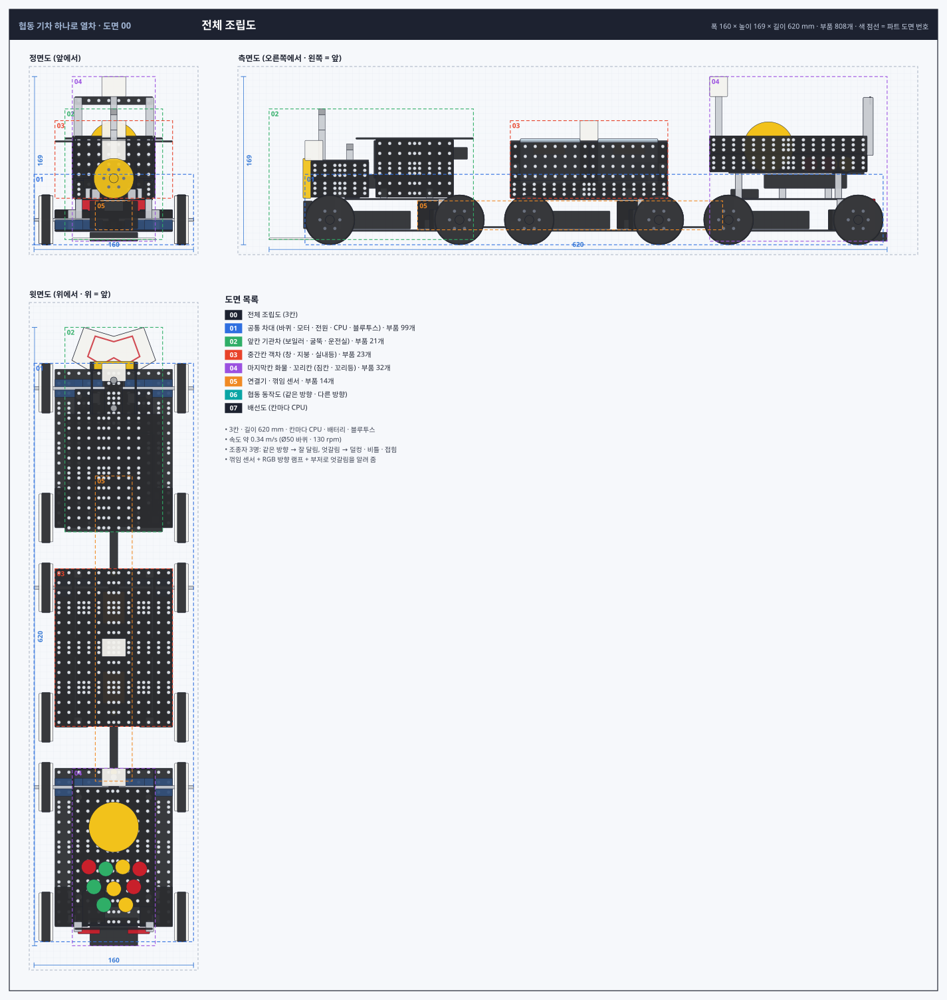
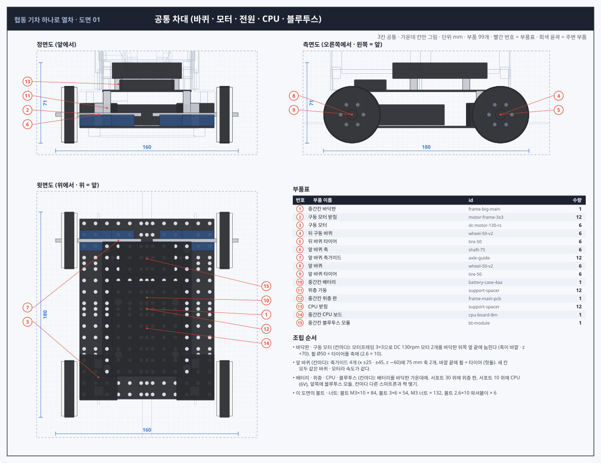
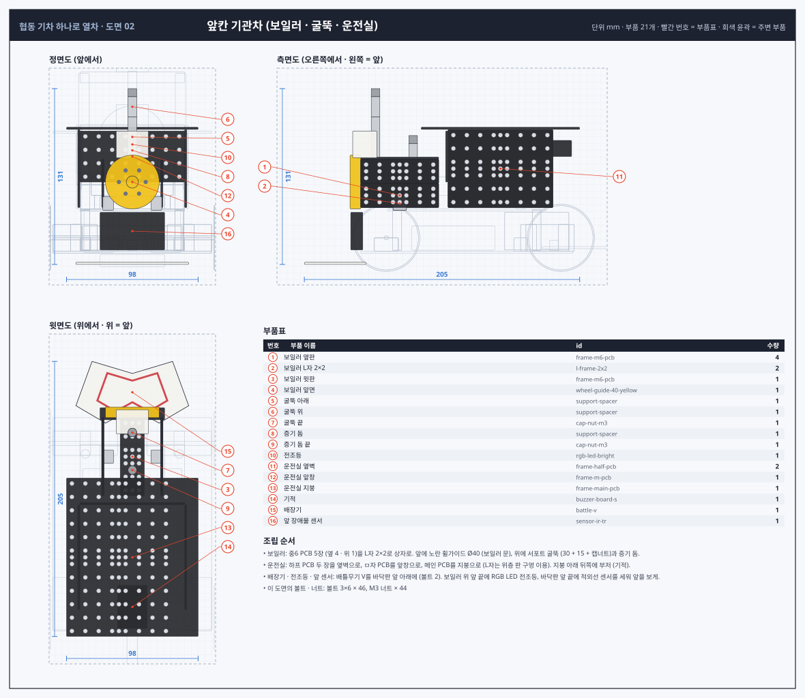
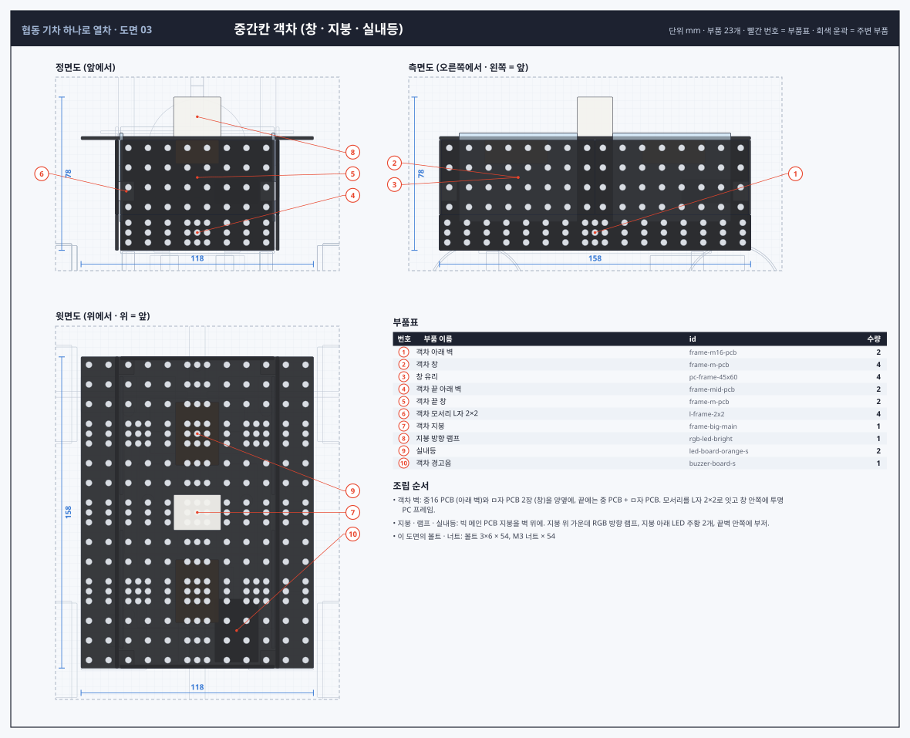
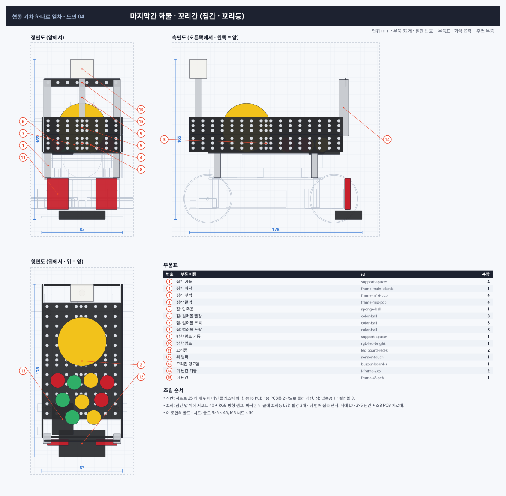
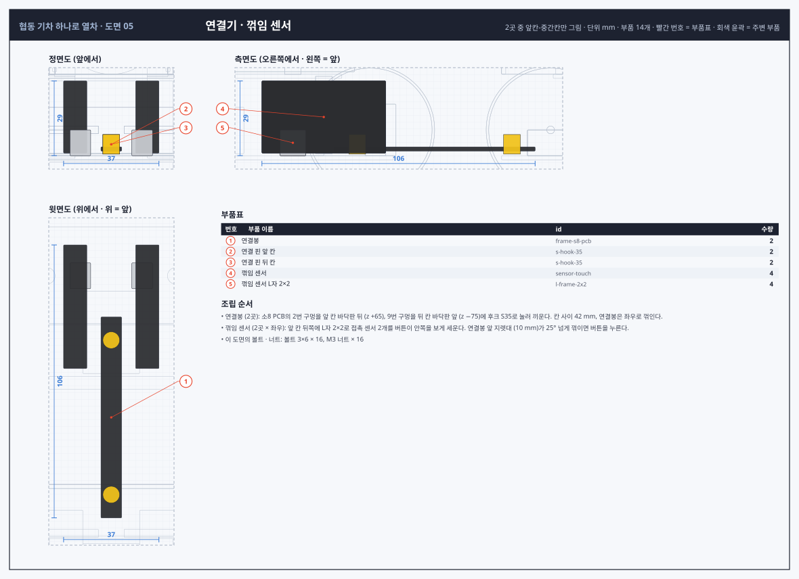
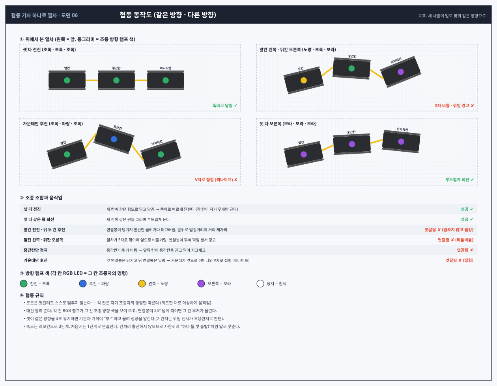
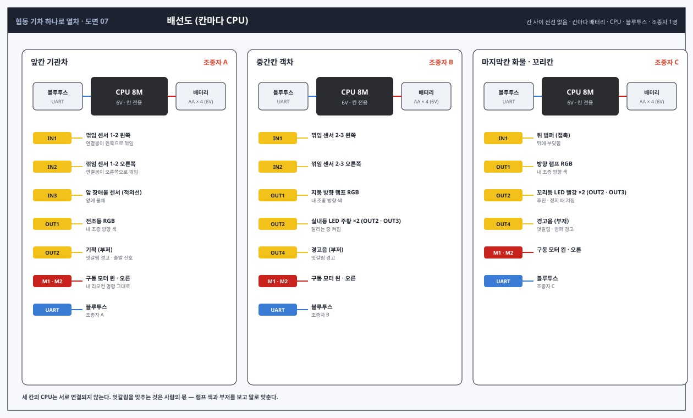

# 협동 기차 로봇 "하나로 열차" 설계도면

## 0. 의도 (간략)

- **3칸 기차**입니다. 앞칸 기관차, 중간칸 객차, 마지막칸 화물·꼬리칸이 서로 다른 모양입니다.
- **칸마다 CPU · 배터리 · 블루투스 · 구동 모터**가 따로 있습니다. 세 사람이 각자 리모컨(스마트폰)으로 자기 칸 하나만 조종합니다.
- 세 칸은 **연결봉으로만** 이어져 있고 서로 통신하지 않습니다.
  - 셋이 **같은 방향**이면 힘이 합쳐져 잘 달립니다.
  - **다른 방향**이면 멈추지 않고 덜컹거리고, 비틀거리고, V자로 접히는 등 이상하게 움직입니다.
- **목표는 의사소통**입니다. 세 사람이 말로 "하나 둘 셋, 전진!"처럼 맞춰 같은 방향으로 가게 만드는 협동 놀이 로봇입니다.
- 기능은 위 내용만 넣고, 디자인만 배틀무기와 여러 부품으로 꾸몄습니다.

## 1. 조사

| 내용 | 이 설계에 적용 |
|---|---|
| 칸 사이 연결은 연결봉 · 너클 · 볼-히치 방식이 흔하다 | 소8 PCB 연결봉 + 후크 S35 회전 핀 (양 끝이 돈다) |
| 연결봉이 길수록 꺾이는 범위가 커지지만 칸 사이가 멀어진다 | 핀 간격 60 mm, 칸 사이 42 mm로 절충 |
| 칸마다 힘을 받으면 각 연결부는 자기 칸 무게만 끌면 된다 | 칸마다 모터 2개 → 같은 방향일 때 연결봉이 거의 힘을 안 받음, 엇갈리면 연결봉이 당겨 · 밀려 이상한 움직임이 생긴다 |

출처: [Model train with improved coupling mechanism (US7383962)](https://patents.google.com/patent/US7383962), [Model train coupling (Justia)](https://patents.justia.com/patent/20060054582), [Drawbar US1862956A](https://patents.google.com/patent/US1862956A/en). 로봇 기차 전용 자료는 찾지 못해 모형 기차 연결 방식을 참고했습니다.

## 2. 개요

| 항목 | 값 |
|---|---|
| 전체 크기 | 폭 160 × 높이 183 × 길이 620 mm (3칸 + 연결기 2) |
| 칸 하나 | 차대 158 × 118, 바퀴 Ø50 4개 (뒤 2개 구동), 속도 약 0.34 m/s |
| 칸마다 | CPU 8M · 블루투스 모듈 · AA 4개 6V · DC 130rpm 2개 (기능은 이것만) |
| 부품 수 | 968개 (볼트 · 너트 · 케이블 포함), 42종 |

## 3. 도면

### 도면 00 · 전체 조립도 (3칸)

### 도면 01 · 공통 차대 (바퀴 · 모터 · 전원 · CPU · 블루투스)

### 도면 02 · 앞칸 기관차 (육각 보일러 · 굴뚝 · 박공 운전실)

### 도면 03 · 중간칸 객차 (3단 벽 · 채광창 지붕 · 별무늬 띠)

### 도면 04 · 마지막칸 화물 · 꼬리칸 (짐칸 · 브레이크 휠 · 사다리)

### 도면 05 · 연결기 (연결봉 · 회전 핀)

### 도면 06 · 협동 동작도 (같은 방향 · 다른 방향)

### 도면 07 · 배선도 (칸마다 CPU)

## 4. 협동 규칙

- 각 칸은 자기 조종자의 명령만 따른다. 엇갈려도 스스로 멈추지 않고, 연결봉으로 서로 끌고 밀며 이상하게 움직인다.
- 칸끼리 전선 · 통신이 없다. 같은 방향으로 가려면 세 사람이 말로 맞춰야 한다 ("하나 둘 셋, 전진!").
- 세 칸은 바퀴 · 모터 · 전원이 같아 같은 명령이면 같은 속도로 달린다.

| 조종 조합 | 움직임 | 결과 |
|---|---|---|
| 셋 다 전진 | 세 칸이 같은 힘으로 밀고 당김 → 똑바로 달린다 (각 칸이 자기 무게만 끈다) | 성공 ✔ |
| 셋 다 같은 쪽 회전 | 세 칸이 같은 원을 그리며 부드럽게 돈다 | 성공 ✔ |
| 앞칸 전진 · 뒤 두 칸 후진 | 연결봉이 당겨져 앞칸만 끌려가다 미끄러짐, 앞뒤로 덜컹거리며 거의 제자리 | 엇갈림 ✘ (멈추지 않고 덜컹) |
| 앞칸 왼쪽 · 뒤칸 오른쪽 | 열차가 S자로 꺾이며 옆으로 비틀거림 | 엇갈림 ✘ (비틀비틀) |
| 중간칸만 정지 | 중간칸 바퀴가 버팀 → 앞뒤 칸이 중간칸을 끌고 밀어 지그재그 | 엇갈림 ✘ |
| 가운데만 후진 | 앞 연결봉은 당기고 뒤 연결봉은 밀림 → 가운데가 옆으로 튀어나와 V자로 접힘 | 엇갈림 ✘ (접힘) |

## 5. 파트별 부품 위치

좌표는 부품 중심(mm), 크기는 X × Y × Z입니다. 번호는 도면의 빨간 번호입니다.
- 칸 중심 z: 앞칸 −200, 중간칸 0, 마지막칸 +200
- 공통 차대(01)는 가운데 칸 기준으로 적었고, 다른 칸은 z만 ±200 다릅니다.

### 01 공통 차대 (바퀴 · 모터 · 전원 · CPU · 블루투스)

| 번호 | 부품 | id | 중심 (X, Y, Z) | 크기 | 방향 · 메모 |
|---|---|---|---|---|---|
| 1 | 중간칸 바닥판 (빅 메인 PCB) | `frame-big-main` | (0, 14.2, 0.0) | 118.0 × 1.6 × 158.0 | 긴 쪽이 앞뒤, 지면에서 13.4 mm |
| 2 | 구동 모터 받침 (모터프레임 3×3) | `motor-frame-3x3` | (-42, 25.0, 48.0) | 8.0 × 20.0 × 8.0 |  |
| 2 | 구동 모터 받침 (모터프레임 3×3) | `motor-frame-3x3` | (-42, 25.0, 72.0) | 8.0 × 20.0 × 8.0 |  |
| 3 | 구동 모터 (DC 130rpm) | `dc-motor-130-rs` | (-42.5, 25.0, 60.0) | 33.0 × 20.0 × 40.0 | 옆으로 눕힘, 축이 바깥 · 뒤쪽 (z +70) |
| 4 | 뒤 구동 바퀴 (휠 Ø50[V2]) | `wheel-50-v2` | (-68, 25.0, 70.0) | 14.0 × 48.0 × 48.0 | 모터 D컷 축 |
| 5 | 뒤 바퀴 타이어 (Ø50) | `tire-50` | (-68, 25.0, 70.0) | 8.5 × 50.0 × 50.0 | 휠에 씌움 |
| 6 | 앞 바퀴 축 (75mm) | `shaft-75` | (-42.5, 25.0, -60.0) | 75.0 × 3.0 × 3.0 | x = ±5 ~ ±80, 바퀴가 헛돈다 |
| 7 | 앞 바퀴 축가이드 | `axle-guide` | (-25, 20.0, -60.0) | 28.0 × 10.0 × 18.0 | 바닥판 위, 축 높이 25 |
| 7 | 앞 바퀴 축가이드 | `axle-guide` | (-45, 20.0, -60.0) | 28.0 × 10.0 × 18.0 | 바닥판 위, 축 높이 25 |
| 8 | 앞 바퀴 (휠 Ø50[V2], 헛돎) | `wheel-50-v2` | (-68, 25.0, -60.0) | 14.0 × 48.0 × 48.0 | 75 mm 축에서 자유롭게 돈다 |
| 9 | 앞 바퀴 타이어 (Ø50) | `tire-50` | (-68, 25.0, -60.0) | 8.5 × 50.0 × 50.0 |  |
| 2 | 구동 모터 받침 (모터프레임 3×3) | `motor-frame-3x3` | (42, 25.0, 48.0) | 8.0 × 20.0 × 8.0 |  |
| 2 | 구동 모터 받침 (모터프레임 3×3) | `motor-frame-3x3` | (42, 25.0, 72.0) | 8.0 × 20.0 × 8.0 |  |
| 3 | 구동 모터 (DC 130rpm) | `dc-motor-130-rs` | (42.5, 25.0, 60.0) | 33.0 × 20.0 × 40.0 | 옆으로 눕힘, 축이 바깥 · 뒤쪽 (z +70) |
| 4 | 뒤 구동 바퀴 (휠 Ø50[V2]) | `wheel-50-v2` | (68, 25.0, 70.0) | 14.0 × 48.0 × 48.0 | 모터 D컷 축 |
| 5 | 뒤 바퀴 타이어 (Ø50) | `tire-50` | (68, 25.0, 70.0) | 8.5 × 50.0 × 50.0 | 휠에 씌움 |
| 6 | 앞 바퀴 축 (75mm) | `shaft-75` | (42.5, 25.0, -60.0) | 75.0 × 3.0 × 3.0 | x = ±5 ~ ±80, 바퀴가 헛돈다 |
| 7 | 앞 바퀴 축가이드 | `axle-guide` | (25, 20.0, -60.0) | 28.0 × 10.0 × 18.0 | 바닥판 위, 축 높이 25 |
| 7 | 앞 바퀴 축가이드 | `axle-guide` | (45, 20.0, -60.0) | 28.0 × 10.0 × 18.0 | 바닥판 위, 축 높이 25 |
| 8 | 앞 바퀴 (휠 Ø50[V2], 헛돎) | `wheel-50-v2` | (68, 25.0, -60.0) | 14.0 × 48.0 × 48.0 | 75 mm 축에서 자유롭게 돈다 |
| 9 | 앞 바퀴 타이어 (Ø50) | `tire-50` | (68, 25.0, -60.0) | 8.5 × 50.0 × 50.0 |  |
| 10 | 중간칸 배터리 (AA 4개, 6V) | `battery-case-4aa` | (0, 24.8, -10.0) | 74.0 × 18.0 × 62.0 | 칸마다 따로 (각자 전원) |
| 11 | 위층 기둥 (서포트 30) | `support-spacer` | (-35, 30.8, -52.0) | 6.4 × 30.0 × 6.4 |  |
| 11 | 위층 기둥 (서포트 30) | `support-spacer` | (-35, 30.8, 52.0) | 6.4 × 30.0 × 6.4 |  |
| 11 | 위층 기둥 (서포트 30) | `support-spacer` | (35, 30.8, -52.0) | 6.4 × 30.0 × 6.4 |  |
| 11 | 위층 기둥 (서포트 30) | `support-spacer` | (35, 30.8, 52.0) | 6.4 × 30.0 × 6.4 |  |
| 12 | 중간칸 위층 판 (메인 PCB) | `frame-main-pcb` | (0, 45.8, 0.0) | 78.0 × 1.6 × 118.0 | 전자부 판 |
| 13 | CPU 받침 (서포트 10) | `support-spacer` | (-25, 51.6, -6.0) | 6.4 × 10.0 × 6.4 |  |
| 13 | CPU 받침 (서포트 10) | `support-spacer` | (-25, 51.6, 40.0) | 6.4 × 10.0 × 6.4 |  |
| 13 | CPU 받침 (서포트 10) | `support-spacer` | (25, 51.6, -6.0) | 6.4 × 10.0 × 6.4 |  |
| 13 | CPU 받침 (서포트 10) | `support-spacer` | (25, 51.6, 40.0) | 6.4 × 10.0 × 6.4 |  |
| 14 | 중간칸 CPU 보드 (칸마다 하나) | `cpu-board-8m` | (0, 63.6, 17.0) | 61.0 × 14.0 × 83.0 | 긴 쪽이 앞뒤, 전압 스위치 6V |
| 15 | 중간칸 블루투스 모듈 (조종자 1명) | `bt-module` | (0, 51.1, -44.0) | 48.0 × 9.0 × 28.0 | 위층 앞쪽 |

### 02 앞칸 기관차 (육각 보일러 · 굴뚝 · 박공 운전실)

| 번호 | 부품 | id | 중심 (X, Y, Z) | 크기 | 방향 · 메모 |
|---|---|---|---|---|---|
| 1 | 발판 기둥 (서포트 30) | `support-spacer` | (-50, 30.0, -260.0) | 6.4 × 30.0 × 6.4 |  |
| 1 | 발판 기둥 (서포트 30) | `support-spacer` | (-50, 30.0, -200.0) | 6.4 × 30.0 × 6.4 |  |
| 1 | 발판 기둥 (서포트 30) | `support-spacer` | (-50, 30.0, -140.0) | 6.4 × 30.0 × 6.4 |  |
| 2 | 발판 (중16 PCB) | `frame-m16-pcb` | (-50, 45.8, -200.0) | 18.0 × 1.6 × 158.0 | 차체 양옆 통로 |
| 3 | 왼 불꽃 스커트 (배틀무기 J) | `battle-j` | (-60.5, 30.0, -205.0) | 1.6 × 28.0 × 80.0 | 바퀴 사이 옆면, 발판 아래 |
| 1 | 발판 기둥 (서포트 30) | `support-spacer` | (50, 30.0, -260.0) | 6.4 × 30.0 × 6.4 |  |
| 1 | 발판 기둥 (서포트 30) | `support-spacer` | (50, 30.0, -200.0) | 6.4 × 30.0 × 6.4 |  |
| 1 | 발판 기둥 (서포트 30) | `support-spacer` | (50, 30.0, -140.0) | 6.4 × 30.0 × 6.4 |  |
| 2 | 발판 (중16 PCB) | `frame-m16-pcb` | (50, 45.8, -200.0) | 18.0 × 1.6 × 158.0 | 차체 양옆 통로 |
| 4 | 오른 불꽃 스커트 (배틀무기 I) | `battle-i` | (60.5, 30.0, -205.0) | 1.6 × 28.0 × 80.0 | 바퀴 사이 옆면, 발판 아래 |
| 5 | 보일러 받침 기둥 (서포트 10) | `support-spacer` | (-30, 51.6, -260.0) | 6.4 × 10.0 × 6.4 |  |
| 5 | 보일러 받침 기둥 (서포트 10) | `support-spacer` | (30, 51.6, -260.0) | 6.4 × 10.0 × 6.4 |  |
| 6 | 보일러 받침 (중 PCB) | `frame-mid-pcb` | (0, 57.4, -260.0) | 78.0 × 1.6 × 18.0 | 보일러를 얹는 안장 |
| 5 | 보일러 받침 기둥 (서포트 10) | `support-spacer` | (-30, 51.6, -236.0) | 6.4 × 10.0 × 6.4 |  |
| 5 | 보일러 받침 기둥 (서포트 10) | `support-spacer` | (30, 51.6, -236.0) | 6.4 × 10.0 × 6.4 |  |
| 6 | 보일러 받침 (중 PCB) | `frame-mid-pcb` | (0, 57.4, -236.0) | 78.0 × 1.6 × 18.0 | 보일러를 얹는 안장 |
| 7 | 육각 보일러 판 (중6 PCB) | `frame-m6-pcb` | (13.51, 82.8, -248.0) | 10.4 × 16.4 × 58.0 | 6장이 육각 원통 |
| 8 | 보일러 모서리 (120도 L자 · 탭) | `l-frame-120-2x2` | (9, 90.6, -248.0) | 8.0 × 8.0 × 10.0 | 육각 꼭짓점 안쪽, 너트 없이 볼트 |
| 7 | 육각 보일러 판 (중6 PCB) | `frame-m6-pcb` | (9.55225e-16, 90.6, -248.0) | 18.0 × 1.6 × 58.0 | 6장이 육각 원통 |
| 8 | 보일러 모서리 (120도 L자 · 탭) | `l-frame-120-2x2` | (-9, 90.6, -248.0) | 8.0 × 8.0 × 10.0 | 육각 꼭짓점 안쪽, 너트 없이 볼트 |
| 7 | 육각 보일러 판 (중6 PCB) | `frame-m6-pcb` | (-13.51, 82.8, -248.0) | 10.4 × 16.4 × 58.0 | 6장이 육각 원통 |
| 8 | 보일러 모서리 (120도 L자 · 탭) | `l-frame-120-2x2` | (-18, 75.0, -248.0) | 8.0 × 8.0 × 10.0 | 육각 꼭짓점 안쪽, 너트 없이 볼트 |
| 7 | 육각 보일러 판 (중6 PCB) | `frame-m6-pcb` | (-13.51, 67.2, -248.0) | 10.4 × 16.4 × 58.0 | 6장이 육각 원통 |
| 8 | 보일러 모서리 (120도 L자 · 탭) | `l-frame-120-2x2` | (-9, 59.4, -248.0) | 8.0 × 8.0 × 10.0 | 육각 꼭짓점 안쪽, 너트 없이 볼트 |
| 7 | 육각 보일러 판 (중6 PCB) | `frame-m6-pcb` | (-2.86567e-15, 59.4, -248.0) | 18.0 × 1.6 × 58.0 | 6장이 육각 원통 |
| 8 | 보일러 모서리 (120도 L자 · 탭) | `l-frame-120-2x2` | (9, 59.4, -248.0) | 8.0 × 8.0 × 10.0 | 육각 꼭짓점 안쪽, 너트 없이 볼트 |
| 7 | 육각 보일러 판 (중6 PCB) | `frame-m6-pcb` | (13.51, 67.2, -248.0) | 10.4 × 16.4 × 58.0 | 6장이 육각 원통 |
| 8 | 보일러 모서리 (120도 L자 · 탭) | `l-frame-120-2x2` | (18, 75.0, -248.0) | 8.0 × 8.0 × 10.0 | 육각 꼭짓점 안쪽, 너트 없이 볼트 |
| 9 | 보일러 앞문 (노란 휠가이드 Ø40) | `wheel-guide-40-yellow` | (0, 75.0, -281.0) | 40.0 × 40.0 × 8.0 | 연기실 문 |
| 10 | 전조등 (흰 휠가이드 Ø30) | `wheel-guide-30-servo` | (0, 102.0, -280.0) | 30.0 × 30.0 × 8.0 | 보일러 앞 위, 장식 렌즈 |
| 11 | 전조등 받침 (L자 2×1) | `l-frame-2x1` | (0, 93.0, -276.0) | 8.0 × 10.0 × 8.0 |  |
| 12 | 굴뚝 (서포트 20) | `support-spacer` | (0, 102.2, -266.0) | 6.4 × 20.0 × 6.4 | 보일러 윗면 앞 |
| 13 | 굴뚝 깔때기 (검정 휠가이드 Ø30) | `wheel-guide-30-nylon` | (0, 116.2, -266.0) | 30.0 × 8.0 × 30.0 | 굴뚝 끝이 넓어지는 모양 |
| 14 | 굴뚝 마개 (캡너트) | `cap-nut-m3` | (0, 123.2, -266.0) | 6.4 × 6.0 × 6.4 |  |
| 15 | 증기 돔 기둥 (서포트 7) | `support-spacer` | (0, 95.7, -246.0) | 6.4 × 7.0 × 6.4 |  |
| 16 | 증기 돔 (컬러볼 노랑) | `color-ball` | (0, 106.7, -246.0) | 15.0 × 15.0 × 15.0 |  |
| 17 | 모래 돔 기둥 (서포트 5) | `support-spacer` | (0, 94.7, -230.0) | 6.4 × 5.0 × 6.4 |  |
| 18 | 모래 돔 (컬러볼 노랑) | `color-ball` | (0, 104.7, -230.0) | 15.0 × 15.0 × 15.0 |  |
| 19 | 앞 완충보 (배틀무기 G, 별 무늬) | `battle-g` | (0, 22.0, -280.5) | 90.0 × 18.0 × 1.6 | 바닥판 앞 끝에 세움 |
| 20 | 완충기 (서포트 10, 앞으로) | `support-spacer` | (-36, 22.0, -286.5) | 6.4 × 6.4 × 10.0 | 완충보에서 앞으로 |
| 21 | 완충기 머리 (캡너트) | `cap-nut-m3` | (-36, 22.0, -294.5) | 6.4 × 6.4 × 6.0 |  |
| 22 | 앞 표지등 장식 (컬러볼 빨강) | `color-ball` | (-52, 54.1, -272.0) | 15.0 × 15.0 × 15.0 |  |
| 20 | 완충기 (서포트 10, 앞으로) | `support-spacer` | (36, 22.0, -286.5) | 6.4 × 6.4 × 10.0 | 완충보에서 앞으로 |
| 21 | 완충기 머리 (캡너트) | `cap-nut-m3` | (36, 22.0, -294.5) | 6.4 × 6.4 × 6.0 |  |
| 22 | 앞 표지등 장식 (컬러볼 빨강) | `color-ball` | (52, 54.1, -272.0) | 15.0 × 15.0 × 15.0 |  |
| 23 | 배장기 (배틀무기 U, 톱날) | `battle-u` | (0, 6.0, -300.0) | 84.0 × 1.6 × 40.0 | 바닥판 앞 아래, 앞으로 20 mm |
| 24 | 운전실 아래 벽 (중 PCB) | `frame-mid-pcb` | (-40.8, 55.6, -170.0) | 1.6 × 18.0 × 78.0 | 세움 |
| 25 | 운전실 옆창 (ㅁ자 PCB) | `frame-m-pcb` | (-40.8, 83.6, -170.0) | 1.6 × 38.0 × 78.0 | 세움 |
| 26 | 운전실 창 유리 (투명 PC) | `pc-frame-45x60` | (-38.6, 83.6, -170.0) | 1.6 × 45.0 × 60.0 |  |
| 27 | 운전실 손잡이 (L자 2×6) | `l-frame-2x6` | (-42, 76.6, -128.0) | 8.0 × 58.0 × 10.0 | 운전실 뒤 모서리 |
| 24 | 운전실 아래 벽 (중 PCB) | `frame-mid-pcb` | (40.8, 55.6, -170.0) | 1.6 × 18.0 × 78.0 | 세움 |
| 25 | 운전실 옆창 (ㅁ자 PCB) | `frame-m-pcb` | (40.8, 83.6, -170.0) | 1.6 × 38.0 × 78.0 | 세움 |
| 26 | 운전실 창 유리 (투명 PC) | `pc-frame-45x60` | (38.6, 83.6, -170.0) | 1.6 × 45.0 × 60.0 |  |
| 27 | 운전실 손잡이 (L자 2×6) | `l-frame-2x6` | (42, 76.6, -128.0) | 8.0 × 58.0 × 10.0 | 운전실 뒤 모서리 |
| 28 | 운전실 앞창 (ㅁ자 PCB) | `frame-m-pcb` | (0, 83.6, -210.0) | 78.0 × 38.0 × 1.6 | 보일러 위로 앞을 봄 |
| 29 | 운전실 앞 아래 벽 (중 PCB) | `frame-mid-pcb` | (0, 55.6, -210.0) | 78.0 × 18.0 × 1.6 |  |
| 30 | 운전실 박공 지붕 (하프 PCB) | `frame-half-pcb` | (-25.1, 118.1, -170.0) | 51.0 × 30.4 × 78.0 | 30° 경사 두 장 |
| 30 | 운전실 박공 지붕 (하프 PCB) | `frame-half-pcb` | (25.1, 118.1, -170.0) | 51.0 × 30.4 × 78.0 | 30° 경사 두 장 |
| 31 | 지붕 용마루 (120도 L자 · 탭) | `l-frame-120-2x2` | (0, 128.6, -190.0) | 12.0 × 8.0 × 8.0 | 두 지붕판을 120°로 |
| 31 | 지붕 용마루 (120도 L자 · 탭) | `l-frame-120-2x2` | (0, 128.6, -150.0) | 12.0 × 8.0 × 8.0 | 두 지붕판을 120°로 |

### 03 중간칸 객차 (3단 벽 · 채광창 지붕 · 별무늬 띠)

| 번호 | 부품 | id | 중심 (X, Y, Z) | 크기 | 방향 · 메모 |
|---|---|---|---|---|---|
| 1 | 객차 아래 벽 (중16 PCB) | `frame-m16-pcb` | (-40.8, 55.6, 0.0) | 1.6 × 18.0 × 158.0 | 세움 |
| 2 | 객차 창 (ㅁ자 PCB) | `frame-m-pcb` | (-40.8, 83.6, -39.0) | 1.6 × 38.0 × 78.0 | 세움, 창문 |
| 3 | 창 유리 (투명 PC 프레임) | `pc-frame-45x60` | (-38.6, 83.6, -39.0) | 1.6 × 45.0 × 60.0 | ㅁ자 창 안쪽 |
| 4 | 별무늬 띠 (배틀무기 G) | `battle-g` | (-42.4, 55.6, -39.0) | 1.6 × 18.0 × 90.0 | 아래 벽 바깥, 흰 바탕 빨간 별 |
| 2 | 객차 창 (ㅁ자 PCB) | `frame-m-pcb` | (-40.8, 83.6, 39.0) | 1.6 × 38.0 × 78.0 | 세움, 창문 |
| 3 | 창 유리 (투명 PC 프레임) | `pc-frame-45x60` | (-38.6, 83.6, 39.0) | 1.6 × 45.0 × 60.0 | ㅁ자 창 안쪽 |
| 4 | 별무늬 띠 (배틀무기 G) | `battle-g` | (-42.4, 55.6, 39.0) | 1.6 × 18.0 × 90.0 | 아래 벽 바깥, 흰 바탕 빨간 별 |
| 5 | 객차 위 벽 (중16 PCB) | `frame-m16-pcb` | (-40.8, 111.6, 0.0) | 1.6 × 18.0 × 158.0 | 세움, 창 위 |
| 6 | 출입문 발판 (L자 2×1) | `l-frame-2x1` | (-46, 10.0, -75.0) | 10.0 × 8.0 × 8.0 | 바닥판 아래 모서리 |
| 6 | 출입문 발판 (L자 2×1) | `l-frame-2x1` | (-46, 10.0, 75.0) | 10.0 × 8.0 × 8.0 | 바닥판 아래 모서리 |
| 1 | 객차 아래 벽 (중16 PCB) | `frame-m16-pcb` | (40.8, 55.6, 0.0) | 1.6 × 18.0 × 158.0 | 세움 |
| 2 | 객차 창 (ㅁ자 PCB) | `frame-m-pcb` | (40.8, 83.6, -39.0) | 1.6 × 38.0 × 78.0 | 세움, 창문 |
| 3 | 창 유리 (투명 PC 프레임) | `pc-frame-45x60` | (38.6, 83.6, -39.0) | 1.6 × 45.0 × 60.0 | ㅁ자 창 안쪽 |
| 4 | 별무늬 띠 (배틀무기 G) | `battle-g` | (42.4, 55.6, -39.0) | 1.6 × 18.0 × 90.0 | 아래 벽 바깥, 흰 바탕 빨간 별 |
| 2 | 객차 창 (ㅁ자 PCB) | `frame-m-pcb` | (40.8, 83.6, 39.0) | 1.6 × 38.0 × 78.0 | 세움, 창문 |
| 3 | 창 유리 (투명 PC 프레임) | `pc-frame-45x60` | (38.6, 83.6, 39.0) | 1.6 × 45.0 × 60.0 | ㅁ자 창 안쪽 |
| 4 | 별무늬 띠 (배틀무기 G) | `battle-g` | (42.4, 55.6, 39.0) | 1.6 × 18.0 × 90.0 | 아래 벽 바깥, 흰 바탕 빨간 별 |
| 5 | 객차 위 벽 (중16 PCB) | `frame-m16-pcb` | (40.8, 111.6, 0.0) | 1.6 × 18.0 × 158.0 | 세움, 창 위 |
| 6 | 출입문 발판 (L자 2×1) | `l-frame-2x1` | (46, 10.0, -75.0) | 10.0 × 8.0 × 8.0 | 바닥판 아래 모서리 |
| 6 | 출입문 발판 (L자 2×1) | `l-frame-2x1` | (46, 10.0, 75.0) | 10.0 × 8.0 × 8.0 | 바닥판 아래 모서리 |
| 7 | 객차 끝 아래 벽 (중 PCB) | `frame-mid-pcb` | (0, 55.6, -78.2) | 78.0 × 18.0 × 1.6 | 세움 |
| 8 | 객차 끝 문창 (ㅁ자 PCB) | `frame-m-pcb` | (0, 83.6, -78.2) | 78.0 × 38.0 × 1.6 | 세움 |
| 9 | 객차 끝 위 벽 (중 PCB) | `frame-mid-pcb` | (0, 111.6, -78.2) | 78.0 × 18.0 × 1.6 | 세움 |
| 10 | 객차 모서리 L자 2×2 | `l-frame-2x2` | (-36, 61.6, -74.0) | 8.0 × 10.0 × 8.0 |  |
| 10 | 객차 모서리 L자 2×2 | `l-frame-2x2` | (-36, 101.6, -74.0) | 8.0 × 10.0 × 8.0 |  |
| 10 | 객차 모서리 L자 2×2 | `l-frame-2x2` | (36, 61.6, -74.0) | 8.0 × 10.0 × 8.0 |  |
| 10 | 객차 모서리 L자 2×2 | `l-frame-2x2` | (36, 101.6, -74.0) | 8.0 × 10.0 × 8.0 |  |
| 7 | 객차 끝 아래 벽 (중 PCB) | `frame-mid-pcb` | (0, 55.6, 78.2) | 78.0 × 18.0 × 1.6 | 세움 |
| 8 | 객차 끝 문창 (ㅁ자 PCB) | `frame-m-pcb` | (0, 83.6, 78.2) | 78.0 × 38.0 × 1.6 | 세움 |
| 9 | 객차 끝 위 벽 (중 PCB) | `frame-mid-pcb` | (0, 111.6, 78.2) | 78.0 × 18.0 × 1.6 | 세움 |
| 10 | 객차 모서리 L자 2×2 | `l-frame-2x2` | (-36, 61.6, 74.0) | 8.0 × 10.0 × 8.0 |  |
| 10 | 객차 모서리 L자 2×2 | `l-frame-2x2` | (-36, 101.6, 74.0) | 8.0 × 10.0 × 8.0 |  |
| 10 | 객차 모서리 L자 2×2 | `l-frame-2x2` | (36, 61.6, 74.0) | 8.0 × 10.0 × 8.0 |  |
| 10 | 객차 모서리 L자 2×2 | `l-frame-2x2` | (36, 101.6, 74.0) | 8.0 × 10.0 × 8.0 |  |
| 11 | 객차 지붕 (빅 메인 PCB) | `frame-big-main` | (0, 121.4, 0.0) | 118.0 × 1.6 × 158.0 | 처마가 양옆으로 19 mm |
| 12 | 채광창 기둥 (서포트 10) | `support-spacer` | (-15, 127.2, -50.0) | 6.4 × 10.0 × 6.4 |  |
| 12 | 채광창 기둥 (서포트 10) | `support-spacer` | (-15, 127.2, 50.0) | 6.4 × 10.0 × 6.4 |  |
| 12 | 채광창 기둥 (서포트 10) | `support-spacer` | (15, 127.2, -50.0) | 6.4 × 10.0 × 6.4 |  |
| 12 | 채광창 기둥 (서포트 10) | `support-spacer` | (15, 127.2, 50.0) | 6.4 × 10.0 × 6.4 |  |
| 13 | 채광창 지붕 (5×13 PCB) | `frame-5x13-pcb` | (0, 133.0, 0.0) | 38.0 × 1.6 × 118.0 | 지붕 가운데 위로 한 단 |
| 14 | 채광창 유리 (투명 PC) | `pc-frame-45x60` | (-19.8, 127.2, 0.0) | 1.6 × 10.0 × 60.0 | 채광창 옆, 세움 |
| 14 | 채광창 유리 (투명 PC) | `pc-frame-45x60` | (19.8, 127.2, 0.0) | 1.6 × 10.0 × 60.0 | 채광창 옆, 세움 |
| 15 | 지붕 환기구 (캡너트) | `cap-nut-m3` | (0, 136.8, -50.0) | 6.4 × 6.0 × 6.4 |  |
| 15 | 지붕 환기구 (캡너트) | `cap-nut-m3` | (0, 136.8, -30.0) | 6.4 × 6.0 × 6.4 |  |
| 15 | 지붕 환기구 (캡너트) | `cap-nut-m3` | (0, 136.8, -10.0) | 6.4 × 6.0 × 6.4 |  |
| 15 | 지붕 환기구 (캡너트) | `cap-nut-m3` | (0, 136.8, 10.0) | 6.4 × 6.0 × 6.4 |  |
| 15 | 지붕 환기구 (캡너트) | `cap-nut-m3` | (0, 136.8, 30.0) | 6.4 × 6.0 × 6.4 |  |
| 15 | 지붕 환기구 (캡너트) | `cap-nut-m3` | (0, 136.8, 50.0) | 6.4 × 6.0 × 6.4 |  |

### 04 마지막칸 화물 · 꼬리칸 (짐칸 · 브레이크 휠 · 사다리)

| 번호 | 부품 | id | 중심 (X, Y, Z) | 크기 | 방향 · 메모 |
|---|---|---|---|---|---|
| 1 | 짐칸 받침 기둥 (서포트 25) | `support-spacer` | (-35, 59.1, 150.0) | 6.4 × 25.0 × 6.4 |  |
| 1 | 짐칸 받침 기둥 (서포트 25) | `support-spacer` | (-35, 59.1, 250.0) | 6.4 × 25.0 × 6.4 |  |
| 1 | 짐칸 받침 기둥 (서포트 25) | `support-spacer` | (35, 59.1, 150.0) | 6.4 × 25.0 × 6.4 |  |
| 1 | 짐칸 받침 기둥 (서포트 25) | `support-spacer` | (35, 59.1, 250.0) | 6.4 × 25.0 × 6.4 |  |
| 2 | 짐칸 바닥 (메인 플라스틱) | `frame-main-plastic` | (0, 72.4, 200.0) | 80.0 × 1.6 × 120.0 | CPU 위 |
| 3 | 짐칸 옆벽 (중16 PCB) | `frame-m16-pcb` | (-40.8, 82.2, 200.0) | 1.6 × 18.0 × 158.0 | 세움, 2단 |
| 3 | 짐칸 옆벽 (중16 PCB) | `frame-m16-pcb` | (-40.8, 100.2, 200.0) | 1.6 × 18.0 × 158.0 | 세움, 2단 |
| 4 | 짐칸 갈빗대 (L자 2×6) | `l-frame-2x6` | (-43, 90.6, 140.0) | 4.0 × 58.0 × 8.0 | 옆벽 바깥 세로 보강 |
| 4 | 짐칸 갈빗대 (L자 2×6) | `l-frame-2x6` | (-43, 90.6, 180.0) | 4.0 × 58.0 × 8.0 | 옆벽 바깥 세로 보강 |
| 4 | 짐칸 갈빗대 (L자 2×6) | `l-frame-2x6` | (-43, 90.6, 220.0) | 4.0 × 58.0 × 8.0 | 옆벽 바깥 세로 보강 |
| 4 | 짐칸 갈빗대 (L자 2×6) | `l-frame-2x6` | (-43, 90.6, 260.0) | 4.0 × 58.0 × 8.0 | 옆벽 바깥 세로 보강 |
| 3 | 짐칸 옆벽 (중16 PCB) | `frame-m16-pcb` | (40.8, 82.2, 200.0) | 1.6 × 18.0 × 158.0 | 세움, 2단 |
| 3 | 짐칸 옆벽 (중16 PCB) | `frame-m16-pcb` | (40.8, 100.2, 200.0) | 1.6 × 18.0 × 158.0 | 세움, 2단 |
| 4 | 짐칸 갈빗대 (L자 2×6) | `l-frame-2x6` | (43, 90.6, 140.0) | 4.0 × 58.0 × 8.0 | 옆벽 바깥 세로 보강 |
| 4 | 짐칸 갈빗대 (L자 2×6) | `l-frame-2x6` | (43, 90.6, 180.0) | 4.0 × 58.0 × 8.0 | 옆벽 바깥 세로 보강 |
| 4 | 짐칸 갈빗대 (L자 2×6) | `l-frame-2x6` | (43, 90.6, 220.0) | 4.0 × 58.0 × 8.0 | 옆벽 바깥 세로 보강 |
| 4 | 짐칸 갈빗대 (L자 2×6) | `l-frame-2x6` | (43, 90.6, 260.0) | 4.0 × 58.0 × 8.0 | 옆벽 바깥 세로 보강 |
| 5 | 짐칸 끝벽 (중 PCB) | `frame-mid-pcb` | (0, 82.2, 121.8) | 78.0 × 18.0 × 1.6 | 세움, 2단 |
| 5 | 짐칸 끝벽 (중 PCB) | `frame-mid-pcb` | (0, 100.2, 121.8) | 78.0 × 18.0 × 1.6 | 세움, 2단 |
| 6 | 짐칸 모서리 기둥 (서포트 40) | `support-spacer` | (-39, 92.6, 124.0) | 6.4 × 40.0 × 6.4 |  |
| 7 | 모서리 기둥 머리 (캡너트) | `cap-nut-m3` | (-39, 115.6, 124.0) | 6.4 × 6.0 × 6.4 |  |
| 6 | 짐칸 모서리 기둥 (서포트 40) | `support-spacer` | (39, 92.6, 124.0) | 6.4 × 40.0 × 6.4 |  |
| 7 | 모서리 기둥 머리 (캡너트) | `cap-nut-m3` | (39, 115.6, 124.0) | 6.4 × 6.0 × 6.4 |  |
| 5 | 짐칸 끝벽 (중 PCB) | `frame-mid-pcb` | (0, 82.2, 278.2) | 78.0 × 18.0 × 1.6 | 세움, 2단 |
| 5 | 짐칸 끝벽 (중 PCB) | `frame-mid-pcb` | (0, 100.2, 278.2) | 78.0 × 18.0 × 1.6 | 세움, 2단 |
| 6 | 짐칸 모서리 기둥 (서포트 40) | `support-spacer` | (-39, 92.6, 276.0) | 6.4 × 40.0 × 6.4 |  |
| 7 | 모서리 기둥 머리 (캡너트) | `cap-nut-m3` | (-39, 115.6, 276.0) | 6.4 × 6.0 × 6.4 |  |
| 6 | 짐칸 모서리 기둥 (서포트 40) | `support-spacer` | (39, 92.6, 276.0) | 6.4 × 40.0 × 6.4 |  |
| 7 | 모서리 기둥 머리 (캡너트) | `cap-nut-m3` | (39, 115.6, 276.0) | 6.4 × 6.0 × 6.4 |  |
| 8 | 짐: 압축공 | `sponge-ball` | (0, 98.2, 180.0) | 50.0 × 50.0 × 50.0 |  |
| 9 | 짐: 컬러볼 빨강 | `color-ball` | (-25, 80.7, 220.0) | 15.0 × 15.0 × 15.0 |  |
| 10 | 짐: 컬러볼 초록 | `color-ball` | (-8, 80.7, 222.0) | 15.0 × 15.0 × 15.0 |  |
| 11 | 짐: 컬러볼 노랑 | `color-ball` | (9, 80.7, 220.0) | 15.0 × 15.0 × 15.0 |  |
| 9 | 짐: 컬러볼 빨강 | `color-ball` | (26, 80.7, 222.0) | 15.0 × 15.0 × 15.0 |  |
| 10 | 짐: 컬러볼 초록 | `color-ball` | (-20, 80.7, 240.0) | 15.0 × 15.0 × 15.0 |  |
| 11 | 짐: 컬러볼 노랑 | `color-ball` | (0, 80.7, 242.0) | 15.0 × 15.0 × 15.0 |  |
| 9 | 짐: 컬러볼 빨강 | `color-ball` | (20, 80.7, 240.0) | 15.0 × 15.0 × 15.0 |  |
| 10 | 짐: 컬러볼 초록 | `color-ball` | (-10, 80.7, 258.0) | 15.0 × 15.0 × 15.0 |  |
| 11 | 짐: 컬러볼 노랑 | `color-ball` | (12, 80.7, 258.0) | 15.0 × 15.0 × 15.0 |  |
| 12 | 뒤 문장 (배틀무기 S, 방패) | `battle-s` | (0, 90.6, 280.2) | 50.0 × 56.0 × 1.6 | 뒤 끝벽 바깥 |
| 13 | 브레이크 휠 축 (서포트 15) | `support-spacer` | (25, 116.6, 280.0) | 6.4 × 15.0 × 6.4 | 뒤 끝벽 위 |
| 14 | 핸드 브레이크 휠 (노란 휠가이드 Ø40) | `wheel-guide-40-yellow` | (25, 127.6, 280.0) | 40.0 × 8.0 × 40.0 | 장식 (돌지 않음) |
| 15 | 뒤 사다리 (캐터필러 마디) | `caterpillar-link` | (-28, 22.0, 281.5) | 22.0 × 10.0 × 3.0 | 6개를 세로로 이어 사다리 |
| 15 | 뒤 사다리 (캐터필러 마디) | `caterpillar-link` | (-28, 32.0, 281.5) | 22.0 × 10.0 × 3.0 | 6개를 세로로 이어 사다리 |
| 15 | 뒤 사다리 (캐터필러 마디) | `caterpillar-link` | (-28, 42.0, 281.5) | 22.0 × 10.0 × 3.0 | 6개를 세로로 이어 사다리 |
| 15 | 뒤 사다리 (캐터필러 마디) | `caterpillar-link` | (-28, 52.0, 281.5) | 22.0 × 10.0 × 3.0 | 6개를 세로로 이어 사다리 |
| 15 | 뒤 사다리 (캐터필러 마디) | `caterpillar-link` | (-28, 62.0, 281.5) | 22.0 × 10.0 × 3.0 | 6개를 세로로 이어 사다리 |
| 15 | 뒤 사다리 (캐터필러 마디) | `caterpillar-link` | (-28, 72.0, 281.5) | 22.0 × 10.0 × 3.0 | 6개를 세로로 이어 사다리 |
| 16 | 뒤 난간 기둥 (L자 2×6) | `l-frame-2x6` | (-36, 138.6, 282.0) | 8.0 × 58.0 × 10.0 | 짐칸 끝벽 뒤 |
| 17 | 꼬리 표지 장식 (컬러볼 빨강) | `color-ball` | (-36, 175.2, 282.0) | 15.0 × 15.0 × 15.0 |  |
| 16 | 뒤 난간 기둥 (L자 2×6) | `l-frame-2x6` | (36, 138.6, 282.0) | 8.0 × 58.0 × 10.0 | 짐칸 끝벽 뒤 |
| 17 | 꼬리 표지 장식 (컬러볼 빨강) | `color-ball` | (36, 175.2, 282.0) | 15.0 × 15.0 × 15.0 |  |
| 18 | 뒤 난간 (소8 PCB) | `frame-s8-pcb` | (0, 162.6, 284.0) | 78.0 × 8.0 × 1.6 | 난간 가로대 |

### 05 연결기 (연결봉 · 회전 핀)

| 번호 | 부품 | id | 중심 (X, Y, Z) | 크기 | 방향 · 메모 |
|---|---|---|---|---|---|
| 1 | 연결봉 (소8 PCB) | `frame-s8-pcb` | (0, 17.6, -105.0) | 8.0 × 1.6 × 78.0 | 앞칸-중간칸 · 구멍 2번 = 앞 칸 핀, 9번 = 뒤 칸 핀 |
| 2 | 연결 핀 앞 칸 (후크 S35) | `s-hook-35` | (0, 19.4, -135.0) | 6.5 × 7.6 × 6.5 | 앞칸-중간칸 · 바닥판 구멍과 연결봉을 돌게 이음 |
| 3 | 연결 핀 뒤 칸 (후크 S35) | `s-hook-35` | (0, 19.4, -75.0) | 6.5 × 7.6 × 6.5 | 앞칸-중간칸 |
| 1 | 연결봉 (소8 PCB) | `frame-s8-pcb` | (0, 17.6, 95.0) | 8.0 × 1.6 × 78.0 | 중간칸-마지막칸 · 구멍 2번 = 앞 칸 핀, 9번 = 뒤 칸 핀 |
| 2 | 연결 핀 앞 칸 (후크 S35) | `s-hook-35` | (0, 19.4, 65.0) | 6.5 × 7.6 × 6.5 | 중간칸-마지막칸 · 바닥판 구멍과 연결봉을 돌게 이음 |
| 3 | 연결 핀 뒤 칸 (후크 S35) | `s-hook-35` | (0, 19.4, 125.0) | 6.5 × 7.6 × 6.5 | 중간칸-마지막칸 |

## 6. 조립 순서

| 도면 | 단계 | 방법 | 볼트 · 너트 등 |
|---|---|---|---|
| 01 | 바닥판 · 구동 모터 (칸마다) | 모터프레임 3×3으로 DC 130rpm 모터 2개를 바닥판 뒤쪽 옆 끝에 눕힌다 (축이 바깥 · z +70). 휠 Ø50 + 타이어를 축에 (2.6 × 10). | 볼트 M3×10 × 24, 볼트 3×6 × 24, M3 너트 × 48, 볼트 2.6×10 와셔붙이 × 6 |
| 01 | 앞 바퀴 (칸마다) | 축가이드 4개 (x ±25 · ±45, z −60)에 75 mm 축 2개, 바깥 끝에 휠 + 타이어 (헛돎). 세 칸 모두 같은 바퀴 · 모터라 속도가 같다. | 볼트 M3×10 × 48, M3 너트 × 48 |
| 01 | 배터리 · 위층 · CPU · 블루투스 (칸마다) | 배터리를 바닥판 가운데에. 서포트 30 위에 위층 판, 서포트 10 위에 CPU (6V), 앞쪽에 블루투스 모듈. 칸마다 다른 스마트폰과 짝 맺기. | 볼트 M3×10 × 12, M3 너트 × 36, 볼트 3×6 × 30 |
| 02 | 발판 · 불꽃 스커트 | 서포트 30 세 개씩 위에 중16 PCB 발판 (양옆). 발판 아래 바퀴 사이에 배틀무기 I (오른쪽) · J (왼쪽). | M3 너트 × 6, 볼트 3×6 × 18, 볼트 M3×10 × 4 |
| 02 | 육각 보일러 | 중6 PCB 6장을 120도 L자(탭) 6개로 이어 육각 원통 (지름 약 36). 중 PCB 안장 2개 (서포트 10 위)에 얹고, 앞에 노란 휠가이드 Ø40 (연기실 문), 위에 흰 휠가이드 Ø30 전조등. | 볼트 3×6 × 34, M3 너트 × 14 |
| 02 | 굴뚝 · 돔 | 보일러 윗면에 서포트 20 + 검정 휠가이드 Ø30 (깔때기) + 캡너트. 증기 돔 · 모래 돔은 서포트 7 · 5 위에 노란 컬러볼. | 볼트 2.6×10 와셔붙이 × 1, 볼트 3×6 × 2 |
| 02 | 완충보 · 완충기 · 배장기 | 바닥판 앞 끝에 배틀무기 G (별 무늬)를 세우고, 서포트 10 완충기 2개 + 캡너트. 아래에 배틀무기 U (톱날 배장기). 앞 모서리에 빨간 컬러볼 장식. | 볼트 3×6 × 8, M3 너트 × 8 |
| 02 | 박공 운전실 | 중 PCB + ㅁ자 PCB로 옆벽 (안쪽 투명 PC), 앞창 ㅁ자 PCB. 하프 PCB 두 장을 120도 L자로 30° 박공 지붕. 뒤 모서리 L자 2×6 손잡이. | 볼트 3×6 × 30, M3 너트 × 26 |
| 03 | 객차 3단 벽 | 양옆: 중16 PCB (아래) · ㅁ자 PCB 2장 (창) · 중16 PCB (위). 끝: 중 PCB · ㅁ자 PCB · 중 PCB. 모서리 L자 2×2, 창 안쪽 투명 PC, 아래 벽 바깥에 배틀무기 G 별무늬 띠 4장. | 볼트 3×6 × 64, M3 너트 × 64 |
| 03 | 채광창 지붕 | 빅 메인 PCB 지붕 위 가운데에 서포트 10 네 개 + 5×13 PCB (채광창). 옆에 투명 PC, 위에 캡너트 환기구 6개. | M3 너트 × 4, 볼트 3×6 × 10 |
| 04 | 짐칸 | 서포트 25 위에 메인 플라스틱 바닥. 중16 · 중 PCB를 2단으로 둘러 짐칸, 바깥에 L자 2×6 갈빗대 8개, 모서리에 서포트 40 + 캡너트. 짐: 압축공 1 · 컬러볼 9. | 볼트 3×6 × 52, M3 너트 × 52 |
| 04 | 뒤 장식 | 뒤 끝벽에 배틀무기 S (방패 문장), 서포트 15 위에 노란 휠가이드 Ø40 (핸드 브레이크 휠), 캐터필러 마디 6개 사다리, L자 2×6 난간 + 소8 PCB + 빨간 컬러볼. | 볼트 3×6 × 14, M3 너트 × 14, 볼트 2.6×10 와셔붙이 × 1 |
| 05 | 연결봉 (2곳) | 소8 PCB의 2번 구멍을 앞 칸 바닥판 뒤 (z +65), 9번 구멍을 뒤 칸 바닥판 앞 (z −75)에 후크 S35로 눌러 끼운다. 칸 사이 42 mm, 연결봉은 좌우로 돈다. | — |
| 07 | 배선 (칸마다) | 칸마다 배터리 → CPU, 블루투스 → CPU UART, 구동 모터 2개 → CPU 모터 커넥터 M1 · M2. 칸 사이에는 전선이 없다. | — |

## 7. 배선 (칸마다)

**앞칸 기관차**

| 포트 | 부품 | 역할 |
|---|---|---|
| M1 · M2 | 구동 모터 왼 · 오른 (DC 130rpm) | 조종자 A의 명령 그대로 |
| UART | 블루투스 모듈 | 조종자 A의 스마트폰 |
| BATT | 배터리 AA × 4 (6V) | 이 칸 전용 |

**중간칸 객차**

| 포트 | 부품 | 역할 |
|---|---|---|
| M1 · M2 | 구동 모터 왼 · 오른 (DC 130rpm) | 조종자 B의 명령 그대로 |
| UART | 블루투스 모듈 | 조종자 B의 스마트폰 |
| BATT | 배터리 AA × 4 (6V) | 이 칸 전용 |

**마지막칸 화물 · 꼬리칸**

| 포트 | 부품 | 역할 |
|---|---|---|
| M1 · M2 | 구동 모터 왼 · 오른 (DC 130rpm) | 조종자 C의 명령 그대로 |
| UART | 블루투스 모듈 | 조종자 C의 스마트폰 |
| BATT | 배터리 AA × 4 (6V) | 이 칸 전용 |

## 8. 부품 목록 (BOM)

| 부품 id | 이름 | 수량 |
|---|---|---|
| `axle-guide` | 축가이드 | 12 |
| `battery-case-4aa` | AA 배터리케이스 1×4 | 3 |
| `battle-g` | 배틀무기 G | 5 |
| `battle-i` | 배틀무기 I | 1 |
| `battle-j` | 배틀무기 J | 1 |
| `battle-s` | 배틀무기 S | 1 |
| `battle-u` | 배틀무기 U | 1 |
| `bt-module` | 무선 통신보드 (블루투스 모듈) | 3 |
| `caterpillar-link` | 캐터필러 (마디) | 6 |
| `color-ball` | 컬러볼 Ø15 | 15 |
| `cpu-board-8m` | CPU Board 8M[12V/S] | 3 |
| `dc-motor-130-rs` | DC Motor 130rpm [RS] | 6 |
| `frame-5x13-pcb` | 프레임 5×13 [PCB] | 1 |
| `frame-big-main` | 프레임 Big Main PCB | 4 |
| `frame-half-pcb` | 프레임 Half PCB 6×8 | 2 |
| `frame-m-pcb` | 프레임 ㅁ자 [PCB] | 9 |
| `frame-m16-pcb` | 프레임 중16 [PCB] | 10 |
| `frame-m6-pcb` | 프레임 중6 [PCB] | 6 |
| `frame-main-pcb` | 프레임 Main PCB 8×12 | 3 |
| `frame-main-plastic` | 프레임 Main 플라스틱 | 1 |
| `frame-mid-pcb` | 프레임 중 [PCB] | 13 |
| `frame-s8-pcb` | 프레임 소8 [PCB] | 3 |
| `l-frame-120-2x2` | 프레임 2x2 120도 [L자 · 탭] | 8 |
| `l-frame-2x1` | 프레임 2x1 [L자] | 5 |
| `l-frame-2x2` | 프레임 2x2 [L자] | 8 |
| `l-frame-2x6` | 프레임 2x6 [L자] | 12 |
| `motor-frame-3x3` | 모터프레임 [3x3] | 12 |
| `pc-frame-45x60` | PC프레임 [45×60] | 8 |
| `s-hook-35` | 후크 S35 [노랑] | 4 |
| `shaft-75` | 축 75mm[Ø3] | 6 |
| `sponge-ball` | 압축공 (스폰지볼) | 1 |
| `support-spacer` | 서포트 (5 mm × 1 · 7 mm × 1 · 10 mm × 22 · 15 mm × 1 · 20 mm × 1 · 25 mm × 4 · 30 mm × 18 · 40 mm × 4) | 52 |
| `tire-50` | 타이어 - Ø50[V2] | 12 |
| `wheel-50-v2` | 휠 - Ø50[V2] | 12 |
| `wheel-guide-30-nylon` | 휠가이드[Ø30/나일론/검정] | 1 |
| `wheel-guide-30-servo` | 휠가이드[Ø30/Servo] | 1 |
| `wheel-guide-40-yellow` | 휠가이드[Ø40-YELLOW] | 2 |
| `bolt-m26x10` | 볼트 2.6×10 와셔붙이 | 8 |
| `bolt-m3x10` | 볼트 M3×10 | 88 |
| `bolt-m3x6` | 볼트 3×6 | 286 |
| `cap-nut-m3` | 캡너트 3Ø 회색 | 13 |
| `nut-m3` | M3 너트 | 320 |
| | **합계** | **968** |
